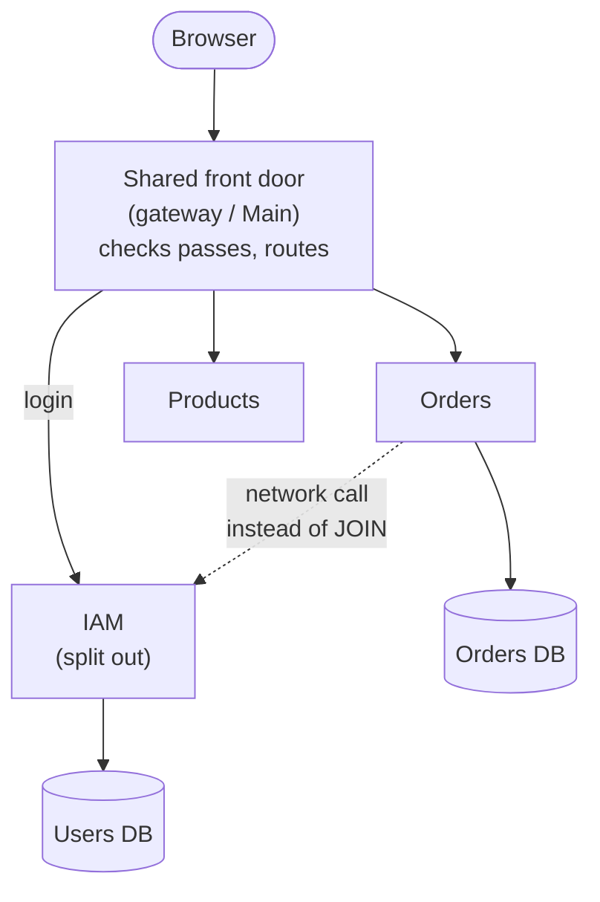

> [!tldr] Quick read
> - [[en/concepts/microservices|Microservices]] trade complexity *in the code* for complexity *on the network*: every old JOIN becomes a network call, every old transaction becomes a saga. Start with a modular monolith and split only when you have a reason.
> - An [[en/concepts/api-gateway|API Gateway]] is the shared front door in front of the services: routing, authentication, rate limiting, response aggregation. Don't let business logic leak into it.
> - [[en/concepts/api-versioning|API versioning]]: *additive* changes don't need a new version; *breaking* changes do, and the best approach is to let the core code know only the newest version while the edge translates for old clients.
> - [[en/concepts/openapi|OpenAPI]] is a machine-readable contract: generate docs, generate clients, validate requests and run contract tests from one source.

> [!info] Context
> The examples come from **flash-sale**, a time-limited discount shop I wrote myself. Today it is **one** application (I call it *Main*). The repo contains a design, not yet built, for splitting login and authorization (called **IAM**, Identity and Access Management) out into a separate application. You don't need to read the project's code. This post uses that design as a real-world example for all four concepts.

> [!abstract]- Quick glossary for this post (click to open)
> - **Monolith**: the whole system is one application, deployed in one go.
> - **Modular monolith**: still one application, but the code is split into areas with clear boundaries (orders, payments, products…).
> - **Service**: an application that runs on its own, with its own database, and talks to other services over the network.
> - **gRPC**: a compact, fast way for services to call functions on each other over the network (see [[en/posts/2026-11-18-api-styles|station 2]]).
> - **JOIN**: an SQL query that combines data from two tables, for example an order together with the buyer's name.
> - **Transaction**: a group of database operations that "either all succeed, or nothing happens".
> - **Saga**: the replacement for a transaction when the steps live in several services. If a later step fails, "undo" steps run for the earlier ones.
> - **Private key / public key**: a key pair. The private key signs, and only one place holds it. The public key verifies signatures, and anyone may hold it.
> - **Rolling deploy**: gradually replacing each running copy with the new version, so for a while old and new versions run side by side.
> - **Swagger UI**: a web page generated from an OpenAPI file that lets you read the docs and try calling the API.

## Picture it first: from a supermarket to a shopping mall

| Everyday life | Concept |
|---|---|
| One big supermarket: one storeroom, one checkout system, one manager | Monolith |
| Still one supermarket, but clearly split into sections: electronics doesn't take stock from the food shelves | Modular monolith (flash-sale today) |
| A shopping mall: each store has its own storeroom and staff and opens and closes on its own. To ask about another store's stock, you have to phone it | [[en/concepts/microservices\|Microservices]] |
| The main entrance has an information desk and security: checking tickets, pointing you to the right store | [[en/concepts/api-gateway\|API Gateway]] |
| Switching to a new kind of power socket but handing out **adapters** for old devices, so everyone can still plug in | [[en/concepts/api-versioning\|API Versioning]] |
| The printed map and directory at the entrance: which store is where, what it sells, opening hours | [[en/concepts/openapi\|OpenAPI]] |

The thing to notice most is "you have to phone it". In a supermarket, a clerk just turns to the next shelf. In a mall, every question is a phone call: there's latency, nobody may pick up, and two stores can't "ring up one shared receipt". The whole price of microservices lies in that sentence.



## The problem: the API is no longer one block

The previous five stations looked at the API from the angle of a single request. The last station looks from above: what happens when the system grows, with many teams, many clients, and one part of the system wanting to split off and run on its own?

Flash-sale is at exactly that point. It's a **modular monolith**: one NestJS application, but with modules split by business domain (`auth`, `product`, `cart`, `order`, `payment`, `flash-sale`, `search`…), communicating through services and events, with an outbox and RabbitMQ already in place. The repo contains a design (Phase 18, **not yet implemented**) for splitting identity and authorization out into a separate `iam-service`. This post uses that design as the example, because it touches all four concepts of the station.

<figure class="figure-map" style="--ar: 1 / 1">
<div class="frame"><iframe data-archify="../../diagrams/api-architecture/iam-extraction.en.html" title="Architecture diagram: the design for splitting an IAM service out of flash-sale" loading="lazy"></iframe></div>
<figcaption><span><b>Figure 1.</b> In the design, Main remains the browser's only entry point, verifies JWTs itself with a public key, and calls IAM over gRPC only for login and user lookups.</span><a href="../diagrams/api-architecture/iam-extraction.en.html" target="_blank" rel="noopener">Open full screen</a></figcaption>
</figure>

## Microservices: what you gain and lose by splitting

[[en/concepts/microservices|Microservices]] is an architecture where each service owns one business capability, **owns its own data**, is deployed independently, and talks to the others over the network. The real benefit is *organizational*: team A deploys its service without waiting for team B, each service scales with its own load, and one service going down doesn't take everything with it.

The IAM split design lists, frankly, what has to be paid:

Read the table below row by row as "before, we did this; after the split, we have to do that":

| In the monolith | After splitting out IAM |
|---|---|
| `orders JOIN users` in one SQL query | Call `GetUsersByIds` over gRPC and stitch it together yourself; "N+1 is a hard no" |
| Foreign key `order.userId → users.id` | *Soft FK*: only a UUID column is left, and the DB no longer guarantees the user exists |
| Approving a seller: change role + create shop in one transaction | `SetUserRole` over gRPC, then create the shop: **not atomic**, needs a saga in a later phase |
| Verify JWTs with a shared secret (HS256) | IAM signs with a private key, Main verifies with a public key (RS256) |

Two decisions in the design I think are well worth learning:

- **The hot path doesn't depend on IAM.** The "hot path" is the requests that run constantly, like viewing products or placing orders. Each logged-in request only needs to verify the JWT signature locally (public key) and check the blocklist in the shared Redis. If IAM dies, new logins fail, but people who are already logged in keep shopping normally. The design deliberately has *no* `ValidateToken` RPC: calling IAM on every request would make IAM a single point of failure for the whole system.
- **Strangler fig** (named after a strangler fig tree, which grows around a host tree until the host rots away and it stands in its place): don't rewrite from scratch; pull parts out of the monolith one at a time while keeping the external interface unchanged (`/auth/*` stays in Main and is just forwarded to IAM).

The example at the end of the post measures the price of a JOIN turned into network calls: for 20 orders, calling `GetUser` one by one is 20 calls, at least 100ms of network latency alone (assuming 5ms per call); a batched `GetUsersByIds` is 1 call, 5ms.

Martin Fowler has an article called *MonolithFirst*: most successful microservice systems started from a monolith that grew too big, while most systems built as microservices from the start ran into trouble, because the boundaries between services are very hard to guess correctly before you understand the business domain. Flash-sale's modular monolith is the preparation: the module boundaries are already clear, so splitting later is just a matter of turning function calls into network calls.

## API Gateway: one front door for many services

When there are many services, the client shouldn't have to know where `catalog` lives, where `order` lives, and how each one authenticates. An [[en/concepts/api-gateway|API Gateway]] is a layer that stands in front and does the shared work:

- **Routing**: `/api/v1/products/*` → catalog, `/api/v1/orders/*` → order.
- **Authentication at the edge**: check the token once and pass the identity inward (an internal header), so the services behind don't have to redo it.
- **Rate limiting, TLS, CORS, logging, tracing** in one place.
- **Response aggregation** (the *Backend for Frontend* pattern): the order details page needs both the order and the products, so the gateway calls the two services in parallel and returns one response. In the example at the end: calling them one after another takes ~100ms; the gateway calling them in parallel takes ~60ms.
- **Protocol translation**: accept REST/JSON from the browser, call gRPC inside.

Flash-sale doesn't have a dedicated gateway yet (the design schedules one for Phase 19), but those jobs are currently split between two places:

- The **NGINX Ingress** does the infrastructure part: TLS, routing by host and path, a 100 requests/second limit, a 10MB body limit, a 30-second timeout, adding security headers.
- In the design, **Main** acts as an "auth facade": it accepts `/auth/*` from the browser, keeps cookies and CSRF at the edge, and calls IAM over gRPC. The browser sees only one origin.

The biggest trap of a gateway is that it gradually accumulates business logic ("let the gateway check stock too, it's faster"), and then becomes a new monolith every team has to edit. A gateway should be "dumb": route, check, forward. It's also a single point of failure, so it must run as several instances and must be fast.

## API Versioning: changing the contract without breaking anyone

Old clients (a mobile app that hasn't been updated, a partner's script) will keep calling my API for months after I change it. [[en/concepts/api-versioning|Versioning]] is how you allow changes without breaking them.

Picture the app on your phone: you haven't updated it in six months, and it still calls the API the way it did six months ago. If the backend renames the field `total` to `amount`, your app breaks immediately, even though you did nothing wrong.

**Step one is to classify the change:**

| Non-breaking (additive) | Breaking |
|---|---|
| Add a new endpoint | Delete or rename an endpoint or field |
| Add a new field to a response | Change a field's type (`total: number` → `total: object`) |
| Add an *optional* parameter | Add a *required* parameter |
| Add a new enum value (if clients ignore unknown values) | Change a value's meaning, change a status code |

Most real-world changes belong in the left column and need no new version. This is also the thinking behind flash-sale's *expand-contract* ADR, only applied to the DB schema: during a Kubernetes rolling deploy, old and new pods run side by side for a few minutes, so every schema change must go through four steps, *add → write both → backfill → remove the old one*, and never rename a column in one step. APIs are the same: add the new field, let clients migrate gradually, and only then drop the old field.

**Step two is choosing where to put the version** when you truly have to break things:

- **In the URL**: `/api/v1/...`, `/api/v2/...`. Flash-sale has set `setGlobalPrefix('api/v1')` since day one. Easy to see, easy to route, easy to cache; but v2 often turns into a large copy of v1.
- **In a header**: `Accept: application/vnd.example.v2+json` or `Api-Version: 2026-09-01`. Clean URLs, but harder to try out in a browser.
- **By date, translated at the edge** (Stripe's approach): each account is pinned to the version date of when it started integrating. The core code only knows the newest shape; each breaking change comes with a function that "downgrades" the response, applied in reverse order for old clients. The example at the end implements exactly this idea: client `2026-01-15` gets `total` as a number and `status: COMPLETED`, while client `2026-10-01` gets the newest shape, from the same core object.

**Step three is retiring with advance notice**: the `Deprecation` header (RFC 9745) announces that an endpoint is going away, `Sunset` (RFC 8594) announces the date it shuts off for good, with a link to the migration docs. And measure who still calls the old version before shutting it off.

## OpenAPI: a contract machines can read

At [[en/posts/2026-11-18-api-foundations|station 1]], the backend sent errors in a `msg` field while the frontend read `message`. The two sides had a "verbal agreement" and understood it differently. OpenAPI is the contract **put in writing**, and both people and machines can read it.

[[en/concepts/openapi|OpenAPI]] (formerly called Swagger) is a YAML/JSON format that describes an API: endpoints, parameters, headers, request and response schemas, status codes, and authentication. Version 3.1 uses JSON Schema 2020-12 directly for schemas.

Flash-sale takes the *code-first* route: write decorators in the controller, and `@nestjs/swagger` generates the spec and a docs page at `/api/docs`:

```ts
// trimmed from checkout.controller.ts
@ApiOperation({ summary: 'Tạo orders từ giỏ hàng. Reserve inventory atomic + idempotent retry.' })
@ApiHeader({ name: 'Idempotency-Key', required: true, description: 'Gửi cùng key khi retry để tránh trùng đơn' })
@ApiResponse({ status: 201, description: '{ groupId, orders[], totalAmount }' })
@ApiResponse({ status: 409, description: 'Có sản phẩm hết hàng tại bước reserve' })
@ApiResponse({ status: 422, description: 'Cart validation fail' })
@Post()
checkout(...) {}
```

The Swagger UI page needs inline scripts, so it gets a relaxed CSP of its own. A comment in the code says this page will be open only to the internal network via an IP allowlist at the ingress, but reading the manifests I found the allowlist only on the Kibana and Grafana ingresses, not yet on the API's ingress. That's something to do before going to production: public API docs are a free map for anyone hunting for vulnerabilities.

The real value of OpenAPI isn't the docs page, but that one file serves many purposes:

- **Generate types and clients** for the frontend (`openapi-typescript`, `orval`…), so frontend and backend don't drift apart. Station 1's `msg` versus `message` bug would become a compile error if the error schema were declared and the frontend used the generated types.
- **Validate requests** against the spec at the gateway or in middleware. The example at the end validates a checkout request missing `Idempotency-Key` and with empty `items`.
- **Mock servers** so the frontend can work before the backend is done.
- **Contract tests** and **linting** (Spectral) in CI: change the spec in a breaking way and CI flags it.

One thing I noticed on rereading: flash-sale's Swagger describes *when* it returns `409` but not *what the error body looks like*. That exact gap let station 1's bug slip through. Code-first is convenient, but it's only as accurate as the decorators I bother to write in full; *design-first* (write the spec first, generate code after) forces you to think about the contract before writing code.

## Runnable example

The file `gateway.ts` has four parts: a small gateway that routes and blocks unauthenticated requests, Stripe-style date-based versioning, request validation against an OpenAPI snippet, and a measurement of N+1 versus a batched call.

```ts
const changes = [
  { version: "2026-06-01", desc: "total thành object {amount, currency}", down: (o: any) => ({ ...o, total: Number(o.total.amount) }) },
  { version: "2026-09-01", desc: "status PAID đổi tên từ COMPLETED", down: (o: any) => ({ ...o, status: o.status === "PAID" ? "COMPLETED" : o.status }) },
]
function render(clientVersion: string) {
  return changes
    .filter((c) => c.version > clientVersion) // apply, in reverse, the changes newer than the client's version
    .reverse()
    .reduce((o, c) => c.down(o), latest as any)
}
```

```text
$ node gateway.ts
===== 1. API Gateway: one front door, many services behind it =====
/api/v1/products/42  → {"status":200,"body":{"service":"catalog","path":"/42"}}
/api/v1/orders       → {"status":401,"note":"chặn ngay ở gateway, service không phải tự kiểm tra"}
/api/v2/unknown      → {"status":404}
client calls one after another: ~100ms | gateway calls in parallel and aggregates: ~60ms

===== 2. Stripe-style versioning: by date, translated at the edge =====
Api-Version: 2026-01-15 → {"id":"ord_1","total":1990000,"status":"COMPLETED"}
Api-Version: 2026-07-01 → {"id":"ord_1","total":{"amount":"1990000","currency":"VND"},"status":"COMPLETED"}
Api-Version: 2026-10-01 → {"id":"ord_1","total":{"amount":"1990000","currency":"VND"},"status":"PAID"}

===== 3. OpenAPI: a machine-readable contract =====
valid request   → []
invalid request → [ 'thiếu header Idempotency-Key', 'items cần ít nhất 1 phần tử' ]
declared status codes: 201, 400, 401, 409, 422

===== 4. Microservices: every old JOIN is now a network call =====
N+1:   20 gRPC calls, at least 100ms of network latency alone
batch: 1 gRPC call for 7 distinct users, at least 5ms
```
*(Output labels translated; the files themselves print Vietnamese.)*

The whole file: <a href="../code/api-architecture/gateway.ts">code/api-architecture/gateway.ts</a>.

## Misconceptions and common traps

### "Microservices make scaling easy"

A stateless monolith running 20 pods behind a load balancer (station 5) scales very well. Microservices solve the problem of *many teams editing one codebase* and *parts with different resource needs*, not the problem of "lots of requests".

### Distributed monolith

Split into many services, but every service calls the others synchronously, they share one database, and they must be deployed together. You get all the downsides of both architectures and none of the upsides. The telltale sign: a small feature needs changes and deploys in three services.

### Bumping the version for every change

Adding a field doesn't need `v2`. Every version is a code branch to maintain and test; Stripe keeps hundreds of "versions" but only one codebase, thanks to translating at the edge.

### A hand-written OpenAPI spec left to rot

A spec that drifts from the code is worse than no spec, because readers trust it. The spec must be *generated* from the code, or the code must be *checked* against the spec in CI.

### A gateway that does everything

Every bit of business logic added to the gateway is another reason for every team to wait on each other to deploy the gateway. Keep it to routing, authentication, limits and observability.

## Self-check questions

> [!question]- Why does the design have no `ValidateToken` RPC calling IAM?
> Calling IAM on every request makes IAM a single point of failure for the whole system and adds network latency to every request. Verifying the signature with the public key right in Main and checking the blocklist in the shared Redis is enough.

> [!question]- Does adding an `estimatedDeliveryAt` field to the order response need `/api/v2`?
> No. Adding a field is a non-breaking change, as long as clients ignore unknown fields (which the API docs should state clearly).

> [!question]- What's the difference between code-first and design-first with OpenAPI?
> Code-first generates the spec from the code (fast, always matches the code, but only complete when the decorators are complete). Design-first writes the spec first, then generates code or checks code against the spec (forces agreement on the contract first; good when many teams use it).

> [!question]- After splitting out IAM, the "order list" page needs buyers' names. What's the right way to get them?
> Collect every `userId` on the page, call `GetUsersByIds` once, then stitch them together in memory. Don't call `GetUser` for each order.

## References

- [microservices.io: API Gateway pattern](https://microservices.io/patterns/apigateway.html) and [Backends for Frontends](https://samnewman.io/patterns/architectural/bff/)
- [Martin Fowler & James Lewis: Microservices](https://martinfowler.com/articles/microservices.html), [MonolithFirst](https://martinfowler.com/bliki/MonolithFirst.html), [StranglerFigApplication](https://martinfowler.com/bliki/StranglerFigApplication.html)
- [Stripe: APIs as infrastructure: future-proofing Stripe with versioning](https://stripe.com/blog/api-versioning)
- [RFC 9745: The Deprecation HTTP Response Header Field](https://www.rfc-editor.org/rfc/rfc9745) and [RFC 8594: The Sunset HTTP Header Field](https://www.rfc-editor.org/rfc/rfc8594)
- [OpenAPI Specification 3.1.0](https://spec.openapis.org/oas/v3.1.0.html) and [NestJS: OpenAPI](https://docs.nestjs.com/openapi/introduction)
- [Stoplight Spectral](https://github.com/stoplightio/spectral)
