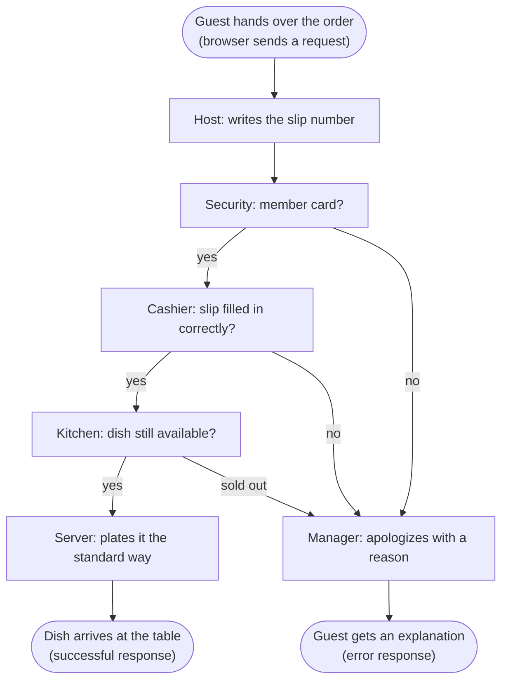
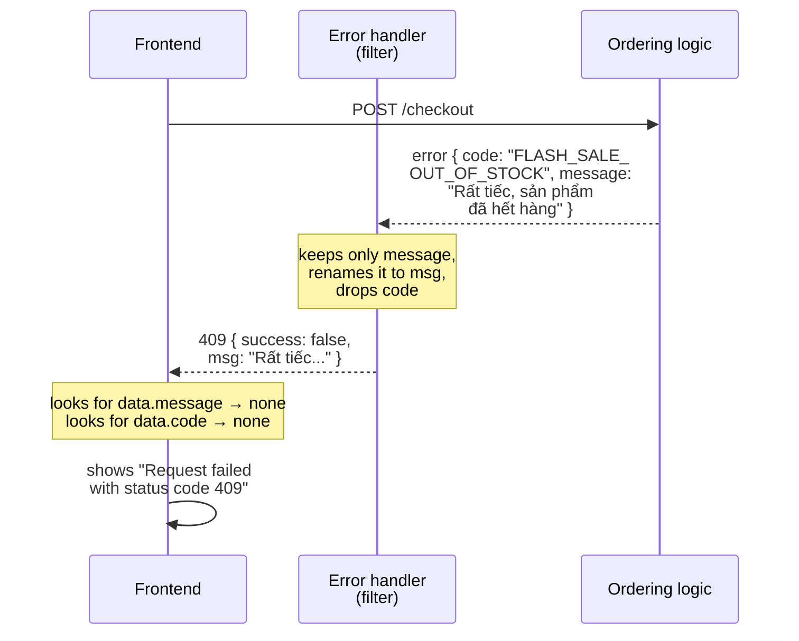

> [!tldr] Quick read
> - An [[en/concepts/endpoint|endpoint]] is a *method + path* pair: `POST /api/v1/checkout` is something entirely different from `GET /api/v1/checkout`.
> - Every request passes through a fixed chain of steps: middleware → guard → pipe → handler → interceptor, and an error anywhere falls into the exception filter ([[en/concepts/request-response|request-response]]).
> - The method states the *intent* and the guarantees that come with it (safe, idempotent), headers carry the *context*, the JSON body carries the *data*, and the status code is the *verdict* ([[en/concepts/http-methods|HTTP Methods]], [[en/concepts/headers|Headers]], [[en/concepts/json|JSON]], [[en/concepts/status-codes|Status Codes]]).
> - The easiest part to get wrong is [[en/concepts/error-handling|error handling]]: my backend dropped the error code, so users only saw "Request failed with status code 409".

> [!info] Context: what flash-sale is, and what you need to know to read this post
> The whole series takes its examples from **flash-sale**, a time-limited discount shop I wrote myself. The sale opens at exactly 21:00, each product has only a few hundred units, and thousands of people hit "Buy now" at the same time. The part that runs on the server (the *backend*) is written in **NestJS**, a Node.js framework. The part that runs in the browser (the *frontend*) calls the backend through an API.
>
> You **don't need** to know NestJS or read the project's code. Whenever the post mentions a name from the project, a plain-language explanation of what it does sits right next to it. Code excerpts from the project are only illustrations. The "Runnable example" section is plain TypeScript that runs on its own with `node`.

> [!abstract]- Quick glossary for this post (click to open)
> - **API**: a program's "service counter". Another program sends a request in the right format and gets a result back, without needing to know what happens inside.
> - **Client / server**: the side that asks / the side that answers. A browser, a phone app or `curl` are all clients.
> - **HTTP**: the common language clients and servers use to talk on the web.
> - **Framework**: a prebuilt code skeleton (NestJS, Express, Spring…). I only write the business logic; the framework takes care of receiving and returning requests.
> - **Redis / Postgres**: two kinds of database. Redis keeps data in RAM, so it is very fast and often used as a temporary store. Postgres stores data durably on disk.
> - **Pod**: one running copy of the backend. Flash-sale runs many identical pods to share the load.
> - **axios**: the library the frontend uses to send requests. When something fails, its default message is "Request failed with status code …".

## Picture it first: ordering at a restaurant

Before getting into the terminology, I find it easiest to think of an API call as **ordering at a restaurant**:

| At the restaurant | In the API | Concept |
|---|---|---|
| A dish on the menu, e.g. "dish no. 12, extra order" | An address plus an action: `POST /api/v1/checkout` | [[en/concepts/endpoint\|Endpoint]] |
| You order and wait for the server to bring it. Each order gets one delivery | Send one request, get exactly one response | [[en/concepts/request-response\|Request-Response]] |
| "Order a dish", "ask the price", "cancel a dish" are different things | `POST` creates, `GET` reads, `DELETE` deletes… | [[en/concepts/http-methods\|HTTP Methods]] |
| Notes in the corner of the order slip: table number, member card, "this is a repeat order" | `Authorization`, `Idempotency-Key`, `Content-Type`… | [[en/concepts/headers\|Headers]] |
| The contents of the order slip, written on a standard form | A body like `{"items": ["SKU-1"]}` | [[en/concepts/json\|JSON]] |
| The server says "coming right up", "sold out", "you don't have a reservation" | `201`, `409`, `401` | [[en/concepts/status-codes\|Status Codes]] |
| When a dish is sold out, they must say *which* dish, so the guest can pick another | Errors carry a clear `code` so the client knows how to react | [[en/concepts/error-handling\|Error Handling]] |

And before the kitchen cooks, the order slip passes through a few people, each checking one thing:



The rest of this post is the "technical" version of exactly this story.

## The problem: what does "calling an API" actually call?

I have been writing the flash-sale backend in NestJS for quite a while, but honestly, I wrote most pieces like guards, interceptors and filters by following templates. When I started [[en/series/api-concepts|the API Concepts line]], I decided not to learn the seven foundational concepts in isolation, but to follow **one single request**: the user clicks "Place order" in the cart.

The frontend sends this (I annotate each line right below):

```http
POST /api/v1/checkout HTTP/1.1
Host: api.example.com
Authorization: Bearer eyJhbGciOi...
Idempotency-Key: 550e8400-e29b-41d4-a716-446655440000
Content-Type: application/json

{"items": ["SKU-1"], "addressId": "addr_9"}
```

Reading each line in plain words:

- `POST /api/v1/checkout`: "I want to **create** an order" (POST) at the address `/api/v1/checkout`.
- `Host`: which server to send it to.
- `Authorization: Bearer …`: "here is the card that proves I am logged in" (station 3 explains this card).
- `Idempotency-Key`: "here is the number of this click. If I accidentally send it again, don't create a second order" (station 4).
- `Content-Type`: "the content below is written in JSON".
- An empty line, then the **body**: buy product `SKU-1`, deliver to address `addr_9`.

And it gets back:

```http
HTTP/1.1 201 Created
Content-Type: application/json
X-Correlation-ID: req-6f1c…

{"success": true, "data": {"groupId": "grp_1", "totalAmount": "1990000.00"}, "msg": "Đặt hàng thành công"}
```

In plain words: `201 Created` means "created". `X-Correlation-ID` is this request's lookup number, like a tracking number for a parcel. The body says the order belongs to group `grp_1`, with a total of 1,990,000 VND (`msg` is the Vietnamese "Order placed successfully").

Every concept of this station is in those two blocks of text. The rest of the post goes through them piece by piece.

## How it works: which stops a request passes through

This is the technical version of the "host → security → cashier → kitchen → server" chain above. Every framework has a chain of stops like this; only the names differ. NestJS calls them middleware, guard, pipe, handler, interceptor and exception filter. Express calls them all middleware. All you need to remember is **each stop does one job, and whichever stop detects an error sends it straight to the error-reporting stop**.

| Stop (NestJS name) | At the restaurant | What it does in flash-sale | Class name in code |
|---|---|---|---|
| Middleware | Host writes the slip number | Reads or generates the lookup number `X-Correlation-ID` so every log line carries it | `CorrelationIdMiddleware` |
| Guard | Security | Who is calling? Calling too often? Allowed to place orders? | `JwtAuthGuard`, `RateLimitGuard`, `PoliciesGuard` |
| Pipe | Cashier checks the slip | Blocks a body with wrong types or unknown fields | `ValidationPipe` |
| Handler | Kitchen | Does the main work: checks `Idempotency-Key`, calls the ordering logic | `CheckoutController.checkout` |
| Interceptor | Server plates the dish | Wraps the result in a shared "envelope" `{ success, data, msg }` | `TransformInterceptor` |
| Exception filter | Manager handling incidents | Turns every error into an error response | `HttpExceptionFilter` |

The last column is only for anyone who wants to cross-check the code. You don't need to remember it to read the post.

<figure class="figure-map" style="--ar: 1 / 1">
<div class="frame"><iframe data-archify="../../diagrams/api-foundations/request-lifecycle.en.html" title="Sequence diagram: the lifecycle of a POST /checkout request in NestJS" loading="lazy"></iframe></div>
<figcaption><span><b>Figure 1.</b> A checkout request passes the host, security, body validation, processing and then result packaging; when stock runs out, the error branches off to the error-reporting stop. The small text in each box is the matching NestJS class name.</span><a href="../diagrams/api-foundations/request-lifecycle.en.html" target="_blank" rel="noopener">Open full screen</a></figcaption>
</figure>

What I only just realized: this order decides both *security* and *performance*. The guard runs before the pipe, just as security stands before the cashier. A request without a token gets `401` right at the door, and the server spends no effort reading and validating the body. Rate limiting (limiting how often someone can call) also lives in a guard, so spam requests are blocked before they touch the database.

## Endpoint: an address plus a verb

An [[en/concepts/endpoint|endpoint]] is a specific entry point of an API. In flash-sale, the full path is assembled from three places:

```ts
app.setGlobalPrefix('api/v1')          // main.ts
@Controller('checkout')                 // checkout.controller.ts
export class CheckoutController {
  @Post()                               // → POST /api/v1/checkout
  checkout(...) {}

  @Post('preview-discount')             // → POST /api/v1/checkout/preview-discount
  previewDiscount(...) {}
}
```

A few conventions I think are worth keeping:

- **The path is a noun, the method is the verb.** `POST /orders` instead of `POST /createOrder`. Flash-sale has a few action-style endpoints such as `POST /flash-sale/campaigns/:id/queue/join`; for operations that aren't CRUD, a sub-resource noun (`/queue/join`, `/orders/:id/cancel`) is what many large APIs choose.
- **A version prefix** `/api/v1` from day one, to leave a way back later (see station 6).
- **Path params for identity, query params for filters**: `/campaigns/:id/queue/position` versus `/products?categoryId=...&limit=20`.

## Request-Response: one question, one answer, no memory

HTTP is a [[en/concepts/request-response|request-response]] protocol: the client speaks first, the server returns exactly one response per request, and that's the end of it. The server **does not remember** earlier requests (stateless). So every request must carry its own context: who is calling (token), which attempt this is (idempotency key), which flow it belongs to (correlation id).

A request has four parts: method, target (path + query), headers, and an optional body. A response has a status code, headers, and an optional body. That's all. Every framework, from Express to NestJS, is just a way of organizing code around these four parts.

A practical consequence of statelessness: flash-sale runs many pods behind a load balancer, and the next request may land on a different pod than the previous one. Anything that needs to be "remembered" between requests (login sessions, carts, queues) lives in Redis or Postgres, not in the process's memory.

## HTTP Methods: verbs with guarantees

A [[en/concepts/http-methods|method]] is not just a label. RFC 9110 gives each method two properties that clients, proxies and browsers all rely on:

| Method | Used for | Safe (doesn't change state) | Idempotent (N calls = 1 call) |
|---|---|---|---|
| `GET` | Read a resource | ✓ | ✓ |
| `HEAD` | Like GET, but only fetches headers | ✓ | ✓ |
| `POST` | Create, or an action that fits no other method | ✗ | ✗ |
| `PUT` | Replace the whole resource | ✗ | ✓ |
| `PATCH` | Partial update | ✗ | not guaranteed |
| `DELETE` | Delete | ✗ | ✓ |
| `OPTIONS` | Ask what the server supports (CORS preflight) | ✓ | ✓ |

Two places in flash-sale show these guarantees doing real work:

- `CsrfGuard` skips `GET`, `HEAD` and `OPTIONS` because they are *safe*: if nothing changes state, there's nothing to forge.
- `POST /checkout` is **not idempotent**: a flaky network that makes the client resend could create two orders. So this endpoint requires the `Idempotency-Key` header and returns `400` if it's missing. The full mechanism is at station 4 ([[en/concepts/idempotency|Idempotency]]).

There's one more interesting case: `POST /checkout/preview-discount` only *calculates* a discount and writes nothing to the DB, so strictly speaking it's a read. It still uses `POST` because it needs to send a list of discount codes in the body. RFC 9110 says plainly that a body on `GET` has no defined semantics, and many proxies drop it. This is a common pragmatic choice; the price is that the response isn't cached automatically like a `GET`. (HTTP is standardizing a `QUERY` method for exactly this case: a safe read that has a body.)

## Headers: the context that travels with a request

A [[en/concepts/headers|header]] is `Name: value` metadata, and names are case-insensitive. A single flash-sale checkout request already contains every group:

- **Format**: `Content-Type: application/json` says what the body is; `Accept` says what the client wants back.
- **Authentication**: `Authorization: Bearer <access token>`. `JwtAuthGuard` splits the string on whitespace and only accepts the `Bearer` scheme.
- **Business semantics**: `Idempotency-Key` (named after Stripe's convention, now being standardized by the IETF).
- **Tracing**: `X-Correlation-ID`. The middleware reads the value sent by the upstream; if there is none, it generates `req-<uuid>`, then **writes it back into the response**. When a user reports a bug, this one number is enough to find every log line of that request.
- **Security** (sent by the server): Helmet adds `Strict-Transport-Security`, `Content-Security-Policy: default-src 'none'`, `X-Frame-Options: DENY`… The API only returns JSON, so the CSP is as strict as it gets.
- **Rate limiting**: `X-RateLimit-Limit`, `X-RateLimit-Remaining`, `Retry-After` (station 4).

A small but important point: the `X-` prefix for custom headers has been deprecated since RFC 6648 (2012), but `X-Correlation-ID` and `X-RateLimit-*` are too widespread to change. New headers should be named without `X-`.

## JSON: a shared format, but with only one number type

[[en/concepts/json|JSON]] beat XML because it is compact and maps straight onto JavaScript objects. But it has only six types: string, number, boolean, null, object, array. There is no date type, no decimal type, and in practice numbers are parsed as 64-bit floats.

Flash-sale computes money with `Prisma.Decimal`, and the `preview-discount` controller has a very apt comment:

```ts
// Serialize Decimal → string for HTTP transport (JSON has no Decimal type)
totalDiscount: result.totalDiscount.toString(),
finalAmount: result.finalAmount.toString(),
```

The example at the end of the post shows why: `0.1 + 0.2` gives `0.30000000000000004`, and a large id like `9007199254740993` is read by JSON.parse as `…992`. The rule I took away: **money and large ids travel as strings**; dates travel as ISO 8601 strings (`2026-11-18T08:00:00Z`).

Flash-sale also wraps every successful response in a shared "envelope":

```json
{ "success": true, "data": { ... }, "msg": "Đặt hàng thành công" }
```

The envelope is convenient for the frontend (always read `data`), but it repeats what the status code already says (`success` is just `status < 400`). The payment gateway webhooks, though, must turn the envelope off with `@SkipResponseTransform()`, because VNPay and MoMo require responses in their own format.

## Status Codes: the verdict on the first line

The [[en/concepts/status-codes|status code]] is the first thing a client reads, before the body. Five classes: `1xx` informational, `2xx` success, `3xx` redirection, `4xx` client error, `5xx` server error. The Swagger docs for the checkout endpoint declare exactly the codes I think an ordering API needs:

| Code | When, in flash-sale | What the client should do |
|---|---|---|
| `201 Created` | Order created | Go to the payment page |
| `400 Bad Request` | Missing `Idempotency-Key`, invalid body | Fix the request, **don't** retry it unchanged |
| `401 Unauthorized` | Missing or invalid token | Refresh the token and try again |
| `403 Forbidden` | Has a token but lacks the `order:create` permission | Report that they lack permission |
| `409 Conflict` | Out of stock at the stock reservation step | Report out of stock, update the cart |
| `422 Unprocessable Content` | The SKU or shop is no longer selling | Report the product is no longer valid |
| `429 Too Many Requests` | Token bucket exceeded | Wait exactly `Retry-After` seconds |
| `500` / `503` | Server error, a dependency is down | May retry with backoff |

Two pairs people often confuse: `401` is "I don't know who you are", `403` is "I know who you are, but you're not allowed to do this". And `400` is a *malformed* request, while `422` is a well-formed request that *fails business rules*. Telling them apart lets the client know whether to retry: `4xx` should almost never be retried unchanged (except `408` and `429`), `5xx` may be.

## Error Handling: where I found a real bug

This is the part I learned the most from, because it exposed a bug in my own project.

The business exceptions in flash-sale are written carefully; each has its own `code` so the frontend can translate it into a friendly message:

```ts
export class FlashSaleOutOfStockException extends ConflictException {
  constructor() {
    super({ code: 'FLASH_SALE_OUT_OF_STOCK', message: 'Rất tiếc, sản phẩm đã hết hàng' })
  }
}
```

But `HttpExceptionFilter`, the "manager" every error must pass through before leaving, only takes the `message`:

```ts
// trimmed from http-exception.filter.ts
const body = exception.getResponse()
message = Array.isArray(body.message) ? body.message[0] : body.message
response.status(status).json(ResponseDto.error(null, message))
// → { success: false, data: null, msg: "Rất tiếc, sản phẩm đã hết hàng" }
```

That means `code` (and fields like `maxUserPerSku` and `currentStatus`) **get dropped**, and a validation error with several lines keeps only the first. Meanwhile, the frontend looks for `message` and `code`:

```ts
// trimmed from the voucher management page in the frontend
const data = err.response?.data
if (typeof data?.message === 'string') return data.message
if (data?.code) return data.code
return err.message // "Request failed with status code 409"
```

The backend sends `msg`, the frontend reads `message`. They don't match. Drawing it out shows exactly where the information falls off:



It's like a restaurant where the kitchen says "dish no. 12 is sold out", the manager goes to the table and only says "there's a problem", and the guest, who is listening for the word "dish", understands nothing. I rebuilt exactly this situation in the example below, and the result was what I predicted: every error shows up as axios's default message.

The lesson isn't about naming it `msg` or `message`; it's that **errors are part of the API contract** and need a fixed format, just like successful responses. RFC 9457 (Problem Details) already standardized that format:

```json
{
  "type": "https://example.com/problems/OUT_OF_STOCK",
  "title": "Rất tiếc, sản phẩm đã hết hàng",
  "status": 409,
  "code": "OUT_OF_STOCK",
  "correlationId": "req-demo-7"
}
```

with `Content-Type: application/problem+json`. `type`, `title`, `status`, `detail` and `instance` are the standard fields; if you want to add `code`, `errors` or `correlationId`, go ahead (the spec allows extension members). The frontend translates by `code`, and `title` is the fallback message.

Three more principles I think flash-sale already gets right:

- **Catch everything** (an empty `@Catch()`), so a stack trace never leaks out.
- **Log 500 errors in full** (with the correlation id), but return only "Internal server error" to the client.
- **Fail fast**: a missing `Idempotency-Key` returns `400` right in the controller, before touching the service.

## Runnable example

The file `pipeline.ts` rebuilds the pipeline with plain `node:http`: a correlation id middleware, a guard, validation, a handler, an interceptor, and two versions of the filter (flash-sale style and RFC 9457 style). The client calls it with `fetch` and then runs exactly the frontend's error-display logic.

```ts
// Filter like flash-sale's: keeps only message (the first element), drops code
function envelopeFilter(err: unknown) {
  const status = err instanceof HttpError ? err.status : 500
  const m = err instanceof HttpError ? err.body.message : "Internal server error"
  return { status, type: "application/json", body: { success: false, data: null, msg: Array.isArray(m) ? m[0] : m } }
}

// Frontend after the fix: translates by code, independent of the backend's wording
function getProblemMessage(data: any): string {
  return MESSAGES[data?.code] ?? data?.title ?? "Có lỗi xảy ra"
}
```

```text
$ node pipeline.ts
========== Flash-sale style filter ==========

# Success
201 Created | application/json | X-Correlation-ID: req-demo-1
{"success":true,"data":{"orderId":"ord_1","total":"1990000.00"},"msg":"Đặt hàng thành công"}

# Missing token
401 Unauthorized | application/json | X-Correlation-ID: req-demo-2
{"success":false,"data":null,"msg":"Token không tồn tại"}
→ user sees: "Request failed with status code 401"

# Invalid body
400 Bad Request | application/json | X-Correlation-ID: req-demo-3
{"success":false,"data":null,"msg":"items không được rỗng"}
→ user sees: "Request failed with status code 400"

# Out of stock
409 Conflict | application/json | X-Correlation-ID: req-demo-4
{"success":false,"data":null,"msg":"Rất tiếc, sản phẩm đã hết hàng"}
→ user sees: "Request failed with status code 409"

========== RFC 9457 filter ==========

# Missing token
401 Unauthorized | application/problem+json | X-Correlation-ID: req-demo-5
{"type":"https://example.com/problems/UNAUTHENTICATED","title":"Token không tồn tại","status":401,"code":"UNAUTHENTICATED","correlationId":"req-demo-5"}
→ user sees: "Bạn cần đăng nhập lại"

# Invalid body
400 Bad Request | application/problem+json | X-Correlation-ID: req-demo-6
{"type":"https://example.com/problems/error","title":"Validation failed","status":400,"code":"VALIDATION_FAILED","errors":["items không được rỗng","property coupon should not exist"],"correlationId":"req-demo-6"}
→ user sees: "Validation failed"

# Out of stock
409 Conflict | application/problem+json | X-Correlation-ID: req-demo-7
{"type":"https://example.com/problems/OUT_OF_STOCK","title":"Rất tiếc, sản phẩm đã hết hàng","status":409,"code":"OUT_OF_STOCK","correlationId":"req-demo-7"}
→ user sees: "Sản phẩm vừa hết hàng, bạn chọn sản phẩm khác nhé"

========== JSON and money ==========
0.1 + 0.2 = 0.30000000000000004
JSON.parse('{"id": 9007199254740993}').id = 9007199254740992
JSON.parse('{"total": "1990000.00"}').total = 1990000.00
```
*(Output labels translated; the files themselves print Vietnamese.)*

Look at the "Invalid body" case: the old-style filter keeps only the first error, and the second one (`coupon` is an unknown field) disappears. The whole file: <a href="../code/api-foundations/pipeline.ts">code/api-foundations/pipeline.ts</a>, run it with `node pipeline.ts` (Node 22.6 or later).

## Misconceptions and common traps

### "For errors, just return 200 with `success: false`"

Many APIs do this to make things "easier" for the frontend. The price: proxies, CDNs, monitoring tools and retry libraries all look at the status code and don't read the body. Return `200` for errors and the dashboard reports 100% success while users can't place orders.

### Frontend and backend agree on the error format "verbally"

That's exactly flash-sale's bug above. The error format must be in the contract (OpenAPI at station 6) and have tests, just like successful responses.

### `GET` with a body

Some clients let you send one, but proxies and caches may drop the body or reject the request. If you need to send complex conditions, use `POST` (like `preview-discount`) and accept losing automatic caching.

### Sending money as a number

`1990000` is fine, but `19.99 * 3` isn't. On the JSON wire, money should be a string (or an integer in the smallest unit, like Stripe's cents).

### Logging only the message, forgetting the correlation id

With 50 pods and thousands of requests per second, "an error at 10:05" is meaningless. Returning `X-Correlation-ID` to the client and writing it into every log line is the only way to find the exact request that failed.

## Self-check questions

> [!question]- A request with no token reaches `POST /checkout`: does `ValidationPipe` run?
> No. The guard runs before the pipe; `JwtAuthGuard` throws `UnauthorizedException` and the flow jumps straight to the exception filter.

> [!question]- Why does `POST /checkout` need an `Idempotency-Key` while `PUT /addresses/9` doesn't?
> `POST` isn't idempotent: resending may create a second order. `PUT` replaces the whole resource, so resending the same content gives the same result.

> [!question]- A user with a valid token but the `BUYER` role calls an admin API. `401` or `403`?
> `403 Forbidden`: the server knows who the caller is, but they don't have permission.

> [!question]- Why does flash-sale send `totalAmount` as `"1990000.00"` instead of `1990000`?
> JSON has only one number type (64-bit float), which easily introduces errors for money with decimals. A string keeps full precision, and the client parses it with a decimal library.

> [!question]- How do you fix "users only see Request failed with status code 409"?
> Agree on one error format (for example RFC 9457) with a stable `code`; the filter keeps the `code` and the whole list of errors; the frontend translates by `code` and uses `title` as the fallback.

## References

- [RFC 9110: HTTP Semantics](https://www.rfc-editor.org/rfc/rfc9110): methods, safe and idempotent properties, the meaning of status codes.
- [RFC 9457: Problem Details for HTTP APIs](https://www.rfc-editor.org/rfc/rfc9457)
- [RFC 8259: JSON](https://www.rfc-editor.org/rfc/rfc8259#section-6): notes on number precision.
- [RFC 6648: Deprecating the "X-" Prefix](https://www.rfc-editor.org/rfc/rfc6648)
- [NestJS: Request lifecycle](https://docs.nestjs.com/faq/request-lifecycle) and [Exception filters](https://docs.nestjs.com/exception-filters)
- [MDN: HTTP request methods](https://developer.mozilla.org/en-US/docs/Web/HTTP/Reference/Methods) and [HTTP response status codes](https://developer.mozilla.org/en-US/docs/Web/HTTP/Reference/Status)
- [IETF draft: The HTTP QUERY Method](https://datatracker.ietf.org/doc/draft-ietf-httpbis-safe-method-w-body/)
