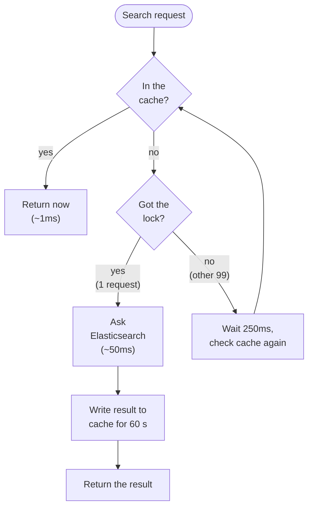
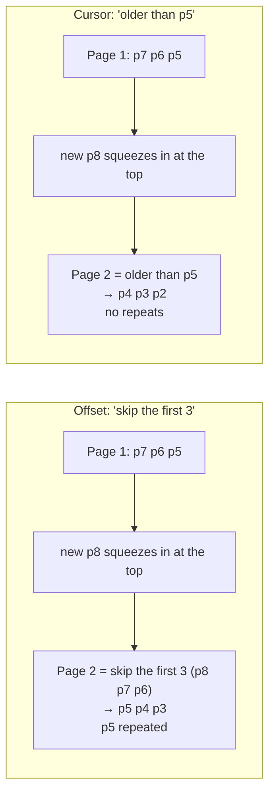
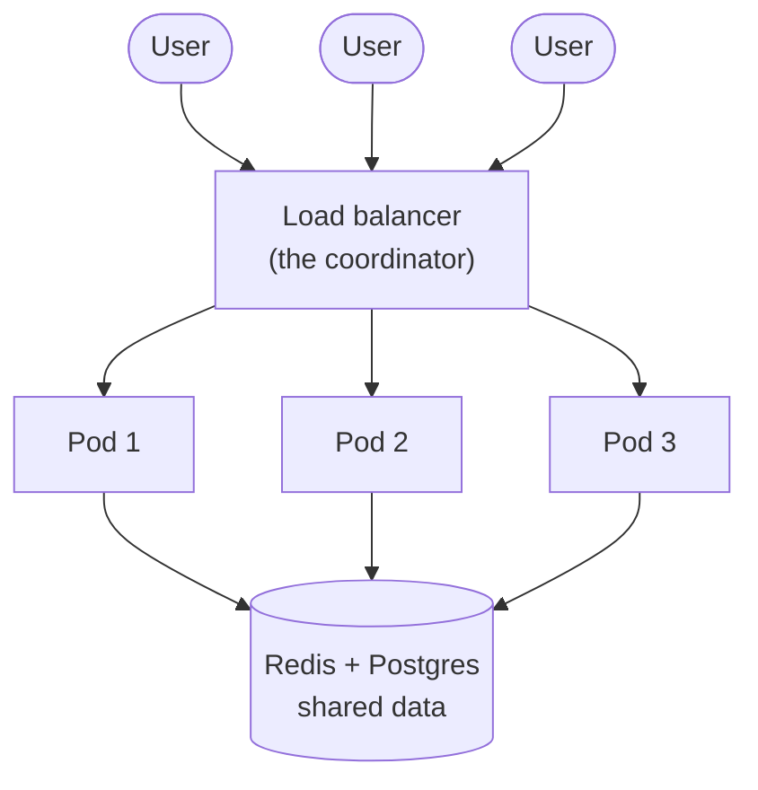

> [!tldr] Quick read
> - The fastest [[en/concepts/caching|cache]] is a request that never reaches the server; the hardest part of caching is knowing when to throw it away. When the cache is empty, 100 concurrent requests can become 100 DB queries (a *stampede*); a short-lived lock turns that into 1.
> - `OFFSET` [[en/concepts/pagination|pagination]] gets slower and repeats or skips records when the data changes; **cursor** (keyset) pagination is stable and uniformly fast.
> - [[en/concepts/filtering-sorting|Filtering and sorting]]: the query string is always a *string*, and `Boolean("false")` is `true`; sorting must follow a whitelist and always include a tiebreaker field so the order is deterministic.
> - [[en/concepts/load-balancing|Load balancing]] spreads requests across many pods; it only works when pods are *stateless*, and the balancing algorithm matters when requests vary in weight.

> [!info] Context
> The examples come from **flash-sale**, a time-limited discount shop I wrote myself. The product search page reads from **Elasticsearch** (a dedicated search engine), and results are cached in **Redis**. The backend runs as many identical copies on **Kubernetes**. You don't need to know these tools. Every section explains things in plain words before getting into code.

> [!abstract]- Quick glossary for this post (click to open)
> - **Redis**: an in-memory database with very fast reads and writes, often used as a cache.
> - **Elasticsearch (ES)**: software specialized in text search, like "bluetooth headphones under 500k".
> - **Postgres**: the main database, storing data durably on disk.
> - **TTL**: the lifetime of a cache entry; when it runs out, the entry is deleted automatically.
> - **CDN**: a network of servers placed near users that keeps ready copies of images and static pages.
> - **Pod / Kubernetes**: a pod is one running copy of the backend. Kubernetes is the system that starts, stops and watches pods.
> - **Ingress**: the entrance to a Kubernetes cluster; it receives requests from the Internet and spreads them across pods.
> - **Index (database)**: a table of contents that helps the database find things fast, without reading every row.
> - **DTO**: a class describing the data an endpoint accepts, along with validation rules.
> - **Query string**: the part after `?` in a URL, for example `?page=2&sort=price_asc`.

## Picture it first: a supermarket at rush hour

| Everyday life | Concept |
|---|---|
| A counter clerk tapes a note with "today's gold price" to the desk instead of phoning the bank every time a customer asks. At the end of the day, they take it down and write a new one | [[en/concepts/caching\|Caching]] (the note is the cache, "end of the day" is the TTL) |
| Reading a book by "continue from page 41", but someone just inserted 5 new pages at the front | [[en/concepts/pagination\|Offset pagination]]: page 41 now has different content, and you reread or skip something |
| Putting a **bookmark** at the exact line you stopped at | [[en/concepts/pagination\|Cursor pagination]]: however many pages get inserted at the front, you don't lose your place |
| Asking the warehouse clerk "get me headphones, cheapest first", choosing from a set list | [[en/concepts/filtering-sorting\|Filtering and sorting]] |
| Many checkout counters. A coordinator points each customer to the least busy one | [[en/concepts/load-balancing\|Load balancing]] |

The note example also reveals a risk: the note has just been taken down, and 100 customers ask for the price at once. If all 100 phone the bank, the bank gets jammed. The smarter way is to send **one** person to ask while the other 99 wait to hear the answer. That's exactly the "anti-stampede lock" below:



## The problem: hundreds of times more reads than writes

During a flash sale, product *views* and *searches* outnumber *orders* by hundreds of times. The previous three stations were about doing things right (the right contract, the right person, exactly once). This station is about doing things **fast** when it's crowded, and almost every technique targets the read path.

<figure class="figure-map" style="--ar: 1 / 1">
<div class="frame"><iframe data-archify="../../diagrams/api-performance/search-read-path.en.html" title="Sequence diagram: the read path of the search API through the load balancer, the Redis cache and Elasticsearch" loading="lazy"></iframe></div>
<figcaption><span><b>Figure 1.</b> A search request goes through the ingress to any pod; the first time the cache is empty, so it must grab the lock and ask Elasticsearch, and later requests read straight from Redis.</span><a href="../diagrams/api-performance/search-read-path.en.html" target="_blank" rel="noopener">Open full screen</a></figcaption>
</figure>

## Caching: remembering the answer

A [[en/concepts/caching|cache]] trades data *freshness* for *speed*. There are many layers, and the closer to the user, the cheaper:

| Layer | Example | Who controls it |
|---|---|---|
| Browser | Product images, `GET` responses with `Cache-Control` | HTTP headers sent by the server |
| CDN, reverse proxy | Images, static pages, public APIs | HTTP headers, CDN configuration |
| Application | Redis: search results, role permissions | My code |
| Database | Postgres's buffer pool | The DB handles it |

**HTTP caching** (RFC 9111) runs on headers: `Cache-Control: max-age=60` allows reuse for 60 seconds; `ETag` + `If-None-Match` lets the server return `304 Not Modified` without a body when the data hasn't changed. Flash-sale currently doesn't set these headers on its API: user-specific data (cart, orders) shouldn't be cached in a shared layer, and public data is currently cached in Redis. This is something I've noted to do later: the public product listing page could perfectly well have `Cache-Control: public, max-age=30` and let a CDN take part of the load.

**Application caching** is something flash-sale uses heavily, following the *cache-aside* pattern: read the cache first; on a miss, read the source and write it into the cache.

```ts
// trimmed from search-cache.service.ts: getOrFetch(key, ttl = 60s, fetcher)
const cached = await redis.get(key)
if (cached) return JSON.parse(cached)                              // 1. cache hit

const token = randomUUID()
const acquired = await redis.set(`lock:${key}`, token, 'EX', 5, 'NX') === 'OK'  // 2. grab the lock
if (!acquired) {
  for (let i = 0; i < 3; i++) {                                    // 3. didn't get it: wait for the other one
    await sleep(250)
    const polled = await redis.get(key)
    if (polled) return JSON.parse(polled)
  }
}
try {
  const value = await fetcher()                                    // 4. ask Elasticsearch
  await redis.set(key, JSON.stringify(value), 'EX', ttl)
  return value
} finally {
  if (acquired) await redis.eval(RELEASE_IF_TOKEN_MATCHES, 1, `lock:${key}`, token)
}
```

Steps 2 and 3 prevent a **cache stampede** (the "crush" at the gold-price note): a "hot" keyword has just expired, and hundreds of requests all see an empty cache and all hammer Elasticsearch. With the lock, only one request goes to ask, and the rest wait at most 750ms, then read the result from the cache. In the example at the end of the post: 100 concurrent requests on an empty cache make 100 queries without the lock, and 1 with it.

Two subtle details:

- **The lock has a token**: only whoever grabbed the lock may delete it, and the token check runs in a Lua script so it's atomic. Without a token, request A runs longer than 5 seconds, the lock expires, B grabs the lock, then A finishes and deletes B's lock.
- **The cache key is normalized**: the search parameters are sorted by name and then hashed with SHA-256. `?q=tai+nghe&sort=sold` and `?sort=sold&q=tai+nghe` share one cache entry.

There's one more pattern, **active invalidation**: each role's permissions are cached in Redis for an hour, but when an admin edits permissions, `invalidateCache(role)` deletes them immediately, including the caches of parent roles in the inheritance tree. The TTL is the safety net; active deletion is the main mechanism.

## Pagination: splitting up the list

No API should return "all products". [[en/concepts/pagination|Pagination]] has two schools:

Look at the picture before reading the text. The list is newest first, 3 products per page, and while you're looking at page 1, a new product `p8` is posted:



**Offset**: `?page=3&limit=20` → `OFFSET 40 LIMIT 20`. Easy to build, and it lets you jump to any page. But it has two problems:

- **It gets slower**: `OFFSET 100000` forces the DB to read and discard 100,000 rows.
- **It repeats or skips when the data changes**: in the example at the end, while you're viewing page 1 (p7, p6, p5) a new product appears; page 2 with offset 3 returns p5 again.

**Cursor (keyset)**: "give me 20 records *after this record*". Flash-sale uses this for the product list:

```ts
// trimmed from product.repository.ts: ordering (createdAt DESC, id DESC)
where: cursor ? {
  OR: [
    { createdAt: { lt: cursor.createdAt } },
    { createdAt: cursor.createdAt, id: { lt: cursor.id } },   // same createdAt: compare id
  ],
} : {},
orderBy: [{ createdAt: 'desc' }, { id: 'desc' }],
take: limit + 1,                                              // fetch 1 extra to know if there's a next page
```

- The cursor is the `{ id, createdAt }` of the last record, base64url-encoded so the client treats it as an opaque string and doesn't make one up.
- **The `id` tiebreaker** is mandatory: many products created in the same millisecond would be skipped if you compared only `createdAt`.
- Fetch `limit + 1` records: if record number `limit + 1` exists, `hasMore = true`, with no need for an expensive `COUNT(*)`.
- `limit` defaults to 20, maxes out at 100; a broken cursor returns `400`.

Search on Elasticsearch uses the same idea with `search_after`: the cursor is the array of sort values of the last hit, and every sort ends with `productId` as the tiebreaker.

The price of cursors: you can't jump to "page 37", and a cursor is tied to *one* specific sort order. For an infinitely scrolling list like an e-commerce marketplace, that's a price worth paying.

## Filtering and Sorting: one real bug, and one time I misread

[[en/concepts/filtering-sorting|Filtering and sorting]] sounds simple: add a few query params. Rereading the code, I found a real bug of the "reports no error, just returns wrong results" kind, and nearly published another bug that didn't exist.

### The real bug: `Boolean("false")` is `true`

In words: in a URL, everything is **text**. `?isFlashSale=false` reaches the server as the five-character string `"false"`, not a true/false value. If you want a true/false value, you have to convert it yourself. The quickest way to convert in JavaScript is `Boolean(x)`, and it returns `true` for every non-empty string, including the string `"false"` itself.

The search DTO (the class describing the parameters the endpoint accepts) declares:

```ts
@IsOptional()
@Type(() => Boolean)     // class-transformer calls Boolean(value)
@IsBoolean()
isFlashSale?: boolean;
```

The query string is always a string. `?isFlashSale=false` → `Boolean("false")` → `true` (every non-empty string is `true`). The result: a user who wants to *exclude* flash-sale products gets back *only* flash-sale products, and `@IsBoolean()` happily lets it through because the value is already a boolean. The web UI currently sends only `isFlashSale=true` or nothing, so users haven't hit it yet, but any other client (a mobile app, a partner, me testing with Postman) that sends `false` gets the opposite result. The fix is an explicit conversion:

```ts
// common/decorators/to-boolean.decorator.ts (trimmed)
export const ToBoolean = () =>
  Transform(({ value }) => {
    if (value === 'true' || value === '1' || value === true) return true
    if (value === 'false' || value === '0' || value === false) return false
    return value // leave odd values for @IsBoolean() to reject with 400
  })
```

I've fixed this bug in flash-sale (applied to all four boolean fields across three DTOs), with tests for `true`, `1`, `false`, `0` and odd values.

### Correction: the "ignored parameters" bug isn't real

The first draft of this post said the product list API accepts `sort`, `shopId`, `isFlashSale`, `minPrice` and `maxPrice` but ignores all of them except `categoryId`. When I set out to fix it, I realized I had read the wrong function: `ProductService.findAllCursor` really does use only `categoryId`, but it's old code that only tests still call. The real controller reads from `ProductViewRepository`, a read-model table that already denormalizes `minPrice`, `isFlashSale` and `avgRating`, and it applies every filter and all four sort orders, each with its own index.

The lesson is still worth keeping, just in a different direction: **dead code that still has tests is a trap for readers**, including the author a few months later. To know what an endpoint does, walk down from the controller; don't search by function name.

### What to do, according to the docs and the parts flash-sale gets right

- **Whitelist sort fields**: search uses the enum `relevance | sold | price_asc | price_desc | newest | rating`, and each value maps to a fixed sort array. Never splice a column name from the query directly into a query.
- **Always include a tiebreaker** so the order is deterministic: `[{ minPrice: 'asc' }, { productId: 'asc' }]`.
- **Limit inputs**: `q` is at most 100 characters and must match a regex that allows only letters, digits and a few punctuation marks; `minPrice ≥ 0`.
- **Denormalize what you filter on**: the listing reads from a `product_view` table that already has `min_price`, `is_flash_sale` and `avg_rating`, with an index for each sort order; search filters categories by a `categoryPath` array stored in the document instead of JOINing the category tree at query time.
- **Index exactly the filters people use**: filtering on an unindexed column makes everything else pointless.

## Load Balancing: many pods, one address

One Node.js pod can only handle so much. Just as a crowded supermarket opens more checkout counters, it needs someone at the head of the line pointing customers to a counter:



The key is the box at the bottom: the counters don't keep their own books; they all write into one shared ledger. That's why a returning customer gets the same service at any counter. [[en/concepts/load-balancing|Load balancing]] lets you run many replicas and spread requests across them. In flash-sale on Kubernetes there are two layers:

- **NGINX Ingress** (layer 7, understands HTTP): terminates TLS, spreads requests round robin (the ingress-nginx default), rate limits at the edge.
- **ClusterIP Service** (layer 4, only sees TCP connections): kube-proxy picks a healthy pod from the endpoint list.

And a few things make load balancing work smoothly:

- **Stateless pods**: login sessions, queues, cache and rate limits all live in Redis, so any request can land on any pod. WebSocket uses the Redis adapter so pod A can broadcast to a client connected to pod B (station 2).
- **A readiness probe**, `GET /health/ready` every 5 seconds: a pod that isn't ready yet or is shutting down is pulled out of the list of pods receiving requests.
- **`preStop: sleep 15`**: before the pod gets the shutdown signal, wait 15 seconds so every load balancer has time to update its list, avoiding requests sent to a pod that's already closed.
- **HPA** from 3 to 20 pods, adding pods when average CPU passes 70%; scaling down slowly (waiting 5 minutes for stability) so it doesn't oscillate.

### Does the balancing algorithm matter?

When every request takes the same time, round robin is enough. When they don't, it can be very bad. The example at the end of the post simulates 30 requests where every third one is a heavy 300ms request (a report export) and the rest take 20ms, spread across 3 pods:

- **Round robin**: the heavy request always lands on the same pod (because the cycle of 3 matches the number of pods). That pod carries up to 10 concurrent requests, the other two only 1.
- **Least connections**: sends to the pod with the fewest requests in flight. All three pods carry at most 4.

Other algorithms: *weighted* (stronger pods get more), *IP hash / consistent hashing* (the same user always goes to the same pod, useful for local caches or sticky sessions), *EWMA* (based on recent latency, supported by ingress-nginx).

## Runnable example

The file `perf.ts` contains four experiments: offset vs cursor, cache stampede with and without the lock, query string type coercion, and round robin vs least connections.

```ts
// Keyset like flash-sale's: WHERE (createdAt < c.createdAt) OR (createdAt = c.createdAt AND id < c.id)
const cursorPage = (c: P | null, limit: number) =>
  newestFirst().filter((p) => !c || p.createdAt < c.createdAt || (p.createdAt === c.createdAt && p.id < c.id)).slice(0, limit)
```

```text
$ node perf.ts
===== 1. Offset vs cursor when a new product squeezes in =====
offset: page 1 p7,p6,p5 | page 2 p5,p4,p3 ← p5 repeated
cursor: page 1 p7,p6,p5 | page 2 p4,p3,p2 ← no repeats

===== 2. Cache-aside and cache stampede =====
100 concurrent requests on an empty cache, no lock → 100 queries to the DB
100 concurrent requests on an empty cache, with lock → 1 query to the DB

===== 3. Filtering: the query string is always a string =====
?isFlashSale=false → Boolean("false") = true, compare === "true" = false
?minPrice=100000 → typeof = string, Number() = 100000
sort=price_asc in whitelist? true | sort=password? false

===== 4. Load balancing: round robin vs least connections =====
round robin       → peak concurrent requests per pod: 10 / 1 / 1
least connections → peak concurrent requests per pod: 4 / 4 / 4
```
*(Output labels translated; the files themselves print Vietnamese.)*

The whole file: <a href="../code/api-performance/perf.ts">code/api-performance/perf.ts</a>.

## Misconceptions and common traps

### Caching everything, forgetting invalidation

"There are only two hard things in Computer Science: cache invalidation and naming things." Before caching, answer: how stale can the data be and still be acceptable, and who deletes the cache when the data changes? For prices and stock in a flash sale, the answer is usually "don't cache", or cache for a few seconds.

### Caching the fallback's results

When Elasticsearch fails and search falls back to Postgres, the results are worse. Flash-sale marks these results `__noCache` so they aren't written to the cache; otherwise the poor results would stay for 60 seconds after ES has recovered.

### A cursor without a tiebreaker

Sorting by `createdAt` without an accompanying `id`: records with the same timestamp get skipped or repeated at page boundaries.

### Accepting a parameter and not using it

Validating and then ignoring is worse than not accepting it: the client believes it's filtering. Flash-sale doesn't make this mistake (see the correction above), but an old function in the repo does, and it nearly led me to the wrong conclusion.

### Sticky sessions to "cure" in-memory state

Pinning a user to a fixed pod unbalances the load, and if that pod dies, the session is lost. Move the state out to Redis or the DB and let the load balancer spread requests freely.

## Self-check questions

> [!question]- Why does flash-sale's anti-stampede lock need a random token?
> So that only whoever grabbed the lock can delete it. Without a token, a request that runs past the lock's TTL could delete a lock another request just grabbed.

> [!question]- While you're viewing page 1, 5 new products are posted. How do offset and cursor differ on page 2?
> Offset is pushed back 5 positions, so it repeats the last 5 products of page 1. Cursor takes "after the last record seen", so nothing repeats; the new products only appear when you reload from the start.

> [!question]- What does `@Type(() => Boolean)` produce for `?isFlashSale=0`?
> `true`, because `"0"` is a non-empty string. Only the empty string becomes `false`.

> [!question]- Why does the readiness probe matter for load balancing?
> The load balancer only sends requests to pods that are "ready". A pod that's starting, has lost its DB connection, or is shutting down gets pulled from the list, so it doesn't receive requests only to return errors.

## References

- [RFC 9111: HTTP Caching](https://www.rfc-editor.org/rfc/rfc9111) and [MDN: HTTP caching](https://developer.mozilla.org/en-US/docs/Web/HTTP/Guides/Caching)
- [Redis: Distributed locks](https://redis.io/docs/latest/develop/clients/patterns/distributed-locks/)
- [Slack Engineering: Evolving API Pagination at Slack](https://slack.engineering/evolving-api-pagination-at-slack/)
- [Use The Index, Luke: Paging Through Results](https://use-the-index-luke.com/sql/partial-results/fetch-next-page)
- [Elasticsearch: Paginate search results (search_after)](https://www.elastic.co/docs/reference/elasticsearch/rest-apis/paginate-search-results)
- [class-transformer #306: converting strings to booleans](https://github.com/typestack/class-transformer/issues/306)
- [Kubernetes: Service](https://kubernetes.io/docs/concepts/services-networking/service/) and [ingress-nginx: load-balance](https://kubernetes.github.io/ingress-nginx/user-guide/nginx-configuration/configmap/#load-balance)
