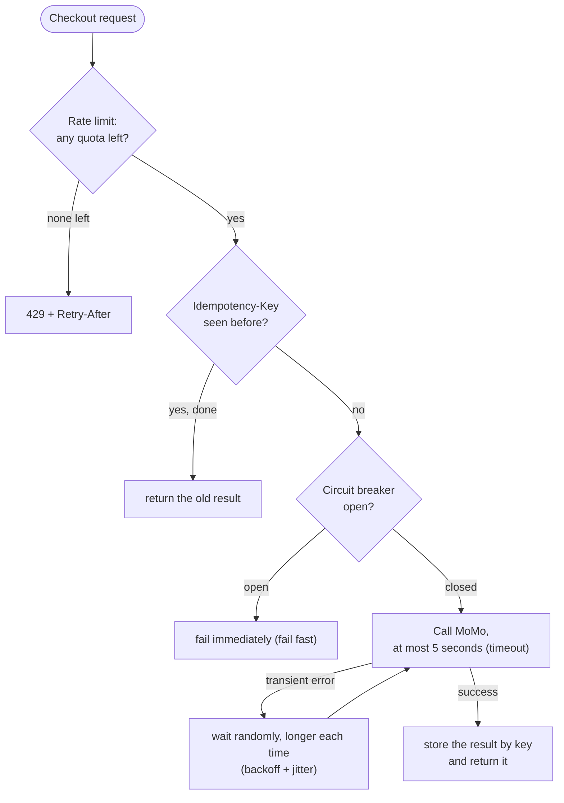
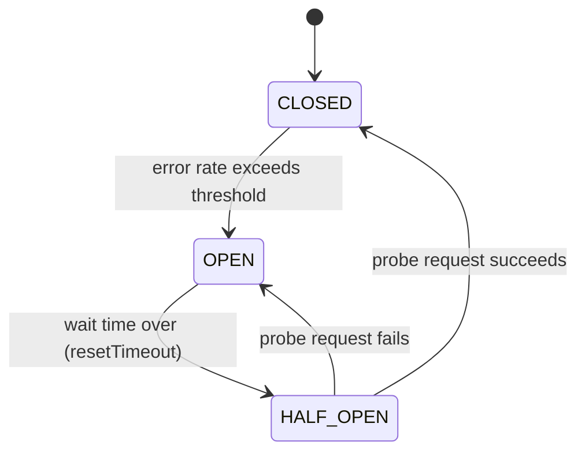

> [!tldr] Quick read
> - [[en/concepts/idempotency|Idempotency]]: resending a request must not cause a side effect a second time. `POST` needs an `Idempotency-Key`; the server records the key **before** doing the work, stores the response, and returns it when it sees the key again.
> - [[en/concepts/timeouts|Timeout]]: every outgoing call needs a deadline; otherwise one slow dependency drags the whole system down with it.
> - [[en/concepts/retries-with-backoff|Retry with backoff]]: retry only transient errors, wait exponentially longer each time, and **add jitter** so clients don't retry at the same moment.
> - [[en/concepts/circuit-breaker|Circuit breaker]]: when a dependency keeps failing, stop calling it for a while, fail immediately (fail fast), then probe with a single request.
> - [[en/concepts/rate-limiting|Rate limiting]] rejects the excess (`429`); [[en/concepts/throttling|throttling]] slows down or queues the excess. Flash-sale uses both.

> [!info] Context
> The examples come from **flash-sale**, a time-limited discount shop I wrote myself: the sale opens at exactly 21:00, thousands of people race for a few hundred units, then pay through MoMo or VNPay. This is exactly the kind of system where "occasionally fails" becomes "definitely fails". You don't need to read the project's code. Code excerpts are only illustrations, and every mechanism gets a plain-language explanation first.

> [!abstract]- Quick glossary for this post (click to open)
> - **Dependency**: something external your system has to call, like a payment gateway, a database or a message queue.
> - **Redis**: an in-memory database, very fast. Here it serves as shared memory for every backend instance.
> - **`SET … NX`**: the Redis command "write only if it doesn't exist yet". If two callers write at once, exactly one wins.
> - **TTL**: the lifetime of a piece of data; when it runs out, the data is deleted automatically.
> - **Interceptor / decorator**: in NestJS, an interceptor is code wrapped around an endpoint (it runs before and after). A `@Something()` decorator is a label stuck on a function to turn it on.
> - **Pod**: one running copy of the backend. Many identical pods run at the same time.
> - **Lua script**: a small piece of code that runs *inside* Redis, all at once, without being interrupted.
> - **opossum**: a circuit breaker library for Node.js.
> - **BullMQ**: a library for running periodic background jobs, backed by Redis.
> - **Sorted set**: a Redis list that keeps itself sorted by score, here the time someone joined the queue.

## Picture it first: ordering a cake by phone

The six concepts of this station are like the courtesies of phoning in a birthday cake order:

| Everyday life | Concept | What goes wrong without it |
|---|---|---|
| Read out the **order number**, "order 123", every time you call back. The shop looks it up, sees it's already done, and doesn't make a second one | [[en/concepts/idempotency\|Idempotency]] | The call drops, you call back, you get two cakes and pay twice |
| Wait on hold for at most 1 minute; if nobody answers, hang up | [[en/concepts/timeouts\|Timeout]] | You hold the phone all afternoon and can't do anything else |
| If the line is busy, call back after 1 minute, then 2, then 4. Everyone is off by a few seconds | [[en/concepts/retries-with-backoff\|Retry + backoff + jitter]] | A hundred people call back in the same second and the switchboard jams even more |
| The breaker trips on a short circuit. Wait a while, then flip it on once to test | [[en/concepts/circuit-breaker\|Circuit breaker]] | You keep flipping it back on and burn the whole house down |
| Security lets only 10 people a minute into the store; the rest are sent home | [[en/concepts/rate-limiting\|Rate limiting]] | One person (or one bot) hogs every counter |
| The bank hands out **queue numbers**; everyone gets served, they just have to wait | [[en/concepts/throttling\|Throttling]] | A thousand people crowd the counter at once |

Put together, a call from the backend to the payment gateway passes through the layers of protection in this order:



## The problem: anything can fail halfway through

At station 1 I saw that `POST /checkout` requires an `Idempotency-Key`; at station 2, MoMo's webhook could arrive twice. This station gathers all the situations where "nothing is wrong in the code, but the system still breaks":

- A payment request times out. The client doesn't know whether the server **hasn't done it yet** or **has charged the money but the response got lost on the way**.
- The payment gateway is 30 seconds slow. Every checkout request holds a DB connection and a processing slot for those whole 30 seconds.
- The payment gateway goes down completely. Every request still tries to call it, waits for the timeout, retries, waits for the timeout again.
- 9 p.m., the flash sale opens, and 10,000 people hit "Buy now" at once.

I used to think these things belonged to "infrastructure". Only after reading the flash-sale code carefully did I see that most of it lives in the application itself: an interceptor, a few small services, a Lua script.

## Idempotency: one key per intent

The hardest question for any payment request: **when the request times out, has the money been charged?** The client can't know. Maybe the server never received it, or maybe the server finished charging but the answer got lost on the way. Resend and you risk charging twice; don't resend and you risk losing the order. An idempotency key solves exactly this: resend freely, because the server recognizes "this one is the earlier one".

The client generates a random string for *each payment intent* and sends it in the `Idempotency-Key` header. Every retry of the same intent reuses exactly this string. The diagram below walks through a lost response followed by a retry; you can drag, zoom, and click each arrow to see details.

<figure class="figure-map" style="--ar: 1 / 1">
<div class="frame"><iframe data-archify="../../diagrams/api-reliability/retry.en.html" title="Sequence diagram: safe retries with Idempotency-Key" loading="lazy"></iframe></div>
<figcaption><span><b>Figure 1.</b> The first call charged the money but the response was lost; the retry only reads back the result.</span><a href="../diagrams/api-reliability/retry.en.html" target="_blank" rel="noopener">Open full screen</a></figcaption>
</figure>

Flash-sale implements this mechanism as an interceptor (code wrapped around an endpoint, running before and after it) called `IdempotencyInterceptor`. To turn it on for an endpoint, you put the `@UseIdempotency()` label on that endpoint. The logic in plain words: *claim the key → if the key is done, return the old result → if not, do the work → when done, store the result → on error, release the key*. Trimmed code:

```ts
// trimmed from idempotency.interceptor.ts
const key = request.headers['idempotency-key']
const endpoint = `${request.method} ${request.route.path}`   // "POST /orders/:id/cancel", not the concrete URL
const requestHash = hashRequestBody(request.body)           // body with normalized key order, then hashed

const result = await idempotency.claim(key, user.id, endpoint, requestHash)  // atomic claim
if (!result.firstTime && result.cached) {
  response.status(result.cached.statusCode)
  return of(result.cached.responseBody)                     // return exactly what the first call returned
}
try {
  const body = await firstValueFrom(next.handle())
  await idempotency.complete(key, user.id, endpoint, response.statusCode, body)
  return of(body)
} catch (err) {
  await idempotency.release(key, user.id, endpoint)          // on error, release the key for the next attempt
  throw err
}
```

- **The key's scope is `(key, userId, endpoint)`**: two users who accidentally generate the same key don't collide.
- **Hash the normalized body**: `{"a":1,"b":2}` and `{"b":2,"a":1}` are the same request; the same key with a different body is rejected.
- **Release the key on error**: if the controller throws (for example, out of stock), the key is freed and the client may genuinely try again. Only *successful* results are stored for replay.

A trimmed, runnable version (using a `Map` instead of Redis):

```ts
async function createPayment(key: string, body: { amount: number }) {
  const raw = JSON.stringify(body)
  const saved = store.get(key)

  if (saved?.status === "processing") return { code: 409, data: "đang xử lý, thử lại sau" }
  if (saved?.status === "done") {
    if (saved.body !== raw) return { code: 422, data: "key đã dùng cho request khác" }
    return { code: 201, data: saved.response } // return the old result
  }

  store.set(key, { status: "processing" }) // Redis: SET key processing NX EX 86400
  const response = await chargeCard(body.amount)
  store.set(key, { status: "done", body: raw, response })
  return { code: 201, data: response }
}
```

```text
$ node idempotency.ts
{ code: 201, data: { id: 'ch_1', amount: 100000 } } { code: 201, data: { id: 'ch_1', amount: 100000 } } { code: 422, data: 'key đã dùng cho request khác' } times charged: 1
```
*(Output labels translated; the files themselves print Vietnamese.)*

The whole file: <a href="../code/api-reliability/idempotency.ts">code/api-reliability/idempotency.ts</a>.

## Timeouts: never wait forever

A call without a [[en/concepts/timeouts|timeout]] is a promise to wait forever. Picture a shop with 10 staff. Each one phones a supplier and waits on hold, but the supplier doesn't pick up. Ten people holding ten phones, and new customers walking in have nobody to serve them. When a dependency is slow, every waiting request holds a connection, some memory, sometimes even a transaction. Once resources run out, even *unrelated* endpoints die too. This is the kind of cascading incident Amazon calls a "spreading brownout".

Flash-sale sets a timeout per dependency, each with a different number:

```ts
// trimmed from resilience.config.ts
'momo-charge':      { timeout: 5000 },  // payment gateway: tolerate more slowness
'vnpay-charge':     { timeout: 5000 },
'rabbitmq-publish': { timeout: 2000 },
'es-bulk-index':    { timeout: 3000 },
'es-search':        { timeout: 1500 },  // search: if slow, better to fail; there's a fallback to Postgres
```

And timeouts appear at every layer, not just in code:

- NGINX Ingress: `proxy-read-timeout: 30` seconds for the whole request.
- Kubernetes: readiness probe `timeoutSeconds: 3`.
- Graceful shutdown: wait at most 20 seconds for in-flight requests before closing the DB connection.

How to choose the number, as the Amazon Builders' Library suggests: measure the dependency's latency and set the timeout around a high percentile (e.g. p99.9) so it only cuts truly abnormal requests. One more principle: **an outer layer's timeout must be longer than the total time the inner layer can take**, retries included. If the ingress cuts at 30 seconds and the inside retries 3 times × 5 seconds plus backoff waits, that's still fine; if the inside retries 10 times, the ingress will return an error while the inside is still toiling away.

## Retries with Backoff: try again, but with discipline

A flaky network, a `503` while a pod is starting, the odd timeout: retrying usually succeeds. But a badly done [[en/concepts/retries-with-backoff|retry]] turns a small incident into a big one: the dependency is overloaded, and every client sends triple the requests at once.

Flash-sale's `RetryService` does all three things:

```ts
// trimmed from retry.service.ts (defaults: 3 attempts, base 200ms, max 5s, full jitter)
for (let attempt = 1; attempt <= maxAttempts; attempt++) {
  try { return await action() }
  catch (err) {
    if (attempt === maxAttempts || !isRetryable(err)) throw err
    const exp = Math.min(maxDelayMs, baseDelayMs * 2 ** (attempt - 1))
    await sleep(Math.random() * exp)          // full jitter: wait a random time in [0, exp)
  }
}
```

1. **Retry only transient errors.** `isRetryable` returns `true` for network errors (`ECONNRESET`, `ETIMEDOUT`…), `5xx` and timeouts; it returns `false` for every `4xx` and when the circuit breaker is open. Retry a `400` and the next attempt is still `400`.
2. **Exponential backoff**: 200ms, 400ms, 800ms… gives the dependency time to recover.
3. **Jitter**: if 1,000 clients fail at 9:00:00 and all wait exactly 200ms, they pour back in together at 9:00:00.200. The example at the end of the post prints it: without jitter, three clients retry together at 200/400/800/1600ms; with jitter, they spread out to 120/179/682…, 35/211/219…, 173/189/200…

And the prerequisite: **retry only idempotent operations**, or operations with an idempotency key. That's why idempotency comes first in this station.

## Circuit Breaker: stop calling what's broken

Retry helps get past *transient* errors. When a dependency is *completely down*, retry only makes every request slower (timeout × number of retries) and still fails. A [[en/concepts/circuit-breaker|circuit breaker]] (described by Michael Nygard in *Release It!*, popularized by Martin Fowler) is an electrical breaker for remote calls:



- **CLOSED**: call normally, count errors.
- **OPEN**: stop calling, fail immediately. The dependency gets breathing room, and my requests don't have to wait for a timeout.
- **HALF_OPEN**: when the wait is over, let *one* request through as a probe. On success, close again; on failure, stay open.

An example in flash-sale: MoMo goes down. Without a breaker, every payment request waits the full 5-second timeout, retries 3 times, and only then reports an error. The user waits almost 20 seconds just to hear "error". With a breaker, after the first few errors every later request gets an error immediately, something like "MoMo is under maintenance, please choose VNPay".

Flash-sale uses the `opossum` library with these defaults: open at **≥ 50% errors** in a 10-second window, but only with **at least 5 requests** (so 1 error out of 1 request doesn't trip the breaker), wait **30 seconds**, then try again. RabbitMQ is more sensitive: a 30% threshold, a 15-second wait.

The detail I find most subtle is the nesting order:

```ts
// resilient-call.service.ts
execute(name, action, opts) {
  return this.cb.fire(name, () => this.retry.execute(action, opts.retry), opts.cb)  // CB(Retry(action))
}
```

Retry sits **inside** the circuit breaker: the breaker only sees the final result after retrying, so a transient error that was retried successfully isn't counted as a failure. And while the breaker is open, no retries run at all. If you flip it (`Retry(CB(action))`), every retry hits the open breaker again, producing a pointless chain of errors.

## Rate Limiting: reject the excess

[[en/concepts/rate-limiting|Rate limiting]] protects a system from overuse, whether from bots, a client bug, or one person clicking nonstop. The excess is rejected immediately with `429 Too Many Requests`. Flash-sale has **four** layers of limits, and each uses a different algorithm:

| Layer | Algorithm | Example |
|---|---|---|
| NGINX Ingress | Leaky bucket per IP | `limit-rps: 100` |
| `RateLimitGuard` (global) | Sliding window log on a Redis sorted set | Default 100 requests / 60s per user or IP; `queue/join` only 5 requests / 10s |
| `TokenBucketGuard` (per route) | Token bucket, a Lua script running atomically in Redis | Checkout: 10 tokens, refilling 1 token every ~6s |
| Login | Fixed counter per email and IP | 5 failures / 15 minutes |

Token bucket is my favorite algorithm because it allows a reasonable **burst** (a sudden flurry). Picture a **bucket of coins**: it holds at most 10 coins, one more coin drops in every 6 seconds, and each request must put in 1 coin. Click 10 times in a row and you still get through, because the bucket is full. On the 11th, the bucket is empty and you have to wait for a new coin. Here is the core of the Lua script that runs in Redis:

```lua
-- trimmed from token-bucket.lua
local tokens  = tonumber(data[1]) or capacity
local elapsed = math.max(0, (now - updated) / 1000)
tokens = math.min(capacity, tokens + elapsed * rate)   -- refill tokens for the time that has passed
if tokens >= cost then tokens = tokens - cost; allowed = 1 end
```

A real user acts in a quick flurry and then pauses: token bucket lets it all through. A bot sends at a steady, constant pace: once the tokens run out, it's blocked. The script runs in Redis, so many pods share one bucket with no race condition.

Two operational details worth learning:

- **Tell the client**: the guard sends `X-RateLimit-Limit`, `X-RateLimit-Remaining`, `X-RateLimit-Reset`, and `Retry-After` when blocking. A well-behaved client waits exactly that long instead of retrying blindly.
- **Fail open**: if Redis dies, `THROTTLER_FAIL_OPEN=true` lets requests through instead of blocking everything. This is a deliberate choice: losing rate limiting for a few minutes is better than losing the whole website. A sensitive endpoint like login can choose the opposite.

## Throttling: queue them instead of sending them away

These two words are often used interchangeably. Here is how I tell them apart: [[en/concepts/rate-limiting|rate limiting]] **rejects** the excess, [[en/concepts/throttling|throttling]] **slows down** the excess: queueing, spacing out, degrading quality. The end result: rate limiting returns `429`, throttling returns the result, just later.

The clearest example in flash-sale is the **virtual queue**. When the sale opens, you can't let 10,000 people into checkout at once (stock, DB and payment gateway can't take it), but you also can't return `429` to 9,950 people. Instead:

1. `POST /queue/join`: the buyer is added to a Redis sorted set by join time.
2. Every `queueIntervalMs` (e.g. 5 seconds), a BullMQ job runs `ZPOPMIN` to take the first `queueBatchSize` (e.g. 50) people in line and issues each a time-limited checkout token.
3. The server pushes `checkout_ready` over WebSocket (station 2) to exactly those people.
4. Estimated wait: `ceil(position / 50) × 5 seconds`; person no. 120 waits about 15 seconds.

The load into checkout is always capped at 50 people every 5 seconds, however many are waiting. Nobody is rejected; they just have to wait.

## Runnable example

The file `resilience.ts` contains five experiments: a timeout, retries with and without jitter, a circuit breaker with a fake clock, a token bucket following exactly the Lua file's logic, and the queue. Random numbers come from a seeded PRNG so every run gives the same result.

```ts
fire(dependencyUp: boolean): string {
  if (this.state === "OPEN") {
    if (clock - this.openedAt < this.resetMs) return "fail fast (không gọi)"
    this.state = "HALF_OPEN"
  }
  this.calls++
  const trial = this.state === "HALF_OPEN" ? " (thử 1 request)" : ""
  if (dependencyUp) { this.state = "CLOSED"; this.failures = 0; return "ok" + trial }
  this.failures++
  if (this.state === "HALF_OPEN" || this.failures >= this.threshold) { this.state = "OPEN"; this.openedAt = clock }
  return "lỗi" + trial
}
```

```text
$ node resilience.ts
===== 1. Timeout: never wait forever =====
calling the payment gateway: timeout after 100ms
→ fails after ~100ms instead of holding a thread/connection for 300ms

===== 2. Retry: exponential backoff, with and without jitter =====
client A: no jitter 200/400/800/1600ms | full jitter 120/179/682/1072ms
client B: no jitter 200/400/800/1600ms | full jitter 35/211/219/1000ms
client C: no jitter 200/400/800/1600ms | full jitter 173/189/200/1411ms
retry 503? true | retry 400? false | retry 409? false

===== 3. Circuit breaker =====
t= 0s dependency down → error                        state=CLOSED
t= 1s dependency down → error                        state=CLOSED
t= 2s dependency down → error                        state=OPEN
t= 3s dependency down → fail fast (no call)          state=OPEN
t=10s dependency down → fail fast (no call)          state=OPEN
t=33s dependency down → error (probe 1 request)      state=OPEN
t=64s dependency up   → ok (probe 1 request)         state=CLOSED
t=65s dependency up   → ok                           state=CLOSED
8 requests, only 6 real calls to the dependency

===== 4. Rate limiting: token bucket (like token-bucket.lua) =====
12 requests at once: 10 pass, 2 get 429, Retry-After: 7s
after 7 seconds: passes (1 token refilled)

===== 5. Throttling: the flash-sale queue, 50 people let in every 5s =====
person 1 waits ~5s, person 51 ~10s, person 120 ~15s
tick 1 (t=5s): 50 people into checkout, 70 still waiting
tick 2 (t=10s): 50 people into checkout, 20 still waiting
tick 3 (t=15s): 20 people into checkout, 0 still waiting
nobody rejected; load into checkout always ≤ 50 people / 5s
```

The breaker in the example opens after 3 consecutive errors to make it easy to follow; the real opossum works on the error *rate* within a time window. The whole file: <a href="../code/api-reliability/resilience.ts">code/api-reliability/resilience.ts</a>.

## Misconceptions and common traps

### Recording the idempotency key after charging

If two requests with the same key arrive almost simultaneously, both see "no key yet" and both charge. You must claim the key with an atomic operation (`SET … NX`, or an `INSERT` with a unique constraint) **before** doing anything with side effects.

### Same key, different content

A buggy client may reuse an old key for a different amount. The server compares the body's fingerprint and returns `422` instead of quietly returning the old result.

### A key TTL that's too short

If the key expires before the client retries, the repeated request is treated as new. The TTL must be longer than the client's maximum retry window, usually 24 hours.

### Retrying at every layer

The client retries 3 times, the gateway 3 times, the service 3 times: one error at the bottom becomes 27 requests. Retry at only *one* layer, usually the one closest to the dependency, and have the other layers respect `Retry-After`.

### An outer timeout shorter than the inner one

The ingress cuts at 30 seconds, but the service inside keeps running up to 60 seconds. The client gets an error, retries, and now two requests are doing the same job. Deadlines must shrink from the outside in.

### Treating rate limiting as a security feature

IP-based rate limiting can't stop a botnet with thousands of IPs. It reduces load and slows down password guessers, but it doesn't replace authentication, CAPTCHA or anomaly detection.

## Self-check questions

> [!question]- Does `PUT /users/42` need an Idempotency-Key?
> Usually not. `PUT` replaces the whole resource, so resending the same content gives the same result.

> [!question]- What do you return when a retry arrives while the first request is still `processing`?
> `409 Conflict` with a hint to try again later, so the work doesn't run twice in parallel.

> [!question]- Who generates the Idempotency-Key, the client or the server?
> The client, because only the client knows that two requests are the same intent.

> [!question]- Why does flash-sale put retry *inside* the circuit breaker?
> So the breaker only counts the final result (a transient error that was retried successfully doesn't count), and when the breaker is open, no retry attempts are wasted.

> [!question]- 10,000 people hit "Buy now" at once. Why is a queue (throttling) better than returning `429` (rate limiting) in this case?
> These are real buyers, not bots. Returning `429` makes them click again and again (adding even more load) and is a bad experience; the queue keeps the load into checkout steady while still serving everyone in order.

## References

- [Stripe API: Idempotent requests](https://docs.stripe.com/api/idempotent_requests)
- [IETF draft: The Idempotency-Key HTTP Header Field](https://datatracker.ietf.org/doc/draft-ietf-httpapi-idempotency-key-header/)
- [MDN: Idempotent](https://developer.mozilla.org/en-US/docs/Glossary/Idempotent)
- [Amazon Builders' Library: Timeouts, retries, and backoff with jitter](https://aws.amazon.com/builders-library/timeouts-retries-and-backoff-with-jitter/)
- [AWS Architecture Blog: Exponential Backoff And Jitter](https://aws.amazon.com/blogs/architecture/exponential-backoff-and-jitter/)
- [Martin Fowler: CircuitBreaker](https://martinfowler.com/bliki/CircuitBreaker.html) and [opossum](https://nodeshift.dev/opossum/)
- [Stripe: Scaling your API with rate limiters](https://stripe.com/blog/rate-limiters)
- [RFC 6585: status code 429](https://www.rfc-editor.org/rfc/rfc6585#section-4) and [IETF draft: RateLimit header fields](https://datatracker.ietf.org/doc/draft-ietf-httpapi-ratelimit-headers/)
