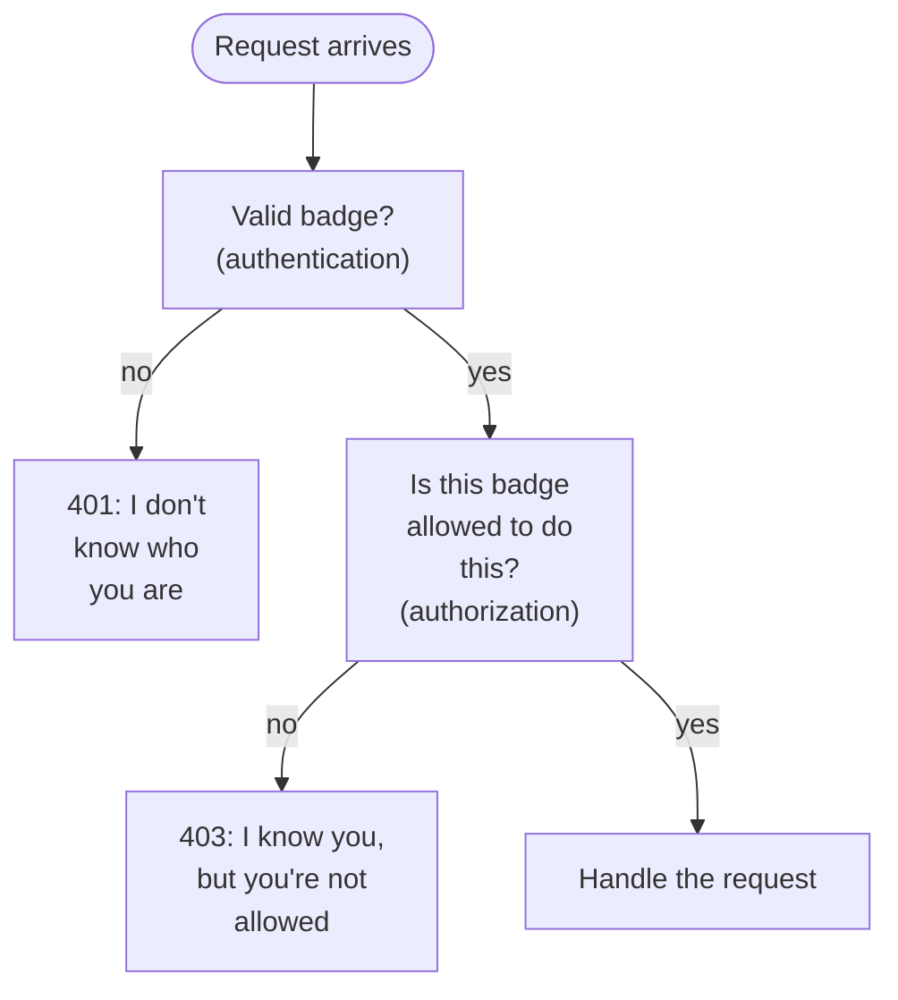
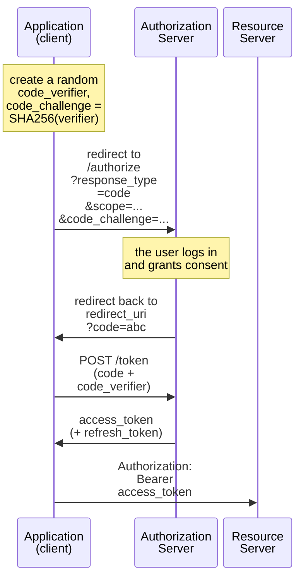
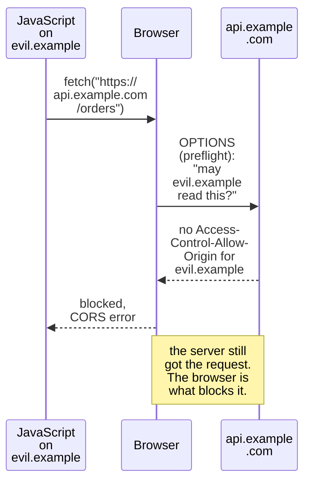

> [!tldr] Quick read
> - [[en/concepts/authentication|Authentication]] answers "who are you" (`401`), [[en/concepts/authorization|authorization]] answers "what may you do" (`403`). Two steps, two guards, two error codes.
> - A [[en/concepts/jwt|JWT]] is only **signed**, not encrypted: anyone can read the payload. The signature prevents *tampering*, not *reading*.
> - A short access token (15 minutes) + a long refresh token (7 days) that is **rotated**: each one works once; reusing an old one means there's an intruder, so the whole session is revoked.
> - An [[en/concepts/api-keys|API key]] identifies an *application*; [[en/concepts/oauth-2|OAuth 2.0]] lets you *delegate* access on a user's behalf without handing over the password.
> - [[en/concepts/https-tls|HTTPS]] protects the transport; [[en/concepts/cors|CORS]] is a rule of the *browser*, not a server firewall.

> [!info] Context
> The examples come from **flash-sale**, a time-limited discount shop I wrote myself (NestJS backend, login session data kept in Redis). You don't need to read the project's code. This post retells how it logs users in, issues users a "pass", and detects a stolen pass.

> [!abstract]- Quick glossary for this post (click to open)
> - **Token**: a string the server issues after login, like an access badge. Later requests only need to show the badge, without sending the password again.
> - **Hash**: turns a string into a fixed "fingerprint" that can't be reversed. Store the hash of a password instead of the password.
> - **bcrypt**: a hash function made for passwords, deliberately slow (~100ms) so attackers can't try billions of passwords.
> - **Signature (HMAC, RSA)**: a string computed from the content and a secret key. If anyone edits the content, the signature no longer matches.
> - **base64 / base64url**: a way to write any data with letters and digits. This is *not* encryption; anyone can decode it.
> - **Redis**: an in-memory database, very fast. Flash-sale uses it to remember which login sessions are still valid.
> - **`httpOnly` cookie**: a cookie that JavaScript on the page can't read; only the browser sends it automatically.
> - **XSS**: an attacker manages to inject their own script into my page.
> - **CSRF**: another website tricks your browser into sending a request to my site, along with your cookies.
> - **Origin**: the triple of scheme + domain + port, for example `https://shop.example.com`.

## Picture it first: getting in and out of an office building

API security has a lot of terminology, but almost every concept has a "twin" in an office building:

| In the building | In the API | Concept |
|---|---|---|
| The receptionist checks your ID: "who are you?" | Check email and password | [[en/concepts/authentication\|Authentication]] |
| A visitor badge with the building's stamp, showing your name and the floors you may enter. Anyone can read it, but nobody can forge the stamp | A token containing `{ sub, role }` plus a signature | [[en/concepts/jwt\|JWT]] |
| The badge only opens floor 3. Once on floor 3, it only opens your own office | Check the role, then check "is this order yours?" | [[en/concepts/authorization\|Authorization]] |
| A contractor badge issued to the cleaning *company*, with no person's name on it | A secret string tied to an application | [[en/concepts/api-keys\|API Keys]] |
| Giving the parking attendant a "valet" key: it starts the engine but doesn't open the trunk | Give another application limited rights without handing over the password | [[en/concepts/oauth-2\|OAuth 2.0]] |
| An armored cash van nobody can see into | Encrypting the transport | [[en/concepts/https-tls\|HTTPS and TLS]] |
| A parent tells their child: "only accept things from people you know". Strangers can still knock on the door; the child just won't take anything | The browser blocks unknown pages from reading the response | [[en/concepts/cors\|CORS]] |

The two most important steps always come in this order:



## The problem: a public endpoint on the Internet

At station 1, the checkout request carried the header `Authorization: Bearer eyJ...`. I knew I had to send it, but when I asked myself, I couldn't fully answer: what does that token contain, who checks it, what happens when it expires, what happens if it leaks, and why does a call from Postman work while the browser blocks one from another website?

OWASP ranks **Broken Object Level Authorization** and **Broken Authentication** as the top two items on its 2023 list of API security risks. Most incidents don't come from weak encryption algorithms, but from checks that are missing or placed in the wrong order.

## How it works: the lifecycle of a login session in flash-sale

<figure class="figure-map" style="--ar: 1 / 1">
<div class="frame"><iframe data-archify="../../diagrams/api-security/token-rotation.en.html" title="Sequence diagram: login, API calls, refresh token rotation and reuse detection" loading="lazy"></iframe></div>
<figcaption><span><b>Figure 1.</b> Login creates a session in Redis; every refresh deletes the old token, so a stolen token that gets reused exposes the intruder and revokes the whole session.</span><a href="../diagrams/api-security/token-rotation.en.html" target="_blank" rel="noopener">Open full screen</a></figcaption>
</figure>

In words: after login, you receive **two** passes. The *day pass* (access token) is used for every request but lives only 15 minutes. The *exchange ticket* (refresh token) lives 7 days and is used only to get a new day pass when the old one expires. The server records in Redis which sessions are still valid. The table below has the technical details:

| Piece | Value | Where it lives on the client |
|---|---|---|
| Access token (JWT, HS256) | `{ sub, role, sid, tokenType: "access" }`, lives 15 minutes | JS memory, sent in the `Authorization` header |
| Refresh token (JWT, separate secret) | `{ sub, sid, tokenType: "refresh" }`, lives 7 days | `httpOnly`, `Secure`, `SameSite=Lax` cookie, `Path=/api/v1/auth/refresh` |
| Session | `session:{sid}` in Redis (allowlist) | Nowhere |
| Current refresh token | `refresh_token:{sid}` = SHA-256 of the token | Nowhere |

## Authentication: proving who you are

[[en/concepts/authentication|Authentication]] is the step that trades a piece of evidence (password, OTP code, certificate, token) for an identity. Flash-sale's `login` function has three details I think are well worth learning:

```ts
// trimmed from auth.service.ts
const [emailAttempts, ipAttempts] = await Promise.all([redis.get(emailKey), redis.get(ipKey)])

const user = await prisma.user.findUnique({ where: { email } })
// ALWAYS run bcrypt, even when the email doesn't exist, so the response time is the same
const valid = await bcrypt.compare(password, user?.password ?? DUMMY_HASH)

if (emailAttempts >= 5) throw new UnauthorizedException('Tạm khóa 15 phút')
if (ipAttempts >= 20) throw new UnauthorizedException('IP tạm khóa 1 giờ')
if (!user || !valid) {
  await incrementLoginAttempts(emailKey, ipKey)
  throw new UnauthorizedException('Email hoặc mật khẩu không chính xác')
}
```

1. **Preventing email enumeration by timing**: if a nonexistent email got an instant answer while a real one took ~100ms for bcrypt, an attacker could time the responses and learn which emails are registered. Comparing against a `DUMMY_HASH` makes both branches take the same time.
2. **The same error message** for "wrong email" and "wrong password", for the same reason.
3. **Limiting attempts by both email and IP**: this blocks password guessing on one account, and blocks one IP from probing many accounts.

After this step, the server knows who the caller is. But HTTP is stateless (station 1), so there has to be a way for later requests *not* to resend the password. That's the token's job.

## JSON Web Token: a signed pass

A [[en/concepts/jwt|JWT]] (RFC 7519) is three base64url parts joined by dots: `header.payload.signature`. The server signs `header.payload` with a secret; if anyone edits one character of the payload, the signature no longer matches.

The example at the end of the post shows three things I used to get wrong:

- **Anyone can read the payload**: just base64-decode it. Never put a password, phone number or address in a JWT.
- **Changing `role: BUYER` to `ADMIN` breaks the signature**, and the server rejects it.
- **The `alg: none` attack**: the attacker changes the header to "unsigned" and drops the signature. Old libraries used to accept it. The fix is for the server to *decide for itself* which algorithms it accepts (RFC 8725 recommends exactly this), without trusting the token's header.

JWTs are attractive because they are *self-contained*: the server checks the signature and knows who it is, without a DB lookup. But that's exactly why they **can't be revoked** before they expire. Flash-sale handles this with a hybrid: after checking the signature, `JwtAuthGuard` also looks up `session:{sid}` in Redis (allowlist) and `blocklist:sid:{sid}`. Logging out or detecting something suspicious only takes `DEL session:{sid}`, and every access token of that session is invalid immediately. The price is one extra `GET` to Redis per request, under about 1ms, in exchange for instant revocation.

Two more by-the-book details:

- Access and refresh tokens are signed with **two different secrets** and have their own `tokenType`; the guard rejects a refresh token used as an access token.
- A limit of **5 devices** per user: a 6th session pushes out the oldest one (the Redis sorted set `user_sessions:{userId}`).

### Refresh token rotation and reuse detection

Access tokens are short-lived so that if one leaks, the damage lasts only 15 minutes. Refresh tokens are long-lived and therefore much more dangerous. Flash-sale follows exactly the recommendation of the OAuth 2.0 Security BCP (RFC 9700):

```ts
// trimmed from auth.service.ts: refreshTokens()
const stored = await redis.getdel(`refresh_token:${sid}`)   // atomic: read, then delete
if (!stored || !timingSafeEqual(hash(stored), hash(incoming))) {
  await revokeSession(userId, sid, 'refresh_token_reuse_detected')
  throw new UnauthorizedException('Refresh token không hợp lệ')
}
return generateTokens(userId, role, sid) // issue a new token pair, store the hash of the new refresh token
```

Each refresh token works **only once**. It's like a parking ticket: once you trade the ticket for your car, the ticket is taken back. Anyone who shows up with a ticket that was already taken back is definitely up to something. As a story, it goes like this:

| Step | Real user | Attacker | Which ticket the server remembers |
|---|---|---|---|
| 1 | Logs in, receives ticket `r1` | | `r1` |
| 2 | | Steals `r1` (e.g. from a shared computer) | `r1` |
| 3 | The day pass expires; trades `r1` for a new pass and ticket `r2` | | `r2` (`r1` deleted) |
| 4 | | Tries to trade `r1` | Doesn't match `r2`. **Alarm: two people hold tickets for one session** |
| 5 | Has to log in again | Gets kicked out | The whole session is deleted |

The real user suffers a little inconvenience (logging in again), and in exchange the attacker loses access. What if the attacker trades the ticket *first*? Then it's the real user who shows up with the old ticket, and the alarm goes off just the same.

Two small details: the server stores only the **hash** of the refresh token (a Redis leak doesn't make it usable), and compares with `timingSafeEqual` so the comparison time leaks nothing.

## Authorization: what you're allowed to do

[[en/concepts/authorization|Authorization]] runs *after* authentication. Flash-sale has two layers:

- **By role (RBAC)**: `@RequirePermissions('order:create')` + `PoliciesGuard`. Each role's permissions are cached in the Redis set `perms:{role}` for one hour; a check is one `SISMEMBER` command. When an admin changes permissions, `invalidateCache(role)` clears the cache (including parent roles in the inheritance tree).
- **By ownership**: `OwnershipGuard` checks whether an order, a shop… belongs to the caller.

The second layer is the one most often forgotten. Having the `order:read` permission doesn't mean you may read *every* order. If `GET /orders/ord_123` only checks the role, user A can change the id in the URL and read B's order. This is exactly the top item of the OWASP API Top 10 (BOLA).

## API Keys: identifying an application, not a person

An [[en/concepts/api-keys|API key]] is a long-lived secret string tied to an *application* or an *integration account*, sent in a header (usually `Authorization: Bearer sk_...` or `X-API-Key`). Flash-sale only uses API keys in the *outgoing* direction: calling SendGrid to send email. It doesn't issue API keys to anyone, because no partner integrates with it yet.

If one day I need to issue API keys to sellers who automate their orders, here are the principles I took from the Stripe and GitHub docs:

- Show the key **only once** at creation; the DB stores only its hash (the same way flash-sale stores refresh tokens).
- Give it a recognizable prefix (`sk_live_`, `ghp_`) so secret scanners catch it when it's accidentally committed to Git.
- Attach **scopes** (`orders:read`) and allow revocation and rotation.
- Never use an API key in code that runs in a browser or a mobile app: anyone can extract it.

## OAuth 2.0: delegating access without handing over the password

[[en/concepts/oauth-2|OAuth 2.0]] (RFC 6749) solves this problem: application X wants to access your data at service Y, but you don't want to give X your Y password. Flash-sale doesn't have "Sign in with Google" yet, so I learned this part from the docs.

The recommended flow today is **Authorization Code + PKCE**:



Four roles: the *resource owner* (the user), the *client* (the application), the *authorization server* (where you log in and tokens are issued), and the *resource server* (the API that holds the data). **Scopes** limit what a token can do. **PKCE** stops an attacker who intercepts the `code` on the redirect from trading it for a token: they don't have the `code_verifier`.

Two things I used to get wrong:

- **OAuth is authorization, not login.** An access token says "allowed to read the calendar", not "this is Duong". The login part is **OpenID Connect**, a layer on top of OAuth that adds an `id_token` (a JWT describing the identity).
- **The implicit flow and the password grant are now advised against** in RFC 9700, even for SPAs. SPAs today use Authorization Code + PKCE.

## HTTPS and TLS: a transport nobody can eavesdrop on

Everything above is meaningless if the token crosses the network in plain text. [[en/concepts/https-tls|HTTPS]] is HTTP over TLS. TLS 1.3 (RFC 8446) provides three things: **encryption** (nobody can read it), **integrity** (nobody can modify it), and **server authentication** (the certificate proves it's really `api.example.com`, not an impostor in the middle).

In flash-sale, TLS is handled at the edge:

- The NGINX Ingress on Kubernetes holds the certificate, which cert-manager requests and renews automatically from Let's Encrypt. Pods inside speak plain HTTP (TLS termination at the ingress).
- `app.set('trust proxy', 1)` so `req.ip` takes the client's real IP from `X-Forwarded-For`, instead of the ingress's IP. Without this line, IP-based rate limiting would treat every user as one.
- Helmet sends `Strict-Transport-Security: max-age=31536000; includeSubDomains`: the browser remembers for a year that this domain may only be used over HTTPS, blocking downgrade attacks to HTTP.
- The refresh token cookie has the `Secure` flag in production: it is never sent over plain HTTP.

## CORS: a rule of the browser

This is the concept I misunderstood the longest. I used to think CORS *protects the server*. Remember the parent and child from the start of the post: strangers can still knock on the door; the child (JavaScript in the browser) just isn't allowed to accept anything. In fact **[[en/concepts/cors|CORS]] protects the user in the browser**, and it is a way of *relaxing* the Same-Origin Policy, not tightening it.

By default, JavaScript on `https://evil.example` may not read responses from `https://api.example.com` (a different origin). CORS is how the server says "this origin may read":

```ts
// flash-sale's main.ts
app.enableCors({
  origin: configService.getOrThrow('FRONTEND_URL'), // exactly one origin, not '*'
  credentials: true,                                // allow sending cookies along
})
```

For a "non-simple" request (a method other than GET/POST/HEAD, or a header like `Authorization`, or `Content-Type: application/json`), the browser first sends an `OPTIONS` request (the *preflight*) to ask. Only if the server returns an `Access-Control-Allow-Origin` that matches the origin does the browser send the real request.

Drawing it makes it easy to see *who* is blocking:



Three consequences:

- **`curl`, Postman and other servers aren't blocked by CORS**, because they aren't browsers. CORS can't replace authentication.
- **`credentials: true` doesn't work with `origin: '*'`**: the browser refuses. You have to list specific origins.
- **CORS doesn't prevent CSRF.** An HTML form on another site can still send a `POST` with cookies to my API (the browser only blocks *reading* the response, not *sending*). Because the refresh token lives in a cookie, flash-sale adds a `CsrfGuard` using the double-submit cookie pattern: write requests must carry a CSRF header that matches the CSRF cookie, which another site can't read.

## Runnable example

The file `tokens.ts` implements JWT HS256 by hand with `node:crypto` (no library) to make each step visible, then simulates refresh token rotation exactly as flash-sale does, hashed API key storage, and the CORS decision.

```ts
function verify(token: string) {
  const [h, b, s] = token.split(".")
  const header = JSON.parse(Buffer.from(h, "base64url").toString())
  if (header.alg !== "HS256") return { ok: false, reason: `alg ${header.alg} không được chấp nhận` }
  const expected = createHmac("sha256", SECRET).update(`${h}.${b}`).digest()
  const got = Buffer.from(s ?? "", "base64url")
  if (got.length !== expected.length || !timingSafeEqual(got, expected)) return { ok: false, reason: "chữ ký sai" }
  const claims = JSON.parse(Buffer.from(b, "base64url").toString())
  if (claims.exp <= now) return { ok: false, reason: "token hết hạn" }
  return { ok: true, claims }
}
```

```text
$ node tokens.ts
===== 1. A JWT is only signed, not encrypted =====
access token: eyJhbGciOiJIUzI1NiIsInR5cCI6IkpXVCJ9.eyJ…
anyone can read the payload: {"sub":"user_42","role":"BUYER","sid":"s1","iat":1800000000,"exp":1800000900}

===== 2. Editing the payload or changing alg is blocked =====
change role to ADMIN     → { ok: false, reason: 'chữ ký sai' }
alg: none, no signature  → { ok: false, reason: 'alg none không được chấp nhận' }
valid token              → true
16 minutes later         → { ok: false, reason: 'token hết hạn' }

===== 3. Refresh token rotation + reuse detection =====
user refreshes: 200, gets a new refresh token
attacker uses r1: 401, refresh token already used → REUSE, session s1 revoked
user's next refresh: 401, session has been revoked

===== 4. API key: store the hash, match by hash =====
correct key → { owner: 'shop_7', scopes: [ 'orders:read' ] }
wrong key   → 401

===== 5. CORS is just a browser rule =====
from shop.example.com → Access-Control-Allow-Origin: https://shop.example.com, Allow-Methods: POST, Allow-Credentials: true
from evil.example     → no Access-Control-Allow-Origin returned → the browser blocks JS from reading the response
curl/Postman          → sends no preflight; the server receives the request as usual
```
*(Output labels translated; the files themselves print Vietnamese.)*

The whole file: <a href="../code/api-security/tokens.ts">code/api-security/tokens.ts</a>. This is learning code; in production, use a vetted library (`jose`, `@nestjs/jwt`).

## Misconceptions and common traps

### Storing the access token in `localStorage`

Any script running on the page (including one from a library injected with malicious code, i.e. XSS) can read `localStorage`. Flash-sale keeps the refresh token in an `httpOnly` cookie (JavaScript can't read it) and the short-lived access token in memory. Nothing makes you fully immune to XSS, but this limits the damage.

### Checking only the role, forgetting ownership

`order:read` is the right role, but it reads someone else's order. Every endpoint that takes a resource id needs to ask "does this resource belong to the caller?".

### Opening CORS to `*` "to get it working first"

For an API that uses cookies, `*` doesn't work anyway. For an API that uses tokens in headers, `*` lets any website call the API *with whatever token that site has*; the real problem is a leaked token, but there's no reason to open things wider than needed.

### Since JWTs can't be revoked, just make them last longer for convenience

A 7-day access token that leaks gives the attacker 7 days of free use. Keep access tokens short, and if you need immediate revocation, add an allowlist or blocklist like flash-sale does.

### Using an OAuth access token as proof of login

An access token may have been issued to another application and then brought to my API. To know *who logged in*, use OpenID Connect's `id_token` and check that `aud` is really my application.

## Self-check questions

> [!question]- Why does `login` still run bcrypt when the email doesn't exist?
> So that "email doesn't exist" and "wrong password" take the same response time; otherwise an attacker could time the responses and learn which emails are registered.

> [!question]- Flash-sale's JWT is already signed. Why does the guard still look up `session:{sid}` in Redis?
> The signature only proves the server issued the token; it doesn't allow revoking it before it expires. The Redis allowlist makes logout, kicking a device, and revoking a session on reuse detection take effect immediately.

> [!question]- An attacker gets an old refresh token and uses it *before* the real user. What happens?
> The attacker gets a new token pair. The real user's next refresh uses a token that has been deleted → hash mismatch → reuse detected → the whole session is revoked, and the attacker loses access within at most 15 minutes (the access token lifetime).

> [!question]- The server enables CORS only for `https://shop.example.com`. Can an attacker call the API with `curl`?
> Yes. CORS is enforced by the browser; `curl` doesn't care. To block it you need authentication and authorization.

> [!question]- What is the difference between OAuth 2.0 and OpenID Connect?
> OAuth 2.0 issues an access token to *access resources* (authorization). OpenID Connect adds an `id_token` to *identify who the user is* (login).

## References

- [RFC 7519: JSON Web Token](https://www.rfc-editor.org/rfc/rfc7519) and [RFC 8725: JWT Best Current Practices](https://www.rfc-editor.org/rfc/rfc8725)
- [RFC 6749: OAuth 2.0](https://www.rfc-editor.org/rfc/rfc6749), [RFC 7636: PKCE](https://www.rfc-editor.org/rfc/rfc7636), [RFC 9700: OAuth 2.0 Security Best Current Practice](https://www.rfc-editor.org/rfc/rfc9700)
- [OpenID Connect Core](https://openid.net/specs/openid-connect-core-1_0.html)
- [RFC 8446: TLS 1.3](https://www.rfc-editor.org/rfc/rfc8446) and [MDN: Strict-Transport-Security](https://developer.mozilla.org/en-US/docs/Web/HTTP/Reference/Headers/Strict-Transport-Security)
- [MDN: Cross-Origin Resource Sharing (CORS)](https://developer.mozilla.org/en-US/docs/Web/HTTP/Guides/CORS)
- [OWASP API Security Top 10 (2023)](https://owasp.org/API-Security/editions/2023/en/0x11-t10/)
- [OWASP Cheat Sheet: Cross-Site Request Forgery Prevention](https://cheatsheetseries.owasp.org/cheatsheets/Cross-Site_Request_Forgery_Prevention_Cheat_Sheet.html)
- [Stripe: API keys](https://docs.stripe.com/keys)
