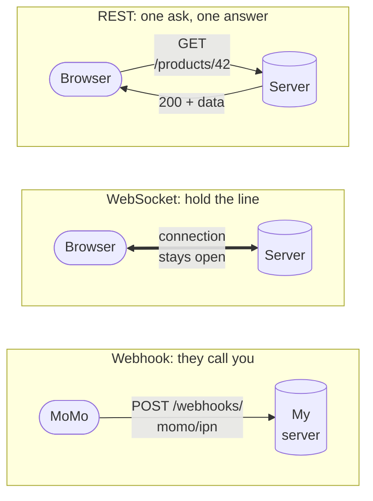
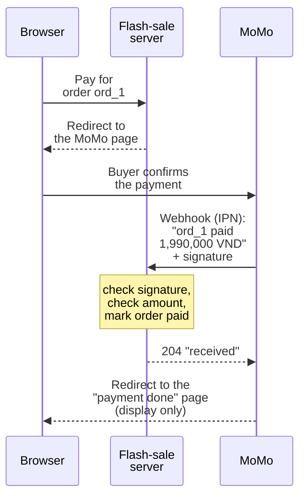

> [!tldr] Quick read
> - There is no "best" API style; each one answers a different question: *who speaks first* and *does data flow one way or both ways*.
> - [[en/concepts/rest|REST]]: the client asks, the server answers, and each resource has its own URL; the default for public APIs.
> - [[en/concepts/graphql|GraphQL]]: the client picks the fields it needs through a single endpoint; fits when many kinds of clients need different data.
> - [[en/concepts/grpc|gRPC]]: a `.proto` contract, binary, HTTP/2; fits internal calls between services.
> - [[en/concepts/websockets|WebSockets]]: a connection that stays open, so the server can push messages at any time. [[en/concepts/webhooks|Webhooks]]: an *external* system calls back into you when an event happens.

> [!info] Context
> The examples come from **flash-sale**, a time-limited discount shop I wrote myself: the moment the sale opens, thousands of people race for a few hundred units. Because it's so crowded, buyers first enter a **virtual queue** and can only pay when their turn comes. Payment goes through the **MoMo** or **VNPay** wallets. You don't need to read the project's code. Every project-specific name comes with a plain-language explanation.

> [!abstract]- Quick glossary for this post (click to open)
> - **Endpoint, request, status code**: see [[en/posts/2026-11-18-api-foundations|station 1]].
> - **Polling**: the client asks again every few seconds, "anything new yet?".
> - **Push**: the server sends a message to the client on its own, without waiting to be asked.
> - **Service**: a program that runs on its own and does one part of the system's work (login, payment…).
> - **Protobuf (Protocol Buffers)**: a way of packing data into a compact byte sequence that machines read fast but humans can't read.
> - **HTTP/2**: the version of HTTP that lets many requests run in parallel over the same connection.
> - **Socket.IO**: a library built on top of WebSocket that adds automatic reconnection, rooms and more.
> - **Redis Pub/Sub**: a "loudspeaker" inside Redis. One place broadcasts a message, and everyone listening receives it.
> - **IPN**: the name Vietnamese payment gateways give to the webhook that reports a payment result.
> - **HMAC / signature**: a string computed from the message content and a shared secret. Change the content and the string no longer matches.

## Picture it first: five ways to contact a coffee shop

Each API style is like a different way of getting in touch. Only two questions tell them apart: **who speaks first**, and **do you hang up after talking or stay on the line**.

| Everyday life | API style | Who speaks first | Fits |
|---|---|---|---|
| Walk to the counter and ask "one iced milk coffee", take the cup and leave | [[en/concepts/rest\|REST]] | The customer | Most request-response work |
| Fill in a form, ticking exactly what you want: "less ice, extra shot, no sugar" | [[en/concepts/graphql\|GraphQL]] | The customer | Each customer needs a different shape of data |
| The counter and the storeroom talk over walkie-talkies, using short codes instead of long sentences | [[en/concepts/grpc\|gRPC]] | Internal departments | Services in the same system calling each other |
| Call the shop and **stay on the line**; when your order is ready, they tell you right away | [[en/concepts/websockets\|WebSockets]] | Both, at any time | The server needs to report news as soon as it happens |
| Leave your phone number, and **the bank calls you** to say "the money has arrived" | [[en/concepts/webhooks\|Webhooks]] | An external system | Waiting for a result from a third party |

Without WebSocket, the only way to know "is my order ready?" is to run to the counter every two minutes and ask (polling). Ask often and you wear yourself out; ask rarely and you hear the news late.



## The problem: one purchase, four kinds of communication

At station 1 I followed one order request. But a real flash-sale hunt in my project is much longer:

1. The buyer clicks "Buy now" → enters the **virtual queue**.
2. They wait for their turn. The server has to **tell** the browser "it's your turn", because the browser has no idea when to ask.
3. They enter checkout, create an order, and are sent to MoMo or VNPay to pay.
4. When the payment gateway is done, it **calls back** into my server with the result.
5. The server reports the order result to the browser.

Steps 1 and 3 are ordinary request-response. Steps 2 and 5 are the server speaking on its own. Step 4 is another system speaking on its own. I used to think "API" meant REST; it turns out REST covers only half the story.

## How it works: who speaks first, which way the data flows

<figure class="figure-map" style="--ar: 1 / 1">
<div class="frame"><iframe data-archify="../../diagrams/api-styles/flash-sale-flow.en.html" title="Sequence diagram: REST, WebSocket and webhook in one flash-sale purchase" loading="lazy"></iframe></div>
<figcaption><span><b>Figure 1.</b> One flash-sale purchase uses REST for request-response, WebSocket for server push, and a webhook for the payment gateway to report the result.</span><a href="../diagrams/api-styles/flash-sale-flow.en.html" target="_blank" rel="noopener">Open full screen</a></figcaption>
</figure>

| Style | Who speaks first | Connection | Format | Flash-sale uses it for |
|---|---|---|---|---|
| REST | Client | One round trip per request | JSON over HTTP | Almost everything: cart, checkout, products |
| GraphQL | Client | One round trip per request | JSON, client picks fields | Not used (explained below) |
| gRPC | Service calls service | HTTP/2, kept open | Binary protobuf | The design for splitting out an IAM service |
| WebSockets | Both, at any time | Stays open | Arbitrary frames (Socket.IO: JSON) | Queue position, stock, order result |
| Webhooks | An external system | One request per event | Defined by the sender | IPN from MoMo, VNPay |

## REST: resources have addresses, operations use standard methods

[[en/concepts/rest|REST]] is not a protocol but an *architectural style* Roy Fielding described in 2000, made of constraints: client-server, stateless, cacheable responses, uniform interface, layered system. In practice, "REST API" usually means:

- each resource has its own URL: `/products/42`, `/orders/ord_1`;
- HTTP methods are used with their proper semantics (station 1);
- status codes deliver the verdict;
- the server keeps no session state between requests.

Flash-sale follows REST pragmatically: clear resources, correct methods, complete status codes. There are a few action-style endpoints such as `POST /flash-sale/campaigns/:id/queue/join`, because "join the queue" doesn't map neatly to CRUD. The "hypermedia" part (responses containing links to the next operations, the hardest constraint in Fielding's dissertation) is something almost no API does, large ones included, and neither do I.

REST's strength is that *anyone can call it*: browsers, `curl`, Postman, every language. HTTP caches, proxies and CDNs all understand it out of the box. Its weakness shows when a screen needs data assembled from many resources: either you make many requests (under-fetching), or an endpoint returns lots of fields you don't use (over-fetching).

## GraphQL: the client writes its own "order form" for data

[[en/concepts/graphql|GraphQL]] (released by Facebook in 2015) flips who decides: the server publishes a **typed schema**, and the client sends a query describing exactly the shape of data it needs, usually through a single endpoint, `POST /graphql`:

```graphql
query {
  order(id: "ord_1") {
    status
    items { name qty }
  }
}
```

The server runs a *resolver* for each field and returns JSON in exactly that shape. In the example at the end of the post, for the same order, REST returns 442 bytes, while a GraphQL query that selects only `status` and `items { name qty }` returns 85 bytes.

The price you pay, which is also why flash-sale doesn't use it:

- **HTTP caching becomes almost useless**: everything is `POST /graphql`, and a CDN can't tell whether two queries are the same. You need persisted queries or caching at the client layer.
- **N+1 in resolvers**: query 20 orders, resolve `user` separately for each, and that's 21 SQL queries. You need DataLoader to batch them.
- **Malicious queries**: a client can nest as deep as it likes. You have to limit depth and complexity.
- **Errors come with `200 OK`**: errors live in the body's `errors` array, so monitoring by status code is no longer enough.

Flash-sale has one web frontend with fairly fixed screens, so REST plus a few "pre-aggregated" endpoints (like `preview-discount`) is enough. GraphQL shines when there are many kinds of clients (web, mobile, partners), each needing a different slice of data, like GitHub API v4 or the Shopify Storefront API.

## gRPC: a strict, binary contract for services talking to services

[[en/concepts/grpc|gRPC]] (Google, 2015) calls a function on another machine as if it were a local function. The contract is written in Protocol Buffers, and tooling generates client and server code for each language. Flash-sale has a design (not merged) that splits login and authorization out into an `iam-service` that communicates over gRPC:

```proto
service IamService {
  rpc Login(LoginRequest)         returns (AuthResult);
  rpc Refresh(RefreshRequest)     returns (AuthResult);
  rpc GetUser(GetUserRequest)     returns (UserReply);
  rpc GetUsersByIds(IdsRequest)   returns (UsersReply);   // batched call, avoids N+1
  rpc SetUserRole(SetRoleRequest) returns (Empty);
}
```

Why gRPC fits this internal path:

- **Small and fast**: protobuf doesn't send field names, only field numbers and values. In the example, `{id: 150, status: PAID}` is 5 bytes, `08 96 01 10 02`, while the equivalent JSON is 26 bytes.
- **HTTP/2**: one connection carries many calls in parallel; all 4 kinds are supported: unary, server streaming, client streaming, bidirectional streaming.
- **Built-in deadlines**: each call carries a deadline that propagates across services (a great fit for station 4).
- **Changing the contract is a compile error**, not a runtime error.

Downsides: a browser can't call gRPC directly (it needs gRPC-Web and a proxy), and binary payloads are hard to read when debugging. So the design keeps REST for the browser, and gRPC runs only between Main and IAM.

## WebSockets: an open connection so the server can speak first

With plain HTTP, the server may only speak when the client asks. To know "is it my turn yet", the client has to ask constantly (polling). [[en/concepts/websockets|WebSocket]] (RFC 6455) solves this by *upgrading* an HTTP request into a long-lived bidirectional channel:

```http
GET /socket HTTP/1.1
Upgrade: websocket
Connection: Upgrade
Sec-WebSocket-Key: dGhlIHNhbXBsZSBub25jZQ==

HTTP/1.1 101 Switching Protocols
Upgrade: websocket
Sec-WebSocket-Accept: s3pPLMBiTxaQ9kYGzzhZRbK+xOo=
```

After `101`, both sides send frames to each other freely, with no headers repeated each time.

Flash-sale uses **Socket.IO**, a library built on WebSocket. In plain words, here is what it does:

- It authenticates with a JWT in `handshake.auth.token` at connection time; if it's invalid, it calls `disconnect()` right away.
- Each user joins their own "room" named `user:{userId}`. Open several tabs and every tab is in that room, so every tab gets the messages.
- The server pushes the events `queue_position`, `checkout_ready`, `stock_update`, `order_result` and `campaign_ended`.
- The backend runs several instances (pods) at once. Your browser may be connected to instance B, while instance A is the one that knows "it's your turn". So the instances talk to each other through the Redis Pub/Sub "loudspeaker" (the `RedisIoAdapter` class): A broadcasts, B hears it and forwards it to you.
- The REST endpoint `GET /queue/position` (limited to 30 requests per 10 seconds) stays as a **fallback** for when the socket isn't connected yet or the user reloads the page.

The example at the end of the post runs the numbers: watch the queue for 60 seconds while the position changes 3 times. Polling every 2 seconds costs 30 requests, 27 of them wasted, and news arrives up to 2 seconds late. WebSocket needs only 1 connection and 3 messages.

One detail I used to get wrong: **Socket.IO is not plain WebSocket**. It has its own protocol on top (rooms, acks, automatic reconnection, long-polling fallback), so a plain WebSocket client can't talk to a Socket.IO server. If you run several nodes with long-polling enabled, you also need sticky sessions at the load balancer.

## Webhooks: another system calls back into you

When a buyer pays on the MoMo page, my server doesn't know when it's done. A [[en/concepts/webhooks|webhook]] is a reverse contract: I register a URL, and *the other side* sends an HTTP request to that URL when an event happens. Vietnamese payment gateways call it **IPN** (Instant Payment Notification).

The easiest sequence to picture:



The thing to notice is that **the webhook arrow goes from MoMo to the server**, not from the browser. Anyone on the Internet can call this endpoint, so the server must ask itself, "did MoMo really send this?". That's the signature's job.

Flash-sale has two webhook controllers (a controller is the class that holds the endpoints). Together they show almost every principle. Lines starting with `@` are *decorators*, labels stuck on a function so the framework knows how to handle it; I note what each label means at the end of its line:

```ts
// trimmed from momo-webhook.controller.ts
@Public()                 // no JWT: the caller is MoMo, not a user
@CsrfExempt()             // no CSRF cookie
@SkipResponseTransform()  // return exactly the format MoMo requires, without the {success,data,msg} envelope
@Post('ipn')
@HttpCode(204)            // MoMo treats 204 as "received"; any other code makes MoMo resend
@RateLimit({ max: 100, windowMs: 1_000 })
async handleIpn(@Body() body: MoMoIpnPayload) {
  await this.paymentService.handleWebhook('MOMO', toStringRecord(body))
}
```

Inside `handleWebhook` there are four layers of checks:

1. **Verify the signature** (HMAC with a secret shared with the payment gateway). The endpoint is public and anyone can call it, so the signature is the only thing proving the request came from MoMo.
2. **Idempotency, layer 1**: if the payment is no longer `PENDING`, return "Already processed". A webhook sender can *always* resend.
3. **Check the amount** against the payment in the DB, and reject on a mismatch.
4. **Idempotency, layer 2**: `INSERT` into `payment_transactions` with `providerRef` as `UNIQUE`; if two duplicate webhooks arrive at the same time, one hits the unique violation (`P2002`).

And one principle lives in the VNPay controller: the `return` endpoint (where the browser is redirected after paying) is for **display** only and doesn't update the order. The user can edit the query string on that URL; only the signed IPN is the source of truth.

## Runnable example

The file `styles.ts` contains four experiments: GraphQL-style field selection, hand-written protobuf encoding, a webhook receiver with signature checks and deduplication, and the polling-versus-push math.

```ts
function receiveWebhook(raw: string, signature: string): number {
  const expected = Buffer.from(sign(raw), "hex")
  const got = Buffer.from(signature, "hex")
  if (expected.length !== got.length || !timingSafeEqual(expected, got)) return 401
  const event = JSON.parse(raw)
  if (processed.has(event.transId)) return 204 // already processed: still ACK so the sender stops retrying
  processed.add(event.transId)
  paidOrders++
  return 204
}
```

```text
$ node styles.ts
REST    GET /orders/ord_1 → 442 bytes
GraphQL { status items { name qty } } → 85 bytes: {"status":"PAID","items":[{"name":"Tai nghe","qty":1},{"name":"Ốp lưng","qty":2}]}

protobuf: 5 bytes [08 96 01 10 02]
JSON:     26 bytes {"id":150,"status":"PAID"}

first delivery            → 204
redelivery (retry)        → 204
body with edited amount   → 401
orders marked as paid: 1

polling every 2s: 30 requests, 3 with news, 27 wasted
WebSocket: 1 connection, 3 messages, latency ~0s instead of up to 2s
```
*(Output labels translated; the files themselves print Vietnamese.)*

The whole file: <a href="../code/api-styles/styles.ts">code/api-styles/styles.ts</a>.

## Misconceptions and common traps

### Trusting the "payment successful" page the browser is redirected to

The return URL passes through the browser, and the user can edit its query string. Update orders only from a webhook whose signature has been verified.

### Doing heavy work right inside the webhook handler

Senders usually wait only a few seconds. A slow handler is treated as a failure and gets resent, while the first attempt is still running. The rule: verify, record (idempotently), return `2xx` fast, and push heavy work into a queue.

### Returning an error for a bad signature makes the sender retry forever

Flash-sale chooses to return `204` to MoMo even when the signature is wrong (and logs the error). The reason: a bad signature stays bad however many times it's resent, so retrying only wastes resources. My example returns `401` to make the point clear; either way is fine, as long as you don't process that request.

### Thinking GraphQL can replace REST for everything

GraphQL solves the "many clients, many data shapes" problem. It doesn't help with file uploads, webhooks or CDN caching, and it pushes complexity onto the server (DataLoader, depth limits, per-field authorization).

### Using WebSocket for something you only need to ask once

A connection that stays open costs memory on the server, and you have to handle reconnection, re-authentication and scaling across pods. If the data changes once every few minutes, polling or Server-Sent Events (one-way, over plain HTTP) is much simpler.

## Self-check questions

> [!question]- Why must `checkout_ready` go over WebSocket instead of being returned in the response to `POST /queue/join`?
> At join time, the server doesn't know when the turn will come; the event happens seconds to minutes later, decided by a worker. Only a channel on which the server may speak on its own can report it in time.

> [!question]- Two identical webhooks arrive at the same moment. Which check in flash-sale stops the second one?
> The status check (layer 1) can let it through, because both read `PENDING`. Only the `UNIQUE(providerRef)` constraint inside the transaction (layer 2) stops it for sure.

> [!question]- Can a browser call `IamService.Login` directly over gRPC?
> Not directly. A browser can't control HTTP/2 at the level gRPC needs; it has to go through gRPC-Web and a proxy. The design has Main accept REST from the browser and then call IAM over gRPC.

> [!question]- When should I consider GraphQL for flash-sale?
> When a mobile app and partners arrive, each needing a different slice of data, and adding a separate REST endpoint for every screen starts costing more than running GraphQL.

## References

- [Roy Fielding, chapter 5: Representational State Transfer](https://ics.uci.edu/~fielding/pubs/dissertation/rest_arch_style.htm)
- [GraphQL: Learn](https://graphql.org/learn/) and [GraphQL Specification](https://spec.graphql.org/)
- [gRPC: Core concepts](https://grpc.io/docs/what-is-grpc/core-concepts/) and [Protocol Buffers: Encoding](https://protobuf.dev/programming-guides/encoding/)
- [RFC 6455: The WebSocket Protocol](https://www.rfc-editor.org/rfc/rfc6455)
- [Socket.IO: Using multiple nodes](https://socket.io/docs/v4/using-multiple-nodes/)
- [Stripe: Receive webhook events](https://docs.stripe.com/webhooks) and [GitHub: Validating webhook deliveries](https://docs.github.com/en/webhooks/using-webhooks/validating-webhook-deliveries)
- [Standard Webhooks](https://www.standardwebhooks.com/)
