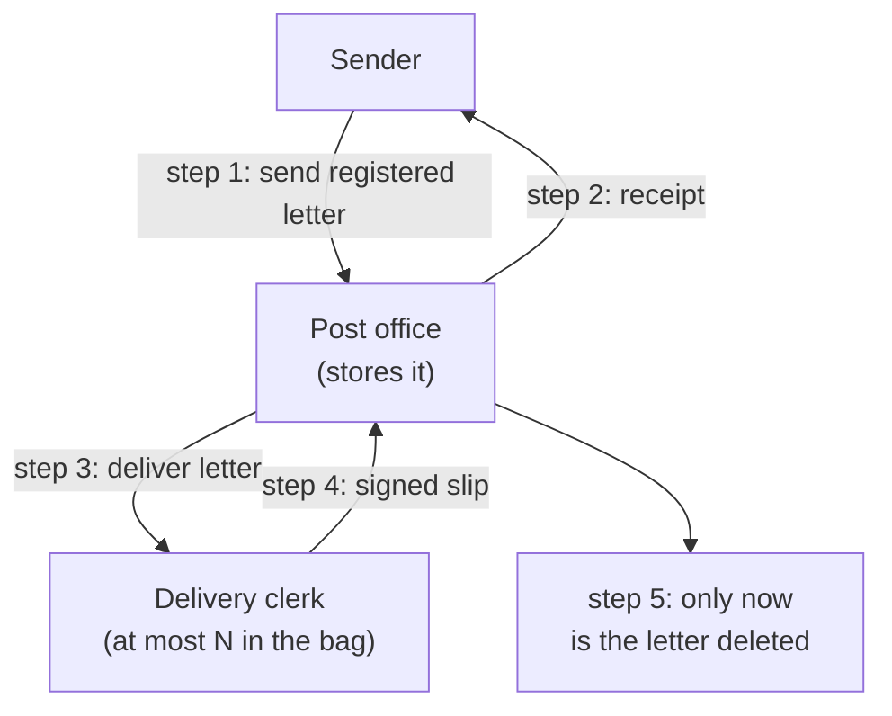

> [!tldr] Quick read
> - [[en/concepts/work-queue|Work queue]]: several consumers read the same queue and the broker splits the messages among them. To split them *fairly*, you need acks and prefetch.
> - [[en/concepts/consumer-acknowledgement|Consumer ack]]: the broker deletes a message only after the consumer reports "done processing". If the consumer dies before acking, the message goes back to the queue and is [[en/concepts/redelivery|redelivered]] with the flag `redelivered = true`.
> - [[en/concepts/auto-ack|Auto-ack]] treats a message as done the moment it is sent. Fast, but messages are lost when a consumer dies, and NestJS turns it on **by default**.
> - [[en/concepts/prefetch|Prefetch]] limits how many unacked messages a consumer may hold. Prefetch 1 hands out work to whoever is free; without it, the broker splits evenly no matter who is slow.
> - [[en/concepts/publisher-confirms|Publisher confirms]] are the receipts the broker sends the producer. Three conditions for a message to survive a broker restart: a durable queue, a [[en/concepts/message-persistence|persistent]] message, and a confirm.

> [!info] Context
> Station 4 of **the RabbitMQ line**. The example is **flash-sale**, a time-limited flash-sale shop I wrote myself: every placed order produces a message, and consumers decrement stock, send emails and update search. At this station there is only one question: how do you make sure a message is *not lost* on its way from the producer to the moment the consumer finishes. You don't need to know the project's code.

> [!abstract]- Quick glossary for this post (click to open)
> - **Exchange, queue, binding, channel, connection**: see [[en/posts/2026-11-21-rabbitmq-amqp-model|station 2]].
> - **Worker**: a consumer that does one kind of heavy job (sending emails, processing images).
> - **Round-robin**: handing out one item to each person in turn, then starting over from the first person.
> - **Writing to disk / fsync**: writing data from RAM to the disk so a power cut doesn't lose it. `fsync` is the call that forces the operating system to actually write to disk right away.
> - **Buffer**: a holding area in memory where data waits before being sent.
> - **Transaction**: a group of operations that either all succeed or none take effect.
> - **NestJS**: the Node.js framework flash-sale uses. See [[en/posts/2026-11-18-api-foundations|the API line]].

## Picture it first: signatures and receipts

A professional post office has two pieces of paper: a **receipt** handed to the sender, and a **delivery slip** signed by the recipient. Without either one, there is room for letters to go missing.

| Everyday life | Concept |
|---|---|
| Several clerks take letters from the same mailbox to deliver | [[en/concepts/work-queue\|Work queue]] |
| The recipient signs the slip: "received and handled" | [[en/concepts/consumer-acknowledgement\|Consumer ack]] |
| The mail carrier tosses the letter over the gate and leaves, no signature needed | [[en/concepts/auto-ack\|Auto-ack]] |
| Each clerk carries at most N undelivered letters | [[en/concepts/prefetch\|Prefetch]] |
| A clerk falls sick mid-shift; the letters in their bag go back to the mailbox for someone else, stamped "redelivery" | [[en/concepts/redelivery\|Redelivery]] |
| The post office gives the sender a receipt: "letter taken into our care" | [[en/concepts/publisher-confirms\|Publisher confirm]] |
| Registered mail: stored in a locked storeroom, still there after a power cut | [[en/concepts/message-persistence\|Message persistence]] |



## The problem: three places a message can be lost

I used to think "once there's a queue, messages don't get lost". After an afternoon of stopping and starting containers for fun, I counted three gaps:

1. **While publishing.** `publish` returns immediately, but the message is only sitting in the library's buffer. If the network drops at that moment, or the broker refuses it, the producer never knows.
2. **When the broker restarts.** The message made it into the queue, but the queue or the message wasn't marked durable. Restart, and everything is gone.
3. **When the consumer dies mid-task.** The broker delivers the message, the consumer receives it, and while processing, the pod is shut down. If the broker deleted the message at delivery time, that job vanishes.

One more thing isn't message loss but is just as broken: a slow worker hoards hundreds of messages while a fast worker sits idle. This station goes from the consumer side (acks, prefetch) to the producer side (confirms, persistence).

## How it works

<figure class="figure-map" style="--ar: 1 / 1">
<div class="frame"><iframe data-archify="../../diagrams/rabbitmq-ack-confirm/letter-life.en.html" title="Sequence diagram: receipt, delivery, consumer dies and redelivery" loading="lazy"></iframe></div>
<figcaption><span><b>Figure 1.</b> The broker deletes a letter only after the signed slip arrives; clerk A dies before signing, so the letter is redelivered to B with a "redelivery" stamp.</span><a href="../diagrams/rabbitmq-ack-confirm/letter-life.en.html" target="_blank" rel="noopener">Open full screen</a></figcaption>
</figure>

### Work queue: several people doing the same kind of job

A [[en/concepts/work-queue|work queue]] (also called *competing consumers*) is the simplest pattern: one queue, several identical consumers subscribed to it. The broker splits the messages among them; each message goes to only one consumer. To process faster, run more consumers. This is how station 1's "load leveling" becomes real.

By default the broker hands out messages **round-robin**: message 1 to A, message 2 to B, message 3 to A… regardless of whether A or B is busy. The next two sections fix that.

### Consumer ack: delete only when done

A [[en/concepts/consumer-acknowledgement|consumer acknowledgement]] (ack) is how a consumer tells the broker that a message has been processed. With **manual acks**:

1. The broker delivers the message and marks it **unacked** (delivered, not yet acknowledged). The message is still in the queue.
2. When the consumer finishes, it sends `basic.ack`. Only then does the broker delete the message.
3. If the consumer's channel or connection closes while a message is still unacked (the consumer died, lost the network, was shut down), the broker **puts the message back in the queue** and delivers it to another consumer.

Each message is delivered with a **delivery tag**, a number that increases *per channel*. The ack must be sent on the same channel the message was received on; an ack on a different channel makes the broker report "unknown delivery tag" and close the channel.

Besides `ack`, a consumer has two ways to reject:

| Method | Meaning | Notes |
|---|---|---|
| `basic.ack` | done, delete the message | `multiple = true` also acknowledges every message with a tag less than or equal |
| `basic.reject` | rejects **one** message | `requeue = true`: back to the queue; `false`: drop it, or dead-letter it if configured |
| `basic.nack` | rejects, with `multiple` too | a RabbitMQ extension; in `amqplib`, `nack` defaults to `requeue = true` |

> [!warning] Requeue is not retry
> Returning a message to the queue (`requeue = true`) gets it redelivered **almost immediately**. If the failure is caused by bad data, the message cycles forever: deliver, fail, return, deliver… That's a hot loop that eats all the CPU. Retries with a delay and a limit on attempts are the subject of [[en/posts/2026-11-21-rabbitmq-dlx-retry|station 6]].

Forgetting to ack is also a bug: the message stays unacked forever, the broker's memory slowly grows, and after 30 minutes (the default), the broker concludes the consumer is stuck. Past that timeout, the broker cancels the consumer or closes the channel with a `PRECONDITION_FAILED` error, and the unacked messages go back to the queue. The timeout can be changed with the `x-consumer-timeout` argument or a policy. Since 4.3, only quorum queues still apply this timeout.

### Auto-ack: fast and dangerous

[[en/concepts/auto-ack|Auto-ack]] (the `noAck: true` flag) tells the broker to treat a message as **done as soon as it is written to the network**. No ack needed, so it's faster. In exchange:

- If the consumer dies while processing, the message is lost; the broker doesn't redeliver it.
- Prefetch has no effect: the broker pushes messages as fast as the network allows, and a slow consumer can be flooded until it runs out of memory.

The RabbitMQ docs say it bluntly: this mode "should be considered unsafe". Watch out for framework defaults: `amqplib` defaults to `noAck: false` (manual acks), but the RabbitMQ transport of **NestJS** (`@nestjs/microservices`, `Transport.RMQ`) defaults to `noAck: true`. To be safe you have to set `noAck: false` yourself and ack in the handler. Flash-sale uses a different library (`@golevelup/nestjs-rabbitmq`), which acks manually: when the handler finishes without an error, the library acks.

### Prefetch: each person carries at most N letters

[[en/concepts/prefetch|Prefetch]] (the `basic.qos` method) sets the maximum number of **unacked** messages the broker may deliver to one consumer. Once there are N unacked messages, the broker stops delivering to that consumer until it acks some.

- **Prefetch 1**: each worker holds just one job. Only a free worker gets a new job, so the fast worker does more than the slow one. The fairest option, but each message costs a network round trip of waiting.
- **Not set** (0 = unlimited): the broker pushes all messages to the consumers round-robin. The slow worker hoards a pile of jobs while the fast worker sits idle; and if the queue holds a million messages, a consumer may get a million messages pushed into its RAM.
- **Around 100–300**: the RabbitMQ docs say this is usually the range with the best throughput when each job is light. Flash-sale sets 10.

Prefetch only has an effect with manual acks. It can be counted in two ways: per consumer (the `amqplib` default) or for the whole channel (`global`). The `global` mode has been deprecated and is **blocked by default since RabbitMQ 4.3**; quorum queues and streams never supported it.

Related to prefetch is **consumer priority**: a consumer that subscribes with a higher `x-priority` argument gets messages first; low-priority consumers receive messages only when every high-priority consumer has filled its prefetch. Use it when a group of powerful machines should take work first, and a standby group only works under overload.

### Redelivery: the "redelivery" stamp

[[en/concepts/redelivery|Redelivery]] happens when an unacked message is returned to the queue (the consumer died, or it was `nack`ed/`reject`ed with `requeue = true`) and delivered again. A redelivered message carries the flag `redelivered = true`. The broker tries to put the message back in its original position in the queue; if it can't, it puts it near the head.

The meaning of this flag is *asymmetric*:

- `redelivered = false`: the message has **definitely never** been delivered to anyone.
- `redelivered = true`: the message **may** have been partly or fully processed. Not that it definitely was.

So this flag isn't enough to prevent duplicate processing; [[en/posts/2026-11-21-rabbitmq-delivery-guarantees|station 5]] shows the right way.

Two more things consumers often run into at the same time: the **consumer tag** is the name of one `consume` subscription, used to cancel it (`basic.cancel`). And the broker can also **cancel** a consumer itself, for example when the queue is deleted; then `amqplib` calls the callback with `null`, so every handler should start with `if (!msg) return`.

### Publisher confirms: receipts for the sender

The producer side has the opposite problem: `publish` only pushes the message into a buffer, with no guarantee the broker received it. [[en/concepts/publisher-confirms|Publisher confirms]] fix this. The producer enables **confirm mode** on the channel (`createConfirmChannel` in `amqplib`), and the broker sends back a `basic.ack` for each message (or batch of messages) once it has **taken responsibility** for it:

- A message that matches no binding: confirmed as soon as the broker determines there is no queue (station 3: a confirm ≠ someone received it).
- A persistent message routed to a durable queue: confirmed **after it has been written to disk**.
- A message routed to a quorum queue (station 7): confirmed when **a majority of replicas** have received it.

The broker sends `basic.nack` when it can't accept the message, for example an internal queue error, or a full queue with the `reject-publish` policy (station 6). On a nack, or no answer within some period, the producer should republish.

Two ways to wait for confirms:

- **One at a time**: publish a message, wait for the confirm, publish the next. Simple but slow, because each message costs a full network round trip and a disk write. The RabbitMQ docs call this a pattern to avoid.
- **In batches / asynchronously**: publish many messages and handle the confirms as they come back. The broker groups the disk writes for the whole batch. The example below shows it is about 10 times faster.

If you also use `mandatory` (station 3), the broker sends `basic.return` **before** `basic.ack`, so the producer learns the message was returned before it sees the confirm.

AMQP **transactions** (`tx.select`, `tx.commit`) can also ensure "the broker definitely received it", but the RabbitMQ docs measured them as up to about 250 times slower. Use confirms.

A small trap on the client side: in `amqplib`, `publish` returns `false` when the socket's write buffer is full. At that point, wait for the `'drain'` event before publishing more; ignore the return value and messages pile up in the process's RAM.

### Message persistence: registered mail

[[en/concepts/message-persistence|Message persistence]] is the combination of three conditions for a message to survive a broker restart:

1. **A durable queue** (or quorum/stream, which are always durable). A non-durable queue is deleted on restart, taking every message inside with it.
2. **A persistent message** (`delivery_mode = 2`, in `amqplib` `persistent: true`). A non-persistent message in a durable queue is still lost on restart.
3. **A publisher confirm**. RabbitMQ doesn't `fsync` every message the moment it arrives; there is a short window where a message has been received but isn't on disk yet. Only the confirm is the promise "it has been written".

The official tutorial says it plainly: marking messages persistent alone "doesn't fully guarantee" they won't be lost. Missing any one of the three conditions leaves a gap. And all three only protect a message on **one** node; if that node's disk fails, you need replicas on other nodes, the subject of [[en/posts/2026-11-21-rabbitmq-queue-types|station 7]].

## Runnable example

Two files, run against the Docker broker as in the previous stations:

```bash
docker run -d --rm --name atlas-rabbit -p 5673:5672 -p 15673:15672 rabbitmq:4-management
npm i amqplib
node work-queue.ts && PREFETCH=0 node work-queue.ts
node publisher-confirms.ts
```

### Work queue, prefetch and redelivery

[work-queue.ts](../code/rabbitmq-ack-confirm/work-queue.ts) has two workers: the "slow" one (`cham`) takes 300 ms per job, the "fast" one (`nhanh`) takes 50 ms. It publishes 20 jobs and counts who did how many. Part two has a worker receive a job and then close its channel without acking.

```ts
async function worker(name: 'cham' | 'nhanh', ms: number) {
  const ch = await conn.createChannel();
  const pf = Number(process.env.PREFETCH ?? 1);
  if (pf > 0) await ch.prefetch(pf); // at most pf unacked messages on this consumer (0 = unlimited)
  await ch.consume(Q, async (msg) => {
    if (!msg) return;
    await sleep(ms);
    count[name]++;
    ch.ack(msg);
  }, { noAck: false });
}

// Part 2: the consumer receives but doesn't ack, then dies
crash.consume(Q, (msg) => { /* no ack! */ });
await crash.close(); // channel closes → the unacked message goes back to the queue
const again = await pub.get(Q, { noAck: false });
```

```text
$ node work-queue.ts
prefetch=1, 20 jobs -> { cham: 3, nhanh: 17 }
worker A received: viec-quan-trong redelivered = false
worker B received again: viec-quan-trong redelivered = true

$ PREFETCH=0 node work-queue.ts
prefetch=0, 20 jobs -> { cham: 10, nhanh: 10 }
worker A received: viec-quan-trong redelivered = false
worker B received again: viec-quan-trong redelivered = true
```

*(Output labels translated; the files themselves print Vietnamese.)*

With prefetch 1, the fast worker does 17 jobs and the slow one 3. Without prefetch, the broker splits exactly 10/10 even though one side is 6 times slower, so the total time is dragged down to the slow worker's pace. Part two plays out exactly like Figure 1: the unacked message goes back to the queue and carries the `redelivered = true` stamp.

### Confirming one at a time, in a batch, and getting rejected

[publisher-confirms.ts](../code/rabbitmq-ack-confirm/publisher-confirms.ts) publishes 2,000 persistent messages in two ways, then publishes 5 messages to a queue that holds at most 3 messages with a policy of rejecting new ones.

```ts
const ch = await conn.createConfirmChannel();
for (let i = 0; i < N; i++) {
  ch.sendToQueue(Q, Buffer.from(`m${i}`), { persistent: true });
  await ch.waitForConfirms(); // wait for each message
}
for (let i = 0; i < N; i++) ch.sendToQueue(Q, Buffer.from(`m${i}`), { persistent: true });
await ch.waitForConfirms(); // wait for the whole batch

await ch.assertQueue(QL, { durable: true, arguments: { 'x-max-length': 3, 'x-overflow': 'reject-publish' } });
ch.sendToQueue(QL, Buffer.from(`don-${i}`), { persistent: true }, (err) => resolve(`don-${i}: ${err ? 'NACK' : 'ack'}`));
```

```text
$ node publisher-confirms.ts
one at a time : 2000 messages in 242 ms
in a batch    : 2000 messages in 27 ms
don-1: ack | don-2: ack | don-3: ack | don-4: NACK | don-5: NACK
messageCount in queue = 3
```

Waiting per batch is about 9 times faster, and this is only localhost; over a real network the gap grows, because each wait is longer. The second part shows nacks are real: the broker rejects the last two orders, and the producer knows right away and can deal with it instead of assuming they were sent. (The numbers are from one run on my machine, only to show the ratio.)

## Misconceptions and common traps

### Using auto-ack because it's "faster"

Faster until the first time a pod gets shut down mid-task. Check your library's default: NestJS `Transport.RMQ` is `noAck: true`.

### Not setting prefetch

Unlimited means a consumer can get tens of thousands of messages pushed into its RAM, and a slow worker holds jobs while a fast worker is idle. Always set a finite prefetch.

### Acking before processing is done

Acking as soon as you receive and only then doing the work is exactly the same as auto-ack. The ack is the **last** thing the handler does, after the database write has finished.

### Requeuing on every kind of error

Errors caused by data (broken JSON, an order that doesn't exist) will never go away on their own. Requeuing them creates a hot loop. Tell transient errors from permanent ones; station 6 has tools for both.

### A "confirmed" message is a message "someone received"

A confirm is the broker's receipt, not the consumer's. A message that matches no binding is still confirmed.

### Setting only `persistent` and forgetting the durable queue, or vice versa

You need all three: a durable queue, a persistent message, and a confirm. Miss one and at some point you'll lose messages.

### Confirming one message at a time on the hot path

Each message costs one network round trip and one disk write. Publish in batches or handle confirms asynchronously.

## Self-check questions

> [!question]- Where is the danger in auto-ack?
> A message counts as done as soon as it is sent. If the consumer dies mid-task, the message is lost. On top of that, prefetch stops having any effect, so the consumer can be flooded.

> [!question]- Two workers, one 6 times slower. How do prefetch 1 and no prefetch differ?
> Prefetch 1: a worker only gets a new job after acking the old one, so the fast worker does most of the work (17/3 in the example). No prefetch: the broker splits evenly 10/10 regardless of speed, and the total time is dragged down to the slow worker's pace.

> [!question]- What does an ack from a publisher confirm mean? Does it mean a consumer received the message?
> The broker has taken responsibility: it has written to disk (persistent message, durable queue) or a majority of replicas have received it (quorum). It has nothing to do with consumers; an unroutable message is acked too.

> [!question]- What are the three conditions for a message to survive a broker restart?
> A durable queue (or quorum/stream), a persistent message, and a publisher confirm to know the message really was written.

> [!question]- If a message has `redelivered = true`, has it definitely been processed?
> Not necessarily. It only tells you the message was delivered to someone before. `redelivered = false` means it has definitely never been delivered.

> [!question]- Why must the ack be sent on the same channel the message was received on?
> Delivery tags are numbered separately on each channel. On a different channel the broker doesn't recognize the tag, reports an error and closes the channel.

## References

- [RabbitMQ: Consumer Acknowledgements and Publisher Confirms](https://www.rabbitmq.com/docs/confirms)
- [RabbitMQ tutorial 2: Work Queues (JavaScript)](https://www.rabbitmq.com/tutorials/tutorial-two-javascript)
- [RabbitMQ: Consumers](https://www.rabbitmq.com/docs/consumers) and [Consumer Priorities](https://www.rabbitmq.com/docs/consumer-priority)
- [RabbitMQ: Publishers](https://www.rabbitmq.com/docs/publishers)
- [RabbitMQ 4.3 release notes](https://github.com/rabbitmq/rabbitmq-server/blob/main/release-notes/4.3.0.md) (global QoS, consumer timeout)
- [amqplib: Channel API](https://amqp-node.github.io/amqplib/channel_api.html)
- [NestJS: RabbitMQ transport](https://docs.nestjs.com/microservices/rabbitmq)
