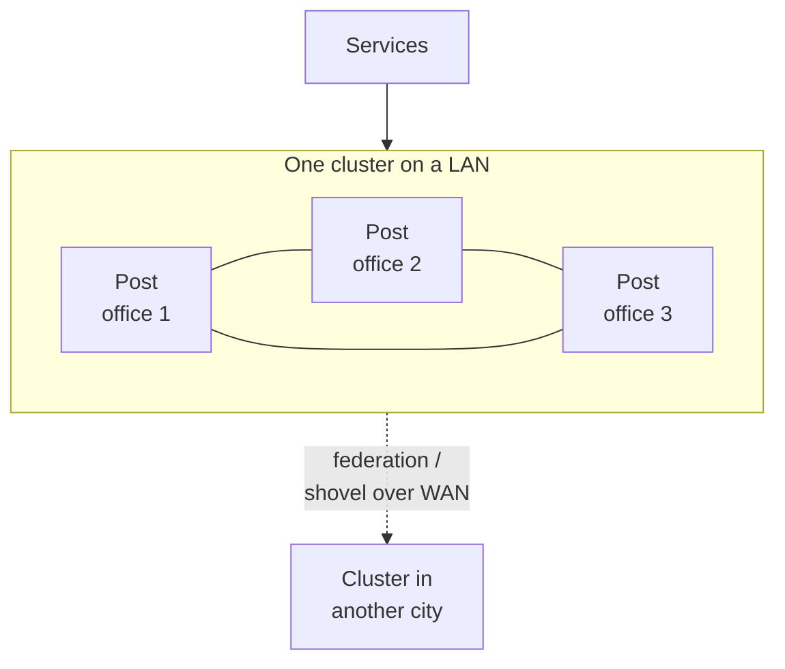

> [!tldr] Quick read
> - A [[en/concepts/clustering|cluster]] is a group of RabbitMQ nodes sharing one set of metadata. An application connected to any node sees every queue. But the **contents** are replicated only for quorum queues and streams.
> - Since RabbitMQ 4.3, metadata lives in [[en/concepts/khepri|Khepri]], a Raft-based store. The cluster needs **a majority of nodes up** to start and to change its structure, so always use an odd number of nodes: 3 or 5.
> - [[en/concepts/network-partition|Network partition]] (the network is split): since 4.3 the `pause_minority`, `autoheal`… strategies are gone. Raft decides: the majority side keeps running, the minority side stands still.
> - Clusters are for LANs only. To link distant clusters, use [[en/concepts/federation|federation]] (the remote cluster pulls messages over when someone needs them) or a [[en/concepts/shovel|shovel]] (a one-way pump of messages from one place to another).
> - [[en/concepts/feature-flags|Feature flags]] let nodes of different versions run together during a rolling upgrade. Once enabled, they cannot be disabled.

> [!info] Context
> Station 8 of **the RabbitMQ line**. At [[en/posts/2026-11-21-rabbitmq-queue-types|station 7]], quorum queues replicated messages across several nodes. This station builds those nodes: a 3-node cluster with Docker Compose, then shuts down the nodes one by one. The example is **flash-sale**, a time-limited discount shop I wrote myself, which currently runs a single RabbitMQ node in dev. You don't need to know the project's code.

> [!abstract]- Quick glossary for this post (click to open)
> - **Quorum queue, Raft, leader, majority**: see [[en/posts/2026-11-21-rabbitmq-queue-types|station 7]].
> - **Metadata**: information *about* the system rather than messages: users, vhosts, exchanges, queues, bindings, policies.
> - **Erlang**: the language RabbitMQ is written in. Erlang nodes talk to each other through their own mechanism.
> - **Erlang cookie**: a shared secret string; two nodes can only talk if they have the same cookie. The command-line tools need this cookie too.
> - **LAN / WAN**: local network (fast, stable, same data center) / wide area network (between cities, slower and flakier).
> - **Docker Compose**: a tool that runs several containers at once from one configuration file.
> - **Kubernetes**: a system that runs and orchestrates containers across many machines. A **pod** is one running instance of an application in it.
> - **Rolling upgrade**: upgrading one machine at a time while the others keep serving.

## Picture it first: a chain of post offices and the post office in another city

| Everyday life | Concept |
|---|---|
| Three post offices in the same city share one address book and staff directory; customers can send mail from any of them | [[en/concepts/clustering\|Clustering]] |
| The shared address book, which can only be changed when a majority of postmasters agree | [[en/concepts/khepri\|Khepri]] |
| The phone line between post offices is cut, and each group thinks the other has closed | [[en/concepts/network-partition\|Network partition]] |
| The Da Nang post office asks Hanoi to send copies of relevant letters, only when someone in Da Nang needs them | [[en/concepts/federation\|Federation]] |
| A truck that regularly carries mail from the old warehouse to the new one | [[en/concepts/shovel\|Shovel]] |
| A new procedure applies only once every post office has been trained | [[en/concepts/feature-flags\|Feature flags]] |



## The problem: one node is a single point of failure

Flash-sale runs a single RabbitMQ node in Docker. When that node restarts for an upgrade, it takes 30 seconds: 30 seconds in which nobody can publish events (luckily, the outbox from station 5 holds them back). If that node's disk fails, every unprocessed message is lost.

I used to think "add a second node and we're done". Reading the docs, I found that a 2-node cluster is the **worst** configuration: when the two nodes lose contact, neither side has a majority, and everything built on Raft stops. The real questions are: what does a cluster replicate, how many nodes can it lose and keep running, and when the network is cut, who gets to decide?

## How it works

<figure class="figure-map" style="--ar: 1 / 1">
<div class="frame"><iframe data-archify="../../diagrams/rabbitmq-cluster/cluster.en.html" title="Architecture diagram: a three-node cluster and a remote cluster linked by federation or shovel" loading="lazy"></iframe></div>
<figcaption><span><b>Figure 1.</b> Inside a cluster, nodes replicate metadata and quorum replicas to each other through Raft; between two distant clusters, messages travel by federation or shovel rather than stretching one cluster across a WAN.</span><a href="../diagrams/rabbitmq-cluster/cluster.en.html" target="_blank" rel="noopener">Open full screen</a></figcaption>
</figure>

### What a cluster replicates, and what it doesn't

A RabbitMQ [[en/concepts/clustering|cluster]] is a group of peer nodes (there is no fixed "main" node):

- **Metadata** (users, vhosts, permissions, exchanges, queues, bindings, policies) is replicated to **every** node.
- **Queue contents** depend on the type: a classic queue lives on one node only; quorum queues and streams have replicas on several nodes.
- An application can connect to **any node** and use every queue; if the queue lives on another node, the node holding the connection forwards messages back and forth. That is why you usually put a load balancer or a shared DNS name in front of the cluster, and give clients a list of several addresses so they can reconnect on their own when a node dies.

Requirements for nodes to form a cluster:

- **The same Erlang cookie.** The `rabbitmqctl` tool also needs that cookie to control a node.
- **Network reachability** on port 4369 (epmd, Erlang's address book) and 25672 (inter-node and CLI communication), plus the AMQP port 5672 and the management port 15672.
- **Stable node names**, of the form `rabbit@<hostname>`. Change the hostname and the node becomes a stranger.
- **A LAN.** The RabbitMQ docs state clearly that clusters are not designed to be stretched across a WAN.

There are two ways to join nodes: by hand with `rabbitmqctl join_cluster rabbit@node1` (since 4.1 you no longer need to `reset` the node before joining), or with **peer discovery**, so nodes find each other at startup. Peer discovery is the recommended way in production, with several backends: a fixed list in the config file (the example below uses this), DNS, Kubernetes, AWS, Consul, etcd. There used to be "RAM nodes" (nodes that kept metadata only in RAM); that feature has been removed, and every node is a disk node.

### Khepri: the shared address book

A cluster's metadata needs a consistent place to live. The history:

| Version | Metadata store |
|---|---|
| 3.x | Mnesia, Erlang's built-in database |
| 3.13 | [[en/concepts/khepri\|Khepri]] experimental |
| 4.0 | Khepri officially supported |
| 4.2 | Khepri is the default for new clusters |
| 4.3 | **Mnesia removed**, Khepri is the only store |

Khepri uses Raft, the same algorithm as quorum queues. The consequence: **the cluster needs a majority of nodes up** to change metadata (create a queue, add a user, change a policy) and to start. A 3-node cluster that loses 2 nodes can still read on the remaining node, but cannot create new queues. On Kubernetes, the docs recommend letting the pods start in parallel (`podManagementPolicy: Parallel`) so they find each other and reach a majority, instead of waiting for one pod at a time.

### Network partition: when the network is cut

A [[en/concepts/network-partition|network partition]] is when the nodes are still alive but cannot see each other: a loose cable, a failed switch, a firewall configuration change. Each group of nodes thinks the other has died. The danger is that both groups accept writes, and when they reconnect the data conflicts.

- **Before 4.3** (the Mnesia era), RabbitMQ had the `cluster_partition_handling` strategies: `ignore`, `pause_minority`, `pause_if_all_down`, `autoheal`. Many articles, including RabbitMQ's current production checklist, still advise "if unsure, pick `pause_minority`".
- **Since 4.3**, these strategies have been removed. The config key is still accepted but has no effect. Raft decides: the majority side elects a leader (if needed) and keeps running; the minority side cannot write anything. When the network heals, the minority side catches up on its own.

Unacked messages on the old leader are returned to the queue when a new leader takes over, so consumers may receive duplicates (station 5). A classic queue on the minority side is unusable until the network heals.

| Nodes | Majority | Nodes that can die or be cut off |
|---|---|---|
| 1 | 1 | 0 |
| 2 | 2 | **0** |
| 3 | 2 | 1 |
| 5 | 3 | 2 |

### Federation and shovel: linking distant clusters

When you need RabbitMQ in several data centers, each site runs **its own cluster**, and messages move between clusters with one of two plugins. Both work when the two sides run different versions and different users, and both tolerate a flaky WAN.

[[en/concepts/federation|Federation]]:

- **Federated exchange**: an exchange in the downstream cluster receives copies of the messages published to the exchange of the same name in the upstream cluster. Good for "broadcasting events to several regions".
- **Federated queue**: a queue in the downstream cluster pulls messages from the queue of the same name upstream **when it has consumers but no messages**. Good for spreading load across regions.
- Configured with policies and parameters; asynchronous.

[[en/concepts/shovel|Shovel]]:

- A simple process: read from a source (queue or exchange), publish to a destination (queue or exchange), one way, with acks and confirms on both ends.
- It speaks both AMQP 0-9-1 and AMQP 1.0, so it is also used to move messages between two different systems.
- **Dynamic shovels** declared at runtime (through the CLI, the HTTP API or the management UI) are the modern approach; static shovels are written in the config file. Since 4.2 there is a **local shovel** that runs inside one cluster.
- Common uses: moving leftover messages when changing queue type (station 7), moving clusters during a blue-green upgrade, draining a dead-letter queue back into the main queue.

The rule to remember: **clusters** for availability within one data center; **federation/shovel** for geographic distance.

### Feature flags and upgrades

Nodes in a cluster may run different versions during a rolling upgrade. [[en/concepts/feature-flags|Feature flags]] keep that safe: a new feature turns on only when **every** node supports it.

- Upgrade all the nodes, then run `rabbitmqctl enable_feature_flag all`.
- Once a flag is enabled, it **cannot be disabled**. Some flags become required in the next version: they must be enabled before you upgrade further.

Alongside them runs the lifecycle of **deprecated features**: `permitted_by_default` (still works, with a warning) → `denied_by_default` (blocked, can be re-enabled through config) → `disconnected` → `removed`. The `rabbitmq-diagnostics list_deprecated_features` command lists their state; on RabbitMQ 4.4.1 I saw that non-durable non-exclusive queues and global QoS were `denied_by_default`, while mirrored queues and RAM nodes were `removed`. Run `rabbitmq-diagnostics check_if_any_deprecated_features_are_used` before upgrading.

Three ways to upgrade:

| Approach | How | When |
|---|---|---|
| **Rolling** (recommended) | upgrade one node at a time while the others keep serving | between adjacent versions |
| **Blue-green** (safest) | build a new cluster alongside, move clients and messages (shovel) over | jumping several versions, or from 3.13 with Khepri enabled |
| Grow-then-shrink | add new nodes to the cluster, then remove the old ones | not recommended by the docs |

A few concrete rules: from 3.13, 4.0 or 4.1 you must go to **4.2 first** before moving to 4.3/4.4. Before stopping a node, run `rabbitmq-diagnostics check_if_node_is_quorum_critical`: it tells you whether stopping that node would make any quorum queue lose its majority. After the upgrade, `rabbitmq-queues rebalance all` spreads the leaders evenly again. Upgrade Erlang along with RabbitMQ according to the compatibility table.

Flash-sale uses the `rabbitmq:3-management-alpine` image, which is the 3.13 series, out of community support since 30 September 2024. The path to 4.4 will have to go through 4.2. Luckily, the current code uses neither non-durable queues nor global QoS, the two things blocked since 4.3.

## Runnable example: shutting down a three-node cluster step by step

The [rabbitmq-cluster](../code/rabbitmq-cluster/quorum-failover.ts) folder has three files: `compose.yaml` builds 3 nodes, `rabbitmq.conf` lets them find each other, and `quorum-failover.ts` shuts down the nodes one by one.

```yaml
# compose.yaml
x-node: &node
  image: rabbitmq:4-management
  environment:
    RABBITMQ_ERLANG_COOKIE: atlas-demo-cookie   # every node (and the CLI) must share the cookie
  volumes:
    - ./rabbitmq.conf:/etc/rabbitmq/rabbitmq.conf:ro
services:
  rmq1: { <<: *node, hostname: rmq1, ports: ["5674:5672"] }
  rmq2: { <<: *node, hostname: rmq2, ports: ["5675:5672"] }
  rmq3: { <<: *node, hostname: rmq3, ports: ["5676:5672"] }
```

```ini
# rabbitmq.conf: the three nodes find each other through a fixed list
cluster_formation.peer_discovery_backend = classic_config
cluster_formation.classic_config.nodes.1 = rabbit@rmq1
cluster_formation.classic_config.nodes.2 = rabbit@rmq2
cluster_formation.classic_config.nodes.3 = rabbit@rmq3
loopback_users.guest = false   # demo only: let guest log in from the host machine
```

```bash
docker compose -p atlas-cluster up -d          # wait ~30 seconds
docker exec atlas-cluster-rmq1-1 rabbitmqctl cluster_status   # Running Nodes: rmq1, rmq2, rmq3
npm i amqplib && node quorum-failover.ts
docker compose -p atlas-cluster down
```

The script connects to `rmq1`, creates a 3-replica quorum queue, then in turn: publishes a message; stops `rmq3` and publishes; also stops `rmq2` and publishes; restarts `rmq2`; restarts `rmq3`. Each publish waits for its confirm with a time limit:

```ts
function publish(ch: amqp.ConfirmChannel, body: string, ms: number): Promise<string> {
  return new Promise((resolve) => {
    const timer = setTimeout(() => resolve(`${body}: CHƯA được xác nhận sau ${ms}ms`), ms);
    ch.sendToQueue(Q, Buffer.from(body), { persistent: true }, (err) => {
      clearTimeout(timer);
      resolve(`${body}: ${err ? 'bị từ chối (nack)' : 'đã xác nhận (ack)'}`);
    });
  });
}
docker(`stop ${node(2)}`);
const pending = publish(ch, 'don-3', 30000);
console.log(await Promise.race([pending, sleep(5000).then(() => 'don-3: sau 5 giây vẫn chưa có xác nhận, publisher phải chờ')]));
docker(`start ${node(2)}`);
console.log(await pending);
```

```text
$ node quorum-failover.ts
0) quorum queue with 3 replicas: leader=rabbit@rmq1, alive=rabbit@rmq1, rabbit@rmq2, rabbit@rmq3
   don-1: confirmed (ack)
1) stopped rmq3, 2/3 nodes left (still a majority): leader=rabbit@rmq1, alive=rabbit@rmq1, rabbit@rmq2
   don-2: confirmed (ack)
2) also stopped rmq2, 1/3 nodes left (majority lost)
   don-3: still no confirm after 5 seconds, publisher has to wait
3) restarted rmq2, majority is back...
   don-3: confirmed (ack)
   messages in queue: 3 | leader=rabbit@rmq1, alive=rabbit@rmq1, rabbit@rmq2
4) restarted rmq3: leader=rabbit@rmq1, alive=rabbit@rmq1, rabbit@rmq2, rabbit@rmq3
```

*(Output labels translated; the files themselves print Vietnamese.)*

This is the majority table above, running for real:

- Losing 1/3 of the nodes: nobody notices, and `don-2` is still confirmed immediately.
- Losing 2/3 of the nodes: `rmq1` is still alive and the connection is still open, but `don-3` **is not confirmed**. The queue does not dare write without a majority. A producer using confirms knows this; a producer without confirms would think the message was sent.
- With the majority back: the confirm for `don-3` arrives, and the queue holds all 3 messages. No message was lost.
- When `rmq3` comes back, it catches up on its own and rejoins the replica list.

The script deliberately never stops `rmq1`, because it holds the connection. In practice, clients should have a list of several nodes and reconnect on their own; when the leader dies, the other two nodes elect a new leader as in Figure 1 at station 7.

## Misconceptions and common traps

### A 2-node cluster "for redundancy"

If the network between the two nodes breaks, neither side has a majority: Khepri and every quorum queue stop together. Use 3 or 5 nodes.

### Stretching one cluster across two data centers

WAN latency and flakiness make Raft re-elect leaders constantly. One cluster per site, linked with federation or shovel.

### Configuring `pause_minority` on 4.3+

It no longer has any effect. Raft already handles that. Old articles and checklists have not caught up.

### Thinking a cluster makes classic queues survive

A classic queue lives on one node only; if that node dies, the queue is unusable. Important data must be in quorum queues.

### Forgetting the cookie when using the CLI

`rabbitmqctl` reports it cannot reach the node, even though the node is running, just because the CLI reads a different cookie. Use the same cookie for the nodes and for the user running the CLI.

### Skipping versions when upgrading

You cannot go straight from 3.13 to 4.4. Go through 4.2, enable all feature flags at each step, and check for deprecated features before upgrading.

### Stopping a node without checking quorum

Stopping a node when a quorum queue only has its majority thanks to that node makes the queue stop. Run `check_if_node_is_quorum_critical` first.

## Self-check questions

> [!question]- What does a RabbitMQ cluster replicate to every node?
> Metadata: users, vhosts, permissions, exchanges, queues, bindings, policies. Message contents are replicated only for quorum queues and streams.

> [!question]- Why shouldn't you run a 2-node cluster?
> The majority of 2 is 2. Losing one node or breaking the network between them leaves neither side with a majority, so Khepri and quorum queues both stop writing.

> [!question]- On RabbitMQ 4.4, when the network splits a 5-node cluster into a group of 3 and a group of 2, what happens?
> The group of 3 has the majority, keeps running and elects new leaders for the quorum queues that need them. The group of 2 cannot write. When the network heals, the group of 2 catches up on its own. Unacked messages may be redelivered.

> [!question]- How do federation and shovel differ?
> Federation is a relationship per exchange or queue: the downstream cluster receives copies of messages from upstream, and a federated queue pulls only when a consumer needs them. A shovel is a one-way pump from a source to a destination, simpler and more general.

> [!question]- What do you need to do before a rolling upgrade?
> Check the upgrade path (through 4.2 if needed), enable every feature flag, check for deprecated features in use, and before stopping each node run `check_if_node_is_quorum_critical`.

> [!question]- In the example, why is `don-3` not confirmed even though `rmq1` is still alive?
> A 3-replica quorum queue needs a majority of 2 to write. With only 1 node left, the write cannot take effect, and the broker sends no confirm until the majority is back.

## References

- [RabbitMQ: Clustering Guide](https://www.rabbitmq.com/docs/clustering)
- [RabbitMQ: Metadata Store (Khepri)](https://www.rabbitmq.com/docs/metadata-store)
- [RabbitMQ: Clustering and Network Partitions](https://www.rabbitmq.com/docs/partitions)
- [RabbitMQ: Federation](https://www.rabbitmq.com/docs/federation) and [Shovel](https://www.rabbitmq.com/docs/shovel)
- [RabbitMQ: Feature Flags](https://www.rabbitmq.com/docs/feature-flags) and [Deprecated Features](https://www.rabbitmq.com/docs/deprecated-features)
- [RabbitMQ: Upgrading](https://www.rabbitmq.com/docs/upgrade)
- [RabbitMQ 4.3 release notes](https://github.com/rabbitmq/rabbitmq-server/blob/main/release-notes/4.3.0.md)
