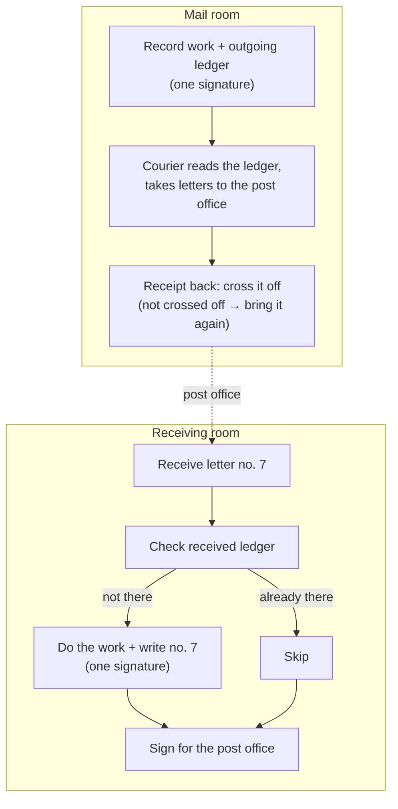

> [!tldr] Quick read
> - There are two levels of guarantee: **at-most-once** (no acks, no confirms: messages may be lost, never duplicated) and [[en/concepts/at-least-once-delivery|at-least-once]] (acks + confirms + persistent messages: nothing lost, **duplicates possible**).
> - RabbitMQ doesn't promise [[en/concepts/exactly-once-delivery|exactly-once]]. "Exactly once" is the application's job: at-least-once plus an [[en/concepts/idempotent-consumer|idempotent consumer]].
> - An idempotent consumer writes the event ID into a "processed" table **in the same transaction** as the business work; when it sees an old ID again, it skips the work and still acks.
> - The [[en/concepts/transactional-outbox|transactional outbox]] solves "write to the database, then publish a message": write the event into an outbox table in the same transaction as the data, and a separate process reads the outbox and publishes it.
> - [[en/concepts/message-ordering|Ordering]] only holds within one queue with one consumer; multiple consumers, requeues and priorities all reorder messages. [[en/concepts/request-reply|Request-reply]] uses `reply_to` + `correlation_id`.

> [!info] Context
> Station 5 of **the RabbitMQ line**. The example is **flash-sale**, a time-limited flash-sale shop I wrote myself. When a customer cancels an order, an `order.cancelled` event is published so the stock service **adds back** the quantity. Add back too little and stock gets stuck; add it back twice and you get phantom stock and oversell what you really have. This station is all about "not too little, not too much". The flash-sale code in this post is trimmed and renamed; you don't need to know the project.

> [!abstract]- Quick glossary for this post (click to open)
> - **Ack, publisher confirm, persistent, redelivered**: see [[en/posts/2026-11-21-rabbitmq-ack-confirm|station 4]].
> - **Transaction (database transaction)**: a group of SQL statements that either all take effect or are all rolled back. See also [[en/concepts/dual-write|Dual Write]].
> - **Commit**: the statement that finalizes a transaction, making every change officially take effect.
> - **Postgres**: the database system flash-sale uses.
> - **`ON CONFLICT DO NOTHING`**: a Postgres `INSERT` that "does nothing if the key already exists", without raising an error.
> - **`FOR UPDATE SKIP LOCKED`**: locks the rows you read, and skips rows locked by someone else. Lets several processes take work at the same time without stepping on each other.
> - **Cron job**: a job that runs periodically, for example once a second.
> - **Idempotency**: doing something once or many times gives the same result. See [[en/concepts/idempotency|Idempotency]] on the API line.
> - **UUID**: a random string long enough that it almost never collides, used as an identifier.

## Picture it first: the outgoing ledger and the received ledger

A careful office keeps two ledgers: an **outgoing ledger** in the mail room, and a **received ledger** in the receiving room.

| Everyday life | Concept |
|---|---|
| The post office promises: registered letters never get lost, but occasionally get delivered twice | [[en/concepts/at-least-once-delivery\|At-least-once delivery]] |
| The promise "every letter arrives exactly once" that no post office dares to sign | [[en/concepts/exactly-once-delivery\|Exactly-once delivery]] |
| The receiving room checks its ledger: letter no. 7 already handled, so it's filed away, not redone | [[en/concepts/idempotent-consumer\|Idempotent consumer]] |
| Writing the letter into the **outgoing ledger** at the same time as recording the work in the books; the courier works from the ledger | [[en/concepts/transactional-outbox\|Transactional outbox]] |
| One line of people at one counter stays in order; open three counters and who finishes first is anyone's guess | [[en/concepts/message-ordering\|Message ordering]] |
| Sending a letter asking for a price, with "reply to box no. 12, question code A7" | [[en/concepts/request-reply\|Request-reply]] |



## The problem: where duplicate messages come from

After station 4, I thought I was done: manual acks, confirms, persistence. No more lost messages. But picture this: a customer cancels an order of 2 items, and stock goes up by 4. No line of code adds twice.

I used to think "once it's acked, it never comes back". It turns out the very mechanisms that prevent message loss are what create duplicates:

1. **The consumer dies after finishing the work, before acking.** Stock has been added back, but the broker never got the ack, so it redelivers to another consumer. Added back a second time.
2. **The producer republishes because it didn't see a confirm.** The message reached the broker, but the confirm was lost on the way back (a flaky network, the producer restarting). A safe producer has to republish, and the broker ends up with two copies.
3. **The cluster changes leader** (stations 7, 8): when the leader node of a quorum queue loses contact, the unacked messages go back to the queue and are redelivered.

No RabbitMQ setting can switch off all three. The fix has to be in the application.

## How it works

<figure class="figure-map" style="--ar: 4 / 5">
<div class="frame"><iframe data-archify="../../diagrams/rabbitmq-delivery-guarantees/outbox-inbox.en.html" title="Sequence diagram: the outbox on the sending side and the processed table on the receiving side" loading="lazy"></iframe></div>
<figcaption><span><b>Figure 1.</b> The outbox makes sure the event isn't lost even if the broker is down at commit time; the "processed" table makes sure an event that arrives twice still adds back stock only once.</span><a href="../diagrams/rabbitmq-delivery-guarantees/outbox-inbox.en.html" target="_blank" rel="noopener">Open full screen</a></figcaption>
</figure>

### At-most-once and at-least-once

RabbitMQ's "Reliability" guide names two levels:

| | At-most-once | [[en/concepts/at-least-once-delivery\|At-least-once]] |
|---|---|---|
| Setup | auto-ack, no confirms, non-persistent messages | manual acks, confirms, durable queue, persistent messages |
| Message loss | possible | no (within the limits of replication, station 7) |
| Duplicates | no | **possible** |
| Fits | metrics, debug logs, data where losing a few points is fine | orders, payments, inventory |

The two levels are a tradeoff: if you don't want to lose anything, you have to accept republishing when in doubt, and republishing sometimes creates extras. There is no third box.

### Why there is no exactly-once

[[en/concepts/exactly-once-delivery|Exactly-once]] means each message is *processed* exactly once, even when the network drops, a process dies, or the broker switches nodes. The core problem: **processing and acking are two operations in two different systems** (your database and RabbitMQ). No transaction spans both, so there is always a moment between "done" and "reported". Die at exactly that moment and the broker can't know whether the work is done, and the only safe choice is to redeliver.

The RabbitMQ docs don't promise exactly-once. Systems that advertise "exactly-once" usually guarantee it only within themselves (for example from one topic to another), not all the way into the consumer's database. The practical approach everywhere is: **at-least-once + idempotent processing = effectively exactly-once**.

### Idempotent consumer: the "processed" ledger

An [[en/concepts/idempotent-consumer|idempotent consumer]] is a consumer for which receiving a message twice gives the same result as receiving it once. There are two ways:

1. **Naturally idempotent work.** "Set order status = canceled" run twice is still canceled. "Add 2 to stock" is not.
2. **A processed ledger (inbox / dedup table).** Each event carries a unique ID. The consumer writes the ID into a table whose primary key is that ID; if the write succeeds, it does the work, and if the ID is already there, it skips.

What decides everything: **writing to the ledger and doing the work must be in the same database transaction**:

- Write the ledger in a separate transaction, *before* the work: the ledger is written, then the work fails. The redelivery sees the ledger entry and skips. The work is **lost**.
- Write the ledger *after* the work, in a separate transaction: the work is done, then the process dies before writing the ledger. The redelivery sees no entry and does the work a second time. **Duplicate**.
- Same transaction: either both take effect or neither does. Wherever it dies, the result is correct.

Flash-sale does exactly that in a base class shared by every consumer. Trimmed and renamed:

```ts
// illustration, not runnable on its own
const eventId = msg.properties.headers['x-event-id'] ?? msg.properties.messageId;
try {
  await db.$transaction(async (tx) => {
    // INSERT INTO processed_events (event_id, consumer) ... ON CONFLICT DO NOTHING RETURNING event_id
    const firstTime = await processedEvents.mark(tx, eventId, this.consumerName);
    if (!firstTime) return;          // already processed: skip
    await this.handle(payload, tx);  // business work, same transaction
  });
  return ACK;
} catch {
  return NACK_NO_REQUEUE;            // error: send to the dead-letter box (station 6)
}
```

Two details worth copying:

- The table's primary key is the pair **(event ID, consumer name)**. Each consumer keeps its own ledger: the stock service having processed `evt-7` doesn't mean the email service has.
- A duplicate is still **acked**. If you don't ack it, the duplicate keeps coming back to the queue forever.

The event ID must be generated by **whoever creates the event** and kept unchanged when republishing (in flash-sale, it's the outbox row ID). Don't rely on the `redelivered` flag: the example below shows that a duplicate caused by the producer republishing has `redelivered = false`.

### Transactional outbox: no loss on the sending side

The sending side has its own problem, which is exactly a [[en/concepts/dual-write|dual write]]: cancel the order in the database **and** publish the event to RabbitMQ.

- Commit the database, then publish: if the process dies between the two steps, the order is canceled but the event never goes out. Stock is stuck forever.
- Publish, then commit: if the commit fails (a data constraint, a deadlock), the event has gone out for something that didn't happen.

The [[en/concepts/transactional-outbox|transactional outbox]] turns "publishing" into "writing":

1. In **the same transaction** as the business work, write the event into an `outbox` table (status PENDING).
2. A separate process, the **relay**, periodically reads the PENDING rows and publishes them to RabbitMQ with publisher confirms.
3. When the confirm arrives, mark the row PUBLISHED. On an error, increment the attempt count, back off, and try again.

If the relay dies after the confirm but before marking the row, it publishes again next time, so an outbox **always comes with** an idempotent consumer. The two patterns are a pair.

Flash-sale's relay runs every second, takes at most 100 rows with `FOR UPDATE SKIP LOCKED` so several pods running in parallel don't take the same rows, and publishes with `persistent: true` and `messageId` set to the outbox row ID:

```ts
// illustration, not runnable on its own
if (!amqp.connected) return;  // connection lost: leave it for next time, don't publish now
await amqp.publish(exchangeFor(event), event.type, event.payload, {
  messageId: event.id, persistent: true,
  headers: { 'x-event-id': event.id },
});
await outbox.markPublished(event.id);
```

The first line is a real lesson. The connection library the project uses (`amqp-connection-manager`) **holds messages back** while the connection is lost and only sends them after reconnecting, so the `publish` promise never settles while the broker is down. A relay that waits on it hangs the whole loop. Checking the connection first and skipping this round is safer, because the outbox row stays PENDING and will be published next time.

Thanks to the outbox, even a broker outage doesn't lose events: they sit in Postgres and are published when the broker comes back.

### Message ordering

[[en/concepts/message-ordering|Ordering]] in RabbitMQ holds to this extent: messages published by **one producer on one channel** into **one queue** are delivered in the order they were published. But the order gets shuffled when:

- **Several consumers read one queue**: message 1 to A, message 2 to B; if B is faster, message 2 finishes first.
- **Requeue**: a returned message is put back in its original position if possible, otherwise near the head, but meanwhile later messages have already been delivered.
- **Priority** (station 6): high-priority messages jump ahead.
- **Several producers** or several channels: there is no shared order among them.

If order matters (for example, "placed" must come before "canceled" for the same order), there are three options: a single consumer for that queue, **Single Active Consumer** so you still have a standby ([[en/posts/2026-11-21-rabbitmq-queue-types|station 7]]), or splitting messages by key with a consistent hash exchange (station 3) so every message of one order goes into the same queue. The most robust option is to make the consumer **independent of order**: carry a version number in the event and ignore events older than the current state.

### Request-reply: asking and waiting for an answer through the broker

Sometimes you need to ask through the broker and wait for the answer (RPC). [[en/concepts/request-reply|Request-reply]] uses two properties from station 2:

- `reply_to`: the name of the queue where the requester wants to receive the answer.
- `correlation_id`: the question's ID, so the requester knows which answer belongs to which question.

When the responder is done, it publishes the result to the default exchange with the routing key equal to `reply_to`, carrying the same `correlation_id`.

RabbitMQ has a lighter option built in than declaring your own reply queue: **Direct Reply-to**. The requester consumes the pseudo-queue `amq.rabbitmq.reply-to` (it must use `noAck: true`, on **the same channel** used to publish the question, and must consume *before* publishing). The answer goes straight back to that channel without passing through any real queue. In exchange, it is at-most-once: if the requester dies, the answer is lost. NestJS's RabbitMQ transport uses Direct Reply-to by default for `client.send()`.

I rarely need this pattern. If the requester has to wait for the answer before moving on, a direct HTTP/gRPC call is usually simpler; RPC through a broker fits when you want to use a work queue to spread questions across several workers.

## Runnable example

Two files, with the same Docker broker as in the previous stations:

```bash
docker run -d --rm --name atlas-rabbit -p 5673:5672 -p 15673:15672 rabbitmq:4-management
npm i amqplib
node idempotent-consumer.ts
node rpc-direct-reply.ts
```

### Two sources of duplicates, one dedup ledger

[idempotent-consumer.ts](../code/rabbitmq-delivery-guarantees/idempotent-consumer.ts) creates both sources of duplicates at once: the producer publishes `evt-1` twice (like an outbox relay republishing), and consumer A commits and then dies before acking. The "database" here is an in-memory `Map` with a simulated `transaction` function so the example runs standalone.

```ts
transaction((tx) => {
  if (tx.processed.has(id)) { skipped = true; return; }
  tx.processed.add(id);   // write the ledger
  tx.stock -= qty;        // business work, same transaction
});
if (label === 'A' && crashOnce) { crashOnce = false; c.close(); return; } // dies after commit, before ack
c.ack(msg);
```

```text
$ node idempotent-consumer.ts
[A] evt-1 redelivered=false → decrement stock 2; stock left 98
[B] evt-1 redelivered=true → ALREADY PROCESSED, skipped; stock left 98
[B] evt-1 redelivered=false → ALREADY PROCESSED, skipped; stock left 98
[B] evt-2 redelivered=false → decrement stock 5; stock left 93
Final result: stock = 93 (correct is 100 - 2 - 5 = 93)
```

*(Output labels translated; the files themselves print Vietnamese.)*

`evt-1` arrives three times: the first time, the redelivery after A dies (`redelivered=true`), and the producer's republished copy (`redelivered=false`). The third line is why you mustn't use the `redelivered` flag to prevent duplicates. Final stock is still exactly 93.

### Request-reply with Direct Reply-to

[rpc-direct-reply.ts](../code/rabbitmq-delivery-guarantees/rpc-direct-reply.ts) asks for a product's price through the broker:

```ts
await client.consume('amq.rabbitmq.reply-to', (msg) => {
  pending.get(msg.properties.correlationId)?.(msg.content.toString());
}, { noAck: true });               // must consume before publishing, noAck is required

client.sendToQueue(Q, Buffer.from(JSON.stringify({ sku })),
  { replyTo: 'amq.rabbitmq.reply-to', correlationId: id });

// server side:
server.publish('', msg.properties.replyTo, Buffer.from(JSON.stringify({ sku, price })),
  { correlationId: msg.properties.correlationId });
```

```text
$ node rpc-direct-reply.ts
{"sku":"AO-THUN","price":99000} (4.4 ms)
{"sku":"KHONG-CO","price":0}
```

One request-reply round trip takes a few milliseconds on my machine. If the server doesn't answer, the question only expires thanks to a 2-second `setTimeout` on the client; always set a timeout for RPC through a broker.

## Misconceptions and common traps

### "RabbitMQ guarantees each message is processed exactly once"

No. There is only at-most-once or at-least-once. Important systems choose at-least-once and make their consumers idempotent.

### Preventing duplicates with `redelivered`

This flag can't see duplicates caused by the producer republishing. Use an event ID generated by the event's creator.

### Writing the dedup ledger outside the transaction

Write it first and you can lose work; write it after and you can duplicate work. Same transaction, no exceptions.

### A dedup ledger in RAM

An in-memory `Set` is lost when the process restarts, and each pod has its own `Set`. The ledger must live somewhere durable and shared: the consumer's database, or Redis with a long enough expiry.

### Publishing inside the database transaction

If you publish before committing and the commit fails, the event has gone out for something that didn't happen; a consumer may read the database and not find the order. Use an outbox.

### An outbox you forget to clean up

The outbox table grows forever. Delete or archive PUBLISHED rows once they are old enough, and alert when the number of PENDING or FAILED rows rises.

### Believing a queue is always in order

One queue with several consumers already shuffles the order. Design consumers that tolerate out-of-order messages, or use SAC/consistent hash deliberately.

## Self-check questions

> [!question]- Name three sources of duplicate messages in RabbitMQ.
> The consumer dies after processing but before acking; the producer republishes because it didn't get a confirm; the leader of a quorum queue changes during a network partition and unacked messages are redelivered.

> [!question]- Why must the "processed" table be in the same transaction as the business work?
> If they are separate, dying between the two steps gives one of two wrong results: marked but not done (lost), or done but not marked (duplicate).

> [!question]- What problem does the outbox solve, and what problem does it leave?
> It solves the "dual write": the event isn't lost when the database commit succeeds but publishing to the broker fails. It leaves: the relay may publish duplicates, so the consumer must be idempotent.

> [!question]- Is a message with `redelivered = false` definitely unprocessed?
> It has definitely never been *delivered* before from this queue. But it may still be the producer's republished copy of an event that was already processed, so it can't be used to prevent duplicates.

> [!question]- One queue, three consumers, prefetch 10. Can you keep the order "placed first, canceled after" for the same order?
> Not reliably. The two messages may go to two different consumers and the cancellation may finish first. You need a single consumer (or SAC), splitting by order key, or a consumer that ignores events older than the current state.

> [!question]- What constraints does Direct Reply-to have?
> The requester must consume `amq.rabbitmq.reply-to` with `noAck: true`, on the same channel used to publish the question, and before publishing. The answer is at-most-once: if the requester dies, it is lost.

## References

- [RabbitMQ: Reliability Guide](https://www.rabbitmq.com/docs/reliability)
- [RabbitMQ: Consumer Acknowledgements and Publisher Confirms](https://www.rabbitmq.com/docs/confirms)
- [RabbitMQ: Queues](https://www.rabbitmq.com/docs/queues) (message ordering)
- [RabbitMQ: Direct Reply-to](https://www.rabbitmq.com/docs/direct-reply-to) and [tutorial 6: RPC](https://www.rabbitmq.com/tutorials/tutorial-six-javascript)
- [microservices.io: Transactional outbox](https://microservices.io/patterns/data/transactional-outbox.html)
- [NestJS: RabbitMQ transport](https://docs.nestjs.com/microservices/rabbitmq)
