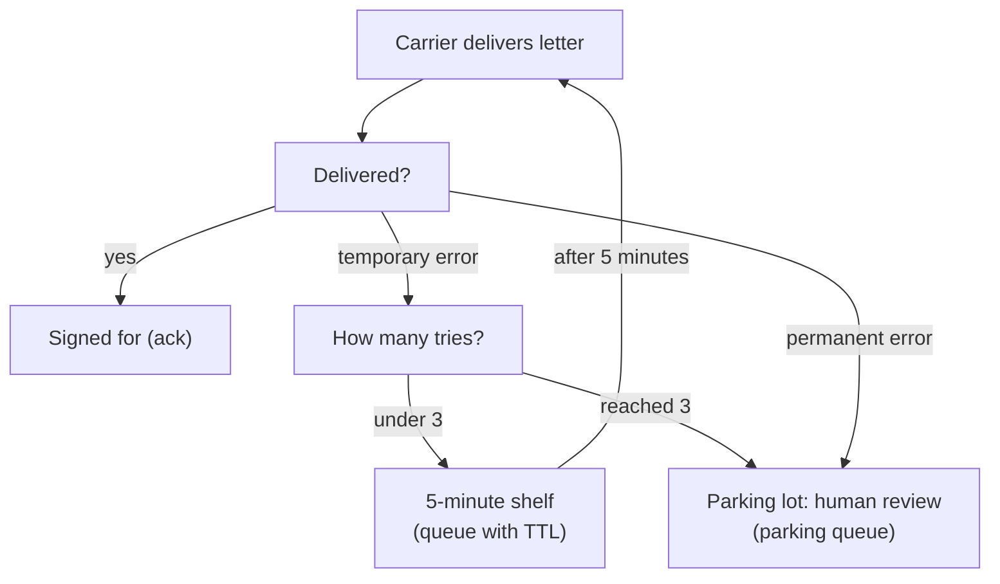

> [!tldr] Quick read
> - A [[en/concepts/dead-letter-exchange|dead letter exchange]] (DLX) is the exchange that receives "dead" messages: rejected without requeue, expired, pushed out because the queue is full, or over the delivery limit. If no queue is bound to the DLX, dead messages **vanish silently**.
> - [[en/concepts/message-ttl|TTL]] sets how long a message lives (per queue or per message). An expired message is only removed when it reaches the **head** of the queue.
> - A [[en/concepts/queue-length-limit|length limit]] keeps a queue from growing forever: drop the oldest message (`drop-head`) or refuse new ones (`reject-publish`).
> - [[en/concepts/delayed-retry|Delayed retry]] = nack without requeue → DLX → a waiting queue with a TTL → on expiry, back to the main queue; count attempts with the `x-death` header. A [[en/concepts/poison-message|poison message]] that keeps failing goes to a "parking lot".
> - [[en/concepts/delayed-message|Scheduled delivery]]: the delayed message plugin is no longer maintained. RabbitMQ 4.4 builds it into quorum queues. A [[en/concepts/priority-queue|priority queue]] lets important messages jump ahead while the queue has a backlog.

> [!info] Context
> Station 6 of **the RabbitMQ line**. The example is **flash-sale**, a time-limited discount shop I wrote myself: a consumer calls the payment gateway, and the payment gateway sometimes fails temporarily. There are also messages that fail *permanently*, such as an event for an order that has been deleted. This station tells the two kinds apart and gives each one its own way out. You don't need to know the project's code.

> [!abstract]- Quick glossary for this post (click to open)
> - **Ack, nack, reject, requeue**: see [[en/posts/2026-11-21-rabbitmq-ack-confirm|station 4]]. In short: `nack`/`reject` with `requeue = false` means "I can't process this message, don't put it back in the queue".
> - **Exchange, binding, routing key, header**: see [[en/posts/2026-11-21-rabbitmq-amqp-model|station 2]] and [[en/posts/2026-11-21-rabbitmq-exchanges|station 3]].
> - **Temporary / permanent error**: a temporary error goes away if you wait (a network blip, another service restarting); a permanent error fails no matter how many times you try (corrupt data, an order that does not exist).
> - **Backoff**: waiting longer and longer between attempts. See [[en/concepts/retries-with-backoff|Retry with Backoff]] on the API line.
> - **Policy**: configuration applied to many queues/exchanges by name pattern, changeable at runtime. Details at [[en/posts/2026-11-21-rabbitmq-operations|station 9]].
> - **Epoch milliseconds**: a point in time counted in milliseconds since 1 January 1970, the way computers usually store time.

## Picture it first: the post office's dead letter room

Every post office has letters it cannot deliver. A good post office does not throw them away, nor does it let a mail carrier run back and forth to the same address all day.

| Everyday life | Concept |
|---|---|
| The "undeliverable mail" room: every returned letter ends up here | [[en/concepts/dead-letter-exchange\|Dead letter exchange]] |
| A letter marked "destroy after the 15th" | [[en/concepts/message-ttl\|Message TTL]] |
| A mail slot that holds only 100 letters; when full, drop the oldest or refuse new ones | [[en/concepts/queue-length-limit\|Queue length limit]] |
| Nobody home: put the letter on the "redeliver in 5 minutes" shelf, at most 3 times | [[en/concepts/delayed-retry\|Delayed retry]] |
| A letter addressed to a place that does not exist: every delivery attempt fails | [[en/concepts/poison-message\|Poison message]] |
| A letter scheduled "deliver exactly on the morning of the 1st" | [[en/concepts/delayed-message\|Delayed message]] |
| Express mail placed ahead of the pile of regular letters waiting | [[en/concepts/priority-queue\|Priority queue]] |



## The problem: requeue is not retry

At station 4, I learned that on an error I can put a message back in the queue (`requeue = true`). I used to think that gave me retry for free. I tried it with the payment gateway down:

- The message was returned and redelivered **immediately**, within a few milliseconds. The payment gateway had no time to come back.
- The consumer failed, returned, received, failed… thousands of times per second. The CPU of both consumer and broker hit 100%, and the logs filled up.
- If the error is permanent (corrupt JSON), the loop never ends, and the messages behind it get stuck.

On the other hand, `requeue = false` with nothing else configured **drops** the message. Both are bad. What I need: a way out for failed messages, a wait before retrying, and a cap on the number of attempts.

## How it works

<figure class="figure-map" style="--ar: 1 / 1">
<div class="frame"><iframe data-archify="../../diagrams/rabbitmq-dlx-retry/retry-topology.en.html" title="Architecture diagram: delayed retry with a dead letter exchange, TTL and a parking lot" loading="lazy"></iframe></div>
<figcaption><span><b>Figure 1.</b> A failed message takes a lap through a waiting queue with a TTL and comes back to the work queue; if the third attempt still fails, it goes to the parking lot instead of looping forever.</span><a href="../diagrams/rabbitmq-dlx-retry/retry-topology.en.html" target="_blank" rel="noopener">Open full screen</a></figcaption>
</figure>

### Dead letter exchange: the undeliverable mail room

A [[en/concepts/dead-letter-exchange|dead letter exchange]] is not a special kind of exchange. It is an ordinary exchange (usually fanout, topic or direct) that is **designated** to receive a queue's dead messages. A message is "dead-lettered" when:

1. The consumer `reject`s or `nack`s it with `requeue = false`.
2. The message's TTL expires.
3. The message is pushed out because the queue exceeds its length limit (`drop-head`, or `reject-publish-dlx`).
4. The message exceeds the maximum number of deliveries (delivery limit, quorum queues only, [[en/posts/2026-11-21-rabbitmq-queue-types|station 7]]).

Configure it with queue arguments (`x-dead-letter-exchange`, optionally `x-dead-letter-routing-key`) or, better, with the `dead-letter-exchange` **policy**, so you can change it without redeclaring the queue. If both are present, the queue argument wins. Without a separate routing key, dead messages keep their original routing key.

Each time a message dies, the broker adds (or updates) the **`x-death`** header on it. It is an array with one element per (queue, reason) pair, newest first:

| Field | Meaning |
|---|---|
| `queue` | the queue where the message died |
| `reason` | `rejected`, `expired`, `maxlen` or `delivery_limit` |
| `count` | how many times the message has died in this queue for this reason |
| `exchange`, `routing-keys` | where the message was originally published, with which key |
| `time` | the first death |

There are also the `x-first-death-queue`, `x-first-death-reason` and `x-last-death-…` headers for quick reading.

> [!warning] A DLX with no mail slot loses dead letters
> A DLX is just an exchange, and exchanges do not hold messages (station 2). Designate a DLX without binding any queue to it, or mistype the DLX name, and dead messages **disappear without a word**. Flash-sale ran into exactly this bug; a comment in the project's code still tells the story, and since then every DLX is declared together with a dead-letter queue (DLQ) bound with the key `#` to catch every routing key. When I reread the declarations to write this post, I still found one DLX with no DLQ attached: this bug comes back very easily.

By default, moving a message to the DLX happens **without publisher confirms** inside the broker, so in some failure scenarios dead messages can still be lost. Quorum queues have a safer mode, *at-least-once dead-lettering* (station 7).

The broker detects dead-letter cycles (a dead message returning to the same queue without any reject in between) and drops the message. The retry loop in Figure 1 is not treated as a cycle because each lap includes a `rejected`.

### TTL: how long a message lives

[[en/concepts/message-ttl|Message TTL]] can be set in two ways:

- **Per queue**: the `x-message-ttl` argument or the `message-ttl` policy, in milliseconds. Every message in that queue gets the same expiry.
- **Per message**: the `expiration` property at publish time, a **string** of milliseconds (`'5000'`, not a number).

With both, the smaller value wins. A TTL of 0 means the message expires immediately unless it can be delivered to a consumer right away.

The most important detail: an expired message is **only removed (or dead-lettered) when it reaches the head of the queue**. With a per-queue TTL, every message has the same lifetime, so the expiry order matches the queue order and there is no problem. With per-message TTL, a message with a 1-second TTL sitting behind one with a 1-hour TTL **waits the whole hour** before it is handled. A requeued message keeps its original expiry.

There is a third kind of TTL that applies to **the queue itself**: `x-expires`. A queue with no consumers, not redeclared and not `get`-ed by anyone for that period is deleted. Messages inside a queue deleted this way are **not** dead-lettered. It is commonly used for temporary per-session queues.

### Length limit: a mail slot with a capacity

A [[en/concepts/queue-length-limit|queue length limit]] is set with `x-max-length` (message count) or `x-max-length-bytes` (total body size), or the `max-length` / `max-length-bytes` policy. Only **ready** (waiting) messages count toward the limit; delivered but unacked messages do not. When the queue is full, the `x-overflow` argument decides:

| `x-overflow` | What happens | Does the publisher know? |
|---|---|---|
| `drop-head` (default) | drops the **oldest** message at the head (dead-letters it if there is a DLX) | no |
| `reject-publish` | refuses the **new** message | yes, it gets a `basic.nack` when using confirms |
| `reject-publish-dlx` | refuses the new message **and** dead-letters it | yes; not available on quorum queues |

Choose by what the data means. For a "latest price" message, `drop-head` makes sense: the old message is already meaningless. For orders, `reject-publish`, so the producer knows and can deal with it (station 4 has an example queue capped at 3 messages, where messages 4 and 5 get nacked). A limit is the cheapest way to keep one dead consumer from dragging the whole broker into a memory alarm ([[en/posts/2026-11-21-rabbitmq-operations|station 9]]).

### Delayed retry: a lap through the waiting queue

Classic [[en/concepts/delayed-retry|delayed retry]] combines the three pieces above and runs on every RabbitMQ version (Figure 1):

1. The work queue `work.q` has `retry.x` as its DLX.
2. The consumer hits a temporary error: `nack(msg, false, false)`. The message dies, goes to `retry.x`, and lands in `retry.q`.
3. `retry.q` has a 5-second TTL, **no consumers**, and its DLX points back to `work.x`. After 5 seconds, the message dies again and returns to `work.q`.
4. The consumer reads `x-death` to know how many attempts there have been: the element with `queue = work.q`, `reason = rejected` has `count` equal to the number of failures.
5. After N attempts, the consumer copies the message to the **parking lot** (`parking.q`) and acks it. An operator reviews it, fixes the data, and resends it by hand or with a tool.

For increasing backoff (5 seconds, 30 seconds, 5 minutes), you need **one waiting queue per level**, because TTL only removes messages at the head: mix 5-second and 5-minute messages in the same queue and the 5-second ones get stuck behind the 5-minute ones.

Since **RabbitMQ 4.3**, quorum queues have built-in delayed retry: the arguments `x-delayed-retry-type` (`all`, `failed`, `returned` or `disabled`), `x-delayed-retry-min` and `x-delayed-retry-max`. A returned message waits `min(min × delivery count, max)` milliseconds before it is delivered again. No separate waiting queue or DLX is needed. The main quorum queue documentation does not list the defaults for these arguments yet, so the example below sets them explicitly.

Another option is retrying inside the consumer (wait and try again before acking). Simple, but the message stays unacked for a long time, takes up a prefetch slot, and can exceed the consumer timeout from station 4.

### Poison messages: knowing when to stop

A [[en/concepts/poison-message|poison message]] is a message that makes the consumer fail every time: corrupt JSON, a missing required field, a reference to something that no longer exists. Retrying only wastes resources. Three layers of defense:

- **Classify errors in the consumer**: a data validation error goes straight to the parking lot, no retry. Retry only network errors, timeouts and 5xx errors from other services.
- **Count attempts** with `x-death` as above.
- **The quorum queue delivery limit**: the broker dead-letters a message on its own after N failed deliveries (20 by default since 4.0). Station 7 has a big trap here: since 4.3, `nack` with requeue does **not** count toward this limit; only `reject` does.

Flash-sale chose the simplest approach: every error is a `nack` without requeue, and the message goes straight to the dead-letter queue on the first failure. No hot loop, but a single passing network blip also pushes messages into the DLQ, so there has to be a resend tool. The project's design document says "requeue at most 3 times before going to the DLQ", but the code does not do that. Read the code, not the design.

### Scheduled messages

A [[en/concepts/delayed-message|delayed message]] is delivered only after a certain time, for example "send a payment reminder after 15 minutes if the order is still unpaid". There are three ways, and the most popular one online is now the one you should not use:

1. **The delayed message exchange plugin** (`x-delayed-message`, header `x-delay`). The plugin stores waiting messages on **one node** in Mnesia, does not suit large volumes of waiting messages, and does not support `mandatory`. The RabbitMQ team has **stopped maintaining it and archived the repo**, because Mnesia was removed from RabbitMQ 4.3. Don't use it for new projects.
2. **A waiting queue with TTL + DLX**, as in the retry above: it works, but each delay needs its own queue.
3. **A quorum queue with `x-opt-delivery-time`** (since **4.4**): publish the message with the `x-opt-delivery-time` header set to the delivery time (epoch milliseconds, a long integer). The message enters the queue immediately and is replicated like every quorum message, but is delivered only when its time comes.

### Priority queue: express mail

A [[en/concepts/priority-queue|priority queue]] delivers messages with a higher `priority` before lower-priority messages **waiting in the same queue**:

- Classic queues: declare `x-max-priority` (1 to 255; the docs recommend fewer than 10, since each level adds a sub-queue and costs more resources). Without it, the queue has no priority at all. It can only be set at declaration, not by policy.
- Quorum queues since 4.3: always 32 levels (0–31), with **strict priority**: as long as higher-priority messages remain, lower ones wait, possibly forever. A message with no priority counts as level 4.

Priority only matters when **the queue has a backlog**. With an empty queue, every message is delivered as soon as it arrives. A large prefetch also makes priority less effective: regular messages are already sitting in the consumer's buffer before the express message arrives. Don't confuse this with **consumer priority** from station 4, where the *consumers* are ranked, not the messages.

## Runnable example

Three files, the same Docker broker:

```bash
docker run -d --rm --name atlas-rabbit -p 5673:5672 -p 15673:15672 rabbitmq:4-management
npm i amqplib
node dlx-retry.ts && node queue-features.ts && node quorum-delays.ts
```

### Retry through the waiting queue, then the parking lot

[dlx-retry.ts](../code/rabbitmq-dlx-retry/dlx-retry.ts) builds exactly Figure 1 with a 500 ms waiting queue and at most 3 attempts. Part two tries the quorum queue delivery limit (details at station 7).

```ts
await ch.assertQueue('demo.work.q', { durable: true, deadLetterExchange: 'demo.retry.x' });
await ch.assertQueue('demo.retry.q', { durable: true, messageTtl: 500, deadLetterExchange: 'demo.work.x' });

await ch.consume('demo.work.q', (msg) => {
  const xdeath = (msg.properties.headers?.['x-death'] ?? []) as Array<{ queue: string; reason: string; count: number }>;
  const attempt = (xdeath.find((d) => d.queue === 'demo.work.q')?.count ?? 0) + 1;
  if (attempt >= MAX) {
    ch.sendToQueue('demo.parking.q', msg.content, { headers: msg.properties.headers, persistent: true });
    ch.ack(msg);
    return;
  }
  ch.nack(msg, false, false); // NO requeue → dead-letter to the retry exchange
});
```

```text
$ node dlx-retry.ts
+  86ms attempt 1: goi-cong-thanh-toan #42 (x-death: none)
+ 591ms attempt 2: goi-cong-thanh-toan #42 (x-death: demo.retry.q/expired/1, demo.work.q/rejected/1)
+1094ms attempt 3: goi-cong-thanh-toan #42 (x-death: demo.retry.q/expired/2, demo.work.q/rejected/2)
+1095ms over 3 attempts → moving to parking queue
parking queue has 1 message
quorum: delivery 1, x-delivery-count=-, x-acquired-count=- → nack(requeue=true)
...
quorum: delivery 8, x-delivery-count=2, x-acquired-count=7 → reject(requeue=true)
quorum DLQ received: tin-doc (x-death reason = delivery_limit)
```

*(Output labels translated; the files themselves print Vietnamese.)*

The gap between attempts is exactly the 500 ms TTL. The `x-death` header tells the whole journey: on each lap the message is `rejected` in `work.q` and then `expired` in `retry.q`.

### Priority, single active consumer and per-message TTL

[queue-features.ts](../code/rabbitmq-dlx-retry/queue-features.ts) tries three small features. The single active consumer part belongs to station 7 but shares this file to keep things compact.

```ts
await ch.assertQueue(PQ, { durable: true, maxPriority: 5 });
[['thuong-1', 0], ['thuong-2', 0], ['VIP', 5], ['thuong-3', 0], ['uu-tien-vua', 2]].forEach(([b, p]) =>
  ch.sendToQueue(PQ, Buffer.from(String(b)), { priority: Number(p) }));

ch.sendToQueue(TQ, Buffer.from('song-lau'));
ch.sendToQueue(TQ, Buffer.from('het-han-200ms'), { expiration: '200' });
```

```text
$ node queue-features.ts
priority queue consumed in order: VIP > uu-tien-vua > thuong-1 > thuong-2 > thuong-3
single active consumer: c1:m1, c1:m2, c1:m3, c2:m4, c2:m5
after 400ms, TTL queue still has: song-lau
```

`VIP` was sent third but came out first, because all five messages were waiting in the queue. The message with `expiration: '200'` was gone after 400 ms.

### Built-in retry and scheduled messages on a quorum queue

[quorum-delays.ts](../code/rabbitmq-dlx-retry/quorum-delays.ts) uses two new features: delayed retry (4.3) and delivery time (4.4).

```ts
await ch.assertQueue(RQ, { durable: true, arguments: {
  'x-queue-type': 'quorum', 'x-delayed-retry-type': 'all', 'x-delayed-retry-min': 300, 'x-delayed-retry-max': 1000 } });
// consumer: reject(requeue=true) the first 3 times, ack on the 4th

ch.sendToQueue(DQ, Buffer.from('nhac-thanh-toan'),
  { headers: { 'x-opt-delivery-time': { '!': 'long', value: Date.now() + 800 } } });
```

```text
$ node quorum-delays.ts
+  47ms delayed-retry: attempt 1, x-delivery-count=-
+ 353ms delayed-retry: attempt 2, x-delivery-count=1
+ 958ms delayed-retry: attempt 3, x-delivery-count=2
+1864ms delayed-retry: attempt 4, x-delivery-count=3
+1921ms sent message scheduled for 800ms later
+2726ms received scheduled message: nhac-thanh-toan
```

The waits grow by roughly 300, 600, 900 ms, exactly the formula `min(300 × delivery count, 1000)`, with no extra queue. The scheduled message arrived after about 805 ms. The `{ '!': 'long', value }` shape is how `amqplib` sends a 64-bit integer, because RabbitMQ requires this header to be of type long.

## Misconceptions and common traps

### Using requeue as retry

There is no delay, so it easily becomes a hot loop. Use DLX + TTL, or the quorum queue's delayed retry.

### A DLX with no bound queue

Dead messages vanish silently. Every DLX needs at least one DLQ bound with a suitable key (`#` for topic, the empty string for fanout). Check with the management UI or `rabbitmqctl list_bindings`.

### One waiting queue for several delay levels

TTL only removes messages at the head, so short waits get stuck behind long ones. One queue per delay level.

### Thinking per-message TTL makes a message disappear on time

A message is only removed when it reaches the head. A queue with no consumers holding a 1-minute message behind a 1-day message keeps the 1-minute message for a whole day.

### Retrying permanent errors too

Corrupt JSON does not fix itself after 5 seconds. Classify the error before deciding whether to retry or send it straight to the parking lot.

### A DLQ nobody watches

The DLQ quietly fills up for weeks. Alert when the DLQ has more than 0 messages, and have a resend tool (read from the DLQ, publish back to the original exchange **keeping the headers** so the dedup log from station 5 still recognizes the message).

### Installing the delayed message plugin for a new project

The plugin is no longer maintained. On 4.4, use `x-opt-delivery-time` with a quorum queue; on older versions, use a waiting queue with a TTL.

### Setting a huge `x-max-priority` "just to be safe"

Each priority level costs extra resources on a classic queue. A few levels are enough, and only use them when the queue really does build up a backlog.

## Self-check questions

> [!question]- Name four reasons a message gets dead-lettered.
> It is `reject`ed/`nack`ed with `requeue = false`; its TTL expires; it is pushed out because the queue exceeds its length limit; it exceeds the delivery limit on a quorum queue.

> [!question]- There is a DLX but no queue is bound to it. Where do failed messages go?
> They vanish silently. A DLX is just an exchange; it does not hold messages.

> [!question]- How do you retry after 5 seconds without a plugin?
> `nack` without requeue → the main queue's DLX → a waiting queue with a 5-second TTL and no consumers → on expiry, dead-letter back to the main exchange. Count attempts with `x-death`. On a 4.3+ quorum queue, use `x-delayed-retry-*`.

> [!question]- A message with a 1-second TTL sits behind a message with a 1-hour TTL in a classic queue with no consumers. When is the 1-second message removed?
> Only when it reaches the head of the queue, that is, after the 1-hour message expires and is removed first.

> [!question]- Why shouldn't you use the delayed message plugin for a new project?
> It stores waiting messages on one node, does not suit large volumes, and is no longer maintained because RabbitMQ 4.3 dropped Mnesia, which the plugin depends on. RabbitMQ 4.4 can schedule messages directly on quorum queues.

> [!question]- The orders queue is full. Should you choose `drop-head` or `reject-publish`?
> `reject-publish`, so the producer gets a nack and knows the order was not accepted. `drop-head` silently drops the oldest order.

> [!question]- When does a priority queue have no effect?
> When the queue has no backlog (every message is delivered immediately), or when a large prefetch means regular messages are already sitting at the consumer.

## References

- [RabbitMQ: Dead Letter Exchanges](https://www.rabbitmq.com/docs/dlx)
- [RabbitMQ: Time-To-Live and Expiration](https://www.rabbitmq.com/docs/ttl)
- [RabbitMQ: Queue Length Limit](https://www.rabbitmq.com/docs/maxlength)
- [RabbitMQ: Priority Queue Support](https://www.rabbitmq.com/docs/priority)
- [RabbitMQ: Quorum Queues](https://www.rabbitmq.com/docs/quorum-queues) (delivery limit, poison messages)
- [rabbitmq-delayed-message-exchange](https://github.com/rabbitmq/rabbitmq-delayed-message-exchange) (no longer maintained)
- Release notes for [RabbitMQ 4.3](https://github.com/rabbitmq/rabbitmq-server/blob/main/release-notes/4.3.0.md) (delayed retry) and [4.4](https://github.com/rabbitmq/rabbitmq-server/blob/main/release-notes/4.4.0.md) (delivery time)
