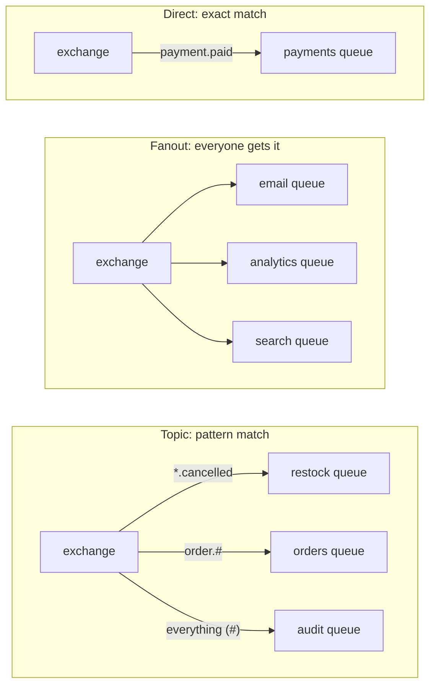
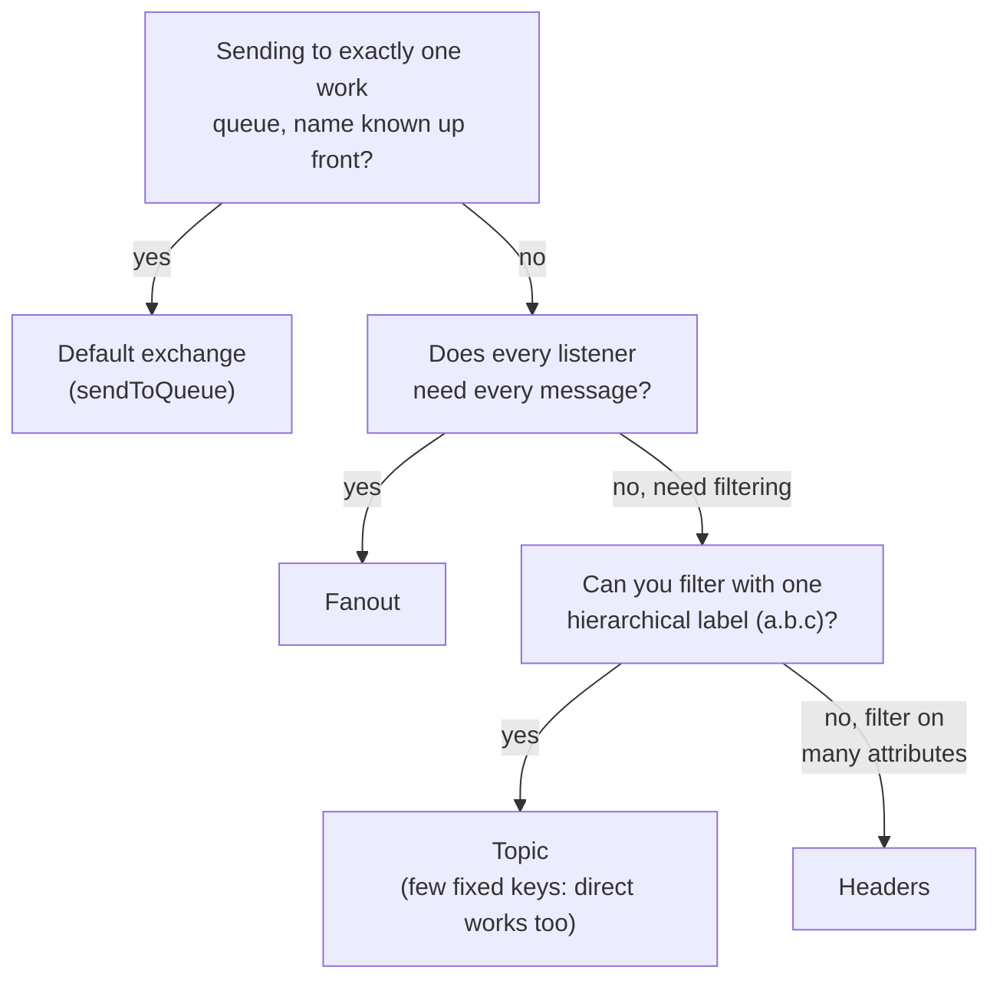
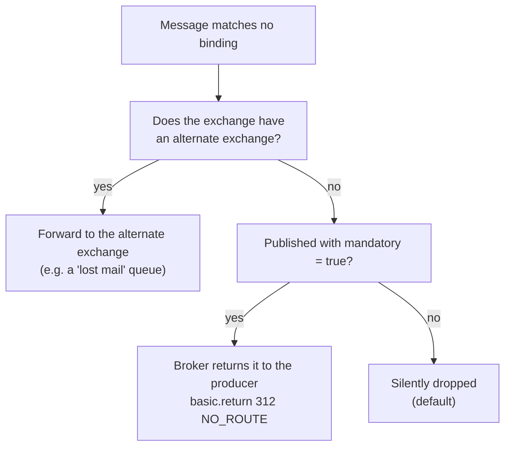

> [!tldr] Quick read
> - [[en/concepts/direct-exchange|Direct]]: copies a message into the queues whose binding key **exactly matches** the routing key. The [[en/concepts/default-exchange|default exchange]] is a special direct exchange.
> - [[en/concepts/fanout-exchange|Fanout]]: copies a message into **every** bound queue, ignoring the routing key. This is the "loudspeaker" type.
> - [[en/concepts/topic-exchange|Topic]]: the routing key is a list of words joined by dots; in a binding, `*` matches exactly **one** word and `#` matches **zero or more** words.
> - [[en/concepts/headers-exchange|Headers]] routes on the headers table instead of the routing key. An [[en/concepts/exchange-to-exchange-binding|exchange-to-exchange binding]] lets you bind an exchange to another exchange.
> - **Most common**: the default exchange (behind `sendToQueue`, and the default in many frameworks) for work queues, and **topic** for events. Headers is the rarest. When in doubt, choose topic.
> - A [[en/concepts/unroutable-message|message that matches no binding]] is **silently dropped** by default. To find out about it, use the `mandatory` flag (the broker returns the message) or an [[en/concepts/alternate-exchange|alternate exchange]] (the broker forwards the message to a fallback exchange).

> [!info] Context
> Station 3 of **the RabbitMQ line**. [[en/posts/2026-11-21-rabbitmq-amqp-model|Station 2]] showed that the producer always publishes to an exchange, and bindings decide where the message goes. This station asks the next question: by what rule does the exchange *compare* the routing key with the binding key? The examples are the events of **flash-sale** (a time-limited flash-sale shop I wrote myself): `order.placed`, `order.cancelled`, `payment.paid`… You don't need to know the project's code.

> [!abstract]- Quick glossary for this post (click to open)
> - **Exchange, queue, binding, routing key, binding key**: see [[en/posts/2026-11-21-rabbitmq-amqp-model|station 2]]. In short: the exchange is the sorting desk, the queue is the mailbox, the binding is the rule linking the two, and the routing key is the label on the letter.
> - **Pub/sub (publish/subscribe)**: one side publishes, many sides subscribe and all receive.
> - **Audit log**: a ledger that records everything that happens, for later lookup.
> - **Plugin**: an extension installed into RabbitMQ.
> - **Hash**: an operation that turns a string into a number; the same string always gives the same number.
> - **`basic.return`**: the method the broker uses to return a message to its sender.

## Picture it first: four ways to sort letters

The sorting desk from station 2 actually has four kinds of clerk, each following their own rule:

| Everyday life | Concept |
|---|---|
| A clerk who only reads the exact postal code, and drops the letter in a box only if every digit matches | [[en/concepts/direct-exchange\|Direct exchange]] |
| A "send by mailbox name" counter: write the mailbox name on the envelope and it goes straight to that mailbox | [[en/concepts/default-exchange\|Default exchange]] |
| The neighborhood loudspeaker: everyone who signed up hears it, no address needed | [[en/concepts/fanout-exchange\|Fanout exchange]] |
| A clerk who reads the address by level "province.district.ward" and understands "every ward of district X" | [[en/concepts/topic-exchange\|Topic exchange]] |
| A clerk who ignores the address and only reads the note clipped to it ("registered mail", "large format") | [[en/concepts/headers-exchange\|Headers exchange]] |
| The central sorting desk passes the whole stack to each province's sorting desk | [[en/concepts/exchange-to-exchange-binding\|Exchange-to-exchange binding]] |
| A wrongly addressed letter: thrown away, returned to sender, or sent to the "lost mail room" | [[en/concepts/unroutable-message\|Unroutable message]] |
| The lost mail room | [[en/concepts/alternate-exchange\|Alternate exchange]] |



## The problem: one event, many kinds of listener

In flash-sale, the services want to hear very different things:

- The **restock** service only cares about anything canceled: `order.cancelled`, `refund.cancelled`.
- The **email** service listens to a few specific events: `order.placed`, `payment.paid`.
- The **audit** service wants to record *everything*.
- The operations team wants the events of the Vietnam region only: `order.vn.hcm.placed`, `order.vn.hn.placed`…

I used to think the producer should just send a separate copy for each kind of listener. Then I realized that brings back station 1's problem: the producer has to know the receivers. The four exchange types are exactly four ways for the producer to send **one** message with **one** label, while bindings decide who receives it.

## How it works

### Direct exchange: exact match

A [[en/concepts/direct-exchange|direct exchange]] copies a message into every queue whose binding key is **identical** to the routing key. A binding `payment.paid` only receives messages whose routing key is exactly `payment.paid`, nothing more, nothing less.

- If several queues bind the same key, each queue gets a copy.
- If one queue binds several keys, it receives the messages for all of them.
- RabbitMQ comes with a direct exchange named `amq.direct`.

It fits when the keys are a fixed, clear set: command types (`resize-image`, `send-email`), log levels (`error`, `warning`). RabbitMQ's "Routing" tutorial uses exactly the log-level example.

### Default exchange: a nameless direct exchange

The [[en/concepts/default-exchange|default exchange]] (the empty name `""`) is a direct exchange to which **every queue is automatically bound with a binding key equal to the queue name**. Nobody can add or remove bindings on it. This is what stands behind `sendToQueue` at station 2. It also doesn't support alternate exchanges (end of the post).

### Fanout exchange: the loudspeaker

A [[en/concepts/fanout-exchange|fanout exchange]] copies a message into **every** queue bound to it and **ignores the routing key**. Sending `order.placed` or `abc` makes no difference.

This is the basic **pub/sub** pattern: each party that wants to listen creates its own queue, binds it to the fanout exchange, and everyone receives every message. In the "Publish/Subscribe" tutorial, each consumer creates a temporary queue (server-named, `exclusive`) to listen while it is running; when it shuts down, the queue disappears. The built-in exchange: `amq.fanout`.

Fanout is fast and simple, but it can't filter anything. When listeners start saying "I only need *some* events", switch to topic.

### Topic exchange: pattern match

A [[en/concepts/topic-exchange|topic exchange]] is the most flexible type and the most used for events. The rules:

- The routing key is a list of **words** joined by dots: `order.vn.hcm.placed`.
- The binding key is also words joined by dots, plus two special characters:
  - `*` matches **exactly one** word.
  - `#` matches **zero, one or more** words.

| Binding key | Matches | Doesn't match |
|---|---|---|
| `order.placed` | `order.placed` | `order.vn.placed` |
| `*.cancelled` | `order.cancelled`, `refund.cancelled` | `order.vn.cancelled` (two words before `cancelled`) |
| `order.*` | `order.placed`, `order.vn` | `order`, `order.vn.hcm` |
| `order.#` | `order`, `order.placed`, `order.vn.hcm.placed` | `refund.placed` |
| `order.vn.#` | `order.vn` (`#` matches 0 words), `order.vn.hcm.placed` | `order.us.placed` |
| `#` | everything | |

Two special cases: a binding key of just `#` turns a topic exchange into a fanout; a binding key with no `*` or `#` makes it behave like a direct exchange. Since RabbitMQ 4.4, a topic binding key may contain at most two `#` characters.

A naming tip: go from general to specific, `<entity>.<region>.<action>` or `<entity>.<action>`. This order decides what you can filter on: putting the action last lets `*.cancelled` gather every kind of cancellation. Flash-sale names its events this way (`order.placed`, `order.cancelled`, `inventory.changed`) and uses a topic exchange for each business area.

### Headers exchange: reading the clipped note

A [[en/concepts/headers-exchange|headers exchange]] ignores the routing key and compares the message's **headers** with the binding's arguments. The `x-match` argument decides how to compare:

- `x-match: all`: every key-value pair in the binding must be present in the message's headers.
- `x-match: any`: a single matching pair is enough.
- `all-with-x` and `any-with-x`: as above, but headers starting with `x-` count too (the plain versions ignore them).

For example, the binding `{ "x-match": "all", "region": "vn", "tier": "vip" }` only receives messages that have both of those headers. A headers exchange fits when the filter criteria can't be arranged into an ordered string, but it is used less than topic because it is harder to read and debug. The built-in exchange: `amq.headers` (and `amq.match`).

### Comparing the four standard types

Side by side, the four types differ in **what the exchange looks at** and **what it can filter**:

| | Direct | Fanout | Topic | Headers |
|---|---|---|---|---|
| Looks at | routing key | nothing | routing key | headers |
| How it matches | exact match | every bound queue receives | pattern with `*` `#` | match all or any |
| Can filter | a few fixed keys | no filtering | by level, by group | many unordered attributes |
| Fits | commands, log levels | broadcasting to everyone | business events | attribute combinations, rarely used |
| Post office | reads the exact postal code | neighborhood loudspeaker | reads the address by level | reads the clipped note |

Each type has a predeclared exchange on every broker: `amq.direct` (along with the default exchange `""`), `amq.fanout`, `amq.topic`, `amq.headers` (and `amq.match`). "Commands" for direct are keys such as `send-email`, `resize-image`; "events" for topic are keys such as `order.placed`, `payment.paid`. Broadcasting with fanout covers jobs such as refreshing caches or notifying every replica of a service.

Topic "covers" the others: a binding with no `*` or `#` makes topic behave like direct, and a `#` binding makes it behave like fanout. In exchange, it has to match patterns, so it does a little more work than direct; for most systems, that is not the bottleneck.

### Which type is the most common?

RabbitMQ doesn't publish statistics, so the answer below is based on the defaults of popular libraries and the official tutorials:

- **The default exchange is the most used type that users barely notice.** Every call to `sendToQueue` uses it. NestJS's RabbitMQ client publishes with `sendToQueue` by default. Spring AMQP (`RabbitTemplate`) publishes to the exchange with the empty name by default. This is the path of the **work queue** pattern: one job, one queue, several workers sharing it ([[en/posts/2026-11-21-rabbitmq-ack-confirm|station 4]]).
- **Topic is the most explicitly declared type for events.** Event-driven systems need "whoever wants to hear something binds for it themselves" and need to add listeners without changing the producer. All **14 exchanges** of flash-sale are `topic`.
- **Direct** fits when the keys are a small, fixed list: command types, log levels, tenant names.
- **Fanout** fits for broadcasting. MassTransit (a .NET library) creates a fanout exchange per message type by default, then binds each consumer's queue to it.
- **Headers** is the rarest: hard to read, hard to debug, and most filtering needs can already be arranged into an ordered routing key.

### Which one to choose?



If I'm torn between direct and topic, I choose **topic**. Today, with exact keys, it behaves just like direct. Tomorrow, when someone wants to hear "everything canceled", you only add a `*.cancelled` binding, without changing the exchange type (changing the type forces you to delete and recreate the exchange, because redeclaring it with a different type fails with `406`).

### Exchange-to-exchange bindings and CC/BCC

An [[en/concepts/exchange-to-exchange-binding|exchange-to-exchange binding]] is a RabbitMQ extension: one exchange binds to **another exchange** instead of a queue. A message passes through the chain of exchanges following each one's rules. For example, a fanout exchange `events.all` binds to two topic exchanges `orders` and `payments`; each team manages its own exchange. The broker merges the routes before copying, so even if several paths lead to the same queue, **each queue receives exactly one copy**, and loops between exchanges are detected.

**Sender-selected distribution** is another small trick: the producer adds a `CC` or `BCC` header (an array of strings) so the message is *also* routed by those keys, like carbon-copying a letter. The `BCC` header is removed from the message before delivery, so the recipients don't see it.

### Plugin exchanges

Besides the four standard types, RabbitMQ has types that come from plugins. Two worth knowing:

- **Consistent hash** (`x-consistent-hash`): hashes the routing key (or a header) to spread messages evenly across several queues, while the same key always lands in the same queue. Here the binding key is a **weight**: a queue bound with `"2"` gets twice as much as a queue bound with `"1"`. Use it when you want to spread load while keeping all messages of one order in the same queue.
- **Local random** (`x-local-random`, since 4.0): always picks a random queue located on the **same node** as the producer's connection; good for request-reply inside a multi-node cluster.

The **delayed message** plugin (`x-delayed-message`) used to be very popular but is no longer maintained; [[en/posts/2026-11-21-rabbitmq-dlx-retry|station 6]] covers alternative ways to delay messages.

### The three fates of a letter nobody receives

Publish a message that matches no binding and you have an [[en/concepts/unroutable-message|unroutable message]]. There are three possibilities:



1. **Silently dropped** (the default). No error, no log on the application side. The broker only increments the `messages_unroutable_dropped` counter.
2. **Returned to the sender** if the producer publishes with the `mandatory: true` flag. The broker sends the message back with code `312 NO_ROUTE` via the `basic.return` method; in `amqplib`, the channel emits a `'return'` event.
3. **Forwarded to an [[en/concepts/alternate-exchange|alternate exchange]]** (AE) if the exchange is configured with one. The message moves on to the AE (usually a fanout exchange bound to a "lost mail" queue) so operators can review it. Set the AE with a **policy** so you can change it at runtime; you can also set it with the `alternate-exchange` argument when declaring the exchange. When there is an AE, the message counts as "routed", so even a `mandatory` publish gets no `basic.return`.

> [!warning] A confirm doesn't mean someone received it
> Station 4 covers **publisher confirms**, the receipt the broker sends the producer. An unroutable message that gets dropped is still *positively* confirmed by the broker: the broker has "finished handling" that message by determining that nobody receives it. A confirm only proves the broker has taken responsibility, not that any queue holds the message.

A real detail from flash-sale: the project published an event to the orders exchange with a routing key that no consumer bound, and without `mandatory`. The broker still confirmed, the outbox table marked it "sent", and the message vanished. The code had no syntax error anywhere; it's just that nobody was listening. An audit queue bound to `#` in the dev environment, or an alternate exchange, is the cheapest way to spot messages like that.

## Runnable example

The file `topic-routing.ts` sets up a topic exchange with four bindings and an alternate exchange, publishes six routing keys, then prints what each queue received. It then removes the `#` binding to show messages falling through to the AE, and tries `mandatory` on a direct exchange without an AE.

```bash
docker run -d --rm --name atlas-rabbit -p 5673:5672 -p 15673:15672 rabbitmq:4-management
npm i amqplib && node topic-routing.ts
```

The main part (full version: [topic-routing.ts](../code/rabbitmq-exchanges/topic-routing.ts)):

```ts
await ch.assertExchange(AE, 'fanout', { durable: false });
await ch.assertExchange(EX, 'topic', { durable: false, alternateExchange: AE });
const bindings: Array<[string, string]> = [
  ['q.placed-any', 'order.placed'],
  ['q.all-cancelled', '*.cancelled'],
  ['q.audit-all', '#'],
  ['q.vn-anything', 'order.vn.#'],
];
for (const [q, key] of bindings) { await ch.assertQueue(q, { durable: true }); await ch.bindQueue(q, EX, key); }

for (const key of ['order.placed', 'order.cancelled', 'refund.cancelled', 'order.vn.hcm.placed', 'order.vn', 'payment.paid'])
  ch.publish(EX, key, Buffer.from(key));

// mandatory + basic.return on an exchange WITHOUT an AE
ch.on('return', (msg) => console.log('basic.return:', msg.fields.replyCode, msg.fields.replyText, 'key =', msg.fields.routingKey));
ch.publish('demo.direct', 'khong-ai-nghe', Buffer.from('x'), { mandatory: true });
ch.publish('demo.direct', 'khong-ai-nghe-2', Buffer.from('x')); // no mandatory → lost silently
```

```text
$ node topic-routing.ts
q.placed-any     order.placed   -> order.placed
q.all-cancelled  *.cancelled    -> order.cancelled, refund.cancelled
q.audit-all      #              -> order.placed, order.cancelled, refund.cancelled, order.vn.hcm.placed, order.vn, payment.paid
q.vn-anything    order.vn.#     -> order.vn.hcm.placed, order.vn
q.unrouted       alternate-exch -> 
after removing '#': q.unrouted received -> payment.paid (2nd round)
basic.return: 312 NO_ROUTE key = khong-ai-nghe
```

*(Output labels translated; the files themselves print Vietnamese.)*

Reading the output:

- `order.vn` matches `order.vn.#`: `#` also matches **zero** words.
- `refund.cancelled` matches `*.cancelled` even though it has nothing to do with orders: how you name events decides what you can filter.
- At first the AE is empty, because the audit queue's `#` "caught" every message. Remove `#` and `payment.paid` has no listener, so it falls through to the AE.
- The `khong-ai-nghe` message (with `mandatory`) is returned with code 312. The `khong-ai-nghe-2` message (without `mandatory`) vanishes without a single log line.

### Comparing the four types on the same set of messages

The file `compare-types.ts` publishes **the same four messages** (`order.placed`, `order.cancelled`, `refund.cancelled`, `payment.paid`) through four exchanges of different types. Each exchange has three queues with the same wishes: **email** listens to `order.placed` and `payment.paid`, **restock** (`hoan-kho`) listens to everything canceled, **audit** listens to everything. Full version: [compare-types.ts](../code/rabbitmq-exchanges/compare-types.ts).

```ts
// direct: exact match; for "everything canceled" or "everything" you have to list each key
{ queue: 'hoan-kho', key: 'order.cancelled' }, { queue: 'audit', key: 'order.placed' },
// topic: pattern match
{ queue: 'hoan-kho', key: '*.cancelled' }, { queue: 'audit', key: '#' },
// headers: ignores the routing key, compares the message's headers
{ queue: 'hoan-kho', args: { 'x-match': 'all', action: 'cancelled' } },
{ queue: 'audit', args: { 'x-match': 'all' } }, // all with no conditions: matches every message
```

```text
$ node compare-types.ts

DIRECT
  email     <- order.placed, payment.paid
  hoan-kho  <- order.cancelled
  audit     <- order.placed

FANOUT
  email     <- order.placed, order.cancelled, refund.cancelled, payment.paid
  hoan-kho  <- order.placed, order.cancelled, refund.cancelled, payment.paid
  audit     <- order.placed, order.cancelled, refund.cancelled, payment.paid

TOPIC
  email     <- order.placed, payment.paid
  hoan-kho  <- order.cancelled, refund.cancelled
  audit     <- order.placed, order.cancelled, refund.cancelled, payment.paid

HEADERS
  email     <- order.placed, payment.paid
  hoan-kho  <- order.cancelled, refund.cancelled
  audit     <- order.placed, order.cancelled, refund.cancelled, payment.paid
```

Reading the output:

- **Direct** gets the email part right, but restock misses `refund.cancelled` and audit has only one message: every new key needs another binding added by hand.
- **Fanout** doesn't filter: every queue receives all four messages, including the ones it doesn't need.
- **Topic** satisfies all three wishes with just four bindings. That's why it is the default choice for events.
- **Headers** can do it too, but the producer has to attach extra `entity` and `action` headers to every message, and the rules live in the binding arguments, which makes them much harder to read than `*.cancelled`.

The exchanges in the example are `durable: false` for brevity, since this is an experiment. Queues can't be: on the first run, declaring a queue with `durable: false` brought the connection down with the error `541 … transient_nonexcl_queues is deprecated` on RabbitMQ 4.4 (see station 2).

## Misconceptions and common traps

### Thinking `*` and `#` are like shell wildcards

In a topic, `*` is exactly **one word** (between two dots), not "any string". `order.*` doesn't match `order.vn.hcm`. For "everything after", use `#`.

### Naming routing keys on a whim

`placed.order` here, `order-placed` there, `orderPlaced` somewhere else: no binding can gather them all. Agree on one convention (general to specific, dots, lowercase) before the first listener appears. Flash-sale once had `flash-sale.order.placed` (hyphen) next to `flash_sale.item.added` (underscore); a consumer binding `flash_sale.*` would never see the first event.

### Messages dropped without anyone knowing

This is RabbitMQ's hardest-to-spot mistake. In production, attach an alternate exchange to important exchanges, or publish with `mandatory` and handle the `return` event. Watch the unroutable-message counter in Prometheus ([[en/posts/2026-11-21-rabbitmq-operations|station 9]]).

### Using fanout and filtering in the consumer

A consumer that receives every message and then throws away 90% of them wastes network and CPU and makes the queue pointlessly long. Let the exchange filter for you with topic.

### One queue per routing key, even for the same consumer

A queue can bind many keys. Creating too many queues wastes resources and is hard to monitor. Split queues when two groups of jobs need **their own processing speed** or **their own failure policy**, not just because the keys differ.

## Self-check questions

> [!question]- Does the routing key `order.vn` match `order.vn.#`? Does it match `order.*`?
> Both. `#` matches zero words, so `order.vn.#` matches `order.vn`. `order.*` matches because exactly one word (`vn`) follows `order`.

> [!question]- Does `order.vn.cancelled` match `*.cancelled`?
> No. `*` matches exactly one word, and there are two words before `cancelled`. To match it, use `#.cancelled`.

> [!question]- Which exchange type is the most common?
> The default exchange, because `sendToQueue` and the defaults of many frameworks (NestJS, Spring AMQP) go through it, serving the work queue pattern. Among explicitly declared exchanges, topic is the popular choice for events. Headers is the rarest.

> [!question]- You use direct with the key `order.cancelled`, and later want to add a listener for "everything canceled". What then?
> You have to bind each key separately (`refund.cancelled`, `payment.cancelled`…) and remember to add one whenever a new kind of cancellation appears. With topic, a single `*.cancelled` binding is enough. Changing the exchange type later means deleting and recreating the exchange.

> [!question]- When do you choose fanout over topic?
> When every listener needs every message and there is no need to filter. Fanout is simple and ignores the routing key.

> [!question]- What happens to a message that matches no binding? How do you find out?
> By default it is silently dropped. Publish with `mandatory: true` and the broker returns the message (`basic.return`, code 312); or set an alternate exchange so the message falls into a fallback queue.

> [!question]- If there is already an alternate exchange and you still publish with `mandatory`, do you get a `basic.return`?
> No. A message forwarded to the AE counts as routed.

> [!question]- Does a successful publisher confirm mean the message is sitting in a queue?
> No. An unroutable message that gets dropped is still confirmed. A confirm only means the broker has finished its part of the responsibility.

## References

- [RabbitMQ: Exchanges](https://www.rabbitmq.com/docs/exchanges)
- [RabbitMQ: AMQP 0-9-1 Model Explained](https://www.rabbitmq.com/tutorials/amqp-concepts)
- [RabbitMQ tutorials 3–5: Publish/Subscribe, Routing, Topics](https://www.rabbitmq.com/tutorials)
- [RabbitMQ: Alternate Exchanges](https://www.rabbitmq.com/docs/ae)
- [RabbitMQ: Exchange to Exchange Bindings](https://www.rabbitmq.com/docs/e2e)
- [RabbitMQ: Sender-selected Distribution](https://www.rabbitmq.com/docs/sender-selected)
- [RabbitMQ: Publishers](https://www.rabbitmq.com/docs/publishers) (unroutable, mandatory)
- [NestJS: RabbitMQ transport](https://docs.nestjs.com/microservices/rabbitmq), [Spring AMQP: Sending Messages](https://docs.spring.io/spring-amqp/reference/amqp/sending-messages.html), [MassTransit: RabbitMQ transport](https://masstransit.massient.com/documentation/transports/rabbitmq) (each library's default exchange)
- [Consistent hash exchange plugin](https://github.com/rabbitmq/rabbitmq-server/tree/main/deps/rabbitmq_consistent_hash_exchange) and [Local random exchange](https://www.rabbitmq.com/docs/local-random-exchange)
