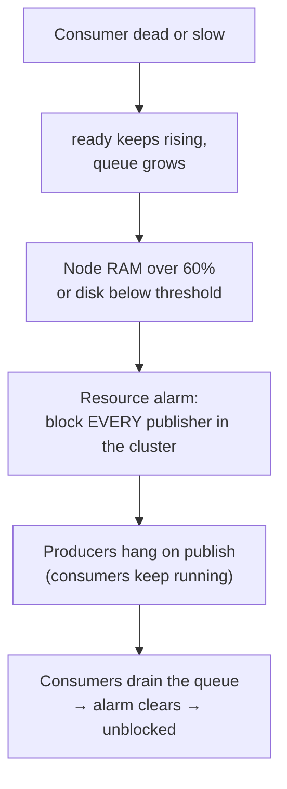

> [!tldr] Quick read
> - [[en/concepts/resource-alarm|Resource alarms]]: when one node exceeds its RAM threshold (60% by default) or its free disk drops below the threshold (50 MB by default), **every publisher in the whole cluster is blocked**. Consumers keep running.
> - [[en/concepts/flow-control|Flow control]] is a lighter automatic brake: the broker slows down a connection that publishes faster than it can be processed. Separate publishing and consuming connections so consumers are not throttled by mistake.
> - [[en/concepts/queue-metrics|Queue metrics]]: a steadily rising `ready` means consumers cannot keep up; a high `unacked` means consumers are holding a lot of work. Monitor with Prometheus, not just the management UI.
> - [[en/concepts/access-control|Access control]] works per vhost with three permissions, configure / write / read; delete the `guest` user, give each application its own user, turn on TLS. A [[en/concepts/policy|policy]] configures queues at runtime without redeclaring them.
> - RabbitMQ 4.x speaks [[en/concepts/giao-thuc-ngoai-amqp-0-9-1|several protocols]]: AMQP 1.0 (recommended for new applications), MQTT for IoT, STOMP, the stream protocol. The post ends with a [[en/concepts/production-checklist|production checklist]].

> [!info] Context
> Station 9, the last station of **the RabbitMQ line**. The previous eight stations built every concept; this one asks: when it runs for real, what do you need to watch, block and configure? The example is **flash-sale**, a time-limited discount shop I wrote myself: at 21:00 the producers publish in a flood, and the question is whether RabbitMQ can take it, and if not, how it tells you. You don't need to know the project's code.

> [!abstract]- Quick glossary for this post (click to open)
> - **Ready / unacked**: messages waiting in the queue / messages delivered to a consumer but not yet acked. See [[en/posts/2026-11-21-rabbitmq-ack-confirm|station 4]].
> - **Prometheus, Grafana**: Prometheus periodically scrapes metrics from systems; Grafana draws charts and alerts from those metrics.
> - **Watermark (threshold)**: the level past which the system reacts.
> - **Back-pressure**: when the receiver cannot keep up, it pushes pressure back to the sender, forcing it to slow down.
> - **Regex**: an expression describing a string pattern, for example `^orders\.` means "every name starting with `orders.`".
> - **JWT, OAuth 2**: a signed login token and the protocol that issues it. See [[en/posts/2026-11-18-api-security|the Security station of the API line]].
> - **IoT**: small networked devices (sensors, smart home appliances).
> - **Health check / readiness probe**: a periodic check of whether a service is alive and ready to take work.

## Picture it first: running a real post office

| Everyday life | Concept |
|---|---|
| The warehouse is over 60% full: stop accepting new mail at **every** branch, keep delivering | [[en/concepts/resource-alarm\|Resource alarm]] |
| The intake counter slows down when the sorting desk behind it is backed up | [[en/concepts/flow-control\|Flow control]] |
| The electronic board: how many letters are waiting, how many are out for delivery | [[en/concepts/queue-metrics\|Queue metrics]] |
| Staff badges: who may open which storeroom, who may only send, who may only receive | [[en/concepts/access-control\|Access control]] |
| An internal memo: "every mail slot starting with `orders.` holds at most 10,000 letters" | [[en/concepts/policy\|Policy]] |
| Intake counters for several languages: international parcels, telegrams, internal mail | [[en/concepts/giao-thuc-ngoai-amqp-0-9-1\|Protocols Beyond AMQP 0-9-1]] |
| The checklist before opening day | [[en/concepts/production-checklist\|Production checklist]] |



## The problem: the system runs fine until 21:00

On my dev machine, RabbitMQ never had any trouble. I used to think "the broker is infrastructure; install it and it runs". Three things only showed up under real load:

- A consumer has a configuration error and stops receiving messages at 20:55. Five minutes later, its queue holds hundreds of thousands of messages. The node's RAM hits the threshold, and the **ordering service** (which has nothing to do with that consumer) hangs on the `publish` line.
- Nobody knows the consumer has died, because the management UI is only opened when someone remembers to.
- Every application logs in with `guest/guest`, so there is no way to tell who is opening 2,000 connections.

## How it works

### Resource alarms: protecting the broker by blocking publishers

A [[en/concepts/resource-alarm|resource alarm]] is RabbitMQ's self-defense mechanism. There are two kinds:

- **Memory alarm**: RAM use exceeds `vm_memory_high_watermark`, by default **0.6** (60%) of the machine's RAM. In a container, set an **absolute** value (for example `vm_memory_high_watermark.absolute = 3GiB`), because the ratio is computed from the amount of RAM RabbitMQ detects, and that number may not match the memory limit set on the container. The checklist recommends roughly 0.4–0.7.
- **Disk alarm**: free disk space drops below `disk_free_limit`, by default **50 MB**. That number only suits a dev machine; in production, set it roughly equal to the amount of RAM.

When an alarm fires on **any** node:

- Every connection **publishing messages** across the **whole cluster** is blocked. The broker stops reading their sockets; `publish` hangs.
- Consumers **keep running**, so the queues can drain.
- Clients are notified through the `connection.blocked` / `unblocked` events (in `amqplib`: `conn.on('blocked')`).

Blocking the whole cluster because of one node sounds heavy-handed, but it is the only way to keep any node from overflowing: a message published to node A may be routed to a queue on node B. The consequence for applications: producers need a **timeout** on publishing, confirms to know a message did not get in, and somewhere to hold messages (the outbox from station 5 does exactly this). The root-cause defense is a queue length limit ([[en/posts/2026-11-21-rabbitmq-dlx-retry|station 6]]), so one dead consumer cannot drag down the whole cluster.

### Flow control: a light brake before the hard brake

[[en/concepts/flow-control|Flow control]] is the back-pressure mechanism inside the broker. Each message passes through a chain of processes: the connection reading the socket, the channel, the queue, the disk write, the replication to replicas. When a stage is slow, the stage before it is blocked temporarily, and so on all the way back to the **publishing connection**. That connection shows the `flow` state in the management UI: it is blocked and unblocked many times per second, so its publishing rate matches the rate the broker can write.

Two takeaways:

- A connection that **only consumes** is not throttled. If one connection both publishes and consumes, the brake also slows down the acks, and the consumer slows down exactly when it needs to be fast. That is why the checklist recommends **separate publishing and consuming connections**.
- A connection staying in the `flow` state for a long time is a sign the broker is at its limit: a slow disk, quorum queues that cannot replicate fast enough, or a maxed-out CPU.

There is one more layer of back-pressure on the client side: in `amqplib`, `publish` returns `false` when the write buffer is full, and the application should wait for the `'drain'` event (station 4).

### Queue metrics: reading the gauges

[[en/concepts/queue-metrics|Queue metrics]] are the first thing to look at. The three basic numbers for each queue:

| Metric | Meaning | Worrying when |
|---|---|---|
| `messages_ready` | messages waiting to be delivered | rising steadily over time: consumers cannot keep up or have died |
| `messages_unacked` | messages delivered, not yet acked | high and not dropping: a consumer is stuck or forgot to ack |
| `consumers` | number of subscribed consumers | 0 on a queue that is receiving messages |

Add **consumer capacity** (or consumer utilisation): the fraction of time the queue can deliver messages to consumers *immediately*. Below 100% while there is a backlog means consumers are not fast enough: raise the prefetch or add consumers.

Beyond individual queues, monitor: publish, deliver, ack and **redeliver** rates (a high redeliver rate means a requeue loop is running), new connections opened per second (connection churn, station 2), unroutable messages dropped (station 3), dead-lettered messages by reason (station 6), RAM against the threshold, free disk space, file descriptors.

There are three tools for looking:

- **Management UI and HTTP API** (the `rabbitmq_management` plugin, port 15672): handy for looking by hand and for tools to call, but it keeps only short-term data and recomputes on a cycle of a few seconds. `rabbitmqadmin` is a command-line tool built on this HTTP API. Users need a tag (`management`, `monitoring`, `policymaker`, `administrator`) to log in; the tag only decides which pages they can see and does not replace permissions on resources.
- **Prometheus** (the `rabbitmq_prometheus` plugin, port 15692): what the RabbitMQ docs recommend for production, with ready-made Grafana dashboards. Real metric names on 4.4: `rabbitmq_queue_messages_ready`, `rabbitmq_queue_messages_unacked`, `rabbitmq_queue_consumers`, `rabbitmq_global_messages_redelivered_total`, `rabbitmq_global_messages_unroutable_dropped_total`, `rabbitmq_global_messages_dead_lettered_expired_total`, `rabbitmq_connections_opened_total`, `rabbitmq_alarms_memory_used_watermark`… Scrape every 30–60 seconds. Once you use Prometheus, you can turn off the management plugin's metrics collector to reduce load.
- **CLI**: `rabbitmqctl` (administration: users, permissions, vhosts, listing queues), `rabbitmq-diagnostics` (health, status, alarms), `rabbitmq-plugins`, `rabbitmq-queues` (quorum replicas), `rabbitmq-streams`, `rabbitmq-upgrade`.

Health checks come in several levels: `rabbitmq-diagnostics ping` (does the node respond), `check_running`, `check_local_alarms`, `check_port_connectivity`, `check_virtual_hosts`. The docs recommend that a readiness probe on Kubernetes be only a **TCP port check** on AMQP: heavier checks can keep a Khepri cluster from restarting, because the pods wait for the probe while the cluster waits for a majority of pods. On the application side, flash-sale has its own health check that reports `rabbitmq: down` based on the library's connection state; the application can still start when the broker is down (it does not wait for a connection at boot), and the outbox holds events until the broker comes back.

### Access control

RabbitMQ [[en/concepts/access-control|access control]] covers authentication (who you are) and authorization (what you may do).

**Authentication** uses username/password (the default), x.509 certificates (the `EXTERNAL` mechanism, through a plugin), or JWTs through the **OAuth 2 plugin**. With OAuth 2, the token is sent in place of the password; permissions are read from scopes in the token, of the form `rabbitmq.read:<vhost>/<name pattern>`; the `resource_server_id` value must appear in the token's `aud` field. When the token expires, an AMQP 0-9-1 client sends a new one with the `update-secret` command without reconnecting.

**Authorization** works per vhost, with three regexes on resource names:

| Permission | Allows |
|---|---|
| **configure** | creating, deleting and modifying exchanges and queues matching the pattern |
| **write** | publishing to an exchange, binding a queue to an exchange |
| **read** | consuming from a queue, binding an exchange to a queue |

Example for an email service: configure `^email\.`, write `^$` (publishes nothing), read `^email\.`. There are also **topic permissions** that check the routing key too when publishing to a topic exchange.

Defaults worth fixing:

- The `guest/guest` user can only log in from `localhost`. Don't loosen that; delete it in production.
- One user per application, with the least privilege. When something goes wrong, the user name tells you whose connection it is.
- The `ANONYMOUS` mechanism is enabled by default in 4.x for easy experimenting; disable it in production.
- Turn on **TLS**: port 5671 for AMQPS, at least TLS 1.2, `verify_peer` to verify certificates; add `fail_if_no_peer_cert` if every client must present a certificate too.

### Policies: changing queue configuration at runtime

A [[en/concepts/policy|policy]] is configuration applied to every queue or exchange whose name matches a regex, within one vhost:

```bash
rabbitmqctl set_policy orders-limits "^orders\." \
  '{"max-length": 100000, "overflow": "reject-publish", "dead-letter-exchange": "orders.dlx"}' \
  --apply-to queues --priority 10
```

The advantage over `x-` arguments at declaration time: you can change it at any moment without deleting and redeclaring the queue (station 2: redeclaring with different arguments is a 406 error). The rules:

- Each queue gets only **one** policy, the matching one with the highest `priority`. Keys are not merged from several policies.
- If the queue has an `x-` argument with the same key as the policy, **the argument wins**.
- Cannot be set by policy: the queue type (`x-queue-type`) and `x-max-priority`.
- An **operator policy** is a layer set by operators to impose *upper limits* (for example a maximum max-length) that no application can exceed. When both set a numeric limit, the smaller value wins.

Good practice: applications declare only the name, type and `durable` flag; every limit, TTL and DLX is set through policy and managed with the infrastructure.

### Protocols beyond AMQP 0-9-1

[[en/concepts/giao-thuc-ngoai-amqp-0-9-1|RabbitMQ 4.x speaks several protocols]], on one broker with shared queues:

| Protocol | Port | Used for | Notes |
|---|---|---|---|
| AMQP 0-9-1 | 5672 / 5671 | traditional libraries (`amqplib`, Pika, Spring AMQP) | the protocol of this whole line |
| **AMQP 1.0** | 5672 / 5671 | new applications | built in since 4.0; completely different from 0-9-1 despite the name |
| MQTT 3.1 / 3.1.1 / 5.0 | 1883 / 8883 | IoT, weak devices, flaky networks | topic `a/b/c` becomes routing key `a.b.c` on `amq.topic`; QoS 0 and 1, no QoS 2 |
| STOMP 1.0–1.2 | 61613 | a text protocol, easy to use from a browser over WebSocket | destinations like `/exchange/...`, `/queue/...`, `/topic/...` |
| Stream protocol | 5552 | high-speed stream reads and writes | station 7 |

RabbitMQ recommends AMQP 1.0 for new applications. Instead of `ack`/`nack`, the consumer returns one of four outcomes: `accepted` (done), `released` (back to the queue), `rejected` (dead-letter) or `modified` (quorum queues only: returned with modified headers). Addresses look like `/queues/<name>` or `/exchanges/<name>/<routing key>`. AMQP 1.0 has no transactions. `amqplib` does **not** support AMQP 1.0; you need RabbitMQ's own AMQP 1.0 client library.

### NestJS and RabbitMQ: mapping back to the concepts

Most Node.js applications use RabbitMQ through a framework. With NestJS:

- **`@nestjs/microservices`, `Transport.RMQ`**: each server listens on **one queue** (`queue`). By default it publishes through the default exchange (station 3); with `wildcards: true` it uses a topic exchange. `@MessagePattern` + `client.send()` is request-reply, through Direct Reply-to by default (station 5). `@EventPattern` + `client.emit()` publishes an event without waiting for a reply. **`noAck` defaults to `true`** (auto-ack, station 4): to be safe, set `noAck: false` and ack yourself with `context.getChannelRef().ack(context.getMessage())`. The `isGlobalPrefetchCount` option is global QoS, blocked on 4.3+.
- **`@golevelup/nestjs-rabbitmq`** (the library flash-sale uses): declares exchanges, queues and bindings explicitly; `@RabbitSubscribe({ exchange, routingKey, queue })` per handler. A handler that completes acks, returning `new Nack(false)` dead-letters; the default prefetch is 10; it publishes through a confirm channel. Careful: a handler that **throws** defaults to `nack` *with requeue*, the delivery limit trap from station 7.

### Production checklist

The [[en/concepts/production-checklist|production checklist]], gathered from the official checklist and the previous stations:

**Infrastructure**
- A cluster of 3 or 5 nodes on the same LAN; use federation or shovel between regions (station 8).
- Each node with at least 4 CPUs, 4 GiB of RAM, local SSD/NVMe, and an unshared data directory.
- At least 50,000 file descriptors.
- Set `vm_memory_high_watermark` (an absolute value in containers) and `disk_free_limit` close to the RAM size.

**Security**
- Delete `guest`, disable `ANONYMOUS`, one user per application with least privilege.
- TLS for clients and for inter-node communication.

**Queues and messages**
- Important data: quorum queues (station 7); temporary queues: exclusive classic.
- Every queue has a length limit and a DLX through policy; every DLX has a DLQ (station 6).
- Producers: confirms, persistent messages, `mandatory` or an alternate exchange for important events (stations 3, 4).
- Consumers: manual acks, bounded prefetch, idempotent (stations 4, 5).

**Connections**
- Long-lived, named connections with 5–20 second heartbeats; separate publishing and consuming connections; few channels.
- Avoid `basic.get` (polling).

**Observability**
- Prometheus + Grafana; alert when `ready` rises steadily, when a DLQ has messages, when a resource alarm fires, when an important queue has 0 consumers.
- The readiness probe is a TCP port check.

**Upgrades**
- Know the upgrade path (through 4.2 from 3.13/4.0/4.1); enable feature flags; check for deprecated features (station 8).

## Runnable example

[observe.ts](../code/rabbitmq-operations/observe.ts) reproduces the opening scenario on a small scale: a producer publishes 200 messages/second for 4 seconds, while the consumer can only handle about 50 messages/second (20 messages in parallel, 400 ms each). Every second it prints the number of `ready` messages (asked from the broker) and `unacked` (counted on the client).

```bash
docker run -d --rm --name atlas-rabbit -p 5673:5672 -p 15673:15672 rabbitmq:4-management
npm i amqplib && node observe.ts
```

```ts
await sub.prefetch(20);
await sub.consume(Q, async (m) => {
  inflight++;
  await sleep(400);   // slow consumer
  sub.ack(m);
  inflight--; acked++;
});
const { messageCount: ready } = await pub.checkQueue(Q); // ready message count, in real time
```

```text
$ node observe.ts
 second | published | acked | ready | unacked
   1  |   180  |    40  |   120 |    20
   2  |   400  |    80  |   280 |    20
   3  |   580  |   140  |   420 |    20
   4  |   780  |   180  |   580 |    20
   5  |   780  |   240  |   520 |    20
   6  |   780  |   280  |   480 |    20
   ...
  14  |   780  |   680  |    80 |    20
  15  |   780  |   740  |    20 |    20
  16  |   780  |   780  |     0 |     0
```

*(Output labels translated; the files themselves print Vietnamese.)*

Read the table like a dashboard:

- **Seconds 1–4**: `ready` rises steadily by about 150 per second. This is the "consumers cannot keep up" signal. In production, this line stretching on for hours is the road to a memory alarm.
- **`unacked` stays flat at 20**: exactly the prefetch. The consumer always holds as much work as it is allowed; to go faster, add consumers rather than waiting.
- **Seconds 5–16**: the producer stops, and `ready` drops by about 50 per second, exactly the consumer's rate. From this slope you can compute how long until the queue is empty.

While it runs, open `http://localhost:15673` (guest/guest) → the **Queues** tab → `demo.observe` to see the same numbers on a chart. The management UI updates on a cycle of a few seconds, so it lags the table by a beat. The Prometheus port 15692 is available in this image if you map that port too.

## Misconceptions and common traps

### "A queue can be as long as it likes; RabbitMQ will handle it"

RabbitMQ handles it by blocking every publisher in the cluster. Set a length limit and alert on `ready`.

### Leaving the disk threshold at the default 50 MB

The disk fills up before the alarm has time to fire. Set it close to the RAM size.

### Setting the RAM threshold as a ratio in a container

The amount of RAM RabbitMQ detects can differ from the container's limit, and the container can be killed for running out of memory before the alarm fires. Use an absolute value below the container limit.

### One connection that both publishes and consumes

Flow control brakes the publishing connection and drags down consuming and acking with it. Use two connections.

### Only looking at the management UI when something is wrong

By the time someone remembers to open the UI, the queue has already grown. Use Prometheus and automatic alerts.

### Using `guest` for everything

You cannot tell who did what, and loosening `loopback_users` to use `guest` remotely opens the door to anyone. One user per application.

### Configuring limits with `x-` arguments in code

Changing a limit means deleting the queue. Use policies.

### A readiness probe that runs heavy checks

It can keep a Khepri cluster from restarting. Use a TCP port check.

### Copying the default NestJS configuration

`noAck: true` is auto-ack. Set `noAck: false` and ack manually.

## Self-check questions

> [!question]- What happens when one node exceeds its RAM threshold?
> Every publishing connection across the whole cluster is blocked, and `publish` hangs. Consumers keep running to drain the queues. Once usage drops below the threshold, publishers are unblocked.

> [!question]- Which metric tells you a consumer is falling behind?
> `messages_ready` rising steadily over time, and consumer capacity below 100% while there is a backlog. A high `messages_unacked` that does not drop means a consumer is stuck or forgot to ack.

> [!question]- Why separate publishing and consuming connections?
> Flow control and resource alarms block publishing connections. If it is the same connection, receiving messages and sending acks are blocked too, and the consumer slows down exactly when it needs to drain the queue.

> [!question]- Can the `guest` user be used from another machine?
> No, by default only from `localhost`. In production, delete it entirely and create a separate user for each application.

> [!question]- The `x-max-length` argument on a queue and the `max-length` policy differ. Which one wins?
> The queue argument beats a regular policy. An operator policy sets an upper limit: the smaller of the two values applies.

> [!question]- How does NestJS `Transport.RMQ` ack by default?
> `noAck: true`, that is, auto-ack. You have to change it to `false` and ack manually in the handler.

> [!question]- Should a new application use AMQP 0-9-1 or AMQP 1.0?
> RabbitMQ recommends AMQP 1.0 for new applications on 4.x. But `amqplib` and many familiar libraries support only 0-9-1, so in today's Node.js ecosystem 0-9-1 is still the practical choice.

## References

- [RabbitMQ: Resource Alarms](https://www.rabbitmq.com/docs/alarms), [Memory Threshold](https://www.rabbitmq.com/docs/memory), [Disk Alarms](https://www.rabbitmq.com/docs/disk-alarms)
- [RabbitMQ: Flow Control](https://www.rabbitmq.com/docs/flow-control)
- [RabbitMQ: Monitoring](https://www.rabbitmq.com/docs/monitoring) and [Management Plugin](https://www.rabbitmq.com/docs/management)
- [RabbitMQ: Authentication, Authorisation, Access Control](https://www.rabbitmq.com/docs/access-control), [TLS](https://www.rabbitmq.com/docs/ssl), [OAuth 2.0](https://www.rabbitmq.com/docs/oauth2)
- [RabbitMQ: Policies](https://www.rabbitmq.com/docs/policies)
- [RabbitMQ: AMQP 1.0](https://www.rabbitmq.com/docs/amqp), [MQTT](https://www.rabbitmq.com/docs/mqtt), [STOMP](https://www.rabbitmq.com/docs/stomp)
- [RabbitMQ: Production Checklist](https://www.rabbitmq.com/docs/production-checklist)
- [RabbitMQ: CLI tools](https://www.rabbitmq.com/docs/cli)
- [NestJS: RabbitMQ transport](https://docs.nestjs.com/microservices/rabbitmq)
