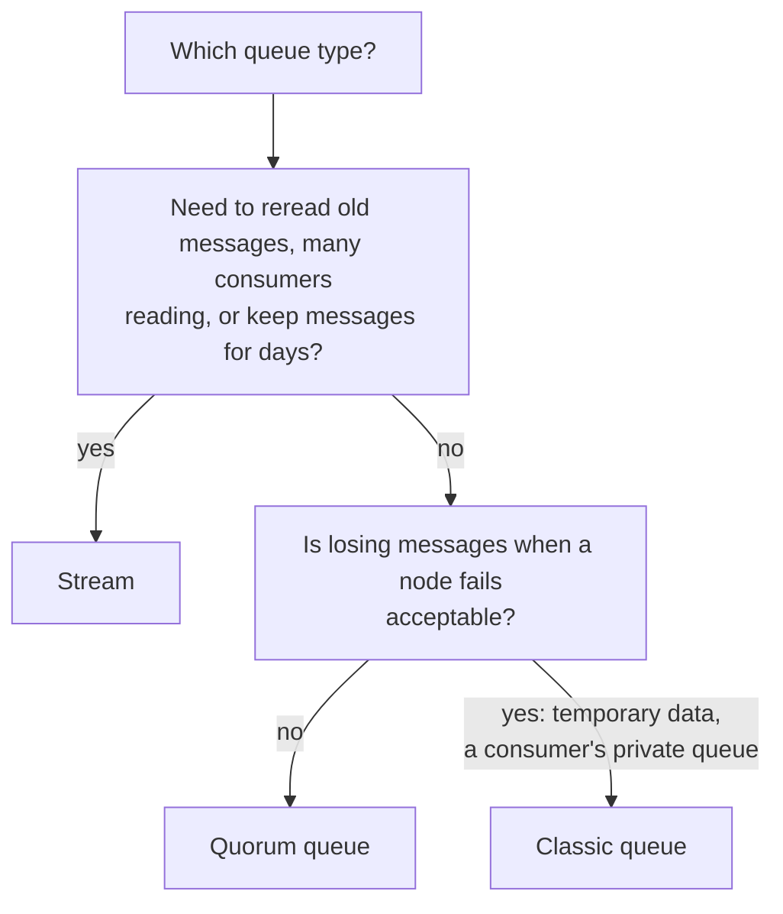

> [!tldr] Quick read
> - [[en/concepts/classic-queue|Classic queue]]: the default type; messages live on **one node**. Since 4.0 there is no replication (mirrored queues were removed). Good for temporary data and a consumer's private queue.
> - [[en/concepts/quorum-queue|Quorum queue]]: messages are replicated across several nodes with the [[en/concepts/raft|Raft]] algorithm; the confirm is sent only when a **majority** of replicas have the message. This is the default choice for important data.
> - The quorum queue [[en/concepts/delivery-limit|delivery limit]] dead-letters a message on its own after 20 failed deliveries. Since 4.3, `nack` with requeue is **not** counted; only `reject` is.
> - A [[en/concepts/stream|stream]] is an append-only log: reading **does not delete** messages, each consumer picks where to start with an [[en/concepts/stream-offset|offset]], and you can reread as many times as you like.
> - [[en/concepts/single-active-consumer|Single active consumer]]: several consumers subscribe, only one receives at a time; when it leaves, the next one takes over. Order is kept and there is still a standby.

> [!info] Context
> Station 7 of **the RabbitMQ line**. At [[en/posts/2026-11-21-rabbitmq-ack-confirm|station 4]], a durable message was only safe as long as the node holding it stayed alive. This station asks: what if that node's disk burns out? The example is the events of **flash-sale**, a time-limited discount shop I wrote myself. Every queue in the project is currently classic, so this is also when I asked myself whether it is time to switch. You don't need to know the project's code.

> [!abstract]- Quick glossary for this post (click to open)
> - **Node**: one machine (or container) running RabbitMQ. Several nodes joined together form a **cluster**, covered at [[en/posts/2026-11-21-rabbitmq-cluster|station 8]].
> - **Replica**: a full copy of a queue's data living on another node.
> - **Leader / follower**: in a group of replicas, the leader receives every write and copies it to the followers.
> - **Majority (quorum)**: more than half. With 3 nodes the majority is 2; with 5 nodes it is 3.
> - **Log (append-only log)**: a data structure you only add to at the end; no edits, no deletes in the middle. See [[en/concepts/queue-va-log|Queue and Log]].
> - **Retention**: the policy for how long, or how much, data is kept.
> - **Delivery limit, dead-letter, DLX**: see [[en/posts/2026-11-21-rabbitmq-dlx-retry|station 6]].

## Picture it first: one mail slot, three post offices, one ledger

| Everyday life | Concept |
|---|---|
| A mail slot at **one** post office; if the office burns down, the letters are gone | [[en/concepts/classic-queue\|Classic queue]] |
| Three post offices each keep a copy of the mail ledger; an entry counts only when a majority agrees | [[en/concepts/quorum-queue\|Quorum queue]] |
| The rules for electing a head postmaster and for "it counts only when the majority agrees" | [[en/concepts/raft\|Raft]] |
| A letter that fails delivery 20 times goes to the dead letter room | [[en/concepts/delivery-limit\|Delivery limit]] |
| An archive ledger: still there after reading, anyone can reread from any page | [[en/concepts/stream\|Stream]] |
| The page number each reader has reached in the ledger | [[en/concepts/stream-offset\|Stream offset]] |
| Several clerks on duty, but only one may deliver mail at a time | [[en/concepts/single-active-consumer\|Single active consumer]] |



## The problem: durable does not mean safe

At station 4, I had all three conditions: a durable queue, persistent messages, confirms. Messages survived a restart. But everything sat on the disk of **one** node:

- That node's disk fails: every message in the queue is lost.
- That node goes down for 30 minutes of maintenance: the queue is unusable for 30 minutes, even though the cluster has two other healthy nodes.

I used to think "running a 3-node cluster gives me redundancy". It turns out a cluster only replicates the *structure* (names of exchanges, queues, bindings, users) to every node; the **contents** of a classic queue still live on one node. To replicate the messages themselves, you need a different queue type. The queue type is set with the `x-queue-type` argument at declaration and **cannot be changed** afterward, so it pays to choose right from the start.

## How it works

<figure class="figure-map" style="--ar: 1 / 1">
<div class="frame"><iframe data-archify="../../diagrams/rabbitmq-queue-types/quorum-raft.en.html" title="Sequence diagram: a quorum queue replicates messages with Raft and elects a new leader" loading="lazy"></iframe></div>
<figcaption><span><b>Figure 1.</b> The confirm is sent once 2 of the 3 post offices have the letter; if the leader is lost, the other two elect a new leader and keep delivering.</span><a href="../diagrams/rabbitmq-queue-types/quorum-raft.en.html" target="_blank" rel="noopener">Open full screen</a></figcaption>
</figure>

### Classic queue: a mail slot at one post office

A [[en/concepts/classic-queue|classic queue]] is the default type when `x-queue-type` is not set. Messages live on the node where the queue was created.

- **No replication.** There used to be "classic mirrored queues" (the `ha-mode` policy) to replicate a classic queue across nodes. The feature was deprecated in 2021 and **removed entirely in RabbitMQ 4.0**. Plenty of old articles still recommend `ha-mode: all`; on 4.x it no longer exists.
- **Storage**: since 4.0, only the CQv2 format remains. Messages smaller than 4 KB are embedded in the index; the queue keeps a small number of messages in RAM and the rest on disk. "Lazy queue" mode (`x-queue-mode: lazy`) used to be recommended to save RAM, but it **has been ignored since 3.12** because classic queues now behave that way anyway.
- **Supports everything**: exclusive, auto-delete, TTL, length limits, priority, consumer priority, DLX.
- **Missing**: it cannot survive a node failure and has no delivery limit to stop poison messages.

Classic queues suit: a consumer's `exclusive` queue, temporary queues, RPC reply queues, data you can afford to lose (statistics, caches), and dev environments. A reminder from station 2: since 4.3, a non-durable classic queue must be exclusive.

### Quorum queue: three post offices keep the ledger

A [[en/concepts/quorum-queue|quorum queue]] (since 3.8) is a queue replicated with the [[en/concepts/raft|Raft]] consensus algorithm:

- The queue has one **leader** and **followers** on different nodes (never two replicas on the same node). 3 replicas by default, adjustable with `x-quorum-initial-group-size`.
- Every write (new message, ack) goes through the leader, which copies it to the followers. Only when a **majority** of replicas have written it does the write take effect. With confirms, the producer receives the confirm only at that point.
- If the leader dies, the remaining followers elect a new leader, as long as a **majority** remains. Messages that were unacked are redelivered to consumers, so duplicates are possible (station 5).
- If the majority is lost, the queue **stops** accepting and delivering messages instead of guessing. The producer waits for its confirm forever; the example at [[en/posts/2026-11-21-rabbitmq-cluster|station 8]] shows exactly that on a real 3-node cluster.

| Replicas | Majority | Node failures tolerated |
|---|---|---|
| 3 | 2 | 1 |
| 5 | 3 | 2 |
| 7 | 4 | 3 |

Even numbers add nothing: 4 replicas need a majority of 3 and still tolerate only 1 dead node, just like 3 replicas.

A quorum queue is always durable, never exclusive, never server-named, and does not support `global` prefetch. It does not keep message bodies in RAM but keeps a small index entry per message, and it writes through a shared write-ahead log (WAL), so it uses more disk than classic. It supports TTL, DLX, consumer priority, single active consumer, priority (32 levels since 4.3), delayed retry (4.3) and scheduled delivery (4.4) from station 6. It does not support `reject-publish-dlx`.

Quorum queues also have **at-least-once dead-lettering**: set `dead-letter-strategy: at-least-once` (together with `overflow: reject-publish`) and moving a message to the DLX is acknowledged internally too, so a dead message cannot be lost on its way to the DLQ. By default, dead-lettering in every queue type is at-most-once.

### Raft: majority rule

[[en/concepts/raft|Raft]] is a consensus algorithm: a way for several machines to agree on a sequence of changes, even when some machines die or the network is cut. Three main ideas are enough to understand RabbitMQ:

1. **One leader at a time.** A follower that has not heard from the leader for a while puts itself up as a candidate; if a majority votes for it, it becomes leader.
2. **Majority writes.** An entry counts as "written" only when a majority has copied it. Since any two majorities always share at least one machine, a new leader is guaranteed to have every written entry.
3. **The minority stands still.** When the network splits, the majority side keeps working; the minority side cannot elect a leader, so it accepts no writes. There is no case where both sides write and then conflict.

RabbitMQ uses Raft (through the Ra library) for quorum queues, for streams, and since 4.3 for the cluster's metadata store as well (Khepri, station 8).

### Delivery limit: stopping poison messages

The [[en/concepts/delivery-limit|delivery limit]] is how many times a message may fail delivery on a quorum queue. Past the limit, the message is dead-lettered (reason `delivery_limit`), or dropped if there is no DLX. This is the automatic defense against the [[en/concepts/poison-message|poison messages]] of station 6.

- **20 by default since 4.0.** Version 3.13 and earlier default to unlimited. Set it with `x-delivery-limit` or a policy (since 4.4).
- **4.3 changed the counting.** The `x-delivery-count` header only increases when a delivery **fails**: the consumer `reject`s, or the consumer dies or loses its connection while holding the message. **`nack` with requeue is not counted**, and neither is a consumer timeout. A new header, `x-acquired-count`, counts every time the message is taken out.

The practical consequence: any library that handles errors with `nack(requeue = true)` will **loop forever** on a 4.3+ quorum queue, and the limit is never reached. `amqplib`'s `nack` requeues by default; the `@golevelup/nestjs-rabbitmq` library that flash-sale uses also defaults to `nack` with requeue when a handler throws. Flash-sale's shared consumer base class returns `nack` *without* requeue, so it is not affected, but a handler written directly that forgets this would be. For the delivery limit to work, use `reject` per message. The example below proves it: five `nack`s do not move `x-delivery-count` at all.

### Stream: a ledger you can reread

A [[en/concepts/stream|stream]] (since 3.9) is an append-only log, replicated like a quorum queue. The biggest difference: **reading does not delete**.

- Messages stay in a stream according to **retention**: `x-max-age` (for example `7D`) or `x-max-length-bytes`. Data is written in segments, and retention deletes whole segments, not individual messages.
- One message can be read by any number of consumers, without one queue per consumer as with the fanout at station 3. It fits when dozens or hundreds of readers follow the same event stream.
- Throughput is very high, and a backlog of millions of messages does not bother the broker the way a long queue does.

Reading a stream over AMQP 0-9-1 (as with `amqplib`) has three requirements: you must set a **prefetch**, you must use **manual acks** (the ack only throttles the pace and deletes nothing), and you choose the starting point with the `x-stream-offset` consume argument.

Streams have no per-message TTL, DLX, priority, consumer priority or delivery limit. They also do not `fsync` every write; safety comes from having several replicas. For the full feature set and maximum speed, RabbitMQ recommends the **stream protocol**, a separate binary protocol (the `rabbitmq_stream` plugin, port 5552) with its own client libraries. Only the stream protocol gives you:

- **Super streams** (3.11): one logical stream split into several partitions, like a multi-partition Kafka topic, to scale out.
- **Single active consumer for streams** (3.11).
- **Server-side offset tracking**: the consumer stores its read position in the broker itself.
- **Filtering**: the broker skips chunks that contain no messages the consumer needs, thanks to a Bloom filter. Since 4.2, AMQP 1.0 consumers can also filter with SQL expressions.

### Stream offset: which page to start from

A [[en/concepts/stream-offset|stream offset]] is a message's sequence number in the stream, starting at 0. The `x-stream-offset` argument accepts:

| Value | Starts from |
|---|---|
| `first` | the oldest message still in the stream |
| `last` | the last written **chunk**, not the last message |
| `next` | only messages that arrive after subscribing |
| a number, e.g. `3` | the message with that offset |
| a timestamp, or an interval such as `1h` | messages written from that point in time |

`last` often surprises people: one chunk can hold several messages, so "read from last" can return several messages, not one. Since 4.4, `x-stream-initial-offset` sets the stream's default starting point.

### Single active consumer: one on duty, several on standby

[[en/concepts/single-active-consumer|Single active consumer]] (SAC) is enabled with the `x-single-active-consumer: true` argument when declaring the queue (classic or quorum; for streams, through the stream protocol). Several consumers subscribe, but the broker delivers to only **one**. When that consumer cancels or dies, the broker picks the next one.

SAC solves the problem from station 5: processing stays in order (only one consumer works) without a single point of failure (there is always a standby). The cost is no parallel processing on that queue; to get both order and parallelism, split into several queues by key (the consistent hash from station 3, or a super stream), each with its own SAC.

A similar flag is the **exclusive consumer** (the `exclusive` flag on `consume`): only that consumer may read the queue, and others are refused instead of waiting as standbys. The flag exists only on classic queues; quorum queues ignore it, so on quorum use SAC.

### Which one to choose

| | Classic | Quorum | Stream |
|---|---|---|---|
| Replication | no | yes (Raft) | yes |
| After reading | deleted | deleted | kept per retention |
| Rereading | no | no | yes, by offset |
| Exclusive, transient | yes | no | no |
| Poison messages | handle it yourself | delivery limit | not applicable |
| Use for | temporary data, private queues, RPC | orders, payments, anything important | event streams with many readers, rereading, very large backlogs |

For flash-sale, the order event queues are clear candidates to move to quorum: the project already has an outbox and idempotent consumers (station 5), so messages redelivered after a leader change do no harm. The task that goes with it is checking that no handler returns `nack` with requeue.

## Runnable example

The same Docker broker as the previous stations:

```bash
docker run -d --rm --name atlas-rabbit -p 5673:5672 -p 15673:15672 rabbitmq:4-management
npm i amqplib
node stream-offsets.ts
node ../rabbitmq-dlx-retry/dlx-retry.ts   # part 2: delivery limit
```

Replication and leader election need a multi-node cluster, so that example lives at [[en/posts/2026-11-21-rabbitmq-cluster|station 8]].

### Stream: reading without deleting

[stream-offsets.ts](../code/rabbitmq-queue-types/stream-offsets.ts) writes 5 messages to a stream and then reads it 5 times with different offsets.

```ts
await ch.assertQueue(S, { durable: true, arguments: { 'x-queue-type': 'stream', 'x-max-age': '1D' } });
for (let i = 1; i <= 5; i++) ch.sendToQueue(S, Buffer.from(`don-${i}`));

const c = await conn.createChannel();
await c.prefetch(10);                       // required for streams
await c.consume(S, (m) => { /* ... */ c.ack(m); },
  { noAck: false, arguments: { 'x-stream-offset': offset } });
```

```text
$ node stream-offsets.ts
offset='first'             -> don-1@0, don-2@1, don-3@2, don-4@3, don-5@4
offset=3 (number)          -> don-4@3, don-5@4
offset='last' (last chunk) -> don-1@0, don-2@1, don-3@2, don-4@3, don-5@4
offset='next' (new only)   -> (nothing yet)
reread 'first' again       -> don-1@0, don-2@1, don-3@2, don-4@3, don-5@4
```

*(Output labels translated; the files themselves print Vietnamese.)*

The last read still has all 5 messages: reading does not delete. The `last` line is worth noticing: in this run all 5 messages sat in one chunk, so `last` returned all 5; in another run of mine, the first message was written as its own chunk and `last` returned 4 messages. `last` means "the last chunk", and the number of messages depends on how the broker batched the chunks.

### Delivery limit: nack is not counted

Part two of [dlx-retry.ts](../code/rabbitmq-dlx-retry/dlx-retry.ts) declares a quorum queue with `x-delivery-limit: 2`, returns the message 5 times with `nack`, then switches to `reject`.

```ts
await ch.assertQueue('demo.quorum.q', { durable: true,
  arguments: { 'x-queue-type': 'quorum', 'x-delivery-limit': 2, 'x-dead-letter-exchange': 'demo.quorum.dlx' } });
const how = n <= 5 ? 'nack' : 'reject';
if (how === 'nack') ch2.nack(msg, false, true); else ch2.reject(msg, true);
```

```text
quorum: delivery 1, x-delivery-count=-, x-acquired-count=- → nack(requeue=true)
quorum: delivery 2, x-delivery-count=-, x-acquired-count=1 → nack(requeue=true)
quorum: delivery 3, x-delivery-count=-, x-acquired-count=2 → nack(requeue=true)
quorum: delivery 4, x-delivery-count=-, x-acquired-count=3 → nack(requeue=true)
quorum: delivery 5, x-delivery-count=-, x-acquired-count=4 → nack(requeue=true)
quorum: delivery 6, x-delivery-count=-, x-acquired-count=5 → reject(requeue=true)
quorum: delivery 7, x-delivery-count=1, x-acquired-count=6 → reject(requeue=true)
quorum: delivery 8, x-delivery-count=2, x-acquired-count=7 → reject(requeue=true)
quorum DLQ received: tin-doc (x-death reason = delivery_limit)
```

After five `nack`s, `x-delivery-count` has still not appeared; only `x-acquired-count` grows. After switching to `reject`, two more rounds send the message to the DLQ with the reason `delivery_limit`. The first version of this example used only `nack` and ran forever, which is exactly the trap described above.

### Single active consumer

Part two of [queue-features.ts](../code/rabbitmq-dlx-retry/queue-features.ts) subscribes two consumers to a SAC queue, sends 3 messages, cancels the first consumer, then sends 2 more:

```text
single active consumer: c1:m1, c1:m2, c1:m3, c2:m4, c2:m5
```

`c2` subscribed from the start but received nothing until `c1` left.

## Misconceptions and common traps

### "Running a cluster means messages are replicated"

A cluster only replicates metadata. The contents of a classic queue live on one node. Replicated messages exist only in quorum queues and streams.

### Enabling mirrored queues from an old tutorial

Removed in 4.0. Switch to quorum queues.

### Enabling lazy queues to save RAM

Ignored since 3.12. Current classic queues already move messages to disk.

### Using `nack` with requeue on a 4.3+ quorum queue

The delivery limit does not count `nack`, so poison messages loop forever. Use `reject` for errors you want counted, or `nack` without requeue to go straight to the DLX.

### A quorum queue with 2 or 4 replicas

2 replicas tolerate no dead node at all (the majority of 2 is 2). 4 replicas tolerate the same as 3. Use odd numbers: 3 or 5.

### Thinking a stream is a "faster queue"

A stream does not delete messages, has no DLX or delivery limit, and consumers manage their own read position. It is a different model, suited to rereading and many readers, not a replacement for a work queue.

### Assuming `x-stream-offset: last` is the last message

It is the last chunk, possibly several messages. For "only new messages from now on", use `next`.

### Changing the queue type by redeclaring

`x-queue-type` cannot be changed. Redeclaring with a different type fails with a 406 error. Switching types means creating a new queue, moving consumers and bindings over, then draining and deleting the old queue (the shovel from station 8 helps move the remaining messages).

## Self-check questions

> [!question]- How many dead nodes can a 3-replica quorum queue tolerate? A 5-replica one?
> 3 replicas tolerate 1 dead node (majority 2). 5 replicas tolerate 2 (majority 3).

> [!question]- What does a quorum queue do when it loses its majority?
> It stops accepting and delivering messages, and publishers get no confirms. It does not keep writing on the minority side, to avoid the two sides conflicting.

> [!question]- On RabbitMQ 4.3+, is a repeated `nack(requeue = true)` stopped by the delivery limit?
> No. Only failed deliveries of the `reject`, consumer-crash or lost-connection kind increase `x-delivery-count`.

> [!question]- When do you choose a stream over a quorum queue?
> When you need to reread old messages, when many consumers read the same event stream, when the backlog is huge, or when you need very high throughput. Don't use a stream when you need a DLX, a delivery limit or deletion after processing.

> [!question]- Can a classic queue still be replicated?
> No. Mirrored queues were removed in 4.0. If you need replicas, use a quorum queue or a stream.

> [!question]- How does single active consumer differ from an exclusive consumer?
> SAC lets several consumers subscribe and switches to the next one automatically when the active one leaves; it works on classic and quorum queues. An exclusive consumer allows only one subscriber, and others are refused; it exists only on classic queues.

> [!question]- Is `x-stream-offset: last` the very last message?
> No, it is the last written chunk, which can contain several messages.

## References

- [RabbitMQ: Classic Queues](https://www.rabbitmq.com/docs/classic-queues) and [Lazy Queues](https://www.rabbitmq.com/docs/lazy-queues)
- [RabbitMQ: Quorum Queues](https://www.rabbitmq.com/docs/quorum-queues)
- [RabbitMQ: Streams](https://www.rabbitmq.com/docs/streams) and [RabbitMQ Streams Overview](https://www.rabbitmq.com/blog/2021/07/13/rabbitmq-streams-overview)
- [RabbitMQ: Consumers](https://www.rabbitmq.com/docs/consumers) (single active consumer, exclusive)
- [The Raft Consensus Algorithm](https://raft.github.io/)
- Release notes for [RabbitMQ 4.0](https://github.com/rabbitmq/rabbitmq-server/blob/main/release-notes/4.0.1.md) and [4.3](https://github.com/rabbitmq/rabbitmq-server/blob/main/release-notes/4.3.0.md)
