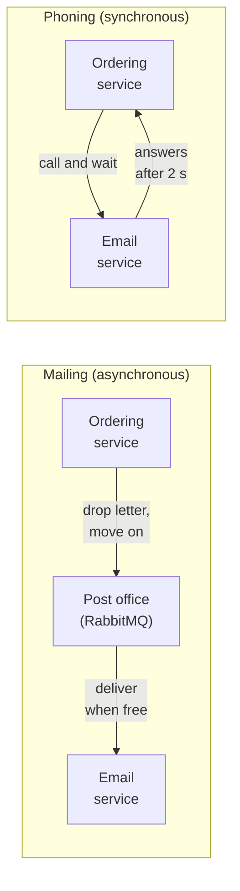
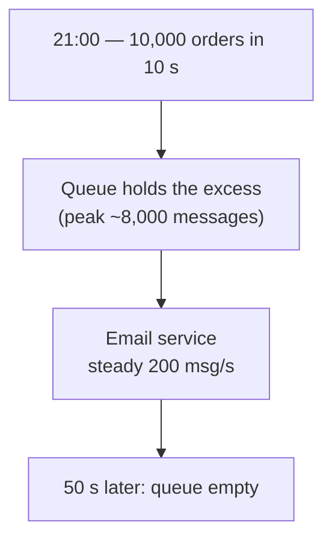

> [!tldr] Quick read
> - A [[en/concepts/message-broker|message broker]] is software that sits in the middle: it receives messages from the sender, holds them, and passes them on to the receiver. RabbitMQ is such a broker.
> - [[en/concepts/asynchronous-messaging|Asynchronous messaging]]: the sender hands the message to the broker and moves on to other work, without waiting for the receiver to finish processing it.
> - [[en/concepts/decoupling|Decoupling]]: the sender doesn't need to know who receives, how many receivers there are, or whether a receiver is alive or dead.
> - [[en/concepts/load-leveling|Load leveling]]: when work arrives faster than it can be processed, the queue holds the excess so the receiver can work through it at its own pace.
> - [[en/concepts/queue-va-log|Queue and log]] are two different kinds of broker: a queue deletes a message once it has been processed, a log (Kafka, RabbitMQ streams) keeps messages so they can be read again.

> [!info] Context
> This is the first station of **the RabbitMQ line**. The running example is **flash-sale**, a time-limited flash-sale shop I wrote myself: sales open at exactly 21:00 and thousands of people race for a few hundred units. Every successful order sets off a chain of side jobs: decrement stock, send an email, update the product page, sync the search box. You don't need to know the project's code, and you don't need to know what RabbitMQ is. This station has no configuration yet; it only answers the question "why".

> [!abstract]- Quick glossary for this post (click to open)
> - **Service**: a program that runs on its own and does one part of the system's work, for example an ordering service or an email service.
> - **HTTP request / API call**: one program asks another program something over the network and waits for the answer. See [[en/posts/2026-11-18-api-foundations|the Foundations station of the API line]].
> - **Synchronous**: after asking, you have to stand and wait for the answer before carrying on.
> - **Message**: a small packet of data, usually JSON, describing a job to do or something that just happened ("order 123 was just placed").
> - **Event**: a message that reports something that *has* happened. Unlike a command, which is a message asking for something to be done.
> - **Throughput**: the number of jobs processed per second.
> - **Docker**: a tool that runs software in an isolated "box"; here it runs RabbitMQ on your machine without installing it.
> - **Kafka**: another well-known messaging system, of the "log" kind. This station only compares them at the level of ideas.

## Picture it first: phoning or mailing a letter

The whole line uses one picture: **RabbitMQ is a post office**. This station only needs the first half of that picture, the difference between *phoning* and *mailing a letter*.

| Everyday life | Concept |
|---|---|
| Post office: takes letters, holds them, delivers them to the recipient | [[en/concepts/message-broker\|Message broker]] |
| You mail the letter and go home, without waiting for the recipient to read it | [[en/concepts/asynchronous-messaging\|Asynchronous messaging]] |
| Phoning: you wait for the other side to pick up; if they are busy, you are stuck too | synchronous call (HTTP) |
| The sender only writes the address, without knowing who is home or how many people will read it | [[en/concepts/decoupling\|Decoupling]] |
| At New Year, letters pour in at ten times the usual rate; the post office piles them in the storeroom and delivers them gradually | [[en/concepts/load-leveling\|Load leveling]] |
| The sender / the recipient of a letter | [[en/concepts/producer-va-consumer\|Producer and consumer]] |
| Mailbox: once you take a letter out, it's gone. Archive ledger: anyone can reread it from the first page | [[en/concepts/queue-va-log\|Queue and log]] |



On the left, the ordering service has to stand and wait until the email is sent. On the right, it hands the letter to the post office and keeps working; the email service picks up the letter whenever it is free.

## The problem: one order sets off five jobs

I used to think the simplest way was the right way: when a customer clicks "Buy now", the ordering service calls each of the other services in turn over HTTP.

1. Call the stock service: decrement 1 item.
2. Call the email service: send "order placed".
3. Call the notification service: push a notification to the phone.
4. Call the search service: update the remaining quantity.
5. Call the analytics service: record one sale.

On my machine, everything worked. Then I asked myself three questions:

- **The email service is 2 seconds slow** (the external mail server is congested). The customer waits 2 more seconds to see "order placed", even though email has nothing to do with placing the order.
- **The notification service is restarting.** The call fails. Is the order canceled? If not, who resends the notification later?
- **At 21:00, 10,000 people click at once.** The email service can only send 200 emails per second. The other 9,800 calls hang, hold their connections, then time out.

These three questions share one root: the ordering service is **doing other people's work for them**, and it **depends** on whether those others are alive and fast. A message queue cuts exactly that thread of dependency.

## How it works

### Message broker: a middleman who holds things for you

A [[en/concepts/message-broker|message broker]] is a separate piece of software whose only job is to receive, hold and pass on messages. The sender no longer talks to the receiver directly; it talks to the broker:

- **The sender** ([[en/concepts/producer-va-consumer|producer]], or publisher): hands messages to the broker.
- **The broker** (RabbitMQ): receives messages, stores them in a **queue**, and holds them until someone takes them.
- **The receiver** (consumer): subscribes to messages from the queue and processes them one by one.

With flash-sale, the ordering service now does only two things: save the order to the database, then send *one* message "order 123 was just placed" to the broker. Stock, email, notifications, search and analytics each pick up that message and do their own part.

RabbitMQ is the most popular open-source broker, written in Erlang, first released in 2007. It talks to applications over a standard protocol called **AMQP 0-9-1** (taken apart at [[en/posts/2026-11-21-rabbitmq-amqp-model|station 2]]). Since version 4.0 it also speaks AMQP 1.0, MQTT and STOMP (see [[en/posts/2026-11-21-rabbitmq-operations|station 9]]).

### Asynchrony: hand it over and go

[[en/concepts/asynchronous-messaging|Asynchronous messaging]] means the sender doesn't wait for the receiver to process anything. It waits for one thing only: the broker confirming "I have taken this message into my care". That confirmation arrives within a few milliseconds, because the broker only has to write the message into the queue.

This completely changes how the "Buy now" request adds up in time:

| | Calling 5 services directly | Sending 1 message to the broker |
|---|---|---|
| Time the customer waits | the sum of 5 calls | save the order + a few ms to send the message |
| Email service 2 seconds slow | customer waits 2 more seconds | customer notices nothing |
| Notification service down | the call fails, you have to handle resending yourself | the message waits in the queue and is delivered when the service is back |

In exchange, you lose one thing: **the result isn't available right away**. When the customer sees "order placed", the email may not have been sent yet. For email, that's fine. For "charge the card", think carefully: any job whose result the customer *needs to know right away* should still be a synchronous call.

> [!warning] Asynchrony doesn't make work faster
> The email still takes 2 seconds to send. The queue only moves those 2 seconds out of the path of the "Buy now" request. The total amount of work doesn't shrink.

### Decoupling: the sender doesn't need to know the receiver

With direct calls, the ordering service has to know the addresses of the five other services, know each one's API, and change its code every time a sixth service is added. That is **tight coupling**.

With a broker, the ordering service knows one thing: "send an `order.placed` message to the broker". Whoever wants to listen subscribes with the broker. Next month the marketing team wants to give a voucher for a customer's first order? They write a new consumer, subscribe to `order.placed`, and **nobody has to change the ordering service**. That is [[en/concepts/decoupling|decoupling]].

Decoupling works along three dimensions:

- **Space**: the sender doesn't need to know where the receivers are or how many there are.
- **Time**: the receiver doesn't need to be alive at the moment the sender sends.
- **Speed**: the receiver processes at its own pace, not the sender's.

The coupling doesn't disappear entirely; it moves into the **message contract**: the event name and the JSON structure. Rename `orderId` to `order_id` and every consumer breaks at the same moment, with no compile error to warn you.

### Load leveling: the queue is a buffer

21:00, the flash sale opens. In the first 10 seconds there are 10,000 orders. The email service sends 200 emails/second, so it needs 50 seconds to send them all.

- **Direct calls**: 9,800 calls get stuck or time out. The email service may go down under the load.
- **With a queue**: 10,000 messages sit in the queue. The email service takes out 200 messages/second, and after 50 seconds they are all done. Nothing goes down; the emails just arrive a little later.

That is [[en/concepts/load-leveling|load leveling]]: the queue turns a sharp spike into a flat line. To process faster, run more consumers; the broker spreads the messages across them on its own (station 4 calls this a *work queue*).



> [!warning] A queue is not a bottomless bag
> Messages in a queue use the broker's RAM and disk. If a queue keeps growing (the consumer died, or has been slower than the producer for too long), at some point RabbitMQ **blocks every publisher across the whole cluster** to protect itself. [[en/posts/2026-11-21-rabbitmq-dlx-retry|Station 6]] covers how to limit queue length, and [[en/posts/2026-11-21-rabbitmq-operations|station 9]] covers resource alarms.

A real detail from flash-sale: the "line up the buyers at 21:00" part of the project does **not** use RabbitMQ; it uses Redis (see [[en/posts/2026-11-21-shopify-flash-sale|the post about Shopify]]). In flash-sale, RabbitMQ carries the **events** produced *after* an order has been created: `order.placed`, `order.cancelled`, `inventory.changed`. The buyer waiting line has to answer "what's your position" instantly, while events need guaranteed delivery. Two different needs, two different tools.

### Queue and log: two kinds of broker

There are two families of broker, and picking the wrong family is a mistake at the root.

- **Queue** is like a mailbox: the consumer takes a letter out, acknowledges it has been processed, and the letter **is deleted**. Each message is usually processed by only one consumer. If two applications need to read the same message, each needs its own queue (station 3 shows the broker copying a message into several queues on its own). RabbitMQ classic queues and quorum queues belong to this family.
- **Log** is like an archive ledger: messages are **appended to the end** and kept for a retention period (say 7 days); reading them doesn't delete them. Each consumer remembers "which line I've read up to" (the offset), and can go back and read from the start. Kafka belongs to this family; since 3.9, RabbitMQ has **streams**, which are logs too.

| | Queue (RabbitMQ classic/quorum) | Log (Kafka, RabbitMQ stream) |
|---|---|---|
| After reading | message is deleted | message stays |
| Reread old messages | no | yes, by offset |
| Strong at | flexible routing, per-message acks, dead letters, delays, priorities | rereading, very many consumers reading together, very high throughput |
| Good for | handing jobs to workers, events that must be processed once | event sourcing, analytics, many systems reading the same event stream |

I used to think "RabbitMQ can't reread; if you want to reread you need Kafka". That was true before 2021. Since 3.9, RabbitMQ has streams; [[en/posts/2026-11-21-rabbitmq-queue-types|station 7]] tries out rereading by offset.

## Runnable example

The file `buffering.ts` shows two ideas from this station on a real broker: the producer hands over 5 orders within a few milliseconds even though the consumer isn't running yet (decoupling in time), and the consumer then works through them at its own pace (load leveling). To run it:

```bash
docker run -d --rm --name atlas-rabbit -p 5673:5672 -p 15673:15672 rabbitmq:4-management
npm i amqplib
node buffering.ts      # Node 22.6+ runs .ts files directly
```

Port 5673 avoids clashing with another RabbitMQ running on the default port 5672. The main part of the code (full version: [buffering.ts](../code/rabbitmq-why-queues/buffering.ts)):

```ts
// Producer: the ordering service. The consumer (sends emails) isn't running yet.
for (let i = 1; i <= 5; i++) {
  ch.sendToQueue(Q, Buffer.from(`don-${i}`), { persistent: true });
}
await ch.waitForConfirms(); // the broker confirms it has taken all 5 messages

// A while later the consumer starts and processes at its own pace.
await sleep(500);
const worker = await conn.createChannel();
await worker.prefetch(1);
await worker.consume(Q, async (msg) => {
  await sleep(200); // sending an email takes 200ms
  worker.ack(msg);
});
```

```text
$ node buffering.ts
+  11ms producer: handed 5 orders to the broker, moving on to other work
+  11ms waiting in the queue: 5 messages
+ 513ms consumer (sends emails) starts
+ 721ms consumer: sent email for don-1
+ 924ms consumer: sent email for don-2
+1126ms consumer: sent email for don-3
+1328ms consumer: sent email for don-4
+1530ms consumer: sent email for don-5
```

*(Output labels translated; the files themselves print Vietnamese.)*

The producer is done at millisecond 11. With a synchronous call, it would wait 5 × 200 = 1,000 ms, and fail immediately if the email service weren't running. The words `sendToQueue`, `prefetch`, `ack`, `persistent` and `waitForConfirms` are explained gradually in station 2 and station 4. For now, just look at the order of the timestamps.

While the container is running, open `http://localhost:15673` (user `guest` / `guest`) to see the management UI: the **Queues** tab shows the queue `demo.orders.to-email` with the number of messages waiting.

## Misconceptions and common traps

### "A queue makes the system faster"

A queue makes the *request* faster because it moves side jobs to later. The total amount of work stays the same, plus the cost of going through the broker. If the consumer is slower than the producer *forever*, the queue only postpones the day things fall over.

### Putting everything in a queue

If you push a job whose result the user needs right away ("is it in stock?", "did the payment go through?") into a queue, you have to build your own mechanism for waiting on the result (station 5 has the request-reply pattern). Queues fit best for jobs the sender *doesn't need to wait for*: sending emails, updating the search index, recording analytics.

### "Once the broker has it, the message is sure to arrive"

Not necessarily. A message may not land in any queue (wrong address, station 3), may be lost when the broker restarts (station 4), or may be processed twice (station 5). Most of this line exists to answer the question "how do I make it reliable".

### Treating decoupling as no coupling at all

Renaming a JSON field or an event still breaks consumers; it just breaks them *silently* and *later*. A message contract needs to be written down and changed according to plan, just like an API contract.

### Choosing Kafka or RabbitMQ because "I heard it's faster"

The two solve different problems. If you need to hand jobs to workers, route by label, retry with a delay, and handle dead letters: a RabbitMQ queue. If you need to store an event stream that many systems reread many times: a log (Kafka or RabbitMQ streams).

## Self-check questions

> [!question]- The email service is down. How do an HTTP call and sending through a broker differ?
> The HTTP call fails immediately (or hangs until it times out), and the caller has to handle resending itself. Through a broker, the message waits in the queue; when the email service comes back it carries on processing, and the sender notices nothing.

> [!question]- 10,000 orders arrive in 10 seconds, and the consumer processes 200 messages/second. What does the queue help with, and what doesn't it help with?
> It helps: it holds the excess so nothing goes down, and the consumer works steadily at 200 messages/second, finishing in about 50 seconds. It doesn't help: the work still takes 50 seconds; and if this goes on forever, the queue grows until the broker has to block publishers.

> [!question]- What is the core difference between a queue and a log?
> A queue deletes a message once the consumer acknowledges it has been processed. A log keeps messages for a retention period; each consumer keeps its own read position (offset) and can reread.

> [!question]- The marketing team wants to give a voucher for every first order. With a broker, do you have to change the ordering service?
> No. They write a new consumer and subscribe to the `order.placed` event. The ordering service keeps sending exactly the same one message as before.

> [!question]- Which jobs in flash-sale should *not* be pushed onto a queue?
> Jobs whose result the user needs right away within the request, such as checking whether units are left or confirming a payment. Pushing them onto a queue means building your own mechanism to wait for the result, which is more complex than a direct call.

## References

- [RabbitMQ: AMQP 0-9-1 Model Explained](https://www.rabbitmq.com/tutorials/amqp-concepts)
- [RabbitMQ tutorial 2: Work Queues (JavaScript)](https://www.rabbitmq.com/tutorials/tutorial-two-javascript)
- [RabbitMQ: Streams](https://www.rabbitmq.com/docs/streams) and [RabbitMQ Streams Overview](https://www.rabbitmq.com/blog/2021/07/13/rabbitmq-streams-overview)
- [Apache Kafka: Introduction](https://kafka.apache.org/intro)
