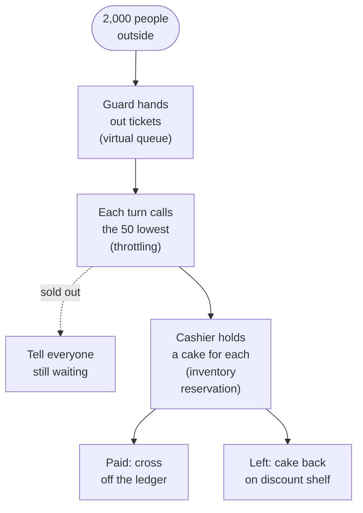
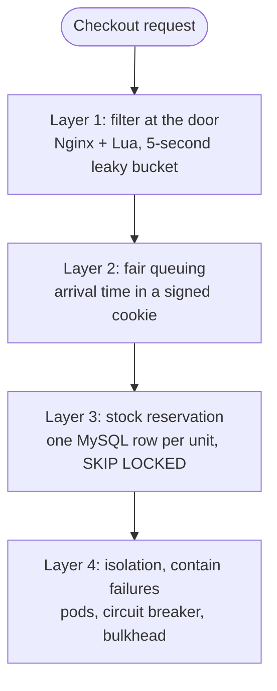
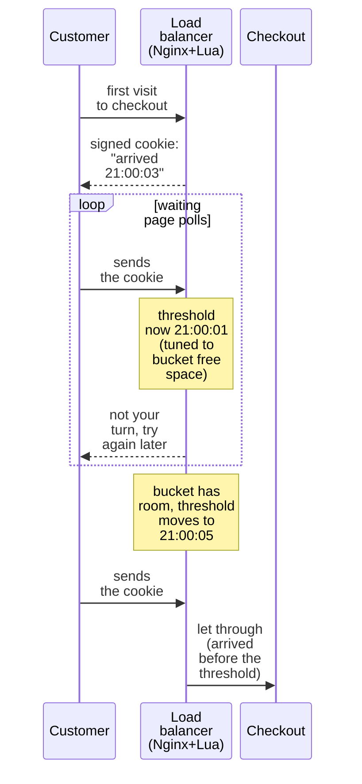

> [!tldr] Quick read
> - The "32 million requests per minute" figure is the peak for all of Shopify during Black Friday 2021, not for one flash sale. The more memorable number: **a single** flash sale once ate more than 20% of Shopify's entire compute capacity.
> - Shopify handles flash sales with four layers: filtering traffic at the door ([[en/concepts/throttling|throttling]]), fair queuing by arrival time ([[en/concepts/virtual-queue|virtual queue]]), reserving stock without overselling ([[en/concepts/inventory-reservation|inventory reservation]]), and isolation so one hot shop doesn't take down the others.
> - Every layer comes with a publicly told correction: a lottery-style queue that made customers wait 40 minutes, a queue at the door that didn't know the stock had run out, a Redis stock reservation that couldn't write atomically with the main stock ledger.
> - My project gets the hardest part right (atomic stock decrement in Lua, a queue by arrival time), but it still has four gaps. The worst: a canceled flash-sale order puts its stock back on **the wrong shelf**, and the end-of-sale reconciliation trusts Redis over the real orders.

> [!info] Context
> **flash-sale** is a golden-hour discount shop I wrote myself (NestJS backend, fast stock in Redis, the main stock ledger in Postgres). At the opening hour, thousands of people compete for a few hundred units. Buyers join a virtual queue, and every 5 seconds the system calls 50 people in to buy. You don't need to read the project's code: every code excerpt is explained in words first.
>
> This post differs from the earlier ones in that it's an **audit**. I read the engineering posts Shopify wrote about flash sales, then used them as a yardstick for my own project.

> [!abstract]- Quick glossary for this post (click to open)
> - **Flash sale**: a sale limited in quantity and time, for example 300 pairs of shoes going on sale at 21:00.
> - **RPM (requests per minute)**: the number of requests per minute the system receives.
> - **Edge / load balancer**: the outermost layer of machines, receiving requests from the Internet before passing them to the application. Shopify uses Nginx with Lua (OpenResty).
> - **Leaky bucket**: only a set number of requests get through in each time window, and the excess has to wait (see [[en/concepts/rate-limiting|rate limiting]]).
> - **Signed cookie**: a cookie the server signs with a secret key. The customer can read it, but editing it breaks the signature.
> - **Redis / Lua script**: Redis is an in-memory database. A Lua script runs inside Redis, in one go, with no other command cutting in.
> - **ZSET**: a Redis list that keeps itself sorted by score; here the score is the arrival time.
> - **Dual write**: one operation has to update two systems, such as Redis and Postgres, with no shared transaction. See [[en/concepts/dual-write|dual write]].
> - **Reconcile**: compare the figures between two stores and fix them to match.
> - **`SELECT … FOR UPDATE SKIP LOCKED`**: the SQL statement that locks rows for modification, skipping any row someone else has locked and taking another.
> - **Circuit breaker, timeout**: see [[en/posts/2026-11-18-api-reliability|the Reliability station]].

## Picture it first: a bakery selling 300 cakes at 9 o'clock

A famous bakery announces: at exactly 9 a.m., 300 cakes at half price. By 8:55, 2,000 people are standing outside. Every technique in this post has a counterpart at the bakery:

| Everyday life | Concept | Shopify | My flash-sale |
|---|---|---|---|
| The guard lets in only 50 people every 5 minutes; the rest wait outside | [[en/concepts/throttling\|Throttling]] | Leaky bucket at the Nginx layer | Call 50 people every 5 seconds |
| Hand out **numbered tickets** by arrival time, and call numbers from smallest to largest | [[en/concepts/virtual-queue\|Virtual queue]] | Arrival time in a signed cookie | Arrival time in a ZSET in Redis |
| The cashier **holds** the cake for you while you dig out your wallet, and only crosses it off the ledger once you've paid | [[en/concepts/inventory-reservation\|Inventory reservation]] | One MySQL row per unit | Lua decrements stock in Redis, then the order is created in Postgres |
| The counter board at the door and the stock ledger in the kitchen must match | [[en/concepts/dual-write\|Dual write]] | Drop Redis, keep only MySQL | Still a dual write, reconciled at the end of the sale |
| When the cakes run out, go to the door and tell the people in line right away | Close the queue when sold out | Move the queue into the application so it knows the stock | **Not yet** |
| A customer who leaves without paying puts the cake back on the discount shelf where it came from | Return stock to the right place | Release the reserved unit | **Returned to the regular shelf by mistake** |



## The problem: what the 32 million says, and what it doesn't

I started from the headline *How Shopify Handles Flash Sales at 32 Million Requests per Minute* in a system design newsletter. Going back to the original source, that figure comes from the early-2022 review written by Shopify's CTO. The Black Friday 2021 peak was **more than 32 million requests per minute to the app servers**, more than 34 million at the load balancers. That's the load on the whole platform, not on one flash sale.

The more notable sentence is right below it: Shopify defines a flash sale as a short sale that crosses a threshold of checkouts per minute, and **a single** such sale once used more than 20% of their entire compute capacity at peak. One shop out of millions taking a fifth of the infrastructure for a few minutes. That's the real problem: the load doesn't rise evenly but piles onto the **write path** (creating checkouts, reserving stock, decrementing stock), exactly the hardest part to scale.

So I skipped the newsletter and went straight to the posts Shopify wrote itself (listed at the end), then asked: how does my project handle each of those problems?

## How Shopify does it: four layers, each with a correction



### Layer 1: filter traffic at the door, but don't return an error

In 2017, Emil Stolarsky explained why Shopify had to throttle checkout. Each checkout session creates a MySQL record, and every step of checkout modifies that same record. A flash sale turns checkout into a write hotspot. The root fix was to rewrite checkout to batch the writes, but there wasn't time before the next sale. So they chose a stopgap at the outermost layer.

The throttle runs in Nginx with Lua (OpenResty), in [[en/concepts/rate-limiting|leaky bucket]] style: each **5-second** cycle lets only a certain number of checkout requests through, a number set by what the application can handle. Whoever gets through receives a signed cookie letting them go straight through for the rest of that session. Whoever doesn't sees a waiting page (designed by the merchant, cached at Nginx), and JavaScript on the page polls again by itself.

They deliberately **don't return `429`**: to a buyer, an error page looks like the shop is down. The waiting page keeps the feeling of "standing in line".

### Layer 2: the lottery queue, and the fix that made it a queue by arrival time

The first version had a design flaw the author himself admits. The waiting page **wasn't really a queue**: every poll was a fresh draw on equal terms with everyone else, and people who arrived early got no priority. Some customers waited as long as **40 minutes**, in a sale that only lasted about 40 minutes.

Part II tells the fix:

1. On the first checkout click, the arrival time is written into a **signed cookie**. No shared database stores the queue.
2. Each load balancer machine computes its own "now serving up to…" threshold (virtual now serving). Anyone whose arrival time is earlier than the threshold is passed on to the leaky bucket.
3. The threshold is adjusted continuously according to **the bucket's free space**: if the bucket has room, the threshold advances toward the present; if it's full, the threshold moves back. The controller uses only a proportional term, after they tried simulating a full PID.



The neat part is that **no shared state is needed**: the queue lives in each customer's cookie, and each load balancer decides for itself. The price is that fairness is only approximate, because the machines may compute slightly different thresholds.

In 2022, Logan Martel (Shopify) told the next part at Strange Loop. The throttle at the door could handle write surges **5 times** normal, but it had two limits. It was separate from the business logic, so it was hard to test and hard to improve. More importantly, **it didn't know the stock**: a customer could wait 30 minutes only to find the item had sold out 20 minutes earlier. They moved the queue into the application (Rails), making it a "business-aware queue".

### Layer 3: stock reservation, and why Shopify dropped Redis

Stock reservation is the operation that prevents overselling: when a customer starts paying, the system holds one unit for a few minutes. If payment succeeds, it is removed from the stock ledger for good (a claim); if the customer abandons, the unit is released.

Emilie Noel's May 2026 post tells how this part moved house. Previously each item had a number in Redis: `DECR` to reserve, `INCR` to release. Concurrency was no problem. The problem was that reserved units lived in Redis while the stock ledger lived in MySQL: a claim had to modify MySQL **and** clean up Redis, two jobs that can't be wrapped in one transaction. Whichever order you do them in, there are moments of overselling or false "sold out" reports. They moved entirely to MySQL:

- **One row per unit.** An item with 10 units has 10 rows. The number of available rows is capped at 1,000 per item-and-location pair, and a background process tops them up gradually from the stock ledger. The 1,000 figure comes from the highest reservation rate measured during flash sales.
- **`SELECT … FOR UPDATE SKIP LOCKED`**: when two people reserve at once, each takes a different row, and nobody waits for anybody.
- **A fixed lock order** to eliminate deadlocks: a reservation always deletes from the available-units table first, and only then writes to the reserved-units table.
- **The real bottleneck was connections, not CPU.** They tagged each SQL query with its business workflow to measure who held connections longest. After the cleanup, the checkout path made half as many reads and a third fewer transactions on the primary.
- **A gradual migration with a way back**: write to both Redis and MySQL in parallel (Redis still the source of truth), then switch the source of truth to MySQL with a switch to fall back to Redis, rolling out from low-traffic shops to the biggest ones.

The result: during large flash sales, writer CPU stayed under 50% and reader CPU under 16%. Black Friday 2025 peaked at 5.1 million USD in sales per minute.

### Layer 4: isolation and containing failures

- **Pods** (2016): shops are divided into groups, each with its own completely separate set of datastores. A piece of software called Sorting Hat in the load balancer routes each request to the right pod. A shop running a flash sale only weighs on its own pod, without spreading across the platform.
- **Semian** (since 2014): [[en/concepts/circuit-breaker|circuit breaker]] plus *bulkhead* (letting only a limited number of workers touch a resource at once, like the sealed compartments of a ship). The reason is stated very clearly: timeouts alone aren't enough, and a slow dependency is worse than a dead one.
- **Toxiproxy and the resiliency matrix**: a table whose rows are the dependent services and whose columns are the parts of the application, with each cell saying how that part behaves when the service is slow or down. Toxiproxy injects real latency and failures into tests to check every cell.
- **Load testing at real scale**: preparation for Black Friday 2021 started in July, and the biggest test reached 50.7 million requests per minute at the load balancers, one and a half times the actual peak.

## Holding up flash-sale: the path of one unit

The diagram below follows one flash-sale unit from joining the queue to the end-of-sale reconciliation, marking the gaps I found:

<figure class="figure-map" style="--ar: 1 / 1">
<div class="frame"><iframe data-archify="../../diagrams/shopify-flash-sale/flash-sale-gaps.en.html" title="Sequence diagram: one flash-sale unit going through the flash-sale project, and the four gaps" loading="lazy"></iframe></div>
<figcaption><span><b>Figure 1.</b> Queuing and stock decrement are done right; the gaps are in calling numbers after stock has run out, between the Redis write and the Postgres write, and in the order-cancellation flow.</span><a href="../diagrams/shopify-flash-sale/flash-sale-gaps.en.html" target="_blank" rel="noopener">Open full screen</a></figcaption>
</figure>

### What's done right

| Job | Shopify | flash-sale | Comment |
|---|---|---|---|
| Queue by arrival time | Signed cookie + threshold at each load balancer | `ZADD NX` into a ZSET, score is the arrival time | More precise fairness, in exchange for depending on one Redis |
| One place per person | Cookie tied to the session | `NX`: don't add if already there | Even |
| Separate "who gets in" from "is there stock" | Separate bucket, separate reservation | Separate checkout ticket, separate Lua decrement | Right direction |
| Decrement stock without overselling | One row per unit, `SKIP LOCKED` | Lua: check status, check per-buyer limit, `DECRBY`, undo if negative | Correct, atomic |
| Notify waiting customers | The waiting page polls again | WebSocket, with a polling endpoint as a fallback | Better than plain polling |
| Emergency off switch | (not seen in the posts) | Feature flag `flash_sale_kill_switch` | Good |

The core stock decrement is written carefully. In words: check that the sale is still open, check whether this person has already bought up to their limit, decrement stock, and if the stock goes negative, add it back and report sold out. All in one Lua script, so no request can cut in between:

```lua
-- trimmed from flash_purchase.lua
if meta.status ~= 'ACTIVE' then return -3 end            -- the sale is closed
if bought + qty > maxPerUser then return -2 end          -- over the per-buyer limit
local left = redis.call('DECRBY', stockKey, qty)
if left < 0 then redis.call('INCRBY', stockKey, qty); return -1 end  -- sold out
redis.call('INCRBY', userLimitKey, qty)
return 1
```

### Gap 1 (serious): flash-sale orders go through the regular stock flow

In Postgres, each SKU has two "shelves": the regular shelf (`total_stock`, `reserved_stock`) and the flash-sale shelf (`flash_sale_stock`, `flash_sale_reserved`, `flash_sale_sold`). A flash-sale order is created correctly on the flash-sale shelf. But afterwards the order enters **the common status-transition flow** of every order, and that flow doesn't distinguish where an order came from:

- An order unpaid after 15 minutes is canceled automatically. The `order.cancelled` event reaches the stock-release consumer, which calls `releaseStock`. That function **decrements `reserved_stock` on the regular shelf**:

  ```sql
  -- trimmed from stock.service.ts: releaseStock
  UPDATE inventories SET reserved_stock = GREATEST(reserved_stock - $qty, 0) WHERE sku_id = $sku
  ```

  If a regular customer is holding stock at that moment, *their* reservation gets partly released, the regular shelf reports more than it really has, and it may **oversell**. Meanwhile the canceled flash-sale unit goes back neither to Redis nor to the flash-sale shelf: it's **simply lost** until the sale ends.
- An order delivered 7 days earlier moves to `COMPLETED` and calls `confirmSold`, also on the regular shelf: it subtracts from `total_stock` and `reserved_stock` with the condition `reserved_stock >= qty`. If no regular customer is holding stock, the statement throws `INSUFFICIENT_RESERVED` and the flash-sale order **can't complete**. If one is, it takes someone else's reservation and subtracts from `total_stock` for an item already counted on the flash-sale shelf.

Experiment 4 at the end of the post rebuilds exactly the cancellation case: the regular shelf has 1 available, and after canceling a flash-sale order it has 2, even though nobody returned anything.

I reached this conclusion by reading the code (the order `transition` flow, the stock-release consumer and `StockService`), without running an integration test to reproduce it. Compared with Shopify: they keep **one** source of truth for stock, with reservation and claim on the same tables. The fix for flash-sale is to make the cancel and complete flows recognize flash-sale orders (the order already stores `skuInfo.source = 'flash-sale'` and `campaignId`), then return the unit to the flash-sale shelf, adding it back to Redis if the sale is still running.

### Gap 2 (serious): a dual write, and a reconciliation that trusts the wrong side

This is exactly the problem that made Shopify leave Redis. In flash-sale, Lua decrements stock in Redis, **then** a Postgres transaction creates the order. If the transaction fails, the `catch` block runs a compensation script that adds the stock back. That's correct when the failure is an exception. It's not correct when **the pod dies** between the two steps (a deploy, running out of memory, a node being reclaimed): Redis has decremented, there's no order, and the `catch` block never runs.

The safety net should be the end-of-sale reconciliation. But that step takes **Redis as the reference**: it computes the number sold as "the allocation minus what's left in Redis", then fixes the Postgres stock ledger to match. The "phantom sales" (Redis decremented, no order) are therefore recorded as sold and never returned to stock. Experiment 3: 100 units, 3% of requests hit at the moment a pod dies, Redis says 100 sold, Postgres has 97 orders, and reconciliation records 100.

The fixes, from light to heavy:

1. **Reconcile against real orders**: the number sold is the number of non-canceled flash-sale orders in Postgres, not the number Redis decremented. The difference goes back to stock and a warning is logged.
2. **Leave a marker in the same Lua**: the decrement script also writes a "reserved" entry keyed by `Idempotency-Key`. A periodic job finds entries past their deadline with no matching order and returns them. This is the Redis version of Shopify's `reserved_quantities` table.
3. **Do it like Shopify**: reserve stock with Postgres rows and `SKIP LOCKED`, leaving Redis as just the queue. You lose Lua's speed, but there are no longer two sources of truth.

### Gap 3: the queue keeps calling numbers after selling out

`joinQueue` and `processBatch` don't look at the stock. If stock runs out at second 60, person number 1,500 still joins the queue, still waits for their turn, gets a ticket, and only then hears "sold out". That's exactly the "wait 30 minutes, sold out 20 minutes ago" story that made Shopify move its queue into the application. Experiment 2 measured more than 3,000 person-minutes of pointless waiting in one 300-unit sale.

The fix is fairly cheap: when Lua returns "sold out" for every SKU in the sale, set a `sold_out` flag; `joinQueue` rejects immediately, `processBatch` stops, and the server broadcasts a WebSocket event so everyone waiting sees "sold out" right away.

### Gap 4: small holes around the queue

- **A fixed calling rate** (50 people every 5 seconds). Shopify tunes its threshold to the bucket's real free space. In flash-sale, unused tickets expire after 5 minutes without anyone being called in their place, and when the system is healthy it still calls only 50. The number per turn could be tuned to the number of still-valid tickets and the remaining stock.
- **Non-atomic number calling**: `ZPOPMIN` takes people out of the queue, and then a separate command issues the tickets. If the worker dies between the two commands, 50 people lose their place with no ticket. Merging the two steps into one Lua script fixes it.
- **A "single-use" ticket that isn't really single-use**: the ticket is checked with a `GET` before the Lua script and only deleted after the order is created. Two parallel requests with two different `Idempotency-Key`s both pass the ticket check. The per-buyer limit per SKU still prevents overbuying, but one ticket can still buy several SKUs. Checking and deleting the ticket could move into `flash_purchase.lua` itself.
- **A load test that can't go red**: the k6 script calls the purchase endpoint directly without queuing for a ticket, uses one shared account for 500 virtual users, and treats `400` and `429` as valid results. Every request is blocked at the ticket check or the rate limiter, so the Lua script is never load tested, yet the test stays green. The results table in the README has never been filled in either. Shopify, by contrast, load tests at one and a half times the real peak starting four months before Black Friday.

There's also a scaling limit, not yet a bug: the Lua script touches three keys `flash:stock:…`, `flash:user_limit:…`, `flash:campaign:…` with no shared hash tag. On a single Redis that's fine. Moving to Redis Cluster, the script will fail with `CROSSSLOT`, and the keys will have to be renamed to the form `flash:{campaignId}:…`.

## Runnable example

The file `sim.ts` contains four experiments, each rebuilding one idea from the post. The random numbers are seeded, so every run gives the same results.

```ts
// Experiment 3: the Lua decrement succeeds, then the pod may die before the DB transaction runs
for (let i = 0; i < 100; i++) {
  redisStock-- // Lua: DECRBY succeeded
  const podKilled = rand3() < 0.03 // 3% of requests hit at the moment the pod is shut down
  if (!podKilled) dbOrders.push(`ord_${i}`)
}
```

```text
$ node sim.ts
===== 1. Lottery queue (Shopify 2016) vs queue by arrival time (Shopify 2017) =====
lottery         : median 69s | p95 160s | longest 200s
by arrival time : median 73s | p95 137s | longest 142s

===== 2. Sold out, but the queue keeps issuing tickets =====
sold out at second 60
queue not closed: the last person in line reaches their turn before learning it's sold out; total pointless waiting 3132 person-minutes
queue closed when sold out: the remaining 1400 people are told "sold out" right at second 60

===== 3. Dual write: Redis decrements stock, then the DB creates the order, the pod dies in between =====
Redis says 100 sold, the DB has 97 real orders
reconcile trusting Redis (current): soldCount=100, 0 units returned to stock → 3 "phantom sales"
reconcile trusting DB orders:       soldCount=97, 3 units returned to stock

===== 4. Stock returned to the wrong shelf when a flash-sale order is canceled =====
before cancel: regular shelf has 1 sellable, flash-sale shelf has sold 1
after cancel:  regular shelf has 2 sellable (up 1 though nobody returned anything), flash-sale shelf still says sold 1
→ the regular shelf can oversell the real stock; the canceled flash-sale unit is simply lost
```

*(Output labels translated; the files themselves print Vietnamese.)*

Experiment 1 shows what Shopify ran into: the medians of the two kinds of queue are almost the same, but with the lottery, the unluckiest person waits almost one and a half times as long. The unfairness lives in the tail, not in the average. The full file: <a href="../code/shopify-flash-sale/sim.ts">code/shopify-flash-sale/sim.ts</a>.

## Misconceptions and common traps

### "Flash sales are hard because of the number of requests"

Read requests can be cached (Shopify even caches the waiting page at Nginx). The hard part is **writes piling onto the same few rows of data**: the same item, the same checkout record. Every technique here aims to spread out or split up those writes.

### "With an atomic Lua script, the stock count can't be wrong"

Lua is only atomic *inside Redis*. As soon as one operation has to write both Redis and a database, atomicity stops at that boundary. Shopify paid the price right there and decided to drop Redis for stock reservation.

### "A queue is for fairness"

A queue is first of all there to **protect the write path**; fairness is the second requirement. But when fairness is missing, customers notice right away (Shopify got complaints about 40-minute waits). And if the queue doesn't know the stock, it becomes a place that makes customers wait for something already sold out.

### "Having an end-of-sale reconciliation makes it safe"

A reconciliation is only safe when it trusts the right source. Fixing the stock ledger to match a temporary counter turns the bug into official data.

### "A green load test means the system can take it"

A test is only worth something if it *can* go red. Ask yourself: if the Lua decrement were wrong, would this test say so?

## Self-check questions

> [!question]- Why does Shopify return a waiting page instead of `429` to people throttled at checkout?
> Buyers read a `429` (or any error page) as "the shop is down". The waiting page, designed by the merchant and cached at Nginx, keeps the feeling of standing in line, and JavaScript on the page polls again by itself.

> [!question]- Shopify's queue by arrival time has no shared database. Where is the arrival time stored, and what's the price?
> In each customer's signed cookie. Each load balancer computes its own "now serving up to" threshold from the bucket's free space. The price is approximate fairness, because the machines may compute slightly different thresholds.

> [!question]- Shopify's Redis stock reservation handled concurrency fine. So why did they drop it?
> Because reserved units lived in Redis while the stock ledger lived in MySQL. A claim had to modify both, which couldn't be wrapped in one transaction, so there were moments of overselling or false "sold out" reports.

> [!question]- In flash-sale, a pod dies right after the Lua decrement. What happens to that unit at reconciliation?
> Redis has decremented but there's no order. The current reconciliation takes Redis as the reference, so it records the unit as sold and doesn't return it to stock. Reconciling against the real orders in Postgres would give it back.

> [!question]- Why can canceling a flash-sale order make the *regular shelf* oversell?
> The common cancel flow calls `releaseStock` on the regular shelf's `reserved_stock`, while the flash-sale order never reserved anything there. If a regular customer is holding stock, their reservation is partly released and the regular shelf reports more than it really has.

## References

I came across the headline and the 32 million figure through the [System Design One](https://newsletter.systemdesign.one/p/shopify-flash-sale) newsletter. All the technical content in this post comes from Shopify's original sources below; the project audit comes from my own reading of the code.

- Emil Stolarsky, [Surviving Flashes of High-Write Traffic Using Scriptable Load Balancers, Part I](https://shopify.engineering/surviving-flashes-of-high-write-traffic-using-scriptable-load-balancers-part-i) and [Part II](https://shopify.engineering/surviving-flashes-of-high-write-traffic-using-scriptable-load-balancers-part-ii) (Shopify Engineering, February 2017)
- Allan Leinwand, [Shopify's Cloud, Load, and Modular Code Plans for 2022](https://shopify.engineering/cloud-load-modular-code-shopify-2022) (January 2022): the 32 million RPM figure, a flash sale taking more than 20% of capacity, the 50.7 million RPM load test
- Emilie Noel, [Scaling Inventory Reservations](https://shopify.engineering/scaling-inventory-reservations) (May 2026)
- Xavier Denis, [A Pods Architecture To Allow Shopify To Scale](https://shopify.engineering/a-pods-architecture-to-allow-shopify-to-scale) (March 2018)
- Logan Martel, [A Commerce-Centric Approach to Queuing Fairly at High Throughput](https://thestrangeloop.com/2022/a-commerce-centric-approach-to-queuing-fairly-at-high-throughput.html) (Strange Loop 2022)
- Simon Eskildsen, [Building and Testing Resilient Ruby on Rails Applications](https://shopify.engineering/building-and-testing-resilient-ruby-on-rails-applications) (January 2015)
- [Shopify/semian](https://github.com/Shopify/semian) and [Shopify/toxiproxy](https://github.com/Shopify/toxiproxy)
