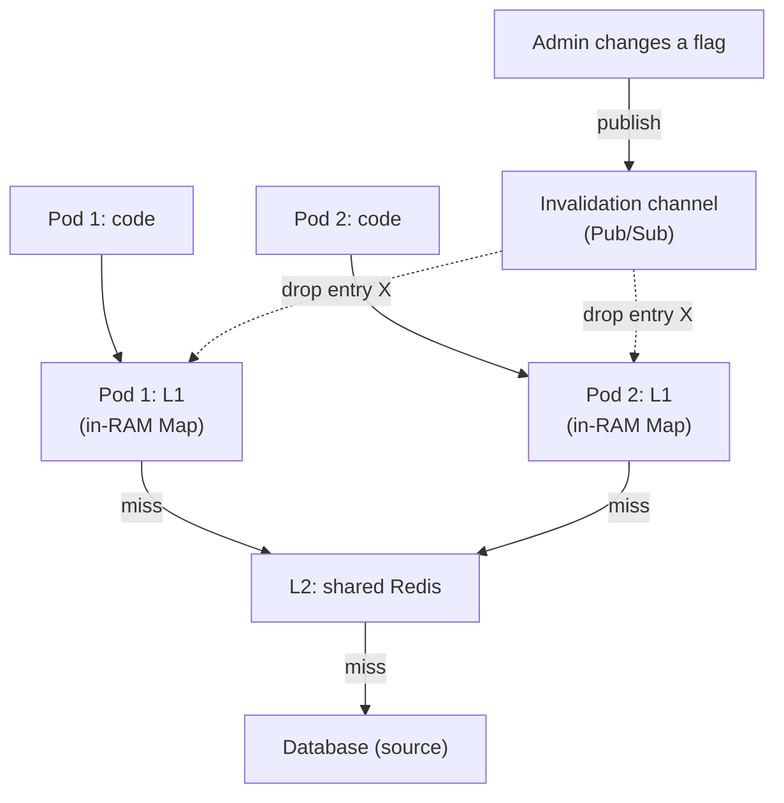

> [!tldr] Quick read
> - An [[en/concepts/in-process-cache|in-process cache]] (a `Map`) is hundreds of times faster than Redis because it skips the network, but each pod keeps its own copy, and without a limit it becomes a memory leak.
> - A [[en/concepts/two-tier-cache|two-tier cache]]: L1 in each pod's RAM, L2 in shared Redis, and the database last. The hardest part is telling *every* pod to drop its L1 when the data changes.
> - [[en/concepts/pubsub-invalidation|Pub/Sub invalidation]] is "fire and forget": a pod that is disconnected at that exact moment never gets the message. An L1 without a TTL stays wrong until the pod restarts; with a 2-second TTL it corrects itself after 2 seconds.
> - Redis 6+ [[en/concepts/client-side-caching|client-side caching]]: Redis itself remembers which keys a client has read and sends an invalidation message when one of them changes.
> - Splitting keys across nodes: `hash % N` moves 80% of keys when a 5th node is added, [[en/concepts/consistent-hashing|consistent hashing]] only 20%. Redis Cluster uses 16384 [[en/concepts/hash-slot|hash slots]]. [[en/concepts/cache-warming|Warm the cache]] before peak hour so new pods don't start from zero.

> [!info] Context
> Station 7 of **the Caching line**. The example is **flash-sale**, a shop with happy-hour discounts: the backend runs many pods behind a load balancer, and every feature flag check (is the new checkout page on yet?) must be so fast it is nearly free. flash-sale keeps flags in each pod's RAM, then Redis, then PostgreSQL. You do not need to know the project's code.

> [!abstract]- Quick glossary for this post (click to open)
> - **Cache-aside, invalidation, TTL, hot key, LRU**: see stations [[en/posts/2026-11-22-caching-patterns|3]], [[en/posts/2026-11-22-caching-invalidation|4]], [[en/posts/2026-11-22-caching-under-load|5]], [[en/posts/2026-11-22-caching-redis|6]].
> - **Pod**: one running copy of the application (in Kubernetes). Ten pods are ten separate processes, each with its own RAM.
> - **Pub/Sub**: "broadcast" messaging: the sender publishes to a channel, and whoever is subscribed to that channel receives it. If nobody is listening, the message is lost.
> - **Feature flag**: a switch that turns a feature on or off without redeploying.
> - **RESP2 / RESP3**: two versions of the protocol clients use to talk to Redis. RESP3 lets the server push messages on the same connection.
> - **Node / shard**: one Redis process holding part of the cluster's data.
> - **CRC16**: a simple hash function that outputs a 16-bit number.

## Picture it first: a stack of books on every desk

The library now has many reading rooms. Each desk keeps its **own stack of books** for speed, the whole building shares **the shelf in the lobby**, and **storage** is in the basement. When a new edition comes out, the librarian announces over the loudspeaker: "whoever has book X, put it away". Anyone wearing headphones does not hear it.

| Everyday life | Concept |
|---|---|
| The stack on the desk: right at hand, used only by that desk | [[en/concepts/in-process-cache\|In-process cache]] (L1) |
| The stack on the desk, the shelf in the lobby, storage in the basement | [[en/concepts/two-tier-cache\|Two-tier cache]] |
| Announcing "put book X away", anyone in headphones misses it | [[en/concepts/pubsub-invalidation\|Pub/Sub invalidation]] |
| The librarian logs who borrowed which book and tells exactly those people about a new edition | [[en/concepts/client-side-caching\|Client-side caching]] |
| Splitting books around a circle so adding a room moves only a few books | [[en/concepts/consistent-hashing\|Consistent hashing]] |
| Books filed into 16,384 numbered compartments, each room holds a range of them | [[en/concepts/hash-slot\|Hash slot]] |
| Putting the textbooks out on the shelf before exam day | [[en/concepts/cache-warming\|Cache warming]] |



## The problem: faster than Redis, but twenty copies

I used to think Redis was the fastest cache tier you'd need. But every request in flash-sale checks a few feature flags, reads permissions, reads templates. Each Redis lookup costs about half a millisecond round trip over the network; multiply by a few thousand requests per second and each pod spends a hundred milliseconds of CPU and network every second just asking about things that almost never change. A `Map` in RAM answers in tens of nanoseconds.

The price: now there are **twenty copies** (one per pod) plus the copy in Redis plus the original. When an admin turns off a feature flag, all twenty copies have to know. And when one Redis is not big enough, keys have to be split across several nodes without making the cache miss en masse every time a node is added.

## How it works

<figure class="figure-map" style="--ar: 4 / 3">
<div class="frame"><iframe data-archify="../../diagrams/caching-distributed/two-tier.en.html" title="Architecture diagram: two pods with an in-RAM L1, shared Redis as L2, PostgreSQL as the source, and a Pub/Sub invalidation channel" loading="lazy"></iframe></div>
<figcaption><span><b>Figure 1.</b> A two-tier feature flag cache: reads go L1 → L2 → database; writes delete L2 and broadcast an invalidation message to every pod.</span><a href="../diagrams/caching-distributed/two-tier.en.html" target="_blank" rel="noopener">Open full screen</a></figcaption>
</figure>

### In-process cache: the fastest, private to each pod

An **[[en/concepts/in-process-cache|in-process cache]]** lives right in the application process's memory: a `Map`, or a library such as `lru-cache` (Node) or Caffeine (Java). No network, no JSON serialization, so it is hundreds to thousands of times faster than Redis.

Three things to watch:

- **It must have a limit.** A `Map` that never deletes is a memory leak: every new key (a template, a result) stays there forever until the pod is killed for running out of RAM. Use an LRU with a `max` number of entries, plus a TTL.
- **One copy per pod.** Twenty pods means twenty copies, each pod's hit ratio is lower than a shared cache's (each pod sees only 1/20 of the traffic), and a freshly started pod has an empty cache.
- **No sync between pods.** Pod A deletes its entry, pod B does not know. That is the topic of the next sections.

It fits best for data that is **small, read extremely often, rarely changed, and fine being a few seconds stale**: feature flags, configuration, role permissions, templates, and the [[en/concepts/hot-key|hot keys]] from station 5.

### Two-tier cache: L1, L2, then the source

A **[[en/concepts/two-tier-cache|two-tier cache]]** stacks two caches: L1 in each pod's RAM, L2 in shared Redis, and only then the database. Reads go top to bottom; a miss at a tier refills that tier on the way back.

flash-sale's feature flag cache is exactly that, plus a negative cache ([[en/posts/2026-11-22-caching-invalidation|station 4]]) in L1:

```ts
// trimmed excerpt from the flash-sale feature flag cache
async get(name: string) {
  const l1Hit = this.l1.get(name);                       // L1: Map, no TTL
  if (l1Hit) return l1Hit;
  if (this.l1Negative.has(name)) return null;
  const raw = await redis.hget('flags', name);            // L2: one hash in Redis
  if (raw) { const f = JSON.parse(raw); this.l1.set(name, f); return f; }
  const flag = await this.repository.findByName(name);    // source: PostgreSQL
  if (flag) { this.l1.set(name, flag); await this.writeL2(name, flag); return flag; }
  this.l1Negative.add(name); return null;
}
async invalidate(name: string) {
  this.l1.delete(name); this.l1Negative.delete(name);     // this pod
  await redis.hdel('flags', name);                         // the shared tier
  await this.pubsub.publish({ flagName: name });           // the other pods
}
```

The good part: reads almost always hit L1, and if Redis goes down you can still read from L1 and the database (each tier is wrapped in try/catch). The weak spot is the last line: the invalidation message.

### Pub/Sub invalidation: fire and forget

Redis Pub/Sub delivers with **at-most-once** semantics: the Redis docs state clearly that a message goes to whoever is subscribed *right now*, is not stored, and is not acknowledged. A pod that has lost its connection to Redis right when the admin changes a flag (flaky network, Redis failing over, the pod stuck in a long GC pause) will never get that message. When it reconnects, it has no idea what it missed.

With **[[en/concepts/pubsub-invalidation|Pub/Sub invalidation]]** and an L1 **without a TTL** (as flash-sale has today), that pod keeps the old value **until it restarts**. The admin turns off the new checkout page because of a bug, 19 pods turn it off, the 20th pod still has it on.

Ways to harden it, from cheap to expensive:

1. **A TTL on L1** as a safety net: a few seconds up to a minute. A missed message can only cause wrong answers for at most the TTL. This is the change to make first.
2. **Clear all of L1 on reconnecting** the subscribe connection: once you may have missed messages, treat everything as possibly stale.
3. **Attach a version**: the invalidation message carries a version (flash-sale already sends `version`); each pod periodically compares the highest version it knows with a key in Redis and clears L1 if they differ.
4. **A durable channel** instead of Pub/Sub: Redis Streams or a queue (RabbitMQ, Kafka), where each pod resumes from where it stopped after reconnecting.

### Client-side caching: let Redis remember who holds what

Redis 6 added **[[en/concepts/client-side-caching|client-side caching]]** (tracking): a client turns on `CLIENT TRACKING on`, and Redis remembers which keys that client has read. When a key is modified, deleted, expires or is evicted, Redis sends an invalidation message (`invalidate`) to exactly the clients that read it. No need to write publish code at every write site yourself.

- **Default mode**: Redis remembers each key for each client. Precise, but it costs server-side memory (the tracking table is bounded; when it is full, Redis proactively invalidates some keys).
- **Broadcast mode (`BCAST PREFIX flag:`)**: Redis remembers nothing and sends invalidations for every change to keys with a registered prefix. No server memory cost, but clients get more messages.
- **RESP3** receives invalidation messages on the connection already in use. **RESP2** has to open an extra connection subscribed to the `__redis__:invalidate` channel and enable tracking with `REDIRECT <that connection's id>`. The `OPTIN`/`OPTOUT` options choose which keys are tracked, and `NOLOOP` skips messages caused by the client itself.

It does not eliminate lost messages: the Redis docs advise that when the connection receiving invalidations drops, the client should **flush its local cache entirely**, since it may have missed messages.

### Consistent hashing: adding a node without missing the whole cache

When one Redis lacks the RAM or CPU, split keys across several nodes. The naive way is `node = hash(key) % N`. Add a fifth node (N goes from 4 to 5) and almost every key moves: about 1 − 1/5 = **80%** of keys now belong to another node, so they all miss at once and the load lands on the database, right when you added a node because things were overloaded.

**[[en/concepts/consistent-hashing|Consistent hashing]]** (Karger et al., 1997) places both nodes and keys on a **ring** of hash values. Each key belongs to the first node you meet going clockwise. Adding a node only moves the keys between the new node and the node before it, about 1/N of the keys. Each real node is placed at many "virtual points" (virtual nodes) on the ring to spread keys more evenly. In the example: 79.8% of keys change node with `hash % N`, 19.8% with consistent hashing. Many memcached clients, CDNs and per-user load balancers ([[en/concepts/load-balancing|load balancing]]) use this idea.

### Hash slot: how Redis Cluster splits keys

Redis Cluster does not use a ring; it uses a fixed **16,384 [[en/concepts/hash-slot|hash slots]]**:

```text
slot = CRC16(key) mod 16384
```

Each node holds a range of slots. Adding a node means **moving some slots** (with the keys in them) to the new node; a client that asks the wrong node gets a `MOVED` or `ASK` redirection error and updates its map. The result resembles consistent hashing (only the moved data changes place), but the move is controlled explicitly, slot by slot.

An important consequence: multi-key commands (`MGET`, `DEL k1 k2`, transactions, Lua scripts) only work when **all keys are in the same slot**, otherwise you get a `CROSSSLOT` error. To force several keys into the same slot, use a **hash tag**: only the part inside `{...}` is hashed. `product:{42}:price` and `product:{42}:stock` share slot 8000, so the lease from station 4 (cache key + lease key in one Lua script) must be named like `{price:42}` and `lease:{price:42}`. Don't overuse it: every key with the same tag piles onto one node, becoming a hot key in a different way.

### Cache warming: not starting from zero

A new pod, a freshly restarted Redis, or a deploy at 20:55: every cache is empty, and the first wave of users falls straight through to the database. **[[en/concepts/cache-warming|Cache warming]]** preloads what is certain to be read *before* taking traffic:

- At startup: flash-sale loads every feature flag into L1 with one query (`warmL1`) and loads every role's permissions into Redis (`warmCache`) before the pod takes requests.
- Before an event: load the pages and prices of the products going on sale at 21:00 into the cache starting at 20:50.

Two traps: warming too aggressively becomes a load spike on the database itself (rate-limit the loading), and warming thousands of keys at once with the same TTL makes them expire at once ([[en/concepts/ttl-jitter|TTL jitter]] from station 5).

## Runnable example

[two-tier.ts](../code/caching-distributed/two-tier.ts) sets up two "pods" in the same process, each with its own L1 and its own Redis connection, both listening on one invalidation channel. Then it tries Redis client-side caching, compares `hash % N` with consistent hashing, and computes hash slots by hand.

```bash
docker run -d --rm --name atlas-redis -p 6380:6379 redis:8
npm i ioredis
node two-tier.ts
```

```ts
// Simulate pod B's Pub/Sub connection dropping right when pod A writes
await b.sub.unsubscribe(CHANNEL);     // B receives no messages
await a.write(K, 'off');              // A: write DB, delete L2, publish
await b.sub.subscribe(CHANNEL);       // B reconnects, but the message is gone

// Redis client-side caching over RESP2: invalidations go to a separate connection
const inboxId = await inbox.client('ID');
await inbox.subscribe('__redis__:invalidate');
await tracked.call('CLIENT', 'TRACKING', 'on', 'REDIRECT', String(inboxId));
```

```text
$ node two-tier.ts
1) Two pods, L1 without a TTL, invalidation over Pub/Sub
   B reads: off (DB), B reads again: off (L1)
   A turns the flag "on" and publishes → B reads: on (DB)
2) B's Pub/Sub connection drops right when A writes (Pub/Sub messages are not stored)
   3 seconds later, DB = off, B reads: on (L1) ← wrong until B restarts
3) Same incident, but L1 has a 2-second TTL as a safety net
   right after A writes: B reads on (L1)
   2 seconds later: B reads off (DB) ← corrects itself when L1 expires
4) Redis client-side caching: Redis remembers which keys a client read and reports changes
   client reads price:42 = 199000 (Redis remembers)
   invalidation sent to the client: price:42
   (changing price:43 sends nothing because the client never read that key)
5) Split 100,000 keys over 4 nodes, then add a 5th node
   hash % node count   → 79.8% of keys change node (cache miss)
   consistent hashing  → 19.8% of keys change node (cache miss)
6) Redis Cluster: slot = CRC16(key) mod 16384, hash tag {…} forces keys into the same slot
   product:{42}:price  → slot 8000
   product:{42}:stock  → slot 8000
   product:42:price    → slot 15184
   somekey             → slot 11058
```
*(Output labels translated; the files themselves print Vietnamese.)*

Reading the results:

- **Part 1**: the normal path works, B gets the message and rereads from the source.
- **Part 2**: one missed message and B is wrong indefinitely. This is exactly how an L1 without a TTL behaves.
- **Part 3**: add a 2-second TTL to L1 and the same incident is wrong for only 2 seconds.
- **Part 4**: Redis sends an invalidation for `price:42` on its own because the client read it, and nothing for `price:43`.
- **Part 5**: matches the theory, 1 − 1/5 = 80% versus 1/5 = 20%.
- **Part 6**: the slot numbers computed with CRC16 match the `CLUSTER KEYSLOT` command of a Redis running in cluster mode (I checked: 8000, 8000, 15184, 11058).

## Misconceptions and common traps

- **"Pub/Sub guarantees every pod gets the message."** No. Messages only reach whoever is listening, with no storage and no acknowledgement. L1 needs a TTL or must be cleared on reconnect.
- **"`new Map()` is a cache."** With no size limit and no TTL, it is a memory leak with a nice name. Use an LRU with `max` and a TTL.
- **"Adding L1 raises the hit ratio."** The *overall* hit ratio may rise, but each pod sees only part of the traffic, so each pod's L1 hits less than a shared cache of the same size. L1 is worth it because it is cheap, not because it hits a lot.
- **"Client-side caching solves syncing by itself."** Messages can still be missed when the connection drops; you must flush the local cache on reconnect. The default mode also costs server-side memory.
- **"`hash % N` is enough to split keys."** Every change in node count makes almost the whole cache miss. Use consistent hashing or Redis Cluster.
- **A Lua script or `MGET` with keys in different slots** fails with `CROSSSLOT` in Redis Cluster. Use hash tags for keys that always travel together.
- **Warming the cache with the same TTL** makes everything expire at once. Add jitter.

## Self-check questions

> [!question]- Why is an in-process cache many times faster than Redis, and what is the price?
> No network trip, no data serialization, just reading the process's own memory. The price: each pod has its own copy, there is no sync between pods, RAM cost multiplies with the number of pods, and the cache is empty every time a pod starts.

> [!question]- Pod B loses its Redis connection for 2 seconds, and right then an admin turns off a feature flag. L1 has no TTL. What happens, and how do you fix it?
> Pub/Sub does not store messages, so B never learns that the flag changed and keeps the old value until it restarts. Fix: add a TTL to L1 as a safety net, clear all of L1 every time the subscribe connection reconnects, or use a durable channel.

> [!question]- How do the default mode and broadcast mode of Redis client-side caching differ?
> Default: Redis remembers each key every client has read and invalidates only those keys; precise but costs server memory. Broadcast: Redis remembers nothing and reports every change to keys matching a registered prefix; no memory cost but more messages.

> [!question]- A 4-node cache cluster splits keys with `hash % N`. Add a 5th node: what percentage of keys miss? And with consistent hashing?
> About 80% with `hash % N`, because almost every key changes node. About 20% (1/N) with consistent hashing, because only the keys in the arc of the ring the new node takes over move.

> [!question]- Why do `product:{42}:price` and `product:{42}:stock` always land in the same slot, and when does that matter?
> When a key has a hash tag, Redis Cluster hashes only the part inside the curly braces (`42`), so the two keys share a slot. It matters when they must be used in the same multi-key command, transaction or Lua script; otherwise you get a `CROSSSLOT` error.

## References

- [Redis: Client-side caching](https://redis.io/docs/latest/develop/reference/client-side-caching/) (tracking, broadcast, REDIRECT, flushing the cache on disconnect)
- [Redis: Pub/Sub](https://redis.io/docs/latest/develop/interact/pubsub/) (at-most-once)
- [Redis Cluster specification](https://redis.io/docs/latest/operate/oss_and_stack/reference/cluster-spec/) (16384 slots, CRC16, hash tags, MOVED/ASK)
- Karger et al., [Consistent Hashing and Random Trees](https://dl.acm.org/doi/10.1145/258533.258660), STOC 1997
- Nishtala et al., [Scaling Memcache at Facebook](https://www.usenix.org/conference/nsdi13/technical-sessions/presentation/nishtala), NSDI 2013 (multiple clusters, cold cluster warmup)
