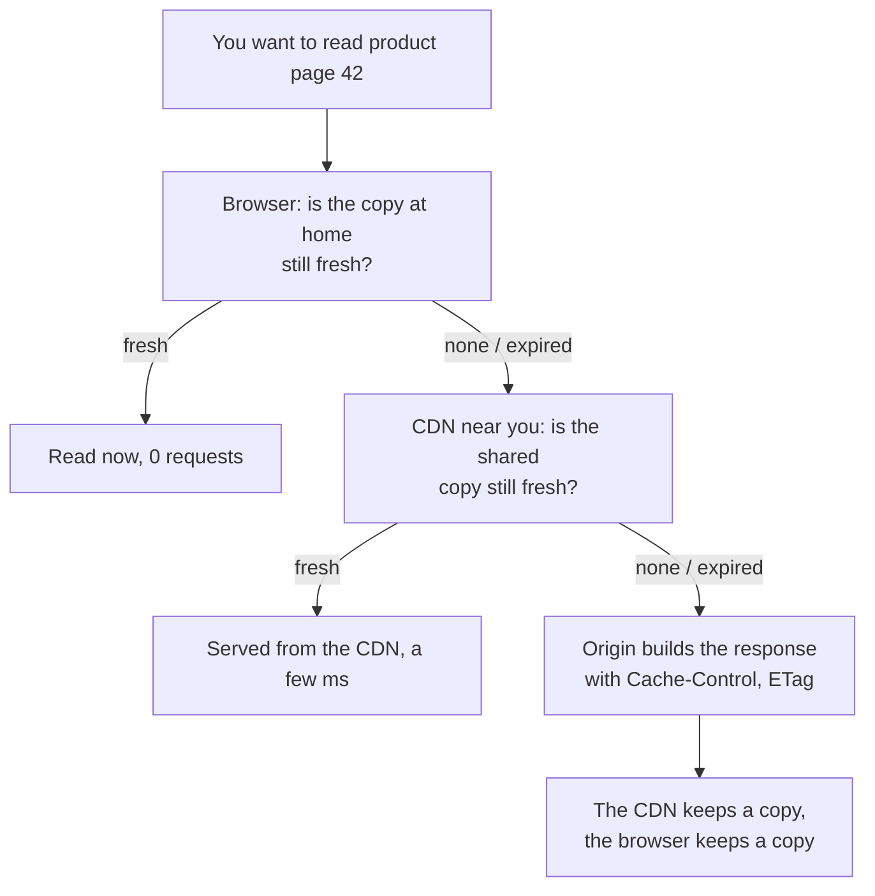

> [!tldr] Quick read
> - Between the user and the server there are at least two cache tiers: the [[en/concepts/browser-cache|browser cache]] (one per person) and the [[en/concepts/cdn|CDN]] (shared by everyone). The server controls both with the [[en/concepts/cache-control|Cache-Control]] header.
> - `max-age=N`: reuse for N seconds without asking. `no-cache` does **not** mean "don't cache" but "you may store it, but check before using it"; forbidding storage is `no-store`. `private`: only the browser may keep it, the CDN may not.
> - An [[en/concepts/etag|ETag]] is a "version tag" for a response. Once it expires, the client asks again with `If-None-Match`; if nothing changed, the server returns `304` with no body.
> - [[en/concepts/vary|Vary]] adds request headers to the cache key: the same URL in Vietnamese and in English are two different copies.
> - [[en/concepts/stale-while-revalidate|stale-while-revalidate]]: after expiry, still return the stale copy immediately, then fetch a fresh one in the background. The user doesn't wait.

> [!info] Context
> Station 2 of **the Caching line**. The example is **flash-sale**, a time-limited discount shop: at 21:00, images, CSS and product pages are downloaded hundreds of thousands of times. This station is the tier farthest from the server: the browser itself and the CDN. The example is a miniature CDN running in Docker on your machine. You don't need to know the project's code.

> [!abstract]- Quick glossary for this post (click to open)
> - **Hit, miss, hit ratio, cache key, staleness**: see [[en/posts/2026-11-22-caching-why|station 1]].
> - **HTTP header**: the `Name: value` lines that travel with requests and responses, carrying extra information (language, content type, caching rules…).
> - **Origin**: the original server that produces the response (here, the shop's Node server), as opposed to the caches standing in front of it.
> - **CDN (Content Delivery Network)**: a network of servers placed in many locations around the world, keeping copies of content close to users. Examples: Cloudflare, Fastly, CloudFront.
> - **Proxy / reverse proxy**: a program in the middle that receives requests on behalf of the server and forwards them. **nginx** is a popular reverse proxy with built-in caching.
> - **Status 200 / 304**: 200 is "here is the data"; 304 Not Modified is "the copy you have is still correct, keep using it".
> - **Docker compose**: a way to run several containers at once from one config file.

## Picture it first: books at home, the district library and the central library

In station 1, the library had a shelf next to the desk. Now zoom out to the whole city: you have a few books **at home** (only you read them), the **district library** near your home keeps copies of the books the whole district borrows often, and the **central library** has everything but is far away.

| Everyday life | Concept |
|---|---|
| Books on your desk at home, only you read them | [[en/concepts/browser-cache\|Browser cache]] (private cache) |
| The district library: shared copies for the whole area | [[en/concepts/cdn\|CDN]] (shared cache) |
| The central library, where the originals are printed and kept | Origin server |
| A sticker on the cover: "usable until…", "not for loan outside" | [[en/concepts/cache-control\|Cache-Control]] |
| The printing number on the spine: call and ask "is printing 3 still current?" | [[en/concepts/etag\|ETag]] and `If-None-Match` |
| The same title in a Vietnamese edition and an English edition | [[en/concepts/vary\|Vary]] |
| An overdue book can still be lent for now, while a request for the new one goes out | [[en/concepts/stale-while-revalidate\|stale-while-revalidate]] |



## The problem: everyone asks for the same thing, from everywhere

I used to think caching was a backend matter: put Redis in front of the database and you're done. But at 21:00, most of the bytes sent out are images, CSS, JavaScript and product pages that are *identical for everyone*. Each download still has to travel all the way to the server, through TLS, through the load balancer, run code, and come back. The server does the same work hundreds of thousands of times, and faraway users pay the network latency every time.

HTTP has long had a complete rulebook for this: the server writes the rules on each response, and every cache along the way (browser, corporate proxy, CDN) follows them on its own. The hard part is understanding every word of the rules correctly.

## How it works

<figure class="figure-map" style="--ar: 1 / 1">
<div class="frame"><iframe data-archify="../../diagrams/caching-http/cdn-life.en.html" title="Sequence diagram: a request passes through the browser, the CDN and the origin; hit, expiry, serving stale, revalidating with an ETag" loading="lazy"></iframe></div>
<figcaption><span><b>Figure 1.</b> A response passing through a CDN: the first request misses, within <code>max-age</code> the CDN answers by itself, after expiry it serves the stale copy immediately and revalidates with the origin in the background using the ETag.</span><a href="../diagrams/caching-http/cdn-life.en.html" target="_blank" rel="noopener">Open full screen</a></figcaption>
</figure>

### Two kinds of cache along the way

RFC 9111 splits HTTP caches into two kinds, and every rule revolves around this difference:

- **Private cache**: serves only one person. That's the **[[en/concepts/browser-cache|browser cache]]**. It may keep private data too (your account page), because nobody else can read it.
- **Shared cache**: one copy serves many people. That's the **[[en/concepts/cdn|CDN]]**, a reverse proxy like nginx, a corporate proxy. If it accidentally keeps person A's private data, it may serve it to person B.

A CDN places servers in hundreds of cities (called PoPs or edges). Someone in Hanoi gets images from a server in Hanoi instead of crossing the sea to the origin server in Singapore. Besides speed, a CDN also **shields load**: the origin sees only the CDN's misses.

### Cache-Control: the rules written on each response

[[en/concepts/cache-control|Cache-Control]] is a header the server sends with the response. The common directives:

| Directive | Meaning | Example use |
|---|---|---|
| `max-age=N` | Stays "fresh" for N seconds: a cache may reuse it without asking | `max-age=60` for a product page |
| `s-maxage=N` | Like `max-age` but **only for shared caches**, and it overrides `max-age` there | CDN keeps it 5 minutes, browser 30 seconds |
| `public` | Shared caches may store it, even a response that normally may not be stored | A response to a request with an `Authorization` header |
| `private` | Only private caches (the browser) may store it | `/me`, the cart |
| `no-cache` | May be stored, but **must be revalidated with the origin before each use** | HTML that must always be current but saves bandwidth with 304s |
| `no-store` | **Must not be stored** anywhere | The checkout page, sensitive data |
| `must-revalidate` | Once expired, revalidation is mandatory; using the stale copy is forbidden | Data where staleness causes harm |
| `immutable` | Within its lifetime, the content never changes; no revalidation even when the user hits reload | `app.3f9a1c.js` with a hash in its name |
| `stale-while-revalidate=N` | After expiry, the stale copy may still be used for N more seconds while a fresh one is fetched in the background | A product page |
| `stale-if-error=N` | If the origin errors (500, 502, 503, 504), the stale copy may be used for N more seconds | Rarely changing pages that must survive an origin outage |

Three points I used to get wrong:

1. **`no-cache` doesn't forbid caching.** To forbid it, use `no-store`. `no-cache` is still useful: with an ETag, each use costs only a very light 304 request instead of downloading the whole body again.
2. **No `Cache-Control` doesn't mean no caching.** RFC 9111 lets a cache guess a lifetime (heuristic freshness) for some status codes such as 200, usually about 10% of the time from `Last-Modified` to the response. A file last modified 10 days ago may be kept for up to a day. Always write the rules explicitly.
3. **To have the CDN and the browser keep it for different times**, use `s-maxage` for the CDN and `max-age` for the browser. Many CDNs also read a separate `CDN-Cache-Control` header (RFC 9213) meant only for them.

For static files, the most common trick is to **put a content hash in the file name** (`app.3f9a1c.js`) and cache it for a year with `immutable`. Change the code and the file name changes, the HTML points to the new name, so you never need to purge the old file from the cache. Only the HTML needs a short lifetime or `no-cache`.

### ETag: revalidating without downloading again

Expired doesn't mean changed. Instead of downloading the whole page again, the cache asks the origin: "is the copy I have still correct?". That's a **conditional request**, based on one of two version markers:

- **[[en/concepts/etag|ETag]]**: a string the server picks itself, representing one version of the content, for example `"a1b2c3"`. The client revalidates with `If-None-Match: "a1b2c3"`.
- **`Last-Modified`**: the time of the last change. The client revalidates with `If-Modified-Since`. Only accurate to the second.

If nothing changed, the server returns **`304 Not Modified`** with no body, plus a new lifetime. If it changed, it returns `200` with the content and a new ETag.

There are two kinds of ETag (RFC 9110):

- **Strong** (`"v42"`, the default): identical byte for byte. Usable for partial downloads (range requests).
- **Weak** (`W/"v42"`): "semantically equivalent", not necessarily identical byte for byte. The example in this post uses `W/"v<price>"`: the body has a different render time each time, but the same price counts as the same version.

> [!tip] What to compute the ETag from
> Hashing the whole body is correct, but the server still has to finish building the response before it knows, so it saves bandwidth but not CPU. Cheaper is to take it from a `version` or `updated_at` column in the database: you can compare before building the page.

### Vary: when the URL isn't enough for a key

The default cache key is method + URL. But if the server returns different content depending on a request header, for example `Accept-Language`, then one URL has several versions. The **[[en/concepts/vary|Vary]]** header in the response tells the cache: "add this request header to the key".

```http
Vary: Accept-Language
```

The trap is picking a header with too many values. `Vary: User-Agent` splits the cache into thousands of copies (one per browser version), and the hit ratio falls to nearly 0. `Vary: Cookie` with analytics cookies gives every person their own copy. `Vary: *` means it can never be reused. Instead, normalize the value first (take only `vi` or `en`), or split the URL (`/vi/...`, `/en/...`).

The opposite direction is even more dangerous: the content depends on a header that is **not declared in Vary**. The cache will serve one person's copy to another. Station 8 turns exactly that mistake into an attack.

### stale-while-revalidate: nobody waits at expiry

Without it, the first person to arrive after expiry has to wait while the cache asks the origin. With `stale-while-revalidate=10` (RFC 5861), for 10 seconds after expiry the cache **immediately returns the stale copy** and at the same time sends a background request to get a fresh one. The user always gets an answer in a few milliseconds; the price is possibly seeing stale data for up to 10 more seconds.

This is a simple form of the idea "refresh before the user has to wait", which comes back in station 3 (refresh-ahead) and station 5 (probabilistic early refresh).

## Runnable example

A miniature CDN: nginx stands in front of a Node origin; every request to the origin takes 300 ms and is counted. Four files: [origin.ts](../code/caching-http/origin.ts), [nginx.conf](../code/caching-http/nginx.conf), [compose.yaml](../code/caching-http/compose.yaml) and [client.ts](../code/caching-http/client.ts).

```bash
docker compose -p atlas-http up -d     # nginx on port 8088, origin inside
node client.ts
docker compose -p atlas-http down
```

The origin writes the rules for each path:

```ts
if (url.pathname === '/products/42') {
  const tag = `W/"v${price}"`;            // weak ETag: same price, same version
  res.setHeader('Cache-Control', 'public, max-age=5, stale-while-revalidate=10');
  res.setHeader('ETag', tag);
  if (req.headers['if-none-match'] === tag) { res.statusCode = 304; res.end(); return; }
  // ...return the product JSON
}
if (url.pathname === '/me')       res.setHeader('Cache-Control', 'private, max-age=60');
if (url.pathname === '/greeting') res.setHeader('Vary', 'Accept-Language');
```

nginx plays the CDN and adds an `X-Cache-Status` header so I can see what it does:

```nginx
proxy_cache edge;
proxy_cache_key $scheme$host$request_uri;
proxy_cache_revalidate on;          # on expiry, revalidate with the origin using If-None-Match
proxy_cache_background_update on;   # update in the background while serving the stale copy
proxy_cache_lock on;                # many requests miss at once: only 1 request goes to the origin
add_header X-Cache-Status $upstream_cache_status always;
```

```text
$ node client.ts
1) max-age=5, stale-while-revalidate=10 through the CDN
 0.4s  /products/42  MISS       352ms  {"id":42,...,"price":199000,...}  ← first time: the CDN asks the origin
 0.4s  /products/42  HIT          4ms  {"id":42,...,"price":199000,...}  ← within 5 seconds: the CDN answers itself
 6.9s  /products/42  STALE        5ms  {"id":42,...,"price":199000,...}  ← past 5 seconds: serve stale now, update in the background
 7.7s  /products/42  HIT          3ms  {"id":42,...,"price":199000,...}  ← background revalidated with the origin: 304, stale copy extended

2) 200 concurrent requests to one URL not yet in the cache
   origin received 1 more request (proxy_cache_lock merged them)

3) Vary: Accept-Language
 8.5s  /greeting     MISS       303ms  Xin chào
 8.8s  /greeting     MISS       305ms  Hello
 8.8s  /greeting     HIT          2ms  Xin chào

4) private: the CDN doesn't keep each person's private data
 9.2s  /me           MISS       304ms  {"user":"an"}
 9.5s  /me           MISS       305ms  {"user":"binh"}

5) ETag: the browser asks "is the copy I have still correct?"
   If-None-Match: W/"v199000" → 304 (keep using the current copy, no body downloaded)
   price changed, ask again with the old ETag → 200, new ETag W/"v200000": {"id":42,...,"price":200000,...}

origin received 8 requests in total
```

*(Output labels translated; the files themselves print Vietnamese.)*

Reading the results:

- **Part 1**: 352 ms the first time, 4 ms after that. At 6.9 seconds the copy had expired but was still served in 5 ms (`STALE`); nobody waited 300 ms. In the background, nginx revalidated with the origin using `If-None-Match`; the price hadn't changed, so the origin returned 304 and the stale copy was extended by another 5 seconds.
- **Part 2**: 200 requests missed the same URL, and the origin received only 1. This is the CDN-tier version of request coalescing; station 5 will write it by hand.
- **Part 3**: `Vary` splits "Xin chào" and "Hello" into two entries; the third request hits exactly the Vietnamese copy.
- **Part 4**: `private` makes the CDN not store it, so every person goes to the origin. Exactly as intended: without `private` here, An could get Binh's page.
- **Part 5**: the CDN answers the browser with 304 by itself when the ETag matches. Change the price and the ETag changes, so the same question gets 200 and the new content.
- In total the client sent over 210 requests, and the origin did work only 8 times.

## Misconceptions and common traps

- **"`no-cache` means no caching."** Wrong. It means "revalidate before use". Not storing is `no-store`.
- **"If I don't set Cache-Control, nobody caches."** Caches are allowed to guess a lifetime from `Last-Modified`. An API response returning 200 with no rules may be kept by some proxy. Always write the rules, even if it's `no-store`.
- **"I changed the file, purging the CDN cache is enough."** The copy in users' browsers can't be deleted remotely. For static files, put a hash in the file name instead of relying on purging.
- **"Personal data with Set-Cookie: the CDN will know not to store it."** It depends on the CDN and its configuration. Many "cache every static file" configurations ignore the origin's headers (station 8). Write `private` or `no-store` explicitly.
- **`Vary: User-Agent` or `Vary: Cookie`** shatters the cache into thousands of pieces. Normalize the values or split the URL.
- **`stale-while-revalidate` isn't free**: users may see the stale copy for N more seconds. For prices during a flash sale, pick a small N or drop it entirely.

## Self-check questions

> [!question]- A response has `Cache-Control: no-cache` and an `ETag`. What does the browser do the next time the page is opened?
> It still uses the stored copy, but first sends a request with `If-None-Match`. If the server returns 304, it uses the copy it has without downloading the body again. `no-cache` doesn't forbid storage.

> [!question]- You want the CDN to keep a product page for 5 minutes but the browser only for 30 seconds. How do you write the header?
> `Cache-Control: public, max-age=30, s-maxage=300`. `s-maxage` applies only to shared caches and overrides `max-age` there.

> [!question]- Why can `app.3f9a1c.js` be cached for a year while `index.html` can't?
> The JS file name contains a content hash: change the content and the name changes, so one URL never changes content (`immutable`). `index.html` keeps the same URL but its content changes with every deploy, so it needs a short lifetime or `no-cache` with an ETag.

> [!question]- The server returns different content depending on `Accept-Language` but forgets `Vary`. What happens behind the CDN?
> The CDN uses only the URL as the key, so whoever arrives first decides the language for everyone after them until it expires. Vietnamese users may get the English page and vice versa.

> [!question]- How is `stale-while-revalidate=10` different from a `max-age` that is 10 seconds longer?
> With a longer `max-age`, the cache doesn't revalidate at all during those 10 seconds. With `stale-while-revalidate`, the first request after expiry is still answered immediately with the stale copy but also triggers a background fetch of a fresh one, so the stale copy gets replaced as early as possible.

## References

- [RFC 9111: HTTP Caching](https://www.rfc-editor.org/rfc/rfc9111) (private and shared caches, `s-maxage`, heuristic freshness, `Vary`)
- [RFC 9110, Conditional Requests section](https://www.rfc-editor.org/rfc/rfc9110#name-conditional-requests) (strong and weak ETags, `If-None-Match`, 304)
- [RFC 5861: HTTP Cache-Control Extensions for Stale Content](https://www.rfc-editor.org/rfc/rfc5861) (`stale-while-revalidate`, `stale-if-error`)
- [RFC 9213: Targeted HTTP Cache Control](https://www.rfc-editor.org/rfc/rfc9213) (`CDN-Cache-Control`)
- [MDN: Cache-Control](https://developer.mozilla.org/en-US/docs/Web/HTTP/Reference/Headers/Cache-Control)
- [nginx: ngx_http_proxy_module](https://nginx.org/en/docs/http/ngx_http_proxy_module.html) (`proxy_cache_lock`, `proxy_cache_background_update`, `$upstream_cache_status`)
