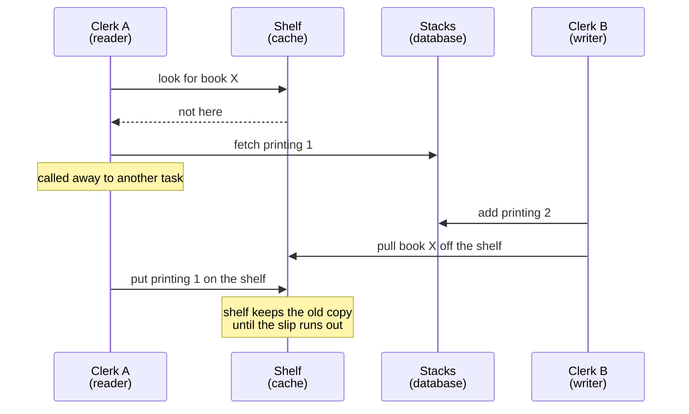

> [!tldr] Quick read
> - [[en/concepts/ttl|TTL]] is a safety net: it limits the *maximum time* the cache can be wrong; it doesn't make the cache correct. Without a TTL, one forgotten delete means wrong forever.
> - [[en/concepts/cache-invalidation|Invalidation]] is deleting (or marking as stale) a cache entry when the source changes. Who deletes, when, and how are three separate questions.
> - The [[en/concepts/stale-set-race|stale set race]]: a reader misses, reads the old DB value, gets delayed; a writer writes the DB then deletes the cache; the reader wakes up and writes the old value into the cache. Result: DB 200, cache 100 for 60 seconds.
> - A [[en/concepts/cache-lease|lease]] (from Facebook's memcache) and a [[en/concepts/versioned-key|version]] close that gap for good: the cache rejects the old value instead of trusting whoever writes last.
> - [[en/concepts/negative-caching|Negative caching]]: cache the "doesn't exist" answer too, with a short TTL, so questions about things that don't exist don't all fall through to the database.

> [!info] Context
> Station 4 of **the Caching line**. The example is **flash-sale**, a time-limited discount shop: a seller changes a price, an order changes status, an admin revokes a role's permissions; every change has to reach the copies in the cache. This station digs into the famous line "cache invalidation is one of the two hardest things". You don't need to know the project's code.

> [!abstract]- Quick glossary for this post (click to open)
> - **Cache-aside, write-through**: see [[en/posts/2026-11-22-caching-patterns|station 3]].
> - **Race condition**: a bug that only happens when two tasks interleave in an unlucky order.
> - **Lua script in Redis**: a small piece of code sent to Redis that runs to completion with no other command in between (atomic).
> - **Token**: a random string used as a "ticket"; only whoever holds the right ticket may act.
> - **Tombstone**: a special value marking "deleted", left in place instead of wiping the entry.
> - **GC pause**: when a program pauses to clean up memory, which can last tens to hundreds of milliseconds.
> - **Commit log / binlog**: the database's log of every committed change, in exact order.

## Picture it first: due-date slips and a new printing

In the library, every book on the desk shelf has a **due-date slip**: when it runs out, the book goes back to the stacks, whether anyone asked for it or not. When the stacks receive a new printing, the librarian must remember to **pull the old copy off the shelf**. Trouble happens when one clerk is carrying the old copy up from the stacks just as someone else has pulled the old copy off the shelf: the old copy ends up on the shelf again.

| Everyday life | Concept |
|---|---|
| The due-date slip: when the day ends, back to the stacks, no matter who asks | [[en/concepts/ttl\|TTL]] |
| The stacks get a new printing: pull the old copy off the shelf | [[en/concepts/cache-invalidation\|Cache invalidation]] |
| A slow clerk puts the old copy on the shelf after it was pulled | [[en/concepts/stale-set-race\|Stale set race]] |
| A "permission to shelve this book" slip, canceled when a new printing arrives | [[en/concepts/cache-lease\|Cache lease]] |
| Write "printing 3" on the spine; the shelf only accepts a newer printing | [[en/concepts/versioned-key\|Versioned key]] |
| A card saying "the library doesn't have this book" so nobody searches the stacks again | [[en/concepts/negative-caching\|Negative caching]] |



## The problem: deleting in the right place and still being wrong

I used to think the "write the DB first, delete the cache after" rule from [[en/posts/2026-11-22-caching-patterns|station 3]] was enough. flash-sale's seller stats do exactly that: change the order status, commit, then `DEL stats:seller:<id>`. And yet the dashboard number was sometimes off for a whole minute.

The reason is that the **reader** also writes to the cache: on a miss, it loads the value it just read from the DB. If that value is already stale by the time it writes, the writer's delete has "passed by" earlier and no longer has any effect. The cache stays wrong until the TTL ends. This station goes from the bluntest tool (TTL) to the ways of closing the gap for good.

## How it works

<figure class="figure-map" style="--ar: 1 / 1">
<div class="frame"><iframe data-archify="../../diagrams/caching-invalidation/stale-set-lease.en.html" title="Sequence diagram: the stale set race, and a lease rejecting the old value" loading="lazy"></iframe></div>
<figcaption><span><b>Figure 1.</b> The reader asks for a ticket on a miss, reads the old price, then gets delayed; the writer writes the DB and deletes both the cache entry and the ticket. The reader's late cache write is rejected because the ticket has been canceled.</span><a href="../diagrams/caching-invalidation/stale-set-lease.en.html" target="_blank" rel="noopener">Open full screen</a></figcaption>
</figure>

### TTL: limits how long it's wrong, doesn't make it right

**[[en/concepts/ttl|TTL]]** (time to live) is the lifetime of a cache entry. In Redis: `SET key value EX 60` or `EXPIRE key 60`; `TTL key` returns the seconds left, `-1` if the key has no expiry, `-2` if the key doesn't exist.

TTL is the safety net for every other kind of invalidation: a forgotten delete, a failed delete, a race… eventually the wrong entry disappears on its own. That's why **every cache entry should have a TTL**, even when there's active deletion.

Choosing a TTL is answering station 1's question: "how stale, at most, is acceptable". A short TTL means less wrongness but more misses (high DB load); a long TTL is the reverse. There's no universal number, only a number per type of data.

Two Redis details that often trip up newcomers:

- **`SET` without `EX` removes the old TTL.** Overwriting a key that has an expiry with `SET key value` turns it into a permanent key. To keep the old expiry, use `SET key value KEEPTTL`.
- **Reads don't extend the expiry.** `GET` doesn't change the TTL. For "whoever reads it extends it" (sliding expiration), use `GETEX key EX 60` (Redis 6.2+).

### Invalidation: who deletes, when, and how

**[[en/concepts/cache-invalidation|Cache invalidation]]** is making a stale cache entry no longer used when the source changes. There are three common approaches, often combined:

| Approach | Who does it | Pros | Cons |
|---|---|---|---|
| Rely on TTL only | Nobody, the cache expires on its own | Simplest | Always stale until the TTL |
| Delete right in the write code | The write code, after commit | Fast, explicit | Every write path must remember to delete every related key |
| Event-driven | A process that reads the DB's changes and deletes | No write path gets forgotten, even manual SQL edits | One more system, adds delay |

The second approach is hard because **one change affects many keys**. Change the price of product 42 and you must delete `product:42`, the category pages that contain it, the search results that include it. Change a role's permissions and you must delete the cache of **every** role that inherits from it. flash-sale has an inheritance chain ADMIN → SELLER → USER, and its permission cache invalidation does this:

```ts
// trimmed from flash-sale's authorization module
async invalidateCache(role: string) {
  await redis.del(`perms:${role}`);
  for (const [parent, child] of ROLE_HIERARCHY)        // [['ADMIN','SELLER'], ['SELLER','USER']]
    if (child === role) await redis.del(`perms:${parent}`);
}
```

Changing USER's permissions deletes `perms:USER` and `perms:SELLER`, but **not** `perms:ADMIN`, even though ADMIN also inherits USER's permissions through SELLER. ADMIN's cache is wrong until its one-hour TTL ends. I only spotted this bug when rereading the code to write this post: relationship-based invalidation has to walk the whole tree, not just one level.

Facebook uses the third approach at large scale: a daemon called **mcsqueal** reads MySQL's commit log and sends delete commands to memcache. Today it's often done with CDC (change data capture), such as Debezium reading PostgreSQL's WAL or MySQL's binlog and pushing events through Kafka or RabbitMQ to a consumer dedicated to deleting cache entries. The big benefit: every change, even from a background job or a hand-typed `UPDATE`, gets its cache deleted.

When you can't list every key to delete (for example, thousands of search pages that might contain product 42), use a **version for the whole group**, right below.

### The stale set race: cache-aside's gap

This is the situation from the "Picture it first" diagram, rewritten as a sequence of commands:

| Step | Reader (R) | Writer (W) | DB | Cache |
|---|---|---|---|---|
| 1 | `GET price:42` → empty | | 100 | empty |
| 2 | read DB → 100 | | 100 | empty |
| 3 | *delayed (GC, network, CPU)* | `UPDATE` → 200, commit | 200 | empty |
| 4 | | `DEL price:42` (nothing to delete) | 200 | empty |
| 5 | `SET price:42 100 EX 60` | | 200 | **100** |

The delete at step 4 happens *before* the cache write at step 5, so it's useless. The cache is wrong for 60 seconds. Facebook's paper calls this a **stale set**: "a web server sets a value in memcache that does not reflect the latest value that should be cached".

Because it needs exactly that interleaving, this race is rare, but at millions of requests per second "rare" means a few times a minute. It's also more likely when the DB has replicas: the reader reads from a replica that lags a few hundred milliseconds, so step 2 returns the old value even when it reads *after* step 3.

There's an even worse variant if the writer **updates** the cache instead of deleting: W1 writes DB = 1, W2 writes DB = 2, W2 writes cache = 2, W1 (slow) writes cache = 1. DB 2, cache 1. This is why station 3 says "delete, don't update".

### Lease: the cache rejects the old value

Facebook fixes stale sets with a **[[en/concepts/cache-lease|lease]]**: when a client misses, memcache gives it a **64-bit token** bound to that key. The client may write a value into the cache only by presenting the right token. When a delete arrives for the key, the token is canceled too. The slow reader at step 5 carries a canceled token, so it gets rejected.

Redis has no built-in lease, but you can build one with an extra key and a Lua script (which runs atomically):

```lua
-- KEYS[1] = cache key, KEYS[2] = lease key, ARGV = token, value, TTL
if redis.call('GET', KEYS[2]) == ARGV[1] then
  redis.call('SET', KEYS[1], ARGV[2], 'EX', ARGV[3]); redis.call('DEL', KEYS[2]); return 1
end
return 0
```

Reader: miss → `SET lease:<key> <token> PX 10000` → read DB → run the script. Writer: write DB → `DEL <key> lease:<key>`. A lease has a second use that Facebook relies on to stop a "herd" when a hot key expires (they hand out a token for a key only once every 10 seconds; everyone else has to wait); station 5 covers that.

### Versioned key: compare versions instead of trusting order

A **[[en/concepts/versioned-key|version]]** is the second approach, in two forms:

**Version in the value.** The database has a `version` column that increments on every write. The cache stores `version:value`. Instead of wiping the entry, the writer leaves a **tombstone** carrying the new version (`2:deleted`). A cache write is accepted only if its version is newer than the one already there. The slow reader carries version 1, the cache holds version 2, so it's rejected. A read that finds a tombstone counts as a miss.

**Version in the key** (namespace version). Instead of deleting keys one by one, put a generation number into the key name: `search:g17:<hash>`. The current generation lives in a separate key (`search:gen = 17`). To delete the *entire* search cache, just `INCR search:gen`; every old key is no longer read by anyone and expires on its own via its TTL. This is how to delete a large group without hunting down each key (station 6 explains why finding keys with `KEYS` is a bad idea). For static files, the hash in the file name from [[en/posts/2026-11-22-caching-http|station 2]] is also a form of version in the key.

### Delayed double delete: narrows the gap, doesn't close it

A trick that shows up a lot online: the writer deletes the cache, waits a few hundred milliseconds, then deletes again to clean up any old value a slow reader might have loaded. The example below shows it works, but only when the reader is delayed by *less* than the chosen delay. That's a guess, not a guarantee. It's usable as an extra layer when you can't add a lease or a version.

### Negative caching: cache "not found" too

Ordinary cache-aside stores nothing when the DB returns empty. The consequence: every question about something that doesn't exist misses and goes to the DB, *every time*. For feature flags, that's every time the code checks a flag that has been deleted; for products, it's every time someone (or a bot) opens `/products/999999`.

**[[en/concepts/negative-caching|Negative caching]]** stores the "not found" answer too, usually with a shorter TTL than normal answers. DNS has done this for a long time (RFC 2308). flash-sale's feature flag cache keeps a separate set for flag names confirmed not to exist:

```ts
// trimmed from flash-sale's feature flag cache
if (this.l1.has(name)) return this.l1.get(name);
if (this.l1Negative.has(name)) return null;           // already known not to exist: no need to ask anyone
const flag = await this.repository.findByName(name);
if (flag) this.l1.set(name, flag); else this.l1Negative.add(name);
```

The one trap: when that thing **gets created**, you must also delete the "not found" entry. flash-sale removes the flag name from the negative set whenever it receives a change notification; forget this step and a newly created flag is treated as nonexistent until the process restarts. Station 5 uses a negative cache to defend against an attack that punches through the cache.

## Runnable example

[stale-set-race.ts](../code/caching-invalidation/stale-set-race.ts) reproduces the situations above on real Redis. The interleaving between reader and writer is controlled with "gates" (promises that open only when the other side finishes a step), so every run gives the same result instead of depending on luck.

```bash
docker run -d --rm --name atlas-redis -p 6380:6379 redis:8
npm i ioredis
node stale-set-race.ts
```

```ts
// Standard cache-aside: the reader misses, reads the old DB value, is delayed right when the writer writes the DB and DELs
const reader = (async () => {
  if ((await redis.get(K)) === null) {
    const { price } = await dbGet();              // reads 100
    readerHasOldValue.open(); await writerDone.p; // ...delayed (GC, network) right at this moment
    await redis.set(K, price, 'EX', 60);          // writes 100 into the cache
  }
})();
const writer = (async () => { await readerHasOldValue.p; await dbPut(200); await redis.del(K); writerDone.open(); })();
```

```text
$ node stale-set-race.ts
0) Two writers both update the cache (update instead of delete)
   W1 writes the DB first, but writes the cache after W2: DB = 2, cache = 1
1) Cache-aside: the reader misses the cache, reads the old DB value, writes it to the cache AFTER the writer has deleted
   wrong for 60 seconds (until the TTL ends): DB = 200, cache = 100
2) Lease: the reader asks for a "ticket" on a miss, the writer deletes both the cache entry and the ticket
   writing 100 into the cache is REJECTED because the ticket was canceled
   the next read will miss and get the correct price: DB = 200, cache = null
3) Version + tombstone: only accept a value with a newer version than the one in the cache
   writing "1:100" is REJECTED because the cache holds version 2
   the cache holds a tombstone, the next read counts as a miss: DB = 200, cache = 2:deleted
4) Delayed double delete: the writer deletes again after 200ms
   right after the reader writes the old copy: DB = 200, cache = 100
   after the second delete: DB = 200, cache = null
   (if the reader is delayed more than 200ms, the old copy still slips through)
```

*(Output labels translated; the files themselves print Vietnamese.)*

Reading the results:

- **Parts 0 and 1** are two bugs: updating the cache in the wrong order, and the stale set. Both leave the old value until the TTL ends.
- **Part 2 (lease)** and **part 3 (version)** close the gap for good: the late cache write is rejected by Redis inside the Lua script, because the check and the write happen atomically.
- **Part 4** shows that double delete helps but only narrows the window.

## Misconceptions and common traps

- **"There's a TTL, so no need to delete."** A TTL only caps how long it's wrong. For data like access permissions, an hour of wrongness is far too long; you need active deletion *and* a TTL.
- **"I deleted in the right place, so the cache is correct."** A stale set can still happen, especially when reading from replicas. If tens of seconds of wrongness is unacceptable, add a lease or a version.
- **"Overwriting a key with SET keeps the TTL."** `SET` without `EX`/`KEEPTTL` removes the TTL and the key becomes permanent. This is a common source of "the cache never expires".
- **"Delete the cache inside the transaction to be safe."** Delete before commit and a reader can reload the old value right before the commit. Delete *after* commit, or let CDC do it.
- **"The negative cache uses the same TTL as the normal cache."** Something just created will be treated as nonexistent for that whole TTL. Use a short TTL and delete the "not found" entry on creation.
- **Relationship-based deletion that goes only one level.** Data derived from other data (inherited permissions, per-category totals) needs deleting along the whole dependency chain, like the ADMIN bug above.
- **"Delete by pattern with KEYS `search:*`."** That command blocks all of Redis when there are many keys (station 6). Use a version in the key, or keep the list of keys in a Set.

## Self-check questions

> [!question]- Write out the 5 steps of the stale set race. Why does the DEL have no effect?
> The reader misses, reads the DB (100), gets delayed; the writer writes the DB (200), DELs the cache (empty, nothing to delete); the reader writes 100 into the cache. The DEL happens before the stale cache write, so it deletes nothing.

> [!question]- How does a lease block a stale set?
> When the reader misses, it gets a token. Writing to the cache requires the right token. When the writer deletes the key, it also cancels the token. The slow reader carries a canceled token and is rejected, and the check + write run atomically.

> [!question]- You want to delete thousands of search results when a category changes, without knowing all the keys. How?
> Use a version in the key: keys look like `search:g<generation>:<hash>`, and the generation number lives in a separate key. Increment the generation and every old key is no longer read and expires on its own via its TTL.

> [!question]- Why does event-driven invalidation (CDC) catch changes that deletion in code misses?
> It reads the database's commit log, which records every committed change no matter where it came from: the main code, background jobs, migrations, hand-typed SQL. Deletion in code only catches the write paths that remember to call the delete function.

> [!question]- What's the risk of a negative cache, and how do you fix it?
> Something just created is still treated as nonexistent until the "not found" entry expires. Fix: a short TTL for negative entries, and delete the negative entry on creation.

## References

- Nishtala et al., [Scaling Memcache at Facebook](https://www.usenix.org/conference/nsdi13/technical-sessions/presentation/nishtala), NSDI 2013 (stale set, lease, mcsqueal)
- [Redis: EXPIRE](https://redis.io/docs/latest/commands/expire/) and [SET](https://redis.io/docs/latest/commands/set/) (`KEEPTTL`, TTL removed on overwrite)
- [Redis: Scripting with Lua](https://redis.io/docs/latest/develop/interact/programmability/eval-intro/) (scripts run atomically)
- [RFC 2308: Negative Caching of DNS Queries](https://www.rfc-editor.org/rfc/rfc2308)
- [Debezium](https://debezium.io/documentation/reference/stable/index.html) (change data capture from WAL/binlog)
