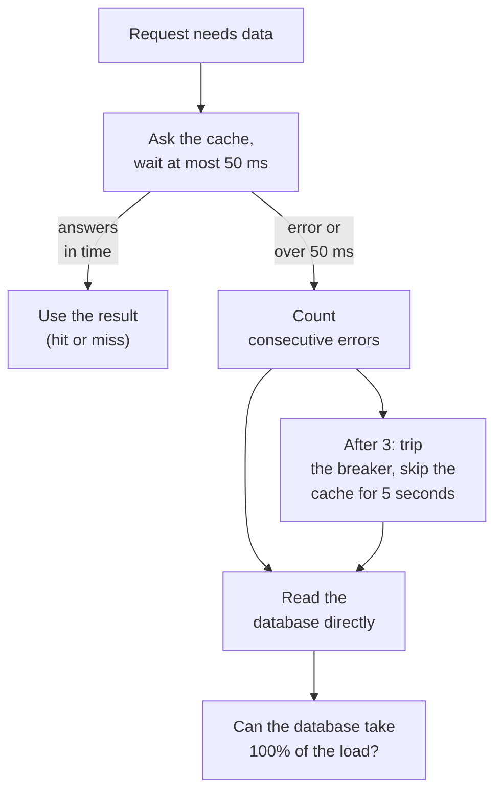

> [!tldr] Quick read
> - [[en/concepts/cache-metrics|Measure caches]] per kind of data. Redis `INFO` lumps every feature together: the example reports 38.9% while the product cache actually hits 77.8%. Also track evicted keys, memory, latency and database load.
> - When the cache goes down, the default Redis client (ioredis) **queues commands and waits forever**, and requests hang with it. [[en/concepts/fail-open|Fail-open]] means that after a short timeout you treat it as a miss and read the source, but then *all* the load lands on the database.
> - [[en/concepts/cache-poisoning|Cache poisoning]]: an attacker sends a header that is not part of the cache key (`X-Forwarded-Host`) so the origin produces malicious content, which the cache stores and serves to everyone.
> - [[en/concepts/web-cache-deception|Web cache deception]]: trick a victim into opening `/account/avatar.css`; the cache sees the `.css` extension and stores the victim's account page, and the attacker opens the same URL and reads it.
> - Both come from the cache and the origin disagreeing on "are these two requests the same?". The [[en/concepts/cache-checklist|checklist]] at the end pulls the whole line together.

> [!info] Context
> The last station of **the Caching line**. The example is **flash-sale**, a shop with happy-hour discounts: the cache already absorbs most of the load at 21:00, and now we need to know whether it is doing well, what happens when the cache itself goes down, and whether it might accidentally serve one person's data to another. The security examples run entirely on your machine. You do not need to know the project's code.

> [!abstract]- Quick glossary for this post (click to open)
> - **Hit ratio, cache key, Cache-Control, Vary, CDN, eviction, stampede**: see the earlier stations, especially [[en/posts/2026-11-22-caching-why|station 1]], [[en/posts/2026-11-22-caching-http|station 2]] and [[en/posts/2026-11-22-caching-redis|station 6]].
> - **Timeout**: the maximum wait; past it, give up. See [[en/concepts/timeouts|Timeouts]] on the API line.
> - **Circuit breaker**: after repeated failures, stop calling a service for a while instead of waiting on it again. See [[en/concepts/circuit-breaker|Circuit Breaker]].
> - **Unkeyed input**: a part of the request that the origin uses but the cache leaves out of the key.
> - **`X-Forwarded-Host`**: a header proxies use to tell the origin which domain the user originally typed.
> - **XSS**: injecting malicious JavaScript into a page other people view.
> - **SLO**: a service quality target, for example "99% of requests under 200 ms".

## Picture it first: a ledger, a power outage, and fake flyers

The library runs fine now. The head librarian needs a **ledger** (how many loans were served from the shelf), a **power-outage plan** (does the storage elevator still work if the lobby shelf closes?), and to watch out for two tricks: someone **slips fake flyers into books on the shelf** so everyone who borrows them later reads them, and someone **gets you to borrow your own medical record and leave it on the shared shelf**.

| Everyday life | Concept |
|---|---|
| A ledger of loans from the shelf and from storage, per kind of book | [[en/concepts/cache-metrics\|Cache metrics]] |
| The lobby shelf closes: librarians go straight to storage, but how many people can the storage elevator take? | [[en/concepts/fail-open\|Fail-open]] |
| Slipping fake flyers into books on the shared shelf | [[en/concepts/cache-poisoning\|Cache poisoning]] |
| Tricking you into putting your medical record on the shared shelf | [[en/concepts/web-cache-deception\|Web cache deception]] |
| The checklist before opening time | [[en/concepts/cache-checklist\|Cache checklist]] |



## The problem: the cache runs, but is it right, and is it safe?

I used to think a cache was something you "add for speed, and remove if it breaks". Three things changed my mind:

1. The Redis dashboard reported a 40% hit ratio, and I thought the cache was useless. It turned out that number mixed in rate limiting, sessions and keys that always miss. The product cache actually hit almost 80%.
2. I turned Redis off on my machine as a test: requests did not fail, nor get a little slower; they **hung**. The default Redis client just kept waiting to reconnect.
3. I read the research on web cache deception and cache poisoning: neither needs a bug in application code, only a cache and an origin that disagree about a URL or a header.

## How it works

### Cache metrics: measuring the right thing

**[[en/concepts/cache-metrics|Cache metrics]]** need to answer three questions: is the cache hitting, is it short on room, and is it actually taking pressure off the database?

Redis gives instance-wide numbers through `INFO stats` and `INFO memory`:

| Metric | Meaning | Worrying when |
|---|---|---|
| `keyspace_hits`, `keyspace_misses` | Read hits and misses, **across all keys** | Use them for trends, not to judge an individual cache |
| `evicted_keys` | Keys evicted because memory is full | Rising steadily: the cache is short on room, hit ratio is being eroded |
| `expired_keys` | Keys that expired | Compare with keys written to see whether the TTL is too short |
| `used_memory`, `maxmemory` | Memory in use and the ceiling | Close to the ceiling with `noeviction`: OOM is near |
| `instantaneous_ops_per_sec`, command latency | Load and speed | Latency spikes: slow commands, big keys, `KEYS` (station 6) |

Because Redis lumps everything together, **count on the application side per kind of cache**: a hit/miss counter labeled `cache="product"`, `cache="search"`, `layer="l1"`... flash-sale's feature flag cache does exactly this, with a `cacheHits` metric labeled `layer` (`l1`, `l2`, `pg`). Besides hit ratio, measure **miss latency** (the time to load from the source) and **the load the source receives**: the real goal of a cache is to keep the database under its limit, not to make one number look good.

### Fail-open: what to do when the cache goes down

The cache is a dependency, and at some point it will go down: Redis restarts, fails over, the network flakes. There are two choices:

- **Fail-closed**: if the cache errors, the request errors. Reasonable when the "cache" is *not* a cache but the primary store (sessions, distributed locks, rate limit counters).
- **[[en/concepts/fail-open|Fail-open]]**: if the cache errors, treat it as a miss and read the source directly. Right for a true cache (everything can be reloaded).

Fail-open sounds simple but has two traps:

1. **The default client does not "fail" fast.** ioredis enables the *offline queue* by default: when the connection is lost, commands queue up waiting to reconnect, and each command is retried up to 20 times. The request hangs until a timeout in a higher layer cuts it off. You have to configure it to fail fast: turn off the offline queue (`enableOfflineQueue: false`), limit retries (`maxRetriesPerRequest`), and wrap each cache command in a short [[en/concepts/timeouts|timeout]] (a few tens of milliseconds; a cache slower than that is no longer a cache).
2. **Fail-open sends 100% of the load to the database.** With a 95% hit ratio, the database sees only 5% of reads; when the cache goes down, the load multiplies by 20, right when everyone is using the site. If the database cannot take it, fail-open just moves the incident from the cache to the database. You need one of these: a database with enough headroom, a limit on concurrent queries to the database (bulkhead), fallback data (a stale copy in L1, a static page), or [[en/concepts/rate-limiting|load limiting]] at the entry point.

Add a [[en/concepts/circuit-breaker|circuit breaker]]: after a few consecutive errors, skip the cache for a few seconds, so you don't pay the timeout on every request while the cache is dead.

### Cache poisoning: poisoning the shared copy

**[[en/concepts/cache-poisoning|Web cache poisoning]]** (James Kettle, PortSwigger, 2018) exploits **unkeyed input**: something the origin uses to build the response but the cache does *not* put into the key.

In the example, the origin builds an absolute script link from the `X-Forwarded-Host` header (a common habit for learning the original domain behind a proxy). The cache uses only the URL as the key. The attacker:

1. Sends `GET /` with `X-Forwarded-Host: evil.example` right when the cache has expired.
2. The origin returns the home page with `<script src="https://evil.example/app.js">`. The cache stores it under the key `/`.
3. Everyone who opens the home page while it is cached runs the attacker's script.

One request, every user affected. How to block it:

- **Everything that affects the response must be in the key** (or in `Vary`), or must not reach the origin. In the example, the fixed configuration strips the client's `X-Forwarded-Host` before forwarding.
- The origin does not trust client-sent headers to build URLs; it uses a fixed domain configuration.
- Cache only what needs caching, with short lifetimes for HTML.

### Web cache deception: tricking the cache into keeping a private page

**[[en/concepts/web-cache-deception|Web cache deception]]** (Omer Gil, 2017) exploits a spot where **the cache and the origin disagree about a URL**:

- The cache has a rule: "the extensions `.css`, `.js`, `.png` are static files, cache them for 10 minutes and ignore the origin's headers".
- The origin (many frameworks behave this way) serves `/account/avatar.css` as `/account`, ignoring the trailing part that matches no route, and returns the logged-in user's account page.

The attacker sends the victim a link to `/account/avatar.css`. The victim clicks it while logged in; the origin returns their account page (with `Cache-Control: private, no-store`), but the cache ignores that header because the extension is `.css`, and stores it. The attacker opens the same URL, with no cookie, and gets the victim's account page from the cache.

How to block it:

- **Respect the origin's `Cache-Control`**, even for "static files". Don't configure something like `proxy_ignore_headers Cache-Control` for a whole group of file extensions.
- The origin returns **404 for paths that do not exist** instead of the closest matching page.
- Cache static files by **directory path** (`/static/`, `/assets/`), not by file extension; also check that the response's `Content-Type` matches the extension.

### Checklist: pulling the whole line together

The **[[en/concepts/cache-checklist|cache checklist]]** before putting a cache into production:

| Area | Question | Station |
|---|---|---|
| Should you cache at all | More reads than writes? Many people reading the same thing? How stale is acceptable? | 1 |
| Key | Does the key contain everything that changes the result, and only that? Is it normalized? | 1, 8 |
| HTTP | Does every response have an explicit `Cache-Control`? Is private data `private` or `no-store`? Is `Vary` complete? | 2 |
| Pattern | Cache-aside, write the DB and then delete the cache after commit? No write-behind for data that must not be lost? | 3 |
| Invalidation | Does every entry have a TTL? Are all related keys deleted, including along dependency chains? Do you need a lease or a version? | 4 |
| Heavy load | Request coalescing or early refresh for hot keys? TTL with jitter? A negative cache or Bloom filter? | 5 |
| Redis | A suitable `maxmemory` and policy? Cache separated from data that must be kept? No `KEYS`, big keys deleted with `UNLINK`? | 6 |
| Many pods | Does L1 have a limit and a TTL? If an invalidation message is lost, how long can it be wrong? Does adding a node cause mass misses? | 7 |
| Operations | Hit ratio measured per cache, `evicted_keys`, database load? When the cache goes down, a short timeout and a database that can cope? | 8 |
| Security | Does the shared cache hold no private data? No unkeyed input? No caching by file extension regardless of headers? | 8 |

## Runnable example

Two examples. [hit-ratio-and-failover.ts](../code/caching-operations/hit-ratio-and-failover.ts) measures hit ratio and tries a Redis outage (nothing listens on port 6399). The [security/](../code/caching-operations/security/origin.ts) folder holds an origin, an nginx with two configurations (port 8090 loose, port 8091 fixed) and [attack.ts](../code/caching-operations/security/attack.ts). Everything runs on your machine, for learning only.

```bash
docker run -d --rm --name atlas-redis -p 6380:6379 redis:8
npm i ioredis
node hit-ratio-and-failover.ts

cd security && docker compose -p atlas-sec up -d
node attack.ts
docker compose -p atlas-sec down
```

```ts
// Fail-open: after 50ms treat it as a miss; 3 consecutive errors skip the cache for 5 seconds
const fast = new Redis(6399, { lazyConnect: true, enableOfflineQueue: false, maxRetriesPerRequest: 0 });
async function cachedGet(id: string) {
  if (Date.now() < skipUntil) return db(id);                 // breaker is open
  try {
    const v = await Promise.race([fast.get(`p:${id}`), sleep(50).then(() => { throw new Error('timeout'); })]);
    failures = 0; if (v !== null) return v;
  } catch { if (++failures >= 3) skipUntil = Date.now() + 5000; }
  return db(id);
}
```

```text
$ node hit-ratio-and-failover.ts
1) Hit ratio
   Redis INFO: keyspace_hits=1555 keyspace_misses=2445 → 38.9% (mixes every feature)
   app counts the product cache itself: 1555 hits / 445 misses → 77.8%
2) Redis does not answer
   default client: still waiting after 3 seconds (3000ms)
   50ms timeout + skip the cache on error: 200 requests done after 26ms, but the DB got 200 queries
   (cache down = all load lands on the DB; the DB must cope, or load must be limited)
```
*(Output labels translated; the files themselves print Vietnamese.)*

The loose nginx configuration (port 8090) and the fixed one (port 8091):

```nginx
# 8090: "static files? just cache them", ignoring the origin's Cache-Control
location ~* \.(css|js|png)$ {
  proxy_cache loose;
  proxy_ignore_headers Cache-Control Set-Cookie Expires;
  proxy_cache_valid 200 10m;
}
location / {
  proxy_set_header X-Forwarded-Host $http_x_forwarded_host;   # pass the client's header to the origin
  proxy_cache loose;
  proxy_cache_key $scheme$host$request_uri;                    # ...but leave it out of the key
}

# 8091: respect Cache-Control, don't let headers outside the key reach the origin
location / {
  proxy_set_header X-Forwarded-Host "";
  proxy_cache strict;
}
```

```text
$ node attack.ts

=== port 8090 (loose configuration) ===
1) Web cache deception
   victim (with cookie) opens /account/avatar.css → MISS   <h1>Tài khoản của lan</h1><p>Địa chỉ: 12 Lý Thường Kiệt, SĐT 09xx</p>
   attacker (no cookie) opens the same URL       → HIT    <h1>Tài khoản của lan</h1><p>Địa chỉ: 12 Lý Thường Kiệt, SĐT 09xx</p>
2) Cache poisoning via a header outside the cache key
   attacker sends X-Forwarded-Host: evil.example → MISS   <script src="https://evil.example/app.js"></script><h1>Flash sale 21:0
   regular user opens the home page             → HIT    <script src="https://evil.example/app.js"></script><h1>Flash sale 21:0

=== port 8091 (fixed configuration) ===
1) Web cache deception
   victim (with cookie) opens /account/avatar.css → MISS   <h1>Tài khoản của lan</h1><p>Địa chỉ: 12 Lý Thường Kiệt, SĐT 09xx</p>
   attacker (no cookie) opens the same URL       → MISS   <h1>Mời đăng nhập</h1>
2) Cache poisoning via a header outside the cache key
   attacker sends X-Forwarded-Host: evil.example → MISS   <script src="https://shop.example/app.js"></script><h1>Flash sale 21:0
   regular user opens the home page             → HIT    <script src="https://shop.example/app.js"></script><h1>Flash sale 21:0
```

Reading the results (the data in the example is fake; the HTML snippets are the origin's Vietnamese pages, quoted as served: "Tài khoản của lan" is "Lan's account" with her address and phone number, "Mời đăng nhập" is "Please log in"):

- **Hit ratio**: in the same run, Redis reports 38.9% because it lumps in 2,000 session reads that all miss; the product cache actually hits 77.8%.
- **Redis down**: the default client hangs the full 3 seconds (and keeps waiting). With a timeout and a circuit breaker, 200 requests finish in 26 ms, but all 200 go to the database.
- **Port 8090**: the attacker reads Lan's account page (`HIT`), and everyone's home page loads a script from `evil.example`.
- **Port 8091**: the account page is not cached (the attacker only sees "Please log in"), and the malicious header is stripped before reaching the origin, so the cached copy is clean.

## Misconceptions and common traps

- **"The hit ratio in INFO is the cache's hit ratio."** It lumps together every key in the instance. Measure per cache on the application side.
- **"If the cache fails, the code already has try/catch."** Try/catch does nothing when the command does not fail but *hangs*. You need a short timeout and the offline queue turned off.
- **"Fail-open is safe."** Safe for correctness, not safe for the database. Work out in advance how much the database can take when the hit ratio drops to 0.
- **"With `Cache-Control: private`, a CDN never stores it."** Unless the cache is configured to ignore the origin's headers, like a "cache every static file by extension" configuration.
- **"Cache poisoning needs an XSS bug in the code."** It does not. It only needs the origin to reflect a header that the cache leaves out of the key.
- **"For an odd path, the origin can return anything."** Returning the closest matching page (instead of 404) is a precondition for web cache deception.

## Self-check questions

> [!question]- Redis reports a 40% hit ratio. Why can't you conclude yet that the product cache is poor?
> `keyspace_hits` and `keyspace_misses` lump together every key in the instance, including sessions, rate limits, locks... which may all miss. You have to count hits/misses per kind of cache on the application side.

> [!question]- Why does a request hang when Redis goes down, even though the code has try/catch around the cache command?
> The default client (like ioredis) does not throw right away; it queues the command in the offline queue and tries to reconnect. The command does not fail, so the catch never runs; the request waits until a timeout in a higher layer. You need to turn off the offline queue, limit retries and wrap a short timeout.

> [!question]- What risk does fail-open during a cache outage pose for the database, and how can you mitigate it?
> Every read the cache was absorbing lands on the database; a 95% hit ratio means the load grows 20 times. Mitigations: database headroom, limiting concurrent queries, fallback data from L1 or a stale copy, load limiting at the entry point, and a circuit breaker so you don't pay the timeout on every request.

> [!question]- How do cache poisoning and web cache deception differ?
> Poisoning: the attacker makes the cache store a *malicious* response they triggered themselves, and the cache serves it to everyone. Deception: the attacker tricks the *victim* into making the cache store the victim's *private* response, then reads it. Both come from the cache and the origin disagreeing about a request.

> [!question]- Name three configuration changes that block both holes in the example.
> Respect the origin's `Cache-Control` instead of ignoring it by file extension; don't forward headers outside the cache key (such as the client's `X-Forwarded-Host`) to the origin; have the origin return 404 for paths that do not exist and build URLs from configuration, not from headers.

## References

- [Redis: INFO](https://redis.io/docs/latest/commands/info/) (`keyspace_hits`, `evicted_keys`, `used_memory`)
- [ioredis: Offline queue](https://github.com/redis/ioredis#offline-queue) (`enableOfflineQueue`, `maxRetriesPerRequest`)
- James Kettle, [Practical Web Cache Poisoning](https://portswigger.net/research/practical-web-cache-poisoning), PortSwigger Research, 2018
- Omer Gil, [Web Cache Deception Attack](https://omergil.blogspot.com/2017/02/web-cache-deception-attack.html), 2017
- [PortSwigger Web Security Academy: Web cache deception](https://portswigger.net/web-security/web-cache-deception)
- [RFC 9111: HTTP Caching](https://www.rfc-editor.org/rfc/rfc9111) (Security Considerations section)
