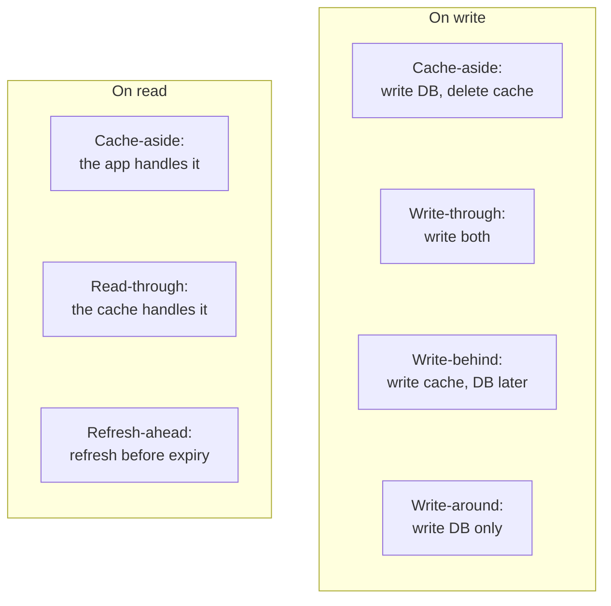
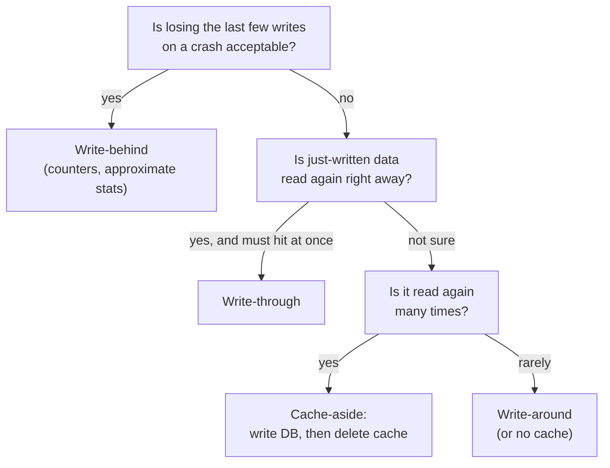

> [!tldr] Quick read
> - [[en/concepts/cache-aside|Cache-aside]] is the most common pattern: the application asks the cache itself; on a miss it reads the DB and writes the result into the cache. On a write: write the DB first, then **delete** the cache entry.
> - [[en/concepts/read-through|Read-through]]: the application talks only to the cache; the cache fetches from the DB itself on a miss. Same idea, different owner of the loading code.
> - [[en/concepts/write-through|Write-through]] writes the DB and the cache together: a read right after a write always hits, at the cost of slower writes.
> - [[en/concepts/write-behind|Write-behind]] writes only the cache and answers immediately; the DB is written later. Fastest, and it can merge many writes, but **crash before the write and the data is lost**.
> - [[en/concepts/write-around|Write-around]] writes straight to the DB without touching the cache. [[en/concepts/refresh-ahead|Refresh-ahead]] refreshes entries that are about to expire in the background, so readers almost never wait for the DB.

> [!info] Context
> Station 3 of **the Caching line**. The example is **flash-sale**, a time-limited discount shop: the seller stats page reads order counts dozens of times a minute while new orders keep coming in. This station answers: when data has two copies (cache and database), who reads which copy, who writes which copy, and in what order. You don't need to know the project's code.

> [!abstract]- Quick glossary for this post (click to open)
> - **Hit, miss, staleness, cache key**: see [[en/posts/2026-11-22-caching-why|station 1]].
> - **TTL (time to live)**: the lifetime of a cache entry; when it runs out the entry disappears on its own. Station 4 covers it in detail.
> - **Redis `SET key value EX 60`**: write a key that expires on its own after 60 seconds. `GET` reads, `DEL` deletes.
> - **Synchronous / asynchronous**: synchronous means wait for the work to finish before answering; asynchronous means answer first and do the work later.
> - **Flush**: push data waiting in a buffer down to durable storage.
> - **Source of truth**: the copy of the data considered correct when two copies disagree. Usually the database.

## Picture it first: the shelf and the register

In station 1, the librarian had a shelf next to the desk (the cache) and basement stacks (the database). Now add **writes**: the library receives new books, corrects book details, changes rental fees. The librarian has to decide: update the stacks register first or the label on the shelf first? Update both at once, or update the shelf first and the register at the end of the day?

| Everyday life | Concept |
|---|---|
| The librarian checks the shelf; if a book is missing, they fetch it from the stacks and put a copy on the shelf | [[en/concepts/cache-aside\|Cache-aside]] |
| Readers only ask the desk; the desk has its own clerk who goes to the stacks when something is missing | [[en/concepts/read-through\|Read-through]] |
| Correcting book details: update the stacks register and the shelf label at the same time | [[en/concepts/write-through\|Write-through]] |
| Write only on the board at the desk, copy into the stacks register at the end of the day | [[en/concepts/write-behind\|Write-behind]] |
| New books go straight into the stacks, not onto the shelf | [[en/concepts/write-around\|Write-around]] |
| A book nearly due back that's still in demand: renew it before it expires | [[en/concepts/refresh-ahead\|Refresh-ahead]] |



## The problem: two copies of one piece of data

I used to think caching was only about reads: add a `redis.get` line before the query and you're done. Then a seller complained: they had just delivered an order, and the stats page still said "processing: 12" for a whole minute. The gap wasn't in reads but in **writes**: the order changed status in the database, while the cache still held the old number.

Whenever there's a cache, there are two copies of the same data. The patterns in this station are six different ways to answer three questions:

1. When a **read** misses, who fetches the data from the database?
2. On a **write**, which copy is written first, and do we wait for the other?
3. When the two copies disagree, which one is the truth?

## How it works

### Cache-aside: the application handles everything

**[[en/concepts/cache-aside|Cache-aside]]** (also called lazy loading) is the default pattern in most systems; Facebook even calls its memcache a "demand-filled look-aside cache". The cache stands *beside* the application, not in between: it doesn't know the database exists.

Read:

1. Ask the cache. If it's there, return it.
2. If not, read the database.
3. Write the result into the cache with a TTL, then return it.

Write:

1. Write the database.
2. **Delete** the corresponding cache entry. The next read will miss and load the fresh copy.

```ts
// trimmed from flash-sale's seller stats
async getStats(ownerId: string) {
  const cached = await redis.get(`stats:seller:${ownerId}`);
  if (cached) return JSON.parse(cached);
  const stats = await this.countOrders(ownerId);                      // expensive query
  await redis.setex(`stats:seller:${ownerId}`, 60, JSON.stringify(stats));
  return stats;
}
// called after the transaction that changes the order status has committed
async invalidate(ownerId: string) { await redis.del(`stats:seller:${ownerId}`); }
```

Why **delete** instead of **writing the new value into the cache**? Facebook's memcache paper answers it briefly: "We choose to delete cached data instead of updating it because deletes are idempotent". Deleting twice is the same as deleting once; but two writes arriving in the wrong order leave the cache holding the wrong value. Station 4 reproduces exactly that situation.

Pros: simple, caches only what is actually read, and if the cache goes down the application still works (more slowly). Cons: the first read and the read right after every write always miss, and there's still a rare gap that station 4 will dissect.

### Read-through: the cache fetches it itself

**[[en/concepts/read-through|Read-through]]** looks like cache-aside from the database's point of view, but differs in who owns the loading code. The application only calls `cache.get(key)`; the cache is configured with a loader function and calls it itself on a miss.

```ts
// illustration only, does not run as is
const products = new LoadingCache({ ttl: 60, load: (id) => db.findProduct(id) });
const p = await products.get('42');   // on a miss the cache calls load('42') itself
```

Libraries like Caffeine (Java) and products like Hazelcast and NCache provide this out of the box. The biggest benefit: the reading code is short and uniform everywhere, and the cache can merge misses on the same key into one load (station 5). flash-sale's `getOrFetch(key, ttl, fetcher)` function sits between the two patterns: the application still passes in the loader on every call, but all the hit, miss and locking logic is wrapped in one place.

### Write-through: write both, synchronously

**[[en/concepts/write-through|Write-through]]**: on every write, write the database **and** write the new value into the cache, in the same call, before answering.

- Pro: a read right after a write always hits and is correct. The cache stays "warm" with recently changed data.
- Cons: every write is slower by one cache write. The cache fills with things that are written but never read (needs a TTL). And because it "writes the new value" rather than "deletes", two concurrent writes can still leave a wrong value (station 4).

Write-through often goes with read-through: both reads and writes go through the cache, and the cache handles the database part.

### Write-behind: write the cache, the database later

**[[en/concepts/write-behind|Write-behind]]** (also called write-back): write only the cache and answer immediately. A background process collects the changes and writes them to the database later, in batches.

- Pros: extremely fast writes. It **merges** many writes to the same key: 100 updates to a view counter become just 1 DB write.
- Serious cons: until the flush, **the cache is the only source of truth**. If the process or the cache crashes, data is lost. Database constraint errors (duplicate key, foreign key violation) happen *after* the user has already been told "success". Write order also has to be preserved carefully.

Suited to data that can tolerate losing a little: view counters, "last active", approximate stats. Never use it for orders or money.

### Write-around: write straight to the database, don't touch the cache

**[[en/concepts/write-around|Write-around]]**: write the database and leave the cache alone; the cache is loaded only when someone reads. Suited to data written once and rarely read again (logs, history), because it doesn't pollute the cache with things nobody needs.

The trap: if the entry *was already* in the cache, the cache will return the old value until the TTL runs out. In practice, cache-aside's "write the DB, then delete the cache" is exactly write-around plus a delete step to patch this spot.

### Refresh-ahead: refresh before expiry

**[[en/concepts/refresh-ahead|Refresh-ahead]]**: when an entry is read close to expiry (for example, with less than 20% of its TTL left), return the current value immediately and load a fresh copy in the background. An entry that's read often never really expires, so readers don't wait for the database; entries few people read are simply left to expire.

This is the same idea as `stale-while-revalidate` in [[en/posts/2026-11-22-caching-http|station 2]], except it acts *before* expiry instead of after. The price: a few "extra" DB queries for entries that are refreshed and then never read. Station 5 has a probabilistic version that is proven optimal.

### Comparing and choosing

| Pattern | Read right after a write | Write speed | Main risk | Suited to |
|---|---|---|---|---|
| Cache-aside (write DB, delete cache) | One miss, then correct | Fast | Rare race (station 4) | Default for most read-heavy data |
| Read-through | Same as above | Same as above | Depends on the cache library | Wanting short reading code, merged misses |
| Write-through | Immediate hit | Slower (writes two places) | Cache full of things nobody reads | Data that will be read right after it's written |
| Write-behind | Immediate hit | Fastest | **Data loss on crash** | Counters, approximate numbers |
| Write-around | Stale until the TTL ends | Fast | Serves stale data | Data written once, rarely reread |
| Refresh-ahead | (a read pattern) | | Extra queries | Hot entries, short TTL |



## Runnable example

[read-write-patterns.ts](../code/caching-patterns/read-write-patterns.ts) runs five patterns on real Redis, with a fake "database" that takes 20 ms per read or write and counts its calls.

```bash
docker run -d --rm --name atlas-redis -p 6380:6379 redis:8
npm i ioredis
node read-write-patterns.ts
```

```ts
// Write-behind: write only the cache and answer; the `dirty` buffer waits to be flushed to the DB
const dirty = new Map<string, number>();
async function behindWrite(id: string, v: number) { await redis.set(k(id), v, 'EX', TTL); dirty.set(id, v); }
async function flush() { const batch = [...dirty]; dirty.clear(); for (const [id, v] of batch) await db.put(id, v); }

// Refresh-ahead: under 20% of the TTL left, refresh in the background; the reader doesn't wait
async function aheadRead(id: string, ttl: number) {
  const [hit, left] = await Promise.all([redis.get(k(id)), redis.ttl(k(id))]);
  if (hit !== null) {
    if (left <= ttl * 0.2) void db.get(id).then((v) => redis.set(k(id), v!, 'EX', ttl));
    return Number(hit);
  }
  // ...miss: read the DB, write the cache
}
```

```text
$ node read-write-patterns.ts
1) Cache-aside
   read 1: 100 (21.3ms, miss → DB)
   read 2: 100 (0.5ms, cache hit)
   write 99 (DB then delete cache), read again: 99 (23.0ms, one miss after every write)
2) Write-through
   write 98 took 21.5ms (DB + cache), read right away: 98 (0.7ms, hit)
3) Write-behind
   100 consecutive writes took 11ms in total, DB not written even once (db.writes = 0)
   flush: DB received 1 write (only the final value 300), 99 intermediate writes merged
   crash before flush: set 1 but DB is still 300 → one write lost
4) Write-around
   write 50 straight to the DB, read through the cache: 300 (stale, until the key expires within at most 60s)
5) Refresh-ahead (TTL 5s)
   +   0ms read: 50 from DB                         22.6ms
   +2500ms read: 50 from cache                      1.5ms
   +1600ms read: 50 from cache (+ background refresh) 1.5ms
   + 300ms read: 60 from cache                      1.4ms
   DB read 2 times (the first + 1 background refresh), only the first time did the user wait
```

*(Output labels translated; the files themselves print Vietnamese.)*

Reading the results:

- **Cache-aside**: a hit takes 0.5 ms versus 21 ms on a miss; after every write there's one miss (23 ms) to load the fresh copy.
- **Write-through**: a write takes 21.5 ms (one extra cache write), and in return the read right after it hits.
- **Write-behind**: 100 writes cost only 11 ms and merge into 1 DB write. But when the process "dies" before the flush, the value 1 never reaches the DB.
- **Write-around**: the DB is already 50 but the cache still returns 300, because nobody deleted the old entry.
- **Refresh-ahead**: on the third read (under 1 second of TTL left), the value still comes back immediately but the refresh runs in the background. The fourth read already sees the new value 60, and nobody waited for the DB.

## Misconceptions and common traps

- **"After writing the DB, update the cache too to save one miss."** Two concurrent write requests can update the cache in the wrong order, leaving the old value indefinitely (until the TTL). Deleting has no ordering problem. Station 4 reruns this situation.
- **"Delete the cache first, then write the DB."** Between the two steps, a read request will miss, read the *old* DB value and load it back into the cache. The right order is write the DB first, delete after, and delete only after the transaction has committed.
- **"Write-behind for orders to absorb peak load."** Orders must never be lost. To absorb a burst of writes, use a durable queue (like RabbitMQ with confirms, see [[en/posts/2026-11-21-rabbitmq-ack-confirm|the RabbitMQ line]]), not a cache.
- **"Read-through solves stale data by itself."** No. Read-through only changes who loads the data; invalidation is still your job.
- **"If deleting from the cache fails, throw an error to the user."** The DB write has already succeeded. Usually it's enough to log it and rely on the TTL as a safety net; flash-sale states this explicitly in a comment: if the delete fails, the cache expires on its own after the TTL.

## Self-check questions

> [!question]- How do cache-aside and read-through differ, given that they look the same from the database?
> From the database, both only receive queries when the cache misses. The difference is who owns the loading code: in cache-aside the application reads the DB and writes the cache itself; in read-through the cache is configured with a loader and calls it itself.

> [!question]- Why does cache-aside delete the cache entry on a write instead of writing the new value?
> Deleting is idempotent and order-independent: two concurrent deletes give the same result. Two writes of new values can reach the cache in the wrong order, leaving the old value until the TTL runs out.

> [!question]- Write-behind merges 100 writes into 1. Name two risks you pay for it.
> Crash before the flush and the changes not yet in the DB are lost. DB errors (constraint violations) happen after the user has been told it succeeded. On top of that, write order has to be preserved.

> [!question]- How can write-around return stale data?
> It writes only the DB without touching the cache. If the entry was already in the cache, the cache keeps returning the old copy until the TTL runs out. To avoid that, add a delete step, which is exactly cache-aside's write path.

> [!question]- How is refresh-ahead different from stale-while-revalidate?
> Refresh-ahead refreshes *before* expiry, when the entry is read in the last part of its TTL. Stale-while-revalidate refreshes *after* expiry, while still serving the stale copy. Both work in the background so the reader doesn't wait.

## References

- [AWS: Caching patterns](https://docs.aws.amazon.com/whitepapers/latest/database-caching-strategies-using-redis/caching-patterns.html) (lazy loading, write-through, TTL)
- [Microsoft Azure Architecture Center: Cache-Aside pattern](https://learn.microsoft.com/en-us/azure/architecture/patterns/cache-aside)
- [Oracle Coherence: Read-Through, Write-Through, Write-Behind, and Refresh-Ahead Caching](https://docs.oracle.com/cd/E15357_01/coh.360/e15723/cache_rtwtwbra.htm)
- [Caffeine wiki: Population](https://github.com/ben-manes/caffeine/wiki/Population) (loading cache, refresh)
- Nishtala et al., [Scaling Memcache at Facebook](https://www.usenix.org/conference/nsdi13/technical-sessions/presentation/nishtala), NSDI 2013 (look-aside, delete instead of update)
