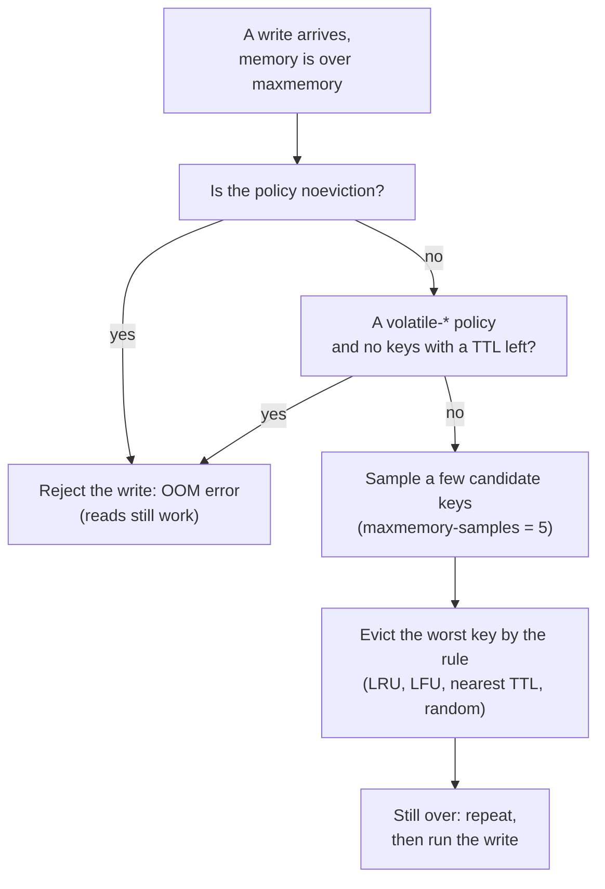

> [!tldr] Quick read
> - By default Redis has `maxmemory 0` (no limit) and the `noeviction` policy: set a limit without changing the policy and, once full, **every write is rejected** (OOM). To use Redis as a cache, set both [[en/concepts/maxmemory|maxmemory]] and an [[en/concepts/eviction-policy|eviction policy]].
> - `allkeys-*` evicts any key; `volatile-*` evicts only keys with a TTL. With Redis shared between sessions (no TTL) and cache: `volatile-lru` still hits OOM once sessions take all the room.
> - [[en/concepts/lru-va-lfu|LRU]] evicts the key nobody has read for the longest time, LFU evicts the least frequently read key. After a scan of 15,000 "cold" keys: LRU keeps 55/200 hot keys, LFU keeps all 200/200.
> - [[en/concepts/key-expiration|Expired keys]] are deleted in two ways: when someone reads them, and by a background cycle that samples at random. 50,000 expired keys vanish within 3 seconds even though nobody reads them.
> - [[en/concepts/big-key|Big keys]] and [[en/concepts/scan-va-keys|KEYS]] freeze Redis because Redis executes commands on a single thread: `KEYS` over 1 million keys blocks every client for 91 ms, `SCAN` only 1 ms; `DEL` on a 1-million-field hash blocks for 51 ms, `UNLINK` close to 0.

> [!info] Context
> Station 6 of **the Caching line**. The example is **flash-sale**, a shop with happy-hour discounts: a single Redis instance holds login sessions, the job queue, rate limit counters and the cache, and no memory limit is set yet. This station asks: what happens when Redis fills up, and how should it be configured? You do not need to know the project's code.

> [!abstract]- Quick glossary for this post (click to open)
> - **TTL, versioned keys**: see [[en/posts/2026-11-22-caching-invalidation|station 4]]. **Hot key**: see [[en/posts/2026-11-22-caching-under-load|station 5]].
> - **OOM (out of memory)**: memory runs out. In Redis it is the error `OOM command not allowed when used memory > 'maxmemory'`.
> - **Single-threaded**: Redis runs commands one at a time. One slow command makes every other client wait.
> - **O(N)**: running time grows with the number of elements N. `KEYS` is O(N), where N is the total number of keys.
> - **Hash, Set, List**: Redis data types holding many elements in one key (a field → value table, a set, a list).
> - **`CONFIG SET`**: changes Redis configuration while it runs. **`INFO stats`**: shows numbers such as evicted keys and expired keys.
> - **Pipeline**: send many commands in one go and only then read the results, saving round trips.

## Picture it first: a shelf with limited room

The shelf next to the desk has only 300 slots. When it is full and a new book needs a spot, the librarian has to pick a book to send back to storage. Different rules for picking leave different books on the shelf.

| Everyday life | Concept |
|---|---|
| The shelf has only 300 slots | [[en/concepts/maxmemory\|Maxmemory]] |
| The rule for "the shelf is full, which book goes" | [[en/concepts/eviction-policy\|Eviction policy]] |
| Put away the book nobody has opened for the longest / the least borrowed book | [[en/concepts/lru-va-lfu\|LRU and LFU]] |
| A book whose hold slip ran out: put away when someone asks, or on the librarian's rounds | [[en/concepts/key-expiration\|Key expiration]] |
| A 40-volume encyclopedia filling a whole shelf row, taking a whole morning to clear | [[en/concepts/big-key\|Big key]] |
| Taking inventory of the whole shelf at once (desk closed) / one compartment at a time | [[en/concepts/scan-va-keys\|SCAN and KEYS]] |



## The problem: Redis does not know it is a cache

I used to think Redis "is a cache", so it would know to drop data when full. In fact Redis is an in-RAM key-value store usable for many jobs: cache, sessions, queues, counters, locks. For sessions or queues, deleting data on its own would be a serious bug. So by default Redis **has no memory limit and deletes nothing**.

In flash-sale's docker-compose, Redis runs without `maxmemory`. It grows with the data until the container or machine runs out of RAM and the operating system kills the process. Then sessions, queues and cache are all lost at once. Setting a limit is not enough on its own: you also have to choose the right eviction rule and understand how Redis cleans up expired keys.

## How it works

### Maxmemory: a ceiling on memory

**[[en/concepts/maxmemory|`maxmemory`]]** is the maximum amount of memory Redis may use for data. The default is `0`, meaning no limit (on 64-bit machines). Once a limit is set, every write that pushes memory over the ceiling triggers evictions under the chosen policy.

A few notes when choosing the number:

- Leave room for what is not data: client buffers, the replication buffer for replicas, and above all the moment Redis forks a child process to write a snapshot (RDB) or rewrite the AOF. With persistence on, setting `maxmemory` to about 60–75% of the RAM reserved for Redis is the commonly recommended safe number.
- In a container, `maxmemory` must be below the container's memory limit, or the container is killed before Redis gets to evict anything.

### Eviction policy: when full, which key goes

**[[en/concepts/eviction-policy|`maxmemory-policy`]]** has two halves: the *group* of keys that may be evicted, and the *rule* for choosing a key within the group. Redis 8 has ten values:

| Policy | Evicts from | By rule |
|---|---|---|
| `noeviction` (default) | nothing | Writes fail with OOM |
| `allkeys-lru` | every key | longest since last read/write |
| `allkeys-lfu` | every key | least frequently used |
| `allkeys-lrm` | every key | longest since last *write* (Redis 8.6+) |
| `allkeys-random` | every key | random |
| `volatile-lru` | keys with a TTL only | longest since last use |
| `volatile-lfu` | keys with a TTL only | least frequently used |
| `volatile-lrm` | keys with a TTL only | longest since last write (Redis 8.6+) |
| `volatile-random` | keys with a TTL only | random |
| `volatile-ttl` | keys with a TTL only | closest to expiry |

Two quick rules for choosing:

- **Redis used only as a cache** (everything can be reloaded from the source): `allkeys-lfu` or `allkeys-lru`. Keys do not need a TTL to be evictable.
- **Redis shared** between data that must not be lost (sessions, queues) and cache: `volatile-*` sounds right, since only keys with a TTL (the cache) get evicted. But if the part without a TTL grows to the ceiling by itself, Redis **still hits OOM**: the docs state that `volatile-*` policies behave like `noeviction` when no eligible keys remain. The example below runs exactly this case. The cleanest way is to **split instances**: one Redis for cache with `allkeys-lfu`, one Redis for data that must be kept, with `noeviction` and an alert when it is nearly full.

### LRU and LFU: Redis guesses which keys are worth little

**[[en/concepts/lru-va-lfu|LRU]]** (least recently used) evicts the key *untouched for the longest time*. **LFU** (least frequently used) evicts the key *used least often*. The difference is clearest during a **scan**: a reporting job skims the whole catalog once. With LRU, every scanned key becomes "just used" and pushes the truly hot keys out. With LFU, a scanned key has a frequency of just 1 and cannot beat a hot key read thousands of times.

Redis does not keep an exact LRU list for every key (too much memory). Instead it **approximates**:

- Each key has a 24-bit field. For LRU, this field records the last access time. When it needs to evict, Redis samples `maxmemory-samples` keys (default 5) and evicts the worst one in the sample, with a small "pool of candidates" that later samples reuse. Raising it to 10 gets closer to exact LRU at more CPU cost.
- For LFU, those 24 bits are split in two: 8 bits are a **logarithmic counter** (a Morris counter: the larger it gets, the harder it is to increment, so 8 bits can count up to a million accesses), and 16 bits are a timestamp used to **decay** the counter over time. `lfu-log-factor` (default 10) tunes how hard it is to increment, `lfu-decay-time` (default 1 minute) tunes how fast it decays. Thanks to the decay, a key that was hot yesterday but nobody reads today can still be evicted.

`allkeys-lrm`, new in Redis 8.6, only looks at the last *write* and ignores reads: a fit for data where "old" means not updated for a long time.

### Key expiration: when expired keys are deleted

A key with a TTL does not disappear at the exact second it expires. **[[en/concepts/key-expiration|Redis deletes expired keys]]** in two ways:

1. **Passively**: when a client reads a key that has expired, Redis deletes it and answers as if it did not exist. A reader never sees an expired value.
2. **Actively**: a background cycle runs many times per second (per `hz`, default 10), randomly samples keys with a TTL and deletes the expired ones; if many keys in the sample were expired, it scans again right away. `active-expire-effort` (1–10, default 1) lets it spend more CPU to clean up faster.

Thanks to the second way, expired keys nobody reads still get cleaned up instead of occupying RAM forever. In the example, 50,000 keys with a 1-second TTL all vanish within 3 seconds without any key being read.

One new thing worth knowing: since **Redis 7.4**, each field in a hash can have its own TTL (`HEXPIRE`, `HTTL`, `HPERSIST`; Redis 8.0 adds `HGETEX`, `HSETEX`). flash-sale's feature flag cache stores every flag in one hash and sets `EXPIRE` on the whole hash, with the comment "per-field TTL not native in Redis". That comment was true for Redis 7.2 and earlier, but it is outdated: each flag can now have its own TTL.

### Big key: one key filling a whole shelf row

A **[[en/concepts/big-key|big key]]** is a key with a very large value (a string of several MB) or a collection with very many elements (a hash, set or list with millions of elements). Because Redis runs commands on one thread, big keys hurt in several ways:

- **Slow deletes**: `DEL` on a collection is O(N) in the number of elements and blocks every client while memory is freed. A big key that expires or gets evicted does the same, unless `lazyfree-lazy-expire` / `lazyfree-lazy-eviction` is on (off by default).
- **Slow reads, network congestion**: `HGETALL` or `GET` on a 5 MB value takes bandwidth and time from the whole server.
- **Skewed load in a cluster**: the node holding a big key is much heavier than the others.

What to do: use **`UNLINK`** instead of `DEL` (Redis 4.0+: removes the key from the keyspace right away and frees memory on a background thread), split collections into many keys, and find big keys with `redis-cli --bigkeys`, `--memkeys` or `MEMORY USAGE <key>`.

### SCAN and KEYS: finding keys without freezing Redis

**[[en/concepts/scan-va-keys|`KEYS pattern`]]** walks the **entire** keyspace in one command. The Redis docs say it plainly: "Use extreme care when using this command in production… Don't use KEYS in your regular application code". While it runs, no other client is served.

**`SCAN cursor MATCH pattern COUNT n`** walks in small batches: each call returns a few keys and a cursor for the next call, until the cursor comes back as `0`. Between batches, other clients run normally. The price: the total takes longer, a key may be returned more than once (you filter it yourself), and keys added or deleted during the scan may or may not appear. A key that exists throughout the whole scan is guaranteed to be returned.

The `invalidate(pattern)` function in flash-sale's search cache uses `KEYS` and then `DEL`. Nothing calls it yet, but if someone calls it one day at 21:00 with millions of keys, all of Redis (sessions and rate limiting included) stops with it. A better replacement is versioned keys ([[en/posts/2026-11-22-caching-invalidation|station 4]]): no need to find any keys at all.

## Runnable example

[redis-as-cache.ts](../code/caching-redis/redis-as-cache.ts) sets `maxmemory 8mb` with `CONFIG SET`, runs each scenario, and finally restores the original configuration. A second connection sends `PING` every millisecond to measure whether Redis still answers in time while busy.

```bash
docker run -d --rm --name atlas-redis -p 6380:6379 redis:8
npm i ioredis
node redis-as-cache.ts
```

```ts
// 200 hot keys read for 20 rounds, then a scan of 15,000 cold keys
for (const policy of ['allkeys-lru', 'allkeys-lfu']) {
  await r.flushall(); await r.config('SET', 'maxmemory-policy', policy);
  await fill('hot:', 200);
  for (let round = 0; round < 20; round++) { /* GET hot:0..199 */ }
  await fill('scan:', 15_000);   // a reporting job skims the whole catalog once
  // count how many hot:* survived
}
```

```text
$ node redis-as-cache.ts
1) maxmemory 8mb, policy noeviction (default)
   write 20,000 1 KB keys → OOM command not allowed when used memory > 'maxmemory'.
2) 200 "hot" keys read continuously, then a scan of 15,000 "cold" keys read only once
   allkeys-lru: Redis evicted 9422 keys, hot keys left 55/200
   allkeys-lfu: Redis evicted 9407 keys, hot keys left 200/200
3) Shared Redis: 3,000 sessions WITHOUT a TTL + cache WITH a TTL, policy volatile-lru
   write 20,000 cache keys (EX 300) → ok
   sessions left 3000/3000, cache left 2841, evicted 17333
   write 6,000 more sessions without a TTL → OOM command not allowed when used memory > 'maxmemory'.
4) Expired keys are cleaned up even when nobody reads them
   50,000 keys with TTL 1s just written: dbsize = 50000
   3 seconds later, no key read: dbsize = 0, expired_keys up by 50000
5) Finding keys: KEYS blocks everyone, SCAN goes step by step
   KEYS product:1*  → 111111 keys, took 107ms, slowest PING 91ms
   SCAN COUNT 1000  → 111111 keys, took 252ms, slowest PING 1ms
6) Deleting a big key (hash with 1 million fields): DEL blocks, UNLINK frees on a background thread
   DEL    → command took 51ms, slowest PING 51ms
   UNLINK → command took 0ms, slowest PING 1ms
7) Per-field TTL in a hash (Redis 7.4+)
   HTTL: [-1,2] (−1 = no expiry)
   2.5 seconds later: {"dark-mode":"on"}
```
*(Output labels translated; the files themselves print Vietnamese.)*

Reading the results (timings in parts 5 and 6 depend on the machine):

- **Part 1**: setting a ceiling while keeping the default policy means writes get rejected. Any application that treats a failed cache write as a failed request will return 500 to the user.
- **Part 2**: with the same scan, LRU loses almost three quarters of the hot keys, LFU keeps them all.
- **Part 3**: `volatile-lru` protects the sessions (evicting 17,333 cache keys), but once the sessions alone exceed the ceiling, it still hits OOM. The cache is down to 2,841 keys, and its hit ratio drops with it.
- **Part 4**: the background cycle cleans out all 50,000 expired keys.
- **Parts 5 and 6**: `KEYS` and `DEL` on a big key both make an unrelated client (`PING`) wait tens of milliseconds; `SCAN` and `UNLINK` do not. With tens of millions of keys, these numbers reach whole seconds.
- **Part 7**: the `new-checkout` field disappears on its own after 2 seconds, the other field stays.

## Misconceptions and common traps

- **"Redis is a cache, so it evicts keys on its own when full."** The default is `noeviction` and no limit. You have to set both `maxmemory` and `maxmemory-policy`.
- **"With volatile-lru, sessions are safe and Redis never fills up."** Sessions are safe, but Redis still hits OOM when the non-TTL part fills the ceiling. Split off an instance for data that must be kept.
- **"LRU is the right default."** For data with scans (reporting jobs, scraping bots), LFU keeps hot keys much better. Measure the hit ratio with both.
- **"An expired key is returned to RAM immediately."** There is a small delay because of the sampling cycle. With a great many keys expiring at once, memory goes down over a few seconds.
- **"KEYS runs fast on my machine."** Your machine has a few hundred keys. Production has tens of millions, and while `KEYS` runs, every feature that uses Redis stalls.
- **"DEL deletes, and deleting is fast."** On a large collection, `DEL` is O(N) and blocking. Use `UNLINK`.
- **"Hashes have no per-field TTL."** They have since Redis 7.4 (`HEXPIRE`). Many articles and code comments still say otherwise.

## Self-check questions

> [!question]- You set `maxmemory 1gb` and change nothing else. When it fills up, what happens?
> The default policy is `noeviction`: every command that increases memory fails with OOM, reads still run. No key is evicted.

> [!question]- Redis is shared between sessions (no TTL) and cache (with a TTL), with the `volatile-lru` policy. Describe a case that still hits OOM.
> Sessions grow until they alone reach the ceiling. At that point there are no keys with a TTL left to evict (or they have all been evicted), so Redis behaves like `noeviction` and rejects writes, including writes of new sessions.

> [!question]- Why does a full catalog scan push hot keys out under LRU but not under LFU?
> LRU only looks at the most recent use: a scanned key was just used, so it looks "newer" than a hot key. LFU looks at frequency: a scanned key was used once, a hot key thousands of times, so the scanned key is evicted first.

> [!question]- Does an expired key that nobody reads stay in RAM forever?
> No. Besides deleting on read, Redis runs a background cycle many times per second that randomly samples keys with a TTL and deletes the expired ones.

> [!question]- You want to delete every `search:*` key. Why shouldn't you run `KEYS search:*` and then `DEL`, and what should you do instead?
> `KEYS` walks the whole keyspace in one command and blocks every client. Use `SCAN ... MATCH search:*` in batches with `UNLINK`, or better, design versioned keys so you never have to find keys.

## References

- [Redis: Key eviction](https://redis.io/docs/latest/develop/reference/eviction/) (the policies, approximated LRU, LFU and the Morris counter)
- [Redis: EXPIRE](https://redis.io/docs/latest/commands/expire/) (passive and active expiration)
- [Redis: KEYS](https://redis.io/docs/latest/commands/keys/), [SCAN](https://redis.io/docs/latest/commands/scan/), [UNLINK](https://redis.io/docs/latest/commands/unlink/), [HEXPIRE](https://redis.io/docs/latest/commands/hexpire/)
- [Redis 8 redis.conf](https://raw.githubusercontent.com/redis/redis/8.0/redis.conf) (defaults for `maxmemory`, `maxmemory-samples`, `lfu-log-factor`, `lazyfree-*`, `active-expire-effort`)
- Defaults verified with `CONFIG GET` on the `redis:8` image (Redis 8.10.3)
