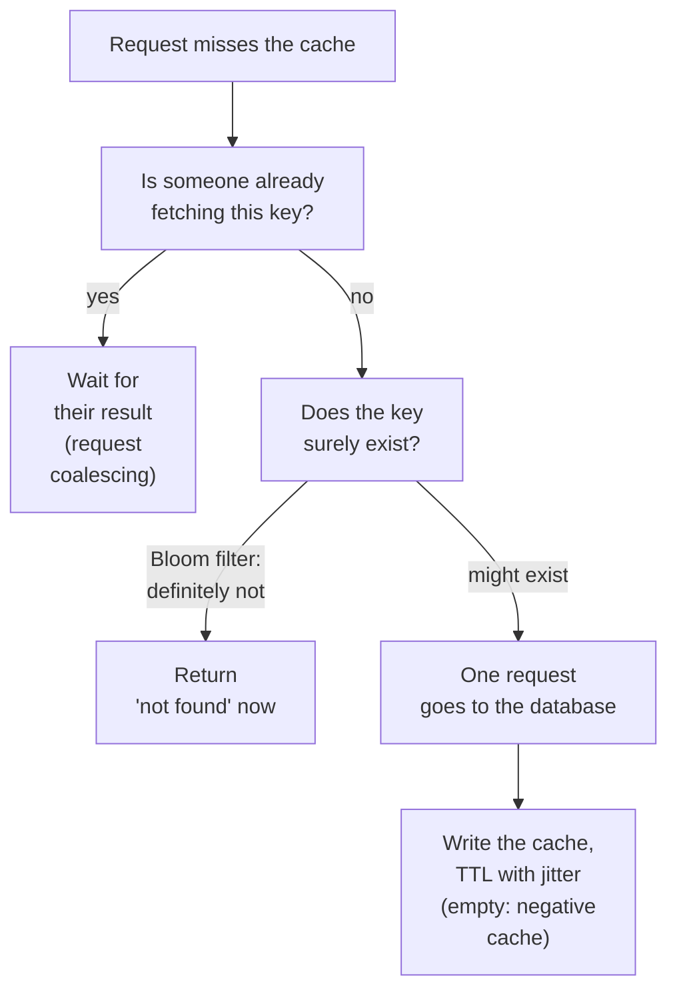

> [!tldr] Quick read
> - [[en/concepts/cache-stampede|Cache stampede]]: a hot key has just expired, and hundreds of requests miss together and all go ask the database. In the example: 500 requests become 500 queries.
> - [[en/concepts/request-coalescing|Request coalescing]] (singleflight, a lock): only one request fetches, the others wait for its result. 500 queries drop to 1.
> - [[en/concepts/probabilistic-early-expiration|Probabilistic early expiration]] (XFetch): the closer to expiry, the more likely one request refreshes the value early on its own. With steady traffic, queries drop from 127 to 50, and to 6 with request coalescing added.
> - [[en/concepts/ttl-jitter|TTL jitter]]: add or subtract a random amount to the TTL so thousands of keys loaded together do not expire together. The peak drops from 2,000 to 526 queries per 100 ms.
> - [[en/concepts/cache-penetration|Cache penetration]]: when you ask for something that does not exist, the cache never hits. The cure is a negative cache, or a [[en/concepts/bloom-filter|Bloom filter]] (12 KB for 10,000 ids, 1% false positives). A [[en/concepts/hot-key|hot key]] is a key so hot that one node cannot keep up.

> [!info] Context
> Station 5 of **the Caching line**. The example is **flash-sale**, a shop with happy-hour discounts: at 21:00, thousands of people open the *same* product page and type the *same* search term. This is when the cache matters most, and also when its small gaps turn into incidents. You do not need to know the project's code.

> [!abstract]- Quick glossary for this post (click to open)
> - **TTL, negative caching, lease**: see [[en/posts/2026-11-22-caching-invalidation|station 4]].
> - **Concurrent**: many requests being handled at the same time.
> - **Promise**: in JavaScript, an "IOU" for a result that will arrive later. Many places can wait on the same promise.
> - **Hash function**: turns any string into a number that looks random; the same input always gives the same output.
> - **Bit**: the smallest unit of memory, holding only 0 or 1. 8 bits make 1 byte.
> - **False positive**: answering "yes" when the truth is "no".
> - **Shard / node**: one machine (or one process) holding part of a cluster's data. Station 7 covers it in detail.

## Picture it first: rush hour at the library

During exam season, a hundred students rush to the desk asking for the very same textbook, right when the copy on the shelf has just been sent back to storage. If every librarian runs down to storage on their own, the elevator jams.

| Everyday life | Concept |
|---|---|
| A hundred people ask for a book just sent to storage, a hundred librarians run down together | [[en/concepts/cache-stampede\|Cache stampede]] |
| One librarian goes down to storage, the others wait for that book | [[en/concepts/request-coalescing\|Request coalescing]] |
| A book about to expire: now and then a librarian swaps in a fresh copy early | [[en/concepts/probabilistic-early-expiration\|Probabilistic early expiration]] |
| Return dates spread a few days apart, so the whole class does not return books on the same morning | [[en/concepts/ttl-jitter\|TTL jitter]] |
| People who keep asking for books the library has never had | [[en/concepts/cache-penetration\|Cache penetration]] |
| A pocket catalog: "definitely not here" or "might be here" | [[en/concepts/bloom-filter\|Bloom filter]] |
| A book requested so often that one desk cannot serve everyone | [[en/concepts/hot-key\|Hot key]] |



## The problem: the cache leaks right when you need it most

I used to think a 99% hit ratio meant the cache had done its job. But the remaining 1% is not spread evenly over time. It piles up at specific moments: the exact second a hot key expires, the exact minute a batch of keys loaded at 21:00 all expire at 21:01, the exact moment a bot sweeps `/products/1..1000000`. At those moments the database sees a thousand queries at once instead of a few dozen, and if it slows down, even more requests miss on top of each other.

This station walks through four kinds of leaks, each with its own patch, all measured with the same example.

## How it works

<figure class="figure-map" style="--ar: 1 / 1">
<div class="frame"><iframe data-archify="../../diagrams/caching-under-load/stampede.en.html" title="Sequence diagram: a hot key expires, three requests miss together, only one request is allowed to ask the database" loading="lazy"></iframe></div>
<figcaption><span><b>Figure 1.</b> Request coalescing with a lock: the first request wins the lock and asks the source, the other requests wait and then reread the cache.</span><a href="../diagrams/caching-under-load/stampede.en.html" target="_blank" rel="noopener">Open full screen</a></figcaption>
</figure>

### Cache stampede: one key, hundreds of misses

**[[en/concepts/cache-stampede|Cache stampede]]** (also called dogpile or thundering herd): a hot key expires, and during the time one request takes to fetch fresh data (say 100 ms), *every* request for that key finds the cache empty and also goes fetching. At 5,000 requests/second, 100 ms means 500 identical queries. If the database slows down under the load, those 100 ms stretch out and even more requests miss: a vicious spiral.

### Request coalescing: only one goes fetching

**[[en/concepts/request-coalescing|Request coalescing]]**: when one request is already fetching key X, later requests do not fetch again but share its result. There are two scopes:

**Within one process (singleflight).** Keep a table of "key → in-flight promise". A later request takes the existing promise instead of creating a new one. Go ships `singleflight`; in Node it is a few lines:

```ts
const inflight = new Map<string, Promise<string | null>>();
async function singleflight(key: string) {
  const e = cache.get(key); if (fresh(e)) return e!.v;
  if (!inflight.has(key)) inflight.set(key, recompute(key, 1000).finally(() => inflight.delete(key)));
  return inflight.get(key)!;   // everyone waits on ONE DB call
}
```

It only coalesces within one process: with 20 pods you can still get 20 queries.

**Across many machines (a distributed lock).** A request that misses tries to take a lock in Redis (`SET lock:<key> <token> NX EX 5`). Whoever wins goes fetching; whoever loses waits a bit and rereads the cache. The flash-sale search cache does exactly this, with a few important details:

```ts
// trimmed excerpt from the flash-sale search cache
const token = randomUUID();
const acquired = (await redis.set(`lock:${key}`, token, 'EX', 5, 'NX')) === 'OK';
if (!acquired) {
  for (let i = 0; i < 3; i++) {                    // wait 250ms × 3, enough for most queries
    await sleep(250);
    const polled = await redis.get(key); if (polled) return JSON.parse(polled);
  }
  // the lock holder is too slow or dead: fetch it ourselves, don't wait forever
}
try { /* fetch, SET key EX ttl */ }
finally {
  if (acquired) await redis.eval(RELEASE_IF_MINE, 1, `lock:${key}`, token);   // Lua: GET, compare token, then DEL
}
```

- **The lock has an expiry** (`EX 5`): if the holder dies, the lock goes away on its own and nobody gets stuck.
- **A random token, and releasing the lock with a Lua script that compares it**: if the holder takes longer than 5 seconds, the lock expires and someone else takes it; when the old holder finishes, it must not delete the new holder's lock by mistake.
- **A bounded wait**: if nothing shows up after 750 ms, fetch it yourself. A few extra queries are better than a hung request.

At the CDN layer, nginx does the same with `proxy_cache_lock` ([[en/posts/2026-11-22-caching-http|station 2]]: 200 requests become 1). Facebook's leases ([[en/posts/2026-11-22-caching-invalidation|station 4]]) work the same way: memcache hands out a token for a key only once every 10 seconds, and whoever has no token waits a bit and retries. Their paper reports peak database load dropping from 17,000 to 1,300 queries/second thanks to this mechanism.

### Probabilistic early expiration: never let the key expire

Request coalescing still makes *one* request wait for the database at every expiry, and every request arriving at the same time waits along with it. A better way is to refresh **before** expiry. But if everyone refreshes when 1 second is left, you just get the stampede 1 second earlier.

**[[en/concepts/probabilistic-early-expiration|XFetch]]** (Vattani, Chierichetti and Lowenstein, VLDB 2015) lets each request *flip its own coin*. Each entry is stored with `delta` (how long the last computation took) and `expiry`. A request recomputes if:

```text
now − delta × beta × ln(rand()) ≥ expiry
```

`rand()` lies in (0, 1), so `ln(rand())` is negative and the left side is larger than `now` by a random amount. Far from expiry almost nobody triggers; the closer to expiry, the likelier it gets; the longer the recomputation (larger `delta`), the earlier it starts. `beta = 1` is the default the paper proves optimal; `beta > 1` refreshes earlier. No lock, no coordination between machines.

In the example (500 requests/second, TTL 1 second, database 100 ms): a plain TTL needs 127 queries and 127 requests have to wait; XFetch needs 50. Combining XFetch with a background singleflight (whoever wins the coin flip starts *one* refresh and still returns the current value) brings it down to 6 queries.

### TTL jitter: avoiding mass expiry

At the start of the flash sale, the system loads 2,000 products into the cache at once with the same 60-second TTL. Exactly 60 seconds later, all 2,000 keys expire in the same instant. This is sometimes called a cache avalanche. It also happens after a restart or after warming the cache (station 7).

**[[en/concepts/ttl-jitter|TTL jitter]]** adds a random part to the TTL, for example 60 seconds ± 20%. Expiries spread over 24 seconds instead of piling into one instant. One line of code:

```ts
const ttl = Math.round(60 * (0.8 + 0.4 * Math.random()));   // 48–72 seconds
```

In the example, the peak drops from 2,000 to 526 queries per 100 ms. The total number of queries stays the same, only its shape changes, and databases usually die from the peak, not the total.

### Cache penetration: asking for things that do not exist

**[[en/concepts/cache-penetration|Cache penetration]]**: requests ask for keys that are not in the database. Cache-aside stores nothing when the DB returns empty, so every such request misses and goes straight to the DB. It can be a bug (broken links, old ids) or deliberate: a bot sweeps `/products/1` to `/products/1000000` to get past the cache and hit the DB directly.

Two patches, usually used together:

1. **Negative caching** ([[en/posts/2026-11-22-caching-invalidation|station 4]]): store "not found" too, with a short TTL. 1,000 requests for 200 fake ids become 200 queries. But if the attacker uses a *new* id every time, the negative cache does not help at all, and it fills up with junk.
2. A **[[en/concepts/bloom-filter|Bloom filter]]** in front of the cache: a small structure that knows "this id definitely does not exist" or "it might exist". An id that definitely does not exist gets a 404 right away, and nobody has to ask.

### Bloom filter: knowing "definitely not" with a few KB

A Bloom filter (Burton Bloom, 1970) is an array of `m` bits, all 0 at first, plus `k` hash functions.

- **Add** an id: hash it with the `k` functions to get `k` positions, and set all `k` bits to 1.
- **Query** an id: hash it again; if *any* of those bits is 0, the id has **definitely never been added**. If all `k` bits are 1, the id **may** have been added (or those bits may have been set by other ids).

It never says "not here" about something that is there (no false negatives). Now and then it says "might be here" about something that is not (a false positive), and then the request simply continues to the cache and the DB as usual. The false positive rate is about `(1 − e^(−k·n/m))^k`; for 1% you need about 9.6 bits per element and `k = 7`. 10,000 ids take only about 12 KB, however long the ids are.

Limits: you cannot delete elements (clearing bits may break other elements; to delete, use a variant such as a counting Bloom filter or a cuckoo filter), and new ids must be added to the filter as soon as they are created. Redis 8 ships Bloom filters (`BF.RESERVE`, `BF.ADD`, `BF.EXISTS`), shared by every pod.

### Hot key: one key, one node, overloaded

A **[[en/concepts/hot-key|hot key]]** is different from a stampede: the key does not expire and the cache still hits, but **one key gets so many requests** that the node holding it is overloaded. When Redis runs as a multi-node cluster (station 7), each key lives on exactly one node; the product on flash sale can get 100,000 reads per second while the other nodes sit idle. The larger the value, the faster it saturates that node's network bandwidth.

Patches:

- **A second cache tier in each pod's RAM** for just the hot keys, with a TTL of a few seconds (station 7). This is the most effective: most reads never leave the pod.
- **Replicating the key**: write the same value to `product:42#0` … `product:42#7` and read a random copy. The eight copies land on different nodes. The price: a delete must delete all eight.
- **Reading from replicas**: spread reads over the node's replicas.

Finding hot keys: `redis-cli --hotkeys` (needs an LFU-style eviction policy, station 6), your Redis provider's statistics, or counting on the application side.

## Runnable example

[stampede-and-friends.ts](../code/caching-under-load/stampede-and-friends.ts) uses an in-RAM cache (enough to see the mechanisms, no Redis needed) and a fake database that takes 100 ms per query and counts queries.

```bash
node stampede-and-friends.ts
```

```ts
// XFetch: probabilistic early recomputation (Vattani et al., VLDB 2015)
async function xfetch(key: string, ttlMs: number, beta = 1) {
  const e = cache.get(key);
  if (!e || performance.now() - e.delta * beta * Math.log(rand()) >= e.expiry) return recompute(key, ttlMs);
  return e.v;
}

// Bloom filter: m bits, k positions taken from SHA-256
add(s: string) { for (const i of this.idx(s)) this.bits[i >> 3] |= 1 << (i & 7); }
has(s: string) { return this.idx(s).every((i) => this.bits[i >> 3] & (1 << (i & 7))); }
```

```text
$ node stampede-and-friends.ts
1) Stampede: 500 concurrent requests on a hot key that just expired
   do nothing    → 500 queries to the DB
   singleflight  →   1 query to the DB
2) Steady traffic ~500 requests/second for 3.5 seconds, TTL 1 second, DB takes 100ms
   plain TTL                      → 127 DB queries,  127/1468 requests had to wait for the DB
   XFetch beta=1                  →  50 DB queries,   50/1458 requests had to wait for the DB
   XFetch + background singleflight →   6 DB queries,   20/1455 requests had to wait for the DB
3) Avalanche: 2000 keys loaded together, TTL 1 second; DB queries in each 100ms window
   fixed TTL     → peak 2000 queries/100ms  [0 0 0 0 0 0 0 0 0 0 2000 0 0 0 0]
   TTL ± 20%     → peak  526 queries/100ms  [0 0 0 0 0 0 0 0 1 509 526 519 445 0 0]
4) Penetration: 1000 requests for 200 ids that do not exist (ghost-*)
   do nothing           → 1000 DB queries
   cache "not found" too →  200 DB queries
   Bloom filter         →    0 DB queries
   12 KB Bloom filter for 10,000 real ids: measured false positives 1.00% over 100,000 unknown ids
```
*(Output labels translated; the files themselves print Vietnamese.)*

Reading the results (part 2 involves real time, so the numbers can drift by a few between runs):

- **Part 1**: singleflight turns 500 queries into 1.
- **Part 2**: with a plain TTL, every expiry has a whole batch of requests missing at once. XFetch refreshes early, so there are far fewer misses. Add a background singleflight and only 6 refreshes remain in 3.5 seconds; the 20 requests that had to wait are the very first ones, while the cache was still empty.
- **Part 3**: the same total of 2,000 queries; a fixed TTL piles them all into one 100 ms window, jitter spreads them over five.
- **Part 4**: the negative cache blocks repeated lookups; the Bloom filter blocks them from the very first one. The measured false positive rate (1.00%) matches the design number exactly.

## Misconceptions and common traps

- **"An anti-stampede lock doesn't need an expiry."** If the holder dies, everyone waits forever. The lock needs a TTL, releasing it must compare the token, and waiters need a time limit.
- **"Singleflight in code is enough."** It only coalesces within one process. With 50 pods, one expiry can still become 50 queries. You need a distributed lock or early refresh.
- **"Refresh when 10% of the TTL is left and you're done."** Every request arriving in that 10% refreshes: the stampede just moves earlier. You need randomness (XFetch) or request coalescing.
- **"Jitter reduces DB load."** No, the total number of queries is the same. Jitter only flattens the peak.
- **"A Bloom filter can answer 'it exists'."** It is only certain about "no". "Might exist" still has to go on and check.
- **"A negative cache is enough against id sweeps."** If the attacker uses a new id every time, the negative cache never hits and fills up with junk. You need a Bloom filter or rate limiting.
- **"For a hot key, add Redis nodes."** A key lives on one node only; adding nodes does not split it. You have to cache at the application layer or replicate the key.

## Self-check questions

> [!question]- 5,000 requests/second hit one key, and recomputing takes 100 ms. When the key expires with no protection, roughly how many duplicate queries happen?
> About 5,000 × 0.1 = 500, because every request arriving in those 100 ms finds the cache empty. If the DB slows down under the load, the window grows and the number goes up further.

> [!question]- Why does the flash-sale anti-stampede lock use a random token and Lua to release the lock?
> If the holder is slower than the lock's TTL, the lock expires and someone else takes it. When the old holder finishes, a plain DEL would delete the new holder's lock by mistake. Comparing the token in Lua guarantees only the current holder can delete it, and the check + delete is atomic.

> [!question]- In XFetch, why does a longer recomputation mean an earlier refresh?
> The condition is `now − delta × beta × ln(rand()) ≥ expiry`. `delta` is the recomputation time; a large `delta` means a large random amount is added to `now`, so it crosses `expiry` sooner. That makes sense, since slow work needs to start earlier to finish before expiry.

> [!question]- A Bloom filter answers "might exist" for an id that does not exist. What happens, and is it harmful?
> The request continues to the cache and then the DB as if there were no filter, and the DB returns empty. It costs one query; at a 1% rate the filter still blocks 99% of junk requests. It never wrongly blocks a real id.

> [!question]- How is a hot key different from a cache stampede?
> A stampede is many simultaneous misses when a key expires, with the load landing on the database. A hot key still hits but gets too many reads, with the load landing on one cache node. The patches differ: request coalescing and early refresh for a stampede; a local cache or key replication for a hot key.

## References

- Vattani, Chierichetti, Lowenstein, [Optimal Probabilistic Cache Stampede Prevention](https://www.vldb.org/pvldb/vol8/p886-vattani.pdf), PVLDB 8(8), 2015
- Nishtala et al., [Scaling Memcache at Facebook](https://www.usenix.org/conference/nsdi13/technical-sessions/presentation/nishtala), NSDI 2013 (leases against thundering herds)
- [Go: golang.org/x/sync/singleflight](https://pkg.go.dev/golang.org/x/sync/singleflight)
- [nginx: proxy_cache_lock](https://nginx.org/en/docs/http/ngx_http_proxy_module.html#proxy_cache_lock)
- [Redis: Bloom filter](https://redis.io/docs/latest/develop/data-types/probabilistic/bloom-filter/)
- Burton H. Bloom, [Space/Time Trade-offs in Hash Coding with Allowable Errors](https://dl.acm.org/doi/10.1145/362686.362692), Communications of the ACM, 1970
