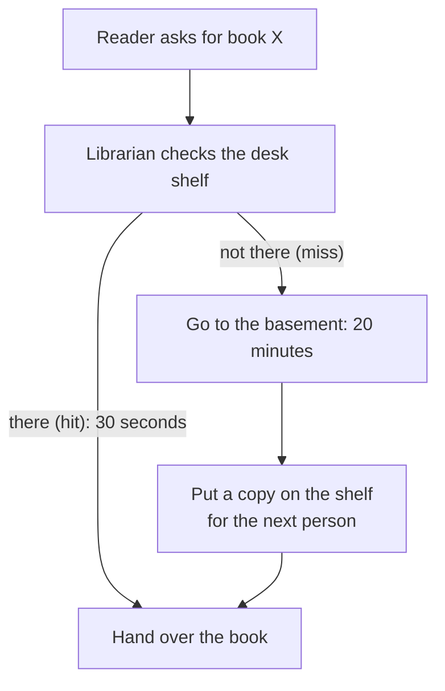

> [!tldr] Quick read
> - A [[en/concepts/caching|cache]] is a small, fast copy of data that lives somewhere slower. A read that finds the copy is a [[en/concepts/cache-hit-va-miss|hit]]; one that doesn't is a miss.
> - [[en/concepts/hit-ratio|Hit ratio]] decides whether a cache is worth it. In the example, a cache holding 1% of the products serves 39% of the views; holding 10% serves 68%.
> - A small cache gets many hits thanks to [[en/concepts/locality|locality]]: users keep rereading a small group of data (the [[en/concepts/working-set|working set]]). With even access, a 10% cache hits exactly 10%.
> - The [[en/concepts/cache-key|cache key]] decides whether two requests share one copy. Leave information out of the key and you serve the wrong data; put too much in and you never hit.
> - The price: the copy may be [[en/concepts/staleness|stale]] compared with the original. Every caching decision starts with the question "how stale is acceptable?"

> [!info] Context
> Station 1 of **the Caching line**. The example is **flash-sale**, a time-limited discount shop I wrote myself: at exactly 21:00, thousands of people open product pages, search, and hit buy on a few hundred units at the same time. The same product page is opened tens of thousands of times within a few minutes, so we can't ask the database every time. You don't need to know the project's code or any framework.

> [!abstract]- Quick glossary for this post (click to open)
> - **Database (DB)**: where the original, durable data lives (PostgreSQL, MySQL). A read from the DB usually takes a few to a few dozen milliseconds.
> - **RAM**: the machine's main memory. Reading from RAM is thousands of times faster than reading disk or calling over the network, but there is little of it and it is lost on shutdown.
> - **Redis**: a program that stores key → value data in RAM, runs separately, and is shared by many servers over the network. Reading one key usually takes under 1 ms.
> - **Request**: one time a client asks the server something (for example, opening product page 42).
> - **ms (millisecond)**: one thousandth of a second.
> - **Zipf distribution**: a "a few things are hugely popular, most are rarely touched" distribution. The k-th most popular item is viewed about 1/k as often as item number 1.
> - **LRU**: the rule "when the shelf is full, drop the item nobody has touched for the longest time". Station 6 covers it in detail.

## Picture it first: the shelf in the reading room

A library has a million books in its basement stacks. Every time someone borrows one, the librarian has to take the elevator down, find it and bring it up: 20 minutes. A smart librarian keeps a small shelf next to the desk with only the few hundred books borrowed most. Most people come for exactly those books, so most loans take 30 seconds.

| Everyday life | Concept |
|---|---|
| The basement stacks: every book, slow to fetch | Database, the original data source |
| The shelf next to the desk: a few hundred books, instant | [[en/concepts/caching\|Cache]] |
| The book you want is on the shelf / has to come from the basement | [[en/concepts/cache-hit-va-miss\|Cache hit / miss]] |
| What percentage of loans are served from the shelf | [[en/concepts/hit-ratio\|Hit ratio]] |
| Exam season, everyone borrows the same few textbooks | [[en/concepts/locality\|Locality]] |
| The group of books that are "hot" this week | [[en/concepts/working-set\|Working set]] |
| The call number on the spine to find the right book on the shelf | [[en/concepts/cache-key\|Cache key]] |
| The shelf holds last year's printing, the stacks have the revised one | [[en/concepts/staleness\|Staleness (stale data)]] |



All of caching revolves around the librarian's three questions: how big should the shelf be, which books get to sit on it, and what to do when the stacks have a new printing but the shelf still holds the old one.

## The problem: the database can't handle repeated reads

I used to think "if it's slow, upgrade the database". Then I counted flash-sale's requests at 21:00: most were reads, and most reads landed on a few dozen discounted products. The database had to answer the same question, "what's the price of product 42", thousands of times, with the same answer.

That question repeats for three reasons a cache can exploit:

1. **Reads far outnumber writes.** A product's price changes a few times a day but is read hundreds of thousands of times.
2. **The result is the same for many people.** Product page 42 is the same for one person as for the next.
3. **Reads pile onto a small group.** The products on flash sale, the trending search terms.

If all three are missing (data changes constantly, every person gets a different result, everything is read evenly), a cache is nearly useless. The rest of this post measures that with numbers.

## How it works

### Hit, miss and the cost of a miss

A read through the cache has two outcomes:

- **[[en/concepts/cache-hit-va-miss|Hit]]**: the data is already in the cache and comes back immediately. The example below treats one cache read as costing 0.5 ms.
- **Miss**: it isn't there. We must read the source (DB, 20 ms), *plus* the time already spent asking the cache, and then usually write the result into the cache for next time.

A miss costs a little more than having no cache at all, because we ask the cache first. So the average time per request is:

```text
avg time = hit_ratio × t_cache + (1 − hit_ratio) × (t_cache + t_DB)
```

With a 0.5 ms cache and a 20 ms DB: a 0% hit ratio gives 20.5 ms (worse than no cache), 50% gives 10.5 ms, 90% gives 2.5 ms. Each percentage point of hit ratio at the high end is worth more than at the low end, because it cuts exactly the most expensive part: the trips to the DB.

### Hit ratio: the number that decides whether a cache is worth it

[[en/concepts/hit-ratio|Hit ratio]] is the number of hits divided by the total number of reads. It doesn't just measure speed; it also measures **the load the source has to bear**: a 95% hit ratio means the DB sees only 5% of the reads. At 99% the DB sees only 1%, so DB load drops another *five times* even though the number moved only 4 points.

Two things decide the hit ratio:

1. **How big the cache is compared with the amount of data being read.**
2. **Whether users read in clusters or evenly.** This is where I used to be wrong, and it's the reason for the whole next section.

### Locality and working set: why a small cache still gets many hits

**[[en/concepts/locality|Locality]]** is the observation that access is not spread evenly:

- **Temporal locality**: something that was just read will soon be read again. Someone just opened product 42, and a few seconds later someone else opens it too.
- **Spatial locality**: things next to what was just read are about to be read too. CPUs read a whole stretch of memory at once for this reason; at the application level, whoever opens page 1 of a list often opens page 2 next.

The **[[en/concepts/working-set|working set]]** is the group of data being read during a period of time. The cache only needs to fit the working set, not the whole database. During a flash sale, the working set is a few dozen discounted products, not the shop's ten thousand products.

Measured with the example at the end of this post (10,000 products, 200,000 views, an [[en/concepts/lru-va-lfu|LRU]] cache):

| Cache holds | % of catalog | Zipf views: hit | avg/request | Even views: hit | avg/request |
|---|---|---|---|---|---|
| 10 items | 0.1% | 13.2% | 17.9 ms | 0.1% | 20.5 ms |
| 100 items | 1% | **39.0%** | 12.7 ms | 0.9% | 20.3 ms |
| 1,000 items | 10% | **67.6%** | 7.0 ms | 10.0% | 18.5 ms |
| 5,000 items | 50% | 88.8% | 2.7 ms | 49.3% | 10.6 ms |

The same 1,000-item cache: with real users (reads piling onto hot items) it hits 68%; with even access it hits exactly 10%, the same as its share of capacity. Without locality, a cache is just an expensive copy.

> [!tip] The curve flattens
> Going from 100 to 1,000 items (10 times the RAM) raises the hit ratio only from 39% to 68%. Going from 1,000 to 5,000 items (5 times) adds 21 points. Adding RAM to a cache always has diminishing returns; a sensible place to stop is when the average time or the DB load is low enough, not when the hit ratio reaches 100%.

### Cache key: do two requests share one copy?

Each entry in the cache is found by a **[[en/concepts/cache-key|cache key]]**, like the call number on a book's spine. The key must contain **everything that makes the result different**, and **only those things**:

- **Too little** → wrong answers. Cache search results under the key `search:tai nghe` but forget the page and the sort order, and someone viewing page 2 gets page 1. Worse: forget the user id on private data and one person sees another person's cart. Station 8 has a real security vulnerability born from exactly this mistake.
- **Too much** → never a hit. Put a timestamp or request id into the key and every request gets its own key; the hit ratio drops to 0.
- **Same meaning, different text** → needless misses. `?q=tai+nghe&sort=price` and `?sort=price&q=tai+nghe` are the same question. flash-sale sorts the parameters by name and hashes them with SHA-256 before using them as the key, so the two URLs above share one entry:

```ts
// trimmed from flash-sale's search cache
hashKey(parts: Record<string, unknown>): string {
  const sorted = Object.keys(parts).sort()                    // parameter order no longer matters
    .map((k) => `${k}=${JSON.stringify(parts[k] ?? '')}`).join('&');
  return createHash('sha256').update(sorted).digest('hex').slice(0, 32);
}
```

A naming convention helps operations: `<type>:<id>[:<part>]`, for example `stats:seller:17`, `product:42:price`. You can tell which feature a key belongs to at a glance, and later count or clean up by prefix (station 6 covers how to clean up safely).

### Staleness: the price of every cache

The copy in the cache is a snapshot taken at one moment. After that the source changes and the copy doesn't know. The gap between the two is **[[en/concepts/staleness|staleness]]**. A cache always trades **freshness for speed**; the question isn't "is it stale" but "how stale, at most, for which data, is acceptable".

| Data in flash-sale | Acceptable staleness | What happens when it's stale |
|---|---|---|
| Product description, images | Minutes to hours | Nobody notices |
| Search results | About a minute | New products don't show up right away |
| A seller's order stats | About a minute | The dashboard number is slightly off |
| A role's permissions | Seconds to an hour, *with active deletion* | Someone whose permission was just revoked can still act |
| Units left when you hit buy | **Must not be stale** | Overselling what's in stock |

The last row is why flash-sale never decides "in stock or not" from a number read from the cache. The number shown on the page may be a few seconds stale; but decrementing stock goes straight to the source of truth with an atomic operation. Station 4 covers how to make the cache less stale, and why that is harder than it looks.

> [!warning] Not everything should be cached
> Data that is written more than it is read, differs per person and is rarely reread, or must be exactly right (balances, stock at checkout) makes caching costly and risky. Phil Karlton has a famous line: "There are only two hard things in Computer Science: cache invalidation and naming things." Adding a cache adds one more place where data can be wrong.

## Runnable example

[hit-ratio.ts](../code/caching-why/hit-ratio.ts) simulates 10,000 products and 200,000 views, comparing two access patterns (Zipf and even) with an LRU cache at five sizes. No Redis needed; the random number generator is seeded, so reruns give the same numbers.

```bash
node hit-ratio.ts
```

```ts
// Zipf(s=1): the k-th product is viewed with probability proportional to 1/k
const weights = Array.from({ length: ITEMS }, (_, k) => 1 / (k + 1));

// Minimal LRU: Map keeps insertion order; on read move to the end, when full drop the first element
function simulate(size: number, next: () => number) {
  const lru = new Map<number, true>();
  let hits = 0;
  for (let i = 0; i < REQUESTS; i++) {
    const id = next();
    if (lru.has(id)) { hits++; lru.delete(id); lru.set(id, true); continue; }
    lru.set(id, true);
    if (lru.size > size) lru.delete(lru.keys().next().value!);
  }
  const ratio = hits / REQUESTS;
  return { ratio, avgMs: ratio * CACHE_MS + (1 - ratio) * (CACHE_MS + DB_MS) };
}
```

```text
$ node hit-ratio.ts
cache holds  | % catalog | Zipf: hit    avg/request | Even: hit   avg/request
   10 items |    0.1%   |    13.2%    17.9ms   |    0.1%    20.5ms
  100 items |      1%   |    39.0%    12.7ms   |    0.9%    20.3ms
  500 items |      5%   |    58.7%     8.8ms   |    5.0%    19.5ms
 1000 items |     10%   |    67.6%     7.0ms   |   10.0%    18.5ms
 5000 items |     50%   |    88.8%     2.7ms   |   49.3%    10.6ms
```

*(Output labels translated; the files themselves print Vietnamese.)*

Reading the results:

- The "Even" column: the hit ratio always roughly equals the % of catalog. The cache hits only by luck.
- The "Zipf" column: 1% of the catalog already absorbs 39% of views. This is why a Redis instance of a few GB in front of a database of hundreds of GB is still effective.
- The 10-item row with even access: 20.5 ms, *slower* than no cache (20 ms). A cache that misses almost every time is a losing cache.

Try changing the Zipf `s` (for example `1 / (k + 1) ** 0.6` for less clustered access) to see how fast the hit ratio falls.

## Misconceptions and common traps

- **"An 80% hit ratio is good."** It depends. 80% means the DB still sees 20% of the reads; if peak load is 50,000 requests/second, that's 10,000 queries/second hitting the DB. Measure the hit ratio per type of data and convert it to DB load (station 8).
- **"The bigger the cache, the better."** The benefit diminishes, while the RAM cost and restart time don't. A big cache also keeps stale data longer if you rely on eviction to refresh it.
- **"With a cache, a small database is fine."** When the cache goes down or has just started, the whole load falls onto the DB (stations 5 and 8). The DB must be able to take it, or there must be a way to limit the load.
- **"Using the URL as the key is enough."** If the result depends on the user, the language or some header that the key doesn't contain, the cache serves the wrong result to someone else (station 2 with `Vary`, station 8 with cache poisoning).
- **"The cache will be correct because there's a TTL."** A TTL only limits the *maximum time* the data is wrong. Within that window, the cache is still wrong (station 4).

## Self-check questions

> [!question]- Cache 0.5 ms, DB 20 ms. At what hit ratio does the cache start to help the average time?
> No cache: 20 ms. With cache: `h × 0.5 + (1 − h) × 20.5 = 20.5 − 20h`. It helps when `20.5 − 20h < 20`, i.e. h > 2.5%. Below that, the cache only adds a useless lookup.

> [!question]- Why does the same 1,000-item cache hit 68% with Zipf access but only 10% with even access?
> Because of locality. With Zipf, a few hundred hot items account for most views; an LRU cache holds exactly that group (the working set). With even access every item is equal, so the cache hits exactly its share of capacity.

> [!question]- You cache search results under the key `search:<keyword>`. What's wrong?
> It leaves out the other parameters that change the result: page, items per page, sort order, filters. Someone viewing page 2 will get page 1. The key must contain every parameter that matters, and the order should be normalized so the same meaning gives the same key.

> [!question]- The hit ratio rises from 95% to 99%. How many times does the database load drop?
> From 5% down to 1% of reads, so 5 times less. At the high end, a few percentage points of hit ratio make a huge difference in source load.

> [!question]- Name three kinds of data that shouldn't be cached, and why.
> For example: stock at checkout (must be exactly right), data written more than it is read (the cache gets deleted before it can hit), per-person data that is rarely reread (no locality, low hit ratio, plus the risk of leaking to someone else if the key is wrong).

## References

- [RFC 9111: HTTP Caching](https://www.rfc-editor.org/rfc/rfc9111) (defines cache, fresh and stale)
- [Redis: Key eviction](https://redis.io/docs/latest/develop/reference/eviction/) (approximate LRU, cache size)
- [AWS whitepaper: Database Caching Strategies Using Redis](https://docs.aws.amazon.com/whitepapers/latest/database-caching-strategies-using-redis/caching-patterns.html)
- Nishtala et al., [Scaling Memcache at Facebook](https://www.usenix.org/conference/nsdi13/technical-sessions/presentation/nishtala), NSDI 2013 (a cache in front of MySQL at large scale)
- Peter J. Denning, *The Working Set Model for Program Behavior*, Communications of the ACM, 1968
- Related earlier station: [[en/posts/2026-11-18-api-performance|API Performance]] (the API line)
