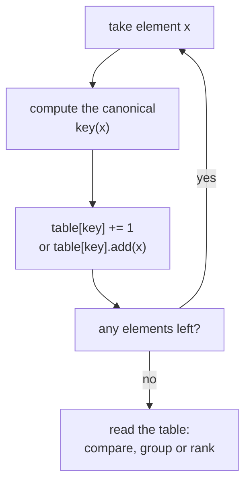

> [!tldr] Quick read
> - The pattern: pick a **canonical key** so that two things that are "the same in the problem's sense" always produce the same key, then **count** or **group** by that key in a hash table. Each element is looked at once; no pairwise comparisons.
> - Valid Anagram: the key is a letter, counted in a 26-slot array. Group Anagrams: each word's own 26-slot count table is the key for grouping. Top K Frequent Elements: after counting, use the **count** as an array index (bucket sort). Valid Sudoku: the keys are (row, digit), (column, digit), (3×3 box, digit).
> - A key must **compare by value**. Arrays in JavaScript and `int[]` in Java compare by reference, so you have to turn them into a delimited string, a tuple (Python), a fixed-size array (Go) or a record (Java).
> - The trap: joining the count table into a string **without** a delimiter. `[1, 11]` and `[11, 1]` both become `"111"`: two different words land in the same group.

> [!info] Context
> Station 2 of **the NeetCode line: Arrays and Strings**. Station 1, [[en/posts/2026-11-22-neetcode-hash-lookup|hash lookup]], asks the table "have I seen x?"; this station asks "seen it **how many times**?" and "**which group** does x belong to?". Each problem has its own page solving it in depth in five languages. All you need to know is loops, arrays and functions.

> [!abstract]- Quick glossary for this post (click to open)
> - **Canonical key**: one shared representative for a whole group of things that count as the same. See [[en/concepts/canonical-key|Canonical Key]].
> - **Frequency counting**: a table from key → number of occurrences. See [[en/concepts/frequency-counting|Frequency Counting]] and [[en/concepts/counting-array|Counting Array]].
> - **Group by**: a table from key → list of the elements with that key. See [[en/concepts/group-by|Group By]].
> - **Bucket sort**: sorting by dropping each element into a "bucket" numbered by its value, with no comparisons. See [[en/concepts/bucket-sort|Bucket Sort]].
> - **Anagram**: two words that use the same letters the same number of times, only in a different order (`listen`, `silent`).

## Picture it first: the mail sorting room

A post office receives thousands of letters every morning. Nobody compares each letter with every other letter to see whether they go to the same place. A clerk reads the **postal code** on each letter and drops it into the pigeonhole for that code. Two addresses written differently ("Dist. 1", "District 1") still share a code, so they still go into the same pigeonhole.

| Everyday life | Concept |
|---|---|
| A postal code: however you write the address, the same place gets the same code | Canonical key |
| A row of pigeonholes numbered by code | A hash table from key → group |
| Counting the letters in each pigeonhole | Frequency counting |
| Two letters with exactly the same characters on the envelope, only in a different order | Anagrams: the same letter-count table |
| Ordering pigeonholes by letter count, fullest first | Top K: buckets by count |
| Each letter gets three stamps: street, district, zone | Valid Sudoku: one cell has three keys (row, column, 3×3 box) |



## The problem: pairwise comparison costs O(n²)

Group Anagrams gives you n words and asks you to group the words that are anagrams of each other. The naive way: compare each pair of words with an anagram check. There are about n²/2 pairs, each costing O(k) where k is the word length, so the total is O(n²·k). With n = 10⁴ and k = 100, that is about 5·10⁹ steps.

Instead: compute one key per word such that **anagrams ⇔ same key**. Grouping then becomes "drop it into the pigeonhole for its key", once per word, O(n·k) in total.

## How it works

### Two ways to pick a key for anagrams

<figure class="figure-map" style="--ar: 3 / 4">
<div class="frame"><iframe data-archify="../../diagrams/neetcode-group-anagrams/canonical-key.en.html" title="Grouping eat, tea, tan, ate, nat, bat by sorted key" loading="lazy"></iframe></div>
<figcaption><span><b>Figure 1.</b> Group Anagrams: every word yields a canonical key, and words with the same key share a group.</span><a href="../diagrams/neetcode-group-anagrams/canonical-key.en.html" target="_blank" rel="noopener">Open full screen</a></figcaption>
</figure>

- **Sorted key**: `"eat"`, `"tea"` and `"ate"` all become `"aet"`. Easy to write, O(k log k) per word.
- **Count key** ([[en/concepts/count-key|Count Key]]): a table of 26 numbers counting each letter. O(k) per word, but the table is an array, and an array cannot always be a key (below).

The [[en/problems/group-anagrams|Group Anagrams]] page measures both: the count key wins on long words but loses when words are only a few letters long.

### A key must compare by value

A hash table finds a key by its hash, then checks it with the language's notion of "equal". If that check compares **addresses** rather than **contents**, two identical count tables are still two different keys ([[en/concepts/key-serialization|Key Serialization]]):

| Language | Count table type | Usable as a key directly? | What to do |
|---|---|---|---|
| TypeScript, JavaScript | array `number[]` | no, `Map` compares arrays by reference | `count.join(",")` |
| Python | `list` | no, a list is not hashable | `tuple(count)` |
| Go | fixed-size array `[26]int` | **yes**, fixed-size arrays compare with `==` | use it as is; a slice `[]int` does not work |
| Java | `int[]` | no, `equals`/`hashCode` go by address | `Arrays.toString(count)`, or a `record` |

### What to do after counting

| Problem | Key | After counting or grouping |
|---|---|---|
| [[en/problems/valid-anagram\|Valid Anagram]] | a letter (26-slot array) | add for `s`, subtract for `t`; anagrams when every slot returns to 0 |
| [[en/problems/group-anagrams\|Group Anagrams]] | the whole word's 26-slot count table | return the groups |
| [[en/problems/top-k-frequent-elements\|Top K Frequent Elements]] | the value | flip it around: the **count** becomes an index into a bucket array, read from the highest bucket down |
| [[en/problems/valid-sudoku\|Valid Sudoku]] | (row, digit), (column, digit), (3×3 box, digit) | use station 1's template: meeting a key a second time means invalid |

In Top K Frequent Elements, counts fall within `1..n`, so an array of n + 1 buckets orders every value by count in O(n), without an O(n log n) sort. This is where counting turns into [[en/concepts/bucket-sort|bucket sort]].

In Valid Sudoku, the 3×3 box key is the canonical index `⌊r/3⌋·3 + ⌊c/3⌋`: all nine cells in one 3×3 block yield the same number from 0 to 8. The [[en/problems/valid-sudoku|Valid Sudoku]] page compares three implementations and measures a [[en/concepts/bitmask|bitmask]] about 10 times faster than Sets.

## Runnable example

[TypeScript](../code/neetcode-counting-keys/counting-keys.ts) · [Python](../code/neetcode-counting-keys/counting_keys.py) · [Go](../code/neetcode-counting-keys/counting_keys.go) · [Java](../code/neetcode-counting-keys/counting-keys.java) · [JavaScript](../code/neetcode-counting-keys/counting-keys.js)

Each file solves all four problems and runs its own 9 test cases. Below are Group Anagrams and Valid Sudoku, the two problems that show most clearly how each language picks a key.

```ts
// 49: each word's own 26-slot count table becomes the key of one big Map.
function groupAnagrams(words: string[]): string[][] {
  const groups = new Map<string, string[]>();
  for (const w of words) {
    const count = new Array(26).fill(0);
    for (let i = 0; i < w.length; i++) count[w.charCodeAt(i) - 97]++;
    const key = count.join(","); // with commas: [1,11] and [11,1] must not become the same string "111"
    const g = groups.get(key);
    if (g) g.push(w);
    else groups.set(key, [w]);
  }
  return [...groups.values()];
}

// 36: the keys are (row, digit), (column, digit), (3×3 box, digit).
function isValidSudoku(board: string[][]): boolean {
  const seen = new Set<string>();
  for (let r = 0; r < 9; r++) {
    for (let c = 0; c < 9; c++) {
      const d = board[r][c];
      if (d === ".") continue;
      const box = Math.floor(r / 3) * 3 + Math.floor(c / 3);
      for (const key of [`r${r}:${d}`, `c${c}:${d}`, `b${box}:${d}`]) {
        if (seen.has(key)) return false; // still station 1's template: ask first, write later
        seen.add(key);
      }
    }
  }
  return true;
}
```

```python
def group_anagrams(words: list[str]) -> list[list[str]]:  # 49
    groups: defaultdict[tuple[int, ...], list[str]] = defaultdict(list)
    for w in words:
        count = [0] * 26
        for ch in w:
            count[ord(ch) - 97] += 1
        groups[tuple(count)].append(w)  # a list is not hashable, a tuple is
    return list(groups.values())


def is_valid_sudoku(board: list[list[str]]) -> bool:  # 36
    seen: set[tuple] = set()
    for r in range(9):
        for c in range(9):
            d = board[r][c]
            if d == ".":
                continue
            for key in (("r", r, d), ("c", c, d), ("b", r // 3 * 3 + c // 3, d)):  # tuples as keys, no string joining
                if key in seen:
                    return False
                seen.add(key)
    return True
```

```go
// 49: in Go, the ARRAY [26]int is comparable, so it works as a map key directly; a slice []int does not.
func groupAnagrams(words []string) [][]string {
	groups := map[[26]int][]string{}
	var order [][26]int // Go maps iterate in random order; keep first-seen order
	for _, w := range words {
		var key [26]int
		for i := 0; i < len(w); i++ {
			key[w[i]-'a']++
		}
		if _, ok := groups[key]; !ok {
			order = append(order, key)
		}
		groups[key] = append(groups[key], w)
	}
	out := make([][]string, 0, len(order))
	for _, k := range order {
		out = append(out, groups[k])
	}
	return out
}

// 36: a struct made of comparable fields also works as a map key.
func isValidSudoku(board [][]byte) bool {
	type key struct {
		kind  byte
		index int
		digit byte
	}
	seen := map[key]bool{}
	for r := 0; r < 9; r++ {
		for c := 0; c < 9; c++ {
			d := board[r][c]
			if d == '.' {
				continue
			}
			for _, k := range []key{{'r', r, d}, {'c', c, d}, {'b', r/3*3 + c/3, d}} {
				if seen[k] {
					return false
				}
				seen[k] = true
			}
		}
	}
	return true
}
```

```java
// 49: int[] CANNOT be a HashMap key (equals/hashCode go by address); use Arrays.toString as a string key.
static List<List<String>> groupAnagrams(String[] words) {
    Map<String, List<String>> groups = new LinkedHashMap<>();
    for (String w : words) {
        int[] count = new int[26];
        for (char ch : w.toCharArray()) count[ch - 'a']++;
        groups.computeIfAbsent(Arrays.toString(count), k -> new ArrayList<>()).add(w);
    }
    return new ArrayList<>(groups.values());
}

// 36: a record gets equals/hashCode by field values, so it works as a key.
record Key(char kind, int index, char digit) {}

static boolean isValidSudoku(char[][] board) {
    Set<Key> seen = new HashSet<>();
    for (int r = 0; r < 9; r++)
        for (int c = 0; c < 9; c++) {
            char d = board[r][c];
            if (d == '.') continue;
            if (!seen.add(new Key('r', r, d)) || !seen.add(new Key('c', c, d)) || !seen.add(new Key('b', r / 3 * 3 + c / 3, d)))
                return false;
        }
    return true;
}
```

```js
// 49: Map compares array keys by REFERENCE, so turn the count table into a (delimited) string.
function groupAnagrams(words) {
  const groups = new Map();
  for (const w of words) {
    const count = new Array(26).fill(0);
    for (let i = 0; i < w.length; i++) count[w.charCodeAt(i) - 97]++;
    const key = count.join(",");
    if (!groups.has(key)) groups.set(key, []);
    groups.get(key).push(w);
  }
  return [...groups.values()];
}

// 36
function isValidSudoku(board) {
  const seen = new Set();
  for (let r = 0; r < 9; r++) {
    for (let c = 0; c < 9; c++) {
      const d = board[r][c];
      if (d === ".") continue;
      const box = Math.floor(r / 3) * 3 + Math.floor(c / 3);
      for (const key of [`r${r}:${d}`, `c${c}:${d}`, `b${box}:${d}`]) {
        if (seen.has(key)) return false;
        seen.add(key);
      }
    }
  }
  return true;
}
```

```text
$ node counting-keys.ts
9/9 cases passed
join(""):  SAME key; join(","): different keys
```

*(Output labels translated; the files themselves print Vietnamese.)*

The second line is the delimiter test: the count tables "1 a, 11 b" and "11 a, 1 b" both join into `"111…"` without a delimiter, so they collide. With commas, `"1,11,…"` differs from `"11,1,…"`. Python, Go, Java and JavaScript run the same 9 cases and all print `9/9 ca đúng` ("9/9 cases passed").

## Misconceptions and common traps

- **Joining a key into a string without a delimiter.** Two different count tables yield the same string (measured above), and two different anagram groups get merged into one.
- **Using an array as a key in JS or `int[]` in Java.** No error is raised; the key is just never found again: every array is its own key, and every word ends up alone in its group.
- **Using a slice as a key in Go.** The compiler rejects it (`invalid map key type`). Use a fixed-size array `[26]int`.
- **Forgetting that Go maps iterate in random order.** The grouping is still correct but the order of the groups changes on every run. LeetCode accepts any order; your own tests have to normalize before comparing.
- **"Counting with a 26-slot array is always correct."** Only when the input is guaranteed to be lowercase a–z. For Unicode, use a Map and normalize the strings first; see [[en/problems/valid-anagram|Valid Anagram]] and [[en/concepts/unicode-normalization|Unicode Normalization]].
- **Sorting everything to get the top k.** O(n log n) still passes LeetCode, but bucket sort does it in O(n) because counts are bounded by n. The [[en/problems/top-k-frequent-elements|Top K Frequent Elements]] page measures heaps, bucket sort and quickselect.

## Self-check questions

> [!question]- What condition must a canonical key for anagrams satisfy?
> Two words are anagrams **if and only if** they have the same key. One direction alone is not enough: if two non-anagrams share a key, they get grouped by mistake.

> [!question]- Why can `[26]int` be a map key in Go, while `int[]` cannot be a HashMap key in Java?
> Fixed-size arrays in Go compare with `==` by content. Java's `int[]` inherits `equals`/`hashCode` from `Object`, which compare by address.

> [!question]- In Top K Frequent Elements, why does the bucket array need only n + 1 entries?
> A value occurs at least once and at most n times, so its count always falls within `1..n` and can be used directly as an index.

> [!question]- Which station's template does Valid Sudoku use, and what are its keys?
> The "ask first, write later" template of [[en/posts/2026-11-22-neetcode-hash-lookup|station 1]]. Each digit at cell (r, c) produces three keys: (row r, digit), (column c, digit), (3×3 box `⌊r/3⌋·3 + ⌊c/3⌋`, digit); meeting any key again means the board is invalid.

## References

- [NeetCode 150](https://neetcode.io/practice) (the list and its groups)
- LeetCode: [242. Valid Anagram](https://leetcode.com/problems/valid-anagram/), [49. Group Anagrams](https://leetcode.com/problems/group-anagrams/), [347. Top K Frequent Elements](https://leetcode.com/problems/top-k-frequent-elements/), [36. Valid Sudoku](https://leetcode.com/problems/valid-sudoku/)
- [Go spec: Comparison operators](https://go.dev/ref/spec#Comparison_operators) (arrays are comparable, slices are not)
- [Java 21 `Arrays.toString`](https://docs.oracle.com/en/java/javase/21/docs/api/java.base/java/util/Arrays.html#toString(int%5B%5D)) and [Record classes](https://docs.oracle.com/en/java/javase/21/language/records.html) (equals/hashCode by value)
- [Python glossary: hashable](https://docs.python.org/3/glossary.html#term-hashable) (a list is not hashable, a tuple is)
