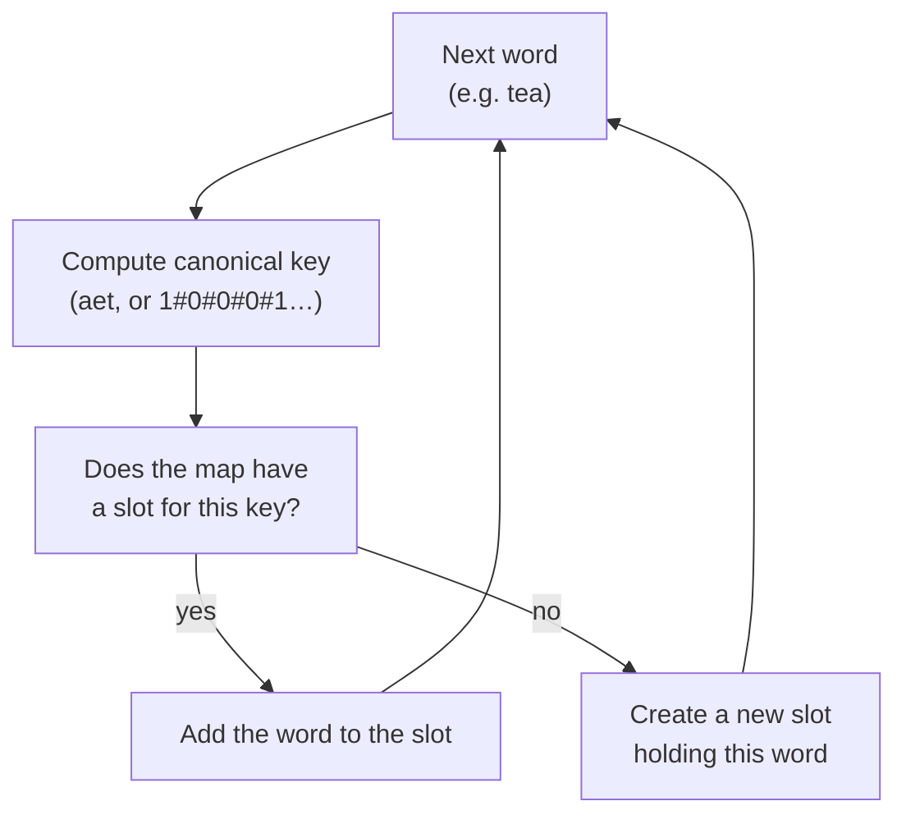

> [!tldr] Quick read
> - The problem: given a list of words, put the words that are anagrams of each other into the same group.
> - [[en/concepts/canonical-key|Canonical key]]: turn each word into a value such that every anagram yields **the same** value, then [[en/concepts/group-by|group by]] it with a `key → list of words` hash map.
> - Sorted key (`"eat"` → `"aet"`): O(k log k) per word. [[en/concepts/count-key|Count key]] (station 2's table of 26 numbers): O(k) per word. The count key wins by 47 times when words are 1000 letters long, but **loses** when words are only 5 letters long.
> - [[en/concepts/key-serialization|Joining a key into a string]] needs a separator. The count tables `[1, 11, …]` and `[11, 1, …]` joined without a separator both become `"1110…"`, so two words that are not anagrams get grouped together. This bug still passes all 4 test cases.
> - Each language has its own rule about what can be a key: Go allows fixed-size arrays as keys, Python needs a tuple, and JS and Java compare arrays by **identity**, so you must convert to a string.

> [!info] Context
> Station 4 of **the NeetCode 150 line: Arrays & Hashing**, the first Medium problem. It combines station 2 (anagrams, count table) with station 3's hash map, but this time the count table is not the answer but the **key**. The solutions come in TypeScript, JavaScript, Python, Go and Java.

> [!abstract]- Quick glossary for this post (click to open)
> - **Anagram, 26-slot count table**: see [[en/posts/2026-11-22-neetcode-valid-anagram|station 2]]. **Hash map, collision**: see [[en/posts/2026-11-22-neetcode-two-sum|station 3]].
> - **k**: the length of one word. **n**: the number of words. The complexity of this problem depends on both.
> - **Key**: the value used to look things up in a map. Two "equal" keys point to the same slot.
> - **Identity**: two objects are "the same" only when they are the same memory location. Two separately created `[1, 2]` arrays have the same contents but different identities.
> - **Immutable**: a value that cannot change after it is created. Python only allows immutable values as dict keys, because if a key changes, its hash changes, and the map can no longer find it.

## Picture it first: sorting mail into pigeonholes

A post office receives a sack of letters. Each letter must go into the pigeonhole for its own area.

| Everyday life | Concept |
|---|---|
| From a handwritten address (everyone writes differently), work out the **postal code** | [[en/concepts/canonical-key\|Canonical key]] |
| Postal code = the letters of the word, sorted A→Z | Sorted key |
| Postal code = "how many a's, how many b's, …" | [[en/concepts/count-key\|Count key]] |
| Print the code on the label as "1-11-0", not "1110" | [[en/concepts/key-serialization\|Joining a key with a separator]] |
| A row of labeled pigeonholes; letters with the same code go into the same pigeonhole | [[en/concepts/group-by\|Group by]] with a hash map |



## The problem

**The problem (summary):** given an array of strings `strs`, group the strings that are anagrams of each other. Return the groups in any order. Original problem: [LeetCode 49](https://leetcode.com/problems/group-anagrams/).

| Input | One valid output |
|---|---|
| `["eat","tea","tan","ate","nat","bat"]` | `[["bat"],["nat","tan"],["ate","eat","tea"]]` |
| `[""]` | `[[""]]` |
| `["a"]` | `[["a"]]` |

Constraints: up to **10,000** strings, each up to **100** characters long, lowercase letters only.

The naive approach: compare every pair of words with station 2's anagram function. With n words that is O(n²·k), about 5·10⁹ steps at the upper limit. We need a way for each word to be "looked at" only once.

## How it works

<figure class="figure-map" style="--ar: 3 / 4">
<div class="frame"><iframe data-archify="../../diagrams/neetcode-group-anagrams/canonical-key.en.html" title="Grouping eat, tea, tan, ate, nat, bat by sorted key" loading="lazy"></iframe></div>
<figcaption><span><b>Figure 1.</b> Each word goes through the "compute key" step exactly once, then into the slot for that key. "eat", "tea" and "ate" all produce the key "aet", so they share a slot.</span><a href="../diagrams/neetcode-group-anagrams/canonical-key.en.html" target="_blank" rel="noopener">Open full screen</a></figcaption>
</figure>

### Canonical key: comparing keys instead of pairs

The central idea is a [[en/concepts/canonical-key|canonical key]]: a function `key(w)` such that `key(a) == key(b)` **if and only if** a and b are anagrams. With that function, the problem becomes [[en/concepts/group-by|grouping]] by key: walk each word, compute its key, and drop it into that key's slot in a hash map. Each word is processed only once.

"If and only if" has two directions, and both matter:

- Anagrams **must** produce the same key (otherwise a group gets split in two).
- Non-anagrams **must** produce different keys (otherwise two groups get merged). The no-separator bug violates exactly this direction.

### Sorted key: O(n · k log k)

Sort the letters of the word: `"eat"`, `"tea"` and `"ate"` all become `"aet"`. This is exactly station 2's approach 1, used as a key. It is simple and correct for any alphabet, Unicode included, as long as you split correctly by code point.

### Count key: O(n · k)

Station 2's 26-slot count table is also a canonical key: anagrams have the same count table. Building the table costs O(k), with no sorting. But the count table is an **array**, and most languages do not let an array be a hash map key directly. You have to [[en/concepts/key-serialization|turn it into a value that can be a key]]:

| | Array as a map key? | How to do it |
|---|---|---|
| TypeScript / JavaScript | allowed, but compared by **identity**: `m.get([1, 2])` always returns `undefined` | join into a string: `count.join('#')` |
| Python | a `list` is not hashable (`TypeError: unhashable type`) | convert to `tuple(count)`: immutable, hashed by contents |
| Go | **allowed**: a fixed-size array `[26]uint8` is comparable with `==`, so it works as a key directly | `map[[26]uint8][]string`; a `[]int` slice does not |
| Java | `int[]` uses identity-based `equals`/`hashCode` | `new String(char[] count)`, or `Arrays.toString(count)` |

The Java trick above deserves an explanation: each count slot is stored in a `char` (a 16-bit number, able to count up to 65,535), and then the 26 `char`s make up a `String` exactly 26 long. Each position in the string is exactly one number, so no separator is needed.

### Joining a key: why you need a separator

Joining numbers into a string without a separator loses the boundaries between the numbers. The word `"a" + "b"×11` has a count table starting `[1, 11, 0, …]`; the word `"a"×11 + "b"` has `[11, 1, 0, …]`. Joined without a separator, both become `"1110…"`. Two words that are not anagrams get grouped together.

Under the problem's constraints (each word ≤ 100 letters), a count slot can be 10 or 11, so this bug **can happen on valid input**. It does not show up in the problem's examples, because there every count slot is below 10. There are two fixes:

- Add a separator (`#`), so each number has a clear boundary.
- Use a fixed-width format, exactly one "character" per slot, like Java's `char` trick.

### Memory

The map holds every word once, plus one key per group: O(n·k) for the words, plus O(number of groups × key length). The count key has a fixed length (26 numbers and 25 `#` signs), even when the word is only 3 letters long. That is one reason it loses on short words.

## Runnable example

[TypeScript](../code/neetcode-group-anagrams/group-anagrams.ts) · [JavaScript](../code/neetcode-group-anagrams/group-anagrams.js) · [Python](../code/neetcode-group-anagrams/group_anagrams.py) · [Go](../code/neetcode-group-anagrams/group_anagrams.go) · [Java](../code/neetcode-group-anagrams/group-anagrams.java)

```ts
// TypeScript: count key, joined with a separator
function byCountKey(strs: string[]): string[][] {
  const groups = new Map<string, string[]>();
  for (const s of strs) {
    const count = new Array<number>(26).fill(0);
    for (let i = 0; i < s.length; i++) count[s.charCodeAt(i) - 97]++;
    const key = count.join('#');
    const g = groups.get(key);
    if (g) g.push(s); else groups.set(key, [s]);
  }
  return [...groups.values()];
}

// Sorted key
function bySortedKey(strs: string[]): string[][] {
  const groups = new Map<string, string[]>();
  for (const s of strs) {
    const key = s.split('').sort().join('');
    const g = groups.get(key);
    if (g) g.push(s); else groups.set(key, [s]);
  }
  return [...groups.values()];
}
```

> [!example]- JavaScript
> ```js
> function groupAnagrams(strs) {
>   const groups = new Map();
>   for (const s of strs) {
>     const count = new Array(26).fill(0);
>     for (let i = 0; i < s.length; i++) count[s.charCodeAt(i) - 97]++;
>     const key = count.join('#'); // an array as a Map key is compared by identity, not by contents
>     if (!groups.has(key)) groups.set(key, []);
>     groups.get(key).push(s);
>   }
>   return [...groups.values()];
> }
> ```

> [!example]- Python
> ```python
> from collections import defaultdict
>
> def group_anagrams(strs: list[str]) -> list[list[str]]:
>     groups: defaultdict[tuple[int, ...], list[str]] = defaultdict(list)
>     for s in strs:
>         count = [0] * 26
>         for ch in s:
>             count[ord(ch) - ord("a")] += 1
>         groups[tuple(count)].append(s)  # a tuple is hashable; a list is not
>     return list(groups.values())
> ```

> [!example]- Go
> ```go
> func groupAnagrams(strs []string) [][]string {
> 	// [26]uint8 is comparable with ==, so it works as a map key directly.
> 	// uint8 is enough because each word has at most 100 letters (< 256).
> 	groups := map[[26]uint8][]string{}
> 	for _, s := range strs {
> 		var key [26]uint8
> 		for i := 0; i < len(s); i++ {
> 			key[s[i]-'a']++
> 		}
> 		groups[key] = append(groups[key], s)
> 	}
> 	out := make([][]string, 0, len(groups))
> 	for _, g := range groups { // map iteration order is randomized on every run
> 		out = append(out, g)
> 	}
> 	return out
> }
> ```

> [!example]- Java
> ```java
> static List<List<String>> groupAnagrams(String[] strs) {
>     Map<String, List<String>> groups = new HashMap<>();
>     for (String s : strs) {
>         char[] count = new char[26]; // char is a 16-bit number
>         for (int i = 0; i < s.length(); i++) count[s.charAt(i) - 'a']++;
>         String key = new String(count); // 26 "characters" = 26 numbers, no separator needed
>         groups.computeIfAbsent(key, k -> new ArrayList<>()).add(s);
>     }
>     return new ArrayList<>(groups.values());
> }
> ```

```text
$ node group-anagrams.ts
bySortedKey            4/4 cases passed
byCountKey             4/4 cases passed
byCountKeyNoSeparator  4/4 cases passed

"abbbbbbbbbbb" and "aaaaaaaaaaab" are not anagrams
  key without separator: 1110… and 1110…
  key with '#':          1#11#0#… and 11#1#0#…
  byCountKeyNoSeparator groups them together: [["abbbbbbbbbbb","aaaaaaaaaaab"]]
  byCountKey keeps them apart:                [["abbbbbbbbbbb"],["aaaaaaaaaaab"]]

n = 10 000 words   sorted key   count key
k = 5                 3.9 ms       5.7 ms
k = 20               14.9 ms       6.3 ms
k = 100              91.5 ms       8.3 ms
k = 1000           1041.1 ms      22.1 ms
```

*(Output labels translated; the files themselves print Vietnamese.)*

- The no-separator version **passes all 4 test cases**, then wrongly groups two words that are not anagrams. A test suite with only short words will never catch this bug.
- **k = 5**: the sorted key is faster. Sorting 5 letters costs almost nothing, while the count key always has to build and join 26 numbers.
- **k = 100** (the problem's limit): the count key is 11 times faster. **k = 1000**: 47 times faster, just as k log k versus k predicts.

Go also shows the consequence of "any order":

```text
$ go run group_anagrams.go
run 1: [[eat tea ate] [tan nat] [bat]]
run 2: [[bat] [eat tea ate] [tan nat]]
run 3: [[tan nat] [bat] [eat tea ate]]
normalized: [[ate eat tea] [bat] [nat tan]]

$ python3 group_anagrams.py
[['eat', 'tea', 'ate'], ['tan', 'nat'], ['bat']]
[['eat', 'tea', 'ate'], ['tan', 'nat'], ['bat']]
list as a dict key: unhashable type: 'list'

$ java group-anagrams.java
[[tan, nat], [eat, tea, ate], [bat]]
[[eat, tea, ate], [bat], [tan, nat]]
int[] as a key: get(new int[]{1, 2}) = null
```

With the same input, Go returns the groups in a different order on each run: the Go spec says map iteration order is unspecified, and the runtime deliberately shuffles it. Java does not keep order either (`HashMap`). Python and JS keep insertion order. Tests for this problem must normalize (sort within each group, then sort the groups) before comparing.

## Misconceptions and common traps

- **Joining the count table without a separator.** Correct for every example in the problem, wrong once a letter appears 10 or more times.
- **Using an array as a key in JS or Java.** No compile error, no runtime error; every word just ends up in its own group, because every array is a key with a different identity.
- **Using a list as a dict key in Python.** It fails immediately (`unhashable type`). Switch to a `tuple`.
- **Go: using `[]int` (a slice) as a key.** It does not compile; slices are not comparable. Use an array `[26]int`/`[26]uint8`. With `uint8`, remember the limit of 255: longer words need a larger type.
- **Comparing the output against a fixed order.** The problem allows any order, and Go changes the order on every run. Normalize before comparing.
- **"The count key is always faster because O(k) < O(k log k)."** For short words, the constants (building 26 slots, joining 51 characters) outweigh the cost of sorting a few letters.
- **Count keys with Unicode.** 26 slots are only for a–z. For arbitrary letters, only a sorted key by code point (or a map-based count table, sorted and joined) is correct.

## Self-check questions

> [!question]- What must a canonical key function for this problem satisfy, in both directions?
> Every pair of anagrams produces the same key, and every pair of non-anagrams produces different keys. Violate the first and a group gets split; violate the second and two groups get merged.

> [!question]- Why can `count.join('')` group wrongly while `count.join('#')` cannot?
> Without a separator you cannot tell where a number ends: `[1, 11]` and `[11, 1]` both become `"111"`. With `#`, each number has a boundary, so the string uniquely determines the array.

> [!question]- In Go, why does `map[[26]uint8][]string` compile but `map[[]uint8][]string` does not?
> Go map keys must be comparable with `==`. Fixed-size arrays are comparable (element by element). Slices are not, because a slice is only a reference to memory that can change.

> [!question]- With 5-letter words, the sorted key is faster than the count key. Explain it in terms of constants.
> Sorting 5 letters takes only a few comparisons. The count key always has to create 26 slots and join 26 numbers into a string, whether the word is short or long. Big-O drops this constant; at small k, it is most of the work.

> [!question]- Your test compares `groupAnagrams(input)` with `[["bat"],["nat","tan"],["ate","eat","tea"]]` and occasionally fails in Go. Why, and how do you fix it?
> Go iterates maps in random order, so the order of the groups changes (and the problem allows any order within a group too). Sort each group, then sort the list of groups before comparing.

## References

- [LeetCode 49: Group Anagrams](https://leetcode.com/problems/group-anagrams/) (original problem)
- [The Go Programming Language Specification](https://go.dev/ref/spec) (map key types must be comparable; map iteration order is unspecified)
- [Python glossary: hashable](https://docs.python.org/3/glossary.html#term-hashable) (mutable containers such as list are not hashable)
- [Java 21: Map](https://docs.oracle.com/en/java/javase/21/docs/api/java.base/java/util/Map.html) (`computeIfAbsent`; the warning about using mutable objects as keys)
