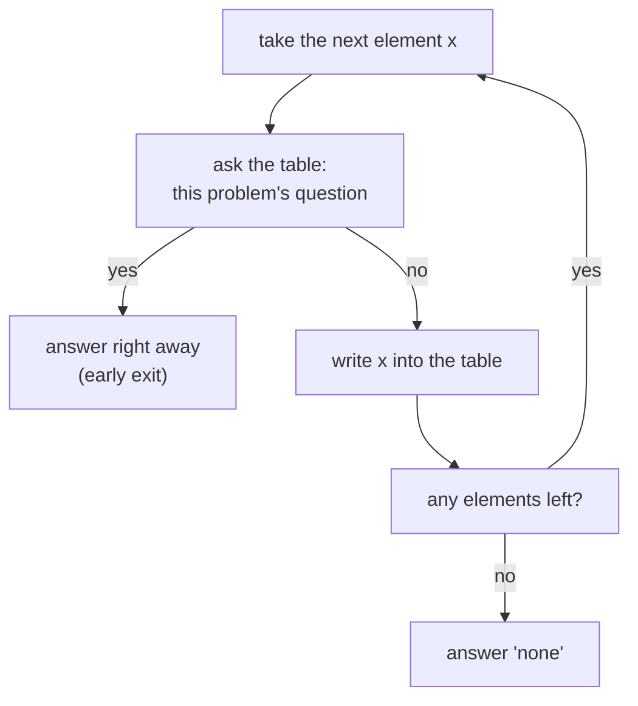

> [!tldr] Quick read
> - The pattern: walk the data **once**; at each step **ask** a hash table (a Set or a Map) one question, then **write** the current element into the table. Asking and writing are both O(1) on average, so the whole problem is O(n) instead of O(n²).
> - Each problem differs only in three decisions: **what the table stores** (just values, or value → index), **what you ask** (x itself, the complement `target − x`, or the neighbor `x − 1`), and **the order** (ask first and then write, or write everything and only then ask).
> - Contains Duplicate asks about x itself. Two Sum asks about `target − x` and needs to store indices. Longest Consecutive Sequence writes everything first, then asks about `x − 1` so it only counts from the start of each run.
> - The most expensive trap at this station: in Longest Consecutive Sequence, iterating over the original array instead of the Set. The result is still correct, but with 20 000 copies of a run's start, the time goes from 2.7 ms to almost 4 seconds.

> [!info] Context
> Station 1 of **the NeetCode line: Arrays and Strings**. [NeetCode 150](https://neetcode.io/practice) is a list of 150 LeetCode problems ordered by solution pattern. On the Atlas, each station is one pattern: this post teaches the pattern, and each problem has its own page solving it in depth in five languages. All you need is to be able to write a loop and a function in any language.

> [!abstract]- Quick glossary for this post (click to open)
> - **Hash table**: a structure that computes a number (the hash) from a key to know right away which slot the key lives in, so lookups and writes don't scan everything. See [[en/concepts/hash-set|Hash Set]] and [[en/concepts/hash-map|Hash Map]].
> - **Set**: a table that only remembers "present or not". **Map**: a table that also remembers a value attached to each key.
> - **O(1) on average**: most lookups take constant time, even if one is occasionally slower. See [[en/concepts/amortized-o1|Amortized O(1)]].
> - **Big-O**: a way to measure how the number of steps grows with the input size. See [[en/concepts/big-o-notation|Big-O Notation]].
> - **Complement**: for a sum `target`, the number that pairs with `x` is `target − x`. See [[en/concepts/complement-lookup|Complement Lookup]].

## Picture it first: a doorman with a guest book

A party has a single entrance. The doorman holds a guest book indexed by name, so finding a name takes a few seconds instead of reading from page one. For every guest who arrives, the doorman **checks the book first**, and only then **writes the guest's name** in.

| Everyday life | Concept |
|---|---|
| Guests walk through the door one by one, once each | Walking the array once |
| A guest book indexed by name | A hash table: O(1) lookups and writes on average |
| "Has this person come in already?" | Contains Duplicate: ask about x itself |
| "Is anyone waiting for a dance partner exactly my height?" | Two Sum: ask about the complement `target − x` |
| The book also records each guest's ticket number | A value → index Map instead of a Set |
| Checking the book before writing the name | Ask first, write later: never pair a guest with themselves |
| After the party, find the longest group of guests with consecutive ticket numbers | Longest Consecutive Sequence: write everything, then ask about `x − 1` |



## The problem: "seen it before?" costs O(n) without a table

All three problems come down to the same question: *among the things I have already seen, is there the one I need?* The naive way rescans everything seen so far for each question. With n elements, each question costs up to n steps, and there are n questions, so the total is O(n²). With LeetCode's limit of n = 10⁵, that is about 5·10⁹ comparisons, far too slow.

This station's pattern replaces "rescan what I have seen" with "look it up in a hash table". The rest of each problem is just picking the right question.

## How it works

### The shared template

```text
table = empty
for each element x (in order):
    if the table can answer the question about x  → return the result, stop
    write x (and whatever goes with it) into the table
return "none"
```

The figure below runs this template on Two Sum with `[3, 2, 4]` and target 6: at each step the complement is looked up *before* the current number is written into the table.

<figure class="figure-map" style="--ar: 3 / 4">
<div class="frame"><iframe data-archify="../../diagrams/neetcode-two-sum/one-pass.en.html" title="One-pass hash map on [3, 2, 4] with target 6" loading="lazy"></iframe></div>
<figcaption><span><b>Figure 1.</b> Two Sum on <code>[3, 2, 4]</code>, target 6: ask for the complement first, write the current number afterward.</span><a href="../diagrams/neetcode-two-sum/one-pass.en.html" target="_blank" rel="noopener">Open full screen</a></figcaption>
</figure>

### Decision 1: what the table stores

- If you only need "present or not", use a **Set** ([[en/concepts/hash-set|Hash Set]]). Contains Duplicate and Longest Consecutive Sequence need nothing more.
- If you need to return a *position*, use a value → index **Map** ([[en/concepts/one-pass-hash-map|One-pass Hash Map]]). Two Sum must return two indices, so a Set is not enough.

### Decision 2: what you ask

| Problem | The question when standing at x | Why |
|---|---|---|
| [[en/problems/contains-duplicate\|Contains Duplicate]] | Is `x` already in the table? | A duplicate means meeting that exact value again |
| [[en/problems/two-sum\|Two Sum]] | Is `target − x` already in the table? | Exactly one value pairs with x (the [[en/concepts/complement-lookup\|complement]]) |
| [[en/problems/longest-consecutive-sequence\|Longest Consecutive Sequence]] | Is `x − 1` in the table? | If not, x is the **start** of a consecutive run; count only from run starts |

### Decision 3: ask first or write first

- **Ask first, write later** when the answer may only rely on elements *before* the current one. In Two Sum with `[3, 3]` and target 6, if you write the first 3 and then ask, the complement 3 finds the element itself and returns `[0, 0]`, which is wrong. Asking first, the table is still empty at the first 3; the match comes at the second 3 and returns `[0, 1]`.
- **Write everything, then ask** when the question needs to know about elements *after* the current one. Longest Consecutive Sequence is such a problem: `x − 1` may sit at the end of the array. This problem has no early exit; it walks the table once after everything has been written.

### Longest Consecutive Sequence: why it is still O(n) despite a nested `while`

For each run start, the `while` loop walks on to `x + 1, x + 2, …` until the run ends. Every value belongs to exactly one run and every run has exactly one start, so the steps of all the `while` loops added together never exceed the number of distinct values. That only holds when you iterate over the **Set**: iterate over the original array and every *copy* of a run start walks the whole run again (measured below).

## Runnable example

[TypeScript](../code/neetcode-hash-lookup/hash-lookup.ts) · [Python](../code/neetcode-hash-lookup/hash_lookup.py) · [Go](../code/neetcode-hash-lookup/hash_lookup.go) · [Java](../code/neetcode-hash-lookup/hash-lookup.java) · [JavaScript](../code/neetcode-hash-lookup/hash-lookup.js)

Each file solves all three problems and runs its own 9 test cases.

```ts
// 217 Contains Duplicate: ask about x itself; the table is a Set of values seen so far.
function containsDuplicate(nums: number[]): boolean {
  const seen = new Set<number>();
  for (const x of nums) {
    if (seen.has(x)) return true; // ask first
    seen.add(x); // write later
  }
  return false;
}

// 1 Two Sum: ask about the complement target - x; the table is a value → index Map.
function twoSum(nums: number[], target: number): [number, number] | null {
  const seen = new Map<number, number>();
  for (let i = 0; i < nums.length; i++) {
    const j = seen.get(target - nums[i]);
    if (j !== undefined) return [j, i];
    seen.set(nums[i], i);
  }
  return null;
}

// 128 Longest Consecutive Sequence: write EVERYTHING into the table first, then ask about x - 1 to know whether x starts a run.
function longestConsecutive(nums: number[]): number {
  const all = new Set(nums);
  let best = 0;
  for (const x of all) { // iterate over the Set, not nums: duplicates are not counted again
    if (all.has(x - 1)) continue;
    let len = 1;
    while (all.has(x + len)) len++;
    best = Math.max(best, len);
  }
  return best;
}
```

```python
def contains_duplicate(nums: list[int]) -> bool:  # 217
    seen: set[int] = set()
    for x in nums:
        if x in seen:  # ask first
            return True
        seen.add(x)  # write later
    return False


def two_sum(nums: list[int], target: int) -> list[int] | None:  # 1
    seen: dict[int, int] = {}  # value → index
    for i, x in enumerate(nums):
        if (j := seen.get(target - x)) is not None:  # don't write "if j:": index 0 is falsy
            return [j, i]
        seen[x] = i
    return None


def longest_consecutive(nums: list[int]) -> int:  # 128
    all_ = set(nums)
    best = 0
    for x in all_:  # iterate over the set, not nums
        if x - 1 in all_:
            continue  # x does not start a run
        length = 1
        while x + length in all_:
            length += 1
        best = max(best, length)
    return best
```

```go
// 217: Go has no set type; map[int]struct{} is a set (struct{} takes 0 bytes).
func containsDuplicate(nums []int) bool {
	seen := make(map[int]struct{}, len(nums))
	for _, x := range nums {
		if _, ok := seen[x]; ok { // ask first
			return true
		}
		seen[x] = struct{}{} // write later
	}
	return false
}

// 1: a value → index map; "comma ok" tells "absent" apart from "present, index 0".
func twoSum(nums []int, target int) []int {
	seen := make(map[int]int, len(nums))
	for i, x := range nums {
		if j, ok := seen[target-x]; ok {
			return []int{j, i}
		}
		seen[x] = i
	}
	return nil
}

// 128: write everything into the set first, then count only from run starts.
func longestConsecutive(nums []int) int {
	all := make(map[int]struct{}, len(nums))
	for _, x := range nums {
		all[x] = struct{}{}
	}
	best := 0
	for x := range all { // iterate over the set, not nums
		if _, ok := all[x-1]; ok {
			continue
		}
		length := 1
		for {
			if _, ok := all[x+length]; !ok {
				break
			}
			length++
		}
		best = max(best, length)
	}
	return best
}
```

```java
// 217: add returns false when the element is already there, so "ask" and "write" merge into one call.
static boolean containsDuplicate(int[] nums) {
    Set<Integer> seen = new HashSet<>();
    for (int x : nums) if (!seen.add(x)) return true;
    return false;
}

// 1: a value → index Map; get returns null when the key is absent.
static int[] twoSum(int[] nums, int target) {
    Map<Integer, Integer> seen = new HashMap<>();
    for (int i = 0; i < nums.length; i++) {
        Integer j = seen.get(target - nums[i]);
        if (j != null) return new int[] {j, i};
        seen.put(nums[i], i);
    }
    return null;
}

// 128: write everything into the set first, then count only from run starts.
static int longestConsecutive(int[] nums) {
    Set<Integer> all = new HashSet<>();
    for (int x : nums) all.add(x);
    int best = 0;
    for (int x : all) { // iterate over the set, not nums
        if (all.contains(x - 1)) continue;
        int len = 1;
        while (all.contains(x + len)) len++;
        best = Math.max(best, len);
    }
    return best;
}
```

```js
// 217
function containsDuplicate(nums) {
  const seen = new Set();
  for (const x of nums) {
    if (seen.has(x)) return true;
    seen.add(x);
  }
  return false;
}

// 1: use a Map, not an object {}: object keys are always converted to strings.
function twoSum(nums, target) {
  const seen = new Map();
  for (let i = 0; i < nums.length; i++) {
    const j = seen.get(target - nums[i]);
    if (j !== undefined) return [j, i]; // don't write "if (j)": index 0 is falsy
    seen.set(nums[i], i);
  }
  return null;
}

// 128
function longestConsecutive(nums) {
  const all = new Set(nums);
  let best = 0;
  for (const x of all) {
    if (all.has(x - 1)) continue;
    let len = 1;
    while (all.has(x + len)) len++;
    best = Math.max(best, len);
  }
  return best;
}
```

The TypeScript version also measures the array-iteration trap in Longest Consecutive Sequence: a run `1..20 000`, plus the number 1 (the run start) repeated 20 000 times.

```text
$ node hash-lookup.ts
9/9 cases passed
iterate Set    result 20000, 2.7 ms
iterate array  result 20000, 3977.7 ms
```

*(Output labels translated; the files themselves print Vietnamese.)*

Both versions return 20 000. The array version meets the number 1 20 001 times, and every time it walks the whole 20 000-number run: about 4·10⁸ lookups, an O(n²) in disguise. Python, Go, Java and JavaScript run the same 9 cases and all print `9/9 ca đúng` ("9/9 cases passed").

## Misconceptions and common traps

- **"A nested loop always means O(n²)."** Not always. In Longest Consecutive Sequence, the `while` loop only runs from run starts, so its steps across all iterations add up to O(n). Count the total work ([[en/concepts/aggregate-analysis|aggregate analysis]]), not the number of loop levels. The [[en/problems/longest-consecutive-sequence|Longest Consecutive Sequence]] page proves it in detail and compares it with the sorting approach.
- **Iterating over the original array instead of the Set.** The result is correct, but the O(n) guarantee is gone when a run start repeats (measured above: 2.7 ms becomes almost 4 seconds).
- **Writing before asking in Two Sum.** An element pairs with itself: `[3, 3]`, target 6 becomes `[0, 0]`.
- **Checking a lookup result for "truthiness".** `if (j)` in JS or `if j:` in Python skips index 0. Compare against `undefined`/`None`, or use `has`/`in`, or "comma ok" in Go.
- **Using an object `{}` as the table in JavaScript.** Object keys are always converted to strings, and inherited keys such as `constructor` are already there. Use `Map` and `Set`.
- **"Hashing is always O(1)."** Only on average. The [[en/problems/two-sum|Two Sum]] page measures the case where every key shares a hash and Java's `HashMap` slows right down; see also [[en/concepts/hash-collision|Hash Collision]].

## Self-check questions

> [!question]- Which three decisions set the three problems at this station apart?
> What the table stores (a Set or a value → index Map), what you ask (x, `target − x` or `x − 1`), and the order of asking and writing (ask first then write, or write everything then ask).

> [!question]- Why can't Longest Consecutive Sequence "ask first, write later" like the other two?
> Because the question "is `x − 1` in the data?" needs to know about elements that come **after** x in the array. You have to write everything into the Set first and only then ask.

> [!question]- The `while` loop sits inside the `for` loop, so why is Longest Consecutive Sequence still O(n)?
> The `while` loop only runs when x starts a run, and each value belongs to a single run, so the total `while` steps over all run starts never exceed the number of distinct values. The total work is O(n).

> [!question]- Change Two Sum into "is there a pair whose **difference** is k?". What do you ask when standing at x?
> Two questions: is `x − k` or `x + k` already in the table? The template stays the same; only the question changes.

## References

- [NeetCode 150](https://neetcode.io/practice) (the list and its groups)
- LeetCode: [217. Contains Duplicate](https://leetcode.com/problems/contains-duplicate/), [1. Two Sum](https://leetcode.com/problems/two-sum/), [128. Longest Consecutive Sequence](https://leetcode.com/problems/longest-consecutive-sequence/)
- [ECMAScript 2025](https://tc39.es/ecma262/2025/) (Set and Map: sublinear average access)
- [Go spec: Map types](https://go.dev/ref/spec#Map_types) (keys must be comparable with `==`)
- [Java 21 `HashSet.add`](https://docs.oracle.com/en/java/javase/21/docs/api/java.base/java/util/HashSet.html#add(E)) (returns false when the element is already present)
