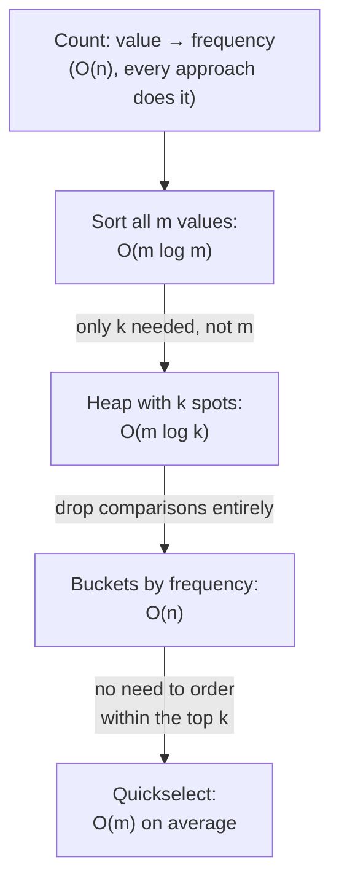

> [!tldr] Quick read
> - The problem: return the k values that appear most often. Step 1 is always counting (station 2), O(n). The hard part is step 2: picking the k largest out of m frequencies.
> - Sort the m (value, frequency) pairs: O(m log m). A [[en/concepts/heap|min-heap]] holding exactly k elements: O(m log k). Python ships `Counter.most_common(k)`, which uses a heap underneath.
> - [[en/concepts/bucket-sort|Bucket sort]] by frequency: frequencies only range from 1 to n, so there are n buckets and the whole thing is O(n). It gets past the [[en/concepts/sorting-lower-bound|O(n log n) bound]] of every comparison-based sorting algorithm.
> - [[en/concepts/quickselect|Quickselect]]: partition like quicksort but descend into only one half, O(n) **on average**, O(n²) in the worst case.
> - Measured on a million numbers: the **counting** step takes most of the time. "O(n)" bucket sort is the slowest when there are few distinct values (it has to allocate a million buckets). Quickselect takes 798 ms when most frequencies are equal, 3.5 times slower than sorting.

> [!info] Context
> Station 5 of **the NeetCode 150 line: Arrays & Hashing**. Counting was station 2's job; this station asks the next question: once you have counted, how do you get the **top k** quickly? This is also the line's first encounter with the heap, a structure that gets a whole group of its own later in NeetCode 150. The solutions come in TypeScript, JavaScript, Python, Go and Java.

> [!abstract]- Quick glossary for this post (click to open)
> - **Frequency counting, Map**: see [[en/posts/2026-11-22-neetcode-valid-anagram|station 2]]. **Big-O**: see [[en/posts/2026-11-22-neetcode-contains-duplicate|station 1]].
> - **m**: the number of *distinct* values in the array. Always m ≤ n.
> - **Heap**: a binary tree stored in an array, where a parent is always smaller (min-heap) or larger (max-heap) than its children. The smallest element is always at the top.
> - **Priority queue**: a data type for "take out the highest-priority element". A heap is the most common implementation.
> - **Partition**: pick one element as the pivot, move the elements smaller than the pivot to the left and the larger ones to the right.
> - **Allocation**: requesting memory for a new object. Creating a million empty arrays is a million allocations.

## Picture it first: the song contest final

A vote receives a million ballots for a few tens of thousands of songs. The organizers need to announce the top 10.

| Everyday life | Concept |
|---|---|
| Tallying: one line per song, one tick per ballot | Frequency counting (station 2) |
| Rank **every** song by votes, then take the first 10 | Sorting, O(m log m) |
| A podium with 10 spots; the weakest song on the podium stands right at the edge. A stronger new song pushes it off | k-element [[en/concepts/heap\|min-heap]] |
| Boxes numbered "1 vote", "2 votes", … "1 million votes"; drop each song into the box for its vote count, then walk down from the biggest box | [[en/concepts/bucket-sort\|Bucket sort]] |
| Pick any song as a reference, split into two camps "more votes than the reference" and "fewer", and keep splitting only the camp that contains the top-10 boundary | [[en/concepts/quickselect\|Quickselect]] |
| If you may only compare two songs at a time, you cannot rank faster than n log n; looking straight at the vote numbers, you can | [[en/concepts/sorting-lower-bound\|The comparison sorting bound]] |



## The problem

**The problem (summary):** given an integer array `nums` and a number `k`, return the k values that appear most often, in any order. The problem guarantees the answer is unique. Original problem: [LeetCode 347](https://leetcode.com/problems/top-k-frequent-elements/).

| `nums` | `k` | Output |
|---|---|---|
| `[1, 1, 1, 2, 2, 3]` | 2 | `[1, 2]` |
| `[1]` | 1 | `[1]` |

Constraints: up to **100,000** elements, k between 1 and the number of distinct values. Follow-up: the complexity must be **better than O(n log n)**.

The follow-up is the interesting part. Sorting the frequencies is O(m log m), and m can equal n (all numbers distinct). So how do you pick the top k without sorting?

## How it works

<figure class="figure-map" style="--ar: 3 / 4">
<div class="frame"><iframe data-archify="../../diagrams/neetcode-top-k-frequent/min-heap.en.html" title="A min-heap keeping the 2 most frequent elements of [1, 1, 1, 2, 2, 3]" loading="lazy"></iframe></div>
<figcaption><span><b>Figure 1.</b> Counting [1, 1, 1, 2, 2, 3] gives {1: 3, 2: 2, 3: 1}, then each pair goes into a min-heap capped at 2 spots. When the heap has 3 elements, the one at the top (the least frequent) gets pushed out.</span><a href="../diagrams/neetcode-top-k-frequent/min-heap.en.html" target="_blank" rel="noopener">Open full screen</a></figcaption>
</figure>

### Approach 1, count then sort: O(n + m log m)

Count into a map (O(n)), take the m (value, frequency) pairs, sort them by frequency in descending order, and cut the first k. Correct, easy to write, and (as the measurements show) not slow at all when m is small. But it does extra work: it ranks all m values when only k are needed.

### Approach 2, k-element min-heap: O(n + m log k)

A [[en/concepts/heap|heap]] stores a binary tree in an array: the parent at position i, its two children at 2i+1 and 2i+2. To add an element, put it at the end and "sift it up"; to take the top, move the last element to the top and "sift it down". Each operation walks the height of the tree, that is, O(log size).

The trick is to use a **min**-heap to find the **largest** elements: the heap holds the k best candidates so far, and the top is the **weakest** candidate among them. Each new pair is pushed in; if the heap exceeds k elements, drop the top. The heap never grows beyond k+1, so each step is O(log k), and the whole thing is O(m log k). With small k (top 10 out of a million), log k is practically a constant.

Every language has a built-in heap except JS:

| | Built-in heap | Notes |
|---|---|---|
| TypeScript / JavaScript | **none** | write your own in about 30 lines, or use bucket sort |
| Python | `heapq`: functions over an ordinary `list`, always a min-heap | `Counter(nums).most_common(k)` calls `heapq.nlargest` underneath |
| Go | `container/heap`: you implement 5 methods (`Len`, `Less`, `Swap`, `Push`, `Pop`), the package handles sifting | you must call `heap.Push(h, x)`, not `h.Push(x)` |
| Java | `PriorityQueue`: a min-heap by `Comparator` | `offer`/`poll` O(log n); compare with `Integer.compare`, do not subtract two numbers |

### Approach 3, bucket sort: O(n)

Every sorting algorithm that relies only on comparing two elements needs Ω(n log n) comparisons in the worst case. That is the [[en/concepts/sorting-lower-bound|lower bound of comparison sorting]]: there are n! possible orders, and each comparison can only eliminate half of them, so you need at least log₂(n!) ≈ n log n comparisons.

[[en/concepts/bucket-sort|Bucket sort]] escapes that bound because it **does not compare**: it uses the frequency value directly as an array index. And the frequency of a value always lies between 1 and n. Create n+1 buckets, drop each value into bucket `buckets[frequency]`, then walk from bucket n down to bucket 1, collecting until you have k. That is O(n) time and O(n) space in total. This is the solution the follow-up is aiming for.

### Approach 4, quickselect: O(n) on average

[[en/concepts/quickselect|Quickselect]] is quicksort that only follows one branch. Pick a random pivot and partition the m pairs by frequency. If the pivot lands exactly on the "k largest elements" boundary, you are done. If not, you only need to continue on **one** side. The average cost is m + m/2 + m/4 + … ≈ 2m, that is, O(m).

"On average" is the key phrase. If the pivot keeps landing on the bad side, each round eliminates only one element and the total becomes O(m²). A random pivot protects against deliberately bad input. But there is one kind of input that randomness cannot save: **very many equal values**. A two-way partition with a `<` condition pushes every element equal to the pivot to one side, so with hundreds of thousands of frequencies equal to 1, each partition eliminates almost nothing. The fix is a three-way partition (less than, equal to, greater than the pivot), also known as the "Dutch national flag".

## Runnable example

[TypeScript](../code/neetcode-top-k-frequent/top-k-frequent.ts) · [JavaScript](../code/neetcode-top-k-frequent/top-k-frequent.js) · [Python](../code/neetcode-top-k-frequent/top_k_frequent.py) · [Go](../code/neetcode-top-k-frequent/top_k_frequent.go) · [Java](../code/neetcode-top-k-frequent/top-k-frequent.java)

```ts
// TypeScript: bucket sort by frequency, O(n)
function byBuckets(nums: number[], k: number): number[] {
  const count = new Map<number, number>();
  for (const x of nums) count.set(x, (count.get(x) ?? 0) + 1);
  const buckets: number[][] = Array.from({ length: nums.length + 1 }, () => []);
  for (const [v, c] of count) buckets[c].push(v); // frequency as the index: no comparisons
  const out: number[] = [];
  for (let f = nums.length; f > 0 && out.length < k; f--)
    for (const v of buckets[f]) { out.push(v); if (out.length === k) break; }
  return out;
}

// k-element min-heap: the top is "the weakest in the top k" (hand-written MinHeap, see the full file)
function byHeap(nums: number[], k: number): number[] {
  const heap = new MinHeap<[number, number]>((x, y) => x[1] < y[1]);
  for (const e of countAll(nums)) {
    heap.push(e);
    if (heap.size > k) heap.pop(); // push out the weakest
  }
  const out: number[] = [];
  while (heap.size) out.push(heap.pop()![0]);
  return out.reverse();
}
```

> [!example]- JavaScript
> ```js
> function topKFrequent(nums, k) {
>   const count = new Map();
>   for (const x of nums) count.set(x, (count.get(x) || 0) + 1);
>   // buckets[f] = the values that appear exactly f times. A value appears at most n times.
>   const buckets = Array.from({ length: nums.length + 1 }, () => []);
>   for (const [value, freq] of count) buckets[freq].push(value);
>   const out = [];
>   for (let f = buckets.length - 1; f > 0; f--) {
>     for (const v of buckets[f]) {
>       out.push(v);
>       if (out.length === k) return out;
>     }
>   }
>   return out;
> }
> ```

> [!example]- Python
> ```python
> import heapq
> from collections import Counter
>
> def top_k_counter(nums: list[int], k: int) -> list[int]:
>     # most_common(k) calls heapq.nlargest underneath: O(n + m log k)
>     return [v for v, _ in Counter(nums).most_common(k)]
>
> def top_k_heap(nums: list[int], k: int) -> list[int]:
>     heap: list[tuple[int, int]] = []  # heapq is a min-heap over an ordinary list
>     for v, c in Counter(nums).items():
>         heapq.heappush(heap, (c, v))
>         if len(heap) > k:
>             heapq.heappop(heap)  # drop the least frequent element
>     return [v for _, v in sorted(heap, reverse=True)]
> ```

> [!example]- Go
> ```go
> type entry struct{ val, freq int }
>
> // container/heap: you implement 5 methods, the heap package handles sifting.
> type minHeap []entry
>
> func (h minHeap) Len() int           { return len(h) }
> func (h minHeap) Less(i, j int) bool { return h[i].freq < h[j].freq }
> func (h minHeap) Swap(i, j int)      { h[i], h[j] = h[j], h[i] }
> func (h *minHeap) Push(x any)        { *h = append(*h, x.(entry)) }
> func (h *minHeap) Pop() any {
> 	old := *h
> 	x := old[len(old)-1]
> 	*h = old[:len(old)-1]
> 	return x
> }
>
> func topKHeap(nums []int, k int) []int {
> 	count := map[int]int{}
> 	for _, x := range nums {
> 		count[x]++
> 	}
> 	h := &minHeap{}
> 	for v, f := range count {
> 		heap.Push(h, entry{v, f}) // call heap.Push, not h.Push directly
> 		if h.Len() > k {
> 			heap.Pop(h)
> 		}
> 	}
> 	out := make([]int, h.Len())
> 	for i := len(out) - 1; i >= 0; i-- {
> 		out[i] = heap.Pop(h).(entry).val
> 	}
> 	return out
> }
> ```

> [!example]- Java
> ```java
> static int[] topKHeap(int[] nums, int k) {
>     Map<Integer, Integer> count = new HashMap<>();
>     for (int x : nums) count.merge(x, 1, Integer::sum);
>     // PriorityQueue is a min-heap by default. Compare with Integer.compare, do not subtract two numbers.
>     PriorityQueue<Map.Entry<Integer, Integer>> heap =
>             new PriorityQueue<>((a, b) -> Integer.compare(a.getValue(), b.getValue()));
>     for (Map.Entry<Integer, Integer> e : count.entrySet()) {
>         heap.offer(e);
>         if (heap.size() > k) heap.poll(); // O(log k)
>     }
>     int[] out = new int[heap.size()];
>     for (int i = out.length - 1; i >= 0; i--) out[i] = heap.poll().getKey();
>     return out;
> }
> ```

The TypeScript file runs the tests for all four approaches, then measures on a million numbers with different numbers of distinct values (m) and different k. The "count only" column is the counting step alone, the part every approach has to do:

```text
$ node top-k-frequent.ts
bySorting      4/4 cases passed
byHeap         4/4 cases passed
byBuckets      4/4 cases passed
byQuickselect  4/4 cases passed

n = 1 000 000                count only    sort     heap   bucket  quickselect  (ms, median of 5 runs)
m = 1000    k = 10     skewed       26       27       27       77       26
m = 99017   k = 10     skewed       44       57       46       75       44
m = 632052  k = 10     uniform      96      200      137      146      155
m = 632052  k = 10000  uniform     108      228      160      167      798
```

*(Output labels translated; the files themselves print Vietnamese.)*

Reading the results:

- **Small m** (1,000 values): counting takes 26 ms, and every approach finishes right after. Sorting 1,000 pairs is practically free. Bucket sort alone spends about 50 ms more creating **one million and one** empty arrays, even though it only uses a few hundred buckets. This is the slowest "O(n)" approach.
- **Large m** (632,052 values, almost every number appearing only 1–2 times): the heap is best, sorting is slowest. The gap between O(m log m) and O(m log k) shows clearly when m is large.
- **Quickselect, last row**: 798 ms, 3.5 times slower than sorting. Most of the 632,052 values have the same frequency (1 or 2), so the two-way partition degenerates as explained above.
- The general lesson: Big-O tells you the curve; measurement tells you the real cost. Under the problem's constraints (n ≤ 100,000), all four approaches take under a few tens of milliseconds. Choose by code clarity, unless measurement says otherwise.

The other languages all give the same answers, and Java illustrates the trap of comparing by subtraction:

```text
$ python3 top_k_frequent.py
[1, 1, 1, 2, 2, 3] 2 → [1, 2] [1, 2] [1, 2]
[1] 1 → [1] [1] [1]
[4, 4, 4, 4, -1, -1, -1, 2, 2, 7] 3 → [4, -1, 2] [4, -1, 2] [4, -1, 2]

$ go run top_k_frequent.go
[1 1 1 2 2 3] 2 → heap [1 2] | bucket [1 2]
[1] 1 → heap [1] | bucket [1]
[4 4 4 4 -1 -1 -1 2 2 7] 3 → heap [4 -1 2] | bucket [4 -1 2]

$ java top-k-frequent.java
...
comparing MIN_VALUE with 1 by subtraction: 2147483647 (positive, meaning 'greater': wrong) | Integer.compare: -1
```

## Misconceptions and common traps

- **"O(n) is always faster than O(n log n)."** Bucket sort allocates n+1 buckets regardless of m. When m is small, the allocation cost exceeds the cost of sorting m elements. You can create only `maxFreq + 1` buckets to cut this down.
- **Using a max-heap holding all m elements, then popping k times.** Correct, O(m + k log m) time, but it costs O(m) memory. A min-heap capped at k spots uses only O(k) memory, which suits data that arrives as a stream.
- **Getting the heap direction wrong.** For the top k **largest**, keep a k-element **min**-heap: the top is the element that should be eliminated first.
- **Java: the comparator `(a, b) -> a - b`.** It overflows when the two numbers have opposite signs and are large: `Integer.MIN_VALUE - 1` comes out positive. Use `Integer.compare`. With frequencies (always positive, ≤ 10⁵) it does not overflow, but the habit hurts elsewhere.
- **Go: calling `h.Push(x)` instead of `heap.Push(h, x)`.** `h.Push` is just an append and does not sift the element up; the heap loses its property without any error.
- **Quickselect is "O(n)".** That is the average with a random pivot. Many equal values call for a three-way partition, otherwise it can be slower than sorting.
- **Forgetting that counting costs too.** At a million elements, the counting step (O(n) map operations) is often more expensive than the top-k selection step.

## Self-check questions

> [!question]- Why use a **min**-heap, not a max-heap, to find the k **most** frequent elements?
> The heap holds the k best candidates so far. When a new candidate arrives, you need to know immediately who is the weakest of those k so you can eliminate them. A min-heap puts exactly that one at the top, removable in O(log k).

> [!question]- How many buckets does bucket sort need here, and why can you know it in advance?
> n+1 buckets (indices 0 to n). A value's frequency cannot exceed the number of elements n, so every frequency already has a bucket.

> [!question]- Why is bucket sort not bound by sorting's Ω(n log n) limit?
> That bound only applies to algorithms that use nothing but comparisons of two elements. Bucket sort uses the frequency directly as an array index, with no comparisons, and that only works because frequencies are integers in a small, known range.

> [!question]- In the measurements, when is bucket sort slower than sorting, and why?
> When m is small (1,000 values among a million numbers). Sorting only works on 1,000 pairs, while bucket sort still creates one million and one empty arrays. That allocation cost far exceeds sorting 1,000 elements.

> [!question]- Quickselect takes 798 ms in the last row, while sorting takes only 228 ms. What is the cause, and how do you fix it?
> Most frequencies are equal (1 or 2). A two-way partition with `<` pushes every element equal to the pivot to one side, so each round eliminates very few elements. A three-way partition (less than, equal to, greater than the pivot) gathers the whole block of equal elements and eliminates them at once.

## References

- [LeetCode 347: Top K Frequent Elements](https://leetcode.com/problems/top-k-frequent-elements/) (original problem and the better-than-O(n log n) requirement)
- [Python: heapq](https://docs.python.org/3/library/heapq.html) (min-heap over a list, `nlargest`)
- [CPython: collections/\_\_init\_\_.py](https://github.com/python/cpython/blob/main/Lib/collections/__init__.py) (`Counter.most_common(n)` calls `heapq.nlargest`)
- [Go: container/heap](https://pkg.go.dev/container/heap) (the 5-method interface)
- [Java 21: PriorityQueue](https://docs.oracle.com/en/java/javase/21/docs/api/java.base/java/util/PriorityQueue.html) (min-heap, `offer`/`poll` O(log n))
