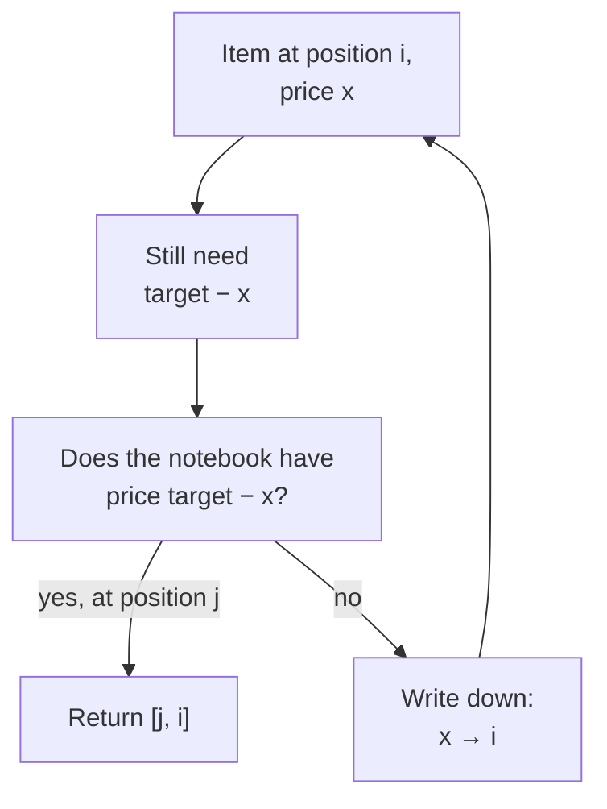

> [!tldr] Quick read
> - The problem: find the **indices** of two elements that add up to `target`. There is always exactly one answer, and you may not use the same element twice.
> - [[en/concepts/complement-lookup|Complement lookup]]: for each `x`, the number you need is `target - x`. The question "is there a pair?" becomes "have I seen `target - x` yet?", which a hash map answers in O(1).
> - [[en/concepts/one-pass-hash-map|One-pass hash map]]: **ask first, store second**. Store first, and `[3, 2, 4]` with target 6 returns `[0, 0]`: it pairs 3 with itself.
> - [[en/concepts/two-pointers|Two pointers]] on a sorted array works too, O(n log n), but you must sort the **indices** so you do not lose the original positions. In JS, the default `sort()` makes two pointers miss the answer.
> - A hash map is O(1) **on average** and [[en/concepts/amortized-o1|amortized]]. When every key [[en/concepts/hash-collision|collides]] into the same bucket, Java still holds up by turning that bucket into a tree, but only when the keys can be ordered.

> [!info] Context
> Station 3 of **the NeetCode 150 line: Arrays & Hashing**. Station 1 remembered "seen it or not", station 2 remembered "how many times"; this station remembers "**at which position**" and asks about a number *not yet* seen. The solutions come in TypeScript, JavaScript, Python, Go and Java.

> [!abstract]- Quick glossary for this post (click to open)
> - **Big-O, Set, hash**: see [[en/posts/2026-11-22-neetcode-contains-duplicate|station 1]]. **Map**: see [[en/posts/2026-11-22-neetcode-valid-anagram|station 2]].
> - **Index**: the position of an element in an array, starting from 0. The problem asks for indices, not values.
> - **Bucket**: a hash table is an array of buckets; the key's hash decides which bucket the key goes into.
> - **Load factor**: the number of keys divided by the number of buckets. Past a threshold, the table grows (usually doubling) and moves every key into the new table.
> - **JIT**: a compiler that runs while the program is running (JVM, V8). The first few runs are usually slower, so a measurement has to "warm up" first.

## Picture it first: shopping with exactly 9 dollars

You have exactly 9 dollars and want to buy **exactly two items** that use up all of it. You walk along a row of stalls, each item with its own price.

| Everyday life | Concept |
|---|---|
| For each item, go back and check every item after it to see whether they add up to 9 | Brute force, O(n²) |
| Standing in front of an item priced 2, you think "I need an item priced **7**" | [[en/concepts/complement-lookup\|Complement lookup]] |
| Write every item you pass into a notebook, "price → shelf position"; at each new item, look up the missing price | [[en/concepts/one-pass-hash-map\|One-pass hash map]] |
| Line up the goods by price, one person at the cheapest end and one at the most expensive end, both walking toward the middle | [[en/concepts/two-pointers\|Two pointers]] |
| The notebook has an index by price; when many prices fall on the same index page, searching takes longer | [[en/concepts/hash-collision\|Hash collision]] |
| When the notebook is full, copy it into one twice as thick; it is work, but you rarely have to do it | [[en/concepts/amortized-o1\|Amortized O(1)]] |



## The problem

**The problem (summary):** given an integer array `nums` and a number `target`, return the indices of two elements that add up to `target`. The problem guarantees **exactly one** answer, and an element may not be used twice. The order of the result does not matter. Original problem: [LeetCode 1](https://leetcode.com/problems/two-sum/).

| `nums` | `target` | Output |
|---|---|---|
| `[2, 7, 11, 15]` | 9 | `[0, 1]` |
| `[3, 2, 4]` | 6 | `[1, 2]` (not `[0, 0]`) |
| `[3, 3]` | 6 | `[0, 1]` |

Constraints: from 2 to **10,000** elements, values and target in the range ±10⁹. The problem's follow-up: is there anything faster than O(n²)?

The last two cases are where wrong solutions show up: `[3, 2, 4]` traps anyone who pairs a number with itself, and `[3, 3]` traps anyone who uses a Set (losing the fact that there are two 3s).

## How it works

<figure class="figure-map" style="--ar: 3 / 4">
<div class="frame"><iframe data-archify="../../diagrams/neetcode-two-sum/one-pass.en.html" title="One-pass hash map on [3, 2, 4] with target 6" loading="lazy"></iframe></div>
<figcaption><span><b>Figure 1.</b> [3, 2, 4], target 6. The 3 asks the notebook for 3 before writing itself in, so it does not pair with itself. At 4, the notebook already has 2 at position 1: the answer is [1, 2].</span><a href="../diagrams/neetcode-two-sum/one-pass.en.html" target="_blank" rel="noopener">Open full screen</a></figcaption>
</figure>

### Complement lookup

Brute force asks "does this pair (i, j) add up to target?" for every pair, O(n²). The [[en/concepts/complement-lookup|complement lookup]] trick flips the question: standing at `x`, there is **exactly one** value that pairs with it, namely `target - x`. The question "is there a pair containing x?" becomes "have I seen the value `target - x` yet?", and that is exactly station 1's question. The only difference is that this time you also need to remember the position, so you use a `value → index` Map instead of a Set.

This trick goes much further than Two Sum: "count the subarrays whose sum is k" uses the complement over prefix sums, and "4Sum II" splits in half and then looks up complements.

### One-pass hash map: ask first, store second

There are two ways to build the notebook:

- **Two passes**: pass 1 writes every number into the map, pass 2 looks up the complement and checks `j !== i`.
- **[[en/concepts/one-pass-hash-map|One pass]]**: look up as you walk, then store. The notebook only holds numbers **before** i, so it never finds i itself. With `[3, 3]`, the second 3 finds the first 3 at position 0, which is correct.

If you swap the order (store first, then ask), the 3 in `[3, 2, 4]` finds itself and returns `[0, 0]`. I made this mistake the first time I wrote it.

And what about duplicate keys? With `[3, 3]` and a target other than 6, the second 3 overwrites the position of the first 3. That is fine, because the two 3s are interchangeable for every element that comes after.

### Two pointers: when the array is sorted

If the array is ascending, put one [[en/concepts/two-pointers|pointer]] at the start (smallest) and one at the end (largest). If the sum is less than target, move the left pointer right to increase the sum; if it is greater, move the right pointer left. Each step rules out exactly one element from every possible answer, so it takes O(n) steps in total and O(1) space.

This problem does not give you a sorted array. Sorting costs O(n log n) and loses the original positions, so you have to sort an array of **indices** by value. The problem "Two Sum II" (the second problem of the Two Pointers group in NeetCode 150) hands you a sorted array, and there two pointers is the optimal solution.

### Inside the hash table: why O(1) is only an average

A hash map is an array of buckets. `hash(key)` picks the bucket; two different keys landing in the same bucket is a [[en/concepts/hash-collision|collision]]. Collisions are normal: with a table of m buckets, only about 1.2·√m keys already give a 50% chance that two keys share a bucket (the birthday problem). Every hash table has a way to handle them:

| | Collision handling | Growing the table |
|---|---|---|
| Java `HashMap` | each bucket is a linked list; a bucket with **8** or more keys (and a table of ≥ 64 buckets) turns into a **red-black tree** | load factor 0.75, doubling |
| Python `dict` | open addressing: if a slot is taken, probe another along a pseudo-random sequence that depends on every bit of the hash | grows when about 2/3 full |
| Go `map` | since Go 1.24 a Swiss Table: groups of 8 slots, comparing 8 hash "fingerprint" bytes at once | grows per sub-table |
| V8 `Map` | a hash table that keeps insertion order, each bucket a chain | doubling |

Two mechanisms make "O(1)" true in practice:

- **A good hash spreads keys evenly**, so each bucket holds one key on average. An attacker who knows the hash function can deliberately send thousands of keys with the same hash, turning each lookup into O(n): this is the hash flooding attack (oCERT 2011). Python responded by randomizing string hashes on every run (`PYTHONHASHSEED`); Java responded with trees inside each bucket.
- **[[en/concepts/amortized-o1|Amortized]] table growth**: now and then a single `set` has to copy the whole table, O(n). But if each growth doubles the table, the total copying after n writes is only about 2n, that is, O(1) per write on average. An individual write can be slow; the total is not.

## Runnable example

[TypeScript](../code/neetcode-two-sum/two-sum.ts) · [JavaScript](../code/neetcode-two-sum/two-sum.js) · [Python](../code/neetcode-two-sum/two_sum.py) · [Go](../code/neetcode-two-sum/two_sum.go) · [Java](../code/neetcode-two-sum/two-sum.java)

```ts
// TypeScript: one-pass hash map
function onePass(nums: number[], target: number): [number, number] | null {
  const seen = new Map<number, number>(); // value → index
  for (let i = 0; i < nums.length; i++) {
    const j = seen.get(target - nums[i]);
    if (j !== undefined) return [j, i]; // ask BEFORE storing: never pairs x with itself
    seen.set(nums[i], i);
  }
  return null;
}

// Two pointers: sort the INDICES by value so we can still return the original positions
function twoPointers(nums: number[], target: number): [number, number] | null {
  const idx = nums.map((_, i) => i).sort((a, b) => nums[a] - nums[b]);
  let l = 0, r = idx.length - 1;
  while (l < r) {
    const sum = nums[idx[l]] + nums[idx[r]];
    if (sum === target) return [Math.min(idx[l], idx[r]), Math.max(idx[l], idx[r])];
    if (sum < target) l++; else r--;
  }
  return null;
}
```

```python
def two_sum(nums: list[int], target: int) -> list[int]:
    seen: dict[int, int] = {}  # value → index
    for i, x in enumerate(nums):
        if (need := target - x) in seen:  # ask before storing
            return [seen[need], i]
        seen[x] = i
    return []
```

```go
func twoSum(nums []int, target int) []int {
	seen := make(map[int]int, len(nums)) // value → index
	for i, x := range nums {
		if j, ok := seen[target-x]; ok { // "comma ok": tells "absent" apart from "present, value 0"
			return []int{j, i}
		}
		seen[x] = i
	}
	return nil
}
```

```java
static int[] twoSum(int[] nums, int target) {
    Map<Integer, Integer> seen = new HashMap<>(); // value → index
    for (int i = 0; i < nums.length; i++) {
        Integer j = seen.get(target - nums[i]);
        if (j != null) return new int[] {j, i};
        seen.put(nums[i], i);
    }
    return new int[0];
}
```

```js
function twoSum(nums, target) {
  const seen = new Map(); // use a Map, not {}: object keys are always converted to strings
  for (let i = 0; i < nums.length; i++) {
    const need = target - nums[i];
    if (seen.has(need)) return [seen.get(need), i];
    seen.set(nums[i], i);
  }
  return [];
}
```

```text
$ node two-sum.ts
bruteForce         5/5 cases passed
twoPointers        5/5 cases passed
onePass            5/5 cases passed
onePassWrongOrder  3/5 cases passed; wrong on [3,2,4], target 6 → [0,0]

[10, 9, 1, 100], target 11:
  default sort() → [1,10,100,9]: not found
  sort((a,b)=>a-b) → [1,9,10,100]: 1 + 10

n            ns per set   ns per get
1000                  114.7             74.4
10000                 146.5            113.8
100000                106.4             51.1
1000000               170.3            100.8
4000000               256.2            127.7
bruteForce   n = 20 000:   219.84 ms
twoPointers  n = 20 000:     1.23 ms
onePass      n = 20 000:     1.81 ms
```

*(Output labels translated; the files themselves print Vietnamese.)*

- **Ask/store order**: the store-first version fails 2/5 cases (`[3, 2, 4]` and `[3, 3]`).
- **Default `sort()`**: `[1, 10, 100, 9]` is not numerically ascending, so the two pointers move in the wrong direction and miss `1 + 10`.
- **Amortization**: n grows 4,000 times, yet the cost per `set` only hovers around 100–250 ns. The increase at large sizes is mostly because the table no longer fits in the CPU cache, not because of Big-O.
- With n = 20,000, two pointers and the hash map both take about 1–2 ms. Brute force takes 220 ms.

The Java version adds a collision test. The strings `"Aa"` and `"BB"` have the same `hashCode` (2112), so concatenating 16 such blocks gives 65,536 strings with **one and the same** hashCode:

```text
$ java two-sum.java
[0, 1] [1, 2] [0, 1]
"Aa".hashCode() = 2112, "BB".hashCode() = 2112
distinct hashCodes: bad strings 1, normal strings 65536
put + get 65 536 keys: normal 4.4 ms, same hashCode (String, Comparable) 23.6 ms
put + get 5000 keys with the same hashCode, not Comparable: 109.0 ms
put + get 10000 keys with the same hashCode, not Comparable: 447.5 ms
put + get 20000 keys with the same hashCode, not Comparable: 2700.6 ms
```

- 65,536 strings piled into one bucket are only about **5 times** slower: that bucket has become a tree, and because `String` is `Comparable`, the tree is ordered by string order, so each lookup is O(log n).
- With keys that **cannot** be ordered (a `record` with a fixed `hashCode`), the tree does not know whether to go left or right, so it has to search both branches. n doubles, time grows 4–6 times: exactly the shape of O(n²) for all n lookups.

Python and Go:

```text
$ python3 two_sum.py
[2, 7, 11, 15] 9 → [0, 1] [0, 1]
[3, 2, 4] 6 → [1, 2] [1, 2]
[3, 3] 6 → [0, 1] [0, 1]
PYTHONHASHSEED=1: hash('two-sum'), hash(2026) = 5272480527784930694 2026
PYTHONHASHSEED=2: hash('two-sum'), hash(2026) = -3137576308460970527 2026

$ go run two_sum.go
[0 1] [1 2] [0 1]
seen[5] = 0 | seen[99] = 0 ← both are 0
using comma ok: is 99 in the map? false
```

String hashes in Python change with the seed, while integer hashes do not. In Go, reading a missing key returns the zero value, which collides with the valid index 0, so you must use the form `j, ok := seen[k]`.

## Misconceptions and common traps

- **Storing first, then asking.** It pairs a number with itself. Always ask first, store second.
- **Using a Set instead of a Map.** You lose the positions, and with `[3, 3]` you also lose the fact that there are two 3s.
- **Go: `if j := seen[k]; j != 0`.** Index 0 is valid. Use `j, ok := seen[k]`.
- **JS: using an object `{}` as a map.** Keys are always converted to strings, so `1` and `"1"` are the same key; and names like `__proto__` have special meaning. `Map` keeps the key's type.
- **Two pointers on an array sorted with JS's default `sort()`.** It misses the answer, as in the `[10, 9, 1, 100]` example.
- **Sorting the values and returning the indices after sorting.** The problem asks for the original positions. Sort an array of indices, or an array of (value, index) pairs.
- **Overflow when computing `target - x`.** With the ±10⁹ limit, a 32-bit `int` is still enough (the maximum difference 2·10⁹ < 2³¹ ≈ 2.1·10⁹), but only just. With larger limits, Java and Go need `long`/`int64`.
- **"A hash map is always O(1)."** O(1) is the average when the hash spreads keys evenly, amortized over table growth. Keys sent by users can be chosen to collide.

## Self-check questions

> [!question]- Standing at element x, why do you only need to look for exactly one value?
> Because the sum must equal target, the other element must have the value `target - x`. The question "is there a pair containing x" reduces to "is that value present", a single map lookup.

> [!question]- With `[3, 3]` and target 6, what does the one-pass version return, and why is the second 3 not mistaken for itself?
> It returns `[0, 1]`. When it considers the second 3 (position 1), the notebook only holds the numbers before it, that is, the 3 at position 0. Position 1 has not been stored at lookup time.

> [!question]- Why does two pointers on a sorted array never miss the answer?
> When the sum is less than target, the left element cannot pair with any remaining element (none of them is larger than the right element), so discarding it is safe. The same argument applies to the right element when the sum is greater than target.

> [!question]- Growing the table means copying the whole table, which costs O(n). Why is `set` still called O(1)?
> Because the table doubles each time, copies are very rare: after n writes, the total number of keys copied is about n + n/2 + n/4 + … < 2n. Spread evenly over n writes, that is O(1) per write, called amortized O(1).

> [!question]- 20,000 keys with the same hashCode make HashMap take 2.7 seconds, but 65,536 strings with the same hashCode take only 24 ms. What is the difference?
> Both pile into one bucket, and that bucket becomes a tree. Strings are `Comparable`, so the tree can be ordered and a lookup is O(log n). Keys that cannot be compared force the tree to search both branches, so a lookup is O(n).

## References

- [LeetCode 1: Two Sum](https://leetcode.com/problems/two-sum/) (original problem)
- [OpenJDK: HashMap.java](https://github.com/openjdk/jdk/blob/master/src/java.base/share/classes/java/util/HashMap.java) (`TREEIFY_THRESHOLD = 8`, `MIN_TREEIFY_CAPACITY = 64`, load factor 0.75)
- [Python: `object.__hash__`](https://docs.python.org/3/reference/datamodel.html#object.__hash__) (string hash randomization, `PYTHONHASHSEED`)
- [Go 1.24 release notes](https://go.dev/doc/go1.24) (maps use Swiss Tables)
- [oCERT-2011-003](https://ocert.org/advisories/ocert-2011-003.html) (hash flooding attacks on many languages)
