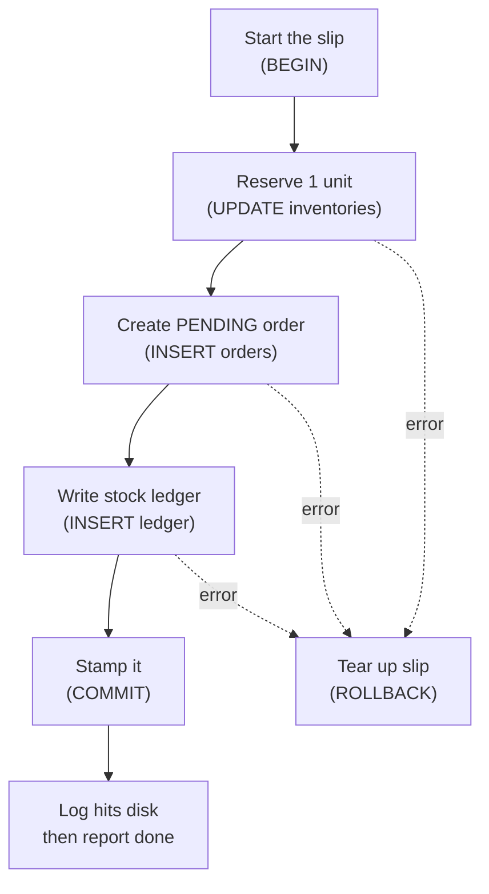

> [!tldr] Quick read
> - A [[en/concepts/transaction|transaction]] groups several statements into **one block**: either every statement takes effect, or none does. In the example, a three-step order fails at step 3: without a transaction, 1 unit stays reserved and 1 order is orphaned; with a transaction, nothing is left behind.
> - [[en/concepts/acid|ACID]] is the four promises of a transaction: Atomicity (the whole block or nothing), Consistency (the data's rules still hold), Isolation (transactions running at the same time don't step on each other), Durability (once committed, never lost).
> - [[en/concepts/commit-va-rollback|COMMIT]] makes the whole block final; [[en/concepts/commit-va-rollback|ROLLBACK]] discards the whole block. An error, a lost connection or a killed pod midway all lead to a rollback.
> - Durability comes from the [[en/concepts/write-ahead-log|Write-Ahead Log]]: Postgres writes the change log to disk **before** replying "COMMIT done"; the table itself is written later.
> - [[en/concepts/mvcc|MVCC]]: `UPDATE` doesn't modify in place but creates a **new row version**. Whoever is reading still sees the old committed version and doesn't have to wait for the writer.

> [!info] Context
> Station 1 of **the Transactions and Locking line**. The example is **flash-sale**, a golden-hour discount shop: at exactly 21:00, thousands of people race for a few hundred products. Every time someone places an order, the server has to reserve stock, create the order and write a line to the stock ledger. The database is PostgreSQL. You don't need to know NestJS, Prisma or the project's code.

> [!abstract]- Quick glossary for this post (click to open)
> - **SQL statement**: one command sent to the database. `SELECT` reads, `INSERT` adds a row, `UPDATE` modifies a row, `DELETE` removes a row.
> - **Table, row**: the database stores data as tables (`inventories`, `orders`); each record is a row.
> - **Session (connection)**: one connection from the application server to Postgres. A transaction always lives entirely inside one session.
> - **Autocommit**: the default mode when you don't type `BEGIN`: each statement is its own transaction and commits immediately.
> - **Stock ledger**: an append-only table, never modified, that records every stock change so it can be checked later.
> - **fsync**: the call that forces the operating system to actually write to disk instead of keeping data in its cache.
> - **Prisma**: the TypeScript library flash-sale uses to talk to Postgres; `prisma.$transaction(async (tx) => …)` opens a transaction.

## Picture it first: a transaction slip at the ticket counter

A ticket counter shares one **big ledger**. Clerks don't write directly into the ledger; they write on a **transaction slip**: "hold 1 ticket in row A, issue the ticket to the customer, record it in the sales book". Only when all three lines are done do they stamp the slip and transfer it into the ledger. If the customer walks away while they are writing, they tear up the slip.

| Everyday life | Concept |
|---|---|
| One transaction slip groups every step of one sale | [[en/concepts/transaction\|Transaction]] |
| The slip either goes into the ledger in full or gets torn up; the ledger always balances; others can't see a half-written slip; once stamped, it is never lost | [[en/concepts/acid\|ACID]] |
| Stamp it into the ledger / tear up the slip | [[en/concepts/commit-va-rollback\|COMMIT / ROLLBACK]] |
| Before stamping, write one line in a bound **logbook** kept in the safe; if the ledger burns, copy it back from the logbook | [[en/concepts/write-ahead-log\|Write-Ahead Log]] |
| Correct the ledger by writing a **new line** and crossing out the old one, never erasing; whoever is looking at the old page can still read it | [[en/concepts/mvcc\|MVCC]] |



## The problem: three statements, the machine dies on the second

When I first wrote backends, I thought of the database as a place to call functions: call `UPDATE` for stock, call `INSERT` for the order, call `INSERT` for the stock ledger. Each call returns OK and that's it. I never thought about what could happen **between two calls**.

And all sorts of things can happen between two calls: the code throws because of a bug, the network connection to the database drops, Kubernetes kills the pod to deploy a new version, the machine runs out of RAM. If each statement commits on its own (autocommit), then every statement that finished **is already in the database**. The first statement reserves 1 unit, the second creates the order, then the pod dies: the database is left with a unit reserved for an order that never got its stock ledger line. Nobody releases that unit, and the stock ledger no longer matches the inventory table.

To clean up, you'd have to write cleanup code for every combination of failures: fail after step 1, release stock; fail after step 2, release stock and delete the order… and the cleanup code itself can die midway. Transactions wipe out that whole class of problem.

## How it works

<figure class="figure-map" style="--ar: 3 / 4">
<div class="frame"><iframe data-archify="../../diagrams/transactions-acid/order-tx.en.html" title="Placing an order in one transaction: roll back on error, commit after the WAL hits disk when done" loading="lazy"></iframe></div>
<figcaption><span><b>Figure 1.</b> The same three ordering steps: wherever an error happens, Postgres discards the whole block; on commit, Postgres writes the log to disk first and only then replies "done".</span><a href="../diagrams/transactions-acid/order-tx.en.html" target="_blank" rel="noopener">Open full screen</a></figcaption>
</figure>

### Transaction: one "all or nothing" block

A [[en/concepts/transaction|transaction]] starts with `BEGIN` and ends with `COMMIT` or `ROLLBACK`. Every statement in between runs in the same session, and their effects are held "pending" until the end:

```sql
BEGIN;
UPDATE inventories SET reserved = reserved + 1 WHERE sku = 'A' AND total >= reserved + 1;
INSERT INTO orders (sku, status) VALUES ('A', 'PENDING');
INSERT INTO ledger (sku, delta, order_id) VALUES ('A', -1, 42);
COMMIT;
```

With Prisma, flash-sale writes it like this. Every statement using the `tx` variable (not `prisma`) sits inside the same transaction; if the function returns normally, Prisma sends `COMMIT`, and if it throws, Prisma sends `ROLLBACK`:

```ts
// illustration, does not run directly (trimmed from flash-sale's order step)
const orders = await prisma.$transaction(async (tx) => {
  for (const item of sortedItems) {
    await stockService.reserveStock(tx, { skuId: item.skuId, qty: item.quantity, orderId });
  }
  const order = await tx.order.create({ data: { /* … */ } });
  await outboxWriter.write(tx, { type: 'order.placed', orderId: order.id });
  return order;
});
```

An easy point to miss: flash-sale's `StockService` **does not open its own transaction**. Every one of its functions takes `tx` from the caller, so reserving stock, creating the order, writing the stock ledger and writing the outbox event (see [[en/concepts/transactional-outbox|transactional outbox]] on the RabbitMQ line) always share one block. If each service opened its own transaction, I'd be back to the problem of three statements committing on their own.

### ACID: four promises

[[en/concepts/acid|ACID]] is the name grouping the four properties a transaction promises:

| Letter | Meaning | Who takes care of it |
|---|---|---|
| **A**tomicity | The whole block takes effect or no statement does | Postgres: ROLLBACK discards every row version the block created |
| **C**onsistency | After every transaction, the data's rules still hold | **You**, with help from constraints (`CHECK`, `UNIQUE`, foreign keys) |
| **I**solation | Transactions running at the same time don't see each other's half-done state | Postgres, at the level you choose (station 3) |
| **D**urability | Once COMMIT is reported done, even a power cut won't lose it | Postgres: WAL hits disk before replying |

The C is different from the other three: the database doesn't know "stock must not go negative" or "the stock ledger must match the inventory table" unless you tell it. A transaction only guarantees that a correct block turns correct data into correct data; a wrongly written block still commits happily. Station 4 uses `CHECK` to turn part of those rules into something the database enforces itself.

The I is the most complicated letter and the subject of stations 2 and 3: "not stepping on each other" comes in several levels, and Postgres's default level does **not** prevent overselling.

### COMMIT and ROLLBACK

[[en/concepts/commit-va-rollback|COMMIT]] makes every change in the block visible to other sessions at the same moment. [[en/concepts/commit-va-rollback|ROLLBACK]] discards them. Three paths lead to a rollback:

- The code calls `ROLLBACK` (Prisma does this when the function inside `$transaction` throws).
- A statement fails (a `CHECK` violation, a duplicate key…). After that, Postgres rejects every following statement in the block with the error "current transaction is aborted" until you send `ROLLBACK`.
- The session drops midway (network failure, dead pod). Postgres sees the connection is gone and discards the uncommitted block itself.

The third path matters most for flash-sale: no cleanup code can run once the pod is dead, but the database still cleans up correctly.

### MVCC: modify by writing a new row

Postgres doesn't modify a row in place. `UPDATE` creates **a new version** of the row and marks the old version as "expired as of transaction X". Each version carries two system columns: `xmin` (the transaction that created it) and `xmax` (the transaction that deleted or replaced it, 0 if none yet). The `ctid` column says where the version sits in the table file.

When a session reads, Postgres picks the version that session **is allowed to see**: one created by a committed transaction and not yet replaced by any committed transaction. So:

- Readers don't wait for writers, and writers don't wait for readers.
- Nobody sees anyone else's uncommitted data (no "dirty read").
- `ROLLBACK` is very cheap: the new versions are simply never considered valid.

The cost is that old versions stay on disk until `VACUUM` cleans them up, and a transaction left open too long keeps every old version from being cleaned up (station 6).

### WAL: write the log first

The Durability promise sounds expensive: surely every COMMIT has to write every modified table page to disk? Postgres makes it cheaper with the [[en/concepts/write-ahead-log|Write-Ahead Log]] (WAL): every change is first written as a log record appended to the `pg_wal` directory. When you COMMIT, Postgres only needs to **fsync the log** (a fast, sequential write) and then reply. The actual table pages are written gradually afterwards, at checkpoints. If the machine dies before the table pages are written, Postgres replays the log from the latest checkpoint on restart.

`synchronous_commit = on` (the default) means COMMIT only replies after the WAL is on disk. Set it to `off` and COMMIT replies sooner and may lose the last few hundred milliseconds of transactions if the machine crashes, but it doesn't corrupt data. The WAL is also what gets shipped to replicas.

## Runnable example

[acid.ts](../code/transactions-acid/acid.ts) sets up three tables (`inventories`, `orders`, `ledger`) on a Postgres 16 running in Docker, then:

- **A.** places a three-step order and deliberately fails at step 3, once without a transaction and once with one;
- **B.** has session W modify a row without committing, while session R reads that same row, then prints the `xmin`, `xmax`, `ctid` of the version each side sees;
- **C.** measures how many bytes the WAL grows after one `UPDATE`.

```bash
docker run -d --name tx-pg -e POSTGRES_PASSWORD=atlas -p 55432:5432 postgres:16-alpine
npm i pg
node acid.ts
```

```ts
// Placing an order = 3 statements. The third one fails (simulating a crash / bug / lost connection).
async function placeOrder(c: pg.PoolClient | pg.Pool, failAtStep3: boolean) {
  await c.query(`UPDATE inventories SET reserved = reserved + 1 WHERE sku = 'A' AND total >= reserved + 1`);
  const { rows: [o] } = await c.query(`INSERT INTO orders (sku, status) VALUES ('A', 'PENDING') RETURNING id`);
  if (failAtStep3) throw new Error('crash giữa chừng');
  await c.query(`INSERT INTO ledger (sku, delta, order_id) VALUES ('A', -1, $1)`, [o.id]);
}
```

```text
$ node acid.ts
A. Three-step order, failing at step 3
   no transaction  : 1 unit reserved, 1 order, 0 ledger rows   ← stock held, orphaned order, ledger out of sync
   with transaction: 0 units reserved, 0 orders, 0 ledger rows ← ROLLBACK wipes out all 3 steps

B. Row versions (MVCC)
   initially                         {"xmin":"22182","xmax":"0","ctid":"(0,1)","reserved":0}
   W (txid 22183) sees, uncommitted  {"xmin":"22183","xmax":"0","ctid":"(0,2)","reserved":5}
   R reads at the same time          {"xmin":"22182","xmax":"22183","ctid":"(0,1)","reserved":0} ← old version, no wait (1 ms)
   R reads after W commits           {"xmin":"22183","xmax":"0","ctid":"(0,2)","reserved":5}

C. Write-Ahead Log
   one small UPDATE pushed the WAL from 0/1CA3D58 to 0/1CA3DC8: 112 bytes of log
   synchronous_commit = on, fsync = on: COMMIT only replies after the WAL is on disk
```

*(Output labels translated; the files themselves print Vietnamese.)*

Reading the output:

- **A** is the whole reason transactions exist. Without a transaction, the first two statements had already committed before the error happened, and the database is stuck in a state no business rule allows.
- **B** shows MVCC with your own eyes. W sets `reserved` to 5: it sees a **new** version at `ctid (0,2)` that it created itself (`xmin = 22183`). R, reading at the same time, still sees the old version at `(0,1)`, which now carries `xmax = 22183` ("replaced by transaction 22183, but 22183 hasn't committed, so I still use this one"), and R doesn't have to wait. After W commits, R switches to the new version.
- **C**: an `UPDATE` of a single integer generates 112 bytes of log. COMMIT waits for exactly that much to hit disk, not a whole 8 KB table page.

## Misconceptions and common traps

- **"If every statement succeeds, the whole operation succeeds."** Only true if nothing dies between two statements. Without `BEGIN`, each statement commits on its own, and a half-done state is the real state.
- **"With a transaction, I don't have to worry about concurrency anymore."** A transaction takes care of the A and the D for sure; the I depends on the isolation level, and Postgres's default level still lets two requests both read "1 unit left" and both sell it. Station 2 reproduces exactly that.
- **"The database takes care of Consistency."** The database only enforces the rules you declare (`CHECK`, `UNIQUE`, foreign keys). A rule that lives in code only holds if every piece of code remembers it.
- **Calling external APIs inside a transaction.** Sending an email or calling a payment gateway inside `$transaction`: the transaction rolls back, but the email has gone out and the money has been charged. And the transaction is held open while waiting on the network (station 6). Work with external effects should go through an outbox after the commit.
- **Each service opening its own transaction.** Two nested `prisma.$transaction` calls in Prisma are **two** independent transactions, not one. Pass `tx` down, like flash-sale's `StockService`.
- **Prisma aborts a transaction after 5 seconds on its own.** An interactive transaction has a default `timeout` of 5000 ms and waits at most `maxWait` 2000 ms to get a connection. flash-sale's cron job that cancels expired orders raises `timeout` to 30 seconds because it processes a whole batch of 100 orders in one transaction.

## Self-check questions

> [!question]- Without `BEGIN`, how many transactions do the three ordering statements run in?
> Three. In autocommit mode, each statement is its own transaction and commits as soon as it finishes. An error in the third statement doesn't make the first two disappear.

> [!question]- A pod is killed after running `UPDATE` and `INSERT orders` inside a transaction. What is left in the database?
> Nothing from that block. The connection drops and Postgres discards the uncommitted transaction; the two row versions it created are never considered valid.

> [!question]- Which letter of ACID is more your responsibility than the database's, and why?
> Consistency. The database only knows the rules declared as constraints; "the stock ledger must match the stock" or "never oversell" are business rules that the code (and the constraints you add yourself) must uphold.

> [!question]- Why doesn't session R in example B have to wait for session W, even though W is modifying the very row R reads?
> Because of MVCC: W creates a new version instead of modifying in place. R reads the old committed version, so it needs no lock and doesn't wait.

> [!question]- COMMIT replies "done" and the machine loses power right after. Why isn't the data lost, even though the table page hasn't been written to disk yet?
> Because with `synchronous_commit = on`, COMMIT only replies after the WAL record has been fsynced to disk. On restart, Postgres replays the WAL from the latest checkpoint and rebuilds the table page.

## References

- [PostgreSQL 16: Transactions (tutorial)](https://www.postgresql.org/docs/16/tutorial-transactions.html)
- [PostgreSQL 16: Concurrency Control, Introduction (MVCC)](https://www.postgresql.org/docs/16/mvcc-intro.html)
- [PostgreSQL 16: Write-Ahead Logging](https://www.postgresql.org/docs/16/wal-intro.html) and the `synchronous_commit` setting
- [PostgreSQL 16: System Columns](https://www.postgresql.org/docs/16/ddl-system-columns.html) (`xmin`, `xmax`, `ctid`)
- [Prisma: Transactions and batch queries](https://www.prisma.io/docs/orm/prisma-client/queries/transactions) (interactive transaction, `maxWait`, `timeout`)
