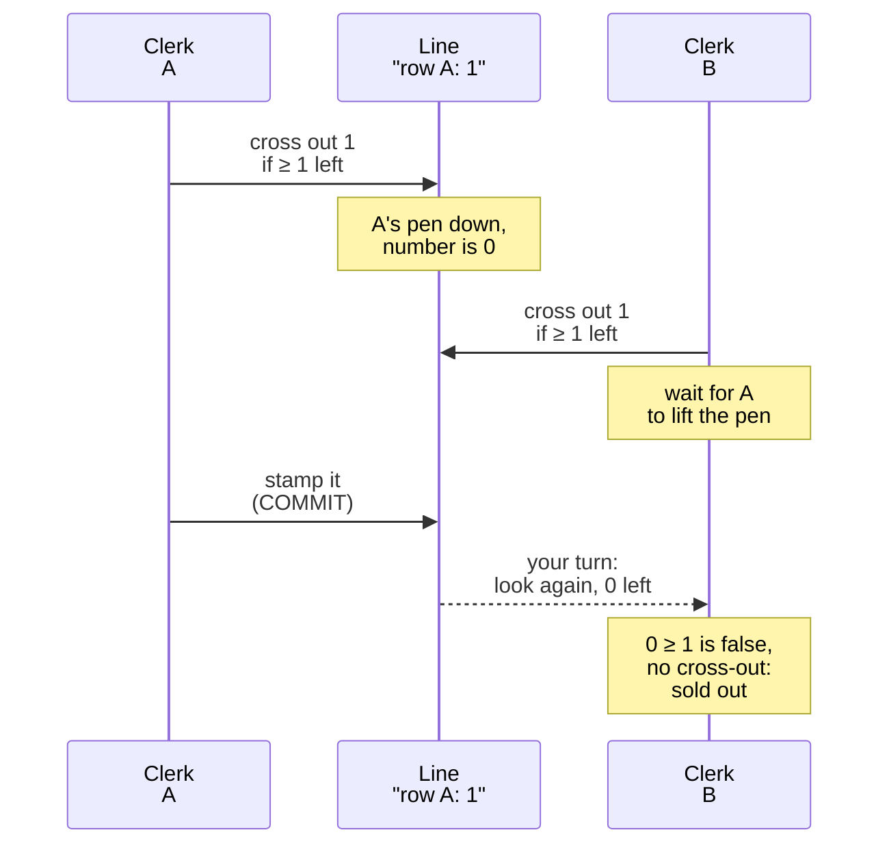

> [!tldr] Quick read
> - A [[en/concepts/conditional-update|conditional update]]: `UPDATE … SET stock = stock - 1 WHERE id = 1 AND stock >= 1`. The check and the decrement sit in **one statement**, with no gap left. No matching row means sold out. Result: 300 people, exactly 100 orders, no retries needed.
> - Every `UPDATE` takes a [[en/concepts/row-lock|row lock]] on its own and holds it until the transaction ends. Whoever comes later has to wait.
> - [[en/concepts/re-check-after-lock|Re-checking after the lock wait]]: at Read Committed, a waiter that gets released re-runs the `WHERE` on the **newest version** of the row. 1 unit left, two people decrement at once: the second sees `0 >= 1` is false and doesn't decrement.
> - At Repeatable Read, the same statement gets aborted with `40001` instead: what makes this approach correct without retries is Read Committed's own behavior.
> - A [[en/concepts/check-constraint|CHECK]] (`stock >= 0`) is the final safety net: whatever code forgets the condition, the database still rejects it (error `23514`). flash-sale's regular inventory table doesn't have this net yet.

> [!info] Context
> Station 4 of **the Transactions and Locking line**. The example is **flash-sale**, a golden-hour discount shop. When a regular order is placed (not a flash sale), the server **reserves stock** for the order awaiting payment: the `reserved_stock` column goes up, and may only go up when `total_stock - reserved_stock` is still enough. Station 2 showed that "read, then check" oversells; station 3 showed that raising the isolation level is correct but needs a great many retries. You don't need to know NestJS or the project's code.

> [!abstract]- Quick glossary for this post (click to open)
> - **Read Committed, Repeatable Read, `40001`**: see [[en/posts/2026-11-22-transactions-isolation|station 3]]. **Row version (MVCC)**: see [[en/posts/2026-11-22-transactions-acid|station 1]].
> - **`rowCount`**: the number of rows an `UPDATE`/`DELETE` just touched. The `pg` library returns it in `result.rowCount`; Prisma's `updateMany` returns `{ count }`.
> - **`RETURNING`**: a clause added to the end of `UPDATE`/`INSERT` so Postgres returns the row's values after the change, saving you another `SELECT`.
> - **Constraint**: a rule declared on a table that the database checks itself on every write: `NOT NULL`, `UNIQUE`, foreign keys, `CHECK`.
> - **`ON CONFLICT DO NOTHING`**: an `INSERT` that hits a row with a duplicate unique key skips it instead of raising an error.

## Picture it first: cross out the number right on the ledger

The two clerks at the ticket counter no longer "glance at the ledger, then turn away to sell". New rule: to sell, **put your pen on the exact line for row A** and cross out the number right there, only if the number is still greater than 0.

| Everyday life | Concept |
|---|---|
| "Cross out 1 if at least 1 is left" is **one motion**; there's no looking first and coming back later | [[en/concepts/conditional-update\|Conditional update]] |
| While a pen is on the line, nobody else can cross out that line; they have to wait | [[en/concepts/row-lock\|Row lock]] |
| When the waiter's turn comes, they **look again at the current number** on the line before deciding whether to cross it out | [[en/concepts/re-check-after-lock\|Re-check after lock]] |
| The ledger's printed number box doesn't allow negative numbers; anyone trying to write one is refused | [[en/concepts/check-constraint\|CHECK]] |



## The problem: the check and the decrement must be one

Station 2 showed that both bugs come from the same place: **the "in stock" condition is checked at one moment, and the decrement happens at another**. Station 3 patched it by letting Postgres detect when those two moments diverge and abort the transaction, at the price of thousands of retries.

I used to think the only other way was to lock the row before reading (`SELECT … FOR UPDATE`, station 5). But there's a much simpler way: stop reading into the app. Put the condition into the write itself, so the database checks and decrements in the same step, on the same row version.

## How it works

<figure class="figure-map" style="--ar: 3 / 4">
<div class="frame"><iframe data-archify="../../diagrams/transactions-atomic-update/recheck.en.html" title="1 unit left, two conditional UPDATEs: Read Committed re-reads and doesn't decrement, Repeatable Read aborts" loading="lazy"></iframe></div>
<figcaption><span><b>Figure 1.</b> B waits for A's row lock. At Read Committed, B re-runs the condition on the new version and doesn't decrement; at Repeatable Read, B is aborted with 40001.</span><a href="../diagrams/transactions-atomic-update/recheck.en.html" target="_blank" rel="noopener">Open full screen</a></figcaption>
</figure>

### Conditional update

This is flash-sale's stock reservation function, trimmed. All of the "is there enough stock" logic sits in the `WHERE` clause:

```ts
// illustration, does not run directly (trimmed from flash-sale's StockService.reserveStock)
const updated = await tx.$queryRaw<Array<{ available_after: number }>>`
  UPDATE catalog.inventories
  SET reserved_stock = reserved_stock + ${qty}, updated_at = NOW()
  WHERE sku_id = ${skuId}::uuid
    AND total_stock >= reserved_stock + ${qty}
  RETURNING (total_stock - reserved_stock) AS available_after`;

if (updated.length === 0) {
  throw new ConflictException({ code: 'OUT_OF_STOCK', skuId, qty }); // HTTP 409
}
```

Three things make it correct:

1. **No value is computed by the app.** `reserved_stock + qty` is computed in the database, on the exact row version being modified.
2. **The condition and the operation are stuck together.** There is no moment at which the condition has been checked but the operation hasn't happened yet.
3. **The result states the decision.** No matching row (`updated.length === 0`) means either the SKU doesn't exist or there isn't enough stock. The app doesn't need to read first to know. `RETURNING` also hands back the remaining amount after the decrement for the stock ledger, saving one more `SELECT`.

The same pattern repeats all over flash-sale: confirming a sale (`WHERE reserved_stock >= qty`), redeeming a voucher (`WHERE usage_limit = 0 OR usage_count < usage_limit`), and the flash sale's sold count.

This function **does not open its own transaction**; it takes the caller's `tx`. After the `UPDATE` comes an `INSERT` into the stock ledger with the idempotency key `sha256(orderId:skuId:RESERVE)` and `ON CONFLICT DO NOTHING`, so a RabbitMQ consumer rerunning the same message doesn't write the ledger twice (see [[en/concepts/idempotent-consumer|idempotent consumer]]).

### Row lock

Every `UPDATE` takes a [[en/concepts/row-lock|row lock]] on every row it modifies, and **holds it until the transaction commits or rolls back**, not until the statement finishes. A row lock doesn't block readers (MVCC handles that); it only blocks others who want to update, delete or lock the same row.

The Postgres docs have a table of row-level lock modes. Only two matter here: a regular `UPDATE` takes `FOR NO KEY UPDATE`; a `DELETE` or an `UPDATE` that changes a key column takes `FOR UPDATE`, the strongest mode. Both modes conflict with themselves, so two `UPDATE`s on the same row always have to queue.

This has consequences for the whole transaction: if you still do slow work after the `UPDATE` (writing the order, calling another service), every buyer of the same SKU has to wait through that whole span. Station 6 comes back to this.

### Re-checking after the lock wait

This is the part I find neatest. The Postgres docs describe what an `UPDATE` at Read Committed does when the row it finds is being modified by another transaction:

1. Wait for the other transaction to COMMIT or ROLLBACK.
2. If the other one rolls back: use the old version, as if nothing had happened.
3. If the other one commits: take the **newest version** of the row and **re-evaluate the `WHERE` condition** on it. If it still matches, apply the operation to the new version; if not, skip the row.

Step 3 is [[en/concepts/re-check-after-lock|re-checking after the lock wait]] (called EvalPlanQual in the Postgres source code). Thanks to it, the second person's `UPDATE … WHERE stock >= 1` is evaluated on the number **after** the first person has decremented. 1 unit left: the first person decrements to 0, the second sees `0 >= 1` is false, matches no row, `rowCount = 0`, sold out.

The same behavior causes the lost update in station 2. The only difference is the operation: `SET stock = 36` (a constant the app computed from old data) applied to the new version still gives 36; whereas with `SET stock = stock - 1 WHERE stock >= 1`, both the condition and the arithmetic use the new version.

At Repeatable Read, step 3 doesn't happen: the transaction took its snapshot before the row changed, so Postgres aborts it with `40001` (station 3). The fix in this station **relies on** Read Committed. Raising the isolation level "to be safe" turns an operation that is correct without retries into one that needs retries.

One limit to remember: the re-check only applies to **the row being modified**. If your condition depends on other rows (the user's total number of orders, like the write skew in station 3), a conditional `UPDATE` on one row can't save you.

### CHECK: the final safety net in the database

A conditional update is only correct if **every** piece of code writing to the table remembers the condition. An admin job adjusting stock, a migration, a hastily written new function: it only takes one place forgetting `AND stock >= 1`. A [[en/concepts/check-constraint|check constraint]] moves that rule into the database:

```sql
ALTER TABLE items ADD CONSTRAINT items_stock_nonneg CHECK (stock >= 0);
```

From then on, every write producing a violating row is rejected with error `23514` and the transaction rolls back, no matter which code sent it.

flash-sale uses CHECK in a few important places: `sold_count <= allocated_stock` on flash-sale products, `usage_count <= usage_limit` on vouchers, a refund amount not exceeding the payment amount. But the regular inventory table `catalog.inventories` **has no CHECK yet** on `reserved_stock` or `total_stock`. Right now every write has a condition, so the data is still correct, and the release function also uses `GREATEST(reserved_stock - qty, 0)` so it never goes negative. But that very `GREATEST` can hide a bug (releasing more than was reserved) instead of exposing it. Adding `CHECK (reserved_stock >= 0 AND reserved_stock <= total_stock)` is a small job worth doing.

## Runnable example

[atomic-update.ts](../code/transactions-atomic-update/atomic-update.ts) does three things:

- **A.** 300 people, 100 units, each person runs one conditional `UPDATE` and then `INSERT`s the order;
- **B.** slows down to show each step: 1 unit left, session A decrements and keeps its transaction open for 300 ms, session B sends the same statement; run at Read Committed, then Repeatable Read;
- **C.** adds `CHECK (stock >= 0)`, then runs an `UPDATE` that forgot the condition twice.

```bash
npm i pg
node atomic-update.ts
```

```ts
// A single statement: decrement only if there is enough stock. No matching row = sold out.
async function buy(buyer: number) {
  const c = await pool.connect();
  try {
    await c.query('BEGIN');
    const r = await c.query('UPDATE items SET stock = stock - 1 WHERE id = 1 AND stock >= 1 RETURNING stock');
    if (r.rowCount === 0) { await c.query('ROLLBACK'); return false; }
    await sleep(2);
    await c.query('INSERT INTO orders (item_id, buyer) VALUES (1, $1)', [buyer]);
    await c.query('COMMIT');
    return true;
  } finally { c.release(); }
}
```

```text
$ node atomic-update.ts
A. Conditional UPDATE: 100 people bought, 100 orders, final stock 0, 489 ms

B. 1 unit left, two sessions decrement at once (READ COMMITTED)
    3 ms  A   UPDATE done, 1 row, stock = 0; not COMMITted, so still holding the row lock
    3 ms  B   sends the same UPDATE…
  304 ms  B   …still waiting for A's row lock
  304 ms  A   sends COMMIT, releases the lock
  308 ms  B   done: 0 rows matched → sold out, no decrement
   final stock: 0

B. 1 unit left, two sessions decrement at once (REPEATABLE READ)
    3 ms  A   UPDATE done, 1 row, stock = 0; not COMMITted, so still holding the row lock
    3 ms  B   sends the same UPDATE…
  304 ms  B   …still waiting for A's row lock
  304 ms  A   sends COMMIT, releases the lock
  308 ms  B   error 40001: could not serialize access due to concurrent update
   final stock: 0

C. Add CHECK (stock >= 0), then code that forgot the condition "AND stock >= 1"
   run 1: decremented
   run 2: error 23514: new row for relation "items" violates check constraint "items_stock_nonneg"
```

*(Output labels translated; the files themselves print Vietnamese.)*

Reading the output:

- **A**: exactly 100 orders, stock reaches 0, nobody gets an error, no retries. Compared to station 3 (about 1200 retries for the same result), this is the difference between "detect, then redo" and "leave nothing to detect".
- **B, Read Committed**: B sends its `UPDATE` at millisecond 3 but only finishes at millisecond 308, right after A commits. It doesn't raise an error, it just reports 0 matched rows: the condition was re-run on the `stock = 0` version.
- **B, Repeatable Read**: same statement, same order, but B gets aborted. Correct, but the app has to retry to find out it's sold out.
- **C**: run 1 decrements 1 to 0, which is valid. Run 2 would produce `stock = -1`, so Postgres rejects it even though the `UPDATE` has no condition at all.

## Misconceptions and common traps

- **"You have to `SELECT` first to know whether there's stock."** No need: `rowCount = 0` (or an empty `RETURNING`) is already the answer. Reading first only reopens the gap from station 2.
- **"Raise it to Repeatable Read to be safer."** With a conditional update, raising the isolation level turns "0 rows matched" into a `40001` error that must be retried. This approach is correct **precisely because of** Read Committed.
- **Reading `rowCount` in the wrong place.** Prisma's `update()` throws `P2025` when the row isn't found, while `updateMany()` returns `{ count: 0 }`. For a complex condition, use `updateMany` or plain SQL like flash-sale, and always check the row count.
- **Applying it to a multi-row rule.** The re-check only applies to the row being modified. A per-buyer limit (counting orders) or a cart total across several SKUs needs `UNIQUE`, Serializable, or locks (station 5).
- **Doing slow work after the `UPDATE`.** The row lock is held until COMMIT. Decrementing stock and then calling an external API makes every buyer of the same SKU queue up waiting for that API.
- **"The condition is already in the code, so CHECK is redundant."** CHECK catches code you haven't written yet, code someone else wrote, or code running outside the app (manual scripts, migrations). It's cheap and sits right next to the data.
- **Using `GREATEST(x - q, 0)` to be "safe".** It keeps the number non-negative but swallows the evidence of a bug. A CHECK makes the bug surface as an error; `GREATEST` keeps it silent.

## Self-check questions

> [!question]- Why does `UPDATE … SET stock = stock - 1 WHERE stock >= 1` not oversell, while "SELECT, then UPDATE stock = stock - 1" does?
> Because the condition and the decrement sit in the same statement and are evaluated on the same row version (and re-evaluated if the statement had to wait for the lock). The two-step approach checks the condition against a number read earlier, so many requests see "in stock" at once.

> [!question]- How long is the row lock taken by `UPDATE` held? What does that mean for the code that runs after the `UPDATE` in the same transaction?
> Until the transaction commits or rolls back. Everything that runs after the `UPDATE` in the transaction (writing the order, calling a service) stretches the time others must wait to modify the same row.

> [!question]- At Read Committed, B waits for A and then gets 0 rows. At Repeatable Read, B waits for A and then gets an error. Why the difference?
> Read Committed lets B re-run the `WHERE` on the newest version after A commits. Repeatable Read keeps B on the old snapshot; since the row changed after the snapshot, letting B continue would mean writing based on stale data, so Postgres aborts B with `40001`.

> [!question]- Can a conditional update enforce the rule "each buyer gets at most 2 units"? Why?
> Not if that rule is computed by counting orders in another table. The re-check after the lock wait only applies to the row being modified; two transactions inserting two new orders don't modify any row in common (the write skew from station 3).

> [!question]- Every write already has its condition. Give two reasons to add a CHECK anyway.
> It catches writes that don't go through that code (admin scripts, migrations, newly written code that forgot the condition); and it turns a bug into a clear error instead of silently wrong data (the way `GREATEST(x - q, 0)` hides a bug that releases more than was reserved).

## References

- [PostgreSQL 16: Transaction Isolation, Read Committed](https://www.postgresql.org/docs/16/transaction-iso.html) (wait, then re-run `WHERE` on the newest version)
- [PostgreSQL 16: Explicit Locking, Row-Level Locks](https://www.postgresql.org/docs/16/explicit-locking.html) (`UPDATE` takes `FOR NO KEY UPDATE`, the conflict table)
- [PostgreSQL 16: UPDATE](https://www.postgresql.org/docs/16/sql-update.html) (`RETURNING`, the number of affected rows)
- [PostgreSQL 16: Constraints](https://www.postgresql.org/docs/16/ddl-constraints.html) (`CHECK`)
