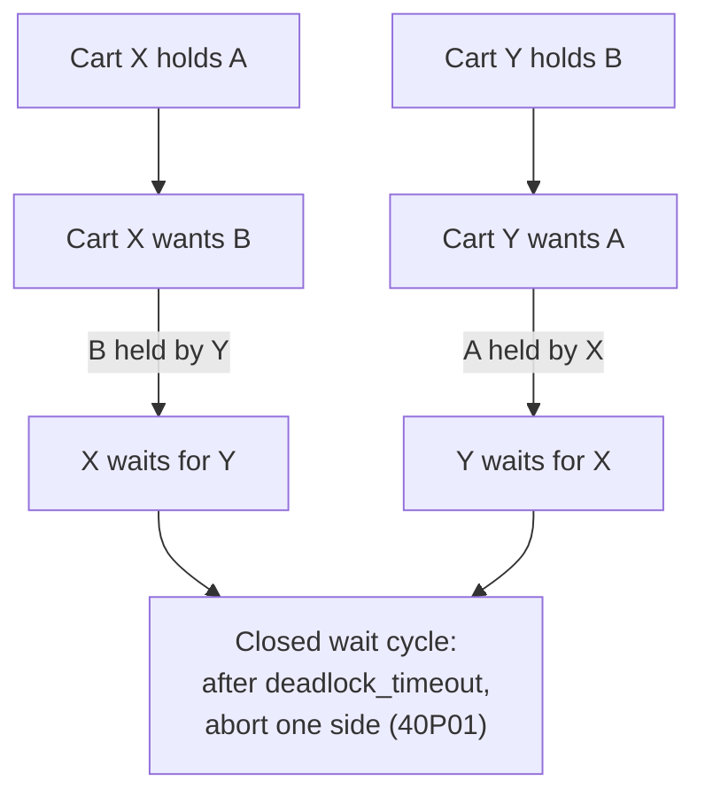

> [!tldr] Quick read
> - [[en/concepts/deadlock|Deadlock]]: cart X holds the lock on SKU A and waits for B, cart Y holds B and waits for A. Neither can let go. Postgres waits `deadlock_timeout` (1 second by default), detects the wait cycle and aborts one side with error `40P01`.
> - [[en/concepts/lock-ordering|Lock ordering]]: if every piece of code locks several rows in **the same order**, no wait cycle can form. flash-sale sorts `skuId` in ascending order before reserving stock for the whole cart. Result: 20/20 carts done, no errors.
> - [[en/concepts/transaction-retry|Retrying]] `40P01`/`40001` errors with jitter is a safety net you need, but it can't replace lock ordering: without sorting, retrying up to 5 times still gets only 8/20 carts done.
> - [[en/concepts/long-running-transaction|Long-running transaction]]: one request holds the lock on SKU A for 3 seconds because it calls the payment gateway inside the transaction, and every buyer of A waits exactly 3 seconds.
> - [[en/concepts/lock-timeout|lock_timeout]] turns "wait forever" into error `55P03` after a span you choose, so a request fails fast instead of dragging the whole system into hanging with it.

> [!info] Context
> Station 6 of **the Transactions and Locking line**. The example is **flash-sale**, a golden-hour discount shop. When checking out a cart with several products, the server reserves stock for **each SKU** in one transaction, one conditional `UPDATE` per SKU (station 4). Two people whose carts contain the same SKUs click checkout at the same time. You don't need to know NestJS or the project's code.

> [!abstract]- Quick glossary for this post (click to open)
> - **Row lock, conditional UPDATE**: see [[en/posts/2026-11-22-transactions-atomic-update|station 4]]. **`FOR UPDATE`, `NOWAIT`, `55P03`**: see [[en/posts/2026-11-22-transactions-locking|station 5]]. **`40001`**: see [[en/posts/2026-11-22-transactions-isolation|station 3]].
> - **SKU**: one specific variant of a product (a red shirt, size M). Stock is tracked per SKU.
> - **Wait cycle**: A waits for B, B waits for A (or longer: A waits for B, B waits for C, C waits for A).
> - **Exponential backoff and jitter**: retry after 50 ms, then 100, 200, 400 ms…, picking a random value within that range each time. See [[en/concepts/retries-with-backoff|retries with backoff]].
> - **`SET LOCAL`**: change a Postgres setting for the current transaction only.

## Picture it first: two people, two doors

Two people need to pass through two adjoining rooms, room A and room B, and only one person may be in each room.

| Everyday life | Concept |
|---|---|
| X stands in room A and needs to go to B; Y stands in room B and needs to go to A. Neither will back off | [[en/concepts/deadlock\|Deadlock]] |
| The guard waits a moment, sees the two are stuck, and asks one of them to go out and start over | Postgres detects it and aborts one side (`40P01`) |
| Rule: everyone must enter room A first and only then B | [[en/concepts/lock-ordering\|Lock ordering]] |
| The person asked to leave waits a random moment and tries again | [[en/concepts/transaction-retry\|Retry with jitter]] |
| Someone enters room A and then **sits making a 3-minute phone call**, and the whole line behind them stands waiting | [[en/concepts/long-running-transaction\|Long-running transaction]] |
| Someone in line sets their own limit: wait more than half a second and leave | [[en/concepts/lock-timeout\|lock_timeout]] |



## The problem: every statement is correct, yet the system jams

After station 4, every stock reservation is one conditional `UPDATE`, correct and fast. A cart with several SKUs just runs that statement several times in one transaction. I couldn't see anything that could go wrong.

What goes wrong is that each `UPDATE` holds its row lock **until the end of the transaction** (station 4). A two-SKU cart holds lock A while going to get lock B. If another cart is doing the exact opposite, the two transactions wait for each other forever. No statement is wrong; only the order is.

At the same time, there's another kind of jam that doesn't need two people: a transaction holds a lock and then goes off to do something slow (calling the payment gateway, sending an email, waiting on a slow service). Postgres has no lock wait limit by default, so everyone who comes later waits until it finishes.

## How it works

<figure class="figure-map" style="--ar: 3 / 4">
<div class="frame"><iframe data-archify="../../diagrams/transactions-deadlock/deadlock.en.html" title="Two carts locking SKUs in opposite orders deadlock; sorted, they queue up" loading="lazy"></iframe></div>
<figcaption><span><b>Figure 1.</b> Locking in opposite orders creates a wait cycle and Postgres aborts one cart after 1 second; with sorted SKUs, the second cart waits right at the first lock and nobody gets aborted.</span><a href="../diagrams/transactions-deadlock/deadlock.en.html" target="_blank" rel="noopener">Open full screen</a></figcaption>
</figure>

### Deadlock

A [[en/concepts/deadlock|deadlock]] is a wait cycle: each transaction in the cycle holds a lock the next transaction needs. The Postgres docs describe exactly the example of transferring money between two accounts, updated in two different orders.

Postgres handles it like this:

1. A transaction has to wait for a lock. At first it just waits, because most waits end on their own.
2. After `deadlock_timeout` (**1 second** by default), Postgres runs the deadlock check, a fairly expensive job, so it isn't done right away.
3. If it finds a wait cycle, it aborts one transaction in the cycle with error `40P01 deadlock detected`. Which transaction gets aborted is "difficult to predict and should not be relied upon".
4. The remaining transactions get their locks and carry on.

The consequence: every deadlock costs at least 1 second of waiting for everyone in the cycle, plus one aborted transaction. In a flash sale, one second is a very long time.

### Lock ordering

The first piece of advice in the Postgres docs: the best defense against deadlocks is for every application to acquire locks on multiple objects **in a consistent order**. If every cart locks A before B, then whichever cart gets A will get B; the other cart waits right at A, holding nothing, so there's no cycle.

flash-sale does exactly that at checkout:

```ts
// illustration, does not run directly (trimmed from flash-sale's CheckoutService)
// Reserve stock ATOMICALLY through StockService: sort skuId ascending to prevent deadlocks.
const sortedItems = [...group.items].sort((a, b) => a.skuId.localeCompare(b.skuId));
for (const item of sortedItems) {
  await stockService.reserveStock(tx, { skuId: item.skuId, qty: item.quantity, orderId });
}
```

The comment in `StockService` gives the reason: unsorted carts [A, B] and [B, A] will deadlock; Postgres detects it and aborts one side, "but a rollback storm at flash-sale scale is expensive". The consumer that releases stock when an order is canceled sorts the same way, even though releasing carries less risk, so every path through the inventory table follows the same order.

The order must be a **global order**, not "the order within the cart". And it must be consistent across **every** piece of code touching the same rows: an admin job updating stock in order of product name can deadlock with a checkout that sorts by `skuId`.

The second piece of advice in the docs: take the strongest lock you'll need right from the first time. Reading with `FOR SHARE` and only later upgrading to `UPDATE` is another way for two transactions to jam each other on the same row.

### Long-running transaction

A [[en/concepts/long-running-transaction|long-running transaction]] is a transaction kept open longer than needed, usually because it does work unrelated to the database inside it: an HTTP call to the payment gateway, sending an email, waiting on a queue. It does harm in three ways:

- **Holding locks**: every modified row stays locked. In the example below, holding the lock on SKU A for 3 seconds makes every buyer of A wait 3 seconds.
- **Holding a connection**: one connection from the pool is occupied the whole time. Enough long transactions and the pool runs dry, so unrelated requests have to wait too.
- **Holding old versions**: MVCC can't clean up any row version an open transaction might still need, so the table bloats.

The Postgres docs call keeping a transaction open for a long time (for example, waiting for user input) "a bad idea". The fix is usually to move things around: call external APIs **before** or **after** the transaction, and use an outbox so the work that must happen after the commit gets done reliably.

Prisma has its own safety net: an interactive transaction is aborted after a default `timeout` of 5 seconds, and waits at most `maxWait` 2 seconds for a connection. flash-sale's expired-order cron deliberately raises `timeout` to 30 seconds for its batch of 100 orders; the checkout transactions keep the default.

### lock_timeout and the other time limits

Postgres has three limit settings, **all off (0) by default**:

| Setting | Cancels when | Error |
|---|---|---|
| [[en/concepts/lock-timeout\|`lock_timeout`]] | a single lock wait exceeds this time | `55P03` lock_not_available |
| `statement_timeout` | a statement runs too long (lock waiting included) | `57014` query_canceled |
| `idle_in_transaction_session_timeout` | a session with an open transaction sits idle too long | the session is closed |

`lock_timeout` suits the user's hot path: better to say "busy, try again" after 500 ms than to hang the request for 30 seconds. `idle_in_transaction_session_timeout` catches exactly the "open a transaction, then go call an API" bug: if the app sends no statement during that span, Postgres closes the session and releases all its locks. Set them with `SET LOCAL` per transaction, or at the role/database level for the whole app.

### Retry with jitter

Some errors are "just retry and it works": `40P01` (deadlock) and `40001` (serialization failure, station 3). Prisma lumps both into `P2034`. A decent [[en/concepts/transaction-retry|retry]] loop:

- retries **the whole transaction** from the start, not the failed statement;
- retries only those error codes, never business errors or syntax errors;
- caps the number of attempts and waits an **exponential span with jitter** between attempts, so those who just collided don't retry at the same moment;
- has no external side effects inside the retried block.

But retry is only a safety net. If the cause is lock order, retrying just pushes the carts back into the same wait cycle. The example below measures this.

## Runnable example

[deadlock.ts](../code/transactions-deadlock/deadlock.ts) does four things:

- **A.** cart X = [A, B] and cart Y = [B, A], unsorted, 100 ms between steps;
- **B.** the same two carts, with the SKUs sorted before locking;
- **C.** one request holds the lock on SKU A for 3 seconds (simulating a payment gateway call inside the transaction), three people buy A, and the third sets `lock_timeout = 500ms`;
- **D.** 20 carts at once, alternating [A, B] and [B, A]: unsorted; unsorted but with up to 5 retries with jitter; sorted.

```bash
npm i pg
node deadlock.ts
```

```ts
// Reserve stock for the whole cart in one transaction: one conditional UPDATE per SKU.
async function reserveCart(name: string, skus: string[], gapMs = 100) {
  const c = await pool.connect();
  try {
    await c.query('BEGIN');
    for (const sku of skus) {
      await c.query('UPDATE inventories SET reserved = reserved + 1 WHERE sku = $1 AND total >= reserved + 1', [sku]);
      console.log(`${at()}  ${name}: đã khóa ${sku}`);
      await sleep(gapMs); // other work between two SKUs (pricing, vouchers…)
    }
    await c.query('COMMIT');
    console.log(`${at()}  ${name}: COMMIT`);
  } catch (e: any) {
    await c.query('ROLLBACK').catch(() => {});
    console.log(`${at()}  ${name}: lỗi ${e.code}: ${e.message.split('\n')[0]}`);
  } finally { c.release(); }
}
```

```text
$ node deadlock.ts
A. Cart X = [A, B], cart Y = [B, A], unsorted
    2 ms  cart X: locked A
    7 ms  cart Y: locked B
 1106 ms  cart Y: locked A
 1107 ms  cart X: error 40P01: deadlock detected
 1210 ms  cart Y: COMMIT

B. The same two carts, but with SKUs sorted ascending before locking
    2 ms  cart X: locked A
  103 ms  cart X: locked B
  207 ms  cart X: COMMIT
  208 ms  cart Y: locked A
  311 ms  cart Y: locked B
  415 ms  cart Y: COMMIT

C. One request holds the lock on SKU A for 3 seconds (external API call inside the transaction)
    2 ms  slow: locked A, waiting for the payment gateway…
  569 ms  buyer 3, lock_timeout 500ms: error 55P03 after 505 ms (canceling statement due to lock timeout)
 3008 ms  slow: COMMIT
 3010 ms  buyer 1: bought after 2957 ms
 3012 ms  buyer 2: bought after 2948 ms

D. 20 carts at once, alternating [A, B] and [B, A]
   unsorted, no retry        : 1/20 carts done (19× 40P01), 0 retries
   unsorted, up to 5 retries : 8/20 carts done (12× 40P01), 90 retries
   sorted SKUs, no retry     : 20/20 carts done (no errors), 0 retries
```

*(Output labels translated; the files themselves print Vietnamese.)*

Reading the output:

- **A**: the two carts jam each other from millisecond 7. Postgres silently waits exactly the 1-second `deadlock_timeout`, then aborts cart X. Cart Y gets A at 1106 ms and commits. One cart fails, and both lose more than a second.
- **B**: cart Y waits right at lock A (the first lock), holding nothing while it waits, so it simply queues behind cart X. Both carts finish in 415 ms, and nobody gets aborted.
- **C**: buyers 1 and 2 wait almost 3 seconds, exactly as long as the slow request's "payment gateway call". Buyer 3 set `lock_timeout`, so it gives up after 505 ms with `55P03` and can tell the user right away.
- **D**: 20 carts in opposite orders create a pile of wait cycles, and 19 carts get aborted. Up to 5 retries with jitter saves a few more, after **90** retries, and 12 carts still fail because every retry falls into a new wait cycle. Sorted SKUs: 20/20, not a single retry. The numbers in the middle row change on every run; the other two rows don't.

## Misconceptions and common traps

- **"Postgres handles deadlocks itself, so there's nothing to worry about."** It handles them by aborting a transaction after at least 1 second. In a flash sale, that's one failed buyer and a whole wait cycle slowed down by a second, multiplied by the number of times it happens.
- **"With retries in place, deadlocks don't matter."** Example D: retrying without fixing the order still leaves 12/20 carts failing. Retry is for rare conflicts, not for design bugs.
- **Sorting in one place and forgetting another.** The order must be consistent across every piece of code locking the same rows: checkout, releasing stock, stock sync jobs, admin tools.
- **Calling external APIs inside a transaction.** It holds locks and a connection for the whole network wait. Call before or after the transaction, or put it in an outbox.
- **Not setting any timeout.** `lock_timeout`, `statement_timeout` and `idle_in_transaction_session_timeout` all default to 0, meaning wait forever. One hanging request can drag the whole connection pool into hanging with it.
- **Lowering `deadlock_timeout` to "detect faster".** The Postgres docs say 1 second is about "the smallest value you would want in practice": the deadlock check is expensive and most lock waits end on their own.
- **Retrying without jitter.** Two carts that just deadlocked each other and retry at the same moment deadlock again in exactly the same way.

## Self-check questions

> [!question]- Why can cart [A, B] and cart [B, A] deadlock, while two [A, B] carts can't?
> Each `UPDATE` holds its lock until the end of the transaction. In opposite orders, each cart holds a lock the other needs, forming a wait cycle. In the same order, the later cart waits right at the first lock while holding nothing, so there's only queuing.

> [!question]- In example A, why does the deadlock error appear after about 1100 ms rather than immediately?
> Postgres only runs the deadlock check after a transaction has waited for a lock for `deadlock_timeout`, 1 second by default, because the check is expensive and most waits end on their own.

> [!question]- With up to 5 retries and jitter, still only 8/20 carts finish. What does that say about the role of retries?
> Retry is only a safety net for rare conflicts. When the cause is design (opposite lock orders), every retry creates a new wait cycle; you have to fix the cause by locking in a fixed order.

> [!question]- Name three things a transaction kept open too long holds on to, harming other requests.
> Row locks (anyone modifying the same rows has to wait), a connection from the pool (the pool can run dry), and old row versions MVCC can't clean up yet (the table bloats).

> [!question]- You want buyers to see a "busy, try again" error after at most half a second instead of hanging. What do you set, and what error comes back?
> Set `SET LOCAL lock_timeout = '500ms'` inside the transaction. When a lock wait exceeds 500 ms, the statement is canceled with error `55P03`; the app catches that error and returns a message to the user.

## References

- [PostgreSQL 16: Explicit Locking, Deadlocks](https://www.postgresql.org/docs/16/explicit-locking.html) (wait cycles, locking in a consistent order, taking the strongest lock from the start, the warning about long-open transactions)
- [PostgreSQL 16: Lock Management](https://www.postgresql.org/docs/16/runtime-config-locks.html) (`deadlock_timeout`, 1s by default)
- [PostgreSQL 16: Client Connection Defaults](https://www.postgresql.org/docs/16/runtime-config-client.html) (`lock_timeout`, `statement_timeout`, `idle_in_transaction_session_timeout`)
- [Prisma: Transactions](https://www.prisma.io/docs/orm/prisma-client/queries/transactions) (`timeout`, `maxWait`, error `P2034`)
