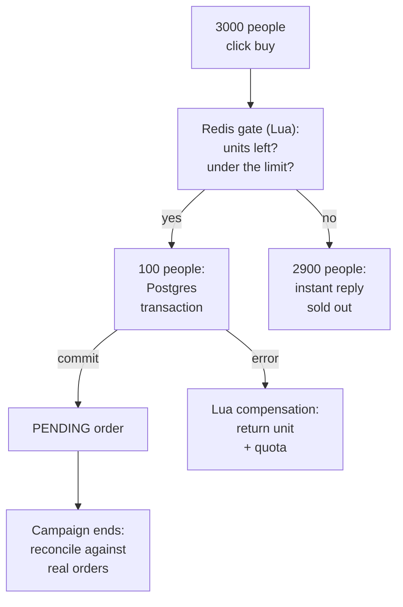

> [!tldr] Quick read
> - [[en/concepts/atomic-gate|Atomic gate]]: a Lua script in Redis checks the per-buyer limit, decrements stock and records the quota in **one run** that nobody can cut into. 3000 people click, only 100 get through the gate, and Postgres sees only 100 transactions instead of 3000.
> - Postgres is still the **ledger of truth**: the order is created with a conditional UPDATE + INSERT in one transaction (station 4). Redis is just a counter for filtering early.
> - Two places storing the same number will drift apart. [[en/concepts/compensation|Compensation]]: if the Postgres transaction fails, a second Lua script gives the unit and the quota back to Redis. With a 10% DB failure rate: 13 compensations, and still exactly 100 orders in the end.
> - [[en/concepts/reconciliation|Reconciliation]]: if a pod dies **between** Redis and Postgres, nobody compensates, and 3 units "evaporate". When the campaign ends, flash-sale counts the real orders in Postgres and fixes the counters.
> - [[en/concepts/defense-in-depth|Defense in depth]]: Redis filters, the conditional UPDATE filters, and `CHECK (sold_count <= allocated_stock)` stops whatever is left when both layers above have a bug. At the end of the post is a [[en/concepts/concurrency-checklist|checklist]] for the whole line.

> [!info] Context
> Station 7, the last station of **the Transactions and Locking line**. The example is **flash-sale**, a golden-hour discount shop: each campaign sets aside a number of units (`allocated_stock`) for each SKU; at the set hour, thousands of people are let in by turns and click buy. Each person may buy at most a few units of each SKU. You don't need to know NestJS, Redis or the project's code.

> [!abstract]- Quick glossary for this post (click to open)
> - **Conditional UPDATE, CHECK**: see [[en/posts/2026-11-22-transactions-atomic-update|station 4]]. **Hot row**: see [[en/posts/2026-11-22-transactions-locking|station 5]]. **Write skew**: see [[en/posts/2026-11-22-transactions-isolation|station 3]].
> - **Redis**: an in-memory database, very fast, processing one command at a time on a single thread. See [[en/series/caching|the Caching line]].
> - **Lua script in Redis**: a small program sent to Redis with the `EVAL` command; Redis runs it to completion before processing any other command.
> - **`DECRBY` / `INCRBY`**: Redis commands that subtract / add an integer and return the new value.
> - **Outbox**: a table that records events in the same transaction as the data, to be sent out after the commit. See [[en/concepts/transactional-outbox|transactional outbox]].
> - **Source of truth**: the place you trust when two records contradict each other.

## Picture it first: a concert with a ticket gate

A concert has 100 seats and 3000 people who want to get in.

| Everyday life | Concept |
|---|---|
| The outer gate has a **hand-held clicker counter**: once it reaches 100, the gate closes, and anyone without a ticket is turned back immediately | [[en/concepts/atomic-gate\|Atomic gate]] (Redis Lua) |
| The desk inside writes each guest's name into the **official seating ledger**; only people who passed the gate reach the desk | Postgres, the source of truth |
| A guest passes the gate but the desk fails to record them: click the counter back by 1 so the gate opens for someone else | [[en/concepts/compensation\|Compensation]] |
| A guest passes the gate and faints before reaching the desk: the counter says 100, the ledger has only 97. At the end of the night, recount the ledger and fix the counter | [[en/concepts/reconciliation\|Reconciliation]] |
| The seating ledger is printed with exactly 100 lines: even if both the gate and the desk are wrong, a 101st guest can't be written in | [[en/concepts/defense-in-depth\|Defense in depth]] (`CHECK`) |



## The problem: one row, three thousand people

The six previous stations gave me a correct approach: one `UPDATE … WHERE sold < allocated` inside a transaction. It's correct for 300 people, and it's still correct for 3000. The problem is that **everyone has to reach that very same row** (station 5: the hot row). Each transaction holds the row lock until it commits; with 3000 transactions queuing through one row, 2900 of those people queue just to hear "sold out". Meanwhile they occupy database connections, and every other part of the shop (browsing products, regular carts) has to compete with them for connections.

flash-sale's idea: reject the 2900 people **before** they touch Postgres, with a counter in Redis. But doing that means two places both store "how many units are left", and the problem shifts from "running concurrently" to "two data sources drifting apart".

## How it works

<figure class="figure-map" style="--ar: 16 / 9">
<div class="frame"><iframe data-archify="../../diagrams/transactions-flash-sale/gate.en.html" title="Redis filters first, Postgres holds the truth, compensation and reconciliation" loading="lazy"></iframe></div>
<figcaption><span><b>Figure 1.</b> Redis rejects most buyers in RAM; only buyers with a unit open a Postgres transaction. On a DB error, Redis is compensated; any leftover drift is reconciled when the campaign ends.</span><a href="../diagrams/transactions-flash-sale/gate.en.html" target="_blank" rel="noopener">Open full screen</a></figcaption>
</figure>

### The atomic gate in Redis

Redis processes commands on one thread, and a Lua script runs to completion before any other command is processed. So a script that both reads and writes several keys is an [[en/concepts/atomic-gate|atomic operation]]: there's no read-modify-write gap to cut into, and no need for a distributed lock. This is flash-sale's unit reservation script, trimmed:

```lua
-- KEYS[1] = flash:stock:{campaignId}:{skuId}
-- KEYS[2] = flash:user_limit:{campaignId}:{userId}:{skuId}
-- KEYS[3] = flash:campaign:{campaignId}  (JSON, with a "status" field)
local meta = redis.call('GET', KEYS[3])
if not meta or cjson.decode(meta).status ~= 'ACTIVE' then return -3 end   -- campaign not running

local bought = tonumber(redis.call('GET', KEYS[2]) or '0')
if bought + tonumber(ARGV[1]) > tonumber(ARGV[2]) then return -2 end      -- over the per-buyer limit

if redis.call('DECRBY', KEYS[1], ARGV[1]) < 0 then                        -- decrement, then check
  redis.call('INCRBY', KEYS[1], ARGV[1])                                  -- negative: give it back right away
  return -1                                                               -- sold out
end
redis.call('INCRBY', KEYS[2], ARGV[1])                                    -- record the quota
return 1
```

Notice how the script enforces the per-buyer limit: it reads the quota and then writes the quota, but because the whole script is atomic there's no write skew like in station 3. In Postgres, the same rule needs `UNIQUE`, Serializable or a lock. In Redis, it comes free, provided every related key is in the same script.

The campaign status check sits inside the script for a specific reason: if an admin ends the campaign while users are buying, a check outside the script would leave a gap, and an order created after that could violate the CHECK in Postgres.

### Postgres is the ledger of truth

Once through the gate, the request opens a Postgres transaction that does five things: reads the flash-sale product's details, creates a PENDING order, increments the flash-sale product's `sold_count`, updates the flash-sale stock figures, and writes an outbox event. All of it commits or rolls back together (station 1). The order in Postgres is what gets paid for, shipped and refunded; the number in Redis is only for rejecting early.

Because Redis has already filtered, only about 100 requests reach the hot row, so lock hold time no longer multiplies with the number of people clicking.

### Compensation when Postgres fails

Redis has decremented, then the Postgres transaction fails (lost connection, timeout, constraint violation). If nothing is done, that unit vanishes from Redis with no order behind it. flash-sale catches the error and runs [[en/concepts/compensation|compensation]] with a second Lua script: add the unit back **and** take back that person's quota in the same run. A comment in the code explains why it must be one script: if the two commands were separate and the second failed, the unit would be returned but the quota would stay high, and that person would be locked out forever with an "over the limit" error despite having bought nothing. The compensation script also keeps the quota from going below 0.

Compensation is a miniature version of the saga pattern: instead of one transaction spanning two systems (which doesn't exist), each system has its own transaction and an "undo" operation for the case where a later step fails.

### Reconciliation when even compensation can't run

Compensation runs in the `catch` block. If the pod is killed **between** Redis finishing its decrement and the Postgres transaction committing, the `catch` block never runs. Redis has decremented, Postgres has no order: a "phantom unit". A second case: an order is canceled, but the cancellation event hasn't yet reached the consumer that updates Redis.

flash-sale handles this with [[en/concepts/reconciliation|reconciliation]] when the campaign ends: stop the queue workers, count the **real, non-canceled orders** in Postgres for each SKU (that's the source of truth, not `sold_count` or Redis), and in a transaction holding the campaign lock, fix the counters to match, return the unsold remainder to regular stock, switch the status to ENDED, then delete the Redis keys. The reconciliation report records for each SKU whether it matched or had to be fixed, and by how much.

Doing it at the end is deliberate: by then no request is sitting between Redis and Postgres, so the count is final. Reconciling midway would have to account for in-flight requests, or it would "give back" a unit that a valid request is using.

### Defense in depth

Three layers, each catching the errors of the layer before:

| Layer | Stops | If this layer has a bug |
|---|---|---|
| Lua in Redis | the 2900 extra people, going over the per-buyer limit, a campaign that has ended | layer 2 still stops overselling |
| Conditional UPDATE inside the transaction | overselling when Redis drifts upward | layer 3 still stops it |
| `CHECK (sold_count <= allocated_stock)` | every violating write, from any code | (no layer left: the data is always correct) |

That's [[en/concepts/defense-in-depth|defense in depth]]: no layer may assume the other layers are correct. The last layer lives in the database because the database is the only place every write path must pass through.

Another path to the same problem is Shopify's approach: drop Redis from stock reservation, make each unit its own row in MySQL, and have buyers lock a free row with `SKIP LOCKED` (station 5). There are no longer two sources of truth to reconcile; in exchange, the database has to take all the traffic. See [[en/posts/2026-11-21-shopify-flash-sale|How Shopify handles flash sales]].

## Runnable example

[flash-sale.ts](../code/transactions-flash-sale/flash-sale.ts) sets up a Redis and a Postgres, 100 units, at most 1 unit per buyer:

- **A.** 3000 people click buy at the same time: once going straight to Postgres (conditional UPDATE), once through the Lua gate first;
- **B.** the Postgres transaction fails randomly 10% of the time, with compensation; anyone who hasn't bought yet clicks again until the units run out;
- **C.** 3 requests get "killed" right after the Lua decrement, followed by reconciliation;
- **D.** a buggy write tries to set `sold` above `allocated`.

```bash
docker run -d --name tx-redis -p 56379:6379 redis:7-alpine
npm i pg ioredis
node flash-sale.ts
```

```ts
async function viaRedisGate(buyer: number, failRate: number, stats: { compensated: number }) {
  const userKey = `flash:user:c1:${buyer}:sku1`;
  const r = await redis.eval(PURCHASE, 2, STOCK_KEY, userKey, 1, MAX_PER_USER);
  if (r !== 1) return false; // sold out or over the limit: don't touch the DB
  try {
    return await writeOrder(buyer, failRate);
  } catch {
    await redis.eval(COMPENSATE, 2, STOCK_KEY, userKey, 1); // give the unit back to Redis
    stats.compensated++;
    return false;
  }
}
```

```text
$ node flash-sale.ts
A. 100 units, 3000 people click buy at once

   straight to DB   : 100 orders, sold = 100, 3000 transactions reach Postgres, 337 ms
   with Redis gate  : 100 orders, sold = 100,  100 transactions reach Postgres, 177 ms

B. DB fails randomly 10%, people who haven't bought click again (3 rounds)
   13 compensations; DB: 100 orders, sold = 100; Redis left 0; Redis + sold = 100 (must equal 100)

C. 3 pods die between Redis and DB
   before reconciliation                       : Redis left 0, DB sold = 97 → 3 units "evaporated"
   reconciliation (no requests half-done left) : Redis left 3, DB sold = 97; 3 more units can be sold

D. Buggy code writes sold above allocated → 23514: new row for relation "flash_items" violates check constraint "sold_le_allocated"
```

*(Output labels translated; the files themselves print Vietnamese.)*

Reading the output:

- **A**: both approaches give exactly 100 orders; station 4 already guaranteed that. The difference is **3000 versus 100** transactions reaching Postgres. On a local machine the time is only twice as long; in production, 2900 extra transactions mean 2900 connections occupied and queued through one hot row, while the rest of the shop needs the database too.
- **B**: 13 transactions fail, 13 compensations return their units to Redis, and those units are sold again to people clicking later. The invariant `Redis left + sold = 100` holds throughout.
- **C**: without compensation, Redis reports sold out while Postgres has sold only 97. Three real buyers are wrongly turned away. Reconciliation takes Postgres as the truth and returns the 3 units. The example reconciles right away because it knows for sure no request is still running; flash-sale waits until the campaign ends for exactly that reason.
- **D**: no Redis, no `WHERE` condition, but `CHECK` still blocks it.

## A checklist for the whole line

The [[en/concepts/concurrency-checklist|checklist]] I took away after seven stations, for any place where many requests write at once:

1. Every multi-step operation sits in **one transaction**, passing `tx` down instead of letting each service open its own (station 1).
2. No **read-modify-write** on shared data: don't read into the app and then write back a number the app computed (station 2).
3. Know which **isolation level** you're running at; Postgres and Prisma default to Read Committed (station 3).
4. Business conditions on a single row go in **the `WHERE` of the `UPDATE`**, and the code always checks the number of affected rows (station 4).
5. Rules spanning several rows (a per-buyer limit, no double booking) get `UNIQUE`, Serializable or a dedicated lock; don't trust `COUNT` followed by `INSERT` (station 3).
6. Important invariants get a **`CHECK`** in the database (stations 4, 7).
7. Choose your locks on purpose: a single `UPDATE` if possible; pessimistic for high contention; optimistic for rare conflicts or long requests; `SKIP LOCKED` for queues; advisory locks for "only one pod" (station 5).
8. Lock several rows in **one global order** (station 6).
9. No external API calls and no waiting for the user **inside a transaction**; set `lock_timeout` on the hot path (station 6).
10. Retry `40001`/`40P01` as a whole transaction, with a limit and jitter, but treat it as a safety net, not as design (stations 3, 6).
11. Hot row: filter people out **before** the database (station 7).
12. When two places store the same number, you need **compensation** for the failures you can foresee and **reconciliation** for the ones you can't, with a clearly chosen source of truth (station 7).

## Misconceptions and common traps

- **"With a Redis Lua script, I don't need a transaction in Postgres."** Redis is just a counter for filtering early. Orders, payments and refunds live in Postgres; the transaction and the CHECK there are still what keep the data correct.
- **"A Lua script is a transaction."** It's atomic with respect to other Redis commands, but it has no rollback: any command that has run in the script has taken effect, even if the script fails on a later line. The script has to write its own "give back", like the `INCRBY` when `DECRBY` goes negative.
- **Compensating with two separate commands.** Returning the unit and then returning the quota with two commands: if the second fails, the user is locked out forever. Put them in one script.
- **"Compensation is enough, no need for reconciliation."** Compensation only runs while the process is alive to run it. A killed pod, a network drop to Redis at the wrong moment: only reconciliation catches those.
- **Reconciling midway and forgetting in-flight requests.** Setting Redis to `allocated - sold` while there are still requests that have decremented Redis but not committed in Postgres gives back a unit that's in use, and oversells again at the Redis layer. Reconcile once you've stopped accepting requests, or subtract the in-flight count.
- **Treating a counter as the truth.** `sold_count` and Redis are both counters that can drift. flash-sale reconciles against **real, non-canceled orders**.
- **A script's keys spread over several Redis Cluster nodes.** A script is only atomic when all its keys live on the same node; with Redis Cluster, the keys must share a hash slot (use the hash tag `{campaignId}`), see [[en/concepts/hash-slot|hash slot]].

## Self-check questions

> [!question]- The Redis gate doesn't make the result more correct (both approaches in example A give 100 orders). So what is it for?
> To take load off Postgres: the 2900 people without a unit are rejected in RAM instead of opening a transaction, occupying a connection and queuing through a hot row just to hear "sold out".

> [!question]- The Lua script checks the quota and then writes the quota. Why isn't there write skew like the `COUNT`-then-`INSERT` example in station 3?
> Redis runs the whole script before processing any other command, so no request can cut in between reading the quota and writing it. No gap, no write skew.

> [!question]- Why must the compensation script return both the unit and the quota in one run?
> If they were split into two commands and returning the quota failed, the unit would be returned but that person's quota would still count as bought, so they'd be blocked as "over the limit" forever despite having no order.

> [!question]- Compensation lives in the `catch` block. Describe a situation where it doesn't run, and how the system detects the discrepancy.
> The pod is killed (or loses power) right after the Lua decrement and before the Postgres transaction commits: no code runs to compensate. Reconciliation when the campaign ends counts the real, non-canceled orders in Postgres, compares them with the counters, and fixes the difference.

> [!question]- What are the three layers that stop overselling, and why must the last one live in the database?
> Lua in Redis, the conditional UPDATE inside the transaction, and `CHECK (sold_count <= allocated_stock)`. The last layer lives in the database because that's the only place every write path must pass through, including code that bypasses the two layers above.

## References

- [Redis: Scripting with Lua](https://redis.io/docs/latest/develop/programmability/eval-intro/) (scripts run atomically, blocking all other server activity while running). The lack of rollback I checked myself on Redis 7.4: a script that `SET`s a key and then fails on a later command leaves the key with its new value.
- [Redis: Cluster specification](https://redis.io/docs/latest/operate/oss_and_stack/reference/cluster-spec/) (multi-key commands, scripts included, only run when all keys share a hash slot; hash tags `{…}`)
- [PostgreSQL 16: Transaction Isolation](https://www.postgresql.org/docs/16/transaction-iso.html)
- [PostgreSQL 16: Constraints](https://www.postgresql.org/docs/16/ddl-constraints.html) (`CHECK`)
- [Shopify Engineering: Scaling inventory reservations](https://shopify.engineering/scaling-inventory-reservations) (another approach: one row per unit, `SKIP LOCKED`)
