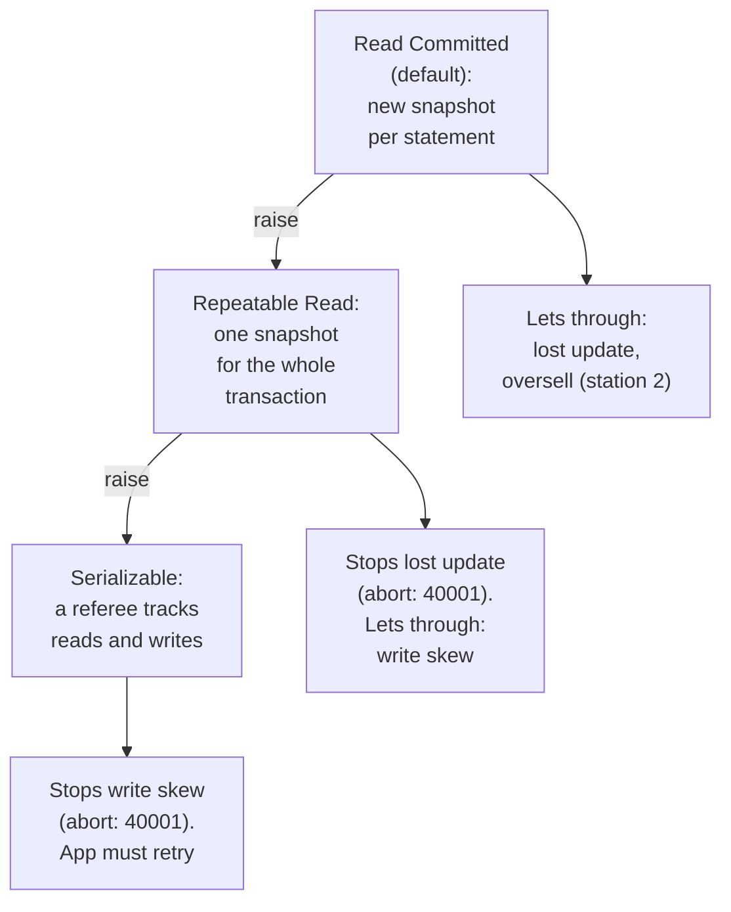

> [!tldr] Quick read
> - The [[en/concepts/isolation-level|isolation level]] decides what a transaction sees while others are writing at the same time. Postgres has three real levels: Read Committed, Repeatable Read, Serializable.
> - [[en/concepts/read-committed|Read Committed]] (the default in Postgres and Prisma): **each statement** sees a fresh snapshot of committed data. The "read, check, write" code from station 2 runs at this level: 300 orders for 100 units.
> - Postgres's Repeatable Read is really [[en/concepts/snapshot-isolation|Snapshot Isolation]]: the whole transaction sees a single snapshot, and whoever modifies a row someone else modified after that snapshot gets aborted. No more overselling, but 293 out of 300 people get an error.
> - [[en/concepts/write-skew|Write skew]]: two transactions read the same data and then write to **two different rows**, so Snapshot Isolation sees no conflict. Example: a limit of 2 units per buyer, two tabs buy at once, and the user ends up with 3 orders.
> - [[en/concepts/serializable|Serializable]] stops write skew too by tracking who read what and who wrote what, then aborting one side with a [[en/concepts/serialization-failure|serialization failure]] (code `40001`). It doesn't make anyone wait on locks; **the app has to retry** the whole transaction.

> [!info] Context
> Station 3 of **the Transactions and Locking line**. The example is **flash-sale**, a golden-hour discount shop: thousands of people race for a few hundred units, and each person may buy at most a few units of each product. Station 2 reproduced overselling at the default isolation level; this station tries raising the level. You don't need to know NestJS or the project's code.

> [!abstract]- Quick glossary for this post (click to open)
> - **Transaction, MVCC, row version**: see [[en/posts/2026-11-22-transactions-acid|station 1]]. **Lost update, read-modify-write, oversell**: see [[en/posts/2026-11-22-transactions-race|station 2]].
> - **Snapshot**: the list of transactions that had committed at a point in time. Reading by snapshot means seeing only row versions created by the transactions on that list.
> - **`COUNT(*)`**: the SQL that counts the rows matching a condition, for example a buyer's number of orders.
> - **SQLSTATE**: SQL's standard 5-character error code. `40001` is a serialization failure, `40P01` is a deadlock.
> - **Retry with jitter**: retry after a wait with a random part added, so requests don't all retry at the same moment. See [[en/concepts/retries-with-backoff|retries with backoff]].

## Picture it first: how clerks look at the ledger

The ticket counter from station 2 still has two clerks and one ledger. The question now is: while I'm in the middle of a transaction, how do I see the ledger?

| Everyday life | Concept |
|---|---|
| The rule for how clerks may look at the ledger while others are writing in it | [[en/concepts/isolation-level\|Isolation level]] |
| Every glance at the ledger shows the newest stamped version; two glances can show two different numbers | [[en/concepts/read-committed\|Read Committed]] |
| At the start of the transaction, **take a photo** of the whole ledger and look only at that photo; when writing, if the line you mean to change was changed by someone after the photo, you must drop the transaction | [[en/concepts/snapshot-isolation\|Snapshot Isolation]] |
| Two clerks both look at a photo saying "customer 7 has bought 1 ticket", each sells 1 more ticket and writes on **two different lines**; no line is changed twice, but the customer has 3 tickets | [[en/concepts/write-skew\|Write skew]] |
| A **referee** records who looked at which line and who wrote which line; if two transactions can't be ordered as "this one first, that one after", the referee cancels one of them | [[en/concepts/serializable\|Serializable]] |
| The transaction is canceled and the clerk has to start over | [[en/concepts/serialization-failure\|Serialization failure (40001)]] |



## The problem: "just raise the isolation level?"

After station 2, my first reflex was: the bug comes from a low isolation level, so raise it to Serializable to be safe. Then I came across two opposite rumors: "Serializable locks the whole table, it's really slow" and "Repeatable Read is enough". Both are wrong in interesting ways.

The SQL standard's table defines four levels through three phenomena (dirty read, non-repeatable read, phantom read). That table is the most copied thing on the subject, and also the most misleading: it doesn't mention lost updates or write skew, the two bugs a flash sale actually runs into. To know what a level prevents, you have to look at how the database implements it, not at its name.

## How it works

<figure class="figure-map" style="--ar: 3 / 4">
<div class="frame"><iframe data-archify="../../diagrams/transactions-isolation/write-skew.en.html" title="Two tabs buy at once: Repeatable Read lets write skew through, Serializable aborts one side" loading="lazy"></iframe></div>
<figcaption><span><b>Figure 1.</b> The same two "count orders, then add an order" transactions: at Repeatable Read both commit and the user exceeds the limit; at Serializable, Postgres sees they can't be ordered one after the other and aborts one side.</span><a href="../diagrams/transactions-isolation/write-skew.en.html" target="_blank" rel="noopener">Open full screen</a></figcaption>
</figure>

### Three real levels in Postgres

You can request the four standard levels, but Postgres implements only three: Read Uncommitted behaves exactly like Read Committed, because MVCC never shows an uncommitted version. The table below combines the table in the Postgres docs with the results of the Hermitage test suite (Martin Kleppmann), which tries each kind of anomaly on a real database:

| Level (name in Postgres) | What it really is | Prevents | Doesn't prevent |
|---|---|---|---|
| Read Committed (default) | one snapshot per statement | dirty read | non-repeatable read, lost update, write skew |
| Repeatable Read | Snapshot Isolation | also: non-repeatable read, phantom, lost update | write skew |
| Serializable | Serializable Snapshot Isolation (SSI) | every anomaly | (none left) |

Prisma doesn't change anything: if you don't pass `isolationLevel`, it uses the database's default, which is Read Committed for Postgres. flash-sale has one place that writes `{ isolationLevel: 'ReadCommitted' }` explicitly (handling the payment webhook); everything else uses the default.

### Read Committed: a fresh snapshot for each statement

At [[en/concepts/read-committed|Read Committed]], each statement takes a new snapshot when it starts. Two `SELECT` statements in the same transaction can see two different numbers if someone commits in between. That's why "read, check, write" code breaks: the number from the `SELECT` and the state when the `UPDATE` runs belong to two different moments.

When an `UPDATE` meets a row that another transaction is modifying, it **waits** for that transaction to finish, then **re-evaluates the `WHERE` condition** on the newest version and applies the operation to it. This behavior causes lost updates for read-modify-write code, but it is also what makes the fix in station 4 correct.

### Snapshot Isolation: one snapshot for the whole transaction

At Repeatable Read, the snapshot is taken **once**, at the first statement, and used for the whole transaction. Postgres implements this level as [[en/concepts/snapshot-isolation|Snapshot Isolation]], which is stronger than the standard requires (it prevents phantom reads too).

The deciding moment is the write. If the transaction wants to `UPDATE`, `DELETE` or lock a row that another transaction modified **after** the snapshot was taken, Postgres doesn't apply the operation to the new version the way Read Committed does. It aborts the transaction with the error:

```text
ERROR:  could not serialize access due to concurrent update
```

The reason: this transaction believes in a snapshot where the row hasn't changed; letting it keep writing would let it overwrite based on stale information. So lost updates can't happen, and the code from station 2 no longer oversells. But everyone who comes later gets aborted.

### Write skew: two different rows, one broken rule

Snapshot Isolation only detects a conflict when two transactions write to **the same row**. [[en/concepts/write-skew|Write skew]] is when two transactions read the same set of data, make a decision based on it, and then write to **different rows**:

1. Rule: each buyer gets at most 2 units of each product. User 7 already has 1 order.
2. Tab 1 and tab 2 both click buy. Each transaction runs `SELECT count(*) FROM orders WHERE buyer = 7` and sees 1.
3. 1 < 2, so each side `INSERT`s a new order. Two new rows; no row is modified twice.
4. Both commit. User 7 has 3 orders.

There's no lost update here; nobody overwrote anybody. What gets broken is a **rule spanning several rows** (the total number of orders), and each transaction checked that rule against a snapshot that was no longer true. Classic examples of the same shape: two on-call doctors both ask for the night off because "the other one is still on call", two people book the same meeting room for two overlapping time slots.

In the table of Berenson et al. (1995), this is phenomenon A5B; Hermitage calls it G2-item, and confirms that Postgres's Repeatable Read lets it through.

### Serializable: a referee that doesn't lock, only aborts

[[en/concepts/serializable|Serializable]] promises: the result of transactions running concurrently is the same as **some sequential order** of them. Postgres implements it with Serializable Snapshot Isolation (SSI): still Snapshot Isolation, plus a record of "which transaction read which data" (predicate locks, shown in `pg_locks` with mode `SIReadLock`). When it detects a dependency cycle of the form "T1 read something T2 wrote, T2 read something T1 wrote", it aborts one side:

```text
ERROR:  could not serialize access due to read/write dependencies among transactions
```

Two things that contradict the rumors:

- **SSI's locks don't block anyone**, so they can't cause deadlocks. Postgres's Serializable doesn't "lock the whole table"; it lets everyone run and then aborts whoever causes trouble.
- **The price is retrying.** The Postgres docs say it plainly: an app using this level must be ready to retry, and should have one common place that handles every `40001` error.

### Serialization failure: retry the whole transaction

A [[en/concepts/serialization-failure|serialization failure]] (SQLSTATE `40001`) is not a bug: it's how Snapshot Isolation and Serializable say "this transaction can't commit and still be correct, do it again". Prisma reports it (and deadlocks) with error code `P2034`, and the Prisma docs include a ready-made loop that retries up to 5 times for that code only.

The retry must be a retry of **the whole transaction from the start**, including the `SELECT` statements: the next attempt needs a new snapshot. And it needs a limit on attempts plus a random wait, otherwise hundreds of aborted requests will all retry at the same moment and collide again. The example below shows how big that number gets when everyone fights over **one row**.

## Runnable example

[isolation.ts](../code/transactions-isolation/isolation.ts) does two things:

- **A.** reruns station 2's "read, check, write the app's number" code (100 units, 300 people) at all three levels, then reruns the two higher levels **with** retry and jitter;
- **B.** reproduces write skew: user 7 already has 1 order, and two transactions both count and then both insert.

```bash
npm i pg
node isolation.ts
```

```ts
// Write skew: each transaction reads the user's order COUNT and then INSERTs a new order.
// The two transactions write to two DIFFERENT ROWS, so there is no write conflict on the same row.
await c.query(`BEGIN ISOLATION LEVEL ${level}`);
const { rows } = await c.query('SELECT count(*)::int AS n FROM orders WHERE buyer = 7');
await sleep(50); // two tabs click "buy" at almost the same moment
if (rows[0].n >= 2) { await c.query('ROLLBACK'); return 'từ chối'; }
await c.query('INSERT INTO orders (item_id, buyer) VALUES (1, 7)');
await c.query('COMMIT');
```

```text
$ node isolation.ts
A. 100 units, 300 people, "read, check, write the app's number" code

level            retry   orders  final stock  gave up  retries     time
READ COMMITTED   no         300           92        0        0   308 ms
REPEATABLE READ  no           7           93      293        0    77 ms
SERIALIZABLE     no           7           93      293        0    66 ms
REPEATABLE READ  yes        100            0        0     1200   475 ms
SERIALIZABLE     yes        100            0        0     1206   451 ms

B. Write skew: user 7 already has 1 order, two tabs buy 1 more at once

READ COMMITTED   ok | ok                user 7 has 3 orders (limit 2)
REPEATABLE READ  ok | ok                user 7 has 3 orders (limit 2)
SERIALIZABLE     ok | error 40001       user 7 has 2 orders (limit 2)
```

*(Output labels translated; the files themselves print Vietnamese.)*

Reading the output:

- **Read Committed**: just like station 2, 300 orders for 100 units.
- **Repeatable Read and Serializable, no retry**: the data is correct (7 orders, stock 93, consistent with each other), but 293 people get a `40001` error and give up while there is still stock. Correct but useless.
- **With retry**: exactly 100 units sold and stock reaches 0. The price is about **1200 retries** for 300 people, because everyone is fighting over the very same row: each round only one person wins, and the rest lose and start over. The run also takes six times as long as without retry.
- **Write skew**: Read Committed and Repeatable Read both let user 7 end up with 3 orders. Only Serializable aborts one side. The aborted side, when retried, counts 2 and correctly refuses.

The lesson for flash-sale: raising the isolation level is **correct**, but it turns a hot stock row into a storm of retries. Station 4 fixes overselling another way, with no retries; and flash-sale checks the per-buyer limit in Redis with an atomic script (station 7), not with a `COUNT` in Postgres.

## Misconceptions and common traps

- **"Repeatable Read prevents everything except phantoms."** That's the SQL standard's table. In Postgres, Repeatable Read prevents phantoms too but **lets write skew through**, a bug the standard's table doesn't mention.
- **"Serializable locks the whole table, so it's slow."** Postgres's SSI doesn't block anyone; it aborts. Whether it's slow depends on how many retries are needed, and that depends on the level of contention. A hot row like flash-sale stock is the worst case.
- **Raising the isolation level without writing a retry.** The `40001` error will go straight to the user as a 500, like the 293 people in the "no retry" rows.
- **Retrying only the failed statement instead of the whole transaction.** After `40001`, the transaction is broken; you must `ROLLBACK` and rerun from the first statement to get a new snapshot.
- **Sending an email or calling an API in a transaction that may be retried.** Every retry sends it again. Work with external effects must sit outside the retried block, or go through an outbox.
- **Mixing isolation levels.** A Serializable transaction is only protected from transactions that also run at Serializable. Read Committed transactions running in parallel can still create anomalies SSI doesn't see.
- **Thinking `UNIQUE` is unrelated.** For write skew of the "one unit per buyer" kind, a `UNIQUE (campaign, buyer)` constraint stops it right away at Read Committed. A constraint is the cheapest way to turn a multi-row rule into a single-index rule.

## Self-check questions

> [!question]- At Read Committed, can two consecutive `SELECT stock` statements in the same transaction return two different numbers? What about at Repeatable Read?
> Read Committed: yes, because each statement takes a new snapshot and someone may commit in between. Repeatable Read: no, the whole transaction uses one snapshot.

> [!question]- Why does Repeatable Read prevent the lost update in example A but not the write skew in example B?
> A lost update is two transactions writing the same row; Snapshot Isolation detects that the row was modified after the snapshot and aborts the later one. Write skew writes to two different rows, so there is no write conflict to detect.

> [!question]- Does Postgres's Serializable make requests wait for each other? How does it prevent anomalies?
> SSI's predicate locks don't block anyone. Postgres records who read what and who wrote what, and when it detects that the transactions can't be put into a sequential order, it aborts one side with `40001`.

> [!question]- With retry, Serializable sells exactly 100 units but costs about 1200 retries. Why so many?
> Because all 300 people are fighting over the very same stock row. Each round only one transaction can commit; every other transaction that read that row is aborted and starts over, again and again until the stock runs out.

> [!question]- Is there a way to keep the rule "each buyer gets at most 1 unit per campaign" correct at Read Committed without Serializable?
> Add a `UNIQUE (campaign_id, buyer_id)` constraint on the orders table. The second request trying to `INSERT` will be rejected by the database, regardless of the isolation level.

## References

- [PostgreSQL 16: Transaction Isolation](https://www.postgresql.org/docs/16/transaction-iso.html) (the phenomena table, Read Committed behavior on update, Repeatable Read's errors, SSI and `40001`)
- [Hermitage: testing transaction isolation levels](https://github.com/ept/hermitage) (Postgres repeatable read is snapshot isolation and doesn't prevent G2-item)
- [Berenson et al., A Critique of ANSI SQL Isolation Levels (1995)](https://www.microsoft.com/en-us/research/publication/a-critique-of-ansi-sql-isolation-levels/) (lost update, snapshot isolation, write skew)
- [Prisma: Transactions](https://www.prisma.io/docs/orm/prisma-client/queries/transactions) (`isolationLevel`, error `P2034`, the retry pattern)
