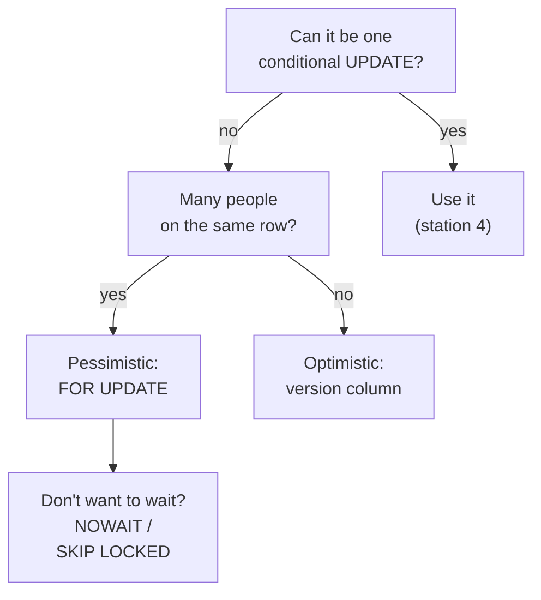

> [!tldr] Quick read
> - [[en/concepts/pessimistic-locking|Pessimistic locking]]: `SELECT … FOR UPDATE` locks the row **before reading**; whoever comes later queues up and waits. Correct, no retries, but everyone fighting over the same row has to go through one at a time.
> - [[en/concepts/optimistic-locking|Optimistic locking]]: read without locking, write with `WHERE version = <the number read>`; 0 matched rows means someone wrote first, so read again and retry. A good fit when conflicts are rare. On a [[en/concepts/hot-row|hot row]]: 300 people, 100 units, about **4100 transactions**.
> - [[en/concepts/skip-locked|NOWAIT and SKIP LOCKED]]: don't wait for the lock. `NOWAIT` raises error `55P03` right away; `SKIP LOCKED` skips rows that are currently locked and takes others, a good fit for queue-like tables. flash-sale uses it for the cron job that cancels expired orders, running on several pods.
> - [[en/concepts/advisory-lock|Advisory lock]]: a lock on a number the app picks, not tied to any row. flash-sale uses `pg_try_advisory_xact_lock` so only one pod runs the cleanup job each hour.
> - The three approaches on the same stock row: the conditional UPDATE (station 4) is fastest; pessimistic comes second; optimistic is the slowest and most expensive.

> [!info] Context
> Station 5 of **the Transactions and Locking line**. The example is **flash-sale**, a golden-hour discount shop. Besides stock, flash-sale has many other places that must be protected from overwrites: order status transitions (PENDING → PAID → SHIPPED…), editing quantities in the cart, a cron job running on every pod that cancels unpaid orders after 15 minutes. Not every place can be written as a single `UPDATE`. You don't need to know NestJS or the project's code.

> [!abstract]- Quick glossary for this post (click to open)
> - **Row lock, conditional UPDATE, `rowCount`**: see [[en/posts/2026-11-22-transactions-atomic-update|station 4]]. **Read Committed, `40001`**: see [[en/posts/2026-11-22-transactions-isolation|station 3]].
> - **Pod**: one running copy of the server in Kubernetes. flash-sale runs several identical pods, so every cron job also runs on every pod at the same time.
> - **Cron**: a job that runs on its own on a schedule (every minute, every hour).
> - **State machine**: the list of an order's statuses and the valid transitions between them.
> - **Hash**: a function that turns a string into a number; Postgres's `hashtext('cleanup-cron')` produces a fixed integer.

## Picture it first: three ways to share one meeting room

The office has one meeting room, and many teams want to use it.

| Everyday life | Concept |
|---|---|
| Hang an "in use" sign before going in; other teams see the sign and wait outside | [[en/concepts/pessimistic-locking\|Pessimistic locking]] (`FOR UPDATE`) |
| Don't hang a sign; just prepare, and when you go in, check whether the booking sheet is still the version you saw; if someone has booked it, go back and prepare again | [[en/concepts/optimistic-locking\|Optimistic locking]] (`version` column) |
| See the sign and **don't wait**: either leave right away (NOWAIT), or go to the free room next door (SKIP LOCKED) | [[en/concepts/skip-locked\|NOWAIT and SKIP LOCKED]] |
| There's only one "tonight's cleanup duty" card; whoever holds the card cleans up, and it isn't tied to any room | [[en/concepts/advisory-lock\|Advisory lock]] |
| The one room the whole company wants at 9 o'clock | [[en/concepts/hot-row\|Hot row]] |



## The problem: there isn't always a single UPDATE

Station 4 went to my head a little: everything should be a conditional `UPDATE`! Then I looked again at the other places in flash-sale:

- An order status transition has to read the current status, check it against the state machine (PENDING may go to PAID or CANCELLED, but SHIPPED never goes back to PENDING), then write, then add a history row. The rules live in TypeScript code and don't fit neatly into a `WHERE`.
- The cart: a user opens two tabs and edits the quantity in both. The later tab must not silently overwrite the earlier one.
- The cron job that cancels expired orders runs every minute **on every pod**. Two pods must not cancel the same order, and they shouldn't wait for each other either.

These places need one of the two locking strategies, plus a few tools to avoid waiting.

## How it works

<figure class="figure-map" style="--ar: 3 / 4">
<div class="frame"><iframe data-archify="../../diagrams/transactions-locking/pess-vs-opt.en.html" title="Pessimistic locking queues up and waits; optimistic locking, on losing, reads again and retries" loading="lazy"></iframe></div>
<figcaption><span><b>Figure 1.</b> Pessimistic: B waits for A, then reads the new version, wasting no attempt. Optimistic: B only finds out it lost after finishing its work, and has to read again and redo it.</span><a href="../diagrams/transactions-locking/pess-vs-opt.en.html" target="_blank" rel="noopener">Open full screen</a></figcaption>
</figure>

### Pessimistic locking: SELECT … FOR UPDATE

[[en/concepts/pessimistic-locking|Pessimistic locking]] assumes a conflict will happen, so it locks first:

```sql
BEGIN;
SELECT stock FROM items WHERE id = 1 FOR UPDATE;   -- lock the row; others wait here
-- check in the app, compute…
UPDATE items SET stock = 36 WHERE id = 1;
COMMIT;                                            -- release the lock
```

`FOR UPDATE` takes the strongest row lock right at read time. A second request sending the same statement will **wait** at the `SELECT`, and when released it (at Read Committed) gets the newest version of the row. That way, station 2's read-modify-write code becomes correct just by adding two words.

The price: the lock is held from the `SELECT` to the `COMMIT`, longer than with a conditional `UPDATE` (which only locks from the write on). Everything in between (checking, writing the order) becomes time others spend in the queue. The Postgres docs warn about two traps:

- **`ORDER BY` with `FOR UPDATE` at Read Committed** can return rows out of order: rows are sorted first and locked afterwards, and the value of the sort column may have changed during the wait.
- Keeping a transaction open while waiting for a user or the network is "a bad idea", because locks have no deadline (station 6).

### Optimistic locking: a version column

[[en/concepts/optimistic-locking|Optimistic locking]] assumes conflicts are rare, so it locks nothing when reading. Each row gets an extra `version` column, incremented by 1 on every write. When writing, the condition is "the version is still the number I read":

```ts
// illustration, does not run directly (trimmed from flash-sale's OrderService.transition)
const order = await repo.findOneInTx(tx, orderId);          // read, no lock
assertTransition(order.status, toStatus);                   // state machine rules in code
const r = await tx.order.updateMany({
  where: { id: orderId, version: order.version },           // write only if nobody has written
  data: { status: toStatus, version: { increment: 1 } },
});
if (r.count === 0) throw new ConflictException({ code: 'ORDER_VERSION_MISMATCH' }); // HTTP 409
await tx.orderStatusHistory.create({ data: { orderId, fromStatus: order.status, toStatus } });
```

At heart, this is a conditional UPDATE; the only difference is that the condition isn't about the business ("in stock") but about **change** ("nobody has touched it"). It relies on exactly the mechanism from station 4: if two requests write at once, the later one waits for the row lock, re-reads, sees that `version` has gone up, and gets 0 rows.

flash-sale uses optimistic locking for:

- **Order status**: the payment webhook and the expired-order cron job can touch the same PENDING order at almost the same time. Only one side wins; the other gets a 409 and doesn't write a wrong history row.
- **The cart**: the frontend keeps each item's `version` and sends it back when editing. Two tabs editing at once means the later tab gets rejected instead of silently overwriting the earlier one. Here optimistic locking is the only sensible choice: nobody holds a database lock while the user is typing.
- **Vouchers**: both `version = <the one read>` and `usage_count < usage_limit`.

Optimistic locking fits when **conflicts are rare** or when **the gap between read and write is long** (a user editing a form). It's bad when many people write the same row: each round only one person wins, and the others have done all their work before finding out they lost.

### Hot row

A [[en/concepts/hot-row|hot row]] is a row that a great many transactions want to write during the same period: a flash-sale product's stock, the usage counter of a store-wide voucher. With a hot row, every strategy is limited by the same thing: **only one transaction can hold the write lock at a time**. Maximum throughput is roughly 1 divided by the lock hold time. There are only two ways to go faster: hold the lock for less time (a conditional UPDATE, no extra work inside the transaction), or **don't let every request reach that row** (Redis filters up front, station 7). The idea is similar to the "hot key" on [[en/concepts/hot-key|the Caching line]].

### NOWAIT and SKIP LOCKED

Sometimes waiting is wrong. Postgres gives two options when it meets a locked row:

- **`FOR UPDATE NOWAIT`**: raises error `55P03` (lock_not_available) immediately. A good fit when you'd rather reply "someone is handling this, try again later" than hang the request.
- **`FOR UPDATE SKIP LOCKED`**: skips rows that are currently locked and returns the rest. The Postgres docs say it clearly: this gives **an inconsistent view** of the data, unsuitable for general-purpose work, but very well suited to several consumers taking jobs from a queue-like table.

flash-sale's expired-order cron job is exactly that case:

```ts
// illustration, does not run directly (trimmed from flash-sale's OrderExpiryService)
const expired = await tx.$queryRaw<Array<{ id: string }>>`
  SELECT id FROM trading.orders
  WHERE status = 'PENDING' AND created_at < ${cutoff}
  ORDER BY created_at
  FOR UPDATE SKIP LOCKED
  LIMIT 100`;
for (const { id } of expired) {
  await orderService.transition({ orderId: id, toStatus: 'CANCELLED', tx }); // same transaction
}
```

Every pod runs this query every minute. Whichever pod comes first locks the 100 oldest orders; the next pod skips those 100 and takes the next 100. No pod waits for another, and no order is canceled twice. There's a 30-second "grace period" in `cutoff` so it doesn't compete with a payment webhook arriving right at the deadline, and if they still compete, the optimistic locking inside `transition()` decides who wins. The station [[en/posts/2026-11-21-shopify-flash-sale|How Shopify handles flash sales]] uses the same pattern for the stock reservation itself: each unit is a row, and a buyer locks a free row with `SKIP LOCKED`.

### Advisory lock

An [[en/concepts/advisory-lock|advisory lock]] is a lock on **a number the app picks**, not tied to any row or table. Postgres only holds and releases it; what the number means is up to the app. There are two kinds:

- **Session-level** (`pg_advisory_lock`): held until you call unlock or the session closes, **even if the transaction rolls back**. Easy to forget to release, especially with a connection pool.
- **Transaction-level** (`pg_advisory_xact_lock`): releases itself when the transaction ends; there's no unlock call. Safer for code that runs through a pool.

The `pg_try_…` variant doesn't wait but returns `true`/`false`. flash-sale uses it so the job that cleans up expired idempotency keys runs on only one pod each hour:

```sql
SELECT pg_try_advisory_xact_lock(hashtext('idempotency-cleanup-cron')) AS locked;
-- false: another pod is running it, skip this round
-- true : delete the expired rows; the lock releases itself on COMMIT
```

No Redis, no distributed-lock library: the database every pod already connects to is the referee.

## Runnable example

[locking.ts](../code/transactions-locking/locking.ts) does three things:

- **A.** 300 people, 100 units, the same row, in three ways: pessimistic (`FOR UPDATE`), optimistic (`version` + retry), conditional UPDATE. It counts the transactions run and the time taken;
- **B.** three workers each take up to 3 `PENDING` jobs from a table of 9 jobs, each worker holding its transaction for 200 ms before marking them `DONE`, in three modes: wait, `NOWAIT`, `SKIP LOCKED`;
- **C.** two "pods" run the same cron job, competing for `pg_try_advisory_xact_lock`.

```bash
npm i pg
node locking.ts
```

```ts
// Optimistic: read without locking, write with "version is still what I read"; on losing, read again and retry.
const { rows } = await c.query('SELECT stock, version FROM items WHERE id = 1');
if (rows[0].stock < 1) return 'hết';
await sleep(WORK_MS);
const u = await c.query(
  'UPDATE items SET stock = $1, version = version + 1 WHERE id = 1 AND version = $2',
  [rows[0].stock - 1, rows[0].version]);
if (u.rowCount === 0) throw new Error('version-mismatch'); // someone wrote first: abort the whole transaction
```

```text
$ node locking.ts
A. 100 units, 300 people, the same stock row

approach                 orders  final stock  transactions   time
pessimistic (FOR UPDATE)    100            0           300   727 ms
optimistic (version)        100            0          4093   772 ms
conditional UPDATE          100            0           300   473 ms

B. Three workers each take up to 3 PENDING jobs, each worker holds its transaction 200 ms
   FOR UPDATE (wait)
     w1: took [1, 2, 3] after 205 ms
     w2: took [4, 5, 6] after 402 ms
     w3: took [7, 8, 9] after 597 ms
   FOR UPDATE NOWAIT
     w1: took [1, 2, 3] after 203 ms
     w2: error 55P03 after 4 ms (could not obtain lock on row in relation "jobs")
     w3: error 55P03 after 2 ms (could not obtain lock on row in relation "jobs")
   FOR UPDATE SKIP LOCKED
     w1: took [1, 2, 3] after 205 ms
     w2: took [4, 5, 6] after 204 ms
     w3: took [7, 8, 9] after 205 ms

C. Two pods run the cleanup cron at once, competing for pg_try_advisory_xact_lock
   pod-a: got the lock, cleaned up, lock released itself on COMMIT
   pod-b: another pod is running it, skipping this round
```

*(Output labels translated; the files themselves print Vietnamese.)*

Reading the output:

- **A**: all three give exactly 100 orders. Pessimistic and conditional UPDATE each run exactly one transaction per person; they differ in time because pessimistic holds the lock for the whole transaction, while the conditional UPDATE only holds it from the write on. Optimistic needs about **4100 transactions** (the number changes on every run) for 300 people: on a hot row, most of the effort is work done and then thrown away.
- **B, wait**: w2 and w3 queue behind w1 (402 ms, 597 ms). They don't grab jobs 1–3 again: after waiting, Postgres re-reads the rows, sees `status` is already `DONE`, skips them and takes the next jobs (exactly the re-check mechanism from station 4).
- **B, NOWAIT**: w2 and w3 fail within a few milliseconds instead of hanging.
- **B, SKIP LOCKED**: the three workers run in parallel, each with 3 different jobs, all done after about 200 ms. This is why flash-sale's order-cancellation cron uses it.
- **C**: exactly one pod runs, and the other skips immediately without waiting.

## Misconceptions and common traps

- **"Optimistic locking is always faster because it doesn't lock."** Only when conflicts are rare. On a hot row, the example above costs 13 times as many transactions as pessimistic locking. Optimistic trades waiting time for discarded work.
- **Forgetting to check `count` after `updateMany`.** Optimistic locking is just a `WHERE` condition; if the code doesn't check for 0 rows, it silently becomes a lost update like station 2.
- **Holding a pessimistic lock while waiting for a user or an external API.** `FOR UPDATE` has no deadline by default; one hanging request means the whole queue of buyers hangs with it.
- **Using `SKIP LOCKED` for something that isn't a queue.** It deliberately returns a view with rows missing. Using it to count stock or compute totals is wrong.
- **Session-level advisory locks through a connection pool.** The lock follows the connection, and the connection goes back to the pool for someone else to use; forget to unlock and the lock hangs forever. Use the `xact` variant.
- **Calling `pg_advisory_lock(id)` in a query with `LIMIT`.** The Postgres docs warn that the lock function may run on more rows than `LIMIT` returns; lock in a subquery.
- **Believing optimistic locking prevents write skew.** It only prevents overwrites on **the same versioned row**. A rule spanning several rows still needs `UNIQUE`, Serializable or a lock on the whole group.

## Self-check questions

> [!question]- Why does adding the two words `FOR UPDATE` to the `SELECT` in station 2's code stop the overselling?
> The second request waits at the `SELECT` until the first commits, then reads the newest version. The gap between read and write is still there, but nobody else can get into it.

> [!question]- Why does optimistic locking need about 4100 transactions for 300 people, while pessimistic locking needs only 300?
> Optimistic lets everyone read and work in parallel, then only one writer wins each round; the losers have to start over. Pessimistic makes everyone queue right from the read, so nobody does wasted work.

> [!question]- flash-sale's cart uses optimistic locking rather than `FOR UPDATE`. Why is that the right choice?
> The gap between read and write is the time the user spends viewing and editing the cart, possibly several minutes. You can't hold a database lock for that long; optimistic locking lets the frontend carry the `version` along and only check it at write time.

> [!question]- Three pods run the expired-order cron at the same time. What differs between plain `FOR UPDATE` and `FOR UPDATE SKIP LOCKED`?
> With plain `FOR UPDATE`, pods 2 and 3 wait for pod 1 to finish before they can take the next batch, so they run sequentially. With `SKIP LOCKED`, each pod skips the orders already locked and takes another batch right away; the three pods work in parallel and no order is canceled twice.

> [!question]- Why does flash-sale use `pg_try_advisory_xact_lock` instead of `pg_advisory_lock` for the cleanup cron?
> The `xact` variant releases itself when the transaction ends, even on error, so it can't be forgotten on a connection shared through a pool. The `try` variant doesn't wait, so a pod that doesn't get it skips the round immediately.

## References

- [PostgreSQL 16: Explicit Locking](https://www.postgresql.org/docs/16/explicit-locking.html) (row-level lock modes, session-level and transaction-level advisory locks)
- [PostgreSQL 16: SELECT, The Locking Clause](https://www.postgresql.org/docs/16/sql-select.html) (`NOWAIT`, `SKIP LOCKED`, the warning about `ORDER BY` with `FOR UPDATE`)
- [PostgreSQL 16: Advisory Lock Functions](https://www.postgresql.org/docs/16/functions-admin.html) (`pg_try_advisory_xact_lock`)
- [Prisma: Optimistic concurrency control](https://www.prisma.io/docs/orm/prisma-client/queries/transactions) (a `version` column with `updateMany`)
