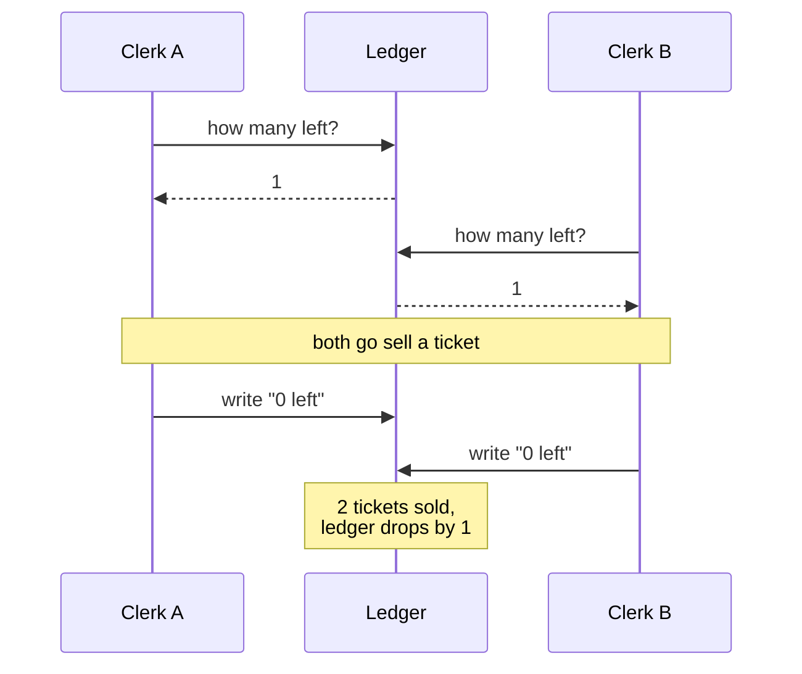

> [!tldr] Quick read
> - [[en/concepts/race-condition|Race condition]]: the result depends on the random order in which requests interleave. Run alone, it's correct; run concurrently, it's wrong.
> - The code pattern behind the bug is [[en/concepts/read-modify-write|read-modify-write]]: read the stock into the app, check it, compute the new number, write it back. There is a gap between the read and the write.
> - [[en/concepts/lost-update|Lost update]]: two people both read 37, both write 36, and stock drops by only 1 even though 2 were sold. In the example: 300 orders, and the final stock is still 86.
> - Switching to `stock = stock - 1` fixes the lost update but does **not** fix [[en/concepts/oversell|overselling]]: the "in stock" check is still separate from the decrement. Result: 149 orders for 100 units, stock at -49.
> - All of this happens **inside a transaction**, at the default Read Committed level. A transaction does not protect against race conditions by itself.

> [!info] Context
> Station 2 of **the Transactions and Locking line**. The example is **flash-sale**, a golden-hour discount shop: at exactly 21:00, thousands of people click "buy" on a product that has only a few hundred units. Each click is a request, and the requests run in parallel over many connections to the same Postgres. You don't need to know NestJS or the project's code.

> [!abstract]- Quick glossary for this post (click to open)
> - **Transaction, COMMIT, ROLLBACK**: see [[en/posts/2026-11-22-transactions-acid|station 1]].
> - **Connection pool**: a group of database connections shared by many requests. The example uses 50 connections, so at most 50 transactions run at the same time.
> - **Read Committed**: Postgres's default isolation level; each statement sees the data committed as of the moment that statement began. Station 3 covers it in detail.
> - **Concurrent**: several things happening during the same period of time, interleaved, not necessarily at the exact same instant.

## Picture it first: two clerks, one ledger

The ticket counter from station 1 now has two clerks. The ledger says "row A: 1 ticket left".

| Everyday life | Concept |
|---|---|
| Two clerks both glance at the ledger, both sell, and whoever is faster "wins" at random | [[en/concepts/race-condition\|Race condition]] |
| Glance at the ledger and see 1, turn away to sell the ticket, come back and write "0 left" from the number in your head | [[en/concepts/read-modify-write\|Read-modify-write]] |
| Both write "0 left": the ledger records only one sale, the other one vanishes | [[en/concepts/lost-update\|Lost update]] |
| Two customers holding two tickets for the same seat | [[en/concepts/oversell\|Oversell]] |



## The problem: "but I already wrapped it in a transaction"

The first purchase code I wrote looked like this, and I was fairly confident because it sat neatly inside a transaction:

```ts
// illustration, does not run directly
await prisma.$transaction(async (tx) => {
  const item = await tx.item.findUnique({ where: { id } });
  if (item.stock < 1) throw new Error('Hết hàng');
  await tx.order.create({ data: { itemId: id, buyerId } });
  await tx.item.update({ where: { id }, data: { stock: item.stock - 1 } });
});
```

Trying it by hand: buy 1 unit, stock drops by 1, and when it's sold out you get an error. The unit tests were green too. The problem only shows up when hundreds of requests run **at the same time**, and that is exactly the one thing a flash sale does.

Station 1 said a transaction promises the four letters of ACID, but the I at Postgres's default level (Read Committed) promises only one thing: **you don't see other people's uncommitted data**. It doesn't promise that the number you read at the start is still true when you write.

## How it works

<figure class="figure-map" style="--ar: 3 / 4">
<div class="frame"><iframe data-archify="../../diagrams/transactions-race/lost-update.en.html" title="Two buyers both read 1 unit left, then both write stock = 0" loading="lazy"></iframe></div>
<figcaption><span><b>Figure 1.</b> Both requests read "1 left" before either gets to write, then both write the now-stale number: two orders are created and stock drops only once.</span><a href="../diagrams/transactions-race/lost-update.en.html" target="_blank" rel="noopener">Open full screen</a></figcaption>
</figure>

### Race condition

A [[en/concepts/race-condition|race condition]] exists when the result depends on the order in which concurrently running operations interleave, and at least one order gives a wrong result. With 300 requests on 50 connections, the interleaving is random on every run. That's why this kind of bug has three nasty traits: it doesn't show up in manual testing, every run produces a different number, and it usually only appears right at peak load.

### Read-modify-write: the gap between read and write

The code above follows the [[en/concepts/read-modify-write|read-modify-write]] pattern:

| Step | Where | What |
|---|---|---|
| read | database → app | `SELECT stock` returns 37 |
| check, compute | in the app | 37 ≥ 1, the new number is 36 |
| write | app → database | `UPDATE … SET stock = 36` |

Between the read and the write, the number 37 lives only in an app variable. The database doesn't know the app is "holding" it; other requests still read 37 and also compute 36. The gap gets wider when there is more work between the read and the write: checking the price, the voucher, the per-buyer limit, writing the order. The example below inserts 2 ms for that part, and 2 ms is more than enough.

There is one more variant, called **check-then-act**: the write step no longer uses a number the app computed but lets the database do the decrement (`stock = stock - 1`), yet **the decision whether to decrement** is still based on the number read earlier.

### Lost update

A [[en/concepts/lost-update|lost update]] is the consequence of read-modify-write: two transactions read the same value, both write a value computed from it, and the later write overwrites the earlier one as if it had never happened. In the anomaly classification of Berenson et al. (1995), this is phenomenon **P4**. The Hermitage test suite confirms that Postgres's Read Committed does **not** prevent P4.

Why does Postgres let the second write overwrite the first? Because at Read Committed, when request B wants to `UPDATE` a row that A just modified, B waits for A to commit and then **applies its own operation to the newest version**. B's operation is "set stock = 36", a constant the app sent down, so applying it to the newest version still gives 36. The database does exactly what it was told; it's just that what it was told was already wrong from the moment the app read.

### Oversell

[[en/concepts/oversell|Overselling]] is what users and accountants actually see: more valid orders than there is stock. It can come from a lost update (stock doesn't drop enough, so there is still "stock" for the next person), or from check-then-act (stock drops correctly, but below 0). Two different bugs, different fixes, and fixing one doesn't fix the other. The example below measures both.

## Runnable example

[oversell.ts](../code/transactions-race/oversell.ts) creates an `items` table with 100 units, then has 300 buyers purchase at the same time over 50 connections, in two ways:

- **read, then write the app's number**: `SELECT stock`, check, wait 2 ms, `INSERT` the order, `UPDATE … SET stock = <number the app computed>`;
- **check, then stock - 1**: identical, but the last step is `UPDATE … SET stock = stock - 1`.

Both run inside `BEGIN … COMMIT` at the default level.

```bash
docker run -d --name tx-pg -e POSTGRES_PASSWORD=atlas -p 55432:5432 postgres:16-alpine
npm i pg
node oversell.ts
```

```ts
// Way 1: read the stock, check it in the app, then write back the number the app computed itself.
async function buyReadModifyWrite(buyer: number) {
  const c = await pool.connect();
  try {
    await c.query('BEGIN');
    const { rows } = await c.query('SELECT stock FROM items WHERE id = 1');
    const stock: number = rows[0].stock;
    if (stock < 1) { await c.query('ROLLBACK'); return false; }
    await sleep(2); // checking price, voucher, per-buyer limit… takes a few milliseconds
    await c.query('INSERT INTO orders (item_id, buyer) VALUES (1, $1)', [buyer]);
    await c.query('UPDATE items SET stock = $1 WHERE id = 1', [stock - 1]);
    await c.query('COMMIT');
    return true;
  } finally { c.release(); }
}
```

```text
$ node oversell.ts
100 units, 300 buyers at once, Read Committed (default)

approach                      orders  final stock  oversold  lost decrements
read, write the app's number     300           86       200              286
check, then stock - 1            149          -49        49                0
```

*(Output labels translated; the files themselves print Vietnamese.)*

Reading the output:

- **Read, then write the app's number**: all 300 people got to buy, meaning 200 units were oversold. Yet the final stock is 86, not -200: out of 300 decrements, 286 were overwritten and lost. Most requests read a high number and wrote that number minus 1, overwriting the work of other requests. The 86 changes on every run; the 300 orders almost never do.
- **Check, then stock - 1**: the lost update disappears (0 lost decrements, because each decrement is applied to the newest version). But it still sells 149 orders, and the stock goes down to **-49**. Requests read "in stock" while the stock was still positive, then decremented after it had already reached 0. The stock no longer lies about how many were sold, but it still allows overselling.

Both approaches are code a careful person could still write, and both sit neatly inside a transaction.

## Misconceptions and common traps

- **"Wrapping it in a transaction gets rid of race conditions."** The example above refutes this directly: 300 orders for 100 units, each order in its own transaction. A transaction takes care of "all or nothing", not of two transactions reading the same stale number.
- **"Using `stock = stock - 1` is enough."** It fixes the lost update, not the overselling. The "in stock" condition must be checked **at the same time** as the decrement, inside the database. That's station 4.
- **"Prisma has `decrement`, so it's safe."** `data: { stock: { decrement: 1 } }` generates `SET stock = stock - 1`, which is exactly the second approach: no more lost update, still overselling if the condition lives in an earlier `findUnique`.
- **"The tests pass, so the code is correct."** Unit tests call the function sequentially, so nothing ever interleaves. Race conditions need concurrent tests on a real database, like this example.
- **"It rarely happens, that's acceptable."** The probability of interleaving grows with the number of concurrent requests and the width of the gap. A flash sale maximizes both: thousands of people, the same product, the same second.
- **"Checking on the frontend is enough."** A "Buy" button disabled when sold out only helps the experience; every request still reaches the server at the same time with the stale stock number.

## Self-check questions

> [!question]- Name the three steps of the read-modify-write pattern, and point out where the gap is.
> Read the value from the database into the app, compute the new value in the app, write the new value back. The gap is the time between the read and the write: the database doesn't know the app is relying on the number it read, so other requests still read that same number.

> [!question]- In approach 1, 300 people got to buy but the final stock is 86 instead of -200. Why?
> Because of lost updates: most requests wrote a constant computed from the high number they read, overwriting other requests' decrements. 286 of the 300 decrements were overwritten, so stock dropped by only 14.

> [!question]- After switching to `stock = stock - 1`, which bug goes away and which remains?
> The lost update goes away (each decrement is applied to the newest version). Overselling remains, because the "in stock" decision is still based on the number read by the earlier `SELECT`, so many requests decrement even after the stock has reached 0.

> [!question]- Why doesn't Postgres at Read Committed prevent lost updates, even though it takes a row lock on `UPDATE`?
> The row lock only makes the later request wait for the earlier one to commit, then apply its operation to the newest version. The operation here is "set stock = 36", a constant the app computed from old data, so applying it to the new version still gives 36.

> [!question]- A colleague says "I bought 10 times in a row and stock dropped by exactly 10, so there's no bug". How do you reply?
> Buying in a row is sequential, so there are never two requests inside the gap at the same time. You have to fire hundreds of parallel requests at a real database to see the race condition.

## References

- [PostgreSQL 16: Transaction Isolation](https://www.postgresql.org/docs/16/transaction-iso.html) (Read Committed: wait, then apply the operation to the newest version)
- [Hermitage: testing transaction isolation levels](https://github.com/ept/hermitage) (Postgres read committed does not prevent P4 lost update)
- [Berenson et al., A Critique of ANSI SQL Isolation Levels (1995)](https://www.microsoft.com/en-us/research/publication/a-critique-of-ansi-sql-isolation-levels/) (definition of lost update P4)
