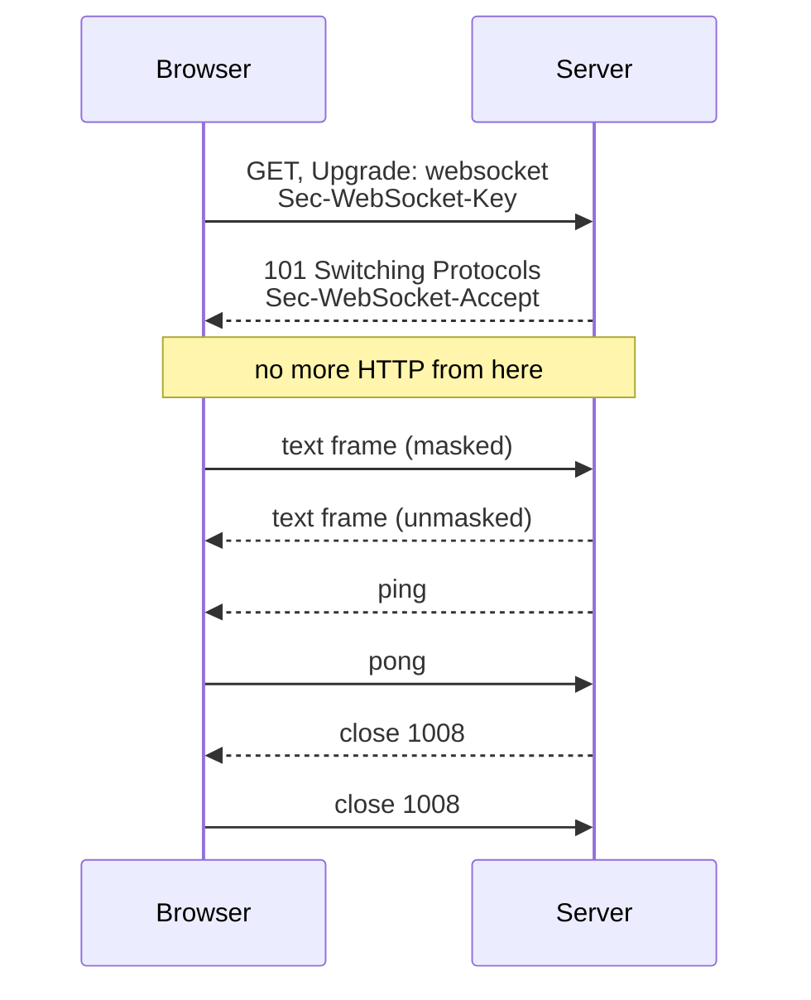

> [!tldr] Quick read
> - [[en/concepts/opening-handshake|Opening handshake]]: an HTTP/1.1 `GET` with `Upgrade: websocket` and a random key; the server answers `101` with `Sec-WebSocket-Accept = base64(SHA-1(key + a fixed GUID))`. After that blank line, the connection no longer speaks HTTP.
> - Data travels in [[en/concepts/websocket-frame|frames]]: 2–14 header bytes (FIN, opcode, MASK, length), then the payload. Opcode 1 text, 2 binary, 8 close, 9 ping, 10 pong.
> - [[en/concepts/masking|Masking]]: every frame the client sends must be XORed with 4 random bytes. It is not encryption; it prevents a kind of cache poisoning in old proxies.
> - [[en/concepts/ping-pong|Ping/Pong]] detects connections that died silently. A [[en/concepts/close-code|close code]] says why a connection closed; 1006 means it dropped without a goodbye, and it never travels on the wire.
> - A [[en/concepts/subprotocol|subprotocol]] lets both sides agree on the message content. Beyond these, RFC 6455 has nothing else: no rooms, no acks, no automatic reconnection.

> [!info] Context
> Station 2 of **the WebSocket and Socket.IO line**. The example is **flash-sale**, a time-limited discount shop: the queue page opens a realtime connection to receive "it's your turn" and the remaining stock. This post uses no library yet: I write a WebSocket server myself with Node's `http` module to see the bytes with my own eyes. You don't need to know the project's code.

> [!abstract]- Quick glossary for this post (click to open)
> - **Polling, long polling, SSE, full-duplex**: see [[en/posts/2026-11-22-websocket-realtime-options|station 1]].
> - **Byte, hex**: a byte is 8 bits, written in hex as two characters `00`–`ff` (`81` = 1000 0001).
> - **Bit**: a single 0 or 1 digit. The "highest bit" of a byte is the leftmost one.
> - **XOR**: the "different gives 1, same gives 0" operation on each bit. XORing twice with the same key gives back the original value.
> - **SHA-1, base64**: SHA-1 turns a string into a 20-byte "fingerprint"; base64 writes those bytes as printable characters.
> - **GUID**: a long identifier string, here a fixed constant written in the RFC.
> - **Intermediary proxy, proxy cache**: a forwarding machine in the middle (nginx, a corporate proxy) that may store a response to give to later users.
> - **UTF-8**: the way characters (including Vietnamese) are encoded as bytes.

## Picture it first: a phone call

WebSocket is like a phone call between the browser and the server.

| Everyday life | Concept |
|---|---|
| Picking up: "Hello, is this the shop?", "Yes, and I heard your password phrase" | [[en/concepts/opening-handshake\|Opening handshake]] |
| Each sentence is a stretch of speech; a long sentence takes several breaths | [[en/concepts/websocket-frame\|Frame]] (and fragments) |
| The customer speaks through a random voice changer, so an old switchboard doesn't mistake it for an internal command | [[en/concepts/masking\|Masking]] |
| "Can you still hear me?", "Yes" | [[en/concepts/ping-pong\|Ping/Pong]] |
| Hanging up with a reason: "time's up", "wrong password"; or losing signal before you can say goodbye | [[en/concepts/close-code\|Close code]] (1000, 1008…; 1006) |
| Agreeing at the start of the call to speak Vietnamese or English | [[en/concepts/subprotocol\|Subprotocol]] |



## The problem: what does "WebSocket" actually include?

I used to think the things I was used to with Socket.IO (naming events, joining rooms, reconnecting automatically) belonged to WebSocket. To know for sure what belongs to the protocol and what belongs to the library, the fastest way is to drop every library, write a server by hand following RFC 6455, and see how much there is to do. The answer: very little. And precisely because it is so little, Socket.IO has room to exist.

## How it works

<figure class="figure-map" style="--ar: 3 / 4">
<div class="frame"><iframe data-archify="../../diagrams/websocket-protocol/ws-life.en.html" title="Sequence diagram: HTTP handshake, masked frames, ping/pong and closing the connection with code 1008" loading="lazy"></iframe></div>
<figcaption><span><b>Figure 1.</b> A WebSocket connection has exactly three parts: a handshake over HTTP, frames exchanged in both directions, and a close with a reason code.</span><a href="../diagrams/websocket-protocol/ws-life.en.html" target="_blank" rel="noopener">Open full screen</a></figcaption>
</figure>

### Opening handshake: starting with HTTP

The **[[en/concepts/opening-handshake|opening handshake]]** is an ordinary HTTP/1.1 request. The client my hand-written server listened to sent:

```text
GET /flash-sale HTTP/1.1
upgrade: websocket
connection: upgrade
sec-websocket-version: 13
sec-websocket-key: qzgRpsTlKkdgxF5u/xLseQ==
sec-websocket-protocol: stock.v1, stock.v2
```

- `Upgrade: websocket` and `Connection: Upgrade`: asking to switch protocols on this very connection.
- `Sec-WebSocket-Version: 13`: the only version still in use.
- `Sec-WebSocket-Key`: 16 random bytes, written in base64. A new key for every connection.
- Browsers also always send `Origin` (which page is opening the connection). Node's client doesn't; station 6 shows why the server should read this header.

The server agrees with:

```text
HTTP/1.1 101 Switching Protocols
Upgrade: websocket
Connection: Upgrade
Sec-WebSocket-Accept: xONuix1HQdWE8MtAOLKFMf0JUA4=
```

`Sec-WebSocket-Accept` is computed by appending a fixed GUID from the RFC (`258EAFA5-E914-47DA-95CA-C5AB0DC85B11`) to the client's key, hashing with SHA-1, then writing it in base64. This is **not security**: anyone can compute it. Its purpose is to prove the server really understands WebSocket, rather than being a naive HTTP server that returns 101 or a cache replaying an old response. The browser checks this value; if it's wrong, the connection is aborted.

After the blank line that ends the 101 response, the TCP connection is still the same connection but **both sides stop speaking HTTP**. No more headers, no more status codes, only frames. That is why every proxy in the middle must know how to forward `Upgrade` (station 5).

Two variants worth knowing: over HTTP/2, WebSocket doesn't use `Upgrade` but an extended `CONNECT` (RFC 8441), and the same goes for HTTP/3 (RFC 9220). The idea stays the same: start with HTTP, then carry WebSocket frames.

### Frames: the unit of everything

All data after the handshake travels in **[[en/concepts/websocket-frame|frames]]**. Here is the first frame the client sends when calling `ws.send('mua')` ("buy"), read byte by byte:

```text
81 83 97 d2 5e 23 fa a7 3f
```

| Byte | Meaning |
|---|---|
| `81` = `1000 0001` | first bit FIN = 1 (this is the final fragment of the message), 3 reserved bits = 0, last 4 bits opcode = 1 (text) |
| `83` = `1000 0011` | first bit MASK = 1 (the payload is masked), remaining 7 bits = 3 (payload length) |
| `97 d2 5e 23` | masking key, 4 random bytes |
| `fa a7 3f` | the payload "mua", masked |

The **opcode** says what kind of frame it is: `1` text (must be valid UTF-8), `2` binary, `0` the continuation of a fragmented message, and three control types: `8` close, `9` ping, `10` pong.

The **length** uses three sizes so that small frames get small headers: under 126 bytes it is written directly in the 7 bits; from 126 to 65,535 bytes the 7 bits say `126` and the next 2 bytes hold the real length; larger than that, it says `127` and the next 8 bytes hold it. A frame therefore costs only 2 to 14 header bytes, compared with the few hundred header bytes of an HTTP request. That is where WebSocket is cheaper than polling.

**FIN and fragments**: a large message can be split into several frames; the first frame carries the real opcode with FIN = 0, the following frames carry opcode `0`, and the last frame has FIN = 1. Control frames (ping, pong, close) may be interleaved between fragments, but they cannot be fragmented themselves and their payload is at most 125 bytes.

Note: **WebSocket is a message-based protocol, not a byte stream**. The receiver always gets a whole message exactly as the sender sent it, never merged or torn apart as when reading straight from TCP. But the protocol says nothing about the *content* of a message: JSON, event names, or anything else is up to you.

**Extensions** can change how the 3 reserved bits are used. The most common is `permessage-deflate` (RFC 7692), which compresses each message and is negotiated through the `Sec-WebSocket-Extensions` header during the handshake. Compression saves bandwidth but costs CPU and memory per connection, so on a server with tens of thousands of connections it deserves thought.

### Masking: the client always masks, the server never does

**[[en/concepts/masking|Masking]]** is the strangest rule in RFC 6455: **every frame the client sends must be masked**, and a server receiving an unmasked frame must close the connection; conversely the server **must not** mask frames it sends. Masking means XORing each payload byte with the masking key, cycling through its 4 bytes: `fa XOR 97 = 6d` ('m'), `a7 XOR d2 = 75` ('u'), `3f XOR 5e = 61` ('a').

This is **not encryption**: the masking key is right there in the frame, and anyone who can read the frame can unmask it. Protecting the content is TLS's job (`wss://`). The reason masking exists lies in a 2011 study (Huang, Chen, Barth, Rescorla, Jackson): if an attacker's JavaScript could choose exactly the bytes on the wire, it could write a frame that looks exactly like an HTTP request. Some old transparent proxies didn't understand `Upgrade`, misread that frame as a request, and stored a fake response in their cache for every later user: cache poisoning. A random masking key chosen by the browser, a new key per frame, means the attacker no longer controls the bytes that actually pass through the proxy.

The server doesn't have to mask because the malicious code runs on the browser side, not the server side.

### Ping/Pong: still alive?

TCP doesn't tell you when the other end disappears silently: a phone goes into an elevator, Wi-Fi switches networks, the carrier's NAT clears its table. The connection "looks open" for ten minutes or more while nobody is listening. **[[en/concepts/ping-pong|Ping/Pong]]** solves that: one side sends a ping frame (opcode 9, arbitrary payload up to 125 bytes), and the other side **must** reply with a pong (opcode 10) carrying the same payload. If no pong arrives within some time, the connection is considered dead and is closed.

Ping has an important side effect too: proxies and load balancers see data flowing, so they don't cut the connection for "being silent too long" (station 5).

One point that is often overlooked: **the browser's WebSocket API has no function to send a ping**. The browser replies with a pong automatically when it receives a ping, but the page's JavaScript can't send a ping and can't see the pong either. If you want the client to detect a lost connection on its own, you have to build a heartbeat at the application layer (sending an ordinary `{"type":"ping"}` message). Socket.IO does exactly that (station 3).

### Close codes: hanging up with a reason

Closing a connection properly is a **closing handshake**: one side sends a close frame (opcode 8) carrying a 2-byte **[[en/concepts/close-code|close code]]** and a UTF-8 text reason (no more than 125 bytes in total); the other side answers with a close frame; then the server closes TCP. On the JavaScript side you see `onclose` with `code`, `reason` and `wasClean = true`.

| Code | Meaning | Example |
|---|---|---|
| 1000 | normal closure | the user leaves the queue page |
| 1001 | going away | the server is shutting down, the tab was closed |
| 1002 | protocol error | an unmasked client frame |
| 1003 | unsupported data | the server accepts only text but got binary |
| 1007 | invalid data | a text frame that isn't UTF-8 |
| 1008 | policy violation | expired token, no permission |
| 1009 | message too big | exceeds the size limit |
| 1011 | server error | an uncaught exception |
| 4000–4999 | private use | the application's own codes |

Three codes are **never sent on the wire** and are only used to inform the application: 1005 (closed without a code), 1006 (abnormal closure, no close frame at all) and 1015 (TLS failure). **1006 is the most important code in practice**: a pod died, the network dropped, a proxy cut the connection. It is the signal to reconnect; with 1008, on the other hand, reconnecting with the same token is pointless.

### Subprotocols: agreeing on a language

WebSocket only carries bytes; both sides have to agree on a format themselves. A **[[en/concepts/subprotocol|subprotocol]]** is the way to negotiate that during the handshake: the client sends a list in `Sec-WebSocket-Protocol` (`stock.v1, stock.v2`), the server picks **exactly one** of them and sends it back; `ws.protocol` on the client tells you the result. If the server returns a value the client didn't offer, the browser aborts the connection. Returning nothing means "no subprotocol".

Well-known subprotocols: STOMP and MQTT (messaging), `graphql-transport-ws` (GraphQL subscriptions), `wamp`. For a home-grown system, the subprotocol is a good place to **version the message format**: old clients ask for `stock.v1`, new clients ask for `stock.v2`, and the server serves both during the transition.

A side note: `Sec-WebSocket-Protocol` is almost the only header the browser lets JavaScript set when opening a WebSocket. That is why some people stuff a token into it; it works but it is an abuse, and station 6 discusses better ways to authenticate.

### What RFC 6455 doesn't have

Read the whole RFC and you won't find: event names, application-level acknowledgements (acks), rooms or groups, broadcasting to many people, automatic reconnection, replay of missed messages, authentication, or how to run on several servers. All of that is the job of the application or of a library. Socket.IO is one such library, and it goes further: it has its own protocol on top of WebSocket. That's station 3.

## Runnable example

[raw-websocket.ts](../code/websocket-protocol/raw-websocket.ts) is a hand-written WebSocket server using Node's `http` and `crypto` modules, no library at all. The client is the `WebSocket` built into Node 22+, with the same API as the browser. The server prints the handshake request, computes `Sec-WebSocket-Accept`, reads every byte of the first frame, sends a ping, then closes with code 1008. Finally it simulates a pod dying by destroying the TCP socket.

```bash
node raw-websocket.ts
```

```ts
const GUID = '258EAFA5-E914-47DA-95CA-C5AB0DC85B11'; // fixed constant from RFC 6455
const accept = (key: string) => createHash('sha1').update(key + GUID).digest('base64');

// read a client → server frame
const fin = (buf[0] & 0x80) !== 0, opcode = buf[0] & 0x0f;
const masked = (buf[1] & 0x80) !== 0;
let len = buf[1] & 0x7f, off = 2;
if (len === 126) { len = buf.readUInt16BE(2); off = 4; }
else if (len === 127) { len = Number(buf.readBigUInt64BE(2)); off = 10; }
// … then unmask:
if (maskKey) for (let i = 0; i < data.length; i++) data[i] ^= maskKey[i % 4];
```

```text
$ node raw-websocket.ts
1) Check the formula against the example in RFC 6455
   key "dGhlIHNhbXBsZSBub25jZQ==" → accept "s3pPLMBiTxaQ9kYGzzhZRbK+xOo="
   RFC says:                       "s3pPLMBiTxaQ9kYGzzhZRbK+xOo="

2) The opening request the client sent (an ordinary HTTP/1.1 GET)
   GET /flash-sale HTTP/1.1
   upgrade: websocket
   connection: upgrade
   sec-websocket-version: 13
   sec-websocket-key: qzgRpsTlKkdgxF5u/xLseQ==
   sec-websocket-protocol: stock.v1, stock.v2
   origin: (none)
   → server returns 101, accept = xONuix1HQdWE8MtAOLKFMf0JUA4=, picks subprotocol "stock.v2"

3) Client: onopen, chosen protocol = "stock.v2"

4) The first frame the client sent, byte by byte
   hex: 81 83 97 d2 5e 23 fa a7 3f 
   FIN=1  opcode=1 (text)  MASK=1  length=3
   mask key: 97d25e23
   payload on the wire: faa73f  (read as is: "..?")
   after XOR with the mask key: "mua"

5) Server sends ping "con-song-khong", client replies with pong (opcode 10) on its own: "con-song-khong"
   (in the browser there is no API to send a ping yourself; the browser replies with pong automatically)

6) Payload length: 5 bytes → 2nd byte = 5; 300 bytes → 126 + 2 length bytes; 70,000 bytes → 127 + 8 bytes

   server receives the answering close: code 1008
7) Client: onclose code=1008 reason="token hết hạn" wasClean=true

8) Wire cut, no close frame: code=1006 wasClean=false
   1006 is never sent on the wire; the client assigns it when the connection is lost abnormally
```

*(Output labels translated; the files themselves print Vietnamese.)*

Reading the results:

- **Part 1**: the accept formula produces exactly the example value given in RFC 6455.
- **Parts 2–3**: the handshake is just a `GET`. The server picks `stock.v2` out of the two subprotocols the client offered, and the client sees exactly that value.
- **Part 4**: the payload "mua" travels on the wire as `fa a7 3f`, which reads as garbage; only after XOR with the masking key does the text appear. The key and hex change on every run because the key is random.
- **Part 5**: the client replies with a pong automatically, with exactly the ping's payload ("con-song-khong", "still alive?"), without a single line of code.
- **Parts 7–8**: on a deliberate close, the client sees the code and the reason ("token expired"), `wasClean=true`; when the wire is cut, it only sees 1006.

## Misconceptions and common traps

- **"WebSocket has rooms, events, automatic reconnection."** RFC 6455 only has the handshake, text/binary frames, ping/pong and close. Everything else belongs to a library.
- **"Masking is there to secure the data."** The masking key is right in the frame. For security, use `wss://` (TLS). Masking only defends against cache poisoning in old proxies.
- **"`Sec-WebSocket-Accept` proves the server is trustworthy."** Anyone can compute it. It only proves the other end understands the WebSocket protocol.
- **"No error means the connection is alive."** TCP doesn't tell you when the other end disappears silently. You need ping/pong or an application-level heartbeat, and on the browser side only a hand-written heartbeat can do it.
- **Seeing 1006 and hunting for who sent code 1006**: nobody did. It means the connection was lost without a close frame, usually because of the network, a proxy cutting a silent connection, or the server process dying.
- **Reconnecting after code 1008** with the same token just gets rejected again. Read the close code before deciding whether to reconnect.
- **"WebSocket reads from TCP, so I have to reassemble messages myself."** WebSocket already frames by message; the receiver gets whole messages. Only when you write a low-level server like the example do you have to gather bytes into frames yourself.

## Self-check questions

> [!question]- After the 101 response, is the TCP connection a new one? Do the two sides still send HTTP headers?
> It is still the old TCP connection, but both sides stop speaking HTTP: no more headers or status codes, only WebSocket frames. That is why every proxy in the middle must understand and forward `Upgrade`.

> [!question]- The first byte of a frame is `81` and the second is `83`. What does this frame say?
> `81`: FIN = 1, opcode = 1, so a complete text message. `83`: MASK = 1 and a length of 3 bytes, so this is a frame sent by the client, followed by 4 bytes of masking key and 3 bytes of masked payload.

> [!question]- Why must the client mask the payload while the server doesn't?
> The attacker's code runs in the browser. If it could choose exactly the bytes on the wire, it could fake an HTTP request and trick an old proxy into poisoning its cache. The browser's random masking key takes that power away. The server doesn't run attacker code, so it doesn't need to mask.

> [!question]- The client receives `onclose` with code 1006. What does that tell you, and should you reconnect?
> The connection was lost without a close frame: the network dropped, a proxy cut it, the server died. 1006 is never sent on the wire; the client assigns it itself. This is a case where you should reconnect (with a delay and randomness). With 1008, on the contrary, reconnecting with the same token is pointless.

> [!question]- Can the browser send a ping on its own? If not, how does the client detect a lost connection?
> No, the browser's WebSocket API only replies with pong automatically. The client must build an application-level heartbeat: periodically send an ordinary message and wait for a reply, and if it times out, close and reconnect itself. Socket.IO has this mechanism built in.

## References

- [RFC 6455: The WebSocket Protocol](https://www.rfc-editor.org/rfc/rfc6455) (section 4 handshake, 5 framing, 5.3 masking, 7.4 close codes, 10.3 the reason for masking)
- [WHATWG WebSockets Standard](https://websockets.spec.whatwg.org/) (the browser API: no ping, `bufferedAmount`)
- [RFC 7692: Compression Extensions for WebSocket](https://www.rfc-editor.org/rfc/rfc7692) (`permessage-deflate`)
- [RFC 8441: Bootstrapping WebSockets with HTTP/2](https://www.rfc-editor.org/rfc/rfc8441) and RFC 9220 for HTTP/3
- Huang, Chen, Barth, Rescorla, Jackson, [Talking to Yourself for Fun and Profit](https://www.adambarth.com/papers/2011/huang-chen-barth-rescorla-jackson.pdf), W2SP 2011
