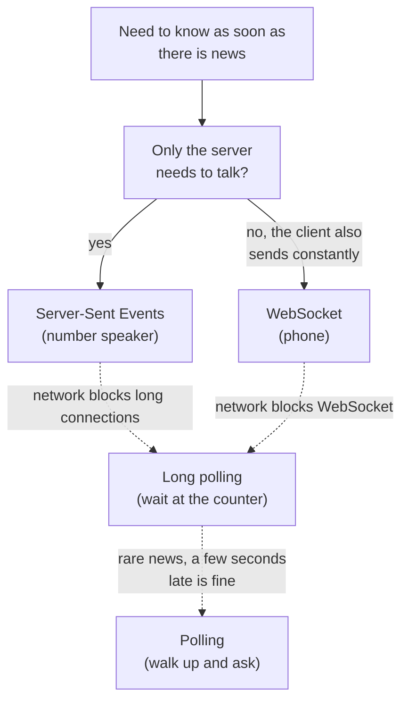
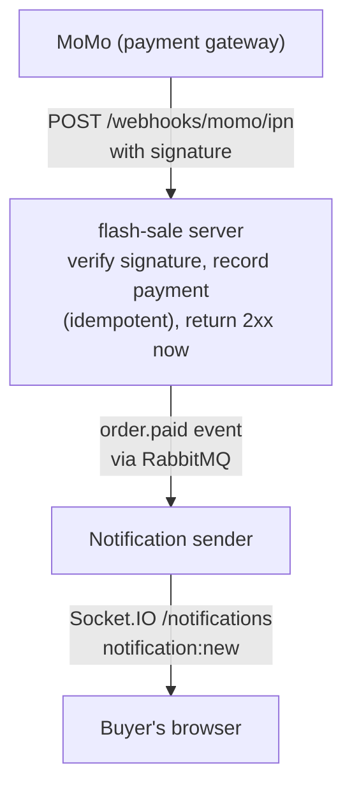

> [!tldr] Quick read
> - HTTP is request-response: the server may only speak when the client asks. To have the [[en/concepts/server-push|server send news on its own]], you have to work around that rule.
> - [[en/concepts/polling|Polling]] asks periodically: the easiest, but news arrives half a cycle late on average and most requests come back empty. In the example, asking every 2 seconds gives an average latency of about 1 second.
> - [[en/concepts/long-polling|Long polling]]: the server holds the request until there is news. Almost instant, but every message costs a new request.
> - [[en/concepts/server-sent-events|Server-Sent Events]]: an HTTP response that never ends, into which the server writes event after event. One-way, with automatic reconnection built in. Often enough when only the server needs to talk.
> - WebSocket opens a [[en/concepts/full-duplex|full-duplex]] connection with a single HTTP request. Socket.IO is a **library** that uses long polling and WebSocket underneath, not another name for WebSocket (station 3).
> - [[en/concepts/webhooks|Webhooks]] often end up in the same table but are a different kind of thing: they are **someone else's server making an HTTP call to your server** (MoMo saying "paid"). A browser cannot receive a webhook; after the server receives it, it must forward the news to the browser using one of the four ways above.

> [!info] Context
> Station 1 of **the WebSocket and Socket.IO line**. The example is **flash-sale**, a time-limited discount shop: at exactly 21:00, thousands of people open the page of a campaign that has only a few hundred items. Whoever arrives first gets a place in the queue; when their turn comes, the server must immediately say "you have 5 minutes to pay" and, at the same time, update the remaining stock for everyone watching. You don't need to know NestJS or the project's code.

> [!abstract]- Quick glossary for this post (click to open)
> - **HTTP request / response**: the browser sends a request, the server returns a response. See the [[en/posts/2026-11-18-api-foundations|API Foundations]] station.
> - **TCP connection**: the two-way pipe between two machines that HTTP and WebSocket run on top of. Opening one costs a few round trips over the network.
> - **Header**: the `Name: value` lines at the top of every request and response (cookies, content type…), usually a few hundred bytes.
> - **Latency**: the time from when an event happens on the server to when the browser knows about it.
> - **Proxy**: a machine standing between the browser and the server that forwards requests (nginx, a load balancer, a corporate proxy).
> - **HTTP/2**: the HTTP version that carries many requests in parallel over one TCP connection.
> - **Payment gateway, IPN**: a service that collects money for you (MoMo, VNPay, Stripe). IPN is the name Vietnamese gateways give to the webhook that reports a payment result.
> - **Public URL**: an address any machine on the Internet can call. A server has one; a user's browser does not.
> - **RabbitMQ**: a message queue system between the parts of a backend. See [[en/series/rabbitmq|the RabbitMQ line]].

## Picture it first: waiting for your order at a coffee shop

You order at a busy coffee shop and want to know the moment your drink is ready. There are four ways for *you* to find out, plus one way for the shop to hear about something from someone else:

| Everyday life | Concept |
|---|---|
| The shop tells you when your drink is ready; you don't have to ask | [[en/concepts/server-push\|Server push]] |
| Every two minutes you walk up to the counter and ask "is it ready?" | [[en/concepts/polling\|Polling]] |
| You ask at the counter and **stand there waiting**; the staff answer when it's ready (or after 30 seconds say "not yet, ask again") | [[en/concepts/long-polling\|Long polling]] |
| The shop has a **number-calling speaker**: the shop talks, customers only listen and can't talk back | [[en/concepts/server-sent-events\|Server-Sent Events]] |
| The shop hands you a **phone**: both sides can talk whenever they like, even at the same time | WebSocket, [[en/concepts/full-duplex\|full-duplex]] |
| You pay with an e-wallet; **the wallet calls the shop** (not you) to say "table 5 has paid". Only then does the shop tell you over the speaker or the phone | [[en/concepts/webhooks\|Webhooks]] |



## The problem: HTTP doesn't let the server speak first

I used to think "realtime" was a separate technology a project had to pick from day one, and that Socket.IO was another name for WebSocket. It turns out realtime is just one question: **how does the server tell the browser something without waiting for the browser to ask?** HTTP was designed as request-response: the browser sends a request, the server returns exactly one response, done. The server has no way to send anything to the browser on its own unless the browser asks first.

For flash-sale, that is a real problem. At 21:00:03 the queue gives a turn to person number 512: if that person's page only learns about it 10 seconds later, they lose 10 seconds of their 5-minute reservation. The remaining stock shown on the page also has to change with every order, or a thousand people will click "buy" on an item that is already gone.

## How it works

<figure class="figure-map" style="--ar: 3 / 4">
<div class="frame"><iframe data-archify="../../diagrams/websocket-realtime-options/four-ways.en.html" title="Sequence diagram: polling, long polling and WebSocket waiting for the same stock event" loading="lazy"></iframe></div>
<figcaption><span><b>Figure 1.</b> The same "stock changed" event: polling only learns about it at the next poll, long polling learns at once but has to ask again, WebSocket needs only one request at the start.</span><a href="../diagrams/websocket-realtime-options/four-ways.en.html" target="_blank" rel="noopener">Open full screen</a></figcaption>
</figure>

### Server push: the road in the other direction

**[[en/concepts/server-push|Server push]]** is when the server sends data on its own when something happens. All four ways below aim to do that; they differ in who holds the connection, how long the connection lives, and how much each message costs.

Don't confuse it with **HTTP/2 Server Push**, an entirely different feature: the server sends CSS and JS files along before the browser asks for them. It never delivers data to the page's JavaScript, and Chrome removed it in 2022. Don't let the name fool you.

### Polling: asking periodically

**[[en/concepts/polling|Polling]]** is the most naive way: every N seconds the browser sends `GET /queue/status`. The upside is that there is nothing new to learn: ordinary requests, ordinary caching, it passes through every proxy and firewall, and the server keeps no state.

The cost has two sides, and they pull against each other:

- **Latency**: an event that happens at a random moment between two polls waits N/2 seconds on average, N seconds at worst.
- **Waste**: most requests come back with "nothing yet". 10,000 people asking every 2 seconds is 5,000 requests per second, each carrying a few hundred bytes of headers and running through the whole authentication middleware chain, just to hear "not yet".

Lower N and latency drops but the cost rises; raise N and it gets cheap but slow. Polling fits when news is rare and a few seconds of delay don't matter: the status of an order being delivered, the progress of a report export.

### Long polling: ask, then stand and wait

**[[en/concepts/long-polling|Long polling]]** fixes latency with a trick: the server *doesn't answer right away*. If there is nothing new, it keeps the request hanging. When an event happens, it answers the hanging request immediately; if the wait times out (usually 20–30 seconds) with still nothing, it returns an empty response. As soon as the browser gets a response, it sends the next request. RFC 6202 describes this technique and its problems.

Latency is close to zero, and it is still plain HTTP. But:

- **Every message is a new request**, with headers and an authentication round. When messages come thick and fast (stock changing every 100 ms), long polling turns into high-speed polling.
- **The gap between two requests**: a message that happens right after the old response returns and before the new request arrives has to be remembered by the server. That is why the client sends along "I have received up to message number X" (`after=3` in the example).
- **The server holds a great many hanging requests**, and when you run several servers, the next request must reach the very server that remembers its session. Station 5 comes back to this with Socket.IO.

Long polling is rarely the first choice nowadays, but it is the **fallback**: Socket.IO starts every connection with long polling and only then tries WebSocket (station 3), so it still works behind proxies that block WebSocket.

### Server-Sent Events: a response that never ends

**[[en/concepts/server-sent-events|Server-Sent Events]]** (SSE) use a single request that the server never finishes answering. The response has `Content-Type: text/event-stream`, and whenever there is news, the server writes a few more lines of text:

```text
id: 42
event: stock_update
data: {"sku":"A1","left":41}

```

A blank line ends an event. On the browser side, the HTML standard has `EventSource` built in:

```ts
// illustration only, does not run directly (runs in the browser)
const es = new EventSource('/campaigns/c-21h/stream');
es.addEventListener('stock_update', (e) => render(JSON.parse(e.data)));
```

The best thing about SSE is what it has built in that WebSocket lacks: **the browser reconnects automatically** when the connection drops, and sends a `Last-Event-ID` header with the id of the last message it received, so the server can replay the missed messages. The server can even tune the reconnection delay with a `retry: 3000` line. Because it is plain HTTP, SSE passes through proxies, uses existing cookies and authentication, and can be compressed with gzip.

Limits:

- **One-way only**, server → client, and text only (UTF-8). If the client wants to send something, it uses an ordinary HTTP request alongside.
- **HTTP/1.1 limits a browser to about 6 connections per domain**, shared across all tabs. Open the page in 7 tabs and the 7th tab hangs. HTTP/2 carries many streams over one connection, so it doesn't hit this (browsers and servers usually allow about 100 concurrent streams).
- `EventSource` doesn't let you set arbitrary headers (such as `Authorization`), so authentication is usually done with cookies.

For flash-sale, most of the realtime traffic is server → client (payment turns, stock, order results). SSE can do all of that. The client only sends "which campaign I'm watching", which an ordinary HTTP request can do.

### WebSocket: a two-way call

**WebSocket** (RFC 6455, 2011) starts with an HTTP request carrying the `Upgrade: websocket` header. The server agrees with `101 Switching Protocols`, and from then on **that same TCP connection no longer speaks HTTP**: the two sides send small frames (a few header bytes, then data) in both directions, at any time. Station 2 dissects this process byte by byte.

**[[en/concepts/full-duplex|Full-duplex]]** means the two directions are independent: while the server is pushing stock updates, the client can still send commands, and nobody has to wait for their turn. HTTP/1.1 is half-duplex in request-response style; long polling and SSE only emulate the server → client direction.

The price of WebSocket is that you **take care yourself of what HTTP and SSE give you for free**: no automatic reconnection, no replay of missed messages, no notion of "which event this is", no per-message authentication, and proxies and load balancers must be configured to forward `Upgrade`. That is exactly the gap Socket.IO fills, and also the reason people tend to mistake the two for one.

### What about Socket.IO?

Socket.IO is **not a fifth way** on a par with the four above. It is a library (a Node.js server and clients for many platforms) that uses **long polling and WebSocket underneath**, then adds on top event names, acknowledgements, rooms and automatic reconnection. It has **its own protocol**, so a plain WebSocket client cannot talk to a Socket.IO server. flash-sale uses Socket.IO for both the queue and notifications. Stations 3 and 4 are about it.

### What about webhooks?

Many comparison articles put **[[en/concepts/webhooks|webhooks]]** in a fifth column next to polling, long polling, SSE and WebSocket. That arrangement invites misunderstanding, because a webhook answers a different question. The four ways above answer "how does **the browser** learn about news?". A webhook answers "how does **my server** learn about something that happened in **someone else's system**?".

A webhook is an ordinary HTTP request, just in the other direction: you register a URL with the other party in advance (a payment gateway, GitHub, a shipping company), and when an event happens, **their server sends a `POST` to that URL**. In flash-sale, the buyer pays on MoMo's page; the flash-sale server doesn't know when that finishes, so MoMo calls `POST /webhooks/momo/ipn` with a signature.

Why can't a browser receive webhooks? Because the sender must call a **public URL that is always available**. A user's browser has no such address: it sits behind the carrier's NAT, changes IP constantly, goes away when the tab closes, and runs no HTTP server. So a webhook always stops at the server, and the server must **forward** the news to the browser using one of the four ways above. flash-sale does exactly this chain:



Without webhooks, the server would have to **poll** the other side itself: every few seconds call MoMo's "has this order been paid?" API. Exactly the drawbacks of polling above, only between two servers. A webhook is the server-to-server version of "don't ask, I'll tell you".

Because they are HTTP calls coming in from the Internet, webhooks have rules of their own that the other four don't:

- **Anyone can call that URL**, so you must authenticate with a signature (HMAC) over the exact raw bytes of the body, plus a timestamp against replay. Stripe also lets you filter by an IP allowlist.
- **The sender will retry** when you return an error or answer slowly: Stripe retries for up to 3 days, GitHub counts it as a failure if there is no `2xx` within 10 seconds. Consequence: an event can arrive **several times** and **out of order**, so processing must be idempotent (record the ids of events already processed).
- **Return `2xx` right away** and push the heavy work into a queue, as flash-sale pushes `order.paid` through RabbitMQ.
- **A webhook may never arrive** (the sender runs out of retries, your endpoint is down for a long time). So you still need a periodic reconciliation job that asks the other side's API again, which is back to polling, but as a safety net rather than the main road.

The details of how flash-sale verifies signatures and prevents duplicate processing (two layers of idempotency) are in the [[en/posts/2026-11-18-api-styles|Five API styles]] station of the API line.

### Quick comparison

| | Polling | Long polling | SSE | WebSocket | Webhook |
|---|---|---|---|---|---|
| Who calls whom | browser → server | browser → server | browser opens, server writes | browser opens, both send | other server → my server |
| Message direction | client asks | client asks | server → client | two-way | outside → server |
| Latency | N/2 on average | near 0 | near 0 | near 0 | near 0 (when it arrives) |
| Requests per message | (many empty requests) | 1 | 0 | 0 | 1 |
| Connection | short | hangs until news | long-lived | long-lived | short |
| Auto reconnect, replay | not needed | do it yourself | built in (`Last-Event-ID`) | do it yourself | sender retries |
| Data | anything | anything | text | text and binary | usually JSON |
| Through old proxies | always | always | usually | sometimes blocked | not relevant (server to server) |

## Runnable example

[compare.ts](../code/websocket-realtime-options/compare.ts) builds a server with all four routes (`/poll`, `/long-poll`, `/sse`, and WebSocket via the `ws` library) and emits 5 stock events at fixed times within 6 seconds. Four clients run in parallel, count the number of HTTP requests and measure the latency from when an event happens to when the client receives it. The WebSocket client is the `WebSocket` built into Node 22+, with the same API as the browser.

```bash
npm i ws
node compare.ts
```

```ts
// server-side long polling: if there is nothing yet, hold the request
const fresh = log.filter((e) => e.id > after);
if (fresh.length) return res.end(JSON.stringify(fresh));
const done = (e: Ev) => { clearTimeout(timer); waiting.delete(done); res.end(JSON.stringify([e])); };
const timer = setTimeout(() => { waiting.delete(done); res.end('[]'); }, LONG_POLL_HOLD);
waiting.add(done);

// SSE: a response that never ends
res.writeHead(200, { 'content-type': 'text/event-stream', 'cache-control': 'no-cache' });
// … for each event:
res.write(`id: ${id}\ndata: ${JSON.stringify(e)}\n\n`);
```

```text
$ node compare.ts
5 events in 6 seconds

method          HTTP requests  received   avg latency      max latency
polling                3           4          1025 ms        1323 ms
long polling           6           5             3 ms           5 ms
SSE                    1           5             5 ms          10 ms
WebSocket              1           5             4 ms           7 ms
```

*(Output labels translated; the files themselves print Vietnamese.)*

Reading the results:

- **Polling** asks 3 times (seconds 0, 2, 4) and its average latency is about 1 second, exactly half of the 2-second cycle. The fifth event (second 5.2) **has not arrived** when the 6 seconds are up: only the next poll would see it.
- **Long polling** is almost instant, but costs 6 requests for 5 events (5 answered and a final one still hanging). The denser the messages, the more requests.
- **SSE and WebSocket** both cost exactly one HTTP request at the start and a few milliseconds of latency. The difference between them is not speed but direction: SSE is server → client only.

## Misconceptions and common traps

- **"Socket.IO is WebSocket."** Socket.IO is a library with its own protocol, running over long polling or WebSocket. A plain WebSocket client cannot connect to a Socket.IO server (station 3 tries it).
- **"Realtime means WebSocket."** Most "realtime" features are server → client: notifications, progress, prices. SSE can do them with fewer things to worry about (automatic reconnection, replay, passing through proxies, using existing cookies).
- **"Polling is cheap because it's simple."** Simple for the person writing it, not cheap for the server: most requests are useless, and shortening the cycle to cut latency raises the cost linearly.
- **"HTTP/2 Server Push can replace WebSocket."** That feature pushes static files into the browser cache, JavaScript can't read them, and Chrome removed it.
- **Opening SSE over HTTP/1.1 in many tabs** exceeds the limit of about 6 connections per domain, and later tabs hang. Turn on HTTP/2 or funnel everything into one shared connection.
- **"Long polling is obsolete, drop it."** It is still the fallback when a corporate network blocks WebSocket; Socket.IO keeps it for that reason.
- **"Use a webhook to notify the browser."** You can't: a webhook sender needs a public URL that is always available, and a browser has none. The webhook stops at the server; the server forwards it via SSE, WebSocket or polling.
- **"A webhook arrives exactly once, in order."** The sender retries when you answer slowly or with an error, so the same event can arrive several times and out of order. Process idempotently, return `2xx` quickly, and keep a reconciliation job in case the webhook never comes.

## Self-check questions

> [!question]- Why doesn't plain HTTP let the server send news first?
> HTTP is request-response: every response must answer a request the client sent. The server has no channel to send data on its own when the client hasn't asked. Every realtime technique is either a way to keep a request open in advance (long polling, SSE) or a way to switch the connection to another protocol (WebSocket).

> [!question]- What average latency does polling every 2 seconds give, and what do you pay to lower it to 0.5 seconds?
> About 1 second on average (half a cycle), 2 seconds at worst. Lowering it to 0.5 seconds multiplies the number of requests by 4, most of them still coming back empty.

> [!question]- How does long polling differ from polling, and why is it still expensive when messages come thick and fast?
> The server holds the request until there is news instead of answering at once, so latency is close to zero. But every message still ends a response and the client must send a new request, so the denser the messages, the more requests.

> [!question]- What does SSE have built in that WebSocket doesn't?
> The browser reconnects automatically, sends `Last-Event-ID` so the server can replay missed messages, the delay is tunable with `retry:`, and because it is plain HTTP it can use existing cookies, compression and proxies. In exchange, SSE is one-way and text only.

> [!question]- When would you pick WebSocket over SSE for flash-sale?
> When the client also has to send data constantly and quickly on the same channel (games, chat, collaborative drag and drop), or when you need binary data. If the client only sends a command now and then, SSE plus ordinary HTTP requests is enough.

> [!question]- A buyer pays on MoMo. Why doesn't MoMo notify their browser directly, and what route does the "paid" news take to reach the browser?
> A webhook needs a public URL that is always available, while the browser sits behind NAT, has no fixed address and runs no HTTP server. So MoMo calls the webhook on the flash-sale server; the server verifies the signature, records the payment, pushes an `order.paid` event through RabbitMQ, and the notification sender then sends `notification:new` down to the browser over Socket.IO.

## References

- [RFC 6455: The WebSocket Protocol](https://www.rfc-editor.org/rfc/rfc6455)
- [WHATWG HTML: Server-sent events](https://html.spec.whatwg.org/multipage/server-sent-events.html) (the `text/event-stream` format, `Last-Event-ID`, `retry`)
- [MDN: Using server-sent events](https://developer.mozilla.org/en-US/docs/Web/API/Server-sent_events/Using_server-sent_events) (the 6-connection limit on HTTP/1.1)
- [RFC 6202: Known Issues and Best Practices for the Use of Long Polling and Streaming in Bidirectional HTTP](https://www.rfc-editor.org/rfc/rfc6202)
- [Socket.IO: How it works](https://socket.io/docs/v4/how-it-works/)
- [Stripe: Receive events in your webhook endpoint](https://docs.stripe.com/webhooks) (public HTTPS URL, signatures, retries for up to 3 days, no ordering guarantee, duplicates)
- [GitHub: Best practices for using webhooks](https://docs.github.com/en/webhooks/using-webhooks/best-practices-for-using-webhooks) (return `2xx` within 10 seconds)
