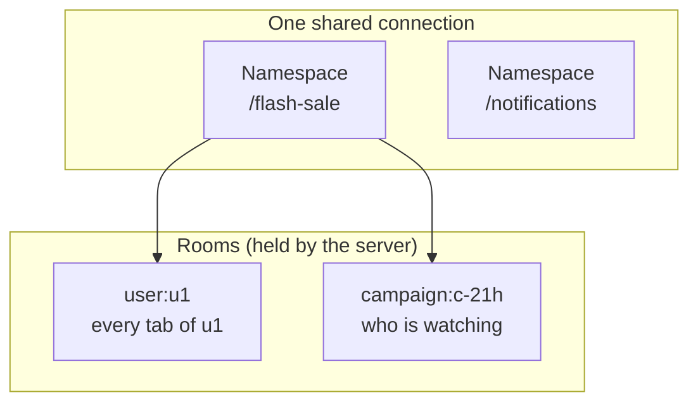

> [!tldr] Quick read
> - A [[en/concepts/namespace|namespace]] (`/flash-sale`, `/notifications`) splits a server into channels with their own middleware and handlers. A [[en/concepts/room|room]] is a group of sockets **only the server knows about**; `to('user:u1').emit()` reaches every tab of one person.
> - [[en/concepts/multiplexing|Multiplexing]]: two `io()` calls to two namespaces on the same origin share **one** connection, and the `transports` option of the second call is **ignored**. flash-sale is very likely caught in exactly this trap.
> - [[en/concepts/auto-reconnect|Auto reconnect]]: the client waits 1, 2, 4, 5, 5… seconds (with randomness) and tries again, forever. Set `reconnectionAttempts: 5` and after the fifth try the client gives up for good.
> - The default [[en/concepts/delivery-guarantee|delivery guarantee]] is **at most once**: when the client is disconnected it buffers its own messages, but messages the server sends during that time are lost.
> - [[en/concepts/connection-state-recovery|Connection state recovery]] keeps the id, rooms and missed messages for a short while, but it doesn't work with the Pub/Sub-based Redis adapter that flash-sale uses.

> [!info] Context
> Station 4 of **the WebSocket and Socket.IO line**. The example is **flash-sale**, a time-limited discount shop: when someone's turn comes, the server pushes `checkout_ready` to exactly that person (every tab they have open), and pushes `stock_update` to everyone watching a campaign. The frontend opens two Socket.IO connections: `/flash-sale` and `/notifications`. You don't need to know NestJS or React.

> [!abstract]- Quick glossary for this post (click to open)
> - **Engine.IO, transport, `transports: ['websocket']`, CONNECT packet, ack**: see [[en/posts/2026-11-22-websocket-socketio|station 3]].
> - **Origin**: the `scheme://domain:port` part of a URL. `https://api.shop.vn/flash-sale` and `https://api.shop.vn/notifications` share the same origin.
> - **Manager**: the object in `socket.io-client` that holds one Engine.IO connection and takes care of reconnecting.
> - **React effect (`useEffect`)**: React code that runs after the UI is drawn, often to open a connection. A child component's effect runs **before** its parent's effect.
> - **At most once / at least once**: no more than once (may be lost) / at least once (may be duplicated). See [[en/concepts/at-least-once-delivery|the RabbitMQ station]].
> - **Adapter**: the part of Socket.IO that decides which sockets a broadcast reaches; station 5 covers it in depth.

## Picture it first: an office building with an internal switchboard

The switchboard from station 3 now serves an office building.

| Everyday life | Concept |
|---|---|
| Each department has its own extension (sales, customer care) | [[en/concepts/namespace\|Namespace]] |
| A chat group set up by the receptionist: whoever is added hears it; members can't see the member list | [[en/concepts/room\|Room]] |
| One line into the building carries calls to many extensions | [[en/concepts/multiplexing\|Multiplexing]] |
| When a call drops, the phone redials after 1 second, 2 seconds, 4 seconds… | [[en/concepts/auto-reconnect\|Auto reconnect]] |
| The receptionist reads an announcement while your call is dropped: you never hear it | [[en/concepts/delivery-guarantee\|At most once]] |
| The receptionist records the last 2 minutes; call back in time and you can hear it again | [[en/concepts/connection-state-recovery\|Connection state recovery]] |



## The problem: "but WebSocket has rooms"

I used to think rooms, namespaces and automatic reconnection were WebSocket features. Station 2 showed that RFC 6455 has none of them: they belong to Socket.IO. And once they belong to a library, they have rules of their own that you only see by reading the source code: which option gets ignored, which message gets lost, when the client gives up. All three can happen in flash-sale.

## How it works

<figure class="figure-map" style="--ar: 1 / 1">
<div class="frame"><iframe data-archify="../../diagrams/websocket-rooms/rooms.en.html" title="Architecture diagram: three event sources broadcast into the rooms user:u1, campaign:c-21h and user:u2 across two namespaces, and the rooms forward messages to the tabs" loading="lazy"></iframe></div>
<figcaption><span><b>Figure 1.</b> The server broadcasts into a room, and the room forwards to every socket in it; a person with two tabs receives on both, and no client knows which rooms it is in.</span><a href="../diagrams/websocket-rooms/rooms.en.html" target="_blank" rel="noopener">Open full screen</a></figcaption>
</figure>

### Namespaces: channels by path

A **[[en/concepts/namespace|namespace]]** splits one Socket.IO server into several logical channels by path. Each namespace has its own middleware (for example authentication), its own handlers and its own rooms. flash-sale has two:

- `/flash-sale`: `checkout_ready`, `stock_update`, `queue_position`, `campaign_ended`, `order_result`; the client sends `subscribe_campaign`.
- `/notifications`: `notification:new`, `notification:unread-count`, `notification:read`.

On the client side, the namespace is in the URL: `io('https://api…/flash-sale')`. That path is **not** an HTTP path; the real requests always go to `/socket.io/` (configurable with the `path` option). The namespace only appears in the CONNECT packet `40/flash-sale,` and in every packet after it. NestJS attaches each gateway to a namespace via `@WebSocketGateway({ namespace: '/flash-sale' })`.

### Rooms: groups only the server knows about

A **[[en/concepts/room|room]]** is a group of sockets managed by the server. The server puts a socket in a room with `socket.join('campaign:c-21h')`, and broadcasts to the whole room with `to('campaign:c-21h').emit(…)`. A few things to know:

- **The client knows nothing about rooms.** There is no client-side API to see which rooms you are in or to join one yourself. The client only sends an event (`subscribe_campaign`), and the server decides which room to put it in. This is also the authorization layer: don't write handlers along the lines of "whatever room name the client sends, put it in that room".
- **Every socket is automatically in a room named after its own id**, so `to(socketId).emit()` sends to that socket alone.
- **Per-user rooms** are the most important pattern: on connection, after authentication, put the socket in `user:<id>`. If that person opens three tabs, that's three sockets in the same room, and `to('user:u1').emit('checkout_ready')` reaches all three. flash-sale does exactly that in `handleConnection`.
- **Rooms live in the server's RAM and vanish when the socket disconnects.** A reconnection is a new socket (new id), in no room at all, and it has to `join` again. flash-sale's client-side hook re-sends `subscribe_campaign` on every `connect` event for exactly this reason.
- **Rooms don't cross pod boundaries**: the default adapter only knows the sockets in the current pod's RAM. Station 5 fixes this with the Redis adapter.

### Multiplexing: two namespaces, one connection, and an ignored option

**[[en/concepts/multiplexing|Multiplexing]]**: when you call `io()` twice for two namespaces on **the same origin**, `socket.io-client` doesn't open two connections. It keeps a cache of Managers per origin, and the second call reuses the Manager of the first. Reading the `socket.io-client` 4.8 source (the `lookup` function):

```ts
// excerpt from socket.io-client 4.8.4, build/esm/index.js (trimmed)
const sameNamespace = cache[id] && path in cache[id]['nsps'];
const newConnection = opts.forceNew || false === opts.multiplex || sameNamespace;
if (newConnection) io = new Manager(source, opts);
else { if (!cache[id]) cache[id] = new Manager(source, opts); io = cache[id]; }
```

That saves one connection. But there is a consequence that is very hard to spot: **connection-level options** (`transports`, `path`, `reconnection*`, `timeout`…) **only take effect on the call that creates the Manager**. Whatever options a later call passes are silently ignored, with no warning. Namespace-level options such as `auth` stay separate per namespace.

Now look at flash-sale:

- `SocketProvider` (wrapping the whole app, in the root layout) calls `io(origin + '/flash-sale', { transports: ['websocket'], reconnectionAttempts: 5, … })`.
- `NotificationSocketBridge` (deeper, in the layout of pages that require login) calls `io(origin + '/notifications', { auth })` with default options.
- Both take the origin from the same environment variable `NEXT_PUBLIC_API_URL`, and both open their connection in an effect that depends on `isAuthenticated`.

React runs **child effects before parent effects**. `NotificationSocketBridge` is a descendant of `SocketProvider`, so when the user logs in (or loads a page while already logged in), the `/notifications` call runs first, creates the Manager with the default transports (polling, then upgrade), and the `transports: ['websocket']` option of `/flash-sale` is ignored. At the same time, `reconnectionAttempts: 5` doesn't apply either (the Manager uses the default: try forever). I haven't measured this on the live deployment, but the example below reproduces exactly this order and prints the transport actually used.

The consequence lands in station 5: as long as long polling is in play, you need sticky sessions, and flash-sale's ingress runs 3 pods without sticky sessions enabled. The fix: use one shared configuration for both namespaces (a single module that creates the Manager and then calls `manager.socket('/notifications', { auth })`), or pass `forceNew: true` to split the two connections completely.

### Auto reconnect: redialing, but is there a limit?

**[[en/concepts/auto-reconnect|Auto reconnect]]** is the client-side Manager's job. When the connection drops abnormally (1006, heartbeat timeout, server shutdown), it waits and tries again with increasing delays:

- `reconnectionDelay` 1000 ms, doubling each time, up to `reconnectionDelayMax` 5000 ms: roughly 1, 2, 4, 5, 5, 5… seconds.
- `randomizationFactor` 0.5: each delay is randomly shifted by up to ±50%, so thousands of clients don't retry at the same moment (station 5).
- `reconnectionAttempts` defaults to **`Infinity`**.

If you set `reconnectionAttempts: 5` like flash-sale's `/flash-sale` configuration (if it takes effect, see the section above), the total waiting time is only about 1 + 2 + 4 + 5 + 5 ≈ 17 seconds. A deploy or Redis failover that takes longer than that, and the client emits `reconnect_failed` and **never tries again on its own**, even after the server is back up. The user has to reload the page to receive `checkout_ready`. If you want a limit, it has to come with a "connection lost, click to retry" UI.

Two cases where the client does **not** reconnect on its own: you call `socket.disconnect()` on the client, or **the server deliberately** calls `socket.disconnect()` (reason `io server disconnect`). The latter is intentional: when the server kicks a client out (for example a bad token), the client shouldn't stubbornly come back. Station 5 uses this detail for when a pod shuts down.

### Delivery guarantee: at most once

The Socket.IO documentation states the default **[[en/concepts/delivery-guarantee|delivery guarantee]]** clearly:

- **Ordering is preserved**, even while upgrading from polling to WebSocket.
- **At most once**: messages can be lost. If the connection drops midway, the sender doesn't know whether the receiver got the message, and nothing is resent after reconnecting.
- **The client buffers, the server doesn't**: if the client calls `emit` while disconnected, the message is buffered and sent on reconnection. The server has **no buffer at all** for absent clients; a message broadcast into a room at that moment only reaches the sockets currently in the room.

For flash-sale, this is real: the queue gives a turn to person number 512 and broadcasts `checkout_ready` into `user:<id>` just as their phone is switching from Wi-Fi to 4G. The message is lost. They have 5 minutes to pay and don't know it. `stock_update` heals itself (the next tick broadcasts the new number), but `checkout_ready` and `order_result` don't.

If you want **at least once** in the server → client direction, you have to build it: give every message an id, store it in the database, have the client remember the last id it received and send it on reconnection so the server can replay, and have the client ignore duplicates (flash-sale's notification hook already deduplicates by `id` within 60 seconds, which is the right direction). A cheaper approach that is good enough: **after every `connect`, call a REST API to fetch the state again** ("do I have a payment turn waiting?"). The client → server direction has it built in: the `retries` option together with `ackTimeout` makes the client resend until it gets an ack.

### Connection state recovery: recording the last 2 minutes

Socket.IO 4.6 added **[[en/concepts/connection-state-recovery|connection state recovery]]**. Enable it on the server:

```ts
const io = new Server(httpServer, {
  connectionStateRecovery: { maxDisconnectionDuration: 2 * 60 * 1000 },
});
```

The server keeps the state of a socket that just dropped (id, rooms, `socket.data`) and the messages broadcast to it for up to 2 minutes. If the client reconnects in time, it gets all of that back, along with the messages it missed, and `socket.recovered === true`. If not, it is like a new connection.

Three limits:

- **It doesn't always succeed.** You still need logic to resynchronize state, just as the documentation says.
- **It depends on the adapter.** It works with the in-memory adapter (one pod), the Redis **Streams** adapter and the MongoDB adapter. It does **not** work with the Pub/Sub-based Redis adapter, because Pub/Sub doesn't store messages. flash-sale uses the Pub/Sub kind (`@socket.io/redis-adapter`), so to get recovery it would have to switch to `@socket.io/redis-streams-adapter`.
- **The server must send at least one message** to the socket before it drops so the client has an offset to go by. And if you enable `skipMiddlewares`, the authentication middleware is skipped on recovery: someone who got banned while disconnected can still come back.

## Runnable example

[rooms.ts](../code/websocket-rooms/rooms.ts) builds a server with two namespaces, authenticates via `auth.user` and puts each socket in the room `user:<id>`. Then: two `io()` calls to the same origin, three tabs belonging to two people, a connection cut midway (with and without recovery), and the server shut down for good with `reconnectionAttempts: 5`.

```bash
npm i socket.io socket.io-client
node rooms.ts
```

```ts
// same order as flash-sale: /notifications creates the Manager first
const notif = ioc(`${url}/notifications`, { auth: { user: 'u1' } });
const flash = ioc(`${url}/flash-sale`, { auth: { user: 'u1' }, transports: ['websocket'] });

// cut the transport, then both sides send while disconnected
c.emit('cart_add', 'SKU-9');                                       // client sends
io.of('/flash-sale').to('user:u1').emit('order_result', { n: 2 }); // server sends
```

```text
$ node rooms.ts
1) Two io() calls to two namespaces on the same origin
   shared Manager: true;  Engine.IO connections on the server: 1
   transports the second call actually uses: ["polling","websocket","webtransport"] ← option ['websocket'] ignored

2) Rooms exist only on the server
   rooms of a u2 socket: ["TeB_aKno-ugmxfkbAAAE","user:u2","campaign:c-21h"]
   u1 tab A ← order_result
   u1 tab B ← order_result
   u2 ← stock_update

3) Default: at most once
   client: disconnected, connected=false
   server received cart_add SKU-9 from u1
   client: reconnected, recovered=false, kept old id=false
   client received: order_result #1

4) connectionStateRecovery enabled (in-memory adapter)
   client: disconnected, connected=false
   server received cart_add SKU-9 from u1
   client: reconnected, recovered=true, kept old id=true
   client received: order_result #1, order_result #2

5) Server shut down for good (long deploy), client sets reconnectionAttempts: 5
   retry 1
   retry 2
   retry 3
   retry 4
   retry 5
   reconnect_failed: the client gives up for good; even if the server comes back it won't reconnect on its own
```

*(Output labels translated; the files themselves print Vietnamese.)*

Reading the results:

- **Part 1**: one Manager, one Engine.IO connection for two namespaces, and the real transport list of `/flash-sale` is the default one, not `['websocket']`.
- **Part 2**: a socket is in the room named after its id plus the two rooms the server put it in. Broadcasting to `user:u1` reaches both of u1's tabs; broadcasting to `campaign:c-21h` reaches only u2, who subscribed.
- **Part 3**: the message the client sent while disconnected (`cart_add`) was buffered and reached the server after reconnecting; the message the server sent at that time (`order_result #2`) was lost for good, and the new socket has a new id.
- **Part 4**: the same incident with recovery enabled: the client keeps its old id and receives the missed `order_result #2`.
- **Part 5**: five retries, then it stops for good.

## Misconceptions and common traps

- **"Rooms and namespaces belong to WebSocket."** They belong to Socket.IO. With plain WebSocket you write them yourself (a `Map<roomName, Set<socket>>`).
- **"The client joins a room by sending its name."** Rooms are the server's decision; a handler that takes a room name from the client without checking permissions lets people eavesdrop on other people's rooms.
- **Calling `io()` several times with different options for the same origin**: only the first call's options take effect at the connection level. Create the connection in one place, or use `forceNew`.
- **"After reconnecting I'm still in my old rooms."** New socket, new id, no rooms. You must join again on every `connect` (unless recovery succeeded).
- **"Socket.IO guarantees delivery."** At most once. Important messages need a resynchronization path (REST after every `connect`) or a home-grown id + replay.
- **A small `reconnectionAttempts` without a "retry" button**: one long deploy and the user loses realtime until they reload the page.
- **Enabling connection state recovery with the Pub/Sub Redis adapter** and thinking you have it: it doesn't work with that adapter.

## Self-check questions

> [!question]- Can a client see which rooms it is in? Why does that matter for security?
> No, rooms exist only on the server. So the server is the only place that decides who joins which room, and it must check permissions before calling `join`, instead of trusting the room name the client sends.

> [!question]- The two calls `io('https://api.x/flash-sale', { transports: ['websocket'] })` and `io('https://api.x/notifications')` run in reverse order. What is the transport of `/flash-sale`?
> The default list (polling, then upgrade), because the `/notifications` call creates the Manager first and the later call reuses that Manager, ignoring its connection-level options.

> [!question]- A phone loses its connection for 3 seconds. Meanwhile the client calls `emit('cart_add')` and the server broadcasts `checkout_ready` into the user's room. After reconnecting, which message arrives?
> `cart_add` reaches the server because the client buffers messages while disconnected. `checkout_ready` is lost because the server doesn't buffer for absent clients (at most once), unless connection state recovery is enabled with an adapter that supports it.

> [!question]- Why doesn't the client reconnect on its own when the server calls `socket.disconnect()`?
> Because that is the server deliberately kicking it out (reason `io server disconnect`), usually because of failed authentication or a ban; if the client reconnected on its own, it would be kicked out in an endless loop. The client only reconnects on its own when the connection drops abnormally.

> [!question]- flash-sale uses the Pub/Sub-based Redis adapter. What would it take to get connection state recovery?
> Switch to an adapter that stores messages, for example the Redis Streams adapter (or the MongoDB adapter), then enable `connectionStateRecovery`. Keep the REST resynchronization path for cases where recovery fails.

## References

- [Socket.IO: Namespaces](https://socket.io/docs/v4/namespaces/) and [Rooms](https://socket.io/docs/v4/rooms/)
- [Socket.IO: Client options](https://socket.io/docs/v4/client-options/) (`forceNew`, `multiplex`, `reconnection*`, `randomizationFactor`)
- [Socket.IO: Delivery guarantees](https://socket.io/docs/v4/delivery-guarantees)
- [Socket.IO: Connection state recovery](https://socket.io/docs/v4/connection-state-recovery)
- `socket.io-client` 4.8.4 source: `lookup()` in `build/esm/index.js`, `Manager` and `contrib/backo2.js`
- [React: useEffect](https://react.dev/reference/react/useEffect)
