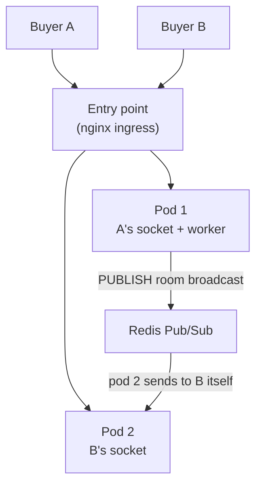

> [!tldr] Quick read
> - Each pod only knows the sockets in its own RAM. There are two different problems: **the way in** (every request of a session must reach the right pod) and **the way out** (a message broadcast on pod 1 must reach people on pod 2).
> - A [[en/concepts/sticky-session|sticky session]] handles the way in. It is mandatory while long polling is in play: reach the wrong pod and you get `400 Session ID unknown`. With WebSocket only, you don't need it.
> - The [[en/concepts/socket-io-adapter|adapter]] handles the way out. The Redis adapter publishes every broadcast to Redis Pub/Sub so every pod sends it too; each pod needs two separate Redis connections.
> - The [[en/concepts/reverse-proxy-upgrade|proxy must forward `Upgrade`]], and the [[en/concepts/idle-timeout|idle timeout]] of every layer must be longer than the heartbeat (Socket.IO recommends over 45 seconds; flash-sale sets 30).
> - When a pod shuts down, all its clients drop at the same moment: a [[en/concepts/reconnect-storm|reconnect storm]]. Jitter spreads out the reconnections, and [[en/concepts/graceful-shutdown|graceful shutdown]] closes connections deliberately before the process exits.

> [!info] Context
> Station 5 of **the WebSocket and Socket.IO line**. The example is **flash-sale**, a time-limited discount shop: the backend runs at least 3 pods on Kubernetes (scaling up to 20 under high load), behind an nginx ingress. The queue worker runs on one pod but has to send `checkout_ready` to users connected to any pod. You don't need to know Kubernetes: every term is in the glossary below.

> [!abstract]- Quick glossary for this post (click to open)
> - **Engine.IO, `sid`, long polling, upgrade, heartbeat**: see [[en/posts/2026-11-22-websocket-socketio|station 3]]. **Rooms, at most once, `io server disconnect`**: see [[en/posts/2026-11-22-websocket-rooms|station 4]].
> - **Pod**: a running instance of the application in Kubernetes. Three pods are three separate processes, each with its own RAM.
> - **Load balancer, ingress**: the entry point that spreads requests across the pods. The nginx ingress is nginx running as the entry point of a Kubernetes cluster.
> - **Redis Pub/Sub**: Redis's broadcast messaging: whoever is listening on a channel receives, nothing is stored. See [[en/concepts/pubsub-invalidation|the Caching station]].
> - **SIGTERM, preStop, readiness**: Kubernetes tells a pod it is about to be shut down with the SIGTERM signal; `preStop` is a command that runs before that; readiness is "can this pod take requests yet".
> - **Hop-by-hop header**: a header that only means something for one network hop, which proxies don't forward on their own (`Connection`, `Upgrade`).
> - **File descriptor**: the number the operating system assigns to each open connection; each process has a limit.

## Picture it first: a switchboard with several operators

The switchboard from station 3 now has three operators on duty. Each one keeps a notebook of the calls they are holding.

| Everyday life | Concept |
|---|---|
| A customer sends several letters about the same conversation: the receptionist must route them to the person holding the file | [[en/concepts/sticky-session\|Sticky session]] |
| An intercom between operators: "whoever is holding customers watching the 21h campaign, tell them" | [[en/concepts/socket-io-adapter\|Adapter]] (Redis Pub/Sub) |
| The building's receptionist must know "this is a call, put it through", not handle it like a letter | [[en/concepts/reverse-proxy-upgrade\|Proxy forwarding Upgrade]] |
| The receptionist hangs up if the line has been silent for 30 seconds | [[en/concepts/idle-timeout\|Idle timeout]] |
| An operator leaves suddenly and a hundred customers call back at the same time | [[en/concepts/reconnect-storm\|Reconnect storm]] |
| Before leaving, the operator tells each customer "call the main number again" and only then leaves the desk | [[en/concepts/graceful-shutdown\|Graceful shutdown]] |



## The problem: it runs fine on one pod

I used to think going from one server to three pods was just a matter of raising `replicas`. With REST that is nearly true: any request can go to any pod. With Socket.IO, two things break right away:

1. The queue worker on pod 1 calls `to('user:u512').emit('checkout_ready')`. User u512 is connected to pod 2. Pod 1 has no socket for u512 in its RAM, so the message **reaches nobody**, and no error is reported either.
2. The client opens a session with long polling: request 1 reaches pod 1 and gets a `sid`; request 2 is sent by the load balancer to pod 3, which has never heard of that `sid`.

Then come the things that don't break right away but break during a deploy: proxies cutting silent connections, a thousand clients reconnecting at once, and clients giving up.

## How it works

<figure class="figure-map" style="--ar: 1 / 1">
<div class="frame"><iframe data-archify="../../diagrams/websocket-scaling/pods.en.html" title="Architecture diagram: two buyers go through the entry point to three pods, pod 1 publishes to Redis Pub/Sub, pods 2 and 3 receive and send to their own sockets" loading="lazy"></iframe></div>
<figcaption><span><b>Figure 1.</b> The entry point keeps each session on one pod; when pod 1 broadcasts into a room, the Redis adapter carries it to every pod so whichever pod holds sockets in that room sends it itself.</span><a href="../diagrams/websocket-scaling/pods.en.html" target="_blank" rel="noopener">Open full screen</a></figcaption>
</figure>

### Sticky sessions: the way in

A **[[en/concepts/sticky-session|sticky session]]** is when the load balancer binds a client to one pod for the whole session. Socket.IO needs it for one specific reason: **long polling is many separate HTTP requests**, and only the pod that issued the `sid` has that session in RAM. Reach the wrong pod, and Engine.IO returns:

```text
HTTP 400 {"code":1,"message":"Session ID unknown"}
```

The client sees the error and opens a new session, which may land on the wrong pod again. Users see flaky realtime, especially at the upgrade step: the WebSocket carries pod 1's `sid` but reaches pod 2.

Two ways out:

- **Enable stickiness at the load balancer.** With plain nginx: `hash $remote_addr consistent;` or `ip_hash;` in the `upstream`. With Kubernetes' nginx ingress: the annotation `nginx.ingress.kubernetes.io/affinity: "cookie"` (a cookie issued by the ingress). IP-based stickiness breaks when many users share one IP (corporate networks, mobile carriers using NAT) or when one user changes IP midway. Cookie-based stickiness requires the client to send the cookie with polling requests; across origins you must enable `withCredentials: true`.
- **Drop long polling**: `transports: ['websocket']`. The whole session is a single TCP connection; whichever pod it reaches, it stays there until it drops, so no stickiness is needed. In exchange, on a network that blocks WebSocket you can't connect.

flash-sale runs 3 pods and its ingress **doesn't have stickiness enabled**. The `/flash-sale` client sets `transports: ['websocket']`, so at first glance it isn't needed. But as station 4 pointed out, that option is very likely ignored because `/notifications` creates the Manager first with the default transports. If so, both namespaces are opening sessions with long polling across three non-sticky pods. The dev environment has only 1 pod, so the error never shows up. Fix it at either end: standardize `transports: ['websocket']` on the shared Manager, or enable cookie affinity (with `withCredentials`).

### The adapter: the way out

A sticky session makes a session's requests reach the right pod. It does **not** help a message broadcast on pod 1 reach a socket on pod 2. That is the job of the **[[en/concepts/socket-io-adapter|adapter]]**: the Socket.IO component that decides which sockets a `to(room).emit()` reaches. The default adapter only looks in the current pod's RAM.

The **Redis adapter** (`@socket.io/redis-adapter`) works like this: on every broadcast into a room, the pod sends to its own sockets *and* `PUBLISH`es the packet to a Redis channel (of the form `socket.io#/flash-sale#`). Every other pod `SUBSCRIBE`d to that channel receives the packet, looks up the room in its own RAM, and sends to its own sockets. It also handles operations that need the whole cluster: `fetchSockets()`, `socketsJoin()`, `disconnectSockets()` across every pod, and `serverSideEmit()` for pods to talk to each other.

flash-sale sets it up exactly like that, with a careful explanation of why it needs **two separate Redis connections**:

```ts
// trimmed excerpt from flash-sale's RedisIoAdapter
async connectToRedis() {
  const pubClient = createClient({ url });
  const subClient = pubClient.duplicate();  // the second connection
  await Promise.all([pubClient.connect(), subClient.connect()]);
  this.adapterConstructor = createAdapter(pubClient, subClient);
}
// main.ts: must be attached BEFORE app.listen()
const redisIoAdapter = new RedisIoAdapter(app);
await redisIoAdapter.connectToRedis();
app.useWebSocketAdapter(redisIoAdapter);
```

A Redis connection that has entered `SUBSCRIBE` mode can no longer run ordinary commands. Share it with the app's Redis client and every other `GET` and `SET` hangs.

Things to know about the Redis adapter:

- **Every broadcast goes through Redis**, even when all recipients are on the same pod. Broadcasting stock every 100 ms for 50 campaigns is 500 `PUBLISH`es per second, each packet reaching **every** pod (plain Pub/Sub doesn't know which pods care). Redis 7 has **sharded Pub/Sub** and the adapter has `createShardedAdapter` to spread the load across a Redis Cluster.
- **Pub/Sub doesn't store messages**: a pod that loses its Redis connection for a few seconds misses every broadcast during that time, and as station 4 said, there is no connection state recovery. The Redis Streams adapter can store them.
- Other adapters: MongoDB, PostgreSQL (`LISTEN/NOTIFY`), the cluster adapter (between Node processes on the same machine), and hosted services.

### Reverse proxy: forwarding Upgrade

Station 2 said `Upgrade` and `Connection` are **hop-by-hop** headers: proxies don't forward them on their own. An HTTP/1.0 proxy, or nginx's default proxying (which uses HTTP/1.0 to talk to the upstream), swallows them; the server doesn't see the upgrade request and returns 400, while Socket.IO silently stays on long polling. **[[en/concepts/reverse-proxy-upgrade|The minimal nginx configuration]]**:

```nginx
location /socket.io/ {
    proxy_pass http://flash_sale_api;
    proxy_http_version 1.1;                    # Upgrade only exists in HTTP/1.1
    proxy_set_header Upgrade $http_upgrade;    # forward the client's header
    proxy_set_header Connection "upgrade";
    proxy_set_header Host $host;
    proxy_read_timeout 60s;                    # see the next section
}
```

Kubernetes' nginx ingress does the three middle lines for every route out of the box, no annotation needed. Cloud load balancers (AWS ALB, Google Cloud Load Balancing) support WebSocket, but each kind has its own idle timeout.

A rarely mentioned consequence: **every WebSocket connection through a proxy takes up a connection on both sides of the proxy** (client → nginx and nginx → pod), one file descriptor per side, living for hours. 50,000 people watching a campaign means about 100,000 file descriptors on the nginx pods; the `worker_connections` limit and `ulimit -n` must be sized for that, not for requests per second.

### Idle timeout: silent too long means cut off

Every layer between the browser and the pod has an **[[en/concepts/idle-timeout|idle timeout]]**: if no data flows for N seconds, the connection is cut. In nginx it is `proxy_read_timeout` (default 60 seconds), cloud load balancers have their own numbers, and mobile carriers' NAT sometimes allows only a few minutes. For a realtime connection, "silence" is normal: if nobody is buying, there are no messages.

The heartbeat exists to keep the line from going silent. The rule: **the heartbeat must be shorter than the smallest timeout in the chain**. The Socket.IO documentation recommends a proxy timeout larger than `pingInterval + pingTimeout`, i.e. 45 seconds with the defaults.

flash-sale sets `proxy-read-timeout: "30"` on the ingress, and Socket.IO uses the default `pingInterval` of 25 seconds. With WebSocket, the server sends a ping every 25 seconds, nginx sees data from the upstream before the 30-second mark, so the connection stays alive. But the margin is only **5 seconds**: if the pod's event loop is busy (a long GC, a heavy synchronous loop) and the ping is more than 5 seconds late, nginx cuts the connection, the client sees `transport close` and reconnects. With long polling, a request hangs for at most exactly one `pingInterval`, which is also cutting it close. Raising the timeout above 45 seconds (say 60) is safer; that 30-second timeout was originally set for REST.

### Reconnect storm: a thousand people calling back at once

Realtime connections have a property REST doesn't: **they die together**. When a pod shuts down (deploy, OOM, a node being drained), every client connected to it loses its connection in the same millisecond. If they all wait exactly 1 second and reconnect, the remaining pods take a pile-up: thousands of handshakes, thousands of JWT verifications, thousands of `subscribe_campaign`s and possibly thousands of REST calls to resynchronize. That is a **[[en/concepts/reconnect-storm|reconnect storm]]**, a relative of [[en/concepts/cache-stampede|cache stampede]].

The cure is **jitter**: each client waits a random amount of time. `socket.io-client` has `randomizationFactor` 0.5 built in, so the first wait falls between 500 and 1500 ms instead of exactly 1000 ms; the next one doubles, also with randomness. In the example, 10,000 clients without jitter all land in a single 100 ms window; with jitter they spread over 10 windows, the busiest holding about 1,000. Don't set `randomizationFactor: 0` to make things "predictable".

Another side effect worth knowing: **connections don't rebalance on their own**. When the HPA adds a 4th pod under high load, the existing connections stay on the 3 old pods (a WebSocket connection lives until it drops); the new pod only receives new connections. The CPU of the 3 old pods stays high while the new pod sits idle. Some systems deliberately close a scattered fraction of connections on overloaded pods so clients reconnect and get spread evenly.

### Graceful shutdown: telling customers before leaving the desk

When Kubernetes shuts down a pod, the ideal sequence for realtime connections is:

1. **Stop accepting new connections**: mark readiness as not ready and wait for the load balancer to update (flash-sale waits 15 seconds in `preStop`, then flips readiness on SIGTERM).
2. **Close realtime connections deliberately, gradually**: close them in batches over a few seconds instead of a thousand at once, so clients move to other pods at a steady pace.
3. **Only then exit** the process.

Step 2 has a trap, which the example below runs to show: **closing with `socket.disconnect(true)` means the Socket.IO client won't reconnect on its own** (reason `io server disconnect`, station 4), and the user loses realtime. You have to close at the transport level (`io.close()`, or `socket.conn.close()` per socket) so the client sees `transport close` and reconnects. With plain WebSocket, send a close frame with code **1001** (going away) so the client knows the server is shutting down and should reconnect.

flash-sale's **[[en/concepts/graceful-shutdown|graceful shutdown]]** already has steps to stop HTTP, wait for in-flight RabbitMQ messages, the outbox and jobs to finish, then close Prisma, within 45 seconds. There is no step specifically for Socket.IO yet, so realtime connections only drop when the process exits, all at once. Client-side jitter softens that somewhat; adding a gradual close step in phase 1 would be smoother.

## Runnable example

[two-pods.ts](../code/websocket-scaling/two-pods.ts) builds two Socket.IO "pods" in the same process (two servers on two ports). Part 1 broadcasts without and with the Redis adapter; part 2 sends a session's polling request to the wrong pod; part 3 compares two ways of disconnecting from the server; part 4 computes the first reconnection attempt of 10,000 clients using exactly `socket.io-client`'s formula.

```bash
docker run -d --rm --name atlas-redis -p 6380:6379 redis:8
npm i socket.io socket.io-client @socket.io/redis-adapter redis
node two-pods.ts
```

```ts
const pub = createClient({ url: 'redis://localhost:6380' });
const sub = pub.duplicate();                       // a separate connection for SUBSCRIBE
await Promise.all([pub.connect(), sub.connect()]);
io.adapter(createAdapter(pub, sub));

const a = ioc(`${p1.url}/flash-sale`, { transports: ['websocket'] }); // A joins pod 1
const b = ioc(`${p2.url}/flash-sale`, { transports: ['websocket'] }); // B joins pod 2
p1.io.of('/flash-sale').to('campaign:c-21h').emit('stock_update', { left: 12 }); // worker on pod 1
```

```text
$ node two-pods.ts
1) Worker on pod 1 broadcasts stock_update to room campaign:c-21h
   no adapter:       A (pod 1)
   Redis adapter:    A (pod 1), B (pod 2)

2) Long polling without sticky sessions
   request 1 → pod 1: handshake, sid=jteHAXi2KdsZ4W7eAAAE
   request 2 → pod 2: HTTP 400 {"code":1,"message":"Session ID unknown"}
   the same request to the right pod 1: HTTP 200 ok

3) Two ways of disconnecting from the server side
   socket.disconnect(true)    → client sees "io server disconnect", automatic retries: 0
   io.close() on pod shutdown → client sees "transport close", automatic retries: 2

4) Pod shuts down, 10,000 clients lose their connection at once: where does the first retry land?
   randomizationFactor 0  : spread over 1 window of 100 ms, busiest window 10000 connections
   randomizationFactor 0.5: spread over 10 windows of 100 ms, busiest window 1047 connections
```

*(Output labels translated; the files themselves print Vietnamese.)*

Reading the results:

- **Part 1**: without an adapter, B on pod 2 receives nothing and no error is reported. With the Redis adapter, both receive.
- **Part 2**: exactly the error of long polling without stickiness. The same request sent to the right pod works.
- **Part 3**: `disconnect(true)` makes the client leave for good (0 retries); closing the transport makes the client retry on its own (2 times, exactly the limit set in the example, because the pod is gone for good).
- **Part 4**: the busiest-window number changes a little on every run (randomness), but always hovers around 1,000, so peak load drops about 10 times.

## Misconceptions and common traps

- **"With the Redis adapter I don't need sticky sessions."** The adapter handles broadcasting between pods; stickiness handles a session's requests reaching the right pod. While long polling is in play, you need both.
- **"With sticky sessions I don't need an adapter."** Stickiness only keeps a client on one pod; messages broadcast on another pod still don't arrive.
- **"Fine in dev means fine in production."** Dev usually has 1 pod: you never see `Session ID unknown` or messages lost on another pod. Test with at least 2 instances before going live.
- **Sharing the app's Redis client with the adapter**: a connection in subscribe mode can't run ordinary commands, so every other Redis command hangs.
- **A proxy timeout set for REST (30 seconds) also applied to WebSocket**: too close to the 25-second ping. Give the realtime route its own timeout above 45 seconds.
- **Closing connections on pod shutdown with `socket.disconnect(true)`**: the client won't reconnect on its own. Close the transport, or send close 1001 with plain WebSocket.
- **Turning off jitter** (`randomizationFactor: 0`) to make delays "predictable": a thousand clients come back within one 100 ms window.
- **Adding pods to reduce connection load**: old connections don't move to the new pods on their own.

## Self-check questions

> [!question]- What two different problems do sticky sessions and the adapter solve?
> Sticky sessions handle the way in: every request of a session reaches the pod holding that session (needed when there is long polling). The adapter handles the way out: a message broadcast into a room on one pod reaches the sockets in that room on every pod.

> [!question]- Why does `transports: ['websocket']` make sticky sessions unnecessary?
> Because the whole session is a single TCP connection: the load balancer picks a pod once at the handshake, and every later packet travels on the same connection to the same pod. There are no separate HTTP requests left that could be routed to another pod.

> [!question]- Why does the Redis adapter need two separate Redis connections per pod?
> A connection that has entered subscribe mode only receives messages and can't run ordinary commands such as `PUBLISH`. So you need one connection to publish and one to subscribe, and neither may be shared with the application's Redis client.

> [!question]- The ingress cuts silent connections after 30 seconds, and Socket.IO uses a `pingInterval` of 25 seconds. Is there a problem?
> Normally no, because the 25-second ping arrives before the 30-second mark. But the margin is only 5 seconds: a ping delayed by a busy event loop gets the connection cut. The documentation recommends a proxy timeout above `pingInterval + pingTimeout` (45 seconds).

> [!question]- When shutting down a pod, why shouldn't you close every socket with `socket.disconnect(true)`?
> The Socket.IO client treats that as the server deliberately kicking it out (`io server disconnect`) and doesn't reconnect on its own, so the user loses realtime. You have to close at the transport level (`io.close()` or `socket.conn.close()`) so the client reconnects to another pod, and you should spread the closes out to avoid a reconnect storm.

## References

- [Socket.IO: Using multiple nodes](https://socket.io/docs/v4/using-multiple-nodes/) (sticky sessions, nginx configuration, timeouts above 45 seconds)
- [Socket.IO: Redis adapter](https://socket.io/docs/v4/redis-adapter/) and [Adapter](https://socket.io/docs/v4/adapter/)
- [nginx: WebSocket proxying](https://nginx.org/en/docs/http/websocket.html)
- [ingress-nginx: WebSockets](https://kubernetes.github.io/ingress-nginx/user-guide/miscellaneous/#websockets) and [cookie affinity](https://kubernetes.github.io/ingress-nginx/examples/affinity/cookie/)
- `socket.io-client` 4.8.4 source: `contrib/backo2.js` (the delay formula with jitter)
