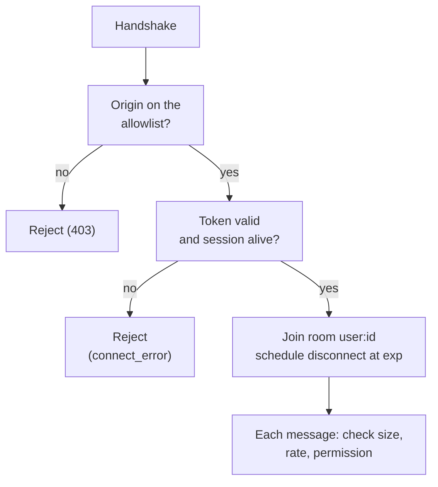

> [!tldr] Quick read
> - [[en/concepts/cross-site-websocket-hijacking|Cross-Site WebSocket Hijacking]]: WebSocket isn't subject to CORS. A foreign page can open a connection to your server, and the browser sends the cookies automatically. Socket.IO's `cors` option **does not block** this; you must check `Origin` or not authenticate with cookies.
> - [[en/concepts/handshake-authentication|Handshake authentication]]: the token goes in Socket.IO's `auth` (not in the URL), and you check both the signature and that the session is still alive.
> - [[en/concepts/long-lived-token|A token outliving its expiry]]: the token is checked once, the connection lives for hours. In the example, the token expired a second ago and the connection still receives messages. Schedule a disconnect exactly at `exp`, and disconnect the socket when the user logs out.
> - [[en/concepts/backpressure|Backpressure]]: `send()` doesn't block; a slow-reading client makes the server hold 18 MB for one connection in the example. Check `bufferedAmount` and drop stale messages. [[en/concepts/message-size-limit|Message size limit]]: Socket.IO defaults to 1 MB, `ws` to 100 MiB.
> - At the end: a [[en/concepts/realtime-checklist|checklist]] and how to choose between SSE, plain WebSocket and Socket.IO.

> [!info] Context
> Station 6, the last station of **the WebSocket and Socket.IO line**. The example is **flash-sale**, a time-limited discount shop: the realtime connection pushes payment turns and order results, i.e. each person's private information, and may stay open all evening. The frontend and the API live on two different domains. You don't need to know NestJS.

> [!abstract]- Quick glossary for this post (click to open)
> - **Handshake, `Origin`, close code**: see [[en/posts/2026-11-22-websocket-protocol|station 2]]. **CONNECT packet, `auth`**: [[en/posts/2026-11-22-websocket-socketio|station 3]]. **The `user:<id>` room**: [[en/posts/2026-11-22-websocket-rooms|station 4]].
> - **Same-Origin Policy, CORS**: the browser rule that prevents one page's JavaScript from reading responses from another domain, unless the server allows it with CORS headers. See [[en/concepts/cors|CORS]].
> - **Cookie, SameSite**: a cookie is data the browser automatically sends with requests to the domain that set it; `SameSite` decides whether it is sent when the request originates from another page.
> - **JWT, `exp`, session (`sid`)**: a signed token with an expiry `exp`; flash-sale ties each token to a login session stored in Redis. See [[en/posts/2026-11-18-api-security|API Security]].
> - **Middleware**: a function that runs before the handler, here before the connection is accepted.
> - **Buffer**: a region of RAM holding data that has been sent but hasn't gone out onto the network yet.

## Picture it first: a bank's hotline

A realtime connection is like a hotline between a customer and the bank, open all session long.

| Everyday life | Concept |
|---|---|
| A stranger dials from your phone; the switchboard recognizes a familiar number and lets the call through without asking who is holding the phone | [[en/concepts/cross-site-websocket-hijacking\|Cross-Site WebSocket Hijacking]] |
| When you pick up, you read your customer code and the switchboard checks whether it is still valid | [[en/concepts/handshake-authentication\|Handshake authentication]] |
| An access badge expires at 21:15, but someone who entered the room at 21:00 is still sitting there | [[en/concepts/long-lived-token\|Long-lived token]] |
| The listener takes notes slowly; the reader must wait or skip some, or the scratch paper piles up | [[en/concepts/backpressure\|Backpressure]] |
| No faxes longer than 10 pages accepted | [[en/concepts/message-size-limit\|Message size limit]] |
| A checklist before opening the line to customers | [[en/concepts/realtime-checklist\|Realtime checklist]] |



## The problem: a long-lived connection means long-lived holes

I used to think securing WebSocket was like REST: CORS plus a JWT guard and you're done. But three of REST's assumptions no longer hold: **WebSocket isn't subject to CORS**, **the token is checked only once** at the handshake instead of on every request, and **the connection lives for hours** while the user may log out, get banned, or be on a network so slow they can't keep up. Each wrong assumption opens a different hole.

## How it works

<figure class="figure-map" style="--ar: 3 / 4">
<div class="frame"><iframe data-archify="../../diagrams/websocket-security/cswsh.en.html" title="Sequence diagram: a foreign page opens a WebSocket through the victim's browser with cookies and the server lets it in; two ways to block it by checking Origin and requiring an explicit token" loading="lazy"></iframe></div>
<figcaption><span><b>Figure 1.</b> If the server authenticates with cookies without checking Origin, a foreign page can use your browser to talk to it; checking Origin or requiring an explicit token both block it.</span><a href="../diagrams/websocket-security/cswsh.en.html" target="_blank" rel="noopener">Open full screen</a></figcaption>
</figure>

### Cross-Site WebSocket Hijacking: CORS won't save you

With `fetch`, the browser applies the Same-Origin Policy: the page `evil.example` can send a request to `shop.example` but **can't read the response** unless the server returns CORS headers allowing it. WebSocket is different: the standard doesn't apply the Same-Origin Policy to it. Any page can open `new WebSocket('wss://api.shop.example')`, read every message the server sends down and send up anything it likes. The only thing the browser does is attach an `Origin: https://evil.example` header so the server can decide for itself.

If the server authenticates with **cookies**, the browser may automatically attach the victim's cookies to the handshake request. The server sees a valid cookie and lets it in, and the foreign page can now listen to orders and notifications, and even send buy commands on the victim's behalf. That is **[[en/concepts/cross-site-websocket-hijacking|Cross-Site WebSocket Hijacking]]** (CSWSH), described by Christian Schneider in 2013; in essence it is CSRF that can also read the response.

Two things that are often misunderstood:

- **Socket.IO's `cors` option doesn't block CSWSH.** It only attaches CORS headers to the HTTP polling requests, so the browser blocks *reading* polling responses. The upgrade request to WebSocket is still accepted from any Origin. The example below shows it: with only `cors` configured, the foreign page **gets in**.
- **SameSite reduces the risk but doesn't remove it.** Chrome treats cookies without a SameSite attribute as `Lax` by default, and `Lax` cookies aren't sent with a WebSocket opened from a different *site*. But cookies set with `SameSite=None` (common when the frontend and API are on different sites), other browsers with different defaults, and an attacking page on a same-site subdomain (a blog page `blog.shop.example` with injected code) are all still exposed.

How to block it:

1. **Check `Origin` at the handshake** against an allowlist, and reject if it doesn't match. Socket.IO: the `allowRequest(req, cb)` option; the `ws` library: `verifyClient` or a check in the `upgrade` event.
2. **Don't authenticate with automatically attached cookies**: use a token the page's JavaScript must send itself (Socket.IO `auth`). A foreign page can't read the token in the real page's memory, so it has nothing to send.

flash-sale falls into case 2: both gateways read the token from `handshake.auth.token` (or the `Authorization` header for non-browser clients), not from cookies, so CSWSH can't obtain the user's identity. Checking `Origin` is still worth adding as a second layer, because the client has `withCredentials` enabled and future features might start reading cookies.

### Handshake authentication: what to check, and where

**[[en/concepts/handshake-authentication|Handshake authentication]]** means checking identity once when the connection opens, then attaching it to the socket (`socket.data.userId`) for every later message. There are a few choices for *where to put* the token:

| Where | Problem |
|---|---|
| Query string `?token=…` | URLs end up in proxy, load balancer and monitoring logs |
| `Authorization` header | Browsers don't let you set arbitrary headers for WebSocket; only Node clients and mobile apps can |
| Socket.IO `auth: { token }` | Travels in the CONNECT packet, not in the URL; this is the recommended way |
| Plain WebSocket in the browser | Cookies (plus an Origin check), or fetch a short-lived single-use **ticket** via REST and send it in the first message |

*What to check* matters as much as where. flash-sale's HTTP guard checks three things: the JWT's signature and expiry, that the token type is `access`, and that **the `sid` session is still alive in Redis** (logging out deletes the session, so the old token is immediately useless for REST). The two Socket.IO gateways only check the first two. That means after logging out, the old access token (which lives up to 15 minutes) can still **open a new realtime connection**, and connections already open aren't cut. The fix: use one shared authentication function for the HTTP guard and for `handleConnection` (or the namespace's `io.use()` middleware), so the two entrances never drift apart.

### Long-lived token: the badge expired, the person is still in the room

flash-sale's access token lives 15 minutes. A Socket.IO connection opened at 21:00 lives until the user closes the tab, maybe 23:00. The server only checked the token at 21:00. From 21:15 to 23:00, the connection is trusted on the strength of an expired token, even if in the meantime the account was banned or its permissions changed. That is **[[en/concepts/long-lived-token|a token outliving its own expiry]]**.

flash-sale's client already does half the job: the `SocketProvider` effect depends on `accessToken`, so every time the token is refreshed, the client closes the old connection and opens a new one with the new token. But that is the client's good will; a modified client won't do it. The server needs to protect itself:

- **Schedule a disconnect exactly at `exp`** when accepting the connection (`setTimeout(() => socket.disconnect(true), exp - now)`), and clear the timer when the socket disconnects. The client reconnects with a new token. This is what the example does.
- **Disconnect when the session is revoked**: on logout or account ban, call `io.in('user:<id>').disconnectSockets(true)`; with the Redis adapter this runs on every pod.
- **Allow refreshing the token over the connection**: the client sends a `refresh_token` event with the new token, the server checks it and extends the expiry, with no reconnection needed.
- **Check permissions on every message** for sensitive operations, via `socket.use()` (middleware for each incoming packet), instead of trusting the result of the handshake check.

### Backpressure: the listener can't take notes fast enough

WebSocket's `socket.send()` **never blocks**. If the client reads slowly (a weak 3G network, a background tab throttled by the browser, a weak device), data piles up: first in the operating system's TCP buffer, then in the server process's RAM. In the example, the server sends 20,000 messages of 1 KB to a client that has stopped reading, and ends up holding **about 18 MB** in RAM for that one connection alone. Multiply by a few thousand people watching a campaign on mobile networks at 21:00, and the pod runs out of RAM and gets killed, triggering station 5's reconnect storm.

**[[en/concepts/backpressure|Backpressure]]** is the mechanism by which a slow receiver slows the sender down. Standard WebSocket gives you only one number: `bufferedAmount`, the number of bytes passed to `send()` that haven't made it onto the network yet (available in both `ws` and the browser API). How to use it:

- **Check before sending**: above a threshold, drop the message, as the example does (drop when more than 1 MB is buffered). This fits data where only the latest version matters: stock, queue position.
- **Coalesce messages**: instead of sending every change, keep the latest version per key (per SKU) and send at a steady pace. Slow clients naturally receive fewer messages.
- **Disconnect clients that are too slow** (buffer above a high threshold for a while) with code 1008 or 1013 (try again later), so they reconnect and resynchronize from scratch.

Socket.IO has no automatic backpressure. It has `socket.volatile.emit()`: drop the message if the connection isn't currently ready to write, which suits stock messages. On the browser side, the new `WebSocketStream` API (built on streams, so it has real backpressure) is only available in Chromium-based browsers so far.

### Message size limit: no 100-page faxes

The receiver has to buffer **a whole message** before handing it to the handler. No size limit is an invitation for someone to send a message of a few hundred MB and drain the server's RAM with a single connection. The default **[[en/concepts/message-size-limit|message size limits]]** differ wildly:

| Library | Option | Default | When exceeded |
|---|---|---|---|
| Socket.IO (Engine.IO) | `maxHttpBufferSize` | 1 MB (`1e6`) | closes the connection |
| `ws` | `maxPayload` | 100 MiB | closes with code 1009 |

flash-sale uses Socket.IO's default, which is reasonable: the largest message the client sends is `{ campaignId }`. If you use `ws` directly, lower `maxPayload` to a few tens of KB. Along with it comes a **message rate limit**: a client sending 10,000 `subscribe_campaign`s per second is still within the size limit. REST rate limiting doesn't automatically apply to WebSocket; you have to count in a `socket.use()` middleware or in the handler, per user, and disconnect offenders.

### Realtime checklist

The **[[en/concepts/realtime-checklist|checklist]]** pulls the whole line together. First, choosing the tool:

| If | Choose |
|---|---|
| Server → client only (notifications, progress, prices) | **SSE**: automatic reconnection, replay, plain HTTP (station 1) |
| Two-way, multi-platform clients or partners speaking standard RFC 6455, need something light | **Plain WebSocket** (`ws`), writing your own heartbeat, reconnection, multi-pod broadcasting |
| Two-way, need rooms, acks, automatic reconnection, a polling fallback, broadcasting across pods | **Socket.IO**, with every client using the Socket.IO library |
| Rare messages, a few seconds of delay is fine | **Polling** is still the best choice |

Then check:

- [ ] Authenticate at the handshake with the same function as REST (signature, token type, session alive); no token in the URL.
- [ ] Check `Origin` at the handshake; don't rely on the `cors` option to block foreign pages.
- [ ] Disconnect when the token expires and when the session is revoked (`disconnectSockets` on the user's room).
- [ ] Authorize on room `join`; don't let the client pick room names.
- [ ] Limit message size and message rate per user.
- [ ] Watch `bufferedAmount` or use `volatile` for messages where only the latest matters; coalesce dense messages.
- [ ] Heartbeat shorter than the smallest idle timeout in the proxy chain (Socket.IO: proxy timeout above 45 seconds).
- [ ] Either WebSocket only, or sticky sessions; and check which `transports` are actually in use (station 4).
- [ ] An adapter for multiple pods; know whether it stores messages.
- [ ] Jitter on reconnection; no cap on retries, or a "retry" button.
- [ ] Close connections deliberately and gradually when a pod shuts down, at the transport level (not `disconnect(true)`).
- [ ] A REST path to resynchronize after every `connect`, because messages can be lost (at most once).
- [ ] Measure: connections per pod, reconnection rate, dropped messages, RAM per connection.

## Runnable example

[security.ts](../code/websocket-security/security.ts) runs four scenarios. Part 1 simulates a browser controlled by the page `evil.example`: Node's Socket.IO client sends the `Origin` and `Cookie` headers as a browser would. Part 2 uses a token that expires in 1 second. Part 3 sends a 2 MB message. Part 4 uses `ws` to send 20,000 messages to a client that has stopped reading its socket.

```bash
npm i socket.io socket.io-client ws
node security.ts
```

```ts
// block foreign pages: check Origin right at the handshake
new Server(httpServer, {
  cors: { origin: SHOP, credentials: true },
  allowRequest: (req, cb) => cb(null, req.headers.origin === SHOP),
});

// token expiring midway: schedule a disconnect exactly at exp
io.use((s, next) => {
  const exp = Number(s.handshake.auth.exp);
  if (Date.now() >= exp) return next(new Error('TOKEN_EXPIRED'));
  setTimeout(() => s.disconnect(true), exp - Date.now());
  next();
});

// backpressure: drop the message when more than 1 MB is buffered
if (serverSide.bufferedAmount > 1_000_000) { dropped++; continue; }
serverSide.send(msg);
```

```text
$ node security.ts
1) The evil.example page opens a WebSocket to the server, the browser attaches the session cookie automatically
   cors only                        → GETS IN
   cors + allowRequest checks Origin → blocked (websocket error)
   token in auth instead of cookie  → blocked (UNAUTHORIZED)

2) Token lives 1 second, checked only at the handshake
   do nothing         : 2 seconds later, connected=true, still receiving=true
   scheduled disconnect: 2 seconds later, connected=false, still receiving=false

3) The client sends a 2 MB message, the server keeps the default maxHttpBufferSize of 1 MB
   the server processes nothing (0 messages) and cuts the connection; the client sees "transport close"

4) The server sends 20,000 messages of 1 KB to a client that has stopped reading
   no check              : sent 20000, dropped 0, server RAM held for this client ≈ 17.9 MB
   drop when buffer > 1 MB: sent 3523, dropped 16477, server RAM held for this client ≈ 0.0 MB
```

*(Output labels translated; the files themselves print Vietnamese.)*

Reading the results:

- **Part 1**: with only `cors`, the foreign page gets in carrying the cookie. The Origin check blocks it right at the handshake; with token authentication, the foreign page has no token to send.
- **Part 2**: doing nothing, 1 second after the token expired the connection is still alive and still receiving messages. With the timer, the server disconnects it right on time.
- **Part 3**: a message over 1 MB never reaches the handler; the connection is cut.
- **Part 4**: without a check, nearly 18 MB stays in the process's RAM. With a threshold, most messages are dropped; the roughly 3.5 MB already sent is held by the operating system in the TCP buffer (on a local machine this buffer is large), so the process's RAM drops to near 0. The exact numbers depend on the operating system.

## Misconceptions and common traps

- **"I configured CORS for Socket.IO, so foreign pages can't get in."** `cors` only applies to HTTP polling requests. Check `Origin` with `allowRequest`, or don't authenticate with cookies.
- **"SameSite defaults to Lax, so it's safe."** Not every browser defaults to Lax, `SameSite=None` cookies are still attached, and same-site pages (subdomains) aren't blocked.
- **"The token was checked on connection."** Once, for a whole connection that lives for hours. Schedule a disconnect by `exp`, and disconnect when the session is revoked.
- **The REST guard and the WebSocket handshake check different things**: logging out blocks REST but not realtime. Use one shared authentication function.
- **Putting the token in the query string** because it's "easy": it ends up in every proxy's logs.
- **"There's only a problem if `send()` fails."** `send()` says nothing when the client is slow; RAM just quietly grows. Watch `bufferedAmount`.
- **Using `ws` with the default `maxPayload` of 100 MiB**: lower it to the largest message you really need.
- **Assuming REST rate limiting also covers WebSocket**: messages on an open connection don't pass through any HTTP middleware.

## Self-check questions

> [!question]- Why can the page `evil.example` open a WebSocket to `api.shop.example`, while `fetch` is blocked by CORS from reading the response?
> The WebSocket standard doesn't apply the Same-Origin Policy: the browser lets the page open the connection and read every message, and only attaches an `Origin` header so the server can decide. If the server doesn't check `Origin` and authenticates with automatically attached cookies, the foreign page can use the victim's session.

> [!question]- A Socket.IO server sets `cors: { origin: 'https://shop.example' }`. Does that block CSWSH?
> No. That option only attaches CORS headers to polling requests; a WebSocket upgrade request from another Origin is still accepted. You must check `Origin` in `allowRequest`, or authenticate with a token the foreign page doesn't have.

> [!question]- A user logs out at 21:05. Is their Socket.IO connection opened at 21:00 cut? How do you make sure it is?
> It isn't cut automatically, because the token is only checked at the handshake. You must actively disconnect when revoking the session, for example `io.in('user:<id>').disconnectSockets(true)` (which runs on every pod thanks to the adapter), and also check at the handshake that the session is alive so new connections are rejected too.

> [!question]- What is `bufferedAmount`, and what do you do when it keeps growing for one client?
> The number of bytes passed to `send()` that haven't been written to the network yet. If it keeps growing, the client is reading slower than you are sending. Drop stale messages (if only the latest matters), coalesce messages, or disconnect that client so it reconnects and resynchronizes.

> [!question]- flash-sale only needs the server to push messages and the client to occasionally send `subscribe_campaign`. If you started over, would SSE be enough?
> Functionally, yes: SSE can push every event, reconnects automatically and replays via `Last-Event-ID`, and `subscribe_campaign` is an ordinary REST request. Socket.IO earns its keep with rooms, the multi-pod adapter and ready-made clients; with SSE, broadcasting across pods (for example via Redis Pub/Sub) is something you build yourself.

## References

- Christian Schneider, [Cross-Site WebSocket Hijacking](https://christian-schneider.net/blog/cross-site-websocket-hijacking/) (2013)
- [PortSwigger Web Security Academy: Cross-site WebSocket hijacking](https://portswigger.net/web-security/websockets/cross-site-websocket-hijacking)
- [OWASP: WebSocket Security Cheat Sheet](https://cheatsheetseries.owasp.org/cheatsheets/WebSocket_Security_Cheat_Sheet.html)
- [Socket.IO: Server options](https://socket.io/docs/v4/server-options/) (`allowRequest`, `maxHttpBufferSize`, `cors`) and [Middlewares](https://socket.io/docs/v4/middlewares/)
- [ws: API docs](https://github.com/websockets/ws/blob/master/doc/ws.md) (`maxPayload`, `verifyClient`, `bufferedAmount`)
- [WHATWG WebSockets Standard](https://websockets.spec.whatwg.org/) (`bufferedAmount`)
