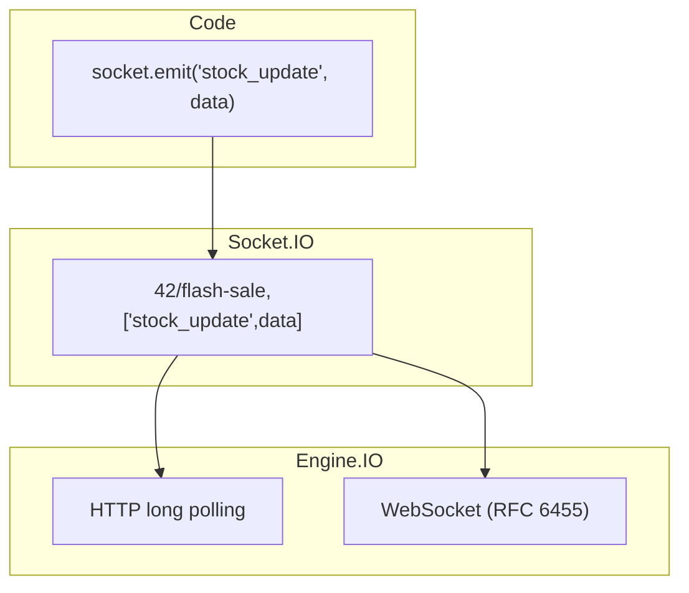

> [!tldr] Quick read
> - Socket.IO is a **library with its own protocol**, in two layers: [[en/concepts/engine-io|Engine.IO]] keeps a session (identified by `sid`) over long polling or WebSocket; Socket.IO puts events, namespaces and acks on top.
> - [[en/concepts/transport-upgrade|Transport upgrade]]: by default Engine.IO opens the session with a long-polling `GET`, then tries WebSocket (`2probe` → `3probe`) and switches over for good (`5`). You can skip the polling step with `transports: ['websocket']`.
> - Engine.IO's [[en/concepts/heartbeat|heartbeat]]: the server sends a ping every 25 seconds, and the client must answer with a pong within 20 seconds. This is not the RFC 6455 ping frame.
> - On the wire, `socket.emit('stock_update', data)` is the string `42["stock_update",{…}]`: a [[en/concepts/socket-io-packet|Socket.IO packet]] (2 = event) inside an Engine.IO packet (4 = message). An [[en/concepts/acknowledgement|ack]] adds an id number so the reply goes to exactly that emit.
> - Consequence: a plain WebSocket client connecting to a Socket.IO server receives `0{"sid":…}` and then gets disconnected; a Socket.IO client connecting to a plain WebSocket server waits forever for packet `0` and then reports `timeout`.

> [!info] Context
> Station 3 of **the WebSocket and Socket.IO line**. The example is **flash-sale**, a time-limited discount shop: the NestJS backend has two Socket.IO "realtime gates", `/flash-sale` (payment turns, stock, order results) and `/notifications` (notifications); the Next.js frontend uses `socket.io-client`. You don't need to know NestJS or React: every piece of code is explained.

> [!abstract]- Quick glossary for this post (click to open)
> - **Long polling, WebSocket, frame, ping/pong, the 101 handshake**: see [[en/posts/2026-11-22-websocket-realtime-options|station 1]] and [[en/posts/2026-11-22-websocket-protocol|station 2]].
> - **Library vs protocol**: a protocol is the rules both sides must follow (RFC 6455); a library is code you install in the project, which may add rules of its own.
> - **NestJS gateway**: a class in NestJS that groups realtime handlers, like a controller but for WebSocket. `@WebSocketGateway({ namespace })` is a **decorator**: an annotation placed on a class so the framework knows how to use it.
> - **Handler**: a function that runs when an event is received.
> - **JWT (access token)**: a signed string that proves who you are, see the [[en/posts/2026-11-18-api-security|API Security]] station.
> - **sid**: session id, the session identifier the server issues.
> - **Callback**: a function you pass in so it gets called back when there is a result.

## Picture it first: a switchboard on the phone line

At station 2, WebSocket was a phone line: it only carries sound. Socket.IO is a **switchboard** placed on that line.

| Everyday life | Concept |
|---|---|
| The switchboard takes care of staying in touch: without a phone it keeps in touch by letter, once there is a phone it switches to calling | [[en/concepts/engine-io\|Engine.IO]] |
| Start with letters, make a test call "hello, can you hear me?", and if it's clear, say "let's use the phone from now on" | [[en/concepts/transport-upgrade\|Transport upgrade]] |
| Every 25 seconds the switchboard asks "still there?"; no answer within 20 seconds counts as losing contact | [[en/concepts/heartbeat\|Heartbeat]] |
| Every sentence goes into an envelope marked with a letter type, a room name and a task name | [[en/concepts/socket-io-packet\|Socket.IO packet]] |
| "When you get this, sign receipt slip number 7 and send it back" | [[en/concepts/acknowledgement\|Acknowledgement]] |
| An ordinary phone calling into the switchboard: it hears sound but doesn't understand the code | plain WebSocket ↔ Socket.IO |



## The problem: "the server uses WebSocket but a WebSocket client can't connect"

I used to think the flash-sale backend "ran WebSocket", so a mobile app or a testing tool would only need `new WebSocket('wss://…')` to talk to it. I tried and it failed: the connection opened, received a strange string `0{"sid":…}`, then got closed. The other way around, when I tried using `socket.io-client` to connect to a server written with the `ws` library, the client just sat waiting and then reported `timeout`.

The Socket.IO documentation says this outright: Socket.IO is **not** a WebSocket implementation. It uses WebSocket as a transport when possible, but adds its own data to every packet, so a plain WebSocket client can't connect to a Socket.IO server, and a Socket.IO client can't connect to a plain WebSocket server either. To understand why, you have to look at what actually runs on the wire.

## How it works

<figure class="figure-map" style="--ar: 3 / 4">
<div class="frame"><iframe data-archify="../../diagrams/websocket-socketio/engineio-wire.en.html" title="Sequence diagram: Engine.IO opens the session with long polling, upgrades to WebSocket, then Socket.IO sends packets 40, 42, 43" loading="lazy"></iframe></div>
<figcaption><span><b>Figure 1.</b> A Socket.IO connection on the wire: Engine.IO opens the session and upgrades the transport first; Socket.IO packets (40, 42, 43) only travel inside Engine.IO message packets.</span><a href="../diagrams/websocket-socketio/engineio-wire.en.html" target="_blank" rel="noopener">Open full screen</a></figcaption>
</figure>

### Engine.IO: the session layer

**[[en/concepts/engine-io|Engine.IO]]** is the lower layer of Socket.IO. Its job: open a **session** between client and server, keep that session alive, and carry packets over the best transport available. There are currently three transports: HTTP long polling, WebSocket, and WebTransport (new, must be enabled separately).

Every Engine.IO packet starts with **a single digit** that gives its type:

| Digit | Type | Used when |
|---|---|---|
| 0 | open | the server opens the session, with `sid` and configuration |
| 1 | close | closing the session |
| 2 | ping | checking liveness (and `2probe` when testing a new transport) |
| 3 | pong | answering a ping (`3probe`) |
| 4 | message | carrying data for the layer above (Socket.IO) |
| 5 | upgrade | switching to the new transport for good |
| 6 | noop | does nothing, used to release a hanging polling request |

The Engine.IO handshake is an ordinary `GET`:

```text
GET /socket.io/?EIO=4&transport=polling
← 0{"sid":"oiULx1xl832xir-vAAAA","upgrades":["websocket"],"pingInterval":25000,
    "pingTimeout":20000,"maxPayload":1000000}
```

The server issues a `sid` (session id), says it can upgrade to `websocket`, and sends the heartbeat configuration along with the maximum size of a packet. Every later request must include the `sid`. A small but important detail: this `sid` session **exists only in the RAM of the very server that issued it**. Station 5 shows what happens when a later request reaches a different server.

### Transport upgrade: start with letters, then call

Why not open WebSocket right away? Because some networks block WebSocket: corporate proxies, antivirus software, some firewalls. If you only tried WebSocket and it failed, the user would have to wait for a whole timeout to find out. Engine.IO takes the safe route: **open the session with long polling first** (it always works), then try WebSocket in the background.

The **[[en/concepts/transport-upgrade|transport upgrade]]** goes like this:

| Step | Who sends | Packet | Meaning |
|---|---|---|---|
| 1 | client | opens a WebSocket to `…&transport=websocket&sid=…` | same session, new transport |
| 2 | client | `2probe` | test: does the new transport work? |
| 3 | server | `3probe` | it works |
| 4 | server | `6` in reply to the hanging polling request | polling, take a rest |
| 5 | client | `5` | from now on, WebSocket only |

During the switch, no packet is lost or reordered: the Socket.IO documentation guarantees message ordering even while upgrading.

Can you skip the polling step? Yes: `io(url, { transports: ['websocket'] })` opens WebSocket from the start. It saves one round trip and, as station 5 will explain, needs no sticky session. In exchange, on a network that blocks WebSocket the user can't connect. flash-sale's `/flash-sale` client makes exactly this choice:

```ts
// trimmed excerpt from flash-sale's SocketProvider (frontend)
const socket = io(`${baseUrl}/flash-sale`, {
  auth: { token: accessToken },   // the token travels in the CONNECT packet, not in the URL
  transports: ['websocket'],      // skip the long-polling step
  reconnection: true,
  reconnectionAttempts: 5,
  reconnectionDelay: 1000,
});
```

(Station 4 shows that this `transports` option may be **ignored** in flash-sale, for a reason that is very hard to spot.)

### Heartbeat: the switchboard asks "still there?"

Station 2 said the browser can't send WebSocket pings. Engine.IO builds its own **[[en/concepts/heartbeat|heartbeat]]** at the application layer, using its own packets `2` and `3`, so it works over long polling too:

- The server sends `2` (ping) every **`pingInterval`** (default 25,000 ms).
- The client must answer `3` (pong) within **`pingTimeout`** (default 20,000 ms). If it doesn't, the server closes the session.
- The client keeps time as well: if no ping arrives within `pingInterval + pingTimeout`, the client considers the connection lost and starts reconnecting.

In Engine.IO v3 (Socket.IO 2.x) it was the other way around: the client sent the ping. Since v4 the server sends it, to detect dead clients faster. The two default numbers also decide the proxy configuration (station 5): a proxy that cuts silent connections after 30 seconds is kept alive just barely by a 25-second ping.

### Socket.IO packets: an envelope inside an envelope

Socket.IO puts **[[en/concepts/socket-io-packet|its packets]]** inside Engine.IO's packet `4` (message). The second digit is the Socket.IO packet type:

| Digit | Type | Example on the wire |
|---|---|---|
| 0 | CONNECT | `40/flash-sale,{"token":…}` |
| 1 | DISCONNECT | `41/flash-sale,` |
| 2 | EVENT | `42/flash-sale,["stock_update",{…}]` |
| 3 | ACK | `43/flash-sale,7[{…}]` |
| 4 | CONNECT_ERROR | `44/flash-sale,{"message":"UNAUTHORIZED"}` |
| 5, 6 | BINARY_EVENT, BINARY_ACK | events with binary data, sent along with binary frames |

After the digit comes the namespace (omitted if it is `/`), an ack id if there is one, then a JSON array `[event name, data…]`. So the line of code `socket.emit('stock_update', { sku: 'A1', left: 41 })` really is this on the wire:

```text
42/flash-sale,["stock_update",{"sku":"A1","left":41}]
```

This is the "switchboard code". When a plain WebSocket client sends `{"type":"subscribe"}`, the Socket.IO server doesn't understand it: it doesn't start with a valid digit. A plain WebSocket server never sends `0{…}`, so the Socket.IO client keeps waiting.

A detail of the CONNECT step: the authentication token travels in **packet `40`**, that is, inside the already open connection, **not in the URL**. URLs often end up in proxy and load balancer logs; the CONNECT packet doesn't. That is why you should use `auth: { token }` rather than `query: { token }`.

### Acknowledgement: a receipt for exactly that send

An ordinary event is "fire and forget". An **[[en/concepts/acknowledgement|ack]]** turns an emit into request-response: pass one more callback at the end, Socket.IO attaches an id number to the packet (`42/flash-sale,7[…]`), the receiver runs its handler and returns an ACK packet with the same id (`43/flash-sale,7[…]`), and the callback is called with the result.

```ts
// client: wait for the server to confirm we joined the room
const resp = await socket.timeout(5000).emitWithAck('subscribe_campaign', { campaignId });
```

On the server side, NestJS does this automatically: the value a handler returns is sent as the ack. flash-sale's gateway:

```ts
// trimmed excerpt from flash-sale's FlashSaleGateway (NestJS backend)
@WebSocketGateway({ namespace: '/flash-sale' })
export class FlashSaleGateway {
  @SubscribeMessage('subscribe_campaign')       // handler for an event the client sends
  async onSubscribeCampaign(@ConnectedSocket() client: Socket, @MessageBody() body: { campaignId: string }) {
    if (!UUID_RE.test(body?.campaignId)) return { event: 'error', data: { reason: 'INVALID_CAMPAIGN_ID' } };
    await client.join(`campaign:${body.campaignId}`);
    return { event: 'subscribed', data: { campaignId: body.campaignId } }; // becomes the ack
  }
}
```

An ack only confirms "the other side ran the handler". It does **not** turn Socket.IO into guaranteed delivery: if the connection drops midway, the callback is never called (use `timeout()` so you don't wait forever), and whatever the server sends while the client is away is still lost. Station 4 covers this in depth.

### So when is Socket.IO worth it?

Socket.IO gives you: a long-polling fallback, heartbeat, automatic reconnection, named events, acks, namespaces, rooms, broadcasting across many servers through an adapter, and clients for the browser, Node, Java, Swift, Python… The price: its own protocol (every client must use a version-compatible Socket.IO library), a few extra bytes per packet, and dependence on one ecosystem.

Use plain WebSocket (`ws`, uWebSockets, or your framework's WebSocket) when you need a partner that speaks standard RFC 6455 (IoT devices, third-party clients), need the lightest possible option, or already have a higher-level protocol (MQTT, GraphQL subscriptions). Then you write the heartbeat, reconnection and multi-server broadcasting yourself.

## Runnable example

[socketio-wire.ts](../code/websocket-socketio/socketio-wire.ts) builds a Socket.IO server with the `/flash-sale` namespace, then **talks to it by hand**: `fetch` for the long-polling step and Node's plain `WebSocket` for the upgrade step, sending exactly the strings `2probe`, `5`, `40`, `42`. Finally it tries two pairs that "speak different languages". `pingInterval` is cut to 1.5 seconds so you can see the ping during the run.

```bash
npm i socket.io socket.io-client ws
node socketio-wire.ts
```

```ts
const open = await (await fetch(`${base}&transport=polling`)).text();   // 0{"sid":…}
const pending = fetch(`${base}&transport=polling&sid=${sid}`);         // long poll hanging
const ws = new WebSocket(`ws://localhost:${port}/socket.io/?EIO=4&transport=websocket&sid=${sid}`);
ws.send('2probe');                       // test the new transport
// … receive 3probe, the hanging polling request is answered with "6"
ws.send('5');                            // switch over for good
ws.send('40/flash-sale,');               // join the namespace
ws.send('42/flash-sale,7["subscribe_campaign",{"campaignId":"c-21h"}]'); // emit with ack id 7
```

```text
$ node socketio-wire.ts
1) Engine.IO handshake: an ordinary HTTP GET, no WebSocket yet
   GET /socket.io/?EIO=4&transport=polling
   ← 0{"sid":"oiULx1xl832xir-vAAAA","upgrades":["websocket"],"pingInterval":1500,"pingTimeout":1000,"maxPayload":1000000}
   leading "0" = Engine.IO OPEN packet; sid = session id, must be sent with every later request

2) Upgrade to WebSocket, done by hand
   → 2probe   ← 3probe   (3 = PONG: the WebSocket transport works)
   the hanging long poll is answered by the server: "6"   (6 = NOOP: polling, take a rest)
   → 5        (UPGRADE: WebSocket only from now on)

3) Socket.IO packets travel inside Engine.IO MESSAGE (4) packets
   → 40/flash-sale,   ← 40/flash-sale,{"sid":"dGXWBVv3rOzKpv8OAAAA"}
   ← 43/flash-sale,7[{"event":"subscribed","data":{"campaignId":"c-21h"}}]
   ← 42/flash-sale,["stock_update",{"sku":"A1","left":41}]
   43/…7[…] = ACK for emit number 7;  42/…["stock_update",…] = event pushed by the server
   … the server sends "2" (PING) on its own, the client must answer "3" within pingTimeout

4) The two sides speak different languages
   plain WebSocket → Socket.IO server: received "0{\"sid\":\"ePXddQVoV-NgVFuzAAAB\",\"upgrades\":[],\"pingInterval\":1500,\"pingTimeout\":1000,\"maxPayload\":1000000}" then got closed; the "subscribe" handler never runs
   Socket.IO client → plain ws server: the TCP connection opens (1 connection), but connect_error: "timeout"
   (the plain ws server never sends the OPEN packet "0{…}", so the Socket.IO client keeps waiting and then gives up)
```

*(Output labels translated; the files themselves print Vietnamese.)*

Reading the results:

- **Part 1**: no WebSocket yet, just a `GET` returning packet `0` with the `sid`.
- **Part 2**: exactly the four upgrade steps. The hanging polling request is released with `6` before the client sends `5`.
- **Part 3**: `40` opens the namespace and receives a Socket.IO `sid` of its own (different from the Engine.IO `sid`). `43…7` is the ack for exactly emit number 7, `42` is an event pushed by the server. A few seconds later the server sends `2` on its own.
- **Part 4**: two pairs that are "both WebSocket" yet don't understand each other. When WebSocket is opened directly (not through polling), `upgrades` is `[]` because it is already on the best transport.

## Misconceptions and common traps

- **"A Socket.IO server is a WebSocket server."** It is a Socket.IO server that can use WebSocket as a transport. The client must be a version-compatible Socket.IO library (Socket.IO v3/v4 use Engine.IO v4; an old v2 client can't connect to a v4 server unless `allowEIO3` is enabled).
- **"Socket.IO always uses WebSocket."** By default it starts with long polling, and if WebSocket is blocked it stays on long polling for the whole session. On a bad network the user still gets through, just over HTTP.
- **"Socket.IO's ping/pong is WebSocket ping/pong."** They are Engine.IO packets `2`/`3`, inside text frames, and they work over polling too.
- **Putting the token in `query`**: a URL with a token ends up in proxy and load balancer logs. Use `auth`, which travels in the CONNECT packet.
- **"An ack means the message definitely arrived."** An ack only exists while the connection lasts; if the connection drops, the callback never runs. Always set a `timeout()`.
- **Testing a Socket.IO server with Postman or `wscat`** and concluding the server is broken: plain WebSocket tools don't speak the Socket.IO protocol. Use a Socket.IO client (Postman has a separate Socket.IO request type).

## Self-check questions

> [!question]- A plain WebSocket client opens a connection to `/socket.io/?EIO=4&transport=websocket` and sends `{"type":"subscribe"}`. What happens?
> The WebSocket connection opens and the server sends the Engine.IO packet `0{"sid":…}`. But the string the client sent is not a valid Engine.IO packet (it doesn't start with a packet type digit), so the server closes the connection and no handler runs.

> [!question]- Why does Engine.IO by default open the session with long polling and only then upgrade?
> Because long polling always works through every proxy and firewall, while WebSocket may be blocked. Opening with polling first gives the user a connection right away; if the upgrade succeeds it switches to WebSocket, and if it fails it stays on polling.

> [!question]- Decode the string `43/flash-sale,7[{"event":"subscribed"}]`.
> `4` is the Engine.IO message packet, `3` is the Socket.IO ACK packet, `/flash-sale` is the namespace, `7` is the id of the emit being answered, and the rest is the data the handler returned.

> [!question]- `pingInterval` is 25 seconds and `pingTimeout` is 20 seconds. When a phone silently loses signal, how long until the server knows?
> At most about 45 seconds: the server sends a ping at the next interval (at most 25 seconds later), then waits another 20 seconds for the pong before closing the session.

> [!question]- When should you choose plain WebSocket over Socket.IO?
> When the client can't use the Socket.IO library (IoT devices, partners that only speak RFC 6455), when you need the lightest possible option, or when you already have a higher-level protocol such as MQTT or GraphQL subscriptions. Then you handle heartbeat, reconnection and multi-server broadcasting yourself.

## References

- [Socket.IO: Introduction](https://socket.io/docs/v4/) (the "What Socket.IO is not" section)
- [Socket.IO: How it works](https://socket.io/docs/v4/how-it-works/) (Engine.IO, upgrade, heartbeat)
- [Engine.IO protocol (v4)](https://socket.io/docs/v4/engine-io-protocol/) and [Socket.IO protocol (v5)](https://socket.io/docs/v4/socket-io-protocol/)
- [Socket.IO: Emitting events](https://socket.io/docs/v4/emitting-events/) (ack, `timeout`, `emitWithAck`)
- [NestJS: Gateways](https://docs.nestjs.com/websockets/gateways)
