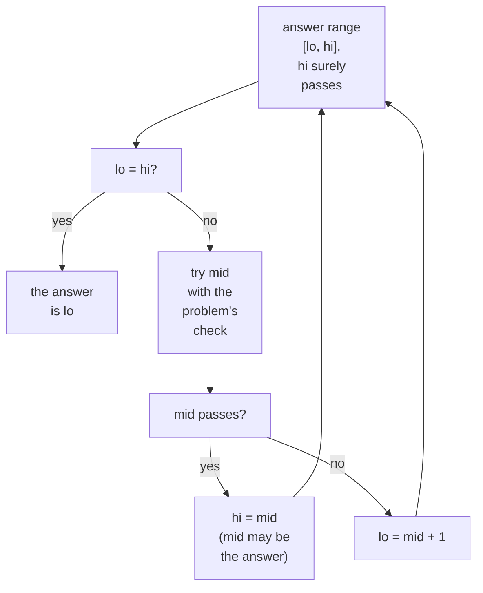

> [!tldr] Quick read
> - Pattern: [[en/concepts/search-on-the-answer|search on the answer]]. The problem asks for "the smallest value that still lets you do X". The answer lies in a known range, and the question "with value k, can X be done?" reads false…false true…true (a [[en/concepts/monotonic-predicate|monotonic predicate]]). Halving that range finds the boundary in log₂(range) checks.
> - The template is the [[en/concepts/lower-bound|lower bound]] from station 1: if `mid` passes, `hi = mid` (keep `mid`), otherwise `lo = mid + 1`, looping while `lo < hi`.
> - Koko Eating Bananas halves the **speed**. Time Based Key-Value Store halves the stored **timestamps**, looking for the last one `<= t`. Median of Two Sorted Arrays halves the **cut position** in the shorter array.
> - The tricky part is not the loop but the check: [[en/concepts/ceiling-division|ceiling division]] for Koko, `<=` versus `<` for the Time Map, and the ±∞ cells at the edges for the Median.

> [!info] Context
> Station 2 of **The NeetCode Line: Search and Heaps**. [[en/posts/2026-11-23-neetcode-binary-search|Station 1]] binary searched sorted arrays and ended with an observation: the real requirement is not "the array is sorted" but "there is a yes/no question that flips once". This station uses that observation when there is no array at all. You need the [[en/concepts/binary-search|binary search]] template, the [[en/concepts/loop-invariant|loop invariant]] and the [[en/concepts/half-open-interval|half-open range]] from station 1.

> [!abstract]- Quick glossary for this post (click to open)
> - **Predicate**: a function returning true or false. It is **monotonic** when, once true at k, it is true for every larger value. See [[en/concepts/monotonic-predicate|Monotonic Predicate]].
> - **Answer space**: every value the answer could take, for example speeds from 1 to `max(piles)`.
> - **⌈x⌉**: rounding up. See [[en/concepts/ceiling-division|Ceiling Division]].
> - **Median**: the middle element in ascending order; with an even count, the average of the two middle elements.
> - **Timestamp**: an increasing integer that marks when something was written.
> - **±∞**: values "smaller than every number" and "larger than every number", used so the edges of an array need no special case. See [[en/concepts/sentinel-value|Sentinel Value]].

## Picture it first: cycling to the station in time for the train

The train leaves at 8, and you want to pedal as gently as possible and still make it. Nobody tries every speed from 1 km/h. You guess a moderate speed and work it out: in time, try slower next; late, try faster. At the station, you read the board of "trains already departed" to find the last one before you arrived. At the entrance two queues of passengers stand sorted by height, and a staff member needs the person in the middle of both queues combined, without asking anyone to move.

| Everyday life | Concept |
|---|---|
| The speeds you could pedal | the answer space `[lo, hi]` |
| "At this speed, do I make the train?" | the predicate `feasible(k)` |
| In time at speed v means in time at any faster speed | monotonicity |
| Working out the trip time for each speed you try | the check, O(n) each time |
| Try the middle speed, drop half | halving the answer space |
| The slowest speed still in time | the boundary: Koko Eating Bananas |
| The last train that left before you arrived | the last timestamp `<= t`: Time Based Key-Value Store |
| How many people to take from the short queue to form the left half of both | the cut position: Median of Two Sorted Arrays |



## The problem: there is no array to search

[[en/problems/koko-eating-bananas|Koko Eating Bananas]] asks for the slowest eating speed that clears n piles of bananas within h hours. There is no array of speeds; there is only a way to compute "at speed k, how many hours". Trying k = 1, 2, 3… takes as many tries as the answer itself: measured with 1,000 piles, an answer of 32,496 takes 35.2 ms, and piles up to 10⁹ (answer about 3.3 · 10⁸) extrapolate to about 6 minutes.

But the check's answers are ordered: if speed k is in time, so is k + 1. Along k, the answers read "too slow, …, too slow, in time, …, in time". That is exactly the "array" `false…false true…true`, except each cell is computed on demand. Finding the first `true` is the [[en/concepts/lower-bound|lower bound]] from station 1: 30 tries for a range up to 10⁹, measured at 0.035 ms.

## How it works

### The shared template

<figure class="figure-map" style="--ar: 3 / 4">
<div class="frame"><iframe data-archify="../../diagrams/neetcode-binary-search-answer/speed-search.en.html" title="Finding the slowest eating speed by halving" loading="lazy"></iframe></div>
<figcaption><span><b>Figure 1.</b> Koko Eating Bananas with piles [3, 6, 7, 11], h = 8: four checks shrink the speed range [1, 11] to [4, 4].</span><a href="../diagrams/neetcode-binary-search-answer/speed-search.en.html" target="_blank" rel="noopener">Open full screen</a></figcaption>
</figure>

Four questions, answered in this order:

1. **Which range holds the answer?** Find a `lo` that surely does not exceed the answer and a `hi` that surely passes. Koko: `lo = 1`, `hi = max(piles)` (one hour per pile, and the problem promises `h >= n`).
2. **What is the check, and what does it cost?** Koko: the sum of ⌈p / k⌉ `<= h`, O(n).
3. **Is the check monotonic?** Prove it in one sentence. Koko: for k' > k, no pile takes more hours. If you cannot prove it, halving still runs and returns **some** boundary, with no error at all.
4. **First `true` or last `true`?** "Smallest value that works" is the first `true`: `hi = mid` when it passes. "Largest value that works" is the last `true` of `true…true false…false`: `lo = mid` when it passes, and `mid` must round **up** to avoid looping forever.

The cost is log₂(hi − lo) checks times the cost of one check. Koko: O(n log max).

### Three problems, three answer ranges

| Problem | Answer range | Check for `mid` | Which half to keep |
|---|---|---|---|
| [[en/problems/koko-eating-bananas\|Koko Eating Bananas]] | speed `[1, max(piles)]` | sum of ⌈p / mid⌉ `<= h`? | in time: `hi = mid`; too slow: `lo = mid + 1` |
| [[en/problems/time-based-key-value-store\|Time Based Key-Value Store]] | index `[0, len)` among one key's timestamps | `ts[mid] > t`? | true: `hi = mid`; false: `lo = mid + 1`; return cell `lo − 1` |
| [[en/problems/median-of-two-sorted-arrays\|Median of Two Sorted Arrays]] | number `i` of elements taken from the shorter array, `[0, m]` | `a[i − 1] > b[j]`, with `j = (m + n + 1) / 2 − i`? | true: took too many from `a`, `hi = i − 1`; `b[j − 1] > a[i]`: took too few, `lo = i + 1` |

**Time Based Key-Value Store** stores several values per key, each with a timestamp, and `get(key, t)` returns the value with the **largest timestamp not exceeding** `t`. The problem promises the timestamps of `set` calls are increasing, so appending to the end keeps the list sorted. `get` is one halving: find the first timestamp `> t` (the upper bound, `bisect_right`), then step back one cell. Stepping back before cell 0 means no value existed at `t`: return the empty string. The easy mistake is the comparison: using the lower bound (`bisect_left`, the first timestamp `>= t`) and stepping back one cell loses the value written **exactly** at `t`. Java has `TreeMap.floorEntry(t)`, which returns exactly the entry needed.

**Median of Two Sorted Arrays** demands O(log(m + n)), so the arrays may not be merged (O(m + n)). The key idea: the median splits the elements into a left half and a right half of equal size (off by one when the total is odd). If the left half takes the first `i` elements of `a`, it must take the first `j = (m + n + 1) / 2 − i` elements of `b`. The cut is right when every element on the left is `<=` every element on the right, that is `a[i − 1] <= b[j]` and `b[j − 1] <= a[i]` (both arrays are sorted, so only the two pairs at the cut need comparing). As `i` grows, `a[i − 1]` grows and `b[j]` shrinks, so "`a[i − 1] > b[j]`?" flips from false to true exactly once: a monotonic predicate again, this time over the cut position. Halving `i` within the shorter array gives O(log min(m, n)). Unlike Koko, this loop uses the closed range `[0, m]` and stops early like problem 704: the right cut is recognized the moment it is found, so there is no need to shrink the range to one cell. At the edges (`i = 0`, `i = m`, `j = 0`, `j = n`) a missing cell counts as −∞ or +∞, so both comparisons can always be written.

### Under the hood of the five languages

| | Halving over a function | Last timestamp `<= t` | ±∞ | Specific trap |
|---|---|---|---|---|
| TypeScript / JavaScript | write it yourself | write the upper bound, then step back one cell | `-Infinity`, `Infinity` | dividing by 0 gives `Infinity`, no error; `Math.max(...arr)` throws `RangeError` when the array is too long (2 · 10⁵ elements on Node 24) |
| Python | `bisect_left(range(lo, hi), True, key=f)` (3.10+) | `bisect_right(ts, t) − 1` | `float("-inf")`, `float("inf")` | `math.ceil(p / k)` is wrong once p > 2⁵³; `bisect` with `key` needs 3.10 |
| Go | `sort.Search(n, f)` | `sort.Search(len, func(i) bool { return ts[i] > t }) − 1` | `math.Inf(-1)`, `math.Inf(1)` (needs a conversion to `float64`) | `sort.Search` always starts at 0: the speed is `i + 1` |
| Java | write it yourself | `TreeMap.floorEntry(t)` | `Long.MIN_VALUE`, `Long.MAX_VALUE` (a `long`, to stay safely outside the `int` range) | the hour sum should be a `long`; `hi = Integer.MAX_VALUE` with `(lo + hi) / 2` makes `mid` negative |

## Runnable example

[TypeScript](../code/neetcode-binary-search-answer/answer-search-station.ts) · [Python](../code/neetcode-binary-search-answer/answer_search_station.py) · [Go](../code/neetcode-binary-search-answer/answer_search_station.go) · [Java](../code/neetcode-binary-search-answer/answer-search-station.java) · [JavaScript](../code/neetcode-binary-search-answer/answer-search-station.js)

Each file solves all three problems and runs 14 cases: the three Koko examples from the problem plus a single pile of 10⁹; the Time Map command sequence from the problem plus "before the first timestamp" and "unknown key"; five Median cases, including an empty array, two arrays of zeros and two non-overlapping arrays.

```ts
// 875: the slowest speed that finishes within h hours. "Is speed k in time?" goes false then true exactly once as k grows.
function minEatingSpeed(piles: number[], h: number): number {
  const hours = (k: number) => piles.reduce((s, p) => s + Math.floor((p + k - 1) / k), 0);
  let lo = 1, hi = Math.max(...piles);
  while (lo < hi) {
    const mid = lo + Math.floor((hi - lo) / 2);
    if (hours(mid) <= h) hi = mid; // in time: keep mid, it may be the answer
    else lo = mid + 1;
  }
  return lo;
}

// 981: each key keeps its timestamps in ascending order. get finds the last timestamp <= t = (first timestamp > t) − 1.
class TimeMap {
  private store = new Map<string, { ts: number[]; vals: string[] }>();
  set(key: string, value: string, timestamp: number): void {
    let e = this.store.get(key);
    if (!e) this.store.set(key, (e = { ts: [], vals: [] }));
    e.ts.push(timestamp); // the problem promises ascending timestamps, so push keeps the array sorted
    e.vals.push(value);
  }
  get(key: string, timestamp: number): string {
    const e = this.store.get(key);
    if (!e) return "";
    let lo = 0, hi = e.ts.length; // find the first timestamp > timestamp on [lo, hi)
    while (lo < hi) {
      const mid = (lo + hi) >>> 1;
      if (e.ts[mid] <= timestamp) lo = mid + 1;
      else hi = mid;
    }
    return lo === 0 ? "" : e.vals[lo - 1];
  }
}

// 4: binary search on the cut position i in the shorter array. The cut is right when every left element <= every right element.
function findMedianSortedArrays(a: number[], b: number[]): number {
  if (a.length > b.length) [a, b] = [b, a];
  const m = a.length, n = b.length, half = (m + n + 1) >> 1;
  let lo = 0, hi = m;
  while (lo <= hi) {
    const i = (lo + hi) >> 1, j = half - i; // i elements of a and j elements of b sit on the left
    const aL = i > 0 ? a[i - 1] : -Infinity, aR = i < m ? a[i] : Infinity;
    const bL = j > 0 ? b[j - 1] : -Infinity, bR = j < n ? b[j] : Infinity;
    if (aL <= bR && bL <= aR) {
      return (m + n) % 2 ? Math.max(aL, bL) : (Math.max(aL, bL) + Math.min(aR, bR)) / 2;
    }
    if (aL > bR) hi = i - 1; // took too many from a
    else lo = i + 1; // took too few from a
  }
  throw new Error("input arrays are not sorted");
}
```

```python
def min_eating_speed(piles: list[int], h: int) -> int:  # 875
    lo, hi = 1, max(piles)
    while lo < hi:
        mid = (lo + hi) // 2
        if sum(-(-p // mid) for p in piles) <= h:  # in time: keep mid
            hi = mid
        else:
            lo = mid + 1
    return lo

class TimeMap:  # 981: each key's timestamps are ascending
    def __init__(self):
        self.ts = defaultdict(list)
        self.vals = defaultdict(list)

    def set(self, key: str, value: str, timestamp: int) -> None:
        self.ts[key].append(timestamp)
        self.vals[key].append(value)

    def get(self, key: str, timestamp: int) -> str:
        i = bisect_right(self.ts.get(key, []), timestamp)  # first timestamp > timestamp
        return self.vals[key][i - 1] if i else ""

def find_median_sorted_arrays(a: list[int], b: list[int]) -> float:  # 4: binary search on the cut position
    if len(a) > len(b):
        a, b = b, a
    m, n = len(a), len(b)
    half = (m + n + 1) // 2
    lo, hi = 0, m
    while lo <= hi:
        i = (lo + hi) // 2
        j = half - i
        a_l = a[i - 1] if i > 0 else float("-inf")
        a_r = a[i] if i < m else float("inf")
        b_l = b[j - 1] if j > 0 else float("-inf")
        b_r = b[j] if j < n else float("inf")
        if a_l <= b_r and b_l <= a_r:
            if (m + n) % 2:
                return max(a_l, b_l)
            return (max(a_l, b_l) + min(a_r, b_r)) / 2
        if a_l > b_r:
            hi = i - 1  # took too many from a
        else:
            lo = i + 1
    raise ValueError("input arrays are not sorted")
```

```go
func minEatingSpeed(piles []int, h int) int { // 875
	lo, hi := 1, slices.Max(piles)
	for lo < hi {
		mid := lo + (hi-lo)/2
		hours := 0
		for _, p := range piles {
			hours += (p + mid - 1) / mid
		}
		if hours <= h { // in time: keep mid
			hi = mid
		} else {
			lo = mid + 1
		}
	}
	return lo
}

type entry struct {
	ts   int
	vals string
}

type TimeMap struct{ store map[string][]entry } // 981: each key's timestamps are ascending

func (t *TimeMap) Set(key, value string, timestamp int) {
	t.store[key] = append(t.store[key], entry{timestamp, value})
}

func (t *TimeMap) Get(key string, timestamp int) string {
	es := t.store[key]
	i := sort.Search(len(es), func(i int) bool { return es[i].ts > timestamp }) // first timestamp > timestamp
	if i == 0 {
		return ""
	}
	return es[i-1].vals
}

func findMedianSortedArrays(a, b []int) float64 { // 4: binary search on the cut position
	if len(a) > len(b) {
		a, b = b, a
	}
	m, n := len(a), len(b)
	half := (m + n + 1) / 2
	lo, hi := 0, m
	for lo <= hi {
		i := (lo + hi) / 2
		j := half - i
		aL, aR, bL, bR := math.Inf(-1), math.Inf(1), math.Inf(-1), math.Inf(1)
		if i > 0 {
			aL = float64(a[i-1])
		}
		if i < m {
			aR = float64(a[i])
		}
		if j > 0 {
			bL = float64(b[j-1])
		}
		if j < n {
			bR = float64(b[j])
		}
		if aL <= bR && bL <= aR {
			if (m+n)%2 == 1 {
				return math.Max(aL, bL)
			}
			return (math.Max(aL, bL) + math.Min(aR, bR)) / 2
		}
		if aL > bR {
			hi = i - 1 // took too many from a
		} else {
			lo = i + 1
		}
	}
	panic("input arrays are not sorted")
}
```

```java
static int minEatingSpeed(int[] piles, int h) { // 875
    int lo = 1, hi = Arrays.stream(piles).max().getAsInt();
    while (lo < hi) {
        int mid = lo + (hi - lo) / 2;
        long hours = 0; // the hour sum can exceed int
        for (int p : piles) hours += (p + mid - 1) / mid;
        if (hours <= h) hi = mid; // in time: keep mid
        else lo = mid + 1;
    }
    return lo;
}

static class TimeMap { // 981: TreeMap.floorEntry returns the largest timestamp <= timestamp
    private final Map<String, TreeMap<Integer, String>> store = new HashMap<>();
    void set(String key, String value, int timestamp) {
        store.computeIfAbsent(key, k -> new TreeMap<>()).put(timestamp, value);
    }
    String get(String key, int timestamp) {
        TreeMap<Integer, String> t = store.get(key);
        if (t == null) return "";
        Map.Entry<Integer, String> e = t.floorEntry(timestamp);
        return e == null ? "" : e.getValue();
    }
}

static double findMedianSortedArrays(int[] a, int[] b) { // 4: binary search on the cut position
    if (a.length > b.length) { int[] t = a; a = b; b = t; }
    int m = a.length, n = b.length, half = (m + n + 1) / 2, lo = 0, hi = m;
    while (lo <= hi) {
        int i = (lo + hi) / 2, j = half - i;
        long aL = i > 0 ? a[i - 1] : Long.MIN_VALUE, aR = i < m ? a[i] : Long.MAX_VALUE;
        long bL = j > 0 ? b[j - 1] : Long.MIN_VALUE, bR = j < n ? b[j] : Long.MAX_VALUE;
        if (aL <= bR && bL <= aR) {
            if ((m + n) % 2 == 1) return Math.max(aL, bL);
            return (Math.max(aL, bL) + Math.min(aR, bR)) / 2.0;
        }
        if (aL > bR) hi = i - 1; // took too many from a
        else lo = i + 1;
    }
    throw new IllegalArgumentException("input arrays are not sorted");
}
```

```js
// 875: the slowest speed that finishes within h hours. "Is speed k in time?" goes false then true exactly once as k grows.
function minEatingSpeed(piles, h) {
  const hours = (k) => piles.reduce((s, p) => s + Math.floor((p + k - 1) / k), 0);
  let lo = 1, hi = Math.max(...piles);
  while (lo < hi) {
    const mid = lo + Math.floor((hi - lo) / 2);
    if (hours(mid) <= h) hi = mid; // in time: keep mid, it may be the answer
    else lo = mid + 1;
  }
  return lo;
}

// 981: each key keeps its timestamps in ascending order. get finds the last timestamp <= t = (first timestamp > t) − 1.
class TimeMap {
  store = new Map();
  set(key, value, timestamp) {
    let e = this.store.get(key);
    if (!e) this.store.set(key, (e = { ts: [], vals: [] }));
    e.ts.push(timestamp); // the problem promises ascending timestamps, so push keeps the array sorted
    e.vals.push(value);
  }
  get(key, timestamp) {
    const e = this.store.get(key);
    if (!e) return "";
    let lo = 0, hi = e.ts.length; // find the first timestamp > timestamp on [lo, hi)
    while (lo < hi) {
      const mid = (lo + hi) >>> 1;
      if (e.ts[mid] <= timestamp) lo = mid + 1;
      else hi = mid;
    }
    return lo === 0 ? "" : e.vals[lo - 1];
  }
}

// 4: binary search on the cut position i in the shorter array. The cut is right when every left element <= every right element.
function findMedianSortedArrays(a, b) {
  if (a.length > b.length) [a, b] = [b, a];
  const m = a.length, n = b.length, half = (m + n + 1) >> 1;
  let lo = 0, hi = m;
  while (lo <= hi) {
    const i = (lo + hi) >> 1, j = half - i; // i elements of a and j elements of b sit on the left
    const aL = i > 0 ? a[i - 1] : -Infinity, aR = i < m ? a[i] : Infinity;
    const bL = j > 0 ? b[j - 1] : -Infinity, bR = j < n ? b[j] : Infinity;
    if (aL <= bR && bL <= aR) {
      return (m + n) % 2 ? Math.max(aL, bL) : (Math.max(aL, bL) + Math.min(aR, bR)) / 2;
    }
    if (aL > bR) hi = i - 1; // took too many from a
    else lo = i + 1; // took too few from a
  }
  throw new Error("input arrays are not sorted");
}
```


```text
answer-search-station 14/14 correct
```

*(Output labels translated; the files themselves print Vietnamese.)*

Python, Go, Java and JavaScript also print `14/14` correct.

## Misconceptions and common traps

- **"You need a sorted array to halve."** You only need a monotonic yes/no question over a range. Koko has no array; the Median halves a cut position, not values.
- **Not proving monotonicity.** Halving over a non-monotonic check still returns a result, just a wrong one. Write a one-sentence proof before the code.
- **Dropping `mid` even when it passes.** The `hi = mid − 1` habit from problem 704 loses the answer when `mid` is the boundary. The Koko page runs this version: 6/10 cases wrong.
- **A wrong check.** Koko with rounding down undercounts hours (5/10 cases). The Time Map with `>= t` instead of `> t` loses the value written exactly at `t`.
- **Bounds that are too wide or meaningless.** `lo = 0` makes the check divide by zero; `hi = Integer.MAX_VALUE` makes `(lo + hi) / 2` overflow. Tight bounds (`1`, `max(piles)`) are both correct and cheaper.
- **Median: halving the longer array.** `j = half − i` can go negative or past `n`. Always swap so that `a` is the shorter array.

## Self-check questions

> [!question]- Problem: ship packages on one ship within `days` days, packages go in order, find the smallest capacity (LeetCode 1011). What are the answer range and the check?
> The range `[max(weights), sum(weights)]`: below the heaviest package nothing can be shipped, at the total it all goes in one day. The check: pack greedily in order, start a new day when full, and count whether days `<= days`. A larger capacity never needs more days, so it is monotonic.

> [!question]- A Time Map holds timestamps `[1, 4, 9]`. Which entries do `get(t = 4)` and `get(t = 3)` return?
> The first timestamp `> 4` is at index 2; step back one: the entry with timestamp 4. The first timestamp `> 3` is at index 1; step back one: the entry with timestamp 1.

> [!question]- Median: `a = [1, 3]`, `b = [2]`. Run the halving loop.
> Is `a` shorter? No: swap so `a = [2]`, `b = [1, 3]`, m = 1, n = 2, half = 2. `i = 0`, `j = 2`: `aL = −∞`, `aR = 2`, `bL = 3`, `bR = +∞`. `bL = 3 > aR = 2`: took too few from `a`, `lo = 1`. `i = 1`, `j = 1`: `aL = 2`, `aR = +∞`, `bL = 1`, `bR = 3`. It holds; the total is odd, so the median is `max(2, 1) = 2`.

> [!question]- Why does "largest value that works" need `mid` rounded up?
> The passing branch sets `lo = mid`. When two cells `[lo, lo + 1]` remain, `mid` rounded down equals `lo`, and `lo = mid` does not shrink the range: it loops forever. Rounding up gives `mid = lo + 1`, and both branches shrink.

## References

- [NeetCode 150](https://neetcode.io/practice) (problem list and groups)
- LeetCode: [875. Koko Eating Bananas](https://leetcode.com/problems/koko-eating-bananas/), [981. Time Based Key-Value Store](https://leetcode.com/problems/time-based-key-value-store/), [4. Median of Two Sorted Arrays](https://leetcode.com/problems/median-of-two-sorted-arrays/), [1011. Capacity To Ship Packages Within D Days](https://leetcode.com/problems/capacity-to-ship-packages-within-d-days/)
- [Python `bisect`](https://docs.python.org/3/library/bisect.html) (`bisect_right`, the `key` parameter)
- [Go `sort.Search`](https://pkg.go.dev/sort#Search)
- [Java 21 `TreeMap.floorEntry`](https://docs.oracle.com/en/java/javase/21/docs/api/java.base/java/util/TreeMap.html#floorEntry(K))
- [C++ `std::partition_point`](https://en.cppreference.com/w/cpp/algorithm/partition_point) (halving over a predicate in the C++ standard library)
