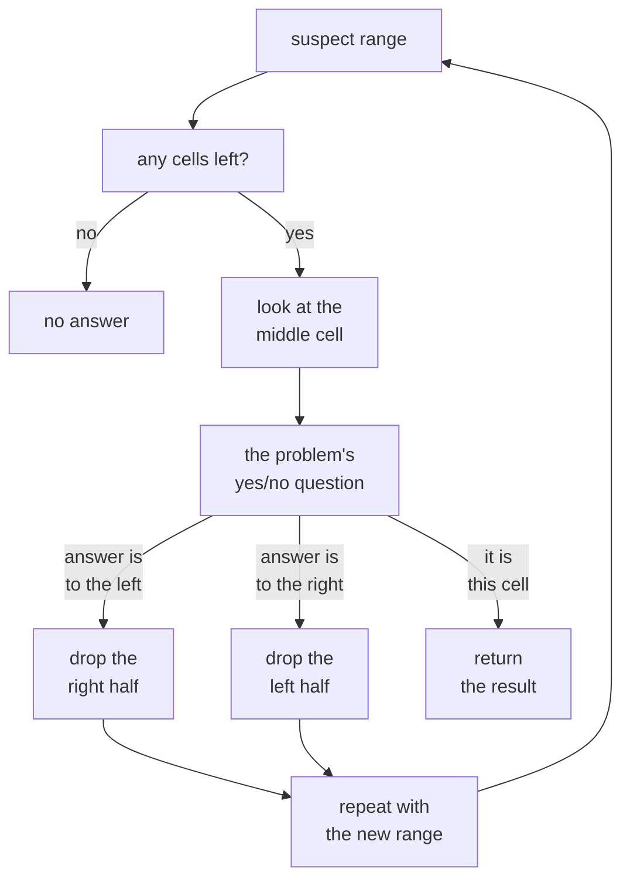

> [!tldr] Quick read
> - Pattern: [[en/concepts/binary-search|binary search]]. Keep a suspect range, look at the middle element, and use one yes/no question to drop half of it. n elements need about log₂ n looks: 20 for 10⁶.
> - Correctness comes from a [[en/concepts/loop-invariant|loop invariant]] and one [[en/concepts/half-open-interval|range convention]] kept consistent: `[lo, hi]` goes with `lo <= hi` and `hi = mid − 1`; `[lo, hi)` goes with `lo < hi` and `hi = mid`.
> - Binary Search is the base template. Search a 2D Matrix maps index k to cell `(k / n, k % n)`. Find Minimum compares `nums[mid]` with `nums[hi]` to learn which side the break is on. Search in Rotated Sorted Array finds the half that is still ascending, then asks whether `target` lies in it.
> - Two shared traps: `lo = mid` makes the loop run forever, and `(lo + hi) / 2` overflows a 32-bit `int` ([[en/concepts/midpoint-overflow|midpoint overflow]]).
> - This station opens the SRCH line: 4 stations, 14 problems.

> [!info] Context
> Station 1 of **The NeetCode Line: Search and Heaps**. All seven stations of the [[en/series/neetcode-arr|Arrays and Strings line]] had to read the data at least once, so none could beat O(n). Here the data is already ordered, and order lets you answer while skipping almost the whole array. The idea of "dropping the part that cannot hold the answer" already appeared at the [[en/posts/2026-11-23-neetcode-two-pointers|two pointers station]] ([[en/concepts/search-space-pruning|Search Space Pruning]]); here each step drops half instead of one element. You only need loops and arrays.

> [!abstract]- Quick glossary for this post (click to open)
> - **Sorted array**: each element is no smaller than the one before.
> - **log₂ n**: how many times n halves before reaching 1; log₂ 10⁶ ≈ 20. See [[en/concepts/big-o-notation|Big-O]].
> - **Invariant**: a statement that holds before and after every pass of a loop. See [[en/concepts/loop-invariant|Loop Invariant]].
> - **Lower bound**: the first position whose value is `>= target`; `bisect_left` in Python. See [[en/concepts/lower-bound|Lower Bound]].
> - **Rotated array**: an ascending array cut at one point with the two pieces swapped: `[0, 1, 2, 4, 5, 6, 7]` becomes `[4, 5, 6, 7, 0, 1, 2]`. See [[en/concepts/rotated-sorted-array|Rotated Sorted Array]].

## Picture it first: looking up a word in a paper dictionary

Nobody looks up a word in a paper dictionary starting from page 1. You open near the middle, see "l", know "n" is in the back half, and drop the front half. Open the middle of the back half, and so on. A 1,000-page dictionary takes about 10 openings.

| Everyday | Concept |
|---|---|
| The pages that could still hold the word | the suspect range `[lo, hi]` |
| Open the middle page | `mid` |
| Whether the page's first word comes before or after yours | the yes/no question asked of `nums[mid]` |
| Drop the half that cannot hold the word | `lo = mid + 1` or `hi = mid − 1` |
| The dictionary is alphabetical, which is why this works | the array must be ordered (or at least the question must be monotonic) |
| A multi-volume dictionary with continuous page numbers | Search a 2D Matrix: many rows read as one array |
| Someone split the dictionary in two and rebound it backwards | a rotated array: Find Minimum, Search in Rotated Sorted Array |



## The problem: reading the whole array costs O(n) even when it is ordered

Finding a number in an ascending array by reading every element is O(n), and wastes the fact that it is sorted. One comparison of `nums[mid]` with `target` proves `target` cannot be in the other half. The [[en/problems/binary-search|Binary Search]] page measures 10⁵ lookups: at 10,000 elements, sequential reading takes 607 ms and halving takes 7.8 ms; at 10⁶ elements, halving still takes only 14 ms.

The difficulty is not the idea but the details. Jon Bentley reports in *Programming Pearls* that about 90% of the professional programmers he asked to write binary search turned in buggy code. The other three problems at this station are harder still: the array is no longer fully ascending, or no longer one-dimensional.

## How it works

### The common template

<figure class="figure-map" style="--ar: 3 / 4">
<div class="frame"><iframe data-archify="../../diagrams/neetcode-binary-search/halving.en.html" title="Binary search on eight elements" loading="lazy"></iframe></div>
<figcaption><span><b>Figure 1.</b> Binary Search: finding 15 takes three looks; finding 4 shrinks the suspect range to empty, and that is the proof 4 is absent.</span><a href="../diagrams/neetcode-binary-search/halving.en.html" target="_blank" rel="noopener">Open full screen</a></figcaption>
</figure>

```text
lo, hi = the initial range
while the range still has cells:
    mid = lo + (hi − lo) / 2
    ask one yes/no question about mid
    drop the half that cannot hold the answer
```

Three things make this template correct:
1. **One invariant**, written down before the code. For problem 704: "if `target` is present, it lies in `[lo, hi]`". Leaving the loop with an empty range is the proof that `target` is absent.
2. **One range convention, kept from start to finish.** Closed `[lo, hi]`: `hi = n − 1`, loop while `lo <= hi`, drop the right with `hi = mid − 1`. Half-open `[lo, hi)`: `hi = n`, loop while `lo < hi`, drop the right with `hi = mid`. Mixing the two is the most common source of bugs.
3. **The range must shrink every pass.** `lo = mid + 1` always shrinks it; `lo = mid` does not when two cells remain, because `mid` rounds down to `lo`, and the loop runs forever.

### Four problems, four questions

| Problem | Range | Question for `mid` | Which half to drop |
|---|---|---|---|
| [[en/problems/binary-search\|Binary Search]] | `[0, n − 1]`, closed | `nums[mid]` compared with `target` | smaller: drop left; larger: drop right; equal: return `mid` |
| [[en/problems/search-a-2d-matrix\|Search a 2D Matrix]] | `[0, m·n − 1]`, closed | cell `(mid / n, mid % n)` compared with `target` | as in Binary Search |
| [[en/problems/find-minimum-in-rotated-sorted-array\|Find Minimum in Rotated Sorted Array]] | `[0, n − 1]`, loop while `lo < hi` | `nums[mid] > nums[hi]`? | yes: the break is to the right, `lo = mid + 1`; no: `hi = mid` (keep `mid`) |
| [[en/problems/search-in-rotated-sorted-array\|Search in Rotated Sorted Array]] | `[0, n − 1]`, closed | which half is ascending, and is `target` in it? | yes: go into that half; no: go to the other |

**Search a 2D Matrix** has every row ascending and each row's first element larger than the previous row's last. Read row after row, the matrix is one ascending array of length `m·n`, so only the index changes: element k sits at row `k / n`, column `k % n` (integer division and remainder by the column count). There is no need to copy it into a flat array. Searching the row first and then the column is also O(log m + log n), the same complexity as O(log(m·n)).

**Find Minimum** has no `target`. A rotated array is two ascending runs, the second smaller than the first; the minimum is the start of the second run. Compare `nums[mid]` with `nums[hi]`: larger means `mid` is in the first run and the break is to the right; smaller means `mid` is in the second run and might be the minimum itself, so `hi = mid`, not `mid − 1`. Invariant: the minimum always lies in `[lo, hi]`. Because `hi = mid` keeps `mid`, the loop condition must be `lo < hi`; with `lo <= hi`, once `lo = hi = mid` the loop never ends.

Comparing with `nums[lo]` instead of `nums[hi]` breaks it: the unrotated array `[1, 2, 3]` has `nums[mid] > nums[lo]`, yet the minimum is to the **left**.

**Search in Rotated Sorted Array** rests on one observation: cut a rotated array at `mid`, and at least one of the halves `[lo, mid]` and `[mid, hi]` is ascending. If `nums[lo] <= nums[mid]`, the left half is ascending, and `target` is in it exactly when `nums[lo] <= target < nums[mid]`. The ascending half is the only one where "does it contain `target`" takes two comparisons; if it does not, `target` (if present) is in the other half. The `<=` in `nums[lo] <= nums[mid]` is needed for the case `lo = mid` (two cells left): drop the equals sign and `[3, 1]` searched for 1 returns `-1`.

### Under the hood of the five languages

| | Computing `mid` | Standard library | Language-specific trap |
|---|---|---|---|
| TypeScript / JavaScript | `(lo + hi) >>> 1` | none | `>> 1` casts to signed int32, wrong once `lo + hi` passes 2³¹; the matrix needs `Math.floor(mid / n)`, since `/` gives a float |
| Python | `(lo + hi) // 2` | `bisect_left`, `bisect_right` | no overflow; `bisect` returns an insertion point, not `-1`; `divmod(mid, n)` gives row and column at once |
| Go | `lo + (hi-lo)/2` | `sort.Search`, `slices.BinarySearch` | `sort.Search` needs a function that flips from `false` to `true` exactly once, so it cannot be used directly on a rotated array |
| Java | `lo + (hi - lo) / 2` | `Arrays.binarySearch` | `(lo + hi) / 2` overflows `int`; `Arrays.binarySearch` returns `-(insertion point) − 1` when absent, and its result is undefined on a rotated array |

## Runnable example

[TypeScript](../code/neetcode-binary-search/binary-search-station.ts) · [Python](../code/neetcode-binary-search/binary_search_station.py) · [Go](../code/neetcode-binary-search/binary_search_station.go) · [Java](../code/neetcode-binary-search/binary-search-station.java) · [JavaScript](../code/neetcode-binary-search/binary-search-station.js)

Each file solves all four problems and runs 14 cases, including one-element arrays, the unrotated array `[11, 13, 15, 17]`, and the two-element arrays `[2, 1]` and `[3, 1]`.

```ts
// 704: closed range [lo, hi], stop as soon as target is found.
function search(nums: number[], target: number): number {
  let lo = 0, hi = nums.length - 1;
  while (lo <= hi) {
    const mid = lo + ((hi - lo) >> 1);
    if (nums[mid] === target) return mid;
    if (nums[mid] < target) lo = mid + 1;
    else hi = mid - 1;
  }
  return -1;
}

// 74: an m×n matrix read row by row is one ascending array of length m·n; index k maps to cell (k / n, k % n).
function searchMatrix(matrix: number[][], target: number): boolean {
  const n = matrix[0].length;
  let lo = 0, hi = matrix.length * n - 1;
  while (lo <= hi) {
    const mid = lo + ((hi - lo) >> 1);
    const v = matrix[Math.floor(mid / n)][mid % n];
    if (v === target) return true;
    if (v < target) lo = mid + 1;
    else hi = mid - 1;
  }
  return false;
}

// 153: compare nums[mid] with nums[hi]. If larger, the break (the minimum) is to the right of mid.
function findMin(nums: number[]): number {
  let lo = 0, hi = nums.length - 1;
  while (lo < hi) { // invariant: the minimum always lies in [lo, hi]
    const mid = lo + ((hi - lo) >> 1);
    if (nums[mid] > nums[hi]) lo = mid + 1;
    else hi = mid; // mid may be the minimum itself, so keep it
  }
  return nums[lo];
}

// 33: one of the two halves around mid is always ascending; if target lies in it go in, otherwise go to the other half.
function searchRotated(nums: number[], target: number): number {
  let lo = 0, hi = nums.length - 1;
  while (lo <= hi) {
    const mid = lo + ((hi - lo) >> 1);
    if (nums[mid] === target) return mid;
    if (nums[lo] <= nums[mid]) { // left half [lo, mid] is ascending
      if (nums[lo] <= target && target < nums[mid]) hi = mid - 1;
      else lo = mid + 1;
    } else { // right half [mid, hi] is ascending
      if (nums[mid] < target && target <= nums[hi]) lo = mid + 1;
      else hi = mid - 1;
    }
  }
  return -1;
}
```

```python
def search(nums: list[int], target: int) -> int:  # 704
    lo, hi = 0, len(nums) - 1
    while lo <= hi:
        mid = (lo + hi) // 2
        if nums[mid] == target:
            return mid
        if nums[mid] < target:
            lo = mid + 1
        else:
            hi = mid - 1
    return -1

def search_matrix(matrix: list[list[int]], target: int) -> bool:  # 74: index k maps to cell (k // n, k % n)
    n = len(matrix[0])
    lo, hi = 0, len(matrix) * n - 1
    while lo <= hi:
        mid = (lo + hi) // 2
        r, c = divmod(mid, n)
        if matrix[r][c] == target:
            return True
        if matrix[r][c] < target:
            lo = mid + 1
        else:
            hi = mid - 1
    return False

def find_min(nums: list[int]) -> int:  # 153: compare with nums[hi] to learn which side the break is on
    lo, hi = 0, len(nums) - 1
    while lo < hi:
        mid = (lo + hi) // 2
        if nums[mid] > nums[hi]:
            lo = mid + 1
        else:
            hi = mid  # mid may be the minimum
    return nums[lo]

def search_rotated(nums: list[int], target: int) -> int:  # 33: one half around mid is always ascending
    lo, hi = 0, len(nums) - 1
    while lo <= hi:
        mid = (lo + hi) // 2
        if nums[mid] == target:
            return mid
        if nums[lo] <= nums[mid]:  # left half is ascending
            if nums[lo] <= target < nums[mid]:
                hi = mid - 1
            else:
                lo = mid + 1
        else:  # right half is ascending
            if nums[mid] < target <= nums[hi]:
                lo = mid + 1
            else:
                hi = mid - 1
    return -1
```

```go
func search(nums []int, target int) int { // 704
	lo, hi := 0, len(nums)-1
	for lo <= hi {
		mid := lo + (hi-lo)/2
		if nums[mid] == target {
			return mid
		} else if nums[mid] < target {
			lo = mid + 1
		} else {
			hi = mid - 1
		}
	}
	return -1
}

func searchMatrix(matrix [][]int, target int) bool { // 74: index k maps to cell (k / n, k % n)
	n := len(matrix[0])
	lo, hi := 0, len(matrix)*n-1
	for lo <= hi {
		mid := lo + (hi-lo)/2
		v := matrix[mid/n][mid%n]
		if v == target {
			return true
		} else if v < target {
			lo = mid + 1
		} else {
			hi = mid - 1
		}
	}
	return false
}

func findMin(nums []int) int { // 153: compare with nums[hi] to learn which side the break is on
	lo, hi := 0, len(nums)-1
	for lo < hi {
		mid := lo + (hi-lo)/2
		if nums[mid] > nums[hi] {
			lo = mid + 1
		} else {
			hi = mid // mid may be the minimum
		}
	}
	return nums[lo]
}

func searchRotated(nums []int, target int) int { // 33: one half around mid is always ascending
	lo, hi := 0, len(nums)-1
	for lo <= hi {
		mid := lo + (hi-lo)/2
		if nums[mid] == target {
			return mid
		}
		if nums[lo] <= nums[mid] { // left half is ascending
			if nums[lo] <= target && target < nums[mid] {
				hi = mid - 1
			} else {
				lo = mid + 1
			}
		} else { // right half is ascending
			if nums[mid] < target && target <= nums[hi] {
				lo = mid + 1
			} else {
				hi = mid - 1
			}
		}
	}
	return -1
}
```

```java
static int search(int[] nums, int target) { // 704
    int lo = 0, hi = nums.length - 1;
    while (lo <= hi) {
        int mid = lo + (hi - lo) / 2;
        if (nums[mid] == target) return mid;
        if (nums[mid] < target) lo = mid + 1;
        else hi = mid - 1;
    }
    return -1;
}

static boolean searchMatrix(int[][] matrix, int target) { // 74: index k maps to cell (k / n, k % n)
    int n = matrix[0].length, lo = 0, hi = matrix.length * n - 1;
    while (lo <= hi) {
        int mid = lo + (hi - lo) / 2, v = matrix[mid / n][mid % n];
        if (v == target) return true;
        if (v < target) lo = mid + 1;
        else hi = mid - 1;
    }
    return false;
}

static int findMin(int[] nums) { // 153: compare with nums[hi] to learn which side the break is on
    int lo = 0, hi = nums.length - 1;
    while (lo < hi) {
        int mid = lo + (hi - lo) / 2;
        if (nums[mid] > nums[hi]) lo = mid + 1;
        else hi = mid; // mid may be the minimum
    }
    return nums[lo];
}

static int searchRotated(int[] nums, int target) { // 33: one half around mid is always ascending
    int lo = 0, hi = nums.length - 1;
    while (lo <= hi) {
        int mid = lo + (hi - lo) / 2;
        if (nums[mid] == target) return mid;
        if (nums[lo] <= nums[mid]) { // left half is ascending
            if (nums[lo] <= target && target < nums[mid]) hi = mid - 1;
            else lo = mid + 1;
        } else { // right half is ascending
            if (nums[mid] < target && target <= nums[hi]) lo = mid + 1;
            else hi = mid - 1;
        }
    }
    return -1;
}
```

```js
function search(nums, target) { // 704
  let lo = 0, hi = nums.length - 1;
  while (lo <= hi) {
    const mid = (lo + hi) >>> 1;
    if (nums[mid] === target) return mid;
    if (nums[mid] < target) lo = mid + 1;
    else hi = mid - 1;
  }
  return -1;
}

function searchMatrix(matrix, target) { // 74: index k maps to cell (k / n, k % n)
  const n = matrix[0].length;
  let lo = 0, hi = matrix.length * n - 1;
  while (lo <= hi) {
    const mid = (lo + hi) >>> 1;
    const v = matrix[Math.floor(mid / n)][mid % n];
    if (v === target) return true;
    if (v < target) lo = mid + 1;
    else hi = mid - 1;
  }
  return false;
}

function findMin(nums) { // 153: compare with nums[hi] to learn which side the break is on
  let lo = 0, hi = nums.length - 1;
  while (lo < hi) {
    const mid = (lo + hi) >>> 1;
    if (nums[mid] > nums[hi]) lo = mid + 1;
    else hi = mid; // mid may be the minimum
  }
  return nums[lo];
}

function searchRotated(nums, target) { // 33: one half around mid is always ascending
  let lo = 0, hi = nums.length - 1;
  while (lo <= hi) {
    const mid = (lo + hi) >>> 1;
    if (nums[mid] === target) return mid;
    if (nums[lo] <= nums[mid]) { // left half is ascending
      if (nums[lo] <= target && target < nums[mid]) hi = mid - 1;
      else lo = mid + 1;
    } else { // right half is ascending
      if (nums[mid] < target && target <= nums[hi]) lo = mid + 1;
      else hi = mid - 1;
    }
  }
  return -1;
}
```


```text
binary-search-station 14/14 correct
```

*(Output labels translated; the files themselves print Vietnamese.)*

Python, Go, Java and JavaScript also print `14/14` correct.

## Misconceptions and common traps

- **"Binary search only works on sorted arrays."** It needs a yes/no question whose answer flips exactly once along the range. A rotated array is not sorted, but "`nums[i] <= nums[n − 1]`?" goes from false to true exactly once, at the break. The next station pushes this further: binary search on the answer itself.
- **Mixing the two range conventions.** Initialising `hi = n − 1` and then looping on `lo < hi` skips the last cell; the [[en/problems/binary-search|Binary Search]] page runs this version and it fails 4/8 cases.
- **`hi = mid` with `lo <= hi`.** When `lo = hi`, `mid = lo`, and `hi = mid` does not shrink the range. Find Minimum keeps `mid`, so it must loop on `lo < hi`.
- **`lo = mid`.** Loops forever once two cells remain. Safe only when `mid` rounds up.
- **Find Minimum: comparing with `nums[lo]`.** Wrong on an unrotated array. Compare with `nums[hi]`.
- **Rotated Search: `nums[lo] < nums[mid]` instead of `<=`.** Wrong when two cells remain and `mid = lo`.
- **Duplicates.** Problems 153 and 33 promise distinct elements. With duplicates (problems 154, 81), `nums[mid] == nums[hi]` does not tell which side the break is on, and the worst case goes back to O(n).

## Self-check questions

> [!question]- A 3 × 4 matrix. Which cell does index k = 7 map to?
> Row `7 / 4 = 1`, column `7 % 4 = 3`: cell `(1, 3)`, the last element of the second row.

> [!question]- Run Find Minimum on `[4, 5, 6, 7, 0, 1, 2]`; write down `lo`, `hi`, `mid`.
> (0, 6, 3): 7 > 2, `lo = 4`. (4, 6, 5): 1 ≤ 2, `hi = 5`. (4, 5, 4): 0 ≤ 1, `hi = 4`. `lo = hi = 4`, return `nums[4] = 0`.

> [!question]- Search in Rotated: `[4, 5, 6, 7, 0, 1, 2]` searching for 0. Which half does the first look go into, and why?
> `mid = 3`, `nums[mid] = 7`. `nums[0] = 4 ≤ 7`, so the left half `[4, 5, 6, 7]` is ascending. 0 is not in `[4, 7)`, so go right: `lo = 4`.

> [!question]- Why does Find Minimum use `hi = mid` while Binary Search uses `hi = mid − 1`?
> Binary Search already knows `nums[mid] != target`, so it can rule out `mid`. Find Minimum only knows `nums[mid] <= nums[hi]`, meaning `mid` is in the second run and **might** be the minimum; ruling it out would throw away the answer.

## References

- [NeetCode 150](https://neetcode.io/practice) (problem list and groups)
- LeetCode: [704. Binary Search](https://leetcode.com/problems/binary-search/), [74. Search a 2D Matrix](https://leetcode.com/problems/search-a-2d-matrix/), [153. Find Minimum in Rotated Sorted Array](https://leetcode.com/problems/find-minimum-in-rotated-sorted-array/), [33. Search in Rotated Sorted Array](https://leetcode.com/problems/search-in-rotated-sorted-array/)
- Jon Bentley, *Programming Pearls* (2nd ed.), column 4 "Writing Correct Programs" (binary search and loop invariants)
- Joshua Bloch, [Extra, Extra – Read All About It: Nearly All Binary Searches and Mergesorts are Broken](https://research.google/blog/extra-extra-read-all-about-it-nearly-all-binary-searches-and-mergesorts-are-broken/), Google Research blog, 2006
- [Python `bisect`](https://docs.python.org/3/library/bisect.html), [Go `sort.Search`](https://pkg.go.dev/sort#Search)
