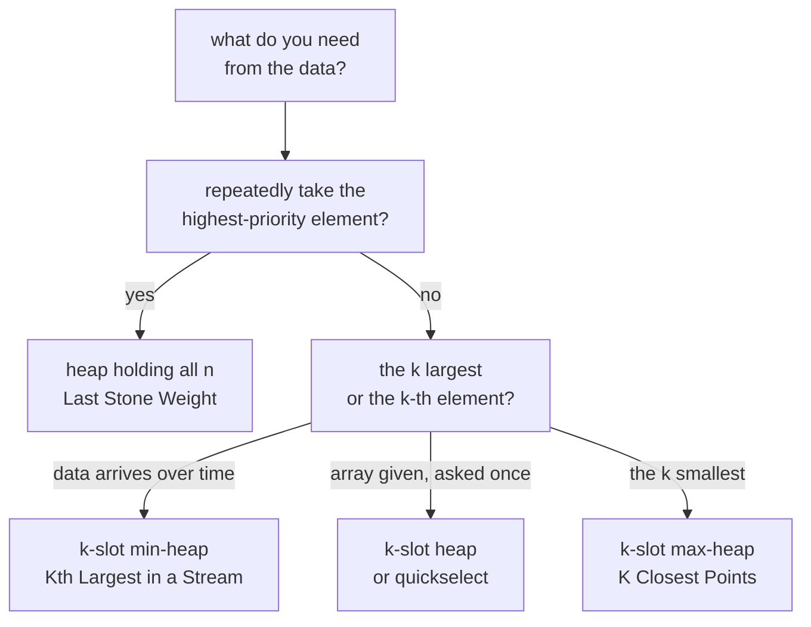

> [!tldr] Quick read
> - Pattern: the [[en/concepts/heap|heap]]. A binary tree stored in an array where no parent is larger than its children, so the smallest element is always in slot 0. Reading the top is O(1); insert and pop-top are O(log n) thanks to [[en/concepts/sift-up-sift-down|sifting up and down]]. Building one from n existing elements is only O(n) ([[en/concepts/heapify|heapify]]).
> - First use, **repeatedly taking the highest-priority element**: Last Stone Weight needs the two heaviest stones each turn, so it uses a max-heap holding all n stones.
> - Second use, **the [[en/concepts/size-k-heap|k-slot heap]]**: for the k largest elements keep a k-slot min-heap whose top is the weakest candidate and also the k-th largest (Kth Largest in a Stream, Kth Largest in an Array). For the k smallest, flip it (K Closest Points). O(n log k), O(k) memory.
> - Compare with the top **before** inserting: with 10⁶ numbers and k = 10, 6.6 ms against 94.0 ms when every number is pushed and only then trimmed.
> - When the array is already there and asked only once, [[en/concepts/quickselect|quickselect]] (O(n) on average) does not depend on k: 12.0 ms at k = 500,000, where the k-slot heap is already as slow as sorting the whole array.

> [!info] Context
> Station 3 of **The NeetCode Line: Search and Heaps**. [[en/posts/2026-11-23-neetcode-binary-search|Station 1]] and [[en/posts/2026-11-23-neetcode-binary-search-answer|station 2]] searched data that was already ordered. This station solves a different problem: the data is **not** ordered, arrives over time, and we only need the element that comes first by some criterion, or the first k. The heap showed up once in [[en/problems/top-k-frequent-elements|Top K Frequent Elements]] on the Arrays and Strings line; here it gets its own station. No prior knowledge of heaps is needed.

> [!abstract]- Quick glossary for this post (click to open)
> - **Heap**: a binary tree stored in an array, parent in slot i, children in `2i + 1` and `2i + 2`. **Min-heap**: no parent is larger than its children, smallest at the top. **Max-heap**: the opposite. See [[en/concepts/heap|Heap]].
> - **Priority queue**: the data type "insert, and take out the highest-priority element"; a heap is its most common implementation. Java calls its heap class `PriorityQueue`.
> - **Sift up, sift down**: swap with the parent, or with the smaller child, until no parent is larger than its children. See [[en/concepts/sift-up-sift-down|Sift Up and Sift Down]].
> - **Top K**: the k largest (or smallest) elements by some criterion. See [[en/concepts/size-k-heap|Size-K Heap]].
> - **Quickselect**: find the k-th element by partitioning the array around a pivot like quicksort, but continuing into one side only. See [[en/concepts/quickselect|Quickselect]].
> - **Squared distance**: x² + y². Comparing distances to the origin needs no square root, because the root preserves order.

## Picture it first: a chess club and its waiting line

A chess club has dozens of players, all at different levels. The organizers have to answer many kinds of questions, and never once do they re-rank the whole club. They only keep a waiting line in which the person they need is always at the front.

| Everyday | Concept |
|---|---|
| A waiting line where the strongest player is always at the front | max-heap, top in slot 0 |
| A newcomer joins the line and moves ahead of anyone weaker | insert, sift up, O(log n) |
| Call the one at the front; the others shuffle up to fill the gap | pop the top, sift down, O(log n) |
| The two strongest play an elimination game; a draw knocks both out, otherwise the winner rejoins the line with the strength left | Last Stone Weight: pop two tops, push the difference |
| A team of exactly k; the team's weakest stands by the door; a newcomer only plays the one at the door | k-slot min-heap: Kth Largest in a Stream, in an Array |
| Pick the k members who live closest to the club to share a car; the farthest of the group stands by the door | k-slot max-heap by distance: K Closest Points |
| Re-ranking the whole club | sorting the whole array, O(n log n) |
| Pick one player as a marker, split the club into "stronger" and "weaker", keep looking only in the group holding the wanted rank | quickselect, O(n) on average |



## The problem: sorting does too much

For the k-th largest number you can sort the whole array and read the k-th slot from the end: correct, O(n log n). But sorting answers **every** question about order (who is 1st, 2nd, …, nth), while we need one position. With 10⁶ random numbers, sorting the whole array takes about 290 ms even when k = 10.

It gets worse when data arrives over time. [[en/problems/kth-largest-element-in-a-stream|Kth Largest Element in a Stream]] asks again after **every** new number; re-sorting each time, with 10⁴ initial numbers and 10⁴ inserts, takes 1,562.8 ms. And [[en/problems/last-stone-weight|Last Stone Weight]] changes the data midway: each turn takes two stones out and may put a new one back, so a sorted array has to re-insert in the right place, O(n) per turn.

We need a structure that keeps **just enough order**: it knows the first element at once, and is cheap to repair after an insert or a removal. That is the heap.

## How it works

### The heap: partial order in an array

<figure class="figure-map" style="--ar: 3 / 4">
<div class="frame"><iframe data-archify="../../diagrams/neetcode-heap-top-k/size-k-heap.en.html" title="A three-slot min-heap returning the third largest of a stream" loading="lazy"></iframe></div>
<figcaption><span><b>Figure 1.</b> Kth Largest Element in a Stream with k = 3: a number smaller than the top is dropped at once; a larger one replaces the top and sifts down, and the top is always the third largest.</span><a href="../diagrams/neetcode-heap-top-k/size-k-heap.en.html" target="_blank" rel="noopener">Open full screen</a></figcaption>
</figure>

A min-heap promises just one thing: no parent is larger than its two children. It promises nothing about two siblings, or about two branches. That weak promise is enough to put the smallest element at the root, and cheap enough to keep:

- **Insert**: put it at the end of the array (a new leaf), then **sift up**: swap with the parent while smaller than it.
- **Pop the top**: move the last element to the root, then **sift down**: swap with the **smaller child** while larger than it.
- **Replace the top**: overwrite the root and sift down once (`heapq.heapreplace`, `heap.Fix(h, 0)`).

A complete tree of n elements is ⌊log₂ n⌋ tall, so each operation is O(log n). The array needs no pointers: the parent of slot i is `(i − 1) >> 1`. Building a heap from n existing elements by sifting down from the last parent back to the root ([[en/concepts/heapify|heapify]], Floyd 1964) costs only O(n): the problem 703 page measures 999,988 swaps on 10⁶ descending numbers, against 17,951,445 when inserting one by one.

### The k-slot heap: why the top k largest needs a small heap

To keep the k largest numbers of a stream, the only question for each new number is "is it stronger than the **weakest** candidate in the top k?". The weakest candidate has to be at the top to be compared in O(1), so the heap is a **min**-heap. Stronger: replace the top, O(log k); otherwise drop it, O(1). The top is both the weakest candidate and the answer: the k-th largest.

The other way round, the k **smallest** elements (the k points closest to the origin) need a k-slot **max**-heap: its top is the farthest point in the group, replaced when a closer one shows up. Picking the wrong heap direction is the most common mistake on this station; the problem 703 page runs the max-heap version and it passes 1/8 cases.

### Four problems, two uses

| Problem | Which heap | Holds | Each step |
|---|---|---|---|
| [[en/problems/kth-largest-element-in-a-stream\|Kth Largest Element in a Stream]] | k-slot min-heap | the k largest seen | a new number larger than the top replaces it; return the top |
| [[en/problems/last-stone-weight\|Last Stone Weight]] | max-heap of all n | every remaining stone | pop two tops y ≥ x; if y > x push y − x |
| [[en/problems/k-closest-points-to-origin\|K Closest Points to Origin]] | k-slot max-heap by x² + y² | the k closest points seen | a new point closer than the top replaces it |
| [[en/problems/kth-largest-element-in-an-array\|Kth Largest Element in an Array]] | k-slot min-heap, or quickselect | the k largest | like the stream problem, on an existing array |

**Kth Largest Element in a Stream** is the anchor problem: exactly the k-slot heap template, and since it is a stream, nothing cheaper exists. **Last Stone Weight** uses the heap the first way: each turn needs the two heaviest stones, then may put back a smaller one. A max-heap makes each turn O(log n), O(n log n) in total; Python has no max-heap, so it negates. **K Closest Points to Origin** is a k-slot heap by distance, the opposite direction: a max-heap. Comparing x² + y² rather than the root is both faster and free of floating-point error. **Kth Largest Element in an Array** is like the stream problem, but the array is given up front, so there is one more option: [[en/concepts/quickselect|quickselect]].

### Heap, sorting or quickselect

The k-th largest of 10⁶ random numbers, median of 5 runs, Node 24 (the station file's hand-written min-heap):

| k | Sort the whole array | Heap: push every number, then pop the top | Heap: compare with the top first | Quickselect |
|---|---|---|---|---|
| 10 | 290.2 ms | 94.0 ms | 6.6 ms | 10.9 ms |
| 1,000 | 286.4 ms | 322.7 ms | 8.8 ms | 7.1 ms |
| 500,000 | 295.5 ms | 371.0 ms | 295.9 ms | 12.0 ms |

Three things to read from the table:

- **Comparing with the top before inserting** decides everything. With random numbers, after the first few thousand almost every new number is smaller than the top and is dropped after one comparison. Pushing first and trimming after makes every number sift up and then down: 14 times slower at k = 10, and at k = 1,000 slower than sorting the whole array.
- **The k-slot heap shines when k is small.** O(n log k) with k = n/2 is no different from O(n log n): at k = 500,000 the heap ties with sorting.
- **Quickselect does not depend on k**, O(n) on average, but it needs the whole array in memory, modifies the array (copied first here), and has an O(n²) worst case if the pivot is chosen badly. A random pivot makes that worst case practically impossible. It cannot be used on a stream: there is no whole array to partition yet.

### Under the hood of the five languages

| | Built-in heap | Max-heap | Replace the top | Specific trap |
|---|---|---|---|---|
| TypeScript / JavaScript | none | write your own, or a negative key | write your own | `sort()` without a compare function compares as strings: `[10, 2].sort()` is `[10, 2]` |
| Python | `heapq` on a `list` | negate (`-x`), or a tuple `(-d, x, y)` | `heapreplace` | tuples compare their second element when the first ties: that element must be comparable |
| Go | `container/heap` | change `Less` | `heap.Fix(h, 0)` | `Push`, `Pop` need pointer receivers; call `heap.Push(h, x)`, not `h.Push(x)` |
| Java | `PriorityQueue` | `Collections.reverseOrder()` | `poll` then `offer` | the comparator `(a, b) -> b - a` overflows `int`; use `Integer.compare(b, a)` |

## Runnable example

[TypeScript](../code/neetcode-heap-top-k/heap-station.ts) · [Python](../code/neetcode-heap-top-k/heap_station.py) · [Go](../code/neetcode-heap-top-k/heap_station.go) · [Java](../code/neetcode-heap-top-k/heap-station.java) · [JavaScript](../code/neetcode-heap-top-k/heap-station.js)

Each file solves all four problems and runs 14 cases: three `add` sequences for the stream problem (the problem's example, empty `nums`, duplicates), four Last Stone Weight cases (the problem's example, one stone, two equal stones that both break, `[3, 7, 2]`), three K Closest Points cases (the problem's two examples and k = n; compared regardless of order) and four Kth Largest in an Array cases (the problem's two examples, one element, repeated negatives). The TypeScript and JavaScript versions use a hand-written min-heap by key: a max-heap is a negative key.

```ts
// Min-heap by key: parent at i, children at 2i + 1 and 2i + 2. For a max-heap, pass a negative key.
class Heap<T> {
  a: T[] = [];
  key: (x: T) => number;
  constructor(key: (x: T) => number) { this.key = key; }
  get size(): number { return this.a.length; }
  peek(): T { return this.a[0]; }
  push(x: T): void {
    const a = this.a, key = this.key;
    a.push(x);
    let i = a.length - 1;
    while (i > 0) { // sift up
      const p = (i - 1) >> 1;
      if (key(a[p]) <= key(a[i])) break;
      [a[p], a[i]] = [a[i], a[p]];
      i = p;
    }
  }
  pop(): T {
    const a = this.a, key = this.key, top = a[0], last = a.pop()!;
    if (a.length > 0) {
      a[0] = last;
      let i = 0; // sift down
      for (;;) {
        const l = 2 * i + 1, r = l + 1;
        let m = i;
        if (l < a.length && key(a[l]) < key(a[m])) m = l;
        if (r < a.length && key(a[r]) < key(a[m])) m = r;
        if (m === i) break;
        [a[m], a[i]] = [a[i], a[m]];
        i = m;
      }
    }
    return top;
  }
}

// 703: min-heap keeps the k largest; the top is the k-th largest.
class KthLargest {
  k: number;
  h = new Heap<number>((x) => x);
  constructor(k: number, nums: number[]) { this.k = k; for (const x of nums) this.add(x); }
  add(val: number): number {
    if (this.h.size < this.k) this.h.push(val);
    else if (val > this.h.peek()) { this.h.pop(); this.h.push(val); } // replace the weakest candidate
    return this.h.peek();
  }
}

// 1046: max-heap (negative key); each turn take the two heaviest, smash, put the remainder back.
function lastStoneWeight(stones: number[]): number {
  const h = new Heap<number>((x) => -x);
  for (const s of stones) h.push(s);
  while (h.size > 1) {
    const y = h.pop(), x = h.pop();
    if (y > x) h.push(y - x);
  }
  return h.size ? h.peek() : 0;
}

// 973: k-slot max-heap by squared distance; the top is the farthest of the k points kept.
function kClosest(points: number[][], k: number): number[][] {
  const d = (p: number[]) => p[0] * p[0] + p[1] * p[1]; // no square root needed: it preserves order
  const h = new Heap<number[]>((p) => -d(p));
  for (const p of points) {
    h.push(p);
    if (h.size > k) h.pop(); // drop the farthest point
  }
  return h.a;
}

// 215: k-slot min-heap over the whole array; the top is the k-th largest.
function findKthLargest(nums: number[], k: number): number {
  const h = new Heap<number>((x) => x);
  for (const x of nums) {
    if (h.size < k) h.push(x);
    else if (x > h.peek()) { h.pop(); h.push(x); } // only a number stronger than the top gets in
  }
  return h.peek();
}
```

```python
class KthLargest:  # 703: min-heap keeps the k largest
    def __init__(self, k: int, nums: list[int]):
        self.k, self.h = k, []
        for x in nums:
            self.add(x)

    def add(self, val: int) -> int:
        if len(self.h) < self.k:
            heapq.heappush(self.h, val)
        elif val > self.h[0]:
            heapq.heapreplace(self.h, val)  # replace the weakest candidate
        return self.h[0]

def last_stone_weight(stones: list[int]) -> int:  # 1046: negate to get a max-heap
    h = [-s for s in stones]
    heapq.heapify(h)
    while len(h) > 1:
        y, x = -heapq.heappop(h), -heapq.heappop(h)
        if y > x:
            heapq.heappush(h, -(y - x))
    return -h[0] if h else 0

def k_closest(points: list[list[int]], k: int) -> list[list[int]]:  # 973: k-slot max-heap by distance
    h = []
    for x, y in points:
        heapq.heappush(h, (-(x * x + y * y), x, y))
        if len(h) > k:
            heapq.heappop(h)  # drop the farthest point
    return [[x, y] for _, x, y in h]

def find_kth_largest(nums: list[int], k: int) -> int:  # 215: k-slot min-heap
    h = nums[:k]
    heapq.heapify(h)
    for x in nums[k:]:
        if x > h[0]:
            heapq.heapreplace(h, x)
    return h[0]
```

```go
// keyHeap is a min-heap by key: for a max-heap, use a negative key.
type keyHeap[T any] struct {
	a   []T
	key func(T) int
}

func (h *keyHeap[T]) Len() int           { return len(h.a) }

func (h *keyHeap[T]) Less(i, j int) bool { return h.key(h.a[i]) < h.key(h.a[j]) }

func (h *keyHeap[T]) Swap(i, j int)      { h.a[i], h.a[j] = h.a[j], h.a[i] }

func (h *keyHeap[T]) Push(x any)         { h.a = append(h.a, x.(T)) }

func (h *keyHeap[T]) Pop() any {
	x := h.a[len(h.a)-1]
	h.a = h.a[:len(h.a)-1]
	return x
}

type KthLargest struct { // 703: min-heap keeps the k largest
	k int
	h *keyHeap[int]
}

func NewKthLargest(k int, nums []int) *KthLargest {
	s := &KthLargest{k, &keyHeap[int]{key: func(x int) int { return x }}}
	for _, x := range nums {
		s.Add(x)
	}
	return s
}

func (s *KthLargest) Add(val int) int {
	if s.h.Len() < s.k {
		heap.Push(s.h, val)
	} else if val > s.h.a[0] { // replace the weakest candidate
		s.h.a[0] = val
		heap.Fix(s.h, 0)
	}
	return s.h.a[0]
}

func lastStoneWeight(stones []int) int { // 1046: max-heap via a negative key
	h := &keyHeap[int]{a: slices.Clone(stones), key: func(x int) int { return -x }}
	heap.Init(h)
	for h.Len() > 1 {
		y, x := heap.Pop(h).(int), heap.Pop(h).(int)
		if y > x {
			heap.Push(h, y-x)
		}
	}
	if h.Len() == 0 {
		return 0
	}
	return h.a[0]
}

func kClosest(points [][]int, k int) [][]int { // 973: k-slot max-heap by squared distance
	h := &keyHeap[[]int]{key: func(p []int) int { return -(p[0]*p[0] + p[1]*p[1]) }}
	for _, p := range points {
		heap.Push(h, p)
		if h.Len() > k {
			heap.Pop(h) // drop the farthest point
		}
	}
	return h.a
}

func findKthLargest(nums []int, k int) int { // 215: k-slot min-heap
	h := &keyHeap[int]{key: func(x int) int { return x }}
	for _, x := range nums {
		if h.Len() < k {
			heap.Push(h, x)
		} else if x > h.a[0] { // only a number stronger than the top gets in
			h.a[0] = x
			heap.Fix(h, 0)
		}
	}
	return h.a[0]
}
```

```java
static class KthLargest { // 703: min-heap (PriorityQueue's default) keeps the k largest
    private final int k;
    private final PriorityQueue<Integer> pq = new PriorityQueue<>();
    KthLargest(int k, int[] nums) { this.k = k; for (int x : nums) add(x); }
    int add(int val) {
        if (pq.size() < k) pq.offer(val);
        else if (val > pq.peek()) { pq.poll(); pq.offer(val); } // replace the weakest candidate
        return pq.peek();
    }
}

static int lastStoneWeight(int[] stones) { // 1046: max-heap
    PriorityQueue<Integer> pq = new PriorityQueue<>(Collections.reverseOrder());
    for (int s : stones) pq.offer(s);
    while (pq.size() > 1) {
        int y = pq.poll(), x = pq.poll();
        if (y > x) pq.offer(y - x);
    }
    return pq.isEmpty() ? 0 : pq.peek();
}

static int[][] kClosest(int[][] points, int k) { // 973: k-slot max-heap by squared distance
    PriorityQueue<int[]> pq = new PriorityQueue<>(
        (p, q) -> Integer.compare(q[0] * q[0] + q[1] * q[1], p[0] * p[0] + p[1] * p[1]));
    for (int[] p : points) {
        pq.offer(p);
        if (pq.size() > k) pq.poll(); // drop the farthest point
    }
    return pq.toArray(new int[0][]);
}

static int findKthLargest(int[] nums, int k) { // 215: k-slot min-heap
    PriorityQueue<Integer> pq = new PriorityQueue<>();
    for (int x : nums) {
        if (pq.size() < k) pq.offer(x);
        else if (x > pq.peek()) { pq.poll(); pq.offer(x); } // only a number stronger than the top gets in
    }
    return pq.peek();
}
```

```js
// Min-heap by key: parent at i, children at 2i + 1 and 2i + 2. For a max-heap, pass a negative key.
class Heap {
  a = [];
  constructor(key) { this.key = key; }
  get size() { return this.a.length; }
  peek() { return this.a[0]; }
  push(x) {
    const a = this.a, key = this.key;
    a.push(x);
    let i = a.length - 1;
    while (i > 0) { // sift up
      const p = (i - 1) >> 1;
      if (key(a[p]) <= key(a[i])) break;
      [a[p], a[i]] = [a[i], a[p]];
      i = p;
    }
  }
  pop() {
    const a = this.a, key = this.key, top = a[0], last = a.pop();
    if (a.length > 0) {
      a[0] = last;
      let i = 0; // sift down
      for (;;) {
        const l = 2 * i + 1, r = l + 1;
        let m = i;
        if (l < a.length && key(a[l]) < key(a[m])) m = l;
        if (r < a.length && key(a[r]) < key(a[m])) m = r;
        if (m === i) break;
        [a[m], a[i]] = [a[i], a[m]];
        i = m;
      }
    }
    return top;
  }
}

// 703: min-heap keeps the k largest; the top is the k-th largest.
class KthLargest {
  h = new Heap((x) => x);
  constructor(k, nums) { this.k = k; for (const x of nums) this.add(x); }
  add(val) {
    if (this.h.size < this.k) this.h.push(val);
    else if (val > this.h.peek()) { this.h.pop(); this.h.push(val); } // replace the weakest candidate
    return this.h.peek();
  }
}

// 1046: max-heap (negative key); each turn take the two heaviest, smash, put the remainder back.
function lastStoneWeight(stones) {
  const h = new Heap((x) => -x);
  for (const s of stones) h.push(s);
  while (h.size > 1) {
    const y = h.pop(), x = h.pop();
    if (y > x) h.push(y - x);
  }
  return h.size ? h.peek() : 0;
}

// 973: k-slot max-heap by squared distance; the top is the farthest of the k points kept.
function kClosest(points, k) {
  const d = (p) => p[0] * p[0] + p[1] * p[1]; // no square root needed: it preserves order
  const h = new Heap((p) => -d(p));
  for (const p of points) {
    h.push(p);
    if (h.size > k) h.pop(); // drop the farthest point
  }
  return h.a;
}

// 215: k-slot min-heap over the whole array; the top is the k-th largest.
function findKthLargest(nums, k) {
  const h = new Heap((x) => x);
  for (const x of nums) {
    if (h.size < k) h.push(x);
    else if (x > h.peek()) { h.pop(); h.push(x); } // only a number stronger than the top gets in
  }
  return h.peek();
}
```


Output of `node heap-station.ts`, including the measurement above:

```text
heap-station 14/14 cases correct

Measured: k-th largest in 10⁶ random numbers (median of 5)
k           sort all      heap: push then pop  heap: top check first  quickselect
10             290.2 ms             94.0 ms                6.6 ms        10.9 ms
1000           286.4 ms            322.7 ms                8.8 ms         7.1 ms
500000         295.5 ms            371.0 ms              295.9 ms        12.0 ms
```

*(Output labels translated; the files themselves print Vietnamese.)*

Python, Go, Java and JavaScript also print `14/14` correct.

## Misconceptions and common traps

- **"The top k largest means a max-heap."** A max-heap holding all n elements and popped k times is also correct, but costs O(n) memory and O(n + k log n). The **k-slot** heap for the top k largest is a min-heap, because its top must be the candidate that gets replaced.
- **"A heap is a sorted array."** No: `[1, 5, 2, 9, 6]` is a valid min-heap. Only slot 0 is guaranteed to be the smallest. Walking a heap array by index does not give an ascending sequence.
- **Push first, trim after.** Correct but slow: comparing with the top first drops a weaker number after one comparison. A 14× gap at k = 10 in the measurement table.
- **Python: tuples with an incomparable element.** `heappush(h, (d, point))` compares down to `point` when two `d` tie; if `point` is an object without `<`, that raises `TypeError`. Add a counter as the second element, or split the coordinates into numbers as the station file does.
- **The square root is unnecessary.** Compare x² + y², not `Math.sqrt(x² + y²)`: same order, no floating point.
- **Quickselect with a fixed pivot.** Always taking the first element as pivot makes a sorted array O(n²). Pick the pivot at random.

## Self-check questions

> [!question]- Array `[3, 1, 6, 5, 2, 4]`. What does heapify (min-heap) produce? From which slot does sifting down start?
> n = 6, the last parent is slot 2 (value 6, its child is slot 5 with value 4): 6 > 4, swap: `[3, 1, 4, 5, 2, 6]`. Slot 1 (value 1, children 5 and 2): no swap. Slot 0 (value 3, children 1 and 4): swap with 1: `[1, 3, 4, 5, 2, 6]`; slot 1 (value 3, children 5 and 2): swap with 2: `[1, 2, 4, 5, 3, 6]`.

> [!question]- Last Stone Weight `[2, 7, 4, 1, 8, 1]`: run the max-heap.
> 8 and 7 → push 1: `[4, 2, 1, 1, 1]` left. 4 and 2 → push 2: `[2, 1, 1, 1]`. 2 and 1 → push 1: `[1, 1, 1]`. 1 and 1 → both break: `[1]`. The answer is 1.

> [!question]- K Closest Points with n = 10⁶ points, k = 10. Why is a k-slot max-heap better than sorting by distance, and when is it not?
> O(n log k) with log k ≈ 3.3 against O(n log n) with log n ≈ 20, and O(k) memory. When k approaches n, log k ≈ log n and the heap stops paying off; then quickselect by distance gives O(n) on average.

> [!question]- Why is quickselect O(n) on average when quicksort is O(n log n)?
> Quicksort recurses into **both** sides, n work per level over log n levels. Quickselect goes into **one** side only: n + n/2 + n/4 + … ≈ 2n.

## References

- [NeetCode 150](https://neetcode.io/practice) (problem list and groups)
- LeetCode: [703. Kth Largest Element in a Stream](https://leetcode.com/problems/kth-largest-element-in-a-stream/), [1046. Last Stone Weight](https://leetcode.com/problems/last-stone-weight/), [973. K Closest Points to Origin](https://leetcode.com/problems/k-closest-points-to-origin/), [215. Kth Largest Element in an Array](https://leetcode.com/problems/kth-largest-element-in-an-array/)
- [Python `heapq`](https://docs.python.org/3/library/heapq.html) (min-heap, `heapify`, `heapreplace`, the note on tuples and counters)
- [Go `container/heap`](https://pkg.go.dev/container/heap) (`heap.Interface`, `heap.Fix`, the `PriorityQueue` example)
- [Java 21 `PriorityQueue`](https://docs.oracle.com/en/java/javase/21/docs/api/java.base/java/util/PriorityQueue.html)
- Robert W. Floyd, "Algorithm 245: Treesort 3", *Communications of the ACM* 7(12), 1964 (bottom-up heapify)
- C. A. R. Hoare, "Algorithm 65: Find", *Communications of the ACM* 4(7), 1961 (quickselect)
- Cormen, Leiserson, Rivest, Stein, *Introduction to Algorithms*, chapter 6 "Heapsort" and chapter 9 "Medians and Order Statistics"
