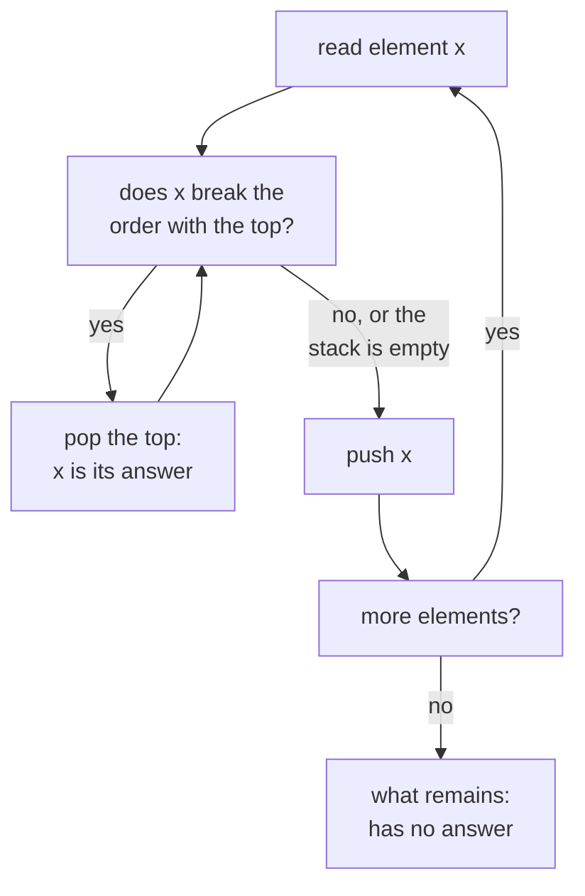

> [!tldr] Quick read
> - The pattern: a [[en/concepts/monotonic-stack|monotonic stack]]. Keep the elements **still waiting** on a stack that always increases (or always decreases) from bottom to top. When a new element breaks the order, pop the top: the new element is exactly the answer the top was waiting for.
> - Each element goes in once and comes out at most once, so the whole algorithm is O(n) even with a `while` inside a `for` ([[en/concepts/aggregate-analysis|aggregate analysis]]).
> - Daily Temperatures: a decreasing stack, popped on meeting the [[en/concepts/next-greater-element|next greater element]]. Car Fleet: sort cars by position, keep a stack of increasing arrival times, and a car faster than the fleet ahead joins it. Largest Rectangle in Histogram: an increasing stack, popped on meeting a **shorter** bar, and at pop time you know both edges of the rectangle.
> - Two questions set them apart: **is the stack increasing or decreasing**, and **what do you compute after popping**.
> - This station closes the ARR line: 7 stations, 27 problems.

> [!info] Context
> Station 7, the last station of **the NeetCode line: Arrays and Strings**. [[en/posts/2026-11-23-neetcode-stack|Station 6, the stack]], keeps unfinished work in reverse order of when it started; this station adds one rule: the work on the stack is always ordered in one direction. [[en/problems/sliding-window-maximum|Sliding Window Maximum]] at station 5 already used the same idea with a double-ended queue ([[en/concepts/monotonic-deque|Monotonic Deque]]). All you need to know is loops, arrays and stacks.

> [!abstract]- Quick glossary for this post (click to open)
> - **Monotonic**: always increasing or always decreasing in one direction.
> - **Next greater element**: the first element to your right that is larger than you. See [[en/concepts/next-greater-element|Next Greater Element]].
> - **Sentinel**: a fake element added at the start or end so the loop doesn't need special handling for edge cases. See [[en/concepts/sentinel-value|Sentinel Value]].
> - **Histogram**: bars of width 1 placed side by side, with different heights.

## Picture it first: a line of people looking out to sea

People stand in a line in the order they arrived, all looking forward. A person can only "see" someone taller standing ahead of them. Whenever a tall person arrives, the shorter people standing right behind them have their answer ("the first taller person is this one") and leave the line. The remaining line always gets shorter from the earliest arrival to the latest.

| Everyday life | Concept |
|---|---|
| The line of people still waiting for an answer | the stack of waiting elements |
| The line is always ordered by height | a monotonic stack |
| A tall person arrives, the shorter people at the end of the line leave | `pop` when the new element breaks the order |
| Whoever leaves learns "who is the first person taller than me" | Daily Temperatures: the next warmer day |
| A fast car catching up with a slow car ahead drives along with it | Car Fleet: joining a fleet |
| Whoever leaves learns the nearest shorter person on both sides | Largest Rectangle: both edges of the rectangle |



## The problem: "the first element to the right that qualifies" costs O(n²)

All three problems ask, for each position, about the **nearest** element on one side satisfying a comparison: the next warmer day, the fleet ahead a car will catch, the nearest shorter bar on both sides. The direct way is for each position to search on its own: O(n) per position, O(n²) in total. The [[en/problems/daily-temperatures|Daily Temperatures]] page measures it: 309 ms on 40 000 decreasing days, against 0.72 ms for the stack.

Flip the question: instead of each position searching for its answer, let **each new element resolve** the positions waiting for it. The waiting positions, kept in the right order, are always resolved from the nearest one outward, exactly the way a stack works.

## How it works

### The shared template

<figure class="figure-map" style="--ar: 3 / 4">
<div class="frame"><iframe data-archify="../../diagrams/neetcode-monotonic-stack/next-warmer.en.html" title="A monotonic stack over eight days of temperatures" loading="lazy"></iframe></div>
<figcaption><span><b>Figure 1.</b> Daily Temperatures: each warmer day takes the days waiting for it out of the book, from the top down.</span><a href="../diagrams/neetcode-monotonic-stack/next-warmer.en.html" target="_blank" rel="noopener">Open full screen</a></figcaption>
</figure>

```text
for each i:
    while the stack is non-empty and a[i] breaks the order with a[top]:
        j = pop()
        record the answer for j, using i (and the new top if needed)
    push(i)
```

Three things make this template correct:
1. **Store indices**, not values: the answer is usually a distance or a width.
2. **The order on the stack** makes the `while` loop stop at the right moment: a new element that doesn't break the order with the top doesn't break it with anyone below either.
3. **Each index goes in once and comes out at most once.** The total number of pops across all iterations is at most n, so O(n). On 10⁶ random days, the measuring file counted 986 048 pops.

### Three problems, two questions

| Problem | Stack (bottom → top) | Pop when | After popping, compute |
|---|---|---|---|
| [[en/problems/daily-temperatures\|Daily Temperatures]] | indices, temperatures **decreasing** | the new day is **strictly** warmer than the top | `out[j] = i − j` |
| [[en/problems/car-fleet\|Car Fleet]] | fleets' arrival times, **increasing** | (no pop) the new car arrives no later than the fleet ahead | the car joins the fleet, no push; the fleet count is the stack size |
| [[en/problems/largest-rectangle-in-histogram\|Largest Rectangle in Histogram]] | indices, heights **increasing** | the new bar is **shorter** than the top | area `h[j] × (i − new top − 1)` |

**Car Fleet** changes axis: sort cars by position from closest to the target, then look at the arrival time `(target − position) / speed`. A car behind that arrives no later than the car ahead catches up before the target and joins its fleet (it can't pass). The stack holds only fleets, and their times increase. Here the new element pops nobody; it is either "swallowed" into the fleet on top or becomes a new fleet. In Python, Go and Java, dividing integers by each other rounds and can merge two fleets by mistake; you must divide as floating point.

**Largest Rectangle** uses both edges. When bar j is popped because bar i is shorter, i is the nearest shorter bar to the **right** of j, and the new top (after popping j) is the nearest shorter bar to the **left** of j. The rectangle of height `h[j]` spans exactly between those two bars. A bar of height 0 added at the end acts as a [[en/concepts/sentinel-value|sentinel]]: it is shorter than every bar, so it empties the stack without a separate loop at the end.

## Runnable example

[TypeScript](../code/neetcode-monotonic-stack/monotonic-stack-station.ts) · [Python](../code/neetcode-monotonic-stack/monotonic_stack_station.py) · [Go](../code/neetcode-monotonic-stack/monotonic_stack_station.go) · [Java](../code/neetcode-monotonic-stack/monotonic-stack-station.java) · [JavaScript](../code/neetcode-monotonic-stack/monotonic-stack-station.js)

Each file solves all three problems and runs 9 cases, including `[70, 70, 71]` (two equal days) and `[2, 2, 2]` (equal bars).

```ts
// 739: a stack of indices, temperatures decreasing; a warmer day pops and records the distance.
function dailyTemperatures(t: number[]): number[] {
  const out = new Array(t.length).fill(0);
  const stack: number[] = [];
  for (let i = 0; i < t.length; i++) {
    while (stack.length > 0 && t[i] > t[stack[stack.length - 1]]) {
      const j = stack.pop()!;
      out[j] = i - j;
    }
    stack.push(i);
  }
  return out;
}

// 853: order cars from closest to the target; the stack holds each fleet's arrival time, increasing from bottom to top.
function carFleet(target: number, position: number[], speed: number[]): number {
  const cars = position.map((p, i) => [p, (target - p) / speed[i]]).sort((a, b) => b[0] - a[0]);
  const fleets: number[] = [];
  for (const [, time] of cars) {
    if (fleets.length === 0 || time > fleets[fleets.length - 1]) fleets.push(time); // slower than the fleet ahead: a new fleet
    // faster or equal: catches up and joins the fleet ahead, no push
  }
  return fleets.length;
}

// 84: a stack of indices, heights increasing; a shorter bar pops and computes the rectangle of the popped bar.
function largestRectangleArea(h: number[]): number {
  const stack: number[] = [];
  let best = 0;
  for (let i = 0; i <= h.length; i++) {
    const cur = i === h.length ? 0 : h[i]; // a virtual 0 bar at the end: empties the stack
    while (stack.length > 0 && cur < h[stack[stack.length - 1]]) {
      const height = h[stack.pop()!];
      const left = stack.length > 0 ? stack[stack.length - 1] : -1; // nearest shorter bar on the left
      best = Math.max(best, height * (i - left - 1));
    }
    stack.push(i);
  }
  return best;
}
```

```python
def daily_temperatures(t: list[int]) -> list[int]:  # 739
    out = [0] * len(t)
    stack: list[int] = []
    for i, x in enumerate(t):
        while stack and x > t[stack[-1]]:
            j = stack.pop()
            out[j] = i - j
        stack.append(i)
    return out

def car_fleet(target: int, position: list[int], speed: list[int]) -> int:  # 853
    cars = sorted(zip(position, speed), reverse=True)  # closest to the target first
    fleets: list[float] = []
    for p, s in cars:
        time = (target - p) / s  # / gives a float; // would round down and merge two fleets by mistake
        if not fleets or time > fleets[-1]:
            fleets.append(time)
    return len(fleets)

def largest_rectangle_area(h: list[int]) -> int:  # 84
    stack: list[int] = []
    best = 0
    for i in range(len(h) + 1):
        cur = h[i] if i < len(h) else 0
        while stack and cur < h[stack[-1]]:
            height = h[stack.pop()]
            left = stack[-1] if stack else -1
            best = max(best, height * (i - left - 1))
        stack.append(i)
    return best
```

```go
// 739
func dailyTemperatures(t []int) []int {
	out := make([]int, len(t))
	stack := []int{}
	for i, x := range t {
		for len(stack) > 0 && x > t[stack[len(stack)-1]] {
			j := stack[len(stack)-1]
			stack = stack[:len(stack)-1]
			out[j] = i - j
		}
		stack = append(stack, i)
	}
	return out
}

// 853
func carFleet(target int, position, speed []int) int {
	idx := make([]int, len(position))
	for i := range idx {
		idx[i] = i
	}
	sort.Slice(idx, func(a, b int) bool { return position[idx[a]] > position[idx[b]] })
	fleets := []float64{}
	for _, i := range idx {
		time := float64(target-position[i]) / float64(speed[i]) // convert to float64 BEFORE dividing: int/int drops the fraction
		if len(fleets) == 0 || time > fleets[len(fleets)-1] {
			fleets = append(fleets, time)
		}
	}
	return len(fleets)
}

// 84
func largestRectangleArea(h []int) int {
	stack := []int{}
	best := 0
	for i := 0; i <= len(h); i++ {
		cur := 0
		if i < len(h) {
			cur = h[i]
		}
		for len(stack) > 0 && cur < h[stack[len(stack)-1]] {
			height := h[stack[len(stack)-1]]
			stack = stack[:len(stack)-1]
			left := -1
			if len(stack) > 0 {
				left = stack[len(stack)-1]
			}
			best = max(best, height*(i-left-1))
		}
		stack = append(stack, i)
	}
	return best
}
```

```java
// 739
static int[] dailyTemperatures(int[] t) {
    int[] out = new int[t.length];
    Deque<Integer> stack = new ArrayDeque<>();
    for (int i = 0; i < t.length; i++) {
        while (!stack.isEmpty() && t[i] > t[stack.peek()]) {
            int j = stack.pop();
            out[j] = i - j;
        }
        stack.push(i);
    }
    return out;
}

// 853
static int carFleet(int target, int[] position, int[] speed) {
    Integer[] idx = new Integer[position.length];
    for (int i = 0; i < idx.length; i++) idx[i] = i;
    Arrays.sort(idx, (a, b) -> position[b] - position[a]);
    Deque<Double> fleets = new ArrayDeque<>();
    for (int i : idx) {
        double time = (double) (target - position[i]) / speed[i]; // cast before dividing
        if (fleets.isEmpty() || time > fleets.peek()) fleets.push(time);
    }
    return fleets.size();
}

// 84
static int largestRectangleArea(int[] h) {
    Deque<Integer> stack = new ArrayDeque<>();
    int best = 0;
    for (int i = 0; i <= h.length; i++) {
        int cur = i == h.length ? 0 : h[i];
        while (!stack.isEmpty() && cur < h[stack.peek()]) {
            int height = h[stack.pop()];
            int left = stack.isEmpty() ? -1 : stack.peek();
            best = Math.max(best, height * (i - left - 1));
        }
        stack.push(i);
    }
    return best;
}
```

```js
// 739
function dailyTemperatures(t) {
  const out = new Array(t.length).fill(0);
  const stack = [];
  for (let i = 0; i < t.length; i++) {
    while (stack.length > 0 && t[i] > t[stack.at(-1)]) {
      const j = stack.pop();
      out[j] = i - j;
    }
    stack.push(i);
  }
  return out;
}

// 853
function carFleet(target, position, speed) {
  const cars = position.map((p, i) => [p, (target - p) / speed[i]]).sort((a, b) => b[0] - a[0]);
  const fleets = [];
  for (const [, time] of cars) if (fleets.length === 0 || time > fleets.at(-1)) fleets.push(time);
  return fleets.length;
}

// 84
function largestRectangleArea(h) {
  const stack = [];
  let best = 0;
  for (let i = 0; i <= h.length; i++) {
    const cur = i === h.length ? 0 : h[i];
    while (stack.length > 0 && cur < h[stack.at(-1)]) {
      const height = h[stack.pop()];
      const left = stack.length > 0 ? stack.at(-1) : -1;
      best = Math.max(best, height * (i - left - 1));
    }
    stack.push(i);
  }
  return best;
}
```


```text
$ node monotonic-stack-station.ts
9/9 cases passed
```

*(Output labels translated; the files themselves print Vietnamese.)*

Python, Go, Java and JavaScript also print `9/9 ca đúng` ("9/9 cases passed"). The measurements and wrong variants are on each problem's page.

## Misconceptions and common traps

- **"A `while` inside a `for` is O(n²)."** Each element leaves the stack at most once; count the total pops, not the loop levels.
- **Getting the stack's direction wrong.** For the next **greater** element the stack is **decreasing** (pop on meeting a larger element); for the next **smaller** element it is **increasing**. Write out a three-element example before coding.
- **Using `>=` when the problem says "strictly".** Daily Temperatures on `[70, 70, 71]` must give `[2, 1, 0]`. Largest Rectangle, on the other hand, gives the right result whether or not you pop on equality, because equal bars yield the same rectangle at a later pop.
- **Forgetting what's left on the stack.** In Daily Temperatures it has answer 0 (already initialized). In Largest Rectangle its areas are not computed yet, so you need a 0 sentinel bar at the end or a separate cleanup loop.
- **Car Fleet: integer division.** `(target − p) // s` in Python or `int / int` in Go and Java rounds down; two cars arriving at 2.5 and 2 hours both become 2 hours and merge by mistake.
- **JS: `stack[-1]`.** It's `undefined`, not the top. Use `stack.at(-1)` or `stack[stack.length - 1]`.

## Self-check questions

> [!question]- To find, for each element, "the nearest smaller element on the left", which direction of stack do you use and where do you read the answer?
> An **increasing** stack from bottom to top. For each i, pop every top ≥ `a[i]`; the remaining top (if any) is i's nearest smaller element on the left. Then push i.

> [!question]- In Largest Rectangle, bar j is popped by bar i. Why can't the rectangle of height `h[j]` be wider than `i − new top − 1`?
> Bar i is shorter than `h[j]`, so it blocks the right; the new top is the nearest bar to the left shorter than `h[j]` (every bar between it and j was popped for being taller than or equal to `h[j]`), so it blocks the left.

> [!question]- Car Fleet: `target = 10`, a car at position 6 with speed 2 and a car at position 0 with speed 5. How many fleets?
> The car at 6 arrives after `(10 − 6) / 2 = 2` hours; the car at 0 after `10 / 5 = 2` hours. The car behind arrives at the same time, so it catches up exactly at the target: one fleet.

> [!question]- Why is the total number of pops at most n?
> Each index is pushed exactly once, and only what was pushed can be popped. The number of pops can't exceed the number of pushes.

## References

- [NeetCode 150](https://neetcode.io/practice) (the problem list and groups)
- LeetCode: [739. Daily Temperatures](https://leetcode.com/problems/daily-temperatures/), [853. Car Fleet](https://leetcode.com/problems/car-fleet/), [84. Largest Rectangle in Histogram](https://leetcode.com/problems/largest-rectangle-in-histogram/)
- Cormen, Leiserson, Rivest, Stein, *Introduction to Algorithms*, chapter "Amortized Analysis" (the stack with `MULTIPOP`: the aggregate argument for the total pops)
- [Java 21 `ArrayDeque`](https://docs.oracle.com/en/java/javase/21/docs/api/java.base/java/util/ArrayDeque.html) (in place of the legacy `Stack` class)
