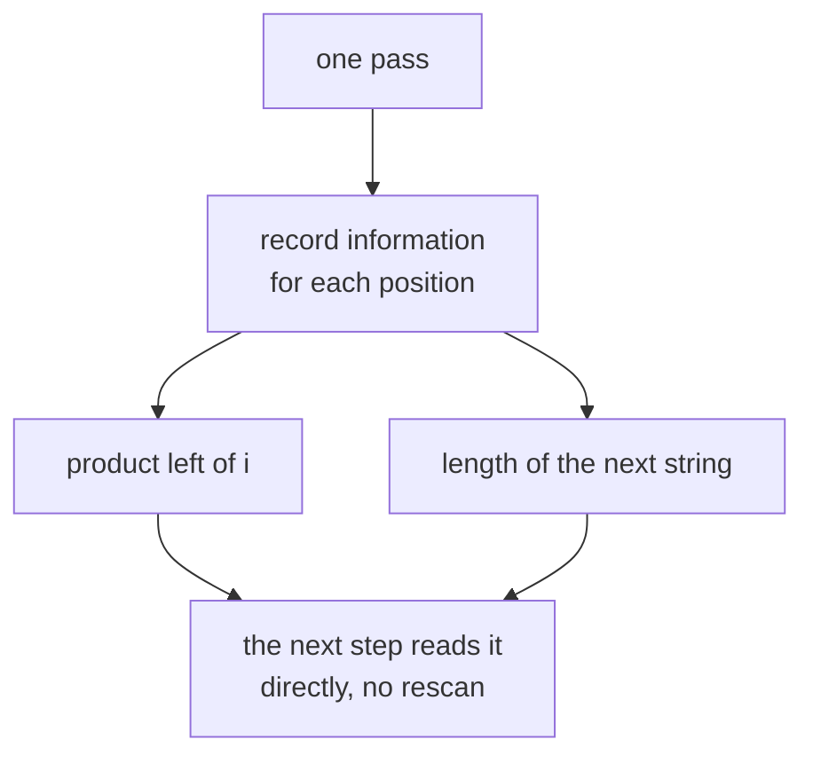

> [!tldr] Quick read
> - The pattern: **write it down first so you don't search later**. One pass records enough information for the next step to answer directly, without rescanning or guessing.
> - Product of Array Except Self: product except i = product on the **left** × product on the **right**. Two passes record those two halves ([[en/concepts/prefix-and-suffix-products|prefix and suffix products]]), no division needed.
> - Encode and Decode Strings: write the **length** before each string ([[en/concepts/length-prefix-encoding|length prefix]]). The decoder knows where to cut without guessing a delimiter.
> - Both "natural" approaches break on edge cases: division breaks on a zero, a delimiter breaks when a string contains it ([[en/concepts/delimiter-collision|Delimiter Collision]]).

> [!info] Context
> Station 3 of **the NeetCode line: Arrays and Strings**. Stations 1 and 2 used hash tables to remember "what have I seen"; this station replaces the hash table with **a helper array or a number written down in advance**: a product built up from one side, or a length placed before the content. Each problem has its own page solved in depth in five languages. All you need to know is loops, arrays and strings.

> [!abstract]- Quick glossary for this post (click to open)
> - **Prefix, suffix**: the start `a[0..i-1]` and the end `a[i+1..n-1]` of an array.
> - **Prefix sum**: an array `P` where `P[i]` is the sum of `a[0..i-1]`; the sum of any range is the difference of two cells. See [[en/concepts/prefix-sum|Prefix Sum]].
> - **Running variable**: a variable that keeps adding or multiplying as you walk the array, replacing a whole helper array.
> - **Escaping**: marking a special character as "ordinary". See [[en/concepts/escaping|Escaping]].

## Picture it first: a walker's notebook

You walk along a road with n milestones. At each milestone you write in a notebook "how far I've walked from the start of the road". Later, when someone asks "how far is it from milestone 3 to milestone 7", you subtract two lines of the notebook instead of walking again. A postman does the same with a bundle of letters: he writes "this bundle has 3 letters" on top, so the recipient doesn't have to guess where each letter ends.

| Everyday life | Concept |
|---|---|
| Writing down the distance walked at each milestone | prefix sum (product) |
| Someone else walks back from the end of the road, also keeping notes | suffix product |
| "Everything except milestone i" = the part before i joined to the part after i | product except i = prefix × suffix |
| A "this bundle has 3 letters" label on top | a length prefix |
| Using a blank sheet as a divider when a letter itself contains a blank sheet | a delimiter colliding with the content |



## The problem: the natural approach breaks on edge cases

Both problems have an "obvious" solution:
- **Product of Array Except Self**: multiply the whole array, then divide by `nums[i]`. A zero breaks it: JS gives `NaN`, other languages throw a division-by-zero error. The problem also forbids division.
- **Encode and Decode Strings**: join the strings with commas. A string containing a comma breaks it, and `[]` and `[""]` both become the empty string.

Both approaches try to **reconstruct** information that was already lost: dividing to remove a factor, splitting to guess boundaries. The station's pattern is not to lose the information in the first place: write it down while you still know it.

## How it works

### Prefix and suffix products

<figure class="figure-map" style="--ar: 3 / 4">
<div class="frame"><iframe data-archify="../../diagrams/neetcode-prefix-suffix-encoding/prefix-suffix.en.html" title="Two passes of prefix and suffix products on [1, 2, 3, 4]" loading="lazy"></iframe></div>
<figcaption><span><b>Figure 1.</b> Product of Array Except Self: pass 1 writes the product on the left, pass 2 multiplies in the product on the right.</span><a href="../diagrams/neetcode-prefix-suffix-encoding/prefix-suffix.en.html" target="_blank" rel="noopener">Open full screen</a></figcaption>
</figure>

The general prefix template: `P[0]` is the identity element (0 for addition, 1 for multiplication), and `P[i+1] = P[i] ⊕ a[i]`. With addition, the sum of `a[l..r]` is `P[r+1] − P[l]`. With multiplication you can't subtract (dividing by 0), so "everything except i" has to join the **prefix from the left** with the **suffix from the right**.

When each prefix cell is used exactly once, in scan order, the helper array shrinks to a **running variable**. The folded version of problem 238 writes the prefix into the result array, then walks backwards with one variable `right`: no helper array at all.

### Length prefix

Each string becomes `<length>#<content>`. The decoder reads digits up to the first `#`, then takes exactly that many characters without reading inside them. Because the length part has only digits, the first `#` is always the real boundary; a `#` in the content is never even looked at. HTTP `Content-Length` and most binary protocols do exactly this.

The other option is [[en/concepts/escaping|escaping]]: turn `,` in the content into `/,` and `/` into `//`. Also correct, but the decoder has to read every character to know which ones were escaped.

### Two problems, one idea

| Problem | What gets written first | How the next step uses it |
|---|---|---|
| [[en/problems/product-of-array-except-self\|Product of Array Except Self]] | the product of everything left of i (then right of i) | `out[i] = left × right`, no division |
| [[en/problems/encode-and-decode-strings\|Encode and Decode Strings]] | the length of the next string | jump over exactly that many characters |

Both run in O(n) with one or two passes. What gets written is small: one number per position.

## Runnable example

[TypeScript](../code/neetcode-prefix-suffix-encoding/prefix-suffix-encoding.ts) · [Python](../code/neetcode-prefix-suffix-encoding/prefix_suffix_encoding.py) · [Go](../code/neetcode-prefix-suffix-encoding/prefix_suffix_encoding.go) · [Java](../code/neetcode-prefix-suffix-encoding/prefix-suffix-encoding.java) · [JavaScript](../code/neetcode-prefix-suffix-encoding/prefix-suffix-encoding.js)

Each file solves both problems and runs 7 cases, including `[]`, `[""]`, a string containing `#` and an array with two zeros.

```ts
// 271: write the length BEFORE the content, so the reader knows where to cut without guessing a delimiter.
function encode(strs: string[]): string {
  return strs.map((s) => `${s.length}#${s}`).join("");
}

function decode(s: string): string[] {
  const out: string[] = [];
  for (let i = 0; i < s.length; ) {
    const h = s.indexOf("#", i);
    const n = Number(s.slice(i, h));
    out.push(s.slice(h + 1, h + 1 + n));
    i = h + 1 + n;
  }
  return out;
}

// 238: the left → right pass writes prefix products, the right → left pass multiplies in suffix products.
function productExceptSelf(nums: number[]): number[] {
  const out = new Array(nums.length).fill(1);
  let left = 1;
  for (let i = 0; i < nums.length; i++) { out[i] = left; left *= nums[i]; }
  let right = 1;
  for (let i = nums.length - 1; i >= 0; i--) { out[i] *= right; right *= nums[i]; }
  return out;
}
```

```python
def encode(strs: list[str]) -> str:  # 271
    return "".join(f"{len(s)}#{s}" for s in strs)

def decode(s: str) -> list[str]:
    out, i = [], 0
    while i < len(s):
        h = s.index("#", i)
        n = int(s[i:h])
        out.append(s[h + 1 : h + 1 + n])
        i = h + 1 + n
    return out

def product_except_self(nums: list[int]) -> list[int]:  # 238
    out = [1] * len(nums)
    left = 1
    for i, x in enumerate(nums):
        out[i] = left
        left *= x
    right = 1
    for i in range(len(nums) - 1, -1, -1):
        out[i] *= right
        right *= nums[i]
    return out
```

```go
// 271
func encode(strs []string) string {
	var b strings.Builder
	for _, s := range strs {
		b.WriteString(strconv.Itoa(len(s)) + "#" + s)
	}
	return b.String()
}

func decode(s string) []string {
	out := []string{}
	for i := 0; i < len(s); {
		h := i + strings.IndexByte(s[i:], '#')
		n, _ := strconv.Atoi(s[i:h])
		out = append(out, s[h+1:h+1+n])
		i = h + 1 + n
	}
	return out
}

// 238
func productExceptSelf(nums []int) []int {
	out := make([]int, len(nums))
	left := 1
	for i, x := range nums {
		out[i] = left
		left *= x
	}
	right := 1
	for i := len(nums) - 1; i >= 0; i-- {
		out[i] *= right
		right *= nums[i]
	}
	return out
}
```

```java
// 271
static String encode(List<String> strs) {
    StringBuilder b = new StringBuilder();
    for (String s : strs) b.append(s.length()).append('#').append(s);
    return b.toString();
}

static List<String> decode(String s) {
    List<String> out = new ArrayList<>();
    for (int i = 0; i < s.length(); ) {
        int h = s.indexOf('#', i);
        int n = Integer.parseInt(s.substring(i, h));
        out.add(s.substring(h + 1, h + 1 + n));
        i = h + 1 + n;
    }
    return out;
}

// 238
static int[] productExceptSelf(int[] nums) {
    int[] out = new int[nums.length];
    int left = 1;
    for (int i = 0; i < nums.length; i++) { out[i] = left; left *= nums[i]; }
    int right = 1;
    for (int i = nums.length - 1; i >= 0; i--) { out[i] *= right; right *= nums[i]; }
    return out;
}
```

```js
// 271
const encode = (strs) => strs.map((s) => `${s.length}#${s}`).join("");

function decode(s) {
  const out = [];
  for (let i = 0; i < s.length; ) {
    const h = s.indexOf("#", i);
    const n = Number(s.slice(i, h));
    out.push(s.slice(h + 1, h + 1 + n));
    i = h + 1 + n;
  }
  return out;
}

// 238
function productExceptSelf(nums) {
  const out = new Array(nums.length).fill(1);
  let left = 1;
  for (let i = 0; i < nums.length; i++) { out[i] = left; left *= nums[i]; }
  let right = 1;
  for (let i = nums.length - 1; i >= 0; i--) { out[i] *= right; right *= nums[i]; }
  return out;
}
```


```text
$ node prefix-suffix-encoding.ts
7/7 cases passed
```

*(Output labels translated; the files themselves print Vietnamese.)*

Python, Go, Java and JavaScript also print `7/7 ca đúng` ("7/7 cases passed"). The measurements (O(n²) brute force against two passes, the emoji's length in each language) are on each problem's page.

## Misconceptions and common traps

- **"Prefixes are only for sums."** Any associative operation works: sum, product, max, XOR. Only **invertible** operations (addition, XOR) can extract a middle range as the difference of two prefixes; product and max need a prefix joined with a suffix.
- **Starting the prefix with the first element instead of the identity.** `P[0]` is the sum (product) of no elements: 0 or 1. Off by one cell means the whole array is off.
- **"A rare delimiter is safe enough."** If the input can contain any character, no character is rare enough.
- **Counting length in different units at the two ends.** JS and Java count UTF-16 units, Python counts code points, Go counts bytes. See [[en/problems/encode-and-decode-strings|Encode and Decode Strings]].
- **"O(1) space" counting the result array.** LeetCode's convention excludes the output.

## Self-check questions

> [!question]- For `a = [3, 1, 4, 1, 5]`, write the prefix-sum array P and use it to get the sum of `a[1..3]`.
> `P = [0, 3, 4, 8, 9, 14]`. The sum of `a[1..3] = P[4] − P[1] = 9 − 3 = 6` (1 + 4 + 1).

> [!question]- Why can't problem 238 work like a range sum, i.e. "the whole product divided by one cell"?
> Multiplication can't be undone when there is a zero: the whole product is already 0 and no longer contains the product of the remaining numbers. Joining a prefix with a suffix avoids undoing anything.

> [!question]- How does writing the length before the content differ from writing a terminator after it, when decoding?
> With a length, the decoder jumps straight over the content. With a terminator, it must read every character to find it, and the content must be escaped so it never contains that character.

> [!question]- When can a prefix helper array shrink to a single variable?
> When each prefix cell is read exactly once, in the same order it was computed. If you need to answer many arbitrary ranges (like range sums), you must keep the whole array.

## References

- [NeetCode 150](https://neetcode.io/practice) (the problem list and groups)
- LeetCode: [238. Product of Array Except Self](https://leetcode.com/problems/product-of-array-except-self/), [271. Encode and Decode Strings](https://leetcode.com/problems/encode-and-decode-strings/)
- [RFC 9110, §8.6 Content-Length](https://www.rfc-editor.org/rfc/rfc9110#section-8.6) (the length comes before the content)
- [RFC 8259, §7 Strings](https://www.rfc-editor.org/rfc/rfc8259#section-7) (JSON escapes `"` and `\`)
