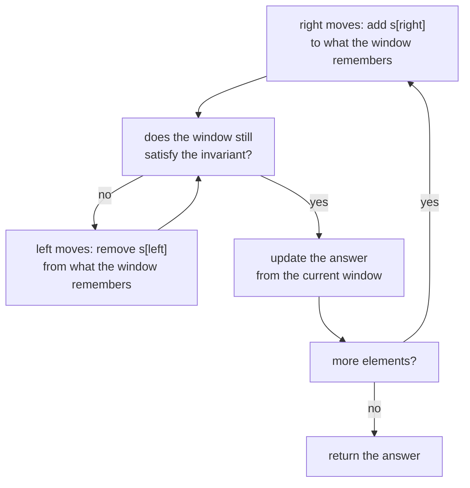

> [!tldr] Quick read
> - The pattern: when a problem asks for the best **contiguous range** (longest, shortest, most profitable), keep a window `[left, right]`. The right end adds one element at a time; the left end moves forward when the window breaks the [[en/concepts/window-invariant|invariant]]. Both ends only move forward, so the total is O(n) instead of O(n²) ranges.
> - Three questions set the six problems apart: **what is the invariant** (no repeated character, covers every letter of t, letters to replace ≤ k), **is the window variable or fixed**, and **what must the window remember** (one number, a last-seen book, a count table, a monotonic queue).
> - Best Time to Buy and Sell Stock: remembers only the [[en/concepts/running-minimum|lowest price]]. Longest Substring: a [[en/concepts/last-seen-index|last-seen book]]. Permutation in String: a [[en/concepts/fixed-size-window|fixed]] window and a count table. Sliding Window Maximum: a [[en/concepts/monotonic-deque|monotonic deque]].
> - The most common traps: the left end **moving backwards** (`"abba"`), and shrinking with `if` where `while` is needed (or the other way round).

> [!info] Context
> Station 5 of **the NeetCode line: Arrays and Strings**. [[en/posts/2026-11-23-neetcode-two-pointers|Station 4, two pointers]], puts two indices at the two ends and moves them **towards each other**; this station moves both **in the same direction**, and reuses the count tables of [[en/posts/2026-11-22-neetcode-counting-keys|station 2]]. Each problem has its own page, solved in depth in five languages. All you need to know is loops, arrays, strings and Maps.

> [!abstract]- Quick glossary for this post (click to open)
> - **Contiguous range (subarray, substring)**: elements that sit next to each other. Unlike a subsequence, which may skip elements in between.
> - **Sliding window**: a range `[left, right]` whose two ends only move forward. See [[en/concepts/sliding-window|Sliding Window]].
> - **Invariant**: something the window satisfies after every step. See [[en/concepts/window-invariant|Window Invariant]].
> - **Count table**: counts how often each character appears in the window; see [[en/concepts/counting-array|Counting Array]] from station 2.
> - **Double-ended queue (deque)**: a list you can add to and remove from at both ends in O(1).

## Picture it first: a photo frame on a conveyor belt

Goods run past on a conveyor belt. You hold a photo frame over the belt and may do only two things: drag the right edge to add a new item to the frame, or drag the left edge to drop an old item. Neither edge may be dragged back. You want the "best" frame according to some rule.

| Everyday life | Concept |
|---|---|
| The photo frame over the belt | the window `[left, right]` |
| Drag the right edge to add an item | `right++` |
| Drag the left edge to drop an item | `left++` |
| The rule the frame must satisfy ("no two items of the same colour") | the invariant |
| A frame of fixed size that only slides | a fixed window (Permutation in String, Sliding Window Maximum) |
| A sticky note on the frame: items per colour, the heaviest item | what the window must remember |
| Never drag back | O(n): each item enters the frame once and leaves once |



## The problem: trying every contiguous range costs O(n²)

An array of length n has n(n+1)/2 contiguous ranges. Trying them all, even with an O(1) check each, is still O(n²): for n = 10⁵ that's about 5·10⁹ ranges. The measurement on [[en/problems/best-time-to-buy-and-sell-stock|Best Time to Buy and Sell Stock]] shows brute force taking 585 ms at n = 40 000, while one pass takes under 1 ms.

The sliding window rests on one observation: in many problems, if range `[left, right]` is already **bad** (has a repeated character, too many letters to replace), every longer range containing it is bad too, and if a range is already **good**, there's no need to try its sub-ranges. Thanks to that, `right` never has to go back, and neither does `left`.

## How it works

### The shared template

<figure class="figure-map" style="--ar: 3 / 4">
<div class="frame"><iframe data-archify="../../diagrams/neetcode-sliding-window/window.en.html" title="A window with no repeated character on pwwkew" loading="lazy"></iframe></div>
<figcaption><span><b>Figure 1.</b> Longest Substring on <code>"pwwkew"</code>: the right end reads each character, the last-seen book answers "seen it?", the left end jumps on a repeat.</span><a href="../diagrams/neetcode-sliding-window/window.en.html" target="_blank" rel="noopener">Open full screen</a></figcaption>
</figure>

```text
left = 0
for right in 0..n-1:
    add a[right] to the window's state
    while the window breaks the invariant:   # variable-size window
        remove a[left] from the state; left += 1
    update the answer from [left, right]
```

The `while` sits inside the `for`, but `left` moves forward at most n times in total, so the whole loop is O(n) ([[en/concepts/aggregate-analysis|aggregate analysis]], the same argument as station 1). With a **fixed window** of length k, the `while` becomes one step: add `a[right]` and remove `a[right − k]` together.

### Six problems, three questions

| Problem | Invariant (or goal) | Window size | What the window remembers |
|---|---|---|---|
| [[en/problems/best-time-to-buy-and-sell-stock\|Best Time to Buy and Sell Stock]] | `left` is the day with the lowest price so far | variable | one number: the price at `left` |
| [[en/problems/longest-substring-without-repeating-characters\|Longest Substring Without Repeating Characters]] | no character repeats | variable, find the longest | each character's last-seen position |
| Longest Repeating Character Replacement | length − count of the most frequent letter ≤ k | variable, find the longest | a 26-letter count table and `maxFreq` |
| Permutation in String | the window is a permutation of s1 | fixed, length \|s1\| | two count tables and the number of matching letters |
| Minimum Window Substring | the window covers every letter of t | variable, find the **shortest** | a "still missing" table and the missing count |
| Sliding Window Maximum | (return the max of every window of length k) | fixed, length k | a queue of indices with decreasing values |

The two search directions are worth noticing:
- **Finding the longest** (Longest Substring, Character Replacement): expand until it breaks, shrink until it's good again, update the answer **after** shrinking.
- **Finding the shortest** (Minimum Window): expand until it's **good**, then shrink **while it stays good**, updating the answer **during** the shrinking.

### Two subtle points

**Character Replacement never needs to decrease `maxFreq`.** When `left` moves, the count of the most frequent letter may drop, but the code keeps the old `maxFreq`. That's fine because the answer only grows when a window with a **larger** `maxFreq` than the record turns up; a stale `maxFreq` only makes the window slide at constant length instead of shrinking, and a shorter window is never a new answer anyway. So here `if` is enough, no `while`: the window never shrinks, it only slides or grows.

**Sliding Window Maximum needs a monotonic queue.** A count table can't answer "the max of the window" once the largest element slides out. A [[en/concepts/monotonic-deque|monotonic deque]] keeps indices in decreasing order of value: a new element pushes out every smaller element at the back (they can never be the max while the new one is in the window), and the front is dropped once it slides out. The front is always the max. Each index enters and leaves the queue once: O(n).

## Runnable example

[TypeScript](../code/neetcode-sliding-window/sliding-window.ts) · [Python](../code/neetcode-sliding-window/sliding_window.py) · [Go](../code/neetcode-sliding-window/sliding_window.go) · [Java](../code/neetcode-sliding-window/sliding-window.java) · [JavaScript](../code/neetcode-sliding-window/sliding-window.js)

Each file solves all six problems and runs 12 cases, two per problem. Below are Longest Substring (find the longest) and Minimum Window Substring (find the shortest), the two directions of one template.

```ts
// 3: invariant "no character repeats"; jump left past the previous sighting if it is inside the window.
function lengthOfLongestSubstring(s: string): number {
  const last = new Map<string, number>();
  let left = 0, best = 0;
  for (let right = 0; right < s.length; right++) {
    const prev = last.get(s[right]);
    if (prev !== undefined && prev >= left) left = prev + 1;
    last.set(s[right], right);
    best = Math.max(best, right - left + 1);
  }
  return best;
}

// 76: expand until every character of t is covered, then shrink from the left while it still is.
function minWindow(s: string, t: string): string {
  const need = new Map<string, number>();
  for (const c of t) need.set(c, (need.get(c) ?? 0) + 1);
  let missing = t.length, left = 0, bestL = 0, bestLen = Infinity;
  for (let right = 0; right < s.length; right++) {
    const r = s[right];
    if (need.has(r)) { if (need.get(r)! > 0) missing--; need.set(r, need.get(r)! - 1); }
    while (missing === 0) {
      if (right - left + 1 < bestLen) { bestLen = right - left + 1; bestL = left; }
      const l = s[left++];
      if (need.has(l)) { need.set(l, need.get(l)! + 1); if (need.get(l)! > 0) missing++; }
    }
  }
  return bestLen === Infinity ? "" : s.slice(bestL, bestL + bestLen);
}
```

```python
def length_of_longest_substring(s: str) -> int:  # 3
    last: dict[str, int] = {}
    left = best = 0
    for right, ch in enumerate(s):
        if last.get(ch, -1) >= left:
            left = last[ch] + 1
        last[ch] = right
        best = max(best, right - left + 1)
    return best

def min_window(s: str, t: str) -> str:  # 76
    need, missing = Counter(t), len(t)
    left, best = 0, (0, float("inf"))
    for right, ch in enumerate(s):
        if need[ch] > 0:
            missing -= 1
        need[ch] -= 1
        while missing == 0:
            if right - left + 1 < best[1]:
                best = (left, right - left + 1)
            need[s[left]] += 1
            if need[s[left]] > 0:
                missing += 1
            left += 1
    return "" if best[1] == float("inf") else s[best[0] : best[0] + best[1]]
```

```go
// 3
func lengthOfLongestSubstring(s string) int {
	var last [128]int // position + 1
	left, best := 0, 0
	for right := 0; right < len(s); right++ {
		left = max(left, last[s[right]])
		last[s[right]] = right + 1
		best = max(best, right-left+1)
	}
	return best
}

// 76
func minWindow(s, t string) string {
	var need [128]int
	for i := 0; i < len(t); i++ {
		need[t[i]]++
	}
	missing, left, bestL, bestLen := len(t), 0, 0, math.MaxInt
	for right := 0; right < len(s); right++ {
		if need[s[right]] > 0 {
			missing--
		}
		need[s[right]]--
		for missing == 0 {
			if right-left+1 < bestLen {
				bestL, bestLen = left, right-left+1
			}
			need[s[left]]++
			if need[s[left]] > 0 {
				missing++
			}
			left++
		}
	}
	if bestLen == math.MaxInt {
		return ""
	}
	return s[bestL : bestL+bestLen]
}
```

```java
// 3
static int lengthOfLongestSubstring(String s) {
    int[] last = new int[128];
    int left = 0, best = 0;
    for (int right = 0; right < s.length(); right++) {
        left = Math.max(left, last[s.charAt(right)]);
        last[s.charAt(right)] = right + 1;
        best = Math.max(best, right - left + 1);
    }
    return best;
}

// 76
static String minWindow(String s, String t) {
    int[] need = new int[128];
    for (char c : t.toCharArray()) need[c]++;
    int missing = t.length(), left = 0, bestL = 0, bestLen = Integer.MAX_VALUE;
    for (int right = 0; right < s.length(); right++) {
        if (need[s.charAt(right)]-- > 0) missing--;
        while (missing == 0) {
            if (right - left + 1 < bestLen) { bestLen = right - left + 1; bestL = left; }
            if (++need[s.charAt(left++)] > 0) missing++;
        }
    }
    return bestLen == Integer.MAX_VALUE ? "" : s.substring(bestL, bestL + bestLen);
}
```

```js
// 3: invariant "no character repeats"; jump left past the previous sighting if it is inside the window.
function lengthOfLongestSubstring(s) {
  const last = new Map();
  let left = 0, best = 0;
  for (let right = 0; right < s.length; right++) {
    const prev = last.get(s[right]);
    if (prev !== undefined && prev >= left) left = prev + 1;
    last.set(s[right], right);
    best = Math.max(best, right - left + 1);
  }
  return best;
}

// 76: expand until every character of t is covered, then shrink from the left while it still is.
function minWindow(s, t) {
  const need = new Map();
  for (const c of t) need.set(c, (need.get(c) ?? 0) + 1);
  let missing = t.length, left = 0, bestL = 0, bestLen = Infinity;
  for (let right = 0; right < s.length; right++) {
    const r = s[right];
    if (need.has(r)) { if (need.get(r) > 0) missing--; need.set(r, need.get(r) - 1); }
    while (missing === 0) {
      if (right - left + 1 < bestLen) { bestLen = right - left + 1; bestL = left; }
      const l = s[left++];
      if (need.has(l)) { need.set(l, need.get(l) + 1); if (need.get(l) > 0) missing++; }
    }
  }
  return bestLen === Infinity ? "" : s.slice(bestL, bestL + bestLen);
}
```


```text
$ node sliding-window.ts
12/12 cases passed
```

*(Output labels translated; the files themselves print Vietnamese.)*

Python, Go, Java and JavaScript run the same 12 cases and all print `12/12 ca đúng` ("12/12 cases passed"). The measurements are on each problem page: [[en/problems/best-time-to-buy-and-sell-stock|Best Time to Buy and Sell Stock]] measures O(n²) brute force against one pass, [[en/problems/longest-substring-without-repeating-characters|Longest Substring]] measures shrinking with a Set against jumping with the last-seen book.

## Misconceptions and common traps

- **Letting the left end move back.** Jumping `left` to the previous sighting without checking it's still in the window: `"abba"` gives 3. Use `left = max(left, …)`.
- **Using `if` where `while` is needed, or the other way round.** Longest Substring with a Set and Minimum Window must shrink several steps; Character Replacement shrinks exactly one.
- **Updating the answer in the wrong place.** Finding the longest: update after shrinking; finding the shortest: update during shrinking, before removing `s[left]`.
- **Using a window on a problem without monotonicity.** Finding a range with sum k when the array has negative numbers: adding an element can lower the sum, so "bad means longer is bad too" no longer holds. That problem needs prefix sums and a hash table.
- **`shift()` on a JS array as a queue.** `shift` is O(n) each time; use a head pointer as in the code above, or Python's `deque`, Java's `ArrayDeque`.

## Self-check questions

> [!question]- Why doesn't the `while` loop in the shared template make the total O(n²)?
> Each time the `while` runs, `left` moves forward one step, and `left` never exceeds n. The total number of `while` steps across the whole algorithm is ≤ n.

> [!question]- Which of the three questions sets Permutation in String apart from Longest Substring?
> The window size: Permutation in String uses a fixed window of length \|s1\|, so each step adds one character and removes one, with no `while`.

> [!question]- In Minimum Window Substring, why is the answer updated inside the shrinking loop, not after it?
> Because the problem looks for the **shortest window that still satisfies** the condition. After the shrinking loop, the window has just lost a needed character, so it no longer satisfies it.

> [!question]- A problem asks for "the longest contiguous range with sum ≤ k" on an array with negative numbers. Can you use a sliding window?
> Not safely: adding a negative number lowers the sum, so a bad window can become good again as it grows. The monotonicity the sliding window relies on is gone.

## References

- [NeetCode 150](https://neetcode.io/practice) (the list and its groups)
- LeetCode: [121. Best Time to Buy and Sell Stock](https://leetcode.com/problems/best-time-to-buy-and-sell-stock/), [3. Longest Substring Without Repeating Characters](https://leetcode.com/problems/longest-substring-without-repeating-characters/), [424. Longest Repeating Character Replacement](https://leetcode.com/problems/longest-repeating-character-replacement/), [567. Permutation in String](https://leetcode.com/problems/permutation-in-string/), [76. Minimum Window Substring](https://leetcode.com/problems/minimum-window-substring/), [239. Sliding Window Maximum](https://leetcode.com/problems/sliding-window-maximum/)
- [Python: `collections.deque`](https://docs.python.org/3/library/collections.html#collections.deque) (add and remove at both ends in O(1)) and [`Counter`](https://docs.python.org/3/library/collections.html#collections.Counter) (equality ignores zero counts since 3.10)
- [Java 21 `ArrayDeque`](https://docs.oracle.com/en/java/javase/21/docs/api/java.base/java/util/ArrayDeque.html)
- [MDN: `Array.prototype.shift`](https://developer.mozilla.org/en-US/docs/Web/JavaScript/Reference/Global_Objects/Array/shift)
