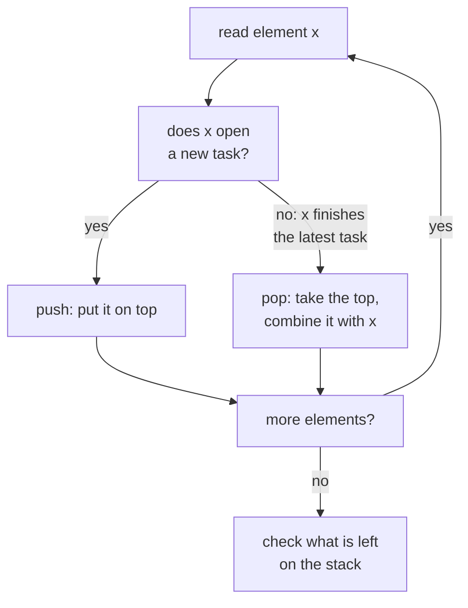

> [!tldr] Quick read
> - The pattern: when the thing **opened last** must be **handled first** (nested brackets, operations waiting for operands, choices waiting to be undone), keep the unfinished work on a [[en/concepts/stack|stack]]. The top is always the most recent unfinished item; `push` and `pop` are both O(1).
> - Valid Parentheses: the top is the nearest unclosed opener ([[en/concepts/bracket-matching|bracket matching]]). Min Stack: each level also remembers the minimum up to that level ([[en/concepts/auxiliary-min-stack|auxiliary min stack]]). Evaluate Reverse Polish Notation: the top holds the waiting operands ([[en/concepts/reverse-polish-notation|reverse Polish notation]]). Generate Parentheses: the string being built is a stack of choices ([[en/concepts/backtracking|backtracking]]).
> - The questions that set them apart: **what goes on top**, and **when it comes off**.
> - Traps: popping an empty stack, swapping operands for subtraction and division, and division rounding differently across languages (Python `-7 // 2 = -4`, the problem needs `-3`).

> [!info] Context
> Station 6 of **the NeetCode line: Arrays and Strings**. [[en/posts/2026-11-23-neetcode-sliding-window|Station 5, sliding window]], remembers one contiguous range whose ends only move forward; this station remembers things **not yet finished**, in the reverse of the order they started. Station 7 will use this very stack for "the next greater element". All you need to know is loops, arrays and functions.

> [!abstract]- Quick glossary for this post (click to open)
> - **Stack**: a list you only add to and take from at one end. Last in, first out (LIFO). See [[en/concepts/stack|Stack]].
> - **Reverse Polish notation (RPN)**: writing the operator after its two operands: `3 4 +` instead of `3 + 4`. No brackets needed. See [[en/concepts/reverse-polish-notation|Reverse Polish Notation]].
> - **Backtracking**: try a choice, continue, then undo that choice to try another. See [[en/concepts/backtracking|Backtracking]].
> - **Recursion**: a function calling itself. Each call waits for the inner call to finish before continuing, so the computer keeps them on a call stack.

## Picture it first: a stack of plates in a kitchen

The dishwasher piles clean plates into a stack. The waiter can only take the **top** plate, the one put down last. Nobody pulls a plate from the middle.

| Everyday life | Concept |
|---|---|
| A pile of plates | a stack |
| Putting a plate on top / taking the top plate | `push` / `pop` |
| The top plate | the top: the most recent unfinished item |
| Nested boxes that must be closed from the inside out | Valid Parentheses |
| A note on each plate: "smallest plate from here down" | [[en/problems/min-stack\|Min Stack]] |
| Gathering ingredients on the counter, and when a recipe step comes, mixing the top two | [[en/problems/evaluate-reverse-polish-notation\|Evaluate Reverse Polish Notation]] |
| Trying an item, lifting it off if it doesn't fit and trying another | Generate Parentheses (backtracking) |



## The problem: what you must remember is the order, not the count

Valid Parentheses shows it most clearly: counting openers is not enough. One shared counter lets `"(]"` through; three separate counters let `"([)]"` through. When `)` arrives, the right question is "what is the **nearest** unclosed opener?", and a counter can't answer it.

"The nearest unfinished thing" comes back in all four problems: an operator needs **the two nearest operands**, the minimum after a `pop` is the minimum **of what remains**, and backtracking undoes **the latest choice**. An array that only grows and shrinks at its end answers that question in O(1).

## How it works

### The shared template

<figure class="figure-map" style="--ar: 3 / 4">
<div class="frame"><iframe data-archify="../../diagrams/neetcode-stack/matching.en.html" title="A stack checks two bracket strings" loading="lazy"></iframe></div>
<figcaption><span><b>Figure 1.</b> Valid Parentheses: openers go on top, a closer must match the top.</span><a href="../diagrams/neetcode-stack/matching.en.html" target="_blank" rel="noopener">Open full screen</a></figcaption>
</figure>

1. Walk the input once.
2. An element that **opens** a task: `push`.
3. An element that **finishes** the latest task: `pop`, then check or combine it. Before `pop`, ask whether the stack is empty.
4. End of input: what is left on the stack is either the result (RPN) or an error (unclosed brackets).

Each element enters the stack once and leaves at most once, so the whole pass is O(n).

### Four problems, two questions

| Problem | What goes on top | When it comes off |
|---|---|---|
| [[en/problems/valid-parentheses\|Valid Parentheses]] | an opener | on a closer: the top must be the same kind |
| Min Stack | a pair (value, min up to this level) | on the user's `pop`; the new min is the one stored on the level below |
| Evaluate Reverse Polish Notation | a number | on an operator: take two numbers, push the result back |
| [[en/problems/generate-parentheses\|Generate Parentheses]] | the character just tried | once that branch has been explored (backtracking) |

**[[en/problems/min-stack|Min Stack]].** The problem wants `getMin` in O(1). A single `min` variable breaks when you `pop` exactly the smallest element: you don't know the new min. The fix: each level also stores the min **up to that level**. After a `pop`, the level below already holds the min of what remains. It costs double the memory, and in return every operation is O(1).

**[[en/problems/evaluate-reverse-polish-notation|Evaluate Reverse Polish Notation]].** `["2", "1", "+", "3", "*"]` is `(2 + 1) · 3 = 9`. On an operator, take the top two numbers: the one popped **first** is the **right** operand. Swapping them is harmless for `+` and `*`, wrong for `-` and `/`. Division must **truncate toward 0** (`-7 / 2 = -3`): Go and Java `int` division does exactly that, JS needs `Math.trunc`, and Python's `//` rounds **down** to `-4`.

**[[en/problems/generate-parentheses|Generate Parentheses]].** List every valid string of n bracket pairs. Add `(` while there are fewer than n openers, add `)` while there are fewer closers than openers. Each try is a `push` of one character onto the string being built, and finishing that try is a `pop`. Those two conditions guarantee only valid strings are produced, so there is no need to generate all 2²ⁿ strings and filter. The number of results is a Catalan number: 5 for n = 3, 14 for n = 4.

## Runnable example

[TypeScript](../code/neetcode-stack/stack-station.ts) · [Python](../code/neetcode-stack/stack_station.py) · [Go](../code/neetcode-stack/stack_station.go) · [Java](../code/neetcode-stack/stack-station.java) · [JavaScript](../code/neetcode-stack/stack-station.js)

Each file solves all four problems and runs 10 cases, including `"(("`, `["-7", "2", "/"]` and the number of strings for n = 4.

```ts
// 20: a closer must match the nearest unclosed opener, i.e. the top of the stack.
function isValid(s: string): boolean {
  const open: Record<string, string> = { ")": "(", "]": "[", "}": "{" };
  const st: string[] = [];
  for (const ch of s) {
    if (!(ch in open)) st.push(ch);
    else if (st.pop() !== open[ch]) return false;
  }
  return st.length === 0;
}

// 155: each stack level also remembers the minimum up to that level.
class MinStack {
  private st: [number, number][] = []; // [value, min up to this level]
  push(x: number) { this.st.push([x, this.st.length ? Math.min(x, this.getMin()) : x]); }
  pop() { this.st.pop(); }
  top() { return this.st[this.st.length - 1][0]; }
  getMin() { return this.st[this.st.length - 1][1]; }
}

// 150: push numbers; an operator pops the top two (the one popped SECOND is the left operand).
function evalRPN(tokens: string[]): number {
  const st: number[] = [];
  for (const t of tokens) {
    if (!"+-*/".includes(t) || t.length > 1) { st.push(Number(t)); continue; } // "-11" is a number, not a subtraction
    const b = st.pop()!, a = st.pop()!;
    st.push(t === "+" ? a + b : t === "-" ? a - b : t === "*" ? a * b : Math.trunc(a / b)); // division truncates toward 0
  }
  return st[0];
}

// 22: backtracking; the string being built is itself a stack of choices, add a character then remove it.
function generateParenthesis(n: number): string[] {
  const out: string[] = [];
  const cur: string[] = [];
  const go = (open: number, close: number) => {
    if (cur.length === 2 * n) { out.push(cur.join("")); return; }
    if (open < n) { cur.push("("); go(open + 1, close); cur.pop(); }
    if (close < open) { cur.push(")"); go(open, close + 1); cur.pop(); }
  };
  go(0, 0);
  return out;
}
```

```python
def is_valid(s: str) -> bool:  # 20
    open_ = {")": "(", "]": "[", "}": "{"}
    st: list[str] = []
    for ch in s:
        if ch not in open_:
            st.append(ch)
        elif not st or st.pop() != open_[ch]:
            return False
    return not st

class MinStack:  # 155: each level also remembers the min up to that level
    def __init__(self):
        self.st: list[tuple[int, int]] = []

    def push(self, x: int) -> None:
        self.st.append((x, min(x, self.st[-1][1]) if self.st else x))

    def pop(self) -> None:
        self.st.pop()

    def top(self) -> int:
        return self.st[-1][0]

    def get_min(self) -> int:
        return self.st[-1][1]

def eval_rpn(tokens: list[str]) -> int:  # 150
    st: list[int] = []
    for t in tokens:
        if t not in ("+", "-", "*", "/"):
            st.append(int(t))
            continue
        b, a = st.pop(), st.pop()
        if t == "+":
            st.append(a + b)
        elif t == "-":
            st.append(a - b)
        elif t == "*":
            st.append(a * b)
        else:
            st.append(int(a / b))  # do NOT use a // b: // floors (-7 // 2 = -4), the problem needs truncation toward 0 (-3)
    return st[0]

def generate_parenthesis(n: int) -> list[str]:  # 22
    out: list[str] = []
    cur: list[str] = []

    def go(open_: int, close: int) -> None:
        if len(cur) == 2 * n:
            out.append("".join(cur))
            return
        if open_ < n:
            cur.append("(")
            go(open_ + 1, close)
            cur.pop()
        if close < open_:
            cur.append(")")
            go(open_, close + 1)
            cur.pop()

    go(0, 0)
    return out
```

```go
// 20
func isValid(s string) bool {
	open := map[rune]rune{')': '(', ']': '[', '}': '{'}
	st := []rune{}
	for _, ch := range s {
		want, isClose := open[ch]
		if !isClose {
			st = append(st, ch)
		} else if len(st) == 0 || st[len(st)-1] != want {
			return false
		} else {
			st = st[:len(st)-1]
		}
	}
	return len(st) == 0
}

// 155: each level also remembers the min up to that level.
type MinStack struct{ st [][2]int }

func (m *MinStack) Push(x int) {
	lo := x
	if len(m.st) > 0 {
		lo = min(x, m.GetMin())
	}
	m.st = append(m.st, [2]int{x, lo})
}

func (m *MinStack) Pop()        { m.st = m.st[:len(m.st)-1] }

func (m *MinStack) Top() int    { return m.st[len(m.st)-1][0] }

func (m *MinStack) GetMin() int { return m.st[len(m.st)-1][1] }

// 150
func evalRPN(tokens []string) int {
	st := []int{}
	for _, t := range tokens {
		n, err := strconv.Atoi(t)
		if err == nil { // Atoi parses "-11" as a number; a lone "-" fails, so it is an operator
			st = append(st, n)
			continue
		}
		a, b := st[len(st)-2], st[len(st)-1]
		st = st[:len(st)-2]
		switch t {
		case "+":
			st = append(st, a+b)
		case "-":
			st = append(st, a-b)
		case "*":
			st = append(st, a*b)
		default:
			st = append(st, a/b) // Go integer division truncates toward 0, as the problem wants
		}
	}
	return st[0]
}

// 22
func generateParenthesis(n int) []string {
	out := []string{}
	cur := make([]byte, 0, 2*n)
	var gen func(open, close int)
	gen = func(open, close int) {
		if len(cur) == 2*n {
			out = append(out, string(cur))
			return
		}
		if open < n {
			cur = append(cur, '(')
			gen(open+1, close)
			cur = cur[:len(cur)-1]
		}
		if close < open {
			cur = append(cur, ')')
			gen(open, close+1)
			cur = cur[:len(cur)-1]
		}
	}
	gen(0, 0)
	return out
}
```

```java
// 20
static boolean isValid(String s) {
    Deque<Character> st = new ArrayDeque<>();
    for (char ch : s.toCharArray()) {
        char want = switch (ch) { case ')' -> '('; case ']' -> '['; case '}' -> '{'; default -> 0; };
        if (want == 0) st.push(ch);
        else if (st.isEmpty() || st.pop() != want) return false;
    }
    return st.isEmpty();
}

// 155: each level also remembers the min up to that level.
static class MinStack {
    private final Deque<int[]> st = new ArrayDeque<>();
    void push(int x) { st.push(new int[] {x, st.isEmpty() ? x : Math.min(x, getMin())}); }
    void pop() { st.pop(); }
    int top() { return st.peek()[0]; }
    int getMin() { return st.peek()[1]; }
}

// 150
static int evalRPN(String[] tokens) {
    Deque<Integer> st = new ArrayDeque<>();
    for (String t : tokens) {
        switch (t) {
            case "+", "-", "*", "/" -> {
                int b = st.pop(), a = st.pop();
                st.push(switch (t) { case "+" -> a + b; case "-" -> a - b; case "*" -> a * b; default -> a / b; }); // int division: truncates toward 0
            }
            default -> st.push(Integer.parseInt(t));
        }
    }
    return st.pop();
}

// 22
static List<String> generateParenthesis(int n) {
    List<String> out = new ArrayList<>();
    gen(n, 0, 0, new StringBuilder(), out);
    return out;
}

static void gen(int n, int open, int close, StringBuilder cur, List<String> out) {
    if (cur.length() == 2 * n) { out.add(cur.toString()); return; }
    if (open < n) { cur.append('('); gen(n, open + 1, close, cur, out); cur.deleteCharAt(cur.length() - 1); }
    if (close < open) { cur.append(')'); gen(n, open, close + 1, cur, out); cur.deleteCharAt(cur.length() - 1); }
}
```

```js
// 20
function isValid(s) {
  const open = { ")": "(", "]": "[", "}": "{" };
  const st = [];
  for (const ch of s) {
    if (!(ch in open)) st.push(ch);
    else if (st.pop() !== open[ch]) return false;
  }
  return st.length === 0;
}

// 155: each level also remembers the min up to that level.
class MinStack {
  st = [];
  push(x) { this.st.push([x, this.st.length ? Math.min(x, this.getMin()) : x]); }
  pop() { this.st.pop(); }
  top() { return this.st.at(-1)[0]; }
  getMin() { return this.st.at(-1)[1]; }
}

// 150
function evalRPN(tokens) {
  const st = [];
  for (const t of tokens) {
    if (!["+", "-", "*", "/"].includes(t)) { st.push(Number(t)); continue; }
    const b = st.pop(), a = st.pop();
    st.push(t === "+" ? a + b : t === "-" ? a - b : t === "*" ? a * b : Math.trunc(a / b)); // Math.floor(-3.5) = -4, wrong
  }
  return st[0];
}

// 22
function generateParenthesis(n) {
  const out = [], cur = [];
  const go = (open, close) => {
    if (cur.length === 2 * n) { out.push(cur.join("")); return; }
    if (open < n) { cur.push("("); go(open + 1, close); cur.pop(); }
    if (close < open) { cur.push(")"); go(open, close + 1); cur.pop(); }
  };
  go(0, 0);
  return out;
}
```


```text
$ python3 stack_station.py
10/10 cases passed
-7 // 2 = -4, int(-7 / 2) = -3
```

*(Output labels translated; the files themselves print Vietnamese.)*

The second line is why the Python file uses `int(a / b)` instead of `a // b`. TypeScript, Go, Java and JavaScript also print `10/10 ca đúng` ("10/10 cases passed"). The measurement of the stack against repeated pair removal is on the [[en/problems/valid-parentheses|Valid Parentheses]] page.

## Misconceptions and common traps

- **Popping an empty stack.** Python raises `IndexError`, Java throws `NoSuchElementException`, Go panics, JS quietly returns `undefined`. Always check for empty before `pop` when the input can be malformed.
- **Swapping operands for subtraction and division.** In RPN, the number popped first is the right operand: `a = pop()` after `b = pop()`.
- **Python `//` on negative numbers.** It rounds down, not toward 0. Use `int(a / b)` (exact enough for 32-bit numbers) or handle the sign yourself.
- **Min Stack with a single min variable.** It breaks as soon as you `pop` the smallest element.
- **Java `Stack`.** The docs recommend `ArrayDeque`; not because it is slow (measured on the Valid Parentheses page, they are about even) but because `Stack` extends `Vector` and allows access to the middle.
- **Backtracking without undoing the choice.** Without the `pop` after the recursive call, the string being built keeps growing and the results are wrong.

## Self-check questions

> [!question]- Evaluate `["4", "13", "5", "/", "+"]` and write the stack after each token.
> `[4]` → `[4, 13]` → `[4, 13, 5]` → on `/`: 13 / 5 = 2, `[4, 2]` → on `+`: `[6]`. The result is 6.

> [!question]- Min Stack: push 5, 3, 7, 3 then `pop` twice. What is `getMin` now, and which level tells you?
> 5 and 3 remain; `getMin` = 3, read from the level of the number 3 (which stores the pair (3, 3)). The level of 7 stored (7, 3) and the top level stored (3, 3), and both have been popped.

> [!question]- Why does Generate Parentheses only add `)` when there are fewer `)` than `(`?
> So that no prefix has more `)` than `(`. That is exactly the condition for no closer lacking an opener, so every complete string of 2n characters is valid.

> [!question]- What does recursion have to do with a stack?
> Each function call is placed on the call stack and only removed when it returns. The last call finishes first: that is LIFO. That's why every recursive algorithm can be rewritten with a stack you manage yourself.

## References

- [NeetCode 150](https://neetcode.io/practice) (the problem list and groups)
- LeetCode: [20. Valid Parentheses](https://leetcode.com/problems/valid-parentheses/), [155. Min Stack](https://leetcode.com/problems/min-stack/), [150. Evaluate Reverse Polish Notation](https://leetcode.com/problems/evaluate-reverse-polish-notation/), [22. Generate Parentheses](https://leetcode.com/problems/generate-parentheses/)
- [Python: Binary arithmetic operations](https://docs.python.org/3/reference/expressions.html#binary-arithmetic-operations) (`//` is division followed by rounding down)
- [Java 21 `Stack`](https://docs.oracle.com/en/java/javase/21/docs/api/java.base/java/util/Stack.html) (recommends `Deque`)
- [OEIS A000108: Catalan numbers](https://oeis.org/A000108) (the number of valid bracket strings with n pairs)
