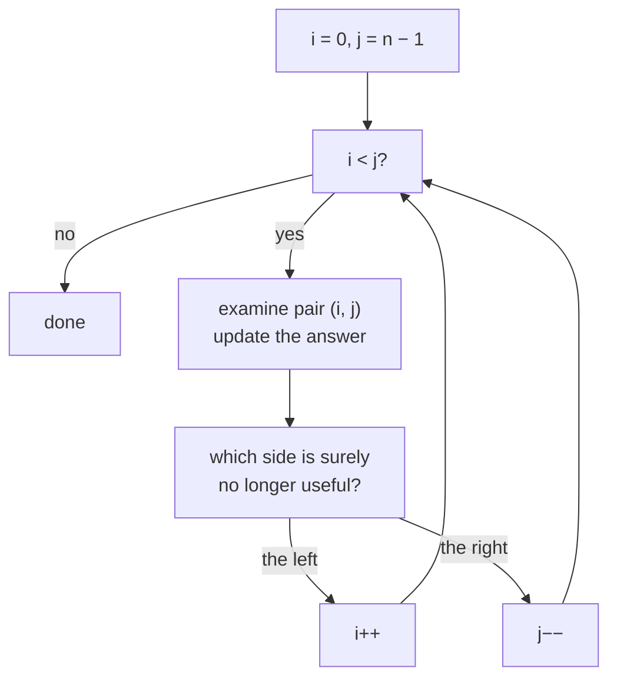

> [!tldr] Quick read
> - The pattern: `i` at the start, `j` at the end; each step moves **exactly one** pointer inward. At most n − 1 steps, O(n) time, O(1) memory.
> - The only requirement: you must **prove** the dropped element belongs to no answer ([[en/concepts/search-space-pruning|search space pruning]]). Each problem has its own reason: both ends must match (palindrome), the array is sorted (Two Sum II, 3Sum), or the shorter wall decides (the two water problems).
> - 3Sum turns a three-number problem into n two-number problems ([[en/concepts/k-sum-reduction|k-Sum Reduction]]) and [[en/concepts/duplicate-skipping|skips duplicates through order]], with no Set.
> - Trapping Rain Water carries two values along (the max on the left, the max on the right) instead of two [[en/concepts/prefix-maximum|prefix maximum]] and suffix maximum arrays.
> - The shared trap: moving the wrong pointer. In the container problem, moving the taller wall gives 8 instead of 49 on the problem's own example.

> [!info] Context
> Station 4 of **the NeetCode line: Arrays and Strings**. [[en/posts/2026-11-22-neetcode-hash-lookup|Station 1]] answers "have I seen x?" with a hash table at O(n) memory; this station trades memory for **order**: when the data has structure (sorted, or a monotonic formula), two pointers answer the same question in O(1) memory. The prefix maximum idea reuses [[en/posts/2026-11-23-neetcode-prefix-suffix-encoding|station 3]]. Each problem has its own page, solved in depth in five languages.

> [!abstract]- Quick glossary for this post (click to open)
> - **Pointer**: here just an index variable (`i`, `j`), not a C memory pointer.
> - **Search space**: every candidate that could be the answer; for pairs `(i, j)`, n(n − 1)/2 pairs.
> - **Invariant**: something true at every iteration, such as "if there is an answer, it lies within `[i, j]`".
> - **Ascending array**: each element is not smaller than the one before. See [[en/concepts/sort-then-scan|Sort Then Scan]].

## Picture it first: two people loading a scale

A warehouse lines its crates up from light to heavy. You need two crates whose total weight is exactly the scale's mark. One person stands at the light end, one at the heavy end, and each time they put the two crates in front of them on the scale. Too little, and the person at the light end switches to the next crate; too much, and the person at the heavy end does.

| Everyday life | Concept |
|---|---|
| Two people at the two ends of the row of crates | `i = 0`, `j = n − 1` |
| Too little: the light crate falls short even with the heaviest one left | drop `nums[i]`, `i++` |
| Too much: the heavy crate is too heavy even with the lightest one left | drop `nums[j]`, `j−−` |
| Every weighing removes one crate for good | at most n − 1 steps |
| Change the rule (reading letters, measuring water) but still two people walking inward | five problems, one template |



## The problem: n²/2 pairs, but most can be crossed out

Most problems at this station ask about **one pair** of positions: the two ends of a palindrome, two numbers summing to a target, the two walls of a container. Trying every pair is n(n − 1)/2 tries, O(n²): at n = 20 000, a brute-force Container With Most Water takes 639 ms.

Think of the n × n table of all pairs. The two pointers start at the corner `(0, n − 1)`. If you can prove that `nums[i]` pairs with **nobody** left, you cross out the whole row i with a single comparison. n − 1 crossings and the table is done.

## How it works

### The shared template

<figure class="figure-map" style="--ar: 3 / 4">
<div class="frame"><iframe data-archify="../../diagrams/neetcode-two-pointers/converging.en.html" title="Two pointers on [1, 3, 4, 6, 8, 11], target 10" loading="lazy"></iframe></div>
<figcaption><span><b>Figure 1.</b> Two Sum II on <code>[1, 3, 4, 6, 8, 11]</code>, target 10: each comparison drops one number for good, and five steps find the pair.</span><a href="../diagrams/neetcode-two-pointers/converging.en.html" target="_blank" rel="noopener">Open full screen</a></figcaption>
</figure>

1. Set `i = 0`, `j = n − 1`.
2. Examine the pair `(i, j)`: compare, compute, or record an answer.
3. Move **one** pointer, on the side you can prove is used up.
4. Repeat until `i ≥ j`.

Step 3 is the whole difficulty. Moving the wrong side still runs, still in O(n); it just gives wrong answers, and often still passes a few easy cases.

### Why one side may be dropped

| Problem | Which side to drop | Why it is safe |
|---|---|---|
| [[en/problems/valid-palindrome\|Valid Palindrome]] | the side pointing at a non-alphanumeric character; or both after a matching pair | junk characters don't take part; a matched pair needs no second look |
| [[en/problems/two-sum-ii-input-array-is-sorted\|Two Sum II]] | too small means `i`, too big means `j` | ascending array: if the smallest plus the largest is still too small, the smallest is useless |
| [[en/problems/3sum\|3Sum]] | as in Two Sum II, for each anchor `a` | sort first; also skip repeated anchors and repeated `b`s |
| [[en/problems/container-with-most-water\|Container With Most Water]] | the shorter wall | the shorter wall sets the water level; pairing it with a closer wall only narrows the base |
| [[en/problems/trapping-rain-water\|Trapping Rain Water]] | the side with the smaller max | that side's water level is already certain, because the other side has a taller bank |

Valid Palindrome needs no sorting; Container and Trapping Rain Water work on **unsorted** arrays. Two pointers don't require order; they require a **reason** to drop.

### 3Sum: reduce to two numbers, skip duplicates through order

Sort, then for each `a = nums[i]` run Two Sum II on the part to the right with target `−a`. n runs of O(n): O(n²) in total, against O(n³) for brute force. Since the array is sorted, duplicate triplets always sit next to each other: skip an anchor equal to the previous anchor, and after each hit jump `b` past equal values. Without this step, `[-1, 0, 1, 2, -1, -4]` yields `[-1, 0, 1]` twice.

### Trapping Rain Water: carrying two values

The water above wall i is `min(L[i], R[i]) − h[i]`, where `L`, `R` are the prefix and suffix maxima. Those two arrays cost O(n) memory. Two pointers keep only `leftMax` and `rightMax`: if `leftMax < rightMax` then `R[i] ≥ rightMax > leftMax`, so the water level at i is `leftMax` even though `R[i]` is still unknown. Measured at n = 10⁶: two arrays 18.4 ms, two pointers 3.8 ms.

### Two pointers or a hash table

| | Hash table (station 1) | Two pointers (this station) |
|---|---|---|
| Needs ordered data? | no | needs a reason to drop one side (usually order) |
| Extra memory | O(n) | O(1) |
| Keeps the original indices? | yes | lost, if you have to sort first |
| Measured on Two Sum II, n = 10⁶ | 99.8 ms | 1.2 ms |

## Runnable example

[TypeScript](../code/neetcode-two-pointers/two-pointers.ts) · [Python](../code/neetcode-two-pointers/two_pointers.py) · [Go](../code/neetcode-two-pointers/two_pointers.go) · [Java](../code/neetcode-two-pointers/two-pointers.java) · [JavaScript](../code/neetcode-two-pointers/two-pointers.js)

Each file solves all five problems with the same template and runs 11 cases. Below are the three problems that show three different reasons to drop: order (167), the `min` formula (11), and carried values (42).

```ts
// 167: sum too small, increase i; too big, decrease j. Indices count from 1.
function twoSumSorted(nums: number[], target: number): number[] {
  for (let i = 0, j = nums.length - 1; i < j; ) {
    const s = nums[i] + nums[j];
    if (s === target) return [i + 1, j + 1];
    if (s < target) i++; else j--;
  }
  return [];
}

// 11: move the shorter wall; pairing it with any closer wall can't be better.
function maxArea(h: number[]): number {
  let best = 0;
  for (let i = 0, j = h.length - 1; i < j; ) {
    best = Math.max(best, (j - i) * Math.min(h[i], h[j]));
    if (h[i] < h[j]) i++; else j--;
  }
  return best;
}

// 42: the side with the smaller max already knows its water level for sure.
function trap(h: number[]): number {
  let total = 0, lm = 0, rm = 0;
  for (let i = 0, j = h.length - 1; i < j; ) {
    lm = Math.max(lm, h[i]);
    rm = Math.max(rm, h[j]);
    if (lm < rm) total += lm - h[i++];
    else total += rm - h[j--];
  }
  return total;
}
```

```python
def two_sum_sorted(nums: list[int], target: int) -> list[int]:  # 167
    i, j = 0, len(nums) - 1
    while i < j:
        s = nums[i] + nums[j]
        if s == target:
            return [i + 1, j + 1]
        if s < target:
            i += 1
        else:
            j -= 1
    return []

def max_area(h: list[int]) -> int:  # 11
    i, j, best = 0, len(h) - 1, 0
    while i < j:
        best = max(best, (j - i) * min(h[i], h[j]))
        if h[i] < h[j]:
            i += 1
        else:
            j -= 1
    return best

def trap(h: list[int]) -> int:  # 42
    i, j, lm, rm, total = 0, len(h) - 1, 0, 0, 0
    while i < j:
        lm, rm = max(lm, h[i]), max(rm, h[j])
        if lm < rm:
            total += lm - h[i]
            i += 1
        else:
            total += rm - h[j]
            j -= 1
    return total
```

```go
// 167
func twoSumSorted(nums []int, target int) []int {
	for i, j := 0, len(nums)-1; i < j; {
		s := nums[i] + nums[j]
		if s == target {
			return []int{i + 1, j + 1}
		}
		if s < target {
			i++
		} else {
			j--
		}
	}
	return nil
}

// 11
func maxArea(h []int) int {
	best := 0
	for i, j := 0, len(h)-1; i < j; {
		best = max(best, (j-i)*min(h[i], h[j]))
		if h[i] < h[j] {
			i++
		} else {
			j--
		}
	}
	return best
}

// 42
func trap(h []int) int {
	total, lm, rm := 0, 0, 0
	for i, j := 0, len(h)-1; i < j; {
		lm, rm = max(lm, h[i]), max(rm, h[j])
		if lm < rm {
			total += lm - h[i]
			i++
		} else {
			total += rm - h[j]
			j--
		}
	}
	return total
}
```

```java
// 167
static int[] twoSumSorted(int[] nums, int target) {
    for (int i = 0, j = nums.length - 1; i < j; ) {
        int s = nums[i] + nums[j];
        if (s == target) return new int[] {i + 1, j + 1};
        if (s < target) i++; else j--;
    }
    return new int[0];
}

// 11
static int maxArea(int[] h) {
    int best = 0;
    for (int i = 0, j = h.length - 1; i < j; ) {
        best = Math.max(best, (j - i) * Math.min(h[i], h[j]));
        if (h[i] < h[j]) i++; else j--;
    }
    return best;
}

// 42
static int trap(int[] h) {
    int total = 0, lm = 0, rm = 0;
    for (int i = 0, j = h.length - 1; i < j; ) {
        lm = Math.max(lm, h[i]);
        rm = Math.max(rm, h[j]);
        if (lm < rm) total += lm - h[i++];
        else total += rm - h[j--];
    }
    return total;
}
```

```js
// 167
function twoSumSorted(nums, target) {
  for (let i = 0, j = nums.length - 1; i < j; ) {
    const s = nums[i] + nums[j];
    if (s === target) return [i + 1, j + 1];
    if (s < target) i++; else j--;
  }
  return [];
}

// 11
function maxArea(h) {
  let best = 0;
  for (let i = 0, j = h.length - 1; i < j; ) {
    best = Math.max(best, (j - i) * Math.min(h[i], h[j]));
    if (h[i] < h[j]) i++; else j--;
  }
  return best;
}

// 42
function trap(h) {
  let total = 0, lm = 0, rm = 0;
  for (let i = 0, j = h.length - 1; i < j; ) {
    lm = Math.max(lm, h[i]);
    rm = Math.max(rm, h[j]);
    if (lm < rm) total += lm - h[i++];
    else total += rm - h[j--];
  }
  return total;
}
```


```text
$ node two-pointers.ts
11/11 cases passed
```

*(Output labels translated; the files themselves print Vietnamese.)*

Python, Go, Java and JavaScript run the same 11 cases and all print `11/11 ca đúng` ("11/11 cases passed"). Each problem page adds brute force, the intermediate approaches, a wrong version and measurements.

## Misconceptions and common traps

- **"Two pointers only work on sorted arrays."** Container With Most Water and Trapping Rain Water work on unsorted arrays. What you need is a reason to drop one side.
- **Moving the wrong pointer.** Moving the taller wall in Container With Most Water: 4/7 cases, wrong on the very first example. Moving both at once can skip the pair `(i, j − 1)`.
- **Forgetting to skip duplicates in 3Sum, or skipping in the wrong place.** Comparing the anchor with the **next** element instead of the previous one loses triplets like `[-1, -1, 2]`.
- **JS: `sort()` without a comparator.** An array "sorted" as strings isn't ascending as numbers, and the drop-one-side argument collapses.
- **Using a hash map "to be safe".** Correct, but Two Sum II forbids O(n) memory, and it is about 80 times slower at 10⁶ elements.

## Self-check questions

> [!question]- What is the general condition for a problem to be solvable with two pointers from both ends?
> At every pair `(i, j)` you must be able to prove that at least one of the two elements belongs to no answer within the remaining range. Then dropping it loses no answer.

> [!question]- In Two Sum II, when the sum is below the target, why drop `nums[i]` and not `nums[j]`?
> `nums[j]` is the largest number left. If `nums[i]` plus it is still too small, `nums[i]` plus anyone is too small. There is no such argument for `nums[j]`: it could still pair with a number larger than `nums[i]`.

> [!question]- 3Sum runs two pointers n times. Why is the total O(n²) and not O(n² log n)?
> The O(n log n) sort happens only once; n two-pointer runs of O(n) each are O(n²). O(n²) dominates O(n log n), so the total is O(n²).

> [!question]- Trapping Rain Water: both the two max arrays and two pointers are O(n). What do two pointers save?
> The O(n) memory of the two arrays, and the time spent writing 2n elements. Measured at n = 10⁶: 18.4 ms against 3.8 ms.

## References

- [NeetCode 150](https://neetcode.io/practice) (the list and grouping of problems)
- LeetCode: [125. Valid Palindrome](https://leetcode.com/problems/valid-palindrome/), [167. Two Sum II](https://leetcode.com/problems/two-sum-ii-input-array-is-sorted/), [15. 3Sum](https://leetcode.com/problems/3sum/), [11. Container With Most Water](https://leetcode.com/problems/container-with-most-water/), [42. Trapping Rain Water](https://leetcode.com/problems/trapping-rain-water/)
- [ECMAScript 2025: SortCompare](https://tc39.es/ecma262/2025/#sec-sortcompare) (`sort()` without a comparator compares strings)
- Cormen, Leiserson, Rivest, Stein, *Introduction to Algorithms*, the section on loop invariants used to prove algorithms correct
