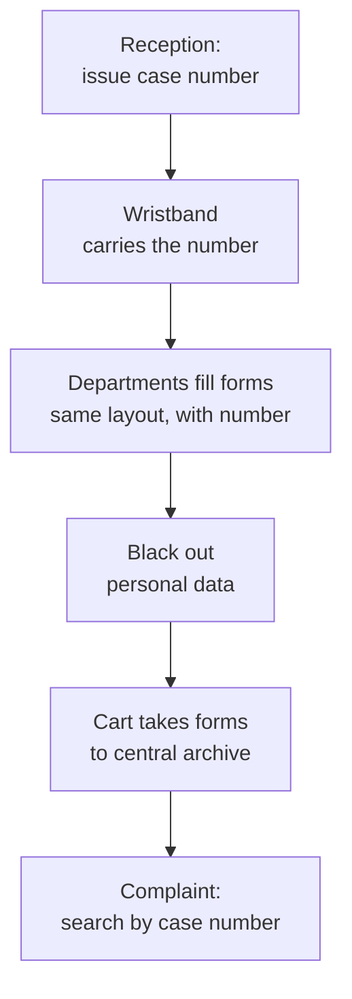
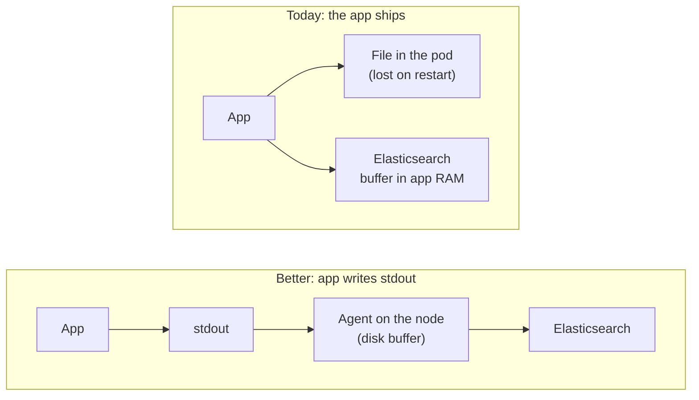

> [!tldr] Quick read
> - [[en/concepts/structured-logging|Structured logs]]: each log line is a JSON object with fixed fields, so the log store can filter and compute on it. Flash-sale does this right except for one field: request time is written as the string `"12ms"`, and you cannot take a p95 of a string.
> - A [[en/concepts/correlation-id|request id]] is attached at the entrance, stored in [[en/concepts/async-local-storage|AsyncLocalStorage]] and handed back to the buyer. But only 2 classes read that id when they log; **92 other classes** use the NestJS logger, and every line they write lacks the id.
> - [[en/concepts/pii-redaction|PII masking]] runs before every sink, but running it shows: an email inside the message gets through untouched, an `Error` becomes `{}`, and an object with a circular reference makes **the logging call itself throw**.
> - [[en/concepts/log-levels|Log levels]] are stuck at `info`: the `LOG_LEVEL` variable exists in the deploy config but the code never reads it, so 28 `debug`/`verbose` lines never print.
> - [[en/concepts/log-shipping|Log shipping]]: the app pushes logs into Elasticsearch itself with an unbounded buffer, while Grafana reads an index the app never writes to.

> [!info] Context
> The example is **flash-sale**, my own project: a shop that sells discounted items at a fixed hour, when thousands of people race for a few hundred units at once. The backend is written in NestJS and runs as several copies (pods) behind a load balancer. When someone reports "I was charged but I see no order," the only way to reconstruct what happened is the logs. You need no knowledge of NestJS or of the project's code; the snippets in this post are trimmed and renamed.

> [!abstract]- Quick glossary for this post (click to open)
> - **Log**: lines a program writes about itself while running, so someone can later read what it did.
> - **Pod**: one running copy of the backend. Flash-sale has several pods, so which pod holds the logs of a given request is down to luck.
> - **Middleware**: code that runs before every request, before the handler. **Interceptor** (NestJS): code wrapped around the handler that sees both the start and the end. **Exception filter**: the place that catches every error nobody else caught and answers the user. See also [[en/posts/2026-11-18-api-architecture|the API architecture station]].
> - **Winston**: a popular Node.js logging library. **Transport**: one place winston writes logs to (the screen, a file, Elasticsearch). **Format**: a step that transforms a log line before it is written.
> - **Elasticsearch**: a database built for search, often used as a log store. **Kibana**, **Grafana**: web UIs for searching that store and drawing charts from it. **Logstash**: a relay that receives logs, fixes them up and pushes them into Elasticsearch.
> - **PII** (Personally Identifiable Information): data that identifies a person: email, phone number, national ID number, address, and login tokens too.
> - **stdout / stderr**: the two default text "pipes" every program has; a container collects both as its logs.
> - **Trace**: a record of a request's path through several services, each piece being a **span**. Flash-sale uses OpenTelemetry for this and links traces through the [[en/concepts/transactional-outbox|outbox]] and RabbitMQ.

## Picture it first: medical records in a large hospital

A patient enters the hospital and goes through reception, the lab, internal medicine, the pharmacy. Each place writes a few lines in its own book. Three weeks later the patient files a complaint, and the hospital has to reconstruct exactly what happened to **this person**.

| Everyday life | Concept |
|---|---|
| Every department fills in the same form: time, department, action, result, not free prose | [[en/concepts/structured-logging\|Structured logging]] |
| Forms are stamped "urgent", "routine", "note": on normal days only urgent and routine are kept | [[en/concepts/log-levels\|Log levels]] |
| Reception hands out a **case number**, and every form in every department carries it | [[en/concepts/correlation-id\|Correlation ID]] |
| The case number is printed on a **wristband**: any department can read it without calling reception | [[en/concepts/async-local-storage\|AsyncLocalStorage]] |
| Before a record leaves the hospital, the ID and phone numbers are blacked out | [[en/concepts/pii-redaction\|PII redaction]] |
| A cart carries forms from every department to a **central archive** so they can be searched in one place | [[en/concepts/log-shipping\|Log shipping]] |



This post looks at flash-sale in that same order, and at each step asks: does the form carry the number, does personal data leak, and does it reach the archive?

## The problem: 20:00:03, three thousand requests, one complaint

At 20:00 the sale opens, and three pods receive about 3000 requests within a few seconds. Each request goes through the guard, reserves stock in Redis, writes the order in Postgres, then sends an event through RabbitMQ. Ten minutes later a buyer sends a screenshot of an "Internal server error".

If the logs are only sentences like `Reserve stock failed for SKU-A`, there are hundreds of identical sentences in that same second, spread across three pods. There is no way to tell which one belongs to this person. To answer, every log line needs three things:

1. **Clear fields** to filter on (`statusCode = 500`, `url = /orders`), not a sentence to grep.
2. **One shared id** on every line of the same request, and the buyer holds that id too.
3. **One central place** holding the logs of every pod, kept long enough, and free of anyone's email or token.

Flash-sale has built all three parts. The rest of this post looks at how each one works, then runs it to see where it is not yet tight.

## How it works

<figure class="figure-map" style="--ar: 4 / 5">
<div class="frame"><iframe data-archify="../../diagrams/flash-sale-logging/log-path.en.html" title="One flash-sale log line, from request to log store" loading="lazy"></iframe></div>
<figcaption><span><b>Figure 1.</b> The id desk stores the id in the request context; the interceptor and the filter log with the id, while services log through the NestJS logger without it. Winston masks PII, then writes to the console, files and Elasticsearch.</span><a href="../diagrams/flash-sale-logging/log-path.en.html" target="_blank" rel="noopener">Open full screen</a></figcaption>
</figure>

### 1. Structured logging: forms, not prose

I used to think a log was `console.log` with a timestamp in front. It turns out what makes logs usable at scale is that **each line is an object with fixed fields**, usually printed as single-line JSON. The log store understands each field, so filtering `statusCode >= 500` or averaging handling time per `url` is a query, not a grep expression.

In flash-sale, the interceptor (wrapped around every HTTP request) writes one summary line after each request:

```ts
// trimmed from flash-sale's logging interceptor
this.logger.info('HTTP Request', {
  correlationId,          // request id
  method, url, statusCode,
  duration: `${duration}ms`,   // ← a string, not a number
  userId,
  // never log req.body: the body may contain PII
});
```

In production the line comes out as `{"level":"info","message":"HTTP Request","correlationId":"req-…","statusCode":201,"duration":"12ms",…}`. On a laptop it switches to a colored, readable layout (`nestLike`). That is the right way to do it: readable for people, JSON for machines.

The one field that is off is `duration`. Writing `"12ms"` writes a **string**. Elasticsearch guesses the type from the first line it sees and stores a string as `text`/`keyword`. On those types you cannot compute percentiles, and sorting compares character by character, so `"100ms"` comes before `"20ms"`. The example below measures this on 10,000 fake requests: the true p95 is 542 ms, while sorting the strings gives `8ms`. The fix is cheap: write `durationMs: 12`, with the unit in the field name.

### 2. Log levels: urgent, routine, note

Each log line carries a level. Winston uses npm's table, where a smaller number is more severe:

| Level | Number | Flash-sale uses it for |
|---|---|---|
| `error` | 0 | Server errors (5xx), errors nobody caught |
| `warn` | 1 | Caller errors (4xx), messages missing an event id |
| `info` | 2 | Every finished request, every business event |
| `http`, `verbose` | 3, 4 | (barely used) |
| `debug` | 5 | Details for debugging |
| `silly` | 6 | (unused) |

A logger has a **threshold**: any line whose number is above it is dropped right away, with no formatting or writing cost. Syslog ([RFC 5424](https://www.rfc-editor.org/rfc/rfc5424#section-6.2.1)) has its own table of 8 levels, but the idea is the same.

Flash-sale's interceptor splits them correctly: a 4xx error is `warn` (the user sent something wrong, nobody needs to wake up), a 5xx error is `error` (the server has a problem). A stack trace is attached only for 5xx errors outside production.

The gap is the threshold. The winston config sets no `level`, so the threshold is the default `info`. The Kubernetes deploy config has `LOG_LEVEL: "info"`, but searching all of `src` finds no line that reads that variable. The result: 28 `logger.debug`/`logger.verbose` calls spread through the code never print. Even on the day of an incident they cannot be turned on without changing code and redeploying.

### 3. Correlation ID: one id for the whole journey

A **correlation id** is a random string attached to a request at the entrance, present in every log line of that request and returned to the caller. Flash-sale does this in a middleware that runs before every route:

```ts
// trimmed from flash-sale's id middleware
const correlationId = req.headers['x-correlation-id'] || `req-${randomUUID()}`;
res.setHeader('X-Correlation-ID', correlationId);         // hand the id back to the caller
RequestContext.run({ correlationId, ip, userAgent, startTime }, next);
```

Three good things here:

- If something upstream (an API gateway, the mobile app) already has an id, that id is reused, so a journey through several services shares one id.
- The error body also contains `correlationId`. The buyer's screenshot of the error already contains the key to the logs.
- The audit table (who changed a price, who cancelled an order) also stores `correlationId`, so a change in the DB links back to the request that caused it.

Two things are not right yet:

- **The id from the header is trusted completely.** No length check, no character check, and then it is written into the response header, the logs and the audit table. JSON escapes newlines, so it cannot forge a new log line, but it should still only accept an id matching a pattern like `^[A-Za-z0-9-]{8,64}$` (the [OWASP Logging Cheat Sheet](https://cheatsheetseries.owasp.org/cheatsheets/Logging_Cheat_Sheet.html) files this under "data from outside going into logs").
- **The correlation id and the trace id are two different ids.** Flash-sale's OpenTelemetry generates its own trace id under the [W3C Trace Context](https://www.w3.org/TR/trace-context/) standard (the `traceparent` header) and links traces through the outbox and RabbitMQ. But log lines do not record the trace id, so you cannot jump from a log line to its trace. The project's Logstash pipeline even has a step that renames `trace.id` to `trace_id`; the app just never sends that field. The [OpenTelemetry logs data model](https://opentelemetry.io/docs/specs/otel/logs/data-model/) makes `TraceId` and `SpanId` standard fields of every log record for exactly this reason.

### 4. AsyncLocalStorage: the request's wristband

My first question: the stock service sits five function calls deep, so how does it know the current request's id without passing a parameter through all five layers? The answer is `AsyncLocalStorage` in the `node:async_hooks` module.

`als.run(store, fn)` runs `fn` and attaches `store` to **every async task spawned from it**: the `await`s, `setTimeout`s, Promise callbacks. Anywhere in that chain, `als.getStore()` returns that store. Two requests interleaved on the same thread still each see their own store, because Node.js tracks which task created which task, not "threads".

Two things I had to run before I believed them:

- **The context follows where a task was created, not where the data goes.** A `setInterval` created at app startup (outside any request) runs forever with an empty store, even while it handles data a request pushed into a queue. The example below prints `"correlationId":"unknown"` for exactly that case. That is also why flash-sale's outbox stores `traceparent` in a column and restores it when sending, instead of relying on the context.
- **Reading early is safer than reading late.** Flash-sale's audit service reads the id on its first line, before any `await`, with a comment saying why. With modern `AsyncLocalStorage`, `await` does not lose the context, but libraries built on callbacks or hand-written pools can. Reading once at the top of the function is a cheap habit.

Cost measured on Node 24: adding `als.run` to a request with one `await` costs about 0.15 µs. A real flash-sale request takes milliseconds, so this part is negligible.

The biggest gap in the whole system is here. The id is in the context, but **only code that reads it can write it**. In the code, only 2 classes get the winston logger through DI and add `correlationId` themselves (the interceptor and the filter), while **92 classes** create their own logger with NestJS's `new Logger('ClassName')`. NestJS forwards those calls to winston with exactly one extra field, `context` (the class name). Lines like "stock reservation failed", "outbox send failed", "consumer skipped a duplicate message" carry no id. The fix is to make the logger read the id itself: a winston format that inserts `RequestContext.getCorrelationId()` into every line, placed before the PII step. Then no call site has to remember.

### 5. PII redaction: black it out before it leaves

Logs are kept long, copied to many places, and read by more people than the database. An email or token in a log is a data leak, even if nobody "hacked" anything. Flash-sale keeps a list of PII field names shared by logging, auditing and account deletion (`email`, `phone`, `cccd`, `password`, `token`, `refreshToken`, `address`…). A winston format walks the log line recursively and replaces the values of those fields:

```ts
// trimmed from flash-sale's PII masker
function maskPiiDeep(input) {
  if (input === null || typeof input !== 'object') return input;
  if (Array.isArray(input)) return input.map(maskPiiDeep);
  const out = {};
  for (const [k, v] of Object.entries(input))
    out[k] = PII.has(k) ? maskValue(k, v) : maskPiiDeep(v);   // an.nguyen@… → an***@…
  return out;
}
```

This format comes **first** in every transport's format chain, and the interceptor never logs `req.body`. The direction is right. But running it against the same winston 3.19 the project uses, I hit four leaks:

| Case | Actual result | Why |
|---|---|---|
| Email inside the message | `an.nguyen@example.com` gets through untouched | Only **field names** are checked; the message string is not scanned |
| `{ err: new Error('…') }` | Written as `"err":{}` | An Error's `message` and `stack` are non-enumerable, so `Object.entries` skips them |
| Object with a circular reference | The `logger.info(...)` call **throws `RangeError`** | The recursion has no stopping point; winston-transport rethrows a format's error to the caller |
| Every log line | The `Symbol(level)` key is lost | `Object.entries` skips Symbol keys; the level is wiped before reaching the transport |

The third row is the worst: a logging call, meant only for observing, turns a request that was working into a 500 error. The fourth row does no harm yet, since the project configures nothing that relies on that key. But I tried turning on the Console transport's `stderrLevels: ['error']`: with the masker, `error` lines go to **stdout**; without it, they go to stderr as expected.

The fixed version in the example below walks keys with `Reflect.ownKeys` (keeping Symbol keys), remembers visited objects in a `WeakSet` (cutting cycles), reads an `Error`'s `name`/`message` explicitly, and scans strings with an email regex. It is slower: 1.68 µs versus 0.62 µs per log line. That is a tiny price for a logging call that never throws. The `PII_LOG_ONLY_MASK` list (mask IPs only in logs) is defined but used nowhere; no IP leaks today because the interceptor does not log IPs, but the constant promises something the code does not do.

### 6. Log shipping: from three pods to one store

Flash-sale writes each log line to three places (and a fourth when Elasticsearch is configured):

| Transport | Content | Notes |
|---|---|---|
| Console | Everything from `info` up | JSON in production |
| `logs/error.log` | Only `error` | Rotates at 10 MB × 5 files |
| `logs/combined.log` | Everything | Rotates at 50 MB × 10 files |
| Elasticsearch | Everything, when `LOG_ELASTICSEARCH_URL` is set | Data stream `logs-app-flash-sale` |

This has three problems, all because **the app ships its own logs**:

- **A file inside a container is not a store.** The pod mounts no volume for `logs/`, so the files vanish when the pod restarts. Each pod keeps up to 550 MB of logs on temporary disk that nobody reads.
- **An unbounded buffer.** The Elasticsearch transport batches logs and sends them every 2 seconds. When Elasticsearch is down, it keeps the logs in RAM to resend. The library's defaults are `buffering: true, bufferLimit: null`, that is, no ceiling. At 2000 lines per second and ~400 bytes per line, one minute of Elasticsearch downtime is 46 MB of RAM, and the number keeps growing. Right at the busiest moment of a flash sale, an outage of the log store can make the backend itself run out of memory.
- **Grafana looks in the wrong place.** Grafana's log datasource reads `logs-flash-sale-*`, the index Logstash creates. The app instead writes straight into the data stream `logs-app-flash-sale`, and nothing in the repo sends logs to Logstash (no Filebeat, no TCP sender). Grafana will not see a single app log line.

The approach that [The Twelve-Factor App](https://12factor.net/logs) recommends, and Kubernetes assumes: the app **only writes to stdout**, treats logs as an event stream, and does not store or ship them itself. An agent running on each node (Filebeat, Fluent Bit, Vector) reads the container logs and ships them, with an on-disk buffer and its own retries. Then when the log store dies, only the agent waits, and the app never notices.



## Runnable example

Three files, no libraries to install, run with Node 24 (`node file.ts`).

**[pii-mask.ts](../code/flash-sale-logging/pii-mask.ts)** copies flash-sale's PII masker (trimmed), runs four log lines through it and compares with the fixed version:

```text
1) PII in the metadata
  original: {"level":"info","message":"login","email":"an***@example.com","token":"********"}  | level Symbol: undefined
  fixed: {"level":"info","message":"login","email":"an***@example.com","token":"********"}  | level Symbol: info

2) PII inside the message itself
  original: {"level":"warn","message":"gửi mail tới an.nguyen@example.com thất bại"}  | level Symbol: undefined
  fixed: {"level":"warn","message":"gửi mail tới an***@example.com thất bại"}  | level Symbol: warn

3) Error as metadata
  original: {"level":"error","message":"lưu đơn lỗi","err":{}}  | level Symbol: undefined
  fixed: {"level":"error","message":"lưu đơn lỗi","err":{"name":"Error","message":"timeout khi ghi bảng orders"}}  | level Symbol: error

4) Object with a circular reference
  original: THROWS RangeError: Maximum call stack size exceeded
  fixed: {"level":"info","message":"đơn mới","order":{"id":"o-1","self":"[vòng tham chiếu]"}}  | level Symbol: info

original: 0.62 µs per log line

fixed: 1.68 µs per log line
```

*(Output labels translated; the files themselves print Vietnamese.)*

The messages are the program's own strings: `gửi mail tới … thất bại` ("sending mail to … failed"), `lưu đơn lỗi` ("saving the order failed"), `đơn mới` ("new order"), `[vòng tham chiếu]` ("[circular reference]").

I also reran these four cases against the project's real winston 3.19, with identical results, including the `logger.info` call throwing `RangeError` back to the code that called it.

**[request-context.ts](../code/flash-sale-logging/request-context.ts)** runs three interleaved requests: one with a valid id, one with no id, one with a dirty header. Each step is logged twice, once with a plain logger and once with a logger that reads the context. Last comes a timer created outside any request:

```text
{"msg":"giữ kho SKU-B"}
{"msg":"giữ kho SKU-B","correlationId":"req-9f7d7997"}
{"msg":"giữ kho SKU-C"}
{"msg":"giữ kho SKU-C","correlationId":"req-447369b0"}
{"msg":"giữ kho SKU-A"}
{"msg":"giữ kho SKU-A","correlationId":"client-abc-12345"}
{"msg":"ghi đơn SKU-B","correlationId":"req-9f7d7997"}
{"msg":"ghi đơn SKU-C","correlationId":"req-447369b0"}
{"msg":"ghi đơn SKU-A","correlationId":"client-abc-12345"}
{"msg":"flush SKU-A,SKU-B","correlationId":"unknown"}
no ALS: 0.11 µs per request
with ALS: 0.25 µs per request
```

The lines of the three requests interleave (`giữ kho` is "reserve stock", `ghi đơn` is "write order"), yet the context-reading logger still gives each line the right id. The dirty header (`xin chào\n{"level":"error"}`) is dropped, so that request gets a new id. The plain logger (like the loggers of those 92 classes) writes lines nobody can connect. The `req-…` ids are random, so each run differs.

**[structured-fields.ts](../code/flash-sale-logging/structured-fields.ts)** generates 10,000 handling times (90% fast, 10% slow, using the mulberry32 generator with a fixed seed), computes p95 two ways, prints the level thresholds, and simulates one minute of Elasticsearch downtime:

```text
true p95 (numbers):           542 ms
p95 by sorting strings:  8ms
"100ms" < "20ms" by characters? true
threshold info : error=write warn=write info=write http=drop verbose=drop debug=drop silly=drop
threshold debug: error=write warn=write info=write http=write verbose=write debug=write silly=drop
unbounded buffer: 120000 lines ≈ 45.8 MB in RAM, still growing
buffer capped at 20000: 20000 lines ≈ 7.6 MB, dropped 100000 lines and counted the drops
```

## A second look at flash-sale: seven gaps, worst first

| # | Gap | Consequence | Fix |
|---|---|---|---|
| 1 | The recursive PII masker does not cut cycles | Logging a circular object fails the request with a 500 | A `WeakSet` of visited objects |
| 2 | 92 classes use the Nest Logger, logs have no id | "Stock reservation failed" cannot be traced to a buyer | A winston format that inserts `correlationId` from the context |
| 3 | PII in the message, `Error` becomes `{}` | Leaked emails; lost error content | Scan strings with a regex; read `name`, `message`, `stack` explicitly |
| 4 | Unbounded Elasticsearch buffer, the app ships itself | A dead log store drags the backend out of RAM | Write only to stdout and let a node agent ship |
| 5 | Grafana reads Logstash's index, the app writes another data stream | Grafana's log panel is empty | Agree on one write target |
| 6 | Nobody reads `LOG_LEVEL`; `duration` is a string | `debug` cannot be turned on during an incident; no p95 | `level: process.env.LOG_LEVEL ?? 'info'`; numeric `durationMs` |
| 7 | A 500 is logged twice, the second time without the id | Errors counted double; one orphan line | Log in one place only (the filter), with the id |

Gap 7 comes from NestJS's execution order: the error travels back through the interceptor first (the interceptor logs `HTTP Server Error` with the id), and only then reaches the exception filter (the filter adds `Unhandled exception`, without the id). The filter's comment even says "to get the correlationId", but the object it logs has no such field.

### Fixed (commits `7445e40` and `475ac71`, November 24–25, 2026)

After the post went up, I fixed gaps 1, 2, 3 and 7, plus `LOG_LEVEL` and `durationMs` from gap 6. All 966 backend tests pass, 22 of them new. A day later, in a second commit, I fixed gaps 4 and 5 (log shipping, Grafana); that part changes infrastructure too, so it is told separately at the end of this section.

**A request id on every log line, without touching any class.** The first approach I thought of was a winston format that reads `RequestContext`. But formats run inside winston's stream pipeline: when a transport writes slowly (a file, Elasticsearch), the log line waits in a buffer and the format runs **later**, when the context belongs to another request or is gone. The id could then be wrong, and a wrong id is worse than none. Reading the source of winston's `logger.log()` shows that `defaultMeta` is merged into the log line with `Object.assign` **inside the call itself**, synchronously, before the line enters the stream. `Object.assign` reads getters too, so this is all it takes:

```ts
// trimmed from flash-sale's logger config
export const requestContextMeta = {
  get correlationId() {
    return RequestContext.get()?.correlationId;   // read at the call site, inside the right request
  },
};
winston.createLogger({ level: resolveLogLevel(), defaultMeta: requestContextMeta, transports });
```

The 92 classes using the Nest Logger now get the id automatically. An id passed by hand in the meta (say, a consumer taking the id from a message) still wins, because winston merges the meta after `defaultMeta`. Outside a request the getter returns `undefined` and JSON drops the field. Tests for two interleaved requests and for the NestJS logger both print the right id.

**A PII masker that never throws.** The new version does what the example above does (`Reflect.ownKeys`, reading `Error` explicitly, scanning emails in every string including stacks), with one difference: the `WeakSet` holds only **the ancestors on the current path**. An object is added on the way down and removed on the way back up. Keeping every visited object, as the example does, would turn `payer` in `{ buyer: user, payer: user }` into `[Circular]` even though there is no cycle. The masker is shared with the audit table, so emails inside strings in `oldValue`/`newValue` are now masked too.

**One line per 500 error, with a stack in production.** The interceptor marks each error it logged in a `WeakSet`. The filter only logs 500 errors that are not marked: errors thrown from middleware or guards, which run before the interceptor so it never sees them. Dropping the filter's line entirely would lose those errors. In production only the filter used to log the stack; now the interceptor logs the stack for every 5xx in every environment. The stack stays in the logs, is never sent to the client, and emails inside it are masked as well.

**Log level and handling time.** The logger reads `LOG_LEVEL`; Joi accepts only the 7 valid levels, so a wrong value makes the app fail right at startup. The interceptor writes a numeric `durationMs` instead of `duration: "12ms"`.

**Gap 4: the app only writes to stdout (commit `475ac71`).** In production the app now only writes JSON to stdout; log files are enabled only on a laptop. Filebeat runs on every Kubernetes node (a DaemonSet) and in docker-compose. It reads only containers labeled `app=flash-sale-api`, splits each JSON line into top-level fields, buffers on disk (up to 2 GB per node) and ships through Logstash. When Elasticsearch dies, Filebeat waits and catches up, and the app knows nothing.

**When the app still ships itself: a ceiling and a count.** A backend running directly on a machine (no container, no Filebeat) still ships through the Elasticsearch transport when `LOG_ELASTICSEARCH_URL` is set. The transport now always has a ceiling (`LOG_ES_BUFFER_LIMIT`, 10,000 lines by default) and counts every dropped line in the metric `log_shipping_dropped_lines_total`, under three reasons: buffer full, a failed batch cut when requeued, the library reporting a hard failure. The library used to drop lines at the ceiling without a word. A capped buffer with no count only turns "the backend ran out of RAM" into "logs went missing and nobody knew". The transport also swallows the library's `error` event: winston turns it into an `error` on the logger, and a logger with no listener kills the process. While writing the tests I hit a counting bug of my own: a line already in the buffer was still counted as "pending" for one more tick, so the transport dropped one line too early. After this commit the backend has 977 tests, all passing.

**Gap 5: Grafana reads the right place.** When the app ships itself it writes to the data stream `logs-flash-sale-app`; Filebeat through Logstash writes to `logs-flash-sale-YYYY.MM.dd`. Both match Grafana's `logs-flash-sale-*` pattern. Documents sent up have the same shape as the stdout line (`level`, `message`, `correlationId` at the top level), because the library's default transformer puts the level in `severity`, which Grafana cannot read. The datasource moves the index name from `database`, a field Grafana 10 marks as deprecated, to `jsonData.index`.

**Not yet checked in a real run.** The Filebeat, Logstash and Grafana configs have only passed YAML syntax checks, `docker compose config` and `kubectl kustomize`; I have not brought them up to watch a log line travel the whole way. One risk in winston-elasticsearch remains unfixed. At startup, the library checks its connection to Elasticsearch up to 400 times, one second apart plus however long each call hangs. If all 400 fail, a promise inside the constructor rejects with nobody catching it, and Node stops the process on the unhandled rejection. Blocking that requires patching the library. On Kubernetes `LOG_ELASTICSEARCH_URL` is not set, so this path never runs there.

## Misconceptions and common traps

- **"JSON logs are structured enough."** JSON is only a format. Structured means **the same fact always lives in the same field, with the same type**. `"12ms"` on one line and `12` on another cannot be aggregated by the log store.
- **"A correlation id in the middleware means every log line has the id."** The id lives in the context, not in the log by itself. Only a logger that reads the context can write it, and in flash-sale only 2 classes do, while 92 classes do not.
- **"A correlation id replaces tracing."** A correlation id only answers "which lines belong to the same request". A trace also answers how long each step took and which step called which. The two complement each other, and they connect when logs also record `trace_id`.
- **"Masking PII by field name is enough."** Personal data often slips through messages built with template strings (`` `sending mail to ${email} failed` ``) and through `Error.message`. The masker must scan strings too, and better still, keep PII out of messages in the first place.
- **"Logging cannot break a request."** If a format throws, winston rethrows to the caller; if a transport has an unbounded buffer, it eats all the RAM. Logging code must be written to **never throw and never block the request**.
- **"Write to a file to be safe."** In a container, the file sits on the pod's temporary disk. With no volume and no reader, that file only costs disk.
- **"Turn on `debug` in production for more detail."** Logs cost money by volume and grow with traffic. At flash-sale time, traffic is a hundred times a normal day. The log level must be changeable at runtime (an environment variable or a flag), not fixed in code.

## Self-check questions

> [!question]- A buyer sends a screenshot of an error with `correlationId: req-7c1e…`. With the current code, which log lines of that request can you find, and which can you not?
> You can find the interceptor's summary line (`HTTP Server Error`, with the id) and the audit record if the request changed data. You cannot find the filter's `Unhandled exception` line (no id) or any line services wrote through the Nest Logger (stock reservation, order write, outbox). To find those, you have to guess by time and pod.

> [!question]- Why does a `setInterval` created at startup log `correlationId: "unknown"`, even when the data it handles was pushed in by a request?
> AsyncLocalStorage attaches the context to **an async task when it is created**. The timer was created outside any `als.run`, so every run of it has an empty store. Data passing through a shared array does not carry the context with it. To keep the id, store it with the data, the way the outbox stores `traceparent` in a column.

> [!question]- The PII masker only costs about 1 µs extra per line. So what is the real cost of not fixing it?
> A circular object in the metadata makes the logging call throw `RangeError`, turning a correct request into a 500 error. An `Error` in the metadata becomes `{}`, so the log is empty exactly when you need to read the error. An email in a message lands untouched in the log store, which has more readers and longer retention than the database.

> [!question]- Elasticsearch is down for 5 minutes right as the sale opens. What happens to the current backend, and with the "stdout only + agent" approach?
> Today: each pod holds every unsent log line in RAM with no ceiling. 2000 lines/second × 300 seconds ≈ 230 MB per pod, on top of the load of the sale itself, which can get the pod killed for running out of memory. With an agent: the app keeps writing to stdout as usual, the agent buffers on the node's disk and catches up when Elasticsearch is back. The app knows nothing about the outage.

> [!question]- What is wrong with writing `duration: "12ms"`, when a human reader understands it fine?
> The log store treats it as a string: no average or p95, and sorting by characters puts `"100ms"` before `"20ms"`. A numeric field named `durationMs` is readable by people and computable by machines.

## References

- [winston](https://github.com/winstonjs/winston) (npm-style log levels, default `level: 'info'`, formats, transports) and [the `winston-transport` source](https://github.com/winstonjs/winston-transport/blob/master/modern.js) (`_write` filters on `info[LEVEL]`, runs the format, rethrows a format's error). I read version 4.9.0 as installed in the project.
- [winston-elasticsearch](https://github.com/vanthome/winston-elasticsearch) (batches every `flushInterval` of 2 seconds, `buffering: true`, `bufferLimit: null` by default). I read `index.js` and `bulk_writer.js` of version 0.19.0.
- [Node.js: Asynchronous context tracking](https://nodejs.org/api/async_context.html) (`AsyncLocalStorage.run`, `getStore`).
- [NestJS: Logger](https://docs.nestjs.com/techniques/logger) (replacing the default logger with another one); how `nest-winston` forwards Nest Logger calls to winston I read in the source of version 1.10.2.
- [OWASP Logging Cheat Sheet](https://cheatsheetseries.owasp.org/cheatsheets/Logging_Cheat_Sheet.html) (do not log sensitive data, validate outside data before logging it).
- [The Twelve-Factor App: Logs](https://12factor.net/logs) (the app writes to stdout, the environment collects and ships).
- [W3C Trace Context](https://www.w3.org/TR/trace-context/) (`traceparent`) and the [OpenTelemetry Logs Data Model](https://opentelemetry.io/docs/specs/otel/logs/data-model/) (`TraceId`, `SpanId` in log records).
- [RFC 5424, section 6.2.1](https://www.rfc-editor.org/rfc/rfc5424#section-6.2.1) (the 8 syslog severity levels).
- I checked every gap in this post against the flash-sale code at its current commit. I reran the four PII masker behaviors against the project's winston 3.19.0.
